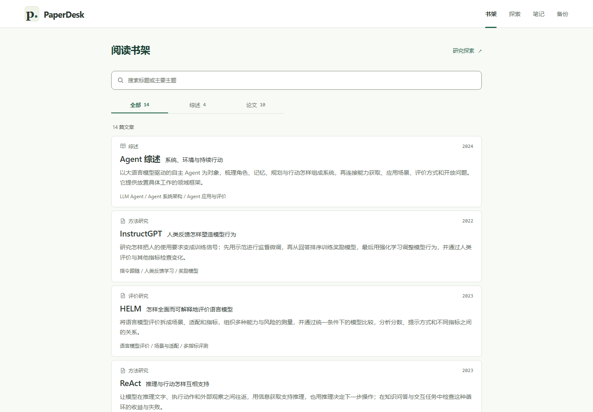

# PaperDesk

A local platform for survey reading, substantive paper explanations and research exploration. **First version: 0.1.0; product specification: 1.1.** The integrated platform and final library layout have completed reader acceptance.



## Run locally

Use Node.js 22.13+ within the supported 22.x line, or Node.js 24+. Verified with Node 22.23.3 and npm 10.9.9.

```text
npm ci
npm run build
npm start
```

`npm start` starts the website and local AI service together and opens [PaperDesk](http://127.0.0.1:4173/library). Ctrl+C stops both. For development use `npm run dev`; `npm run preview` serves the build without automatically opening a browser. Keep this origin fixed: browser-owned records belong to the exact host and port. Stop project servers before reinstalling dependencies or starting another instance on Windows.

## Read, explore and accumulate

- **Survey guidance:** coherent explanations, navigation, diagrams, citations, coverage gaps and original-reading advice.
- **Paper reading:** bibliographic orientation before substantive mechanism/evidence explanations, with source locators and return navigation.
- **Research exploration:** explicit questions, attributed evidence, interpretations, unknowns and next reading actions.
- **Local accumulation:** notes, genuine resume positions, independent explanation/original reading marks, conflict handling, backup/restore and opt-in context packets. Opening an article never marks it read.
- **AI reading:** ask questions about the current reviewed guide, inspect answer sources, and optionally search the web. Open **AI 设置** to connect through official ChatGPT login or configure an OpenAI-compatible API; credentials are stored by the local backend. See [AI setup](docs/AI-READING.md).

The library contains **14 current readings: 4 surveys and 10 papers**, with 18 retained guide revisions. Topics connect Transformer architecture, pretraining and in-context learning, instruction learning, chain-of-thought prompting, retrieval, tools, Agent action/reflection, memory, streaming context and concept drift. Start with the LLM survey's optional path or the [memory and dynamic-decision reading route](docs/LEARNING-ROUTE.md).

Search matches titles and reviewed primary topics. The unselected library is a centered single-column list; selecting opens adjacent orientation. Narrow screens use list → orientation → reader. Further papers can be researched and added through deliberate assistant-assisted authoring. AI answers and optional web searches run only after an explicit reader question; they do not change reviewed content.

## Check and maintain

```text
npm run validate:content
npm test
npm run typecheck
npm run build
```

Browser installation, synthetic end-to-end checks, content import/recovery and backups are in [Operations](docs/OPERATIONS.md). Reviewed content is immutable and validated by exact byte hashes; `.gitattributes` preserves those bytes across platforms.

| Location | Purpose |
|---|---|
| `src/` | Reader, library, exploration and local record modules |
| `server/` | Local AI API, optional ChatGPT authorization, retrieval and conversation storage |
| `content/`, `schemas/` | Reviewed guides, catalog, seeds and validation contracts |
| `scripts/`, `tests/` | Content maintenance and synthetic checks |
| `docs/`, `docs/research/` | Operating/product contracts and public-source verification |
| `docs/history/` | Archived handoff and implementation evidence |
| `docs/images/`, `docs/evidence/` | Curated UI images and compact verification reports |

See the [documentation index](docs/README.md), [project state](PROJECT-STATE.md), [continuation guide](START-HERE.md), [Git policy](docs/GIT-POLICY.md) and [changelog](CHANGELOG.md).

Dependencies, builds, caches, incoming packages and recovery receipts are ignored. Private notes, backups and credentials are not repository content. Only the generic audience description in [Privacy](docs/PRIVACY.md) is used. Academic attribution remains in each guide; downloaded full-paper PDFs and review tooling are not bundled. No project license grant has been added.

`git clone` provides the maintainable source project, so `tests/`, `scripts/`, schemas and the lockfile are intentional repository files. The tests protect content updates, reading records and backup recovery; they are not sample clutter. After install/build, `node_modules/`, `dist/` and `.cache/` appear locally but remain untracked. The production website is built into `dist/`; test sources and maintenance documents are not part of that web bundle. See [Git policy](docs/GIT-POLICY.md) before cleanup, especially the recovery records that must be retained.

This version runs locally. The AI extension adds deliberate external model requests and optional provider authorization; deployment, a hosted account system, synchronization and cloud provisioning remain outside scope. Physical devices, other browser engines, screen readers and exhaustive paper/experiment verification remain outside the recorded checks; see [project state](PROJECT-STATE.md).
