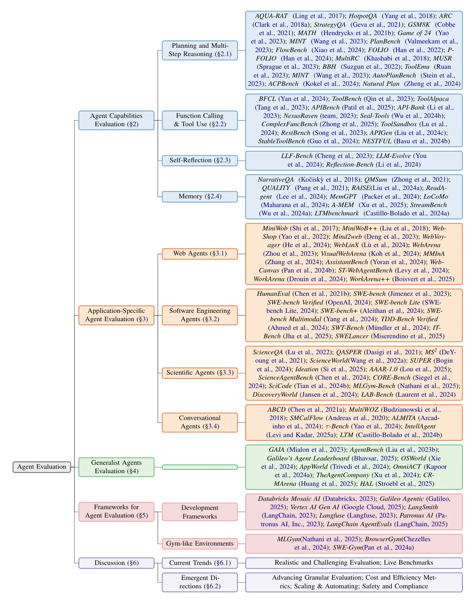

# Agent 评测综述：先定义被测系统，再解释一个分数

评测表上写着某个 Agent 的成功率。追问下去，问题会分成几层：被比较的是模型本身，还是模型加工具、提示、记忆和重试策略组成的一整套系统？任务从哪里来，环境在运行中会不会真的改变状态，成功后由谁判定？同一套模型，换一份工具说明、换一种用户模拟方式、换一条重试预算，分数就会变。把语言模型放进多步流程、让它共享状态并操作环境之后，评价的对象已经从一个回答变成了一串带后果的行动。

IBM Research、耶鲁大学和希伯来大学的研究者在 2025 年 3 月发布了这篇综述，摘要里称这是针对这类 Agent 评测方法的第一篇系统综述。它把材料分成四层：基础能力（规划与多步推理、函数调用与工具使用、自我反思、记忆）、四类应用（网页、软件工程、科学、对话服务）、通用 Agent 基准，以及开发过程中使用的评测框架，最后一节讨论趋势与缺口。[摘要与 §1，PDF 第1页](https://arxiv.org/pdf/2503.16416v1#page=1)

这篇综述值得现在读，是因为它给出的是坐标，而不是排行榜。单轮文本基准如 MMLU、GSM8K 不在它的范围内，作者把注意力集中在“模型被装进系统之后”才出现的问题上。读完之后，面对一篇新的 Agent 基准论文，你能先问出几个具体问题：它把任务、环境和判定各定义成什么，它的成功判据落在最终结果、单个步骤还是整条轨迹上，被比较的两个系统是否在相同条件下运行。这些问题的答案，通常比榜单上那一列数字更能决定这个结果对你有多少用。

全文的主线是“先定义被测系统，再说清证据粒度”，导读也按这条线展开：先看图 1 的分层结构，再用一节说明一次测量由哪三样东西组成；然后沿综述自己的章节顺序走能力、应用、通用 Agent 和评测框架；接着把“结果、步骤、轨迹”三种粒度放到一起比较，最后回到作者列出的缺口和一张速查表。为了让抽象定义有落点，导读准备了一个虚构的教学例子：一家名为“蓝隼航空”的虚构航空公司的客服 Agent，订单号、政策条款和数值都是编的，没有作为实验运行过。正文中第一次出现的缩写带有虚线，点开可以看全称和来历。

本导读固定采用 2025 年 3 月 20 日的 [arXiv v1 全文](https://arxiv.org/pdf/2503.16416v1)。该文后来发表于 Findings of ACL 2026，据发表记录，正式版按五个视角组织；本导读只使用 v1 的四个组织方向与讨论章节，没有把两版的分类、章节和页码混在一起。[v1 版本记录](https://arxiv.org/abs/2503.16416v1) · [Findings of ACL 2026 发表记录](https://aclanthology.org/2026.findings-acl.1330/)

## 图 1：四个视角与一条主线

图 1 是一棵从左向右生长的树。最左边是根节点 Agent Evaluation，向右分出五条主干，每条都标了章节号：Agent Capabilities Evaluation（§2）、Application-Specific Agent Evaluation（§3）、Generalist Agents Evaluation（§4）、Frameworks for Agent Evaluation（§5）、Discussion（§6）。主干上的蓝色方框是子话题，最右边的格子密密麻麻地列着被引论文和基准名。[图 1 与 §1，PDF 第2页](https://arxiv.org/pdf/2503.16416v1#page=2)

读这张图有个省力的顺序：先读方框，再看右格。方框告诉你综述把“评测”切成了哪几层问题，右边的格子只是这一层下有哪些工作，本身不提供结论。真正的判断在正文里，例如某个基准为什么只测到能力、没测到任务完成。

**能力层（§2）** 按 Agent 依赖的基础能力分成四支：规划与多步推理、函数调用与工具使用、自我反思、记忆。右格里的名字大多是你读论文时会遇到的第一批基准：GSM8K、HotpotQA、PlanBench 在规划支，BFCL、ToolBench、ToolSandbox 在工具支，LLF-Bench、Reflection-Bench 在反思支，ReadAgent、MemGPT、LoCoMo 在记忆支。这一层测的是机制：某个能力在受控条件下能否工作。

**应用层（§3）** 按部署领域分成网页、软件工程、科学任务、对话服务四支。这一层的基准通常有自己的环境、工具接口和判定规则：网页基准看站点状态，软件工程基准看仓库和测试，对话服务基准看数据库和领域政策。同一个“成功率”，在这里指的是四种不同的事情。

**通用层（§4）** 把多个任务或环境放在一起，观察系统能否迁移到没见过的条件，代表工作有 GAIA、AgentBench、OSWorld、TheAgentCompany 等。

**框架层（§5）** 面向开发过程，分成开发框架与 Gym 类环境两支。它和前三层的区别在于：基准给你固定的题目，框架让你评估自己写的场景，并把评价嵌进调试、上线和监控。

**讨论层（§6）** 收束成两节：当前趋势（更真实、更难的评测，以及持续更新的活基准）与新兴方向（细粒度评价、成本效率、规模化与自动化、安全合规）。

这五条主干回答的是“评价放在哪一层”，不是“哪个基准最好”。四层之间有一条共同的线索，也是整篇综述反复回到的问题：一次测量要能说清被测系统包含什么，任务、环境与指标各自定义成什么，以及证据落在哪个粒度上。下一节先处理前两件。

## 先定义被测系统与三样东西

在讨论具体基准之前，需要分清两样常被混在一起的东西。大模型提供生成与推理能力；以它为核心的 Agent 把多次模型调用连成一条流程，在调用之间保留共享状态，让上下文前后一致，并通过外部工具做计算、取知识、改变环境。作者在引言里用这个区分来界定综述范围：Agent 的能力来自具体的大模型，但它是在动态环境里顺序行动的，因此需要新的评测方法、基准、环境和指标。[§1，PDF 第1页](https://arxiv.org/pdf/2503.16416v1#page=1)

对一次具体的测量来说，这意味着报告分数时至少要能说明系统配置：模型版本、工具清单与说明、政策或系统提示、记忆机制、重试与调用预算。少了这些，读者无法判断改变发生在模型、工具描述还是流程限制上。虚构的蓝隼航空客服系统可以说明这种差别：同一份订单，模型可能正确解释了改签规则却选错了订单，也可能选对订单却把日期参数写成了航班号，还可能改签成功却没有把新登机口告诉用户。三种情况的最终体验都不好，改进方向却完全不同。

接着是综述在应用章节开头给出的三要素。作者认为，Agent 基准之所以能系统评估能力，是因为它同时提供三样东西：一组定义清楚的任务，说明 Agent 要实现什么；一个运行环境，可能是静态或动态的模拟环境，也可能是真实环境，其中可以包含用户模拟、工具集合和需要遵守的政策；以及评价指标，例如成功率、效率和准确率，指标可以在不同粒度上应用，从单个动作和里程碑一直看到端到端的任务完成。[§3，PDF 第6页](https://arxiv.org/pdf/2503.16416v1#page=6)

把蓝隼航空的例子填进这三格，会更容易看出每一格各自约束了什么：

| 三要素 | 本例中的内容 | 它约束了什么 |
| --- | --- | --- |
| 任务 | 把订单 LB-2043 从明天 15:00 的航班改到后天同一时间，并选靠窗座位 | 目标是什么，什么算做完 |
| 环境 | 订单库与航班库、改签与选座接口、写在系统提示里的政策、模拟用户；政策为：轻享票不可改签，但航班延误超过 2 小时可免费改签一次，改签前须核对姓名与证件后四位，改签后须告知新登机口与行李额 | 能观察什么、能操作什么、哪些规则必须遵守 |
| 指标 | 最终订单的日期、座位与费用，加上必须输出的新登机口与行李额 | 用什么判定，判定落在哪个粒度 |

三格缺一格，同一个数字就会换一种含义。假如环境只比较对话文本、不真正写入订单库，那么“成功”只是“说得像成功”；假如指标只核对日期，Agent 把费用算错也照样得分；假如任务描述里没写“靠窗”，换座失败就归不到系统头上。这也是为什么综述在讲每个应用领域时，都要先交代那个领域的基准怎样构造环境、用什么判定。

三要素还解释了同一模型为什么会在不同榜单上得到很不一样的名次。环境里有没有真实写入、用户由人还是由模型扮演、政策写在系统提示里还是根本不提供，都会改变任务难度和失败类型；指标选成功率还是选分项准确率，会改变“哪类错误更贵”。把这些条件写进报告，一个数字才能被另一个实验室复现。虚构例子里，只要有人把“延迟超过 2 小时”的政策从环境中拿掉，同一套 Agent 的行为就会从“应该改签”变成“必须拒绝”，成功率随之改变，而被测模型一个字都没变。

这里还要把测量装置和运行条件分开。三要素描述的是装置；同一套装置配上不同的运行条件（模型版本、提示与政策文本、工具说明、重试次数、并发与超时），得到的仍是两组各自成立的观察。装置与运行条件一起写进报告，读者才有办法判断分数差异来自哪里。

这个框架对能力层同样适用，只是三格更窄：一道 GSM8K 题也有任务（求解）、环境（题面与允许的工具）、指标（答案是否正确），只不过环境里没有状态变化，指标落在最终答案上。框架的用处是帮你把“窄”和“宽”看清楚，而不是把两类基准分成互不相干的东西。

## 能力评测：把一个大问题缩小

端到端的任务失败很难定位：可能是计划错了，可能是工具描述没读懂，也可能是记忆里取了过时的信息。综述第 2 节的做法是把这些能力分开测，每类能力配一组专门的基准。这一节沿它的四支走一遍，重点看每种测法固定了什么条件、又因此看不到什么。

**规划与多步推理**是作者放在最前面的能力。多步推理通常指需要 3 到 10 个中间步骤才能得到答案的问题，这类问题无法靠单步推断解决。已有基准覆盖数学推理（GSM8K、MATH、AQUA-RAT）、多跳问答（HotpotQA、StrategyQA、MultiRC）、科学推理（ARC）、逻辑推理（FOLIO、P-FOLIO）、约束满足谜题（Game of 24）和常识（MUSR）等。其中 HotpotQA、ALFWorld 和 Game of 24 被专门改造过，用来评 ReAct 这类把计划与工具调用交错进行的做法。[§2.1，PDF 第3页](https://arxiv.org/pdf/2503.16416v1#page=3)

更专门的规划基准把条件收得更紧。ToolEmu 用模拟器评估使用工具的 Agent，作者转述它的发现：成功的计划需要显式跟踪状态，并能从错误中恢复。MINT 在交互环境中评规划，结论是先进模型在需要多步的长程任务上仍然吃力。PlanBench 覆盖多个领域，报告的现象是模型擅长短期的战术性计划，在需要长程策略时表现下降。AutoPlanBench 转向日常场景，发现当时最好的 Agent 仍落后于经典的符号规划器。FlowBench 评工作流规划，ACPBench 评核心推理技能，Natural Plan 用自然语言描述真实世界的计划任务，随着复杂度上升，模型表现明显变差。[§2.1，PDF 第4页](https://arxiv.org/pdf/2503.16416v1#page=4)

作者从这些结果里归纳出五项对规划至关重要的能力：把复杂问题拆成子任务、跟踪状态并维护信念、检测并修正错误、预测行动后果的因果理解、以及改进计划策略的元规划。这份清单是综述的综合，可以当作读新基准时的检查表：一个基准声称测“规划”，它实际压到的是其中哪几项。

**函数调用与工具使用**被拆成五个子任务：识别何时需要函数、选择合适的工具、把对话里的参数值映射到函数参数、执行函数、把返回结果写进回复。早期基准（ToolAlpaca、APIBench、ToolBench、BFCL 第一版）用合成数据和基于规则的匹配（例如抽象语法树比对）来算通过率和结构正确率，主要覆盖单步、参数明确写出的交互。它们抓不到真实场景里的多步对话、对话中没明说却必须推断的参数，以及输入结构复杂、输出很长的工具。[§2.2，PDF 第4页](https://arxiv.org/pdf/2503.16416v1#page=4)

BFCL 的后续版本把这条线往真实复杂度推：第二版加入组织内部的工具，第三版加入多轮、多步的评测逻辑，重点转到连续的状态管理。ToolSandbox 是另一个方向：它让工具执行带状态，工具之间存在隐式的状态依赖，用内置的用户模拟器做在策略的对话评测，并在任意轨迹上动态检查中间与最终里程碑。它要解决的是“前一次调用的结果决定了后一次能不能做”的问题，和一次填对参数的测量是两件事。ComplexFuncBench 针对需要隐式推断参数、遵守用户约束、处理长上下文的场景；NESTFUL 则让一次调用的输出成为下一次调用的输入，专门测嵌套调用序列。[§2.2，PDF 第4–5页](https://arxiv.org/pdf/2503.16416v1#page=5)

沿着这条线看，工具基准的差别集中在三处：交互是一步还是多步，状态是否在执行中改变，参数是明写还是要推断。比较两个“工具调用准确率”时，先确认它们各自落在哪一格。[ToolSandbox 原文摘要](https://arxiv.org/abs/2408.04682)

**自我反思**测的是 Agent 能否理解反馈、更新判断，并在长轨迹上调整行动。早期做法比较间接：把 AGIEval、MedMCQA、ALFWorld、MiniWoB++ 这类推理或规划任务改造成多轮反馈循环，看模型在受限设置下能否发现并改正自己的错误。这种测法只检查最终答案有没有被改对，粒度很粗；作者还提到，观察到的改进可能取决于具体的提示技巧，缺少统一标准。[§2.3，PDF 第5页](https://arxiv.org/pdf/2503.16416v1#page=5)

LLF-Bench 是针对这个缺口提出的标准化基准。它把多样的决策任务扩展成交互形式，并把任务说明放进环境、而不是放进 Agent 一侧；为了减少对特定环境的过拟合，它可以把任务说明和反馈的措辞随机化。它要回答的问题是：当反馈以自然语言给出、任务说明也可能变化时，Agent 能否边做边学。[LLF-Bench 原文摘要](https://arxiv.org/abs/2312.06853) LLM-Evolve 换了一个角度，把过去带反馈的查询收集起来当作上下文示例，在 MMLU 这类标准题上评反思能力。Pan 等人则专门看编程 Agent，把 APPS、LiveCodeBench 扩展到交互设置。Reflection-Bench 从认知科学借来分解方式，把反思拆成感知新信息、使用记忆、在意外后更新信念、调整决策、反事实推理和元反思几个成分。[§2.3，PDF 第5页](https://arxiv.org/pdf/2503.16416v1#page=5)

反思类评测有一个绕不开的条件：反馈从哪里来、Agent 在运行时能看到什么、允许尝试几次。比基线多看了反馈、多跑了几轮的方案，成绩提高里同时包含“纠错机会更多”和“计算更多”两种成分。作者在讲这类工作时把反馈与预算当作实验条件，读结果时需要在同一处交代。

**记忆**处理的是长上下文和跨会话的信息保留。作者把记忆分成短期与长期：短期支持实时响应，长期支持较长时间跨度的理解和使用。评测思路有两条。一条针对上下文长度：ReadAgent 把内容分组、把片段压缩成记忆、再按需取回，在 QUALITY、NarrativeQA、QMSum 上评效果；MemGPT 管理分层记忆，在 NaturalQuestions-Open 和多会话聊天数据上测；A-MEM 的记忆结构用 LoCoMo 评。另一条针对持续改进：StreamBench 看 Agent 能否利用外部记忆（包括此前交互和外部反馈）随着时间稳定提升，覆盖文本到 SQL、ToolBench、HotpotQA 等任务；LTM benchmark 让对话在单次长交互里穿插多个任务，测试长期记忆和信息整合。[§2.4，PDF 第5–6页](https://arxiv.org/pdf/2503.16416v1#page=5)

记忆评测的结论要连条件一起读。LTM benchmark 报告：模型在单任务上表现不错，任务交错后明显变差；同时，配了长期记忆系统的短上下文模型可以追上甚至超过上下文窗口更大的模型。后一个结果比较的是“记忆系统 + 小窗口”和“大窗口”，两者的调用成本、检索开销和可用信息都不同，适合用来讨论设计取舍，而不是给某类模型排名。[LTM benchmark 原文摘要](https://arxiv.org/abs/2409.20222)

能力层的价值在于把条件固定得更清楚，让“哪一步出了问题”变得可观察。它给出的分数是机制证据：说明某个能力在当前设置下能工作到什么程度。把几项能力分数加起来，推不出端到端任务会成功，因为真实任务还要求这些能力在一条轨迹里衔接，并受环境反馈、工具限制和预算约束。要判断系统能否完成任务，仍然要看应用层或通用层的测量，或者自己构造一条完整轨迹。

## 真实环境之一：网页与软件工程

应用层的基准把任务放回具体环境。综述选了四个领域，这一节先看网页与软件工程，它们的共同点是“结果”可以被环境状态或测试检验；下一节看科学任务与对话服务。

**网页 Agent** 要操作网站完成订票、购物这类任务。评测的演化可以按环境从静到动来读。最早的 MiniWob 和 MiniWoB++ 提供基础模拟环境，考察导航和任务自动化。随后出现可离线复现的静态数据集：WebShop 模拟购物流程，从搜索一直到结账；Mind2Web 和 WebVoyager 扩展到更多网页交互，用来比较不同方法。再往后转向动态在线环境：WebLinX 要求 Agent 适应界面的持续变化；WebArena 及其视觉版本 VisualWebArena 搭建了真实可用的网站，要求 Agent 读视觉信息并执行操作；WorkArena 与 WorkArena++ 模拟办公室里的多步任务；MMInA 做多模态、多跳的整体评测；AssistantBench 针对跨站点的耗时任务。[§3.1，PDF 第6–7页](https://arxiv.org/pdf/2503.16416v1#page=6)

判定的细化是另一条线。WebCanvas 把评价改到关键导航节点的完成率上，比“最终页面是否正确”更能指出卡在哪一步；ST-WebAgentBench 把静态与动态元素放在一起，观察 Agent 在多种条件下的表现。作者在这里给出一个明确的缺口：多数网页基准仍以任务完成和导航效率为主，政策合规、风险缓解和组织安全规程测得很少；而网页 Agent 越接近真实部署，这几项越重要。[§3.1，PDF 第7页](https://arxiv.org/pdf/2503.16416v1#page=7)

这个缺口可以用蓝隼航空的例子体会。假设网页基准只核对“订单是否改到后天”，那么 Agent 跳过证件核对、或者先取消再重订多收 120 元，都可能照样算成功。要把这类行为纳入评价，环境需要能记录动作序列，指标里需要有政策检查项。

**软件工程 Agent** 的评测起点是短小的算法题，例如 HumanEval 和 MBPP：给定函数说明，生成能通过单元测试的代码。开放域编程基准随后加入应用场景和多库依赖，但评估的意图仍然较简单，工具使用有限。真正把任务推到真实工程的是 SWE-bench：它从真实 GitHub issue 和对应的合并请求构造题目，提供问题描述、完整代码仓库、执行环境（例如 Docker）和验证测试，要求模型修改代码库来解决问题。原始论文给出 2,294 个问题，来自 12 个 Python 仓库；解决一个问题往往要同时理解和协调多个函数、类乃至文件。[§3.2，PDF 第7页](https://arxiv.org/pdf/2503.16416v1#page=7) · [SWE-bench 原文摘要](https://arxiv.org/abs/2310.06770)

SWE-bench 之后出现了一整个家族，每个版本修正前一个版本的一处弱点。Lite 取 300 个修 bug 的问题，过滤掉需要复杂多文件修改或含多余元素的题目；LiteS 进一步去掉已有精确补丁或描述信息不足的题；Verified 只保留描述清楚、测试可靠的问题；SWE-bench+ 针对答案泄漏和测试太弱这两类评测缺陷；此外还有 Java 版本、面向带视觉元素的 JavaScript 应用的 Multimodal 版本。SWT-Bench 和 TDD-Bench Verified 换了任务：让 Agent 根据 issue 生成测试。ITBench 评 IT 自动化任务，SWELancer 把自由职业式的编程任务与实际金额挂钩，考察长程推理和决策。[§3.2，PDF 第7页](https://arxiv.org/pdf/2503.16416v1#page=7)

读这一家族的分数，先看三件事：用的是哪个版本，判定是不是“测试通过”，以及测试本身有多强。测试通过是一个可执行、可复现的判据，这让 SWE-bench 比“回答得像不像”稳得多；同时它也把成功定义成“让这套测试通过”，测试覆盖不到的副作用、可维护性和需求理解都不在分数里。SWE-bench+ 的存在说明泄漏和弱测试是实际发生过的问题，遇到旧版本上的高分时值得先确认这一点。

## 真实环境之二：科学任务与对话服务

**科学 Agent** 的评测从知识问答一路走到研究流程。早期基准考科学知识回忆与推理（ARC、ScienceQA、ScienceWorld），另一些考文献的整合与语境化（QASPER、QASA、MS2），SciRiff 扩展到跨领域遵循用户指令。更新的基准把镜头对准研究的各个环节：提出研究想法（是否新颖、相关、可行）、设计实验（AAAR-1.0 评假设、方法选择和实验步骤）、为实验写可执行代码（SciCode、ScienceAgentBench、SUPER、CORE-Bench）、以及生成同行评审意见。[§3.3，PDF 第8页](https://arxiv.org/pdf/2503.16416v1#page=8)

两个代表基准的做法值得展开。ScienceAgentBench 从 44 篇同行评审论文里抽出 102 个任务，覆盖四个学科，并请九位领域专家验证；它把每个任务的输出统一成自包含的产物，以便逐项判定。这个基准的作者主张：在声称端到端自动化科研之前，需要先严格评估单个环节的任务。[ScienceAgentBench 原文摘要](https://arxiv.org/abs/2410.05080) CORE-Bench 选的是另一件具体的事：计算可复现性。它包含 270 个任务，基于 90 篇论文，要求 Agent 用给定的代码和数据复现结果。[CORE-Bench 原文摘要](https://arxiv.org/abs/2409.11363)

还有一类工作把多个环节装进同一个平台：AAAR-1.0 把方程推断、实验设计、论文弱点识别、评审意见四项放在一起；MLGym 提供类似 Gym 的环境，覆盖 13 项研究挑战，从假设生成到实验分析；DiscoveryWorld 用虚拟文本环境模拟完整的科学发现循环，包含 120 个任务；LAB-Bench 面向生物学，从实验设计到解读文本、图像和表格。[§3.3，PDF 第8页](https://arxiv.org/pdf/2503.16416v1#page=8)

科学评测常以可执行产物为依据，这让判定更容易复现，但“程序能跑通”和“结论在科学上成立”是两件事。CORE-Bench 报告的是能否复现已发表结果，ScienceAgentBench 报告的是单个环节的任务完成，两者都没有替作者判断一项新发现是否可靠。读这类结果时，先确认指标覆盖到哪一步。

**对话服务 Agent** 要在多轮对话里处理用户请求，遵守公司政策，并完成一系列函数调用。综述区分了两种构造。第一种是收集带用户消息、Agent 消息和函数调用的真实轨迹，给出前一段，让 Agent 预测下一步。第二种更进一步，同时模拟环境和用户，看 Agent 能否把环境带到期望状态，并把正确答案告诉用户。第一种测量接近“人类会怎么做”，第二种测量接近“任务有没有做成”。[§3.4，PDF 第8页](https://arxiv.org/pdf/2503.16416v1#page=8)

第一种构造的代表是 ABCD：一万多段客服对话，覆盖 55 种用户意图，每种意图对应一条政策规定的动作序列；MultiWOZ 和 SMCalFlow 是同类众包任务型对话数据。第二种构造里，ALMITA 用自动化流水线生成测试：每一步都用大模型生成意图、处理流程、工具接口、流程图和对话图，再从对话路径里抽取前缀作为测试；人工筛选后的版本包含 14 种意图、192 段对话，共 1,420 个测试。τ-bench 则手动构造（辅以少量模型帮助）：航空公司与零售两个领域，各自有数据库、接口和写在系统提示里的领域政策；每个任务包含给模拟用户的指令，以及期望的数据库写入和用户问题所需的输出。数据集有 115 个零售任务和 50 个航空任务。[§3.4，PDF 第9页](https://arxiv.org/pdf/2503.16416v1#page=9)

τ-bench 的判定方式值得单独看：它比较对话结束时的数据库状态与标注的目标状态，并检查必要输出；原始论文还提出 pass^k，用同一任务重复 k 次是否都成功来测可靠性，报告当时的先进函数调用 Agent 在不到一半的任务上成功，零售领域的 pass^8 低于 25%。[τ-bench 原文摘要](https://arxiv.org/abs/2406.12045) IntellAgent 把这条路线自动化：输入数据库结构和公司政策文档，构造政策图，采样事件，模拟被测 Agent 与用户 Agent 的对话，最后由一个评审 Agent 分析对话并给出反馈。[§3.4，PDF 第9页](https://arxiv.org/pdf/2503.16416v1#page=9)

蓝隼航空的例子正落在这一格。数据库状态能回答“订单改到后天了吗、费用对不对”，必要输出能回答“新登机口和行李额告诉用户了吗”，而“改签前是否核对了证件后四位”只写在动作序列里。用模型模拟用户还带来一个条件：模拟用户的措辞和耐心会影响对话走向，同一任务重复运行时结果会有波动，这也是重复运行指标要单独报告的原因。

## 通用 Agent：跨任务分数能说明什么

通用 Agent 把网页导航、信息检索、代码执行等技能组合起来，去完成没有限定领域的任务。评测这类系统，需要把不同来源的任务放在一起，观察能力分布，而不只是得到一个总分。综述第 4 节介绍了这一层的代表工作。[§4，PDF 第9页](https://arxiv.org/pdf/2503.16416v1#page=9)

GAIA 是常被引用的一个。它包含 466 个由人编写、贴近真实的问题，考推理、多模态理解、网页导航和通用工具使用；原始论文强调这些问题对人概念上简单、对当时的 AI 很难，人类受访者答对 92%，配插件的 GPT-4 为 15%，并把 300 个答案留作排行榜使用。[GAIA 原文摘要](https://arxiv.org/abs/2311.12983) 这类设计说明它测的是“能否把多种能力串起来解决一个具体问题”，单看某一项能力分数预测不了它。

AgentBench 把语言模型放进八种交互环境（操作系统、数据库、知识图谱、卡牌游戏、海龟汤、家务、购物、网页浏览），用统一的观察、动作和评分流程观察连续行动。[AgentBench 原文摘要](https://arxiv.org/abs/2308.03688) 综述在软件工程一节提到它作为交互能力框架，在通用层又把它列为多环境集合；它的八种环境本身就是“跨环境”的定义，具体协议和指标见本库的 [AgentBench 导读](/read/agentbench/2#environments)。

再往真实系统走，OSWorld、OmniACT 和 AppWorld 把任务放进完整的计算机操作环境，要求 Agent 跨应用协调动作、修改代码、处理控制流，并且不引起意外的系统变化。TheAgentCompany 搭了一个可扩展的小型软件公司，Agent 在里面浏览内部网站、写代码、运行程序、和同事沟通；CRMArena 模拟大规模客户关系管理环境，数据之间有账户、订单、知识条目和工单的关联，考察 Agent 能否同时用界面和接口完成多步操作、遵守领域政策并整合信息。HAL 则试图把多个基准聚合到一个平台上，覆盖编程、交互应用和安全评测。[§4，PDF 第9页](https://arxiv.org/pdf/2503.16416v1#page=9)

跨任务汇总时，权重决定了总分在说什么。按任务数直接平均，题多的领域会占更大比重；先按领域平均再合并，表达的是“各领域同等重要”的选择。两种都能用，但要在报告里说明目的。更重要的是，一个总分把不同环境的成功定义混在了一起：网页任务的“成功”是站点到达目标状态，编程任务是测试通过，科学任务是产物可执行。总分适合看能力分布和迁移，判断具体系统能不能用在某个场景，仍要回到对应领域的子分数和条件。

多 Agent 系统还多一层问题：被测对象是整个团队，还是其中一个角色。团队最终成功不能证明每条消息都有用，也分不清收益来自协作还是来自更多次模型调用。综述在范围说明里把多 Agent、具身和游戏排除在主线之外，只在个别章节提及；这部分联系属于编辑补充，见本库的[多 Agent 通信综述导读](/read/multi-agent-communication-survey/2)。

## 评测框架：把评价放进开发流程

基准比较的是已经完成的系统在预设场景下的表现；评测框架服务的是开发过程。它不提供固定测试数据，而是让开发者评估自己写的场景，并在开发与部署期间持续监控、做错误分析。综述第 5 节把这类工具分成开发框架与 Gym 类环境两类，并说明它们的分工。[§5，PDF 第10页](https://arxiv.org/pdf/2503.16416v1#page=10)

开发框架（LangSmith、Langfuse、Google Vertex AI 的评测服务、Arize AI、Galileo Agentic Evaluation、Patronus AI、LangChain 的 AgentEvals、Databricks Mosaic AI 等）通常都提供轨迹监控，记录任务完成率、延迟、执行速度，有的还记录吞吐和内存；部分工具基于 OpenTelemetry 这套可观测性标准记录调用链。在此基础上，它们按三个层次加评价：

- **最终回复**：用大模型评委按预设标准给回复打分，部分平台提供专有的评委模型，也允许自定义指标。
- **单步**：评单个动作或单次模型调用，检查工具选择、参数和执行输出，帮助定位错误来源；Galileo 的 action advancement 指标进一步问“这一步是否让目标向前推进”，而不只是成败。
- **轨迹**：把动作序列与一条期望的最优路径比较，检查工具选择和顺序；AgentEvals 支持带参考轨迹或不带参考轨迹的评委评分，也能对以图建模的框架检查节点和转移是否符合预期。

轨迹评价的困难在综述里写得很直接：它依赖参考序列，而 Agent 工作流本身有随机性，同一个任务又常有多种有效解法，定义并比较“最优轨迹”因此很难。单步评价的困难则在评委：专用评委适合特定任务，换到复杂工作流就不一定适用；通用评委覆盖面广，质量却没有保证。[§5，PDF 第10–11页](https://arxiv.org/pdf/2503.16416v1#page=10)

框架还承担数据工作：提供标注工具、支持人在环中收集生产环境的反馈、从生产日志里抽取评测集，以及用种子数据合成测试用例（Patronus、Mosaic 提供这类功能）。A/B 比较则让两次运行的输入、输出和指标并排出现，部分平台还能跨多次运行汇总，但要在轨迹或单步层面获得大规模洞察，综述认为仍然是难题。

表 1 把八个框架的六项能力排在一起。勾表示该框架支持这项能力，叉表示不支持；作者提醒有些能力仍在早期阶段。

| 框架 | 单步评价 | 监控 | 轨迹评价 | 人在环中 | 合成数据 | A/B 比较 |
| --- | --- | --- | --- | --- | --- | --- |
| LangSmith | ✓ | ✓ | ✓ | ✓ | × | ✓ |
| Langfuse | ✓ | ✓ | × | ✓ | × | ✓ |
| Google Vertex AI | ✓ | ✓ | ✓ | × | × | ✓ |
| Arize AI | ✓ | ✓ | × | ✓ | ✓ | ✓ |
| Galileo Agentic | ✓ | ✓ | × | ✓ | × | ✓ |
| Patronus AI | ✓ | ✓ | × | ✓ | ✓ | ✓ |
| AgentEvals | × | × | ✓ | × | × | × |
| Mosaic AI | ✓ | ✓ | × | ✓ | ✓ | ✓ |

从表中能读出几件事：单步评价和监控几乎是标配，八家里有七家支持；轨迹评价只有三家，与上一段说的困难相符；合成数据也只有三家，集中在提供专有数据能力的平台；AgentEvals 是唯一只做轨迹、不做监控和单步的工具，定位像一个专门的评委组件。表里没有列价格、部署方式和数据留存策略，这些在选型时同样重要，而综述没有覆盖。

Gym 类环境是框架的另一支：它们借用 OpenAI Gym 的思路，把训练和评估放进可控的模拟环境，让 Agent 与动态环境交互，并让同一套协议跨基准复用；综述举了面向网页 Agent 的 BrowserGym、面向 AI 研究任务的 MLGym 和面向软件工程 Agent 的 SWE-Gym。[§5，PDF 第11页](https://arxiv.org/pdf/2503.16416v1#page=11)

框架的功能更新很快，表 1 记录的是 2025 年初的 v1 快照。产品今天是否支持某项能力，要看它的文档把“支持”定义成内置功能、可扩展接口，还是需要自己实现。

## 结果、步骤与轨迹：三种粒度各回答什么

前面几节反复出现“粒度”这个词。综述在框架部分把评价分成最终回复、单步和轨迹三层；放到基准上，对应的三层是任务结果、单步行动和完整轨迹。两处关心的是同一个问题：证据落在哪一层。这一节把它单独拿出来，因为同一个系统在三种粒度上可能给出完全不同的结论，蓝隼航空的例子可以同时演示这几种情况。

假设四套配置都跑同一批任务：

| 运行 | 最终订单状态 | 必要输出 | 动作序列 | 读起来像什么 |
| --- | --- | --- | --- | --- |
| A | 日期、座位、费用全部正确 | 新登机口与行李额都给了 | 先查订单，再查航班状态，核对证件后四位，改签，选座，告知 | 目标达成，过程合规 |
| B | 订单日期未变 | 无 | 只查了票种，按“轻享票不可改签”拒绝，未查航班状态 | 目标没达成：漏查了延误例外 |
| C | 日期、座位、费用全部正确 | 新登机口与行李额都给了 | 直接改签，没有核对证件后四位 | 目标达成，过程违规 |
| D | 日期正确，费用多收 120 元 | 只给了新登机口 | 先取消再重订，未检查改签费用 | 部分达成，且引入新错误 |

**结果评价**只看最终状态与必要输出两格：目标是否到达，必须告知的信息是否给出。它便宜、稳定、容易复现，适合比较系统在大量任务上的完成能力。它看不见 C 这类“结果对、过程违规”的情况；对 B 这样的失败，也只留下一个零分，说不出错在漏查状态、漏读例外，还是根本没有尝试。B 和 C 在结果分数上可能一个零分一个满分，而在部署判断里，C 往往比 B 更危险。

**单步评价**把每条动作拆开：这一步选了哪个工具、参数是什么、返回值是否被正确理解。它能回答“错误从哪里开始”，例如 D 里的取消操作、C 里缺失的证件核对。单步全对也不保证任务完成：每一步都局部合理，系统可能在一个循环里打转，或者始终没有走到目标状态。单步分数适合诊断，不适合当作完成能力的替代。

**轨迹评价**看动作之间的顺序、依赖、重复与恢复：是否先读出版本再查对应条款，失败后是否回到正确的分支，是否用两次多余的调用换来了正确结果。它最接近“系统怎样工作”这个问题，代价是判定复杂。参考轨迹是一条可能的正确路径，而完成任务往往有多种有效解法：Agent 可能先查航班状态再查订单，也可能反过来，最后都合规地完成改签。逐条强制匹配一条标准路径，会把有效策略判成错误；只用一个宽泛的模型评委打总分，又很难给出可定位的依据。

**成本与重复运行**是第四种观察，它不替代前三种，而是给它们加条件。同样的成功率，可能来自更少的调用和更短的延迟，也可能来自允许无限重试；同一任务跑 k 次，每次都成功和至少成功一次，是两种不同的可靠性。τ-bench 的 pass^k 就是为后者设计的指标，把重复运行纳入判定（见 [τ-bench 导读](/read/tau-bench/2#passk)）。报告结果时，任务数、运行次数、每次的调用预算和实际耗时写在一起，读者才能判断这个数字是在什么条件下取得的。

重复运行与平均成功率回答的问题不同，差多少可以用一个很小的算式看。设某个任务单次成功概率为 0.75，且各次相互独立，那么四次全部成功的概率是 $0.75^4\approx0.32$，至少成功一次的概率是 $1-0.25^4\approx1.00$。单次成功率 75% 的系统，在“每次都得做对”的标准下只剩三成多一点。这个算式的数值是导读为了说明而设的，独立性假设在真实系统里常常不成立：同一环境的状态、同一份提示的措辞会让各次结果相关，实际数值要按观测到的运行记录计算，或者直接报告 k 次运行的分布。它的用处是提醒一件事：把“平均做对”当成“稳定可用”，中间隔着一段距离。

这四种观察也对应不同的失败解释。结果失败时，可能根本没走到目标，也可能是走到了但说不清；单步失败时，可能是工具选错、参数写错，也可能是返回值理解错；轨迹失败时，可能是顺序不对、循环、没有恢复，也可能是参考路径本身排除了另一种有效做法；成本超标时，可能是重试太多，也可能是每次调用都读了过长的上下文。把这几种解释分开，才能决定下一步是改提示、改工具说明、改流程，还是改评测本身。

把这四种观察放在一起，可以得到一张取舍表：

| 观察层次 | 有助于回答 | 本例中的证据 | 仍需补充 |
| --- | --- | --- | --- |
| 最终结果 | 目标是否达成、必要信息是否给出 | A、C 得分，B、D 失分 | 过程是否合规，是否引入未观测的副作用 |
| 单步行动 | 工具、参数和判断是否合适 | C 缺证件核对，D 多出取消动作 | 这一步在整条任务中的作用 |
| 完整轨迹 | 顺序、依赖、恢复与冗余 | A 的依赖顺序，D 的绕路 | 参考路径是否容纳其他有效解法 |
| 成本与重复运行 | 相同约束下是否稳定、可承担 | 调用次数、耗时、k 次是否都成功 | 任务分布、预算口径与评测版本 |

这张表是导读根据综述第 5 节的讨论整理的，不是论文原表。它的用法是：先确定你的结论要落在哪一格，再检查那格对应的证据有没有被记录。落在“最终结果”的结论，说的是任务完成；落在“轨迹”的结论，说的是过程合规和策略质量；两者可以同时成立，也可以互相冲突。

## 成本、安全与作者列出的缺口

综述最后一节把观察到的变化和尚未解决的问题分开写。前者是已经发生在基准设计里的趋势，后者是作者认为值得投入的方向；两者都是 2025 年初的判断，读的时候要结合之后的发展。[§6，PDF 第11页](https://arxiv.org/pdf/2503.16416v1#page=11)

**趋势之一是更真实、更难。** 早期评测多用简化、静态的环境，现在转向更接近真实复杂度的设置：网页从 MiniWob 走到 WebArena 和 VisualWebArena，科学从静态而窄的 LAB-Bench 走到 DiscoveryWorld，软件工程用真实 GitHub issue 取代合成编程题，Natural Plan 甚至引入 Google Calendar、Maps 这类真实工具的模拟返回。同时任务难度在上升，SWE-bench、SWELancer、CORE-Bench、GAIA、TheAgentCompany 都属于这一拨；作者用“表现最好的 Agent 得分有时低到 2%”来说明难度。

**趋势之二是活基准。** 模型进步会很快让静态基准饱和，失去区分能力，因此出现持续更新的做法：BFCL 从第一版走到加入组织工具、再到多轮多步逻辑；SWE-bench 家族不断派生 Lite、Verified、+ 等版本；IntellAgent 建立在 τ-bench 之上，继续生成新测试。这类更新保持了基准的相关性，也带来一个使用上的要求：报告分数时必须带上版本。

**方向之一是更细的粒度。** 作者认为很多基准只给端到端的成功率，能看总体表现，却诊断不出具体失败，中间的工具选择和推理质量因此被掩盖。他们建议发展标准化的细粒度指标，记录任务执行的轨迹，类似 WebCanvas 的节点检查，或 LangSmith、Galileo 这类框架里的分步评价。

**方向之二是成本与效率。** 综述引用 Kapoor 等人的观察：当时的评测偏重准确率，忽视成本与效率，这可能推动系统变得更强但更贵，难以实际部署。作者建议把词元用量、接口费用、推理时间和总体资源消耗作为核心指标，并建立统一的成本口径。

**方向之三是规模化与自动化。** 依赖人工标注的静态评测成本高、更新慢。作者提出两条路：用合成数据生成多样而真实的任务场景（IntellAgent、Mosaic 已有类似尝试），以及让 Agent 充当评委（Agent-as-a-Judge），用自动化的方式获得持续、细粒度、低成本的评价。后者能减少人工，也可能继承评委自身的偏差，这一层在综述里只作为方向提出，没有给出验证。

**方向之四是安全与合规。** 作者指出，当前基准对安全、可信和政策合规的关注有限。已有早期工作开始覆盖，例如 AgentHarm 测 Agent 被滥用时的有害行为，ST-WebAgentBench 把政策合规放进网页任务；但对抗输入的鲁棒性、偏见缓解、组织与社会政策的遵守仍缺少系统测试。多 Agent 场景里还可能出现新的涌现风险，需要专门设计。AgentHarm 原始论文列出 110 个明确有害的 Agent 任务（加增强后 440 个），覆盖 11 类危害，这说明“安全评测”本身也需要一套任务构造与判定方法。[AgentHarm 原文摘要](https://arxiv.org/abs/2410.09024)

把这些放在一起，可以看出作者关心的共同点：一个分数要能支持某个具体判断，就需要说清被测系统、任务与环境、判定粒度，以及取得这个分数的成本。这也解释了为什么“再加一个指标”往往解决不了问题——指标的增加不自动带来可定位的证据。

## 把基准放回问题：一张速查表

读完综述最容易发生的事，是记住一串基准名，遇到自己的评测需求时仍不知道从哪里开始。这一节反过来组织材料：先写你想回答的问题，再找对应的基准，最后看它没有覆盖什么。表中的基准都来自综述正文，条件按原文描述整理。[§2–§5，PDF 第3–11页](https://arxiv.org/pdf/2503.16416v1#page=3)

| 想回答的问题 | 可以先用 | 它固定了什么条件 | 还需要另配的证据 |
| --- | --- | --- | --- |
| 模型会不会选工具、填参数 | BFCL、ComplexFuncBench、ToolSandbox | 工具集、参数是否明写、状态是否改变 | 完整任务上的成功率与调用成本 |
| 多步计划能否走完 | PlanBench、Natural Plan、MINT | 计划长度、环境反馈、可用工具 | 端到端完成与出错后的恢复 |
| 能否在真实网站完成任务 | WebArena、WebCanvas、ST-WebAgentBench | 站点快照或在线环境、关键节点、政策 | 政策合规、重复运行、站点变化 |
| 能否修复真实仓库里的问题 | SWE-bench 家族 | 仓库快照、问题描述、验证测试 | 测试强度、答案泄漏、跨文件修改 |
| 科学流程的哪一步能做 | ScienceAgentBench、CORE-Bench、MLGym | 任务来源、可执行产物、领域 | 结论的科学有效性、专家复核 |
| 对话服务能否按政策办完 | τ-bench、ALMITA、IntellAgent | 数据库、接口、领域政策、模拟用户 | 过程合规、模拟用户带来的波动 |
| 通用能力分布与迁移 | GAIA、AgentBench、OSWorld、TheCompany | 任务混合、接口、环境类型 | 分项分数、权重口径、每任务成本 |
| 开发中把错误定位到哪一步 | 评测框架（表 1） | 自建数据、判分标准、轨迹记录 | 评委可靠性、人在环、版本更新 |

这张表的用法是缩小范围，不是给出结论。选定一个基准之后，还要回到它的原论文核对四件事：任务从哪里来、环境是否真的执行动作、判定落在结果还是过程、被比较的双方是否条件相同。综述提供的正是这四件事的分类坐标，具体数值和规模仍需查原文。

如果要继续读，顺序可以这样安排：先用 [HELM 导读](/read/helm/3#u02) 补齐“场景—适配—指标”的评价协议，理解一个分数怎样由多类指标组成；再读 [AgentBench](/read/agentbench/2#overall-score)，看跨环境分数怎样归一化和汇总；然后读 [τ-bench](/read/tau-bench/2#passk)，把最终状态、过程要求与重复运行的差别看清楚；最后用 [大模型评测综述导读](/read/llm-evaluation-survey/2#framework) 把“测什么、在哪里测、怎样测”这组问题放回更一般的评测框架。这些是编辑建议的阅读顺序，不表示前一篇为后一篇提供了实验证据。

## 原文入口与本次覆盖

综述正文只有 13 页，其余是参考文献，通读一遍的成本不高。时间有限时，下面几处最值得亲自读：

- **图 1（PDF 第 2 页）**：用它确认四个视角对应的章节，再决定后面读哪一支；右格可以当检索入口。[图 1，PDF 第2页](https://arxiv.org/pdf/2503.16416v1#page=2)
- **§3 开头的三要素（PDF 第 6 页）**：任务、环境、指标的定义虽然出现在应用章节，却适用于全篇，是读所有基准的框架。[§3，PDF 第6页](https://arxiv.org/pdf/2503.16416v1#page=6)
- **§2.1 的五项能力（PDF 第 4 页）**：作者从规划类基准里归纳出的检查表，读新基准时可以直接对照。[§2.1，PDF 第4页](https://arxiv.org/pdf/2503.16416v1#page=4)
- **§5 与表 1（PDF 第 10–11 页）**：三种评价粒度、评委的适用范围，以及八个框架的能力对照，都集中在这里。[§5 与表 1，PDF 第10–11页](https://arxiv.org/pdf/2503.16416v1#page=10)
- **§6（PDF 第 11–12 页）**：趋势与方向的原文表述，注意区分“已观察到的趋势”和“作者建议的方向”。[§6，PDF 第11–12页](https://arxiv.org/pdf/2503.16416v1#page=11)

本导读依据固定的 arXiv v1 全文（20 页），实际读了 §1–§7 正文（PDF 第 1–13 页），重点在 §2–§6；图 1 取自同一 PDF，已放大查看裁切结果，确认内容完整；表 1 按原表逐格转录为 Markdown，未改动勾叉。综述列举的基准很多，导读只展开了其中一部分，没有逐篇核验被引论文，也没有运行任何评测；文中的基准规模与判定方式以综述描述为准，其中 SWE-bench、GAIA、τ-bench、ToolSandbox、LLF-Bench、ScienceAgentBench、CORE-Bench、LTM benchmark、AgentHarm 的个别数字和设计细节对照了各自的 arXiv 摘要，并已在正文标注。蓝隼航空的订单、政策与四套运行都是导读自编的教学例子，与任何真实航空公司无关；三要素表、粒度取舍表、重复运行算式和速查表都是导读整理的，不是论文原表。综述没有给出表 1 中各项能力的实现细节，选型时需要查产品文档。多 Agent 的通信联系是编辑补充，不属于 v1 的实验结论。正式发表记录见 [Findings of ACL 2026](https://aclanthology.org/2026.findings-acl.1330/)，正文与页码仍以固定的 v1 为准。图 1 为原论文图，作者 Yehudai 等，arXiv:2503.16416v1 采用 CC BY-NC-SA 4.0 许可，在此保留署名并作个人学术阅读引用。阅读本导读或打开原文，都不会自动记为已读。
