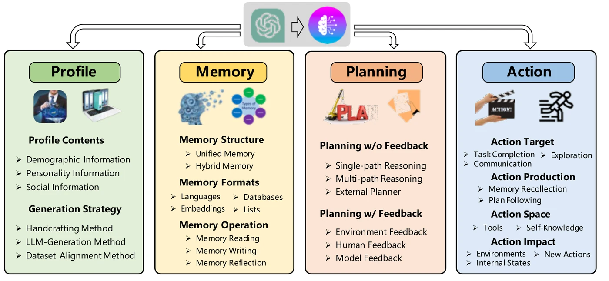
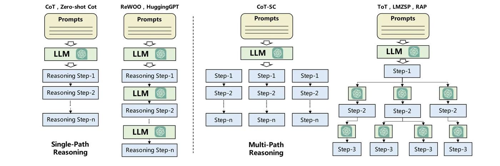
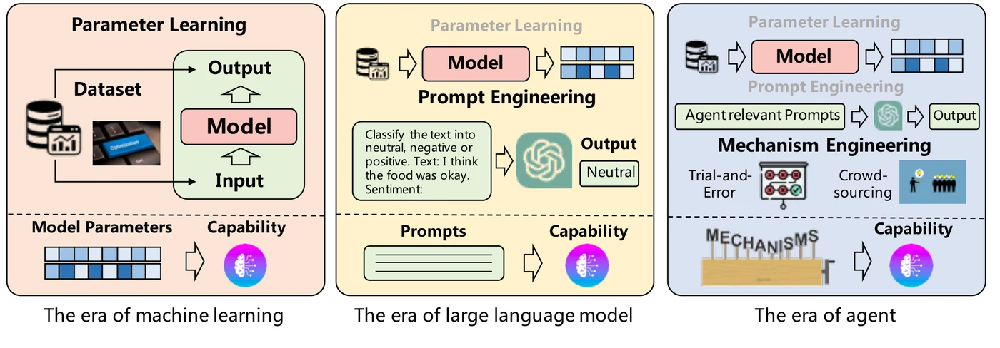

# Agent Survey: How Language Models Enter Environments and Act Over Time

Large language models (LLMs) can write code and answer questions, but once a single exchange is over, they have not actually changed anything in the outside world. For a model to keep working on a task, the system also has to remember what just happened, arrange the next step, call tools and correct itself based on the results. Systems that place a model inside an "observe–think–act" loop of this kind are what this survey discusses: autonomous agents built on large language models. [Abstract and §1](https://arxiv.org/html/2308.11432v7#S1)

The survey was written by a research team at the Gaoling School of Artificial Intelligence, Renmin University of China, first released in 2023; this guide is pinned to arXiv v7 of March 2025, and the journal version was published in Frontiers of Computer Science. It runs no new experiments. Its contribution is to place existing research in a framework that allows comparison: first what parts an agent consists of, then where its abilities come from, and finally its applications and evaluation. [Paper identity and version](https://arxiv.org/abs/2308.11432v7)

The survey's main line can be summarized in three figures. Figure 2 is a unified framework for building systems: profile, memory, planning and action. Figure 4 divides the acquisition of abilities into three routes: parameter learning, prompt engineering and mechanism engineering. Figure 5 places application areas and evaluation methods side by side. The most important part of the survey, and the one most worth reading slowly, is Figure 2 and the four modules; the guide gives them more than half its length.

One practical use of reading this survey is to locate new papers. When you see an agent paper, first ask whether it changes the profile, memory, planning or action; then ask whether it changes model parameters or only the prompts and procedures at run time; finally, see what tasks and metrics it uses to show that the change works. This order is more useful than remembering method names, and it also keeps one from taking "can call tools" directly as "can complete the task".

The guide uses, as a teaching example throughout, an assistant that helps a graduate student compile literature on "agent memory". The assistant and its materials are invented for the guide and have nothing to do with the survey; it reappears in each section to bring the abstract modules down to concrete choices. The reading order follows the survey's own sections: first the authors' framing of the problem and the unified framework, then the four modules one at a time, then ability acquisition, applications, evaluation and open problems. Abbreviations are underlined with a dotted line on first use in the text; clicking one shows its full name and origin.

## From agents in isolated environments to a language-model controller

"Agent" is not a word that appeared only in the era of large models. The survey opens by citing Franklin and Graesser's 1997 definition: a system situated within an environment that senses that environment and acts on it, over time, in pursuit of its own agenda and so as to affect what it senses in the future. This definition already contains three elements: an actor, an environment and sustained action. Early research often placed agents in games, robots or simulated environments and trained their policies with reinforcement learning. [§1, PDF pp. 1–2](https://arxiv.org/pdf/2308.11432v7#page=1)

The authors see two limitations in this research. First, training environments were often simplified, and the policies agents learned were hard to transfer to the open world. Second, knowledge came mainly from limited interaction with the environment, which differs greatly from how humans learn from broad experience. Early agents could therefore do well on closed tasks but struggled with open tasks that had not been defined in advance. The survey accordingly puts its emphasis on sustained action in open environments, going beyond model ability itself.

LLMs changed the conditions. Trained on large amounts of web text, they bring language understanding, common sense, reasoning and generation; researchers began to treat the LLM as the system's central controller, letting it understand tasks, call tools and organize multi-step behavior. The survey takes this shift as its starting point: from "can the model answer" to "can the model be organized into a system that acts over time".

The growth of the field can be seen in Figure 1. The authors counted papers from January 2021 to August 2023, colored by category: general, tool, simulation, embodied, game, web and assistant. The curve steepens clearly in 2023, especially after ChatGPT. Figure 1 shows only research activity and should not be read as a ranking of abilities; the number of papers and the reliability of systems are two different things. [Figure 1 and §1, PDF p. 2](https://arxiv.org/pdf/2308.11432v7#page=2)

The survey divides its material into three parts: how agents are built, which domains they are used in, and how they are evaluated. Building is further split into two questions: architecture design, which the authors liken to "hardware", and ability acquisition, likened to "software". This analogy runs through the whole survey: the same model, organized with a different set of profile, memory and planning, may perform differently; the same architecture, with a different way of acquiring abilities, may also perform differently. When reading later methods, first distinguish whether they touch the hardware or the software. Section 5 of the survey says it compiles 100 related works; the number shows coverage, not that every one was checked to the same depth. [§5, PDF p. 31](https://arxiv.org/pdf/2308.11432v7#page=31) The counts in Figure 1 stop in August 2023 and say nothing about how research activity changed afterward.

## The unified framework: How the four modules connect

Figure 2 is the master diagram of the survey. It breaks agent architecture into four columns: Profile, Memory, Planning and Action. Above the four columns is an LLM icon; arrows in the figure show relations of influence: the profile affects memory and planning, and profile, memory and planning together affect action. [Figure 2 and §2, PDF p. 4](https://arxiv.org/pdf/2308.11432v7#page=4)

This figure should not be read as a pipeline that runs once from left to right. The four columns are four design dimensions, each answering a different question; a system may have no explicit memory module, or may write planning into its prompt. "Influence" in the figure means a dependency in design, and at run time the four steps need not all be gone through every time. The authors also explain that the framework covers most existing work without requiring every system to look like this.

| Module | Question it answers | Main inputs | Main outputs | Connected to |
| --- | --- | --- | --- | --- |
| Profile | In what identity, and under what constraints, does the system take part in the task? | Demographics, personality, social relations, duties | A role description written into the prompt | Affects memory filtering and planning goals |
| Memory | Which past information should be kept, and when should it be retrieved? | Observations, results of actions, reflections | Memory records that can be read and written | Supplies experience to planning and grounds for action |
| Planning | How is a goal broken into executable steps? | The task, current observations, memory | A plan, subgoals, the next step | Guides action and receives feedback from it |
| Action | What can the system actually do, and what does doing it change? | The plan, memory, tool interfaces | Tool calls, messages, operations on the environment | Changes the environment and internal state, producing new observations |

Walk through it with the literature assistant. The task asks it to "compile five empirical papers on agent memory". The profile specifies that it recommends only papers with a DOI (digital object identifier) and gives evidence before conclusions; memory keeps the papers already checked, the reasons for exclusions and the user's constraints; planning decides to search first, then filter, then fill gaps; action calls the arXiv interface, opens PDFs and writes results into a table. An empty result or an error returned by an action changes the next round of planning and is also written back to memory. Here the four modules are four design questions that need answers, and each can vary independently.

Figure 2 also reminds readers that the LLM is only one part of the system. The model provides language understanding and generation, but profile, memory, planning and action all have to be designed separately by the system. A very strong model placed in a loop without memory, tools or feedback can still do only a single exchange. Conversely, an ordinary model equipped with suitable external structure may complete tasks it could not do alone.

## Profile: Giving the system a concrete position

The profile answers: in what identity does this agent take part in the task, and under what background and constraints? The survey divides profile information into three kinds: demographic information (age, gender, occupation and so on), psychological information (personality, preferences) and social information (relations with other actors). Which information to choose depends on the application. When studying human cognitive processes, psychological information matters more; when simulating a team, social relations matter more. [§2.1.1, PDF pp. 4–5](https://arxiv.org/pdf/2308.11432v7#page=4)

Profile information is usually written into the prompt and influences the model's behavior. But "write one sentence saying you are an expert" is only the most superficial layer. The survey divides ways of generating profiles into three:

| Method | How it is done | Advantages | Costs |
| --- | --- | --- | --- |
| Handcrafted | People write the role descriptions directly | Flexible and controllable | Labor-intensive with many roles; hard to cover large populations |
| LLM-generated | Set rules first, give a few seed profiles, and let the LLM generate in bulk | Fast and cheap, suited to large scale | Hard to control precisely; may drift from the setting |
| Dataset-aligned | Extract demographic and other information from real datasets and turn it into prompts | Closer to real populations | Depends on the dataset; privacy and representativeness must be handled separately |

There are many examples of handcrafted profiles. Generative Agents writes a name, goals and relationships for each resident; MetaGPT and ChatDev predefine roles such as product manager, architect and engineer in their software-development processes and assign duties to them. An example of LLM generation is RecAgent: a few seed profiles are made by hand, and ChatGPT then generates more from the seeds. An example of dataset alignment comes from the American National Election Studies (ANES): the authors turned participants' demographic backgrounds into prompts, had GPT-3 answer with these backgrounds, and compared the answers with the real population. [Generative Agents abstract](https://arxiv.org/abs/2304.03442) · [ChatDev abstract](https://arxiv.org/abs/2307.07924)

The three methods can be combined. The authors give the example that in social simulation, some roles can be set from real data so that they reflect current society, while others are handcrafted as identities that do not yet exist but may appear in the future, to project how things could change. The point of this suggestion is to let roles from different sources do different jobs, rather than to pursue sheer quantity of data.

Back to the literature assistant. If the profile is "a careful literature assistant who recommends only papers with a DOI and gives evidence before conclusions", then memory retrieval will favor papers already verified, planning will put "check the DOI" into its steps, and action will reject entries without a source. If it is switched to "a creative brainstorming partner", the same model may be allowed to propose unverified conjectures, and the constraints on retrieval and action change accordingly. The profile changes the default behavior of the three modules after it.

The profile also has limits. An identity in the prompt does not automatically bring professional ability; a model told "you are a lawyer" may still cite statutes that do not exist. A profile only sets focus and constraints; knowledge, tools and verification still have to be prepared separately.

## Memory: What to keep, how to retrieve it, when to reflect

The memory module addresses a very concrete problem: the context window cannot hold a task's whole history, while long tasks need to accumulate experience and stay consistent. A system that starts from scratch every time will repeat operations, forget constraints or lose clues it has already found. The survey takes memory apart from three angles: structure, format and operations. These three are often mixed together, but they answer different questions. [§2.1.2, PDF pp. 6–9](https://arxiv.org/pdf/2308.11432v7#page=6)

**Structure** asks where memory is kept and for how long. The survey divides it into two kinds. Unified memory simulates only short-term memory, usually by writing the currently needed information directly into the prompt and using it through in-context learning; RLP puts the internal states of speaker and listener into the prompt, and SayPlan treats the scene graph and environmental feedback as short-term memory. Hybrid memory has both a short-term buffer and long-term storage: the short-term part keeps recent observations, and the long-term part uses external storage to keep past behavior and thoughts, retrieving them when needed. Generative Agents, AgentSims, GITM and Reflexion all belong to this kind.

Each structure has its costs. Unified memory is simple to implement and suits short tasks, but is limited by the context window; hybrid memory can span longer periods but requires designing writing, retrieval and forgetting as well, and errors may also persist for a long time. The survey notes that structures relying only on long-term memory are rare in the literature, and the authors speculate that this is because agents always operate in continuous environments where recent observations can usually not be omitted.

**Format** asks in what form memories are stored. Natural language is the most flexible and keeps rich meaning: Reflexion stores reflections in natural language, and Voyager describes skills in natural language. Embedding vectors make similarity search easy: MemoryBank encodes each memory as a vector and retrieves it with dual-tower dense retrieval. Databases make precise create, read, update and delete operations easy: ChatDB has the model generate SQL to operate a database. Structured lists make it easy to express relations: GITM uses a tree structure to store the actions corresponding to subgoals, and RET-LLM turns sentences into triples for storage. [MemoryBank abstract](https://arxiv.org/abs/2305.10250) · [ChatDB abstract](https://arxiv.org/abs/2306.03901) · [RET-LLM abstract](https://arxiv.org/abs/2305.14322)

These formats can be mixed. GITM's memory is a key–value list: the key is an embedding vector used for retrieval, and the value is natural language used for reading. This combination shows that retrieval efficiency and readability can be designed separately. When choosing a format, first ask who will use the memory: if it is to be found mainly by similarity, embeddings are convenient; if constraints have to be updated precisely, a database or structured records fit better.

**Operations** ask how memory is used. The survey divides them into reading, writing and reflection.

The goal of reading is to pick out from history the information useful for the current task. The authors distill a scoring formula from existing work:

$$
m^*=\arg\max_{m\in M}\left(\alpha s_{\text{rec}}(q,m)+\beta s_{\text{rel}}(q,m)+\gamma s_{\text{imp}}(m)\right)
$$

$q$ is the current query or task and $M$ all memories; $s_{\text{rec}}$, $s_{\text{rel}}$ and $s_{\text{imp}}$ measure recency, relevance to the query and the importance of the memory itself; $\alpha, \beta, \gamma$ are weighting parameters. Importance depends only on the memory itself and is not compared with the query. Changing the weights gives different reading strategies: to keep only relevance, set $\alpha=\gamma=0$; to weight all three equally, set all three to 1. Generative Agents uses the latter. [Equation 1 and §2.1.2, PDF p. 8](https://arxiv.org/pdf/2308.11432v7#page=8)

Suppose the assistant has three memories, and the query is "what are the representative works on agent memory". The scores of the three memories are as follows; the values are assigned by the guide for demonstration only:

| Memory | Recency $s_{\text{rec}}$ | Relevance $s_{\text{rel}}$ | Importance $s_{\text{imp}}$ | Equal-weight total |
| --- | ---: | ---: | ---: | ---: |
| Paper A, just read | 0.9 | 0.6 | 0.4 | 1.9 |
| Classic paper B | 0.3 | 0.9 | 0.9 | 2.1 |
| Exclusion record C | 0.5 | 0.4 | 0.8 | 1.7 |

For example, B's equal-weight total is $0.3+0.9+0.9=2.1$. With equal weights, B scores highest and the classic paper is retrieved; looking only at recency ($\alpha=1$, $\beta=\gamma=0$), A scores highest; looking only at relevance ($\beta=1$, $\alpha=\gamma=0$), it is still B. The example shows that the weights directly change what is retrieved: they decide whether the system trusts "what just happened" or "what matters more". This ordering holds only under the scores set for the demonstration, and should not be taken as how a real system will necessarily retrieve. For the literature assistant, the user's earlier constraint "only papers after 2022" may not be very recent but is very important; if the weights favor recency, the constraint may be crowded out by an old paper that was just read.

Writing has to handle two problems: duplication and overflow. If every piece of duplicate information is stored, memory swells and retrieval is swamped by similar content; the usual practice is to merge. When the successful actions for the same subgoal reach 5, GITM has the LLM compress them into one unified plan that replaces the original sequences; Augmented LLM merges duplicate information by accumulating counts. Overflow requires deleting old content when memory is full: ChatDB allows explicit deletion on the user's command, and RET-LLM uses a fixed-size buffer that overwrites the oldest records first in, first out (FIFO). FIFO is simple but may delete long-term constraints that are still valid; deleting by importance is more refined but requires an extra judgment of importance.

Reflection is an operation one level above reading and writing. It condenses low-level experiences into more abstract understanding for later use. Generative Agents does this as follows: first it generates three questions from recent memories, then uses these questions to query memory, and finally generates five insights. For example, the low-level memories "Klaus Mueller is writing a paper", "he is discussing his research with the librarian" and "he is discussing his research with Ayesha" can be condensed into "Klaus Mueller is dedicated to his research". Reflection can proceed in layers, generating insights on top of insights. GITM condenses general patterns when successful actions exceed 5; ExpeL compares successful and failed trajectories of the same task, or learns experience from a set of successful trajectories. [Reflection in §2.1.2, PDF p. 9](https://arxiv.org/pdf/2308.11432v7#page=9)

The value of reflection lies in compression, but compression introduces inference. A summary may be useful, or it may misremember, overgeneralize or take an accidental success for a rule. Once a reflection is written back to memory, it affects the next reading, so it is both a learning mechanism and a channel through which errors spread.

The literature assistant's memory could be designed like this: short-term memory keeps the current conversation and the papers just opened; long-term memory keeps summaries of papers read, reasons for exclusion and user constraints; reading considers relevance, recency and importance together; writing merges duplicate paper records and, when capacity is full, deletes expired search caches first; and reflection condenses "the user excluded three pure surveys in a row" into "the user prefers empirical research". If it kept only the papers read most recently, the assistant might recommend again articles the user had already excluded; if the reflection condensed things wrongly, it would record "no surveys needed for now" as "never surveys", which would be hard to correct afterward.

The key to memory is that "keep–organize–reuse" forms a closed loop. Storing a lot is meaningless if it cannot be used; failing to retrieve, or retrieving the wrong version, puts later planning and action on top of wrong information.

## Planning: From single-path reasoning to correction with feedback

The planning module answers: given a goal and the current observations, what should be done next, and how should the goal be broken into executable steps? The survey divides methods into two broad kinds by one criterion: whether the agent receives feedback during planning. Without feedback, the plan is essentially settled before acting; with feedback, the plan is revised according to signals from the environment, people or other models. [§2.1.3, PDF pp. 10–13](https://arxiv.org/pdf/2308.11432v7#page=10)

Figure 3 draws reasoning strategies "without feedback" in two halves. The left half is single-path reasoning: the prompt enters the LLM and produces step 1 through step n in sequence, each step leading only to the next. CoT and zero-shot CoT belong to this kind; ReWOO and HuggingGPT call the LLM several times but are still one chain overall. The right half is multi-path reasoning: the same problem unfolds into several paths. CoT-SC samples several complete paths and then takes a majority vote on the answers; ToT organizes intermediate steps into a tree in which each node is a "thought", evaluated by the LLM to decide which branch to expand, backtracking when necessary. The figure emphasizes differences in structure and does not rank methods on that basis. [Figure 3 and §2.1.3, PDF p. 10](https://arxiv.org/pdf/2308.11432v7#page=10)

**Single-path reasoning** breaks a complex problem into chained steps. CoT puts a few examples with worked reasoning into the prompt so that the model imitates "write the steps first, then give the answer"; zero-shot CoT provides no examples and uses only a trigger such as "think step by step". What the two share is that the model generates the reasoning in one go, with no external check. CoT is effective on arithmetic, commonsense and symbolic reasoning, but if one link of the chain goes wrong, the following steps go wrong with it. [CoT abstract](https://arxiv.org/abs/2201.11903)

ReWOO targets a different problem: methods such as ReAct have to send all the previous context back to the model every time a tool is called, consuming many tokens. ReWOO separates "planning" from "observing": it first has the model generate a complete plan stating which tool to call with which arguments at each step; then it runs the tools in order and fills the results back into the plan; finally it generates the answer all at once. This reduces the number of model calls, and the original paper reports similar or better results on HotpotQA with about one fifth of the tokens. The price is that the plan is fixed before execution, so it is less flexible than ReAct when unexpected observations arise. [ReWOO abstract](https://arxiv.org/abs/2305.18323)

HuggingGPT also has a "plan first, then execute" structure, but its action space is the models on Hugging Face: ChatGPT first breaks the user's request into subtasks, then chooses models based on their descriptions, and summarizes the results after execution. It demonstrates the possibility of an LLM as controller; from a system-design point of view, model selection may go wrong, and the dependencies among subtasks may be oversimplified. [HuggingGPT abstract](https://arxiv.org/abs/2303.17580)

**Multi-path reasoning** is not content with a single chain. CoT-SC samples several reasoning paths for the same question and chooses the answer that appears most often, drawing on the intuition that "different lines of thought may reach the same answer". The original paper reports clear improvements on several reasoning benchmarks, but more samples mean more computation, and if several paths make the same systematic error, a majority vote cannot rescue it. [CoT-SC abstract](https://arxiv.org/abs/2203.11171)

ToT organizes reasoning as a tree: each node is an intermediate thought, the model evaluates nodes, and a search strategy decides which branch to expand first, backtracking when necessary. It suits tasks that require exploration or lookahead, or where early decisions are critical. On the Game of 24, the original paper reports that GPT-4 with CoT solves only 4%, while ToT solves 74%. The comparison shows that multi-path search can help, and also that it depends on the model's evaluation of intermediate states; if the evaluation is wrong, the search expands in the wrong direction. RAP goes further: it uses the LLM as both world model and reasoning agent, explores the reasoning space with Monte Carlo tree search (MCTS), and chooses paths by task reward. [ToT abstract](https://arxiv.org/abs/2305.10601) · [RAP abstract](https://arxiv.org/abs/2305.14992)

**External planners** take another route: instead of having the LLM search on its own, they translate the task into a formal description and hand it to a classical planner. LLM+P first turns a natural-language problem into PDDL (Planning Domain Definition Language), solves it with a classical planner, and finally translates the plan back into natural language. The original paper reports that on most benchmarks it gives optimal solutions, while LLMs often fail to give even a feasible plan. The price is that an accurate PDDL description must exist first; once the translation from natural language to the formal language goes wrong, the optimal solution that follows is meaningless. LLM-DP and CO-LLM are variants of a similar idea: the former turns observations, world state and goals into PDDL, and the latter lets the LLM handle high-level plans while an external low-level planner handles executable actions. [LLM+P abstract](https://arxiv.org/abs/2304.11477)

**Planning with feedback** acknowledges that the initial plan may be incomplete. The survey divides it into three kinds by the source of feedback.

Environmental feedback comes from the consequences of actions. ReAct organizes "thought–action–observation" into a loop: the model first writes its current thought, then chooses an action, the environment returns an observation, and the next thought updates on that observation. This is exactly where it differs from ReWOO: ReAct's plan grows step by step, while ReWOO's plan is fixed before execution. Voyager uses three kinds of environmental signal in Minecraft: intermediate progress of program execution, execution errors, and self-verification results; these signals are used to revise skill code. DEPS argues that telling the agent only "the task failed" is not enough; the specific reason for failure must be given before the plan can be revised effectively. SayPlan verifies plans with a scene-graph simulator and replans when it meets an infeasible action. LLM-Planner updates its plan dynamically when it detects mismatched objects or unreachable plans in the environment. Inner Monologue sends success detection and scene descriptions back to the model as language observations. [ReAct abstract](https://arxiv.org/abs/2210.03629) · [Voyager abstract](https://arxiv.org/abs/2305.16291) · [DEPS abstract](https://arxiv.org/abs/2302.01560)

Human feedback is another kind of signal. Inner Monologue allows the agent to ask a person actively for a scene description and put the answer into the prompt. Human feedback can help the agent align with human preferences and can also ease hallucination, but it is a subjective signal whose cost and consistency depend on the people involved. [Inner Monologue abstract](https://arxiv.org/abs/2207.05608)

Model feedback comes from the agent itself or an auxiliary model. Self-Refine has the same LLM produce an answer, then give feedback on its own answer, then revise according to the feedback, looping until a condition is met; it requires no extra training, but the quality of the feedback is limited by the same model's ability. Reflexion writes feedback as natural-language reflections and stores them in episodic memory for the next attempt; it does not update model parameters but changes the next input. The original paper reports 91% pass@1 on HumanEval, above GPT-4's 80% at the time. SelfCheck, InterAct and ChatCoT also use model feedback: one checks reasoning steps, one lets an auxiliary model act as checker, and one uses an evaluation module to monitor the reasoning process. [Self-Refine abstract](https://arxiv.org/abs/2303.17651) · [Reflexion abstract](https://arxiv.org/abs/2303.11366)

| Method | Source of feedback | When it revises | Main cost |
| --- | --- | --- | --- |
| CoT / zero-shot CoT | None | No revision; generated in one go | One wrong step and the rest follow |
| CoT-SC | None (voting over multiple paths) | Chooses an answer after generation | Many samples, high cost |
| ToT | None (self-evaluation during search) | Expands or backtracks during search | Many calls; evaluation may be wrong |
| ReWOO | None (planning separated from observation) | Plan fixed before execution | Inflexible when unexpected observations arise |
| ReAct | Environment | After each observation | Context grows repeatedly |
| Reflexion | Environment or model, written as language | Between attempts | Depends on feedback quality; may overfit |
| LLM+P | None (handed to an external planner) | Formalized before solving | Depends on correct translation into PDDL |

These methods come from different papers and tasks, and the comparison in the table cannot be taken directly as a comparison of performance.

The literature assistant's planning could start single-path: search arXiv, filter by year and topic, read abstracts, write reasons for recommending. The first search returns nothing, and environmental feedback tells it the query is too narrow; it splits "Agent memory" into three subqueries, "memory retrieval", "memory writing" and "reflection", which is replanning with feedback. The user then says "only papers after 2022", and this human feedback enters the next round of planning as a filter. If the assistant used Reflexion, it would write "arXiv queries need the cs.AI category added" into a reflection and use it directly next time.

Planning and action are easily confused. A plan is a piece of text or structure saying what to do; an action is actually calling an interface, running code or sending a message. A plan can be wrong, and an action can fail; the two kinds of failure have to be handled differently. An empty search is a result of an action, and it triggers a revision of the plan; a tool error is a failed action, and may only require different arguments.

Feedback has costs too. Every round of feedback calls a model or tool, adding latency and cost; the feedback itself may be wrong, and models evaluating themselves are especially prone to overconfidence. When choosing a planning method, first see whether the task needs long-range correction, then whether the feedback is reliable and the budget allows it.

## Action: Goals, production, space and consequences

The action module sits furthest downstream and turns the decisions of the earlier modules into concrete results. The survey takes it apart from four angles: the goal of action, how actions are produced, the action space and the impact of actions. The first two come before acting, the third is the action itself, and the fourth comes after. [§2.1.4, PDF pp. 13–16](https://arxiv.org/pdf/2308.11432v7#page=13)

| Angle | Question | Typical choices |
| --- | --- | --- |
| Goal | Why act? | Completing a task, communicating, exploring |
| Production | Where does the action come from? | Recalling memory, following a plan |
| Space | What can be done? | External tools, internal knowledge |
| Impact | What did the action change? | The environment, internal state, later actions |

**Goals** come in more than one kind. Task completion is the most common: crafting an iron pickaxe in Minecraft, or implementing a function in a software project. Communication is another: the agents in ChatDev collaborate through dialogue, and the agent in Inner Monologue actively asks people questions. Exploration aims to gain information: Voyager explores unknown skills while completing tasks, revising its code repeatedly based on environmental feedback. Different goals mean different standards of success and different memories needed.

**Production** comes in two kinds. The first retrieves relevant experience from memory and acts on it. Generative Agents retrieves recent, relevant and important information from its memory stream before every action; GITM queries memory to see whether there is successful experience from a similar task and, if so, reuses it directly; the conversation histories in ChatDev and MetaGPT are kept in each agent's memory and influence the next utterance. The second follows a plan: DEPS first generates a plan and, if there is no signal of failure, executes it strictly; GITM breaks the task into subgoals and executes them one by one. [GITM abstract](https://arxiv.org/abs/2305.17144)

**The action space** is what the system can actually do. The survey divides it into external tools and the model's internal knowledge. External tools include APIs (application programming interfaces), databases and knowledge bases, and external models. HuggingGPT calls Hugging Face models; WebGPT generates queries and browses web pages; ToolFormer lets the model learn by itself when to call APIs such as a calculator, search, translation and a calendar; ToolLLM/ToolBench trains open-source models' tool use with large numbers of real APIs; ChatDB operates databases with SQL (Structured Query Language); ChemCrow connects a set of chemistry tools to the model; Voyager treats executable code as actions and stores verified skills in a skill library. Internal knowledge includes the model's own abilities in planning, dialogue and common sense: DEPS, GITM and Voyager all rely on the LLM's ability to decompose tasks, ChatDev relies on dialogue ability, and Generative Agents relies on commonsense understanding. [ToolFormer abstract](https://arxiv.org/abs/2302.04761) · [ToolLLM abstract](https://arxiv.org/abs/2307.16789) · [ChemCrow abstract](https://arxiv.org/abs/2304.05376)

The difference between ToolFormer and HuggingGPT deserves attention. ToolFormer trains the model to insert API calls into text, and the model itself decides "when, which one, with what arguments and how to use the result"; HuggingGPT trains nothing, but has ChatGPT act as a controller that selects and orchestrates from an external model library. The former learns tool use into the parameters, and the latter puts tool use in the system's procedure. The two approaches correspond to the "fine-tuning" and "mechanism engineering" discussed in the next section.

**Impact** is the change that happens after an action. It can change the environment: in Minecraft, collecting wood removes wood from the environment. It can change internal state: Generative Agents updates its memory stream after acting, and SayCan updates its understanding of the environment. It can also trigger new actions: once Voyager has collected resources, it triggers building. Seeing action only as "outputting a piece of text" misses these consequences; an agent is an agent largely because it can change what it will observe next.

The literature assistant's action space might include: calling the arXiv API, opening PDFs, extracting metadata, writing to a table and asking the user questions. It retrieves "the user wants only empirical papers" from memory, gets "search first, then filter" from the plan, and then calls the API; the results are written back to memory, and an empty result triggers replanning. If it were allowed only to "generate a paragraph of recommendations", it could neither verify that a paper exists nor detect a wrong DOI.

The larger the action space, the greater the capability, and the greater the risk. Tools may return errors, time out or be contaminated by malicious content; running code may change the file system; operating web pages may have real side effects. The system needs to design "what it can do" and "what it is allowed to do" separately, at least taking sandboxes, permissions and human confirmation into account.

## Where abilities come from: Fine-tuning, prompts and mechanism engineering

Architecture answers "how to organize"; ability acquisition answers "why this organization can complete the task". The authors compare the two to hardware and software: with architecture alone, an agent may lack the knowledge, skills and experience the task requires; with ability alone and no suitable loop, it cannot act over time either. [§2.2, PDF pp. 16–21](https://arxiv.org/pdf/2308.11432v7#page=16)

Figure 4 summarizes how ways of acquiring abilities have changed over three eras. In the era of machine learning, ability came mainly from training parameters on data. In the era of large models, besides parameter learning, requirements could also be written into the input through prompt engineering. In the era of agents, there is one more way, "mechanism engineering": designing dedicated modules, working rules and interaction procedures that let an agent change its own abilities while it runs. The gray parts of the figure show that the methods of the previous era are still in use. [Figure 4 and §2.2, PDF p. 19](https://arxiv.org/pdf/2308.11432v7#page=19)

**Fine-tuning** updates model parameters with task data. The survey divides it into three kinds by the source of data.

Human-annotated data is of high quality but also expensive. CoH turns people's preferences about model outputs into natural-language comparative information and fine-tunes on it; RET-LLM builds "triple–natural language" pairs to teach the model to turn sentences into structured memory; WebShop collected 1.18 million products and real shopping scenarios and recruited 13 workers to collect behavioral data; EduChat uses human-annotated data from educational settings to strengthen question answering, essay assessment, Socratic teaching and emotional support. [§2.2, PDF pp. 17–18](https://arxiv.org/pdf/2308.11432v7#page=17)

LLM-generated data is cheap and can cover larger scales, but its quality is uneven. ToolBench collected 16,464 real APIs in 49 categories, used ChatGPT to generate single-tool and multi-tool instructions, and fine-tuned LLaMA on them to obtain ToolLLaMA; another work had several agents socialize in a sandbox and collected their interaction data to fine-tune a model. The risk of generated data is that errors are amplified: call paths invented by the teacher model become the training target of the student model. [ToolBench abstract](https://arxiv.org/abs/2307.16789)

Real-world data comes closest to the deployment environment. Mind2Web collected more than 2,000 open-ended tasks from 137 real websites across 31 domains to train web agents; SQL-PaLM fine-tuned PaLM-2 on large-scale cross-domain text-to-SQL data. The costs of real data are collection and cleaning, and its distribution changes over time. [Mind2Web abstract](https://arxiv.org/abs/2306.06070)

Fine-tuning can write task knowledge into the parameters and suits open-source models; closed-source models can usually be used only through APIs and cannot be updated this way. Fine-tuning may also bring catastrophic forgetting, overfitting and training costs; the survey does not go into these costs, and they are worth checking when reading specific papers.

Methods **without fine-tuning** divide into prompt engineering and mechanism engineering.

Prompt engineering describes tasks in natural language, gives examples or guides reasoning. CoT, CoT-SC and ToT all belong here; RLP writes the agent's judgments about its own and the listener's mental states into the prompt; Retroformer has the model generate reflections on past failures, puts the reflections into the prompt, and uses reinforcement learning to improve the reflection model. Prompt engineering has the advantage of applying to both open- and closed-source models, and the drawbacks of being limited by the context window and of having a very large design space for prompts.

Mechanism engineering changes how the system works, beyond a sentence of instruction. The survey lists four kinds: trial and error, crowdsourcing, experience accumulation and self-driven evolution. Trial and error lets the agent receive an evaluation after acting and puts the evaluation into the next round: RAH compares predicted responses with real feedback in a recommender system, DEPS has an explainer give the reason for failure, RoCo checks multi-robot plans with collision detection and inverse kinematics, and PREFER uses an LLM to generate more detailed feedback. Crowdsourcing has several agents discuss or debate until they agree; the debate mechanism of [94] has different agents answer separately first and then absorb each other's views. Experience accumulation stores successful trajectories in memory or a skill library: GITM keeps successful actions, Voyager keeps executable skill code, AppAgent builds a knowledge base from human demonstrations, and MemPrompt keeps users' corrections of intent. Self-driven evolution lets the agent set its own goals and explore the environment: LMA3 improves behavior with a reward function, SALLM-MS evolves in multi-agent interaction, CLMTWA has a strong model act as teacher and a weak model as student, and NLSOM dynamically adjusts roles, tasks and relations. [RoCo abstract](https://arxiv.org/abs/2307.04738)

| Approach | What it changes | Representatives | Suited to | Main limitation |
| --- | --- | --- | --- | --- |
| Fine-tuning (human data) | Model parameters | CoH, RET-LLM, WebShop, EduChat | High-quality annotations and trainable open-source models | High cost, limited coverage |
| Fine-tuning (LLM data) | Model parameters | ToolBench/ToolLLaMA | Lack of human annotations, need for scale | Noise and amplified errors |
| Fine-tuning (real data) | Model parameters | Mind2Web, SQL-PaLM | A clear deployment distribution | Expensive to collect; the distribution shifts |
| Prompt engineering | Input text | CoT, CoT-SC, ToT, RLP | Quick experiments, closed-source models | Limited context, large design space |
| Mechanism engineering | Loops, memory, tools, multi-agent rules | ReAct, Reflexion, Voyager, RoCo | Long tasks that need feedback | Complex design, high call costs |

The literature assistant can be improved in three ways. Prompt engineering: write "give the DOI first, then the conclusion" into the system prompt. Mechanism engineering: add a memory module that keeps the user's reasons for exclusion, and a feedback loop that rewrites the query when a search comes back empty. Fine-tuning: given a local open-source model and many "query–relevant paper" annotations, it could be trained to judge relevance better. The three change different things: prompts change the input, mechanisms change the procedure, and fine-tuning changes the parameters. Which to choose depends on whether the model is trainable, whether there is enough data, and whether errors are easy to remedy through the procedure.

The authors point out that fine-tuning can take in large amounts of task knowledge but suits only open-source models; methods without fine-tuning apply to both open- and closed-source models but are limited by the context window, and the design space of prompts and mechanisms is so large that the best design is hard to find. This judgment concerns the model ecosystem of early 2025 and cannot be applied directly to every way of deploying.

## The map of applications: Social science, natural science and engineering

Section 3 of the survey organizes applications by domain, and the left half of Figure 5 is the map. Under three broad categories there are subcategories: social science includes psychology, political science and economics, social simulation, law, and research assistants; natural science includes literature and data management, experiment assistants, and science education; engineering includes civil engineering, computer science, aerospace, industrial automation, and robotics and embodied intelligence. [§3 and Figure 5, PDF pp. 21–27](https://arxiv.org/pdf/2308.11432v7#page=21)

 and evaluation strategies (right) for LLM agents")

When reading this figure, the point is to see how the application changes what "done well" means.

In the social sciences, agents are often used to simulate people. In psychology, researchers give LLMs different profiles, have them complete psychological experiments and compare the results with human participants; some studies find that models give results similar to humans', and also that ChatGPT and GPT-4 sometimes give "too perfect" estimates, which the authors call hyper-accuracy distortion. On mental-health support, one study collected 120 Reddit posts and found that conversational agents can help users cope with anxiety, loneliness and depression, but may also generate harmful content. [§3.1, PDF p. 22](https://arxiv.org/pdf/2308.11432v7#page=22) In political science and economics, agents are used to detect ideology, predict votes, analyze political speeches and simulate economic behavior. In social simulation, Social Simulacra simulates online communities, Generative Agents and AgentSims simulate daily life in a virtual town, S3 simulates the spread of information, emotions and attitudes in social networks, SocialAI School simulates children's social cognition, and CGMI uses a tree structure to maintain characters' personalities and simulate a classroom. In law, Blind Judgement has several models simulate judges and vote, and ChatLaw targets Chinese legal consultation. As research assistants, agents can generate summaries, extract keywords and write research scripts, and can also help researchers discover new questions. [Social Simulacra abstract](https://arxiv.org/abs/2208.04024) · [S3 abstract](https://arxiv.org/abs/2307.14984)

What these applications share is that the standard of evaluation goes beyond whether the task was completed: it includes whether the behavior resembles the people being simulated, whether it conforms to social norms, and whether it produces harmful content. Social simulation depends especially on profiles and knowledge boundaries: if the model knows too much, or its values are too uniform, the simulation becomes distorted.

In the natural sciences, agents are more like tool users. In literature and data management, agents can search the internet, organize literature and extract information from text; ChatMOF extracts key information from text descriptions, plans tool calls and predicts the properties and structures of metal–organic frameworks; ChemCrow uses a set of chemistry tools to verify compounds and identify hazardous substances. As experiment assistants, the system of Boiko and colleagues searches online according to the experimental goal, computes in Python and carries out experiments; ChemCrow suggests experimental procedures and flags safety risks. In science education, agents can tutor experimental design, mathematical proof and programming; EduChat, Math Agents, CodeHelp and FreeText are examples. [ChatMOF abstract](https://arxiv.org/abs/2308.01423)

The risks of natural-science applications are more direct: model hallucinations may lead to wrong conclusions, failed experiments or even safety problems in dangerous experiments. The survey reminds readers that users must have the relevant expertise and treat agents' suggestions as leads to be verified.

Engineering has the broadest applications. In computer science and software engineering, ChatDev completes the software-development life cycle through dialogue among several roles; MetaGPT organizes roles such as product manager, architect, project manager and engineer into a pipeline; Self-collaboration has several LLMs play different experts who collaborate; LLIFT uses an LLM to assist static analysis in finding vulnerabilities; ChatEDA targets electronic design automation; and D-Bot uses a tree of thoughts to diagnose database anomalies. In industrial automation, GPT4IA combines LLMs with digital twins, and IELLM discusses plant automation and PLC (programmable logic controller) programming in the oil and gas industry. In robotics and embodied intelligence, SayCan combines a language model's high-level knowledge with the value functions of pretrained skills, SayPlan uses 3D scene graphs for large-scale task planning, Voyager and GITM act over long horizons in Minecraft, and TidyBot learns household tidying preferences from text examples. The survey also lists a set of open-source frameworks: LangChain, XLang, AutoGPT, WorkGPT, GPT-Engineer, DemoGPT, SmolModels, AGiXT, AgentVerse, GPT Researcher and BMTools. [MetaGPT abstract](https://arxiv.org/abs/2308.00352) · [SayCan abstract](https://arxiv.org/abs/2204.01691) · [SayPlan abstract](https://arxiv.org/abs/2307.06135)

The map of applications also exposes a common misreading: the standard of success in one domain cannot be moved directly to another. Software development's standard is that code runs and tests pass; social simulation's is that behavior is believable; an experiment assistant's is that experimental results are correct and safe. With the same four modules, switching domains means redesigning the contents of memory, the action space and the evaluation metrics.

The literature assistant belongs in the "research assistant" cell. Its standard of success might be: the five recommended papers all exist, meet the topic and time constraints, and have reasons grounded in the original text. This differs from ChatDev's "the software runs" and Generative Agents' "the behavior is believable". Putting them on the same application map serves to show why the conditions of evaluation vary by domain.

The counts in Figure 1 stop in August 2023, and the survey's list of applications reflects the works included in this version; it shows which directions researchers have tried. These applications were mostly validated in research settings and cannot be equated with production deployment. When reading a specific application paper, also look at its task, environment and degree of human supervision.

## Evaluation: Subjective judgment and objective metrics

Evaluating agents is harder than evaluating a single question and answer. Question answering looks only at the final answer; an agent acts continuously in an environment, so success may depend on multi-step planning, tool calls and memory, and failure may happen at any step. The survey divides evaluation into subjective and objective kinds, and the right half of Figure 5 is the classification. [§4 and Figure 5, PDF pp. 27–31](https://arxiv.org/pdf/2308.11432v7#page=27)

**Subjective evaluation** has people judge the agent's performance. A common practice is human annotation: people score or rank the outputs of different systems. Generative Agents had annotators answer 25 questions covering five areas related to agent abilities; Social Simulacra had annotators judge whether the simulation system could help designers improve community rules. [§4.1, PDF p. 27](https://arxiv.org/pdf/2308.11432v7#page=27) Another practice is the Turing test: have people distinguish the agent's outputs from people's; if they cannot tell them apart, the agent is considered to have reached human-like performance on that task. The study by Argyle and colleagues had evaluators judge whether texts about free partisanship were written by people or by a model.

Subjective evaluation suits settings with no standard answer, or where quantitative metrics are hard to define, such as "is the behavior believable" or "is the answer friendly". Its costs are expense and low efficiency, and the group of evaluators may be biased. To ease these problems, researchers have begun to use LLMs as judges: ChemCrow uses GPT to evaluate experimental results, looking at both whether the task was completed and whether the process was correct; ChatEval has several agents evaluate candidate results through structured debate. LLM judges are convenient, but they make mistakes too, and their scores are only a reference.

**Objective evaluation** uses metrics that can be computed, compared and tracked. The survey breaks it into three parts: metrics, evaluation protocols and benchmarks.

Metrics answer "what to measure". Task-success metrics include success rate, reward or score, coverage, and accuracy or error rate; accuracy may mean, in different settings, whether a program runs or whether a task is valid. Human-likeness metrics measure whether agent behavior resembles people's, for example coherence, fluency, similarity to human dialogue and human acceptance rate. Efficiency metrics look at development cost, training efficiency and the like. The three kinds answer different questions: task success, believable behavior and acceptable cost are three different judgments.

Evaluation protocols answer "how the comparison is carried out". Real-world simulation places agents in games or interactive simulators to complete tasks on their own, then evaluates them by success rate and trajectory; social evaluation has agents interact in a simulated society to look at social abilities such as cooperation, communication and empathy; multi-task evaluation tests generalization with a set of tasks across domains; software testing has agents generate tests, reproduce bugs and debug code, then evaluates them by test coverage and bug detection rate. The protocol decides which variables are fixed and which are left free, so when reading results, look at the protocol first.

Benchmarks provide tasks and environments. The survey lists many: ALFWorld, IGLU and Minecraft for interactive tasks; Tachikuma uses TRPG (tabletop role-playing game) logs to examine multi-character interaction; AgentBench evaluates LLMs as agents systematically across 8 environments; SocKET covers 58 social-ability tasks; AgentSims is a customizable sandbox for evaluating agents; ToolBench has 16,464 real RESTful APIs; WebShop has 1.18 million products, and its original paper reports a task success rate of 29% for the best model against 59% for human experts; Mobile-Env, WebArena, GentBench, RocoBench, EmotionBench, PEB, ClemBench and E2E each have their own emphasis. [§4.2, PDF p. 30](https://arxiv.org/pdf/2308.11432v7#page=30) [AgentBench abstract](https://arxiv.org/abs/2308.03688) · [WebShop abstract](https://arxiv.org/abs/2207.01206)

| Benchmark or environment | Scale or scope | What it mainly examines |
| --- | --- | --- |
| AgentBench | 8 interactive environments | Reasoning, decision-making and instruction following across environments |
| WebShop | 1.18 million products, 12,087 instructions | Grounding language in the environment and multi-step operation in web shopping |
| ToolBench | 16,464 APIs, 49 categories | Single-tool and multi-tool calls |
| Mind2Web | More than 2,000 tasks, 137 websites, 31 domains | Generalization on real web pages |
| SocKET | 58 tasks, 5 kinds of social information | Social abilities |
| EmotionBench | More than 400 situations, 8 kinds of negative emotion | Emotion appraisal |

Table 3 organizes existing systems by subjective or objective evaluation and by whether benchmarks are used. When reading the table, note that "-" means the paper did not explicitly discuss an item, and a tick covers only the dimensions listed in the table. [Table 3, PDF p. 29](https://arxiv.org/pdf/2308.11432v7#page=29)

To evaluate the literature assistant, first define the task: given a topic and a time range, return five real, relevant papers with DOIs, with a one-sentence reason for each that is grounded in the original text. Objective metrics could be: whether all five exist, whether they meet the time constraint, and whether the reasons find support in the abstracts; efficiency metrics could be the average number of calls and the time taken. A subjective metric could be the user's rating of "usefulness". The evaluation protocol could fix the same set of queries and the same library of materials, so that different systems are compared under the same conditions. Looking only at the final list, one cannot tell whether the search failed to find something, the planning left something out, or the generation invented a reason; only by keeping the retrieved candidates, the filtering records and the final prompt can the failing stage be located.

The survey points out that most existing metrics are borrowed from related fields and have not yet formed a mature, unified standard for evaluating agents; subjective and objective methods each have strengths and weaknesses and are best combined in practice. Benchmarks have their own problems as well: limited task distributions, the possibility of overfitting, and environments that change. A high score shows only that a system performs well under that benchmark's conditions and cannot be extrapolated directly to real deployment.

## Open problems: Six unresolved tensions

Section 6 of the survey lists six challenges. They are related to one another, and all are tensions that the four modules expose in real use. Below, each is explained as the authors intend, followed by the module it falls on. [§6, PDF pp. 31–33](https://arxiv.org/pdf/2308.11432v7#page=31)

**Role-playing ability.** Agents often have to play specific roles, such as programmer, researcher or chemist. LLMs trained on web corpora are familiar with common roles but grasp rare roles, newly emerging roles and certain cognitive-psychological traits poorly. The authors propose collecting real human data for fine-tuning, or carefully designing prompts and architectures; but fine-tuning may hurt performance on common roles, and the design space of prompts and architectures is too large. This challenge falls on the profile module.

**Generalized human alignment.** Traditional LLMs are trained to align with one set of human values, such as not helping to build bombs. But social simulation sometimes needs agents to show people's negative traits faithfully, even to plan negative behavior, in order to observe the consequences and study how to prevent them. The authors argue that for different purposes, agents should be able to align with different human values, which they call "generalized human alignment". Existing models such as ChatGPT and GPT-4 mainly align with uniform values, and how to "realign" them through prompts is an open problem. This challenge falls on both the profile and planning modules.

**Prompt robustness.** Agents often need a set of prompts: profile, memory, planning and tools each have their own, and a prompt for one module affects another. Existing studies find that small changes to prompts can produce very different results, and different LLMs need different prompt frameworks. Designing a stable prompt framework across models is hard. The authors suggest two routes: manual trial and error, or having GPT generate prompts automatically. This challenge falls on the prompt layer of the whole system.

**Hallucination.** LLMs confidently generate false information, and agents are no exception. The survey gives the example of code generation: faced with overly simple instructions, an agent may hallucinate, producing wrong code, security risks or ethical problems. Bringing human corrective feedback into the loop of human–machine interaction is one mitigation. This challenge falls on the memory and action modules: once an error is written into memory or executed by an action, its consequences are amplified.

**Knowledge boundaries.** Social simulation requires an agent to know only what the person being simulated should know. But LLMs trained on large amounts of web knowledge may know information an ordinary person should not. For example, when simulating a user choosing a film, the agent should know nothing about the film's content, but it may already have learned about these films and so make choices unlike a real user's. The authors consider how to constrain an LLM from using "knowledge the user does not have" an important problem for building believable simulation environments. This challenge falls on the profile and memory modules.

**Efficiency.** Autoregressive generation in LLMs is slow, and an agent may call the model several times for each action: reading memory, planning, generating the action and evaluating the result. Inference speed directly affects how efficiently an agent acts. This challenge falls on the planning and action modules, and also explains why methods that reduce calls, such as ReWOO, are attractive.

These six are the authors' judgments in v7 and will change as research progresses; they cannot be taken directly as the state of research today, and later work may have partly solved them or changed the form of the problems. When reading, they can serve as a checklist: faced with an agent system, ask what trade-offs it makes on roles, alignment, prompt stability, hallucination, knowledge boundaries and efficiency.

## Putting methods back on the map: How to read a new agent paper

The most useful thing to take away from the survey is an order of questions; method names come second. The two tables below compress the preceding content into a form that can be looked up.

| Module or stage | Question to ask first | Representative methods | What it changes |
| --- | --- | --- | --- |
| Profile | In what identity does the system take part, under what constraints? | Handcrafted, LLM-generated, dataset-aligned | Role information in the prompt |
| Memory | What is kept, how is it retrieved, when does reflection happen? | Generative Agents, MemoryBank, ChatDB, RET-LLM, GITM | Memory structure, format, reading, writing and reflection |
| Planning (without feedback) | Is the plan fixed once, or revised along the way? | CoT, CoT-SC, ToT, ReWOO, HuggingGPT, LLM+P | Reasoning paths, the relation between plan and observation |
| Planning (with feedback) | Does feedback come from the environment, people or a model? | ReAct, Voyager, DEPS, Reflexion, Self-Refine | When the plan is revised |
| Action | What can be done, and what does doing it change? | ToolFormer, HuggingGPT, ChatDB, ChemCrow, Voyager | Tools, databases, code, internal knowledge |
| Ability acquisition | Change parameters, prompts or mechanisms? | Fine-tuning, prompt engineering, mechanism engineering | Model parameters or run-time procedure |
| Evaluation | Measure tasks, behavior, efficiency or process? | Subjective evaluation, objective metrics, protocols, benchmarks | How success is defined and measured |

| Symptom | Check first | How to verify |
| --- | --- | --- |
| The assistant keeps recommending excluded papers | Writing to and reading from memory | See whether exclusion reasons were saved and whether they are retrieved |
| It keeps to the original plan after an empty search | Whether planning receives environmental feedback | Compare runs with and without replanning |
| Tool calls have wrong arguments, or call tools that do not exist | The action space and tool selection | Fix the task and compare different tool interfaces and selection strategies |
| The answer cites literature that does not exist | Memory sources and verification of actions | Check whether citations come from actual search results |
| The system knows too much in a simulation | Knowledge boundaries and profile | Construct information the simulated person could not know, and see whether it is used |
| Tasks get done but with too many calls | Efficiency and planning | Count calls, tokens and latency per item |

When reading a new paper, go in four steps. First, locate which module it changes. Second, judge whether it changes parameters, prompts or mechanisms. Third, see what tasks, metrics and controls it uses to show that the change works. Fourth, see what it pays: number of calls, tokens, human feedback, training data, or deployment complexity. Once the four steps are done, a method name is no longer an isolated label.

The survey's own Table 1 is an index of systems, marking 31 systems against profile, memory, planning, action and ability acquisition; Table 2 lists representative systems by application area; and Table 3 lists systems by evaluation method. They are suited to use as lookup tables, not to memorizing from the top. When you meet a system name, first look it up in Table 1 to see which part it emphasizes, then go back to the text and read the details of that part. [Table 1, PDF p. 17](https://arxiv.org/pdf/2308.11432v7#page=17) · [Table 2, PDF p. 25](https://arxiv.org/pdf/2308.11432v7#page=25)

This map of methods is one classification by the survey's authors. A system may change several modules at once, or write some module implicitly into its prompt; the classification is a tool for asking questions, it need not give a system a single label, and it cannot replace reading the original.

## Entry points to the original and coverage of this guide

If you read only one part of the original, start with Figure 2 and §2.1 (PDF pp. 4–16), checking the classification dimensions of the four modules against each other; then read Figure 4 and §2.2 (pp. 19–21) for the three routes of ability acquisition; finally read Figure 5 and §3–4 (pp. 21–31), looking at applications and evaluation together. The challenges in Section 6 (pp. 31–33) are worth revisiting after reading the main body, since they tie these modules together again. [Figure 2 and §2.1, PDF pp. 4–16](https://arxiv.org/pdf/2308.11432v7#page=4) · [Figure 4 and §2.2, PDF pp. 19–21](https://arxiv.org/pdf/2308.11432v7#page=19) · [Figure 5 and §3–4, PDF pp. 21–31](https://arxiv.org/pdf/2308.11432v7#page=21) · [§6, PDF pp. 31–33](https://arxiv.org/pdf/2308.11432v7#page=31)

This guide is based on the full text of arXiv v7, covering the main line of §1–7: the background of the problem, the unified framework, the four modules, ability acquisition, applications, evaluation, related surveys and challenges. Figures 2–5 are original figures from the paper, cropped from the pinned PDF and inspected by eye; for Tables 1–3, only the rows relevant to the argument are excerpted, not copied line by line. For the representative methods the survey mentions, descriptions follow the survey, checked against each method's arXiv abstract page; the guide did not read each cited paper closely and reproduced no experiments. The literature assistant is a teaching example invented for the guide, and its scores, memory entries and evaluation scenario are fictional. [Pinned HTML full text](https://arxiv.org/html/2308.11432v7) · [Pinned PDF](https://arxiv.org/pdf/2308.11432v7)

A few version issues need attention when reading. The survey's text says ChemCrow integrates 17 tools, while the abstract of the ChemCrow paper now says 18; the guide therefore does not use a specific number. The survey describes ChatLaw as a legal model supporting database and keyword retrieval, while the abstract of the current arXiv version emphasizes a mixture-of-experts architecture with multiple agents and role alignment; the guide uses ChatLaw only as an example of a legal application and does not go into its mechanism. The survey's citations and classification follow v7; later versions or the journal's typesetting may differ.

The original figures come under the CC BY 4.0 license marked on the arXiv v7 page; the guide keeps the figure numbers, authors and source, and uses them only for personal academic reading in a private repository. Reading this guide or opening the original does not automatically mark it as read.
