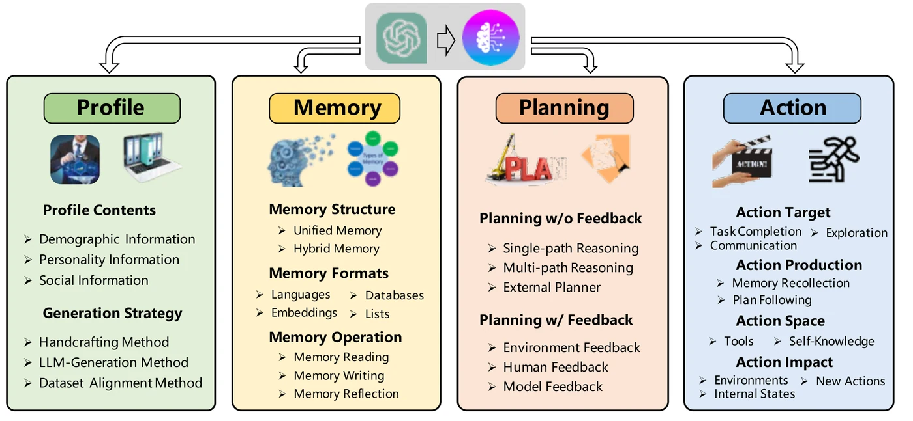
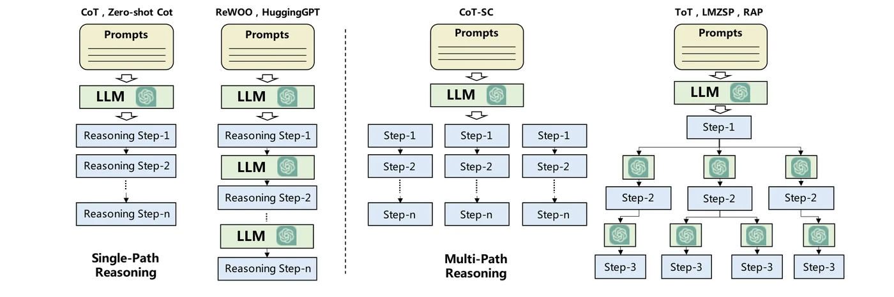
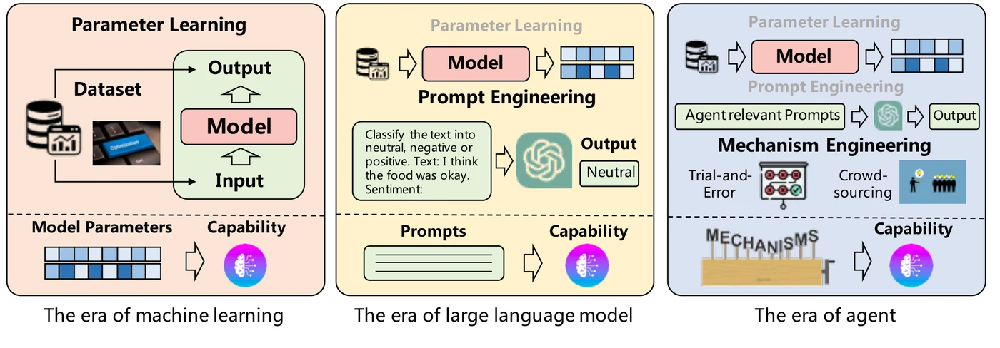
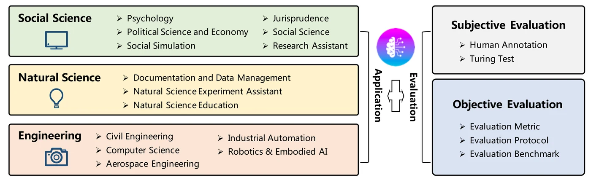

# Agent 综述：大模型怎样进入环境并持续行动

大语言模型（LLM）能写代码、答问题，但一次问答结束，它并没有真正改变外部世界。要让模型持续完成任务，系统还得记住刚才发生了什么、安排下一步、调用工具，并根据结果修正。这类把模型放进“观察—思考—行动”循环的系统，就是这篇综述讨论的、以大语言模型为基础的自主 Agent。[摘要与 §1](https://arxiv.org/html/2308.11432v7#S1)

论文由中国人民大学高瓴人工智能学院的研究团队撰写，2023 年首次公开，导读固定使用 2025 年 3 月的 arXiv v7，期刊版发表在 Frontiers of Computer Science。它不做新实验，贡献是把已有研究放进一个可比较的框架：先看 Agent 由哪些部分构成，再看能力从哪里来，最后看应用与评价。[论文身份与版本](https://arxiv.org/abs/2308.11432v7)

综述的主线可以概括为三张图。图 2 是系统构建的统一框架：角色设定（profile）、记忆（memory）、规划（planning）和行动（action）。图 4 把能力获取分成参数学习、提示工程和机制工程三条路。图 5 把应用领域与评价方式并排放在一起。全文最重要、也最值得慢读的是图 2 和四个模块；导读把一半以上篇幅给它们。

读这篇综述的一个实际用处，是给新论文定位。看到一篇 Agent 工作，先问它改的是角色、记忆、规划还是行动；再问它是改了模型参数，还是只改了运行时的提示与流程；最后看它用什么任务和指标说明改动有效。这个顺序比记住方法名更有用，也能避免把“会调用工具”直接当成“能完成任务”。

全文用一位研究生整理“Agent 记忆”文献的助手作为教学例子。这个助手和它的资料都是导读自编的，与综述无关；它会在各节反复出现，帮助把抽象模块落到具体选择上。阅读顺序按综述自己的章节：先看作问题与统一框架，再逐个打开四个模块，然后看能力获取、应用、评价和开放问题。正文中第一次出现的缩写带有虚线，点开可以看全称和来历。

## 从孤立环境中的智能体到语言模型控制中心

Agent 不是大模型时代才出现的词。综述开篇引用了 Franklin 和 Graesser 1997 年的定义：一个位于环境中、感知环境、随时间采取行动以实现自身目标并影响未来感知的系统。这个定义里已经包含三个要素：主体、环境、持续的行动。早期研究常把 Agent 放进游戏、机器人或模拟环境，用强化学习训练策略。[§1，PDF 第1–2页](https://arxiv.org/pdf/2308.11432v7#page=1)

作者认为，这类研究有两个限制。第一，训练环境往往被简化，Agent 学到的策略难以迁移到开放世界；第二，知识主要来自有限的环境交互，和人类从广泛经验中学习的过程差别很大。于是，早期 Agent 容易在封闭任务里表现不错，却难以处理没有预先定义好的开放任务。综述由此把重点放在开放环境中的持续行动，而不停留在模型能力本身。

LLM 改变了条件。它在大量网页文本上训练，带来语言理解、常识、推理和生成能力；研究者开始把 LLM 当作系统的中心控制器，让它理解任务、调用工具、组织多步行为。综述把这一转向作为自己的起点：从“模型能不能回答”转向“模型能不能被组织成一个持续行动的系统”。

这一领域的增长可以从图 1 看出来。作者统计了 2021 年 1 月到 2023 年 8 月的论文数量，按通用、工具、模拟、具身、游戏、网页和助手等类别着色；曲线在 2023 年明显变陡，ChatGPT 之后尤其密集。图 1 只表示研究热度，不宜当作能力排行榜；论文数量与系统可靠性是两回事。[图 1 与 §1，PDF 第2页](https://arxiv.org/pdf/2308.11432v7#page=2)

综述把材料分成三块：Agent 怎样构建、用在哪些领域、怎样评价。构建又分成两个问题：架构设计，作者比作“硬件”；能力获取，比作“软件”。这个类比贯穿全文：同一个模型，换一套角色、记忆和规划组织，表现可能不同；同一套架构，换一种能力获取方式，表现也可能不同。读后续方法时，先分清它动的是硬件还是软件。综述第 5 节说，它整理了 100 项相关工作；这个数字说明覆盖面，不说明每一项都经过同样的深度核对。[§5，PDF 第31页](https://arxiv.org/pdf/2308.11432v7#page=31)图 1 的统计截止到 2023 年 8 月，不能说明此后研究热度的变化。

## 统一框架：四个模块怎样连起来

图 2 是全文的总图。它把 Agent 的架构拆成四列：Profile（角色设定）、Memory（记忆）、Planning（规划）、Action（行动）。四列之上是 LLM 图标；图中用箭头表示影响关系：角色设定影响记忆和规划，角色、记忆、规划三者共同影响行动。[图 2 与 §2，PDF 第4页](https://arxiv.org/pdf/2308.11432v7#page=4)

这张图不宜读成一条从左到右执行一次的流水线。四列是四个设计维度，各自回答不同问题；一个系统可能没有显式的记忆模块，也可能把规划写进提示里。图中的“影响”表示设计上的依赖，运行时不必每次走完四步。作者也说明，这个框架覆盖大多数已有工作，并不要求每个系统都长成这样。

| 模块 | 回答的问题 | 主要输入 | 主要输出 | 与谁相连 |
| --- | --- | --- | --- | --- |
| 角色设定 | 系统以什么身份、受什么约束参与任务 | 人口统计、性格、社会关系、职责 | 写进提示的角色描述 | 影响记忆筛选与规划目标 |
| 记忆 | 过去的信息中，哪些要保留、何时取回 | 观察、行动结果、反思 | 可读写的记忆记录 | 为规划提供经验，为行动提供依据 |
| 规划 | 目标怎样拆成可执行的步骤 | 任务、当前观察、记忆 | 计划、子目标、下一步 | 指导行动，接收行动反馈 |
| 行动 | 系统实际能做什么、做完改变了什么 | 计划、记忆、工具接口 | 工具调用、消息、环境操作 | 改变环境与内部状态，产生新观察 |

用文献助手走一遍。任务要求“整理五篇关于 Agent 记忆的实证论文”。角色设定规定它只推荐有 DOI（数字对象标识符）的论文，先给证据再给结论；记忆保存已经查过的论文、排除理由和用户约束；规划决定先检索、再筛选、再补漏；行动调用 arXiv 接口、打开 PDF、把结果写进表格。行动返回的空结果或错误，会改变下一轮规划，也会写回记忆。四个模块在这里是四种需要回答的设计问题，各自可以独立变化。

图 2 的另一个作用是提醒读者：LLM 只是系统的一部分。模型提供语言理解和生成，但角色、记忆、规划和行动都要由系统另外设计。一个很强的模型放进没有记忆、没有工具、没有反馈的循环里，仍然只能做一次问答。反过来，一个普通模型配上合适的外部结构，可能完成它单独做不到的任务。

## 角色设定：给系统一个具体位置

角色设定回答的是：这个 Agent 以什么身份参与任务，受哪些背景和约束。综述把角色信息分成三类：人口统计信息（年龄、性别、职业等）、心理信息（性格、偏好）、社会信息（与其他主体的关系）。选择哪些信息，取决于应用。研究人类认知过程时，心理信息更重要；模拟一个团队时，社会关系更重要。[§2.1.1，PDF 第4–5页](https://arxiv.org/pdf/2308.11432v7#page=4)

角色信息通常写进提示，影响模型的行为。但“写一句你是专家”只是最表面的一层。综述把角色的生成方式分成三种：

| 方式 | 怎么做 | 优点 | 代价 |
| --- | --- | --- | --- |
| 手工设定 | 人直接写角色描述 | 灵活、可控 | 角色多时费人力，难以覆盖大规模群体 |
| LLM 生成 | 先定规则，给少量种子角色，让 LLM 批量生成 | 快、便宜，适合大规模 | 难以精确控制，可能偏离设定 |
| 数据集对齐 | 从真实数据集中提取人口统计等信息，转成提示 | 更接近真实人群 | 依赖数据集，隐私与代表性要另处理 |

手工设定的例子很多：Generative Agents 为每个居民写姓名、目标和关系；MetaGPT、ChatDev 在软件开发流程里预定义产品经理、架构师、工程师等角色，并分配职责。LLM 生成的例子是 RecAgent：先手工做几个种子角色，再让 ChatGPT 按种子生成更多。数据集对齐的例子来自美国国家选举研究（ANES）：作者把参与者的人口统计背景转成提示，让 GPT-3 以这些背景回答，再与真实人群比较。[Generative Agents 原论文摘要](https://arxiv.org/abs/2304.03442) · [ChatDev 原论文摘要](https://arxiv.org/abs/2307.07924)

三种方式可以组合。作者举例说，做社会模拟时，可以用真实数据设定一部分角色，让它们反映当前社会；另一部分角色手工设定为现实中还不存在、但未来可能出现的身份，用来推演变化。这个建议的重点在于让不同来源的角色承担不同任务，而不是追求数据数量。

回到文献助手。若角色设定是“谨慎的文献助理，只推荐有 DOI 的论文，先给证据再给结论”，那么记忆检索会优先取回已核验的论文，规划会把“核对 DOI”放进步骤，行动会拒绝没有出处的条目。若换成“创意头脑风暴伙伴”，同样的模型可能被允许提出未经证实的猜想，检索和行动的约束也随之改变。角色会改变后面三个模块的默认行为。

角色设定也有边界。提示里的身份不会自动带来专业能力；一个写着“你是律师”的模型，仍然可能引用不存在的法条。角色只规定关注点和约束；知识、工具和验证仍要另外准备。

## 记忆：保存什么、怎样取回、何时反思

记忆模块要解决一个很具体的问题：上下文窗口装不下整个任务历史，而长任务又需要积累经验、保持前后一致。系统若每次都从头开始，就会重复操作、忘记约束，或者丢掉已经得到的线索。综述从三个角度拆记忆：结构、格式、操作。这三个角度经常被混在一起，实际回答的是不同问题。[§2.1.2，PDF 第6–9页](https://arxiv.org/pdf/2308.11432v7#page=6)

**结构**问的是记忆放在哪里、保存多久。综述分成两类。统一记忆（unified memory）只模拟短期记忆，通常就是把当前需要的信息直接写进提示，靠上下文学习使用；RLP 把说话者和听者的内部状态放进提示，SayPlan 把场景图和环境反馈当作短期记忆。混合记忆（hybrid memory）则同时有短期缓冲和长期存储：短期保存最近的观察，长期用外部存储保存过去的行为和想法，需要时再取回。Generative Agents、AgentSims、GITM、Reflexion 都属于这一类。

两类结构各有代价。统一记忆实现简单，适合短任务，但受上下文窗口限制；混合记忆能跨越更长时间，却要额外设计写入、检索和遗忘，错误也可能长期保留。综述提到，只依赖长期记忆的结构在文献中很少见，作者推测是因为 Agent 总处在连续环境中，最近的观察通常不可省略。

**格式**问的是记忆用什么形式保存。自然语言最灵活，保留丰富语义，Reflexion 用自然语言保存反思，Voyager 用自然语言描述技能；嵌入向量便于相似度检索，MemoryBank 把每段记忆编码成向量，再用双塔稠密检索取回；数据库便于精确增删改查，ChatDB 让模型生成 SQL 操作数据库；结构化列表便于表达关系，GITM 用树形结构保存子目标对应的动作，RET-LLM 把句子转成三元组保存。[MemoryBank 原论文摘要](https://arxiv.org/abs/2305.10250) · [ChatDB 原论文摘要](https://arxiv.org/abs/2306.03901) · [RET-LLM 原论文摘要](https://arxiv.org/abs/2305.14322)

这些格式可以混用。GITM 的记忆是键值列表：键是嵌入向量，用来检索；值是自然语言，用来阅读。这个组合说明，检索效率和可读性可以分开设计。选格式时，先问记忆要被谁使用：如果主要靠相似度找，嵌入方便；如果要精确更新约束，数据库或结构化记录更合适。

**操作**问的是记忆怎样被使用。综述分成读取、写入和反思。

读取的目标是从历史中挑出对当前任务有用的信息。作者从已有工作中归纳出一个打分式：

$$
m^*=\arg\max_{m\in M}\left(\alpha s_{\text{rec}}(q,m)+\beta s_{\text{rel}}(q,m)+\gamma s_{\text{imp}}(m)\right)
$$

$q$ 是当前查询或任务，$M$ 是全部记忆；$s_{\text{rec}}$、$s_{\text{rel}}$、$s_{\text{imp}}$ 分别衡量新近程度、与查询的相关性、记忆本身的重要程度；$\alpha,\beta,\gamma$ 是权衡参数。重要性只取决于记忆本身，不与查询比较。改变权重，就得到不同的读取策略：只保留相关性时，令 $\alpha=\gamma=0$；三项等权时，令三者都为 1。Generative Agents 用的就是后一种。[式 1 与 §2.1.2，PDF 第8页](https://arxiv.org/pdf/2308.11432v7#page=8)

设助手有三条记忆，查询是“Agent 记忆有哪些代表工作”。三条记忆的分数如下，数值由导读指定，只用于演示：

| 记忆 | 新近 $s_{\text{rec}}$ | 相关 $s_{\text{rel}}$ | 重要 $s_{\text{imp}}$ | 等权总分 |
| --- | ---: | ---: | ---: | ---: |
| 刚读过的论文 A | 0.9 | 0.6 | 0.4 | 1.9 |
| 经典论文 B | 0.3 | 0.9 | 0.9 | 2.1 |
| 排除记录 C | 0.5 | 0.4 | 0.8 | 1.7 |

例如 B 的等权总分是 $0.3+0.9+0.9=2.1$。等权时 B 得分最高，取回经典论文；若只看新近（$\alpha=1$，$\beta=\gamma=0$），A 得分最高；若只看相关性（$\beta=1$，$\alpha=\gamma=0$），仍然是 B。这个例子说明，权重直接改变取回结果：它决定系统更相信“刚发生的”还是“更重要的”。这个排序只在演示设定的分数下成立，不能当作真实系统一定这样取回。对文献助手，用户上一条约束“只要 2022 年后的论文”可能新近性不高，却非常重要；如果权重偏向新近，约束就可能被一条刚读过的旧论文挤掉。

写入要处理两个问题：重复和溢出。重复信息如果每条都存，记忆会膨胀，检索也会被相似内容淹没；常见做法是合并。GITM 在同一个子目标的成功动作达到 5 条时，让 LLM 把它们压缩成一个统一计划，替换原来的序列；Augmented LLM 用计数累加合并重复信息。溢出则要在记忆满时删除旧内容：ChatDB 允许按用户命令显式删除，RET-LLM 用固定大小缓冲，按先进先出（FIFO）覆盖最旧的记录。FIFO 简单，但可能删掉仍然有效的长期约束；按重要性删除更精细，却要额外判断重要性。

反思是比读写更高一层的操作。它把低层经历概括成更抽象的认识，供以后使用。Generative Agents 的做法是：先根据最近的记忆生成三个问题，再用这些问题查询记忆，最后生成五条洞察。例如，低层记忆“Klaus Mueller 在写论文”“他在和图馆员讨论研究”“他在和 Ayesha 讨论研究”，可以概括成“Klaus Mueller 专注于研究”。反思可以分层进行，洞察之上再生成洞察。GITM 在成功动作超过 5 条时概括出通用模式；ExpeL 则比较同一任务的成功与失败轨迹，或从一组成功轨迹中学习经验。[§2.1.2 的反思部分，PDF 第9页](https://arxiv.org/pdf/2308.11432v7#page=9)

反思的价值在于压缩，但压缩会引入推断。概括可能有用，也可能记错、过度概括，或者把一次偶然成功当成规律。反思写回记忆后，又会影响下一次读取，所以它既是学习机制，也是错误传播的通道。

文献助手的记忆可以这样设计：短期记忆保存当前对话和刚打开的论文；长期记忆保存已读论文的摘要、排除理由、用户约束；读取时同时考虑相关性、新近性和重要性；写入时合并重复的论文记录，并在容量满时优先删除已过期的搜索缓存；反思则把“用户连续排除了三篇纯综述”概括成“用户偏好实证研究”。如果只保存最近读过的论文，助手可能再次推荐用户已经排除的文章；如果反思概括错了，它会把“暂时不需要综述”误记成“永远不要综述”，之后很难纠正。

记忆的关键在于“保存—组织—再使用”形成闭环。存得多，用不上也没有意义；检索不到，或者取回了错误版本，都会让后续规划和行动建立在错误信息上。

## 规划：从单路推理到带反馈的修正

规划模块要回答：给定目标和当前观察，下一步做什么，怎样把目标拆成可执行的步骤。综述按一个标准分成两大类：规划过程中 Agent 是否收到反馈。没有反馈时，计划在行动前就基本确定；有反馈时，计划会根据环境、人或其他模型的信号修改。[§2.1.3，PDF 第10–13页](https://arxiv.org/pdf/2308.11432v7#page=10)

图 3 把“无反馈”的推理策略画成左右两半。左半是单路推理：提示进入 LLM，依次产生第 1 步到第 n 步，每一步只通向下一步。CoT 和 Zero-shot CoT 属于这一类；ReWOO 和 HuggingGPT 虽然会多次调用 LLM，但整体仍是一条链。右半是多路推理：同一个问题展开成多条路径。CoT-SC 采样多条完整路径，再按答案多数投票；ToT 把中间步骤组织成树，每个节点是一个“想法”，由 LLM 评估后决定扩展哪一支，必要时回退。图强调结构差异，不据此给方法排名。[图 3 与 §2.1.3，PDF 第10页](https://arxiv.org/pdf/2308.11432v7#page=10)

**单路推理**把复杂问题拆成链式步骤。CoT 的做法是在提示里放几个带推理过程的例子，让模型模仿“先写步骤、再给答案”；Zero-shot CoT 不提供例子，只用“一步一步想”这类触发语。两者的共同点是：推理过程由模型一次生成，没有外部检查。CoT 在算术、常识和符号推理上有效，但一条链走错，后面的步骤会跟着错。[CoT 原论文摘要](https://arxiv.org/abs/2201.11903)

ReWOO 针对的是另一个问题：ReAct 这类方法每调用一次工具，都要把之前的全部上下文重新送进模型，token 消耗大。ReWOO 把“计划”和“观察”分开：先让模型生成一个完整的计划，计划里写明每一步调用什么工具、用什么参数；然后依次执行工具，把结果填回计划；最后统一生成答案。这样模型调用次数减少，原论文报告在 HotpotQA 上以约五分之一的 token 达到相近或更好的效果。代价是计划在执行前已经确定，遇到意外观察时不如 ReAct 灵活。[ReWOO 原论文摘要](https://arxiv.org/abs/2305.18323)

HuggingGPT 也是“先规划、再执行”的结构，但它的动作空间是 Hugging Face 上的模型：ChatGPT 先把用户请求拆成子任务，再根据模型描述选择模型，执行后汇总结果。它展示了 LLM 作为控制器的可能性；从系统设计看，模型选择可能错，子任务之间的依赖关系也可能被简化。[HuggingGPT 原论文摘要](https://arxiv.org/abs/2303.17580)

**多路推理**不满足于一条链。CoT-SC 对同一问题采样多条推理路径，再选出现次数最多的答案；它利用的是“不同思路可能得到同一答案”的直觉。原论文报告在多个推理基准上有明显提升，但采样次数增加计算成本，而且如果多条路径犯同一个系统性错误，多数投票也救不回来。[CoT-SC 原论文摘要](https://arxiv.org/abs/2203.11171)

ToT 把推理组织成树：每个节点是一个中间想法，模型对节点做评估，搜索策略决定先扩展哪一支，必要时回退。它适合需要探索、前瞻或早期决策很关键的任务。原论文在“24 点”游戏上报告，GPT-4 用 CoT 只解出 4%，ToT 解出 74%。这个对比说明多路搜索可能有用，但也说明它依赖模型对中间状态的评估；评估错了，搜索会朝错误方向扩展。RAP 走得更远：它把 LLM 同时当作世界模型和推理 Agent，用蒙特卡洛树搜索（MCTS）在推理空间里探索，并按任务奖励选择路径。[ToT 原论文摘要](https://arxiv.org/abs/2305.10601) · [RAP 原论文摘要](https://arxiv.org/abs/2305.14992)

**外部规划器**走另一条路：不让 LLM 自己搜索，而是把任务翻译成形式化描述，交给经典规划器。LLM+P 先把自然语言问题转成 PDDL（规划领域定义语言），再用经典规划器求解，最后把计划翻译回自然语言。原论文报告，在多数基准上它能给出最优解，而 LLM 往往连可行计划都给不出。代价是必须先有准确的 PDDL 描述；自然语言到形式化的翻译一旦出错，后面的最优解也没有意义。LLM-DP 和 CO-LLM 是相近思路的变体：前者把观察、世界状态和目标转成 PDDL，后者让 LLM 负责高层计划、外部低层规划器负责可执行动作。[LLM+P 原论文摘要](https://arxiv.org/abs/2304.11477)

**带反馈的规划**承认初始计划可能不完整。综述按反馈来源分成三类。

环境反馈来自动作的后果。ReAct 把“思考—行动—观察”组织成循环：模型先写出当前想法，再选择一个动作，环境返回观察，下一步思考基于观察更新。它和 ReWOO 的区别正在这里：ReAct 的计划是逐步长出来的，ReWOO 的计划先定好再执行。Voyager 在 Minecraft 中使用三类环境信号：程序执行的中间进度、执行错误、以及自我验证结果；这些信号用来修改技能代码。DEPS 认为只告诉 Agent“任务失败”不够，还要给出失败的具体原因，才能有效修改计划。SayPlan 用场景图模拟器验证计划，遇到不可行的动作就重新规划。LLM-Planner 在环境中检测对象不匹配或计划不可达时，动态更新计划。Inner Monologue 把成功检测和场景描述作为语言观察送回模型。[ReAct 原论文摘要](https://arxiv.org/abs/2210.03629) · [Voyager 原论文摘要](https://arxiv.org/abs/2305.16291) · [DEPS 原论文摘要](https://arxiv.org/abs/2302.01560)

人类反馈是另一类信号。Inner Monologue 允许 Agent 主动向人询问场景描述，再把回答放进提示。人类反馈能帮助 Agent 对齐人的偏好，也能缓解幻觉，但它是主观信号，成本和一致性取决于人。[Inner Monologue 原论文摘要](https://arxiv.org/abs/2207.05608)

模型反馈来自 Agent 自己或辅助模型。Self-Refine 让同一个 LLM 先产出答案，再对自己的答案提出反馈，然后根据反馈修改，循环到满足条件；它不需要额外训练，但反馈的质量受同一个模型的能力限制。Reflexion 把反馈写成自然语言反思，存进情节记忆，供下一次尝试使用；它不更新模型参数，而是改变下一次的输入。原论文报告在 HumanEval 上达到 91% pass@1，高于当时 GPT-4 的 80%。SelfCheck、InterAct、ChatCoT 也属于模型反馈：有的检查推理步骤，有的让辅助模型充当检查者，有的用评估模块监控推理过程。[Self-Refine 原论文摘要](https://arxiv.org/abs/2303.17651) · [Reflexion 原论文摘要](https://arxiv.org/abs/2303.11366)

| 方法 | 反馈来源 | 什么时候修改 | 主要代价 |
| --- | --- | --- | --- |
| CoT / Zero-shot CoT | 无 | 不修改，一次生成 | 一步错，后面跟着错 |
| CoT-SC | 无（多路径投票） | 生成结束后选答案 | 多次采样，成本高 |
| ToT | 无（搜索时自评估） | 搜索过程中扩展或回退 | 调用多，评估可能错 |
| ReWOO | 无（计划与观察分离） | 执行前定计划 | 遇到意外观察不灵活 |
| ReAct | 环境 | 每次观察后 | 上下文反复增长 |
| Reflexion | 环境或模型，写成语言 | 两次尝试之间 | 依赖反馈质量，可能过拟合 |
| LLM+P | 无（交给外部规划器） | 求解前形式化 | 依赖 PDDL 翻译正确 |

这些方法来自不同的论文和任务，表中的对照不能直接当作性能比较。

文献助手的规划可以先用单路：检索 arXiv、按年份和主题筛选、读摘要、写推荐理由。第一次检索返回空结果，环境反馈告诉它查询太窄；它把“Agent memory”拆成“memory retrieval”“memory writing”“reflection”三个子查询，这是带反馈的重新规划。用户又说“只要 2022 年后的”，这条人类反馈进入下一轮计划，成为一个筛选条件。若助手使用 Reflexion，它会把“arXiv 查询需要加 cs.AI 分类”写进反思，下一次直接使用。

规划和行动容易混。计划是一段文字或结构，说明要做什么；行动是实际调用接口、执行代码、发送消息。计划可以错，行动也可以失败；两者的失败要用不同方式处理。检索为空是行动结果，它触发的是规划修改；工具报错是行动失败，可能只需要换参数。

反馈同样有成本。每次反馈都要调用模型或工具，增加延迟和成本；反馈本身也可能错，模型自评尤其容易过度自信。选择规划方法时，先看任务是否需要长程修正，再看反馈是否可靠、预算是否允许。

## 行动：目标、产生方式、空间与后果

行动模块在最下游，把前面模块的决定变成具体结果。综述从四个角度拆它：行动目标、行动产生、行动空间、行动影响。前两个发生在行动之前，第三个是行动本身，第四个是行动之后。[§2.1.4，PDF 第13–16页](https://arxiv.org/pdf/2308.11432v7#page=13)

| 角度 | 问题 | 典型选择 |
| --- | --- | --- |
| 目标 | 为什么行动 | 完成任务、沟通、探索 |
| 产生 | 行动从哪里来 | 记忆回忆、跟随计划 |
| 空间 | 能做什么 | 外部工具、内部知识 |
| 影响 | 行动改变了什么 | 环境、内部状态、后续动作 |

**目标**不只一种。任务完成是最常见的：在 Minecraft 里合成一把铁镐，或在软件项目里实现一个函数。沟通是另一类：ChatDev 里的多个 Agent 通过对话协作，Inner Monologue 里的 Agent 主动向人询问。探索则是为了获得信息：Voyager 在完成任务的过程中探索未知技能，根据环境反馈反复修改代码。目标不同，成功的标准和需要的记忆也不同。

**产生方式**有两类。第一类是从记忆里取回相关经验，再据此行动。Generative Agents 在每次行动前，从记忆流中取回新近、相关、重要的信息；GITM 会查询记忆，看有没有类似任务的成功经验，如果有就直接复用；ChatDev 和 MetaGPT 的对话历史保存在各自记忆里，影响下一句话。第二类是跟随计划：DEPS 先生成计划，如果没有失败信号，就严格按计划执行；GITM 把任务拆成子目标，再逐个执行。[GITM 原论文摘要](https://arxiv.org/abs/2305.17144)

**行动空间**是系统实际能做的事。综述把它分成外部工具和模型内部知识。外部工具包括 API（应用程序接口）、数据库与知识库、外部模型。HuggingGPT 调用 Hugging Face 模型；WebGPT 生成查询并浏览网页；ToolFormer 让模型自己学会何时调用计算器、搜索、翻译、日历等 API；ToolLLM/ToolBench 用大量真实 API 训练开源模型的工具使用能力；ChatDB 用 SQL（结构化查询语言）操作数据库；ChemCrow 把一组化学工具接给模型；Voyager 把可执行代码当作行动，并把验证过的技能存进技能库。内部知识则包括模型自己的规划、对话和常识能力：DEPS、GITM、Voyager 都依赖 LLM 的任务分解能力，ChatDev 依赖对话能力，Generative Agents 依赖常识理解。[ToolFormer 原论文摘要](https://arxiv.org/abs/2302.04761) · [ToolLLM 原论文摘要](https://arxiv.org/abs/2307.16789) · [ChemCrow 原论文摘要](https://arxiv.org/abs/2304.05376)

ToolFormer 和 HuggingGPT 的差别值得注意。ToolFormer 训练模型在文本中插入 API 调用，模型自己决定“何时、调用哪个、传什么参数、怎么用结果”；HuggingGPT 不训练模型，而是让 ChatGPT 充当控制器，在外部模型库里选择和编排。前者把工具使用学进参数，后者把工具使用放在系统流程里。两种做法对应下一节要讲的“微调”和“机制工程”。

**影响**是行动之后发生的变化。它可以改变环境：在 Minecraft 里采集木材，木材从环境中消失；可以改变内部状态：Generative Agents 行动后更新记忆流，SayCan 行动后更新对环境的理解；也可以触发新动作：Voyager 收集到资源后，触发建造。把行动只看成“输出一段文字”，会漏掉这些后果；Agent 之所以是 Agent，很大程度上因为它能改变下一步能观察到什么。

文献助手的行动空间可以包括：调用 arXiv API、打开 PDF、抽取元数据、写入表格、向用户提问。它从记忆里取回“用户只要实证论文”，从计划里得到“先检索再筛选”，然后调用 API；返回结果写回记忆，空结果触发重新规划。若它只被允许“生成一段推荐文字”，那么它无法验证论文是否存在，也无法发现 DOI 错误。

行动空间越大，能力越强，风险也越大。工具可能返回错误、超时或被恶意内容污染；代码执行可能改变文件系统；网页操作可能产生真实副作用。系统需要把“能做什么”和“允许做什么”分开设计，至少在沙箱、权限和人工确认上有所考虑。

## 能力从哪里来：微调、提示与机制工程

架构回答“怎样组织”，能力获取回答“为什么这套组织能完成任务”。作者把两者比作硬件和软件：只有架构，Agent 可能缺少任务所需的知识、技能和经验；只有能力，没有一个合适的循环，也无法持续行动。[§2.2，PDF 第16–21页](https://arxiv.org/pdf/2308.11432v7#page=16)

图 4 用三个时代概括能力获取方式的变化。机器学习时代，能力主要来自用数据训练参数；大模型时代，除了参数学习，还可以用提示工程把要求写进输入；Agent 时代，又多了一种“机制工程”：设计专门的模块、工作规则和交互流程，让 Agent 在运行中改变自己的能力。图中的灰色部分表示前一时代的方式仍然沿用。[图 4 与 §2.2，PDF 第19页](https://arxiv.org/pdf/2308.11432v7#page=19)

**微调**用任务数据更新模型参数。综述按数据来源分成三类。

人工标注数据质量较高，但成本也高。CoH 把人对模型输出的偏好转成自然语言比较信息，再用这些数据微调；RET-LLM 构造“三元组—自然语言”配对，教模型把句子转成结构化记忆；WebShop 收集 118 万件商品和真实购物场景，招募 13 名工人采集行为数据；EduChat 用教育场景的人工标注数据增强问答、作文评估、苏格拉底式教学和情感支持。[§2.2，PDF 第17–18页](https://arxiv.org/pdf/2308.11432v7#page=17)

LLM 生成数据便宜，可以覆盖更大规模，但质量参差。ToolBench 收集 49 个类别、16464 个真实 API，用 ChatGPT 生成单工具和多工具指令，再微调 LLaMA 得到 ToolLLaMA；另一项工作让多个 Agent 在沙箱里社交，收集交互数据来微调模型。生成数据的风险是错误被放大：教师模型编造的调用路径，会成为学生模型的训练目标。[ToolBench 原论文摘要](https://arxiv.org/abs/2307.16789)

真实数据最接近部署环境。Mind2Web 从 137 个真实网站的 31 个领域收集 2000 多个开放任务，用来训练网页 Agent；SQL-PaLM 用跨领域的大规模 text-to-SQL 数据微调 PaLM-2。真实数据的代价是采集和清洗，而且分布会随时间变化。[Mind2Web 原论文摘要](https://arxiv.org/abs/2306.06070)

微调能把任务知识写进参数，适合开源模型；闭源模型通常只能通过 API 使用，无法这样更新。微调也可能带来灾难性遗忘、过拟合和训练成本，综述没有展开这些代价，读具体论文时值得检查。

**不微调**的方法分成提示工程和机制工程。

提示工程用自然语言描述任务、给出示例或引导推理。CoT、CoT-SC、ToT 都属于这一类；RLP 把 Agent 对自己和听者心理状态的判断写进提示；Retroformer 让模型对过去的失败生成反思，再把反思放进提示，并用强化学习改进反思模型。提示工程的优点是适用于开闭源模型，缺点是受上下文窗口限制，而且提示设计空间很大。

机制工程改的是系统的工作方式，不只是一句话。综述列了四类：试错、众包、经验积累、自我驱动演化。试错让 Agent 行动后接受评价，再把评价放进下一轮；RAH 在推荐系统里比较预测回应和真实反馈，DEPS 让解释器给出失败原因，RoCo 用碰撞检测和逆运动学检查多机器人计划，PREFER 用 LLM 生成更详细的反馈。众包让多个 Agent 讨论或辩论，直到达成一致；[94] 的辩论机制就是让不同 Agent 先各自回答，再互相吸收观点。经验积累把成功轨迹存进记忆或技能库：GITM 保存成功动作，Voyager 保存可执行技能代码，AppAgent 从人类演示中构建知识库，MemPrompt 保存用户对意图的纠正。自我驱动演化让 Agent 自己设定目标、在环境中探索：LMA3 用奖励函数改进行为，SALLM-MS 在多 Agent 交互中演化，CLMTWA 让强模型当老师、弱模型当学生，NLSOM 动态调整角色、任务和关系。[RoCo 原论文摘要](https://arxiv.org/abs/2307.04738)

| 方式 | 改变什么 | 代表 | 适合 | 主要限制 |
| --- | --- | --- | --- | --- |
| 微调（人工数据） | 模型参数 | CoH、RET-LLM、WebShop、EduChat | 有高质量标注、可训练的开源模型 | 成本高，覆盖有限 |
| 微调（LLM 数据） | 模型参数 | ToolBench/ToolLLaMA | 缺乏人工标注、需要大规模 | 噪声和错误放大 |
| 微调（真实数据） | 模型参数 | Mind2Web、SQL-PaLM | 部署分布明确 | 采集贵，分布会变 |
| 提示工程 | 输入文本 | CoT、CoT-SC、ToT、RLP | 快速试验、闭源模型 | 上下文有限，设计空间大 |
| 机制工程 | 循环、记忆、工具、多 Agent 规则 | ReAct、Reflexion、Voyager、RoCo | 长任务、需要反馈 | 设计复杂，调用成本高 |

文献助手可以用三种方式提升。提示工程：在系统提示里写“先给 DOI，再给结论”。机制工程：加一个记忆模块保存用户排除理由，加一个反馈循环在检索为空时改写查询。微调：如果有本地开源模型和大量“查询—相关论文”标注，可以训练它更好地判断相关性。三种方式改变的东西不同：提示改输入，机制改流程，微调改参数。选哪种，取决于模型是否可训练、数据是否充足、错误是否容易通过流程补救。

作者指出，微调能纳入大量任务知识，但只适合开源模型；不微调的方法适用于开闭源模型，却受上下文窗口限制，而且提示和机制的设计空间极大，不容易找到最优解。这个判断针对 2025 年初的模型生态，不能直接套到所有部署方式。

## 应用地图：社会科学、自然科学与工程

综述第 3 节按领域整理应用，图 5 左半边是这张地图。三个大类下又分小类：社会科学包括心理学、政治学与经济、社会模拟、法学、研究助理；自然科学包括文献与数据管理、实验助理、科学教育；工程包括土木、计算机、航空航天、工业自动化、机器人与具身智能。[§3 与图 5，PDF 第21–27页](https://arxiv.org/pdf/2308.11432v7#page=21)

读这张图时，重点在于看应用怎样改变“做好了”的含义。

社会科学里的 Agent 常被用来模拟人。心理学方向，研究者给 LLM 不同角色，让它完成心理学实验，再与人类参与者比较；有研究发现模型能给出与人类相似的结果，也发现 ChatGPT、GPT-4 有时给出“过于完美”的估计，作者称为 hyper-accuracy distortion。心理健康支持方面，一项研究收集 120 条 Reddit 帖子，发现对话 Agent 能帮助用户应对焦虑、孤独和抑郁，也可能生成有害内容。[§3.1，PDF 第22页](https://arxiv.org/pdf/2308.11432v7#page=22)政治学与经济方向，Agent 被用来检测意识形态、预测投票、分析政治演讲、模拟经济行为。社会模拟方向，Social Simulacra 模拟在线社区，Generative Agents 和 AgentSims 在虚拟小镇里模拟日常生活，S3 模拟社交网络中的信息、情绪和态度传播，SocialAI School 模拟儿童社会认知，CGMI 用树结构维持角色性格并模拟课堂。法学方向，Blind Judgement 让多个模型模拟法官并投票，ChatLaw 面向中文法律咨询。研究助理方向，Agent 可以生成摘要、提取关键词、写研究脚本，也可以帮助研究者发现新问题。[Social Simulacra 原论文摘要](https://arxiv.org/abs/2208.04024) · [S3 原论文摘要](https://arxiv.org/abs/2307.14984)

这些应用的共同点是：评价标准不只是任务是否完成，还包括行为是否像被模拟的人、是否符合社会规范、是否会产生有害内容。社会模拟尤其依赖角色设定和知识边界：模型知道得太多、价值观太统一，模拟就会失真。

自然科学里的 Agent 更像工具使用者。文献与数据管理方向，Agent 可以查询互联网、整理文献、从文本中提取信息；ChatMOF 从文字描述中提取关键信息，规划工具调用，预测金属有机框架的性质和结构；ChemCrow 用一组化学工具验证化合物、识别危险物质。实验助理方向，Boiko 等人的系统根据实验目标上网检索、用 Python 计算、执行实验；ChemCrow 给出实验步骤建议，并提示安全风险。科学教育方向，Agent 可以辅导实验设计、数学证明和编程，EduChat、Math Agents、CodeHelp、FreeText 都是例子。[ChatMOF 原论文摘要](https://arxiv.org/abs/2308.01423)

自然科学应用的风险更直接：模型幻觉可能导致错误结论、实验失败，甚至在危险实验里造成安全问题。综述提醒，使用者必须具备相应专业知识，把 Agent 的建议当作待验证的线索。

工程方向的应用最广。计算机与软件工程里，ChatDev 用多个角色对话完成软件开发生命周期，MetaGPT 把产品经理、架构师、项目经理、工程师等角色组织成流水线，Self-collaboration 让多个 LLM 扮演不同专家协作，LLIFT 用 LLM 辅助静态分析找漏洞，ChatEDA 面向电子设计自动化，D-Bot 用思维树诊断数据库异常。工业自动化里，GPT4IA 把 LLM 与数字孪生结合，IELLM 讨论油气行业的工厂自动化和 PLC（可编程逻辑控制器）编程。机器人与具身智能里，SayCan 把语言模型的高层知识与预训练技能的价值函数结合，SayPlan 用 3D 场景图做大规模任务规划，Voyager 和 GITM 在 Minecraft 中长程行动，TidyBot 从文本示例学习家庭整理偏好。综述还列了一批开源框架：LangChain、XLang、AutoGPT、WorkGPT、GPT-Engineer、DemoGPT、SmolModels、AGiXT、AgentVerse、GPT Researcher、BMTools。[MetaGPT 原论文摘要](https://arxiv.org/abs/2308.00352) · [SayCan 原论文摘要](https://arxiv.org/abs/2204.01691) · [SayPlan 原论文摘要](https://arxiv.org/abs/2307.06135)

应用地图也暴露一个常见误读：一个领域的成功标准不能直接搬到另一个领域。软件开发的成功标准是代码可执行、测试通过；社会模拟的标准是行为可信；实验助理的标准是实验结果正确且安全。同一套四个模块，换一个领域，记忆内容、行动空间和评价指标都要重新设计。

文献助手属于“研究助理”这一格。它的成功标准可以是：推荐的五篇论文都真实存在、符合主题和时间约束、理由有原文依据。这个标准与 ChatDev 的“软件能运行”、Generative Agents 的“行为可信”不同。把它们放在同一张应用地图上，是为了看清评价条件为何因领域而异。

图 1 的统计停在 2023 年 8 月，综述的应用清单反映的是该版本收录的工作；它说明研究者尝试过哪些方向，这些应用多在研究环境中验证，不能等同于生产部署。读具体应用论文时，还要看它的任务、环境和人工监督程度。

## 评价：主观判断与客观指标

评价 Agent 比评价一次问答难。问答只看最后答案；Agent 要在环境中连续行动，成功可能取决于多步规划、工具调用和记忆，失败也可能发生在任何一步。综述把评价分成主观和客观两类，图 5 右半边是这张分类图。[§4 与图 5，PDF 第27–31页](https://arxiv.org/pdf/2308.11432v7#page=27)

**主观评价**由人判断 Agent 的表现。常见做法是人工标注：让人给不同系统的输出打分或排序。Generative Agents 让标注者回答 25 个问题，覆盖五个与 Agent 能力相关的领域；Social Simulacra 让标注者判断模拟系统能否帮助设计者改进社区规则。[§4.1，PDF 第27页](https://arxiv.org/pdf/2308.11432v7#page=27)另一种做法是图灵测试：让人区分 Agent 的输出和人的输出，如果分不出来，就认为 Agent 在该任务上达到了类似人的表现；Argyle 等人的研究让评估者判断自由党派文本是人写的还是模型写的。

主观评价适合没有标准答案、或者很难定义量化指标的场景，比如“行为是否可信”“回答是否友好”。它的代价是成本高、效率低，而且评估者群体可能有偏差。为缓解这些问题，研究者开始让 LLM 充当评委：ChemCrow 用 GPT 评估实验结果，同时看任务是否完成和过程是否正确；ChatEval 让多个 Agent 以结构化辩论的方式评价候选结果。LLM 评委方便，但它本身也会错，它的分数只是一种参考。

**客观评价**用可计算、可比较、可追踪的指标。综述把它拆成三个部分：指标、评价协议、基准。

指标回答“量什么”。任务成功类指标包括成功率、奖励或分数、覆盖率、准确率或错误率；准确率在不同场景下可能指程序能否执行、任务是否有效。人类相似类指标衡量 Agent 行为像不像人，例如连贯性、流畅性、与人的对话相似度、人类接受率。效率类指标看开发成本、训练效率等。三类指标回答不同问题：任务成功、行为可信、成本可接受是三个不同的判断。

评价协议回答“怎样执行比较”。真实世界模拟把 Agent 放进游戏或交互模拟器，让它自主完成任务，再用成功率和轨迹评价；社会评价让 Agent 在模拟社会中互动，看合作、沟通、共情等社会能力；多任务评价用一组跨领域任务测泛化；软件测试让 Agent 生成测试、复现 bug、调试代码，再用测试覆盖率和 bug 检出率评价。协议决定了哪些变量被固定、哪些被放开，读结果时要先看协议。

基准提供任务和环境。综述列了很多：ALFWorld、IGLU、Minecraft 用于交互式任务；Tachikuma 用 TRPG（桌面角色扮演游戏）日志考察多角色互动；AgentBench 用 8 个环境系统评估 LLM 作为 Agent 的能力；SocKET 覆盖 58 个社会能力任务；AgentSims 是可定制的 Agent 评估沙盒；ToolBench 有 16464 个真实 RESTful API；WebShop 有 118 万件商品，原论文报告最好的模型任务成功率为 29%，人类专家为 59%；Mobile-Env、WebArena、GentBench、RocoBench、EmotionBench、PEB、ClemBench、E2E 各有侧重。[§4.2，PDF 第30页](https://arxiv.org/pdf/2308.11432v7#page=30)[AgentBench 原论文摘要](https://arxiv.org/abs/2308.03688) · [WebShop 原论文摘要](https://arxiv.org/abs/2207.01206)

| 基准或环境 | 规模或范围 | 主要考察 |
| --- | --- | --- |
| AgentBench | 8 个交互环境 | 多环境下的推理、决策、指令跟随 |
| WebShop | 118 万件商品、12087 条指令 | 网页购物中的语言与环境对应、多步操作 |
| ToolBench | 16464 个 API、49 类 | 单工具和多工具调用 |
| Mind2Web | 2000 多个任务、137 个网站、31 个领域 | 真实网页上的泛化 |
| SocKET | 58 个任务、5 类社会信息 | 社会能力 |
| EmotionBench | 400 多个情境、8 类负面情绪 | 情绪评估 |

表 3 把已有系统按主观或客观评价、是否使用基准整理在一起。读表时要注意，“-”表示论文没有明确讨论某一项；打了勾也只覆盖该表列出的维度。[表 3，PDF 第29页](https://arxiv.org/pdf/2308.11432v7#page=29)

评价文献助手，可以先定任务：给一个主题和时间范围，返回五篇真实、相关、有 DOI 的论文，并为每篇写一句有原文依据的理由。客观指标可以是：五篇是否都存在、是否满足时间约束、理由是否能在摘要中找到支持；效率指标可以是平均调用次数和耗时。主观指标可以是用户对“有用性”的评分。评价协议可以固定同一批查询和同一份资料库，让不同系统在相同条件下比较。若只看最终列表，无法区分是检索没找到、规划漏掉了，还是生成时编造了理由；保留检索候选、筛选记录和最终提示，才能定位失败环节。

综述指出，现有指标大多借用自相关领域，尚未形成成熟、统一的 Agent 评价标准；主观和客观各有长短，实践中最好结合使用。基准也有自己的问题：任务分布有限、可能被过拟合、环境会变化。一个高分只说明系统在该基准的条件下表现好，不能直接外推到真实部署。

## 开放问题：六个尚未解决的矛盾

综述第 6 节列出六个挑战。这六项彼此相关，都是前面四个模块在真实使用中暴露出的矛盾。下面按作者的原意解释，再说明它们分别落在哪个模块上。[§6，PDF 第31–33页](https://arxiv.org/pdf/2308.11432v7#page=31)

**角色扮演能力。** Agent 常要扮演具体角色，比如程序员、研究者、化学家。LLM 在网页语料上训练，对常见角色比较熟悉，对少见角色、新出现的角色、以及某些认知心理特征把握不好。作者提出的办法是收集真实人类数据做微调，或者精心设计提示和架构；但微调可能损害常见角色的表现，提示和架构的设计空间又太大。这个挑战落在角色设定模块。

**广义人类对齐。** 传统 LLM 被训练成对齐一套人类价值观，比如不帮助制造炸弹。但社会模拟有时需要 Agent 如实表现人的负面特征，甚至需要它计划负面行为，才能观察后果、研究如何阻止。作者认为，对不同目的，Agent 应能对齐不同的人类价值，这被称为“广义人类对齐”。现有 ChatGPT、GPT-4 主要对齐统一价值观，如何通过提示“重新对齐”是一个开放问题。这个挑战同时落在角色设定和规划模块。

**提示鲁棒性。** Agent 往往需要一组提示：角色、记忆、规划、工具各有各的提示，一个模块的提示会影响另一个。已有研究发现，提示的微小改动会带来很大不同的结果；不同 LLM 需要的提示框架也不一样。要设计一个跨模型、稳定的提示框架很难。作者提出两条路：手工试错，或者用 GPT 自动生成提示。这个挑战落在整个系统的提示层。

**幻觉。** LLM 会自信地生成错误信息，Agent 也不例外。综述举了代码生成的例子：面对过于简单的指令，Agent 可能产生幻觉，导致错误代码、安全风险或伦理问题。把人类纠正反馈放进人机交互循环，是一种缓解办法。这个挑战落在记忆和行动模块：错误一旦写进记忆或被行动执行，后果会被放大。

**知识边界。** 社会模拟要求 Agent 只知道被模拟者应该知道的东西。但 LLM 在大量网页知识上训练，可能知道普通人不该知道的信息。比如模拟用户选择电影时，Agent 本应对电影内容一无所知，但它可能已经学过这些电影，于是做出不符合真实用户的选择。作者认为，如何约束 LLM 使用“用户不知道的知识”，是构建可信模拟环境的重要问题。这个挑战落在角色设定和记忆模块。

**效率。** LLM 自回归生成慢，而 Agent 每执行一个动作可能要多次调用模型：读记忆、做计划、生成动作、评估结果。推理速度直接影响 Agent 的行动效率。这个挑战落在规划和行动模块，也解释了为什么 ReWOO 这类减少调用的方法有吸引力。

这六项是作者在 v7 中的判断，会随研究进展变化；它们不能直接视为今天的研究现状，后续工作可能已经部分解决，也可能改变问题的形式。读的时候可以把它们当作检查表：看到一个 Agent 系统，问它在角色、对齐、提示稳定性、幻觉、知识边界和效率上分别做了什么取舍。

## 把方法放回地图：怎样读一篇新的 Agent 论文

读完综述，最有用的收获是一个提问顺序，方法名其次。下面两张表把前面的内容压缩成可查的形式。

| 模块或阶段 | 要先问的问题 | 代表方法 | 改变了什么 |
| --- | --- | --- | --- |
| 角色设定 | 系统以什么身份参与，受什么约束 | 手工设定、LLM 生成、数据集对齐 | 提示中的角色信息 |
| 记忆 | 保存什么、怎么取、何时反思 | Generative Agents、MemoryBank、ChatDB、RET-LLM、GITM | 记忆结构、格式、读写与反思 |
| 规划（无反馈） | 计划一次定好，还是边做边改 | CoT、CoT-SC、ToT、ReWOO、HuggingGPT、LLM+P | 推理路径、计划与观察的关系 |
| 规划（有反馈） | 反馈来自环境、人还是模型 | ReAct、Voyager、DEPS、Reflexion、Self-Refine | 何时修改计划 |
| 行动 | 能做什么、做完改变什么 | ToolFormer、HuggingGPT、ChatDB、ChemCrow、Voyager | 工具、数据库、代码、内部知识 |
| 能力获取 | 改参数、改提示，还是改机制 | 微调、提示工程、机制工程 | 模型参数或运行时流程 |
| 评价 | 测任务、行为、效率，还是过程 | 主观评价、客观指标、协议、基准 | 成功的定义与测量方式 |

| 看到的现象 | 先回查 | 可以怎样验证 |
| --- | --- | --- |
| 助手反复推荐已排除的论文 | 记忆的写入与读取 | 看排除理由是否被保存、检索时是否被取回 |
| 检索为空后仍按原计划执行 | 规划是否接收环境反馈 | 对照有无重新规划的实验 |
| 工具调用参数错、或调用了不存在的工具 | 行动空间与工具选择 | 固定任务，比较不同工具接口和选择策略 |
| 回答引用了不存在的文献 | 记忆来源与行动验证 | 检查引用是否来自实际检索结果 |
| 系统在模拟中知道得太多 | 知识边界与角色设定 | 构造被模拟者不可能知道的信息，看是否被使用 |
| 任务能完成但调用次数太多 | 效率与规划 | 统计每题调用次数、token 和延迟 |

读一篇新论文时，可以按四步走。第一，定位它改的是哪个模块；第二，判断它改的是参数、提示还是机制；第三，看它用什么任务、什么指标、什么对照证明改动有效；第四，看它付出了什么代价：调用次数、token、人工反馈、训练数据，还是部署复杂度。四步走完，方法名就不再是孤立的标签。

综述自己的表 1 是一张系统索引，把 31 个系统按 profile、memory、planning、action 和能力获取标出对应项；表 2 按应用领域列出代表系统；表 3 按评价方式列出系统。它们适合当查询表，不适合从头背。遇到一个系统名，先查表 1 看它强调了哪一环，再回到正文读那一环的细节。[表 1，PDF 第17页](https://arxiv.org/pdf/2308.11432v7#page=17) · [表 2，PDF 第25页](https://arxiv.org/pdf/2308.11432v7#page=25)

这个方法地图是综述作者的一种分类。一个系统可能同时改多个模块，也可能把某个模块隐式地写进提示里；分类用来提问，不必给系统贴唯一标签，也不能替代读原文。

## 原文入口与本次覆盖

如果只读一处原文，建议先读图 2 和 §2.1（PDF 第4–16页），把四个模块的分类维度对照一遍；然后读图 4 和 §2.2（第19–21页），看能力获取的三条路；最后读图 5 和 §3–4（第21–31页），把应用与评价放在一起看。第 6 节的挑战（第31–33页）适合在读完主体后回看，它会把这些模块重新串起来。[图 2 与 §2.1，PDF 第4–16页](https://arxiv.org/pdf/2308.11432v7#page=4) · [图 4 与 §2.2，PDF 第19–21页](https://arxiv.org/pdf/2308.11432v7#page=19) · [图 5 与 §3–4，PDF 第21–31页](https://arxiv.org/pdf/2308.11432v7#page=21) · [§6，PDF 第31–33页](https://arxiv.org/pdf/2308.11432v7#page=31)

本导读依据 arXiv v7 全文，覆盖 §1–7 的主线：问题背景、统一框架、四个模块、能力获取、应用、评价、相关综述和挑战。图 2–5 为原论文图，截取自固定 PDF 并已亲眼查看；表 1–3 只摘录与论证相关的行，没有逐行抄录。综述提到的代表方法，其做法以综述描述为准，并对照了各方法 arXiv 摘要页；没有逐篇精读被引论文，也没有复现任何实验。文献助手是导读自编的教学例子，分数、记忆条目和评价场景都是虚构的。[固定 HTML 全文](https://arxiv.org/html/2308.11432v7) · [固定 PDF](https://arxiv.org/pdf/2308.11432v7)

几处阅读时需要留意的版本问题。综述正文写 ChemCrow 集成了 17 个工具，而 ChemCrow 原论文摘要现为 18 个；导读因此没有使用具体数字。ChatLaw 在综述中被描述为支持数据库和关键词检索的法律模型，而当前 arXiv 版本的摘要强调多 Agent 与角色对齐的混合专家架构；导读只把 ChatLaw 作为法律应用示例，没有展开其机制。综述的引用和分类以 v7 为准，后续版本或期刊排版可能不同。

原图来自 arXiv v7 页面标注的 CC BY 4.0 许可，导读保留图号、作者和来源，仅在私有仓库中作个人学术阅读引用。阅读本导读或打开原文，都不会自动记为已读。
