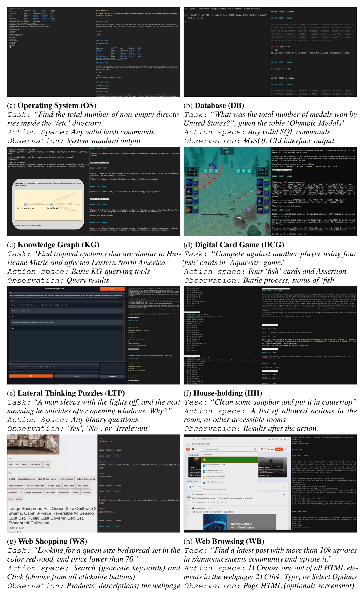
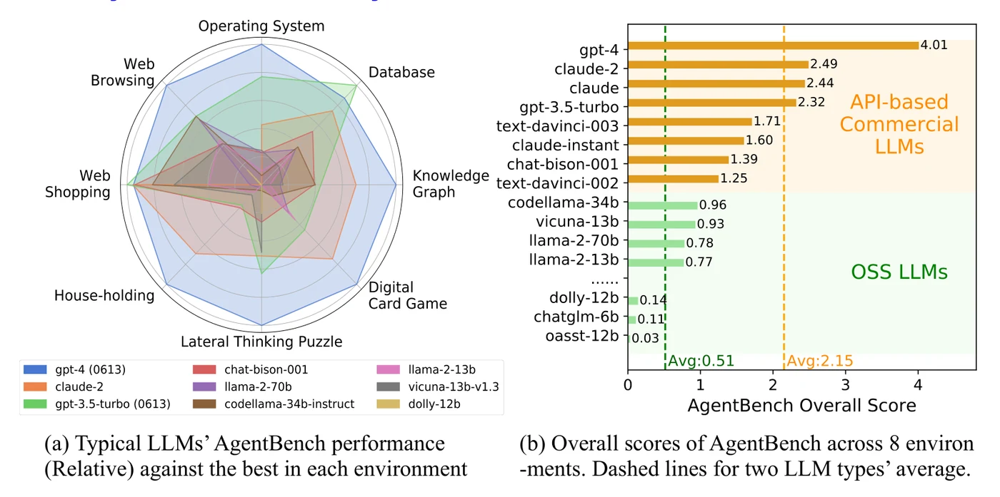

# AgentBench: Measuring Agents in Eight Interactive Environments

Language models are very good at answering questions, but "answering questions" and "getting something done in an environment" are two different demands. When answering, the question, the options and the scoring criteria all arrive in one input. When doing a task, the model first has to see what the environment returned, then decide on its next action, and the action changes the environment again, until the task succeeds, fails or runs out of budget. This paper is a collaboration among researchers at Tsinghua University, The Ohio State University and the University of California, Berkeley. AgentBench puts these two kinds of demand side by side: it places language models in eight environments, an operating system, a database, a knowledge graph, a card game, lateral-thinking puzzles, household tasks, shopping and web browsing, runs 27 models through a common interaction format, and records how each task ends. [Abstract and §1, PDF pp. 1–2](https://arxiv.org/pdf/2308.03688v2#page=1)

The paper's main contribution is to break "agent capability" down into a measurement apparatus that can be inspected; the leaderboard is only a by-product of this particular run. The apparatus covers how tasks are defined, how actions and observations are passed back and forth, what counts as success, how history is truncated when it grows too long, and finally how scores in eight different units are combined into one number. The authors report that top commercial models lead clearly under this setup. Across the 27 models, the mean overall score is 2.15 for commercial models and 0.51 for open-source ones; GPT-4 scores 4.01 overall, achieves the best result in six of the eight environments, and reaches a 78.0% success rate on household tasks. At the same time, many failures come from timeouts, invalid formats or invalid actions, not only from wrong answers. [§4.2, PDF p. 8](https://arxiv.org/pdf/2308.03688v2#page=8)

When reading this guide, focus on "how this score was produced". The core is three threads: what each of the eight environments measures, how prompting and history truncation change the input, and how the overall score differs from a success rate. Only by following these three threads can you judge what a results table supports and what it leaves out. The guide is pinned throughout to Technical Report v0.2, arXiv v2. The paper was later published at ICLR 2024, whose formal abstract lists 29 models; this guide does not mix that version's counts and results into this one. The historical scores represent only this 2023 run and should not be taken directly as today's model ranking. [Front page of arXiv v2 and §4, PDF pp. 1, 6–8](https://arxiv.org/pdf/2308.03688v2)

## From answering to acting: what is being evaluated has changed

To see why AgentBench is designed as it is, start with the older ways of evaluating that it faced. Traditional language-model evaluation is mostly single-turn: give a passage of text, generate an answer or a label, and compare with metrics such as accuracy or F1. Text games had also been used to evaluate language agents, but their action spaces were usually closed and discrete and mainly tested grounding in common sense. Embodied simulators were closer to the real world but relied on images and multimodal input, which did not suit the many text-only models of the time. And some benchmarks covered only a single environment, making it hard to see how models differ across application scenarios. The authors argue that what was missing was an evaluation for text-only models that spans environments, is executable, and can compare multi-turn interaction. [§1, PDF p. 2](https://arxiv.org/pdf/2308.03688v2#page=2)

They therefore cast interactive evaluation as a partially observable Markov decision process (POMDP): a state space, an action space, a transition function, a reward, a task instruction and an observation space together define one task. The formalism sounds abstract, but in an actual run it is quite concrete. The environment has a state, and the model cannot see the whole state, only the observations the environment returns. The model chooses an action, and the environment changes its state according to the transition rules and returns a new observation. The task instruction tells the model the goal; the information needed to finish the task often has to be gathered over several steps. The model's output is no longer one final answer; it is one action in a trajectory. [§2, PDF p. 3](https://arxiv.org/pdf/2308.03688v2#page=3)

This change has four direct consequences, all of which matter when reading the results later. First, the next input depends on the previous action: the model is in effect interacting with a history it produced itself, so the test trajectory varies from model to model, and each task should be read as one history-dependent trajectory. Second, a task can fail midway: an action in the wrong format, an action the environment does not accept, a history that exceeds the context, or running out of turns will all end the run early. Third, the same task can be completed with trajectories of different lengths, so the number of interaction turns itself becomes a cost. Fourth, the score depends not only on the final reply but possibly on whether the environment's state was changed correctly, such as file permissions, the contents of a database table, or a purchase made on a web page.

This also explains the difference between static question-answering benchmarks such as MMLU and agent evaluation. Static items assume by default that each sample is independent, that the answer is given in one go, and that scoring looks only at the output. In an interactive task, one mistake by the model changes the observations that follow, and the scorer also has to judge whether actions are executable and whether the target state was reached. Traditional text games already had multi-turn interaction, but their action spaces were often closed and discrete and mainly tested common sense; embodied simulators had richer environments but needed image input. AgentBench's choice is to keep multi-turn interaction while compressing both environments and actions into a text-only interface, so that the same model can run on eight different tasks.

## The parts of a single run

Break one task apart and you find six parts: a task instruction, an initial state, the available actions, observations, a judging program and a budget. The task instruction states the goal; the environment prepares the initial state; the available actions define what the model can do; observations are the environment's responses to actions; the judging program decides whether the result is correct; and the budget sets how many turns of interaction are allowed and how much history can be sent. AgentBench's eight environments build these six parts into different interfaces, but the basic loop is the same. [§2–3, PDF pp. 3–5](https://arxiv.org/pdf/2308.03688v2#page=4)

A small example written for this guide walks through the loop. Suppose the task is: "Under `/srv/archive`, count the log files dated after 2023 that are larger than 10 MB, and submit the count." In the first turn, the model outputs an action that lists the directory; the environment returns the file list with each item's size. In the second turn, the model decides from the result whether to filter further with `find`. If the output is truncated because it is too long, the model has to rephrase the query and try again. Finally, the model submits a number, and the judging script checks whether it equals the reference answer. This is a teaching task invented for the guide, used only to mark out the relation "action, observation, action again".

| Turn | Key input the model sees | Model action | Environment returns | What this step tests |
| --- | --- | --- | --- | --- |
| 1 | Task instruction and initial prompt | List the directory | File list, partly truncated | Whether the goal can be turned into a first executable command |
| 2 | Instruction, previous action, truncated list | Switch to a conditional find command | Matching files and their sizes | Whether feedback is used to correct the query |
| 3 | Instruction, history of two turns, find results | Submit the count | Judging script returns correct or wrong | Whether the run ends within budget with an answer that can be judged |

The table shows that the same task has at least three different places where it can fail: the first command may be in the wrong format, the second may fail to use the truncation information, and the submitted count may be wrong. Looking only at the final score, the three failures blur together. Only by recording the trajectory together with the reason the run ended can you know whether, next time, to change the prompt, the interface or the model.

In notation, let the visible history before step $t$ be $h_t$, the model $M$, the task instruction $u$, the action $a_t$, the environment state $s_t$, the observation $o_{t+1}$ and the transition function $T$:

$$
a_t=M(u,h_t),\qquad s_{t+1}=T(s_t,a_t),\qquad h_{t+1}=h_t\mathbin{\|}(a_t,o_{t+1}).
$$

Here $\|$ means appending the new action and the new observation to the history. This formula is notation written by the guide for explanation, not a numbered equation of the paper; the paper's own numbered equations can be found in the original. It makes one important point: at each step, the input the model sees is the task instruction concatenated with its own previous actions and the environment's feedback. So how the prompt is organized, how far back the history is kept, and whether observations are truncated all change the problem the model actually faces.

When a run ends, the paper sorts the outcome into five classes: Complete, Context Limit Exceeded (CLE), Invalid Format (IF), Invalid Action (IA) and Task Limit Exceeded (TLE). Complete only means that the task ended through the normal flow; whether the answer was correct is judged separately. Invalid Format means the output does not meet the interface's requirements. Invalid Action means the format was legal but the environment does not allow the action. Task Limit Exceeded means the task was not finished within the given budget, or the model got stuck generating repetitions. This classification is the main tool for diagnosing low scores later on. [§2, PDF p. 4](https://arxiv.org/pdf/2308.03688v2#page=4)

## Eight environments: different abilities behind different interfaces

This figure is worth reading panel by panel. At the top of each panel is a screenshot of the environment, in the middle the task in italics, and the three lines below list the action space and the observations. When reading, look not just at the topic of the task but at "what the model must output". The operating system requires valid bash commands; the database requires one executable SQL statement; the knowledge graph requires calls to a limited set of query tools; the card game requires choosing fish and skills; the lateral-thinking puzzles require asking questions that can only be answered "yes / no / irrelevant"; household tasks require choosing from the list of actions the environment provides; shopping requires searching for keywords or clicking buttons; and web browsing requires choosing among candidate elements and specifying a click, a typed input or a selection. The topics differ, and so do the interfaces and the units of scoring.

The authors divide the eight environments into three groups. The code group, the operating system, database and knowledge graph, emphasizes completing goals through executable interfaces. The game group, the card game, lateral-thinking puzzles and household tasks, emphasizes understanding rules, common sense and sequential decision-making. The web group, shopping and web browsing, emphasizes searching, choosing and predicting actions under the conditions of specific pages. The grouping follows the abilities each environment demands of the model: the code group relies more on precise interface operations, the game group more on rules and strategy, and the web group more on finding the next step from page information. [§3, PDF pp. 4–5](https://arxiv.org/pdf/2308.03688v2#page=4)

The table below collects the key measurement choices for the eight environments. The "judging" column matters especially, because the same "success rate" can be computed by completely different programs in different environments.

| Environment | Task and actions | Main metric | How it is judged | What it mainly tests |
| --- | --- | --- | --- | --- |
| Operating system | Run bash in an Ubuntu terminal, or submit an answer | Success rate | Run check scripts; correct only if every exit code is 0 | Composing commands; operating on files and user state |
| Database | Run SQL against MySQL, or submit an answer | Success rate | Exact match for query answers; table hashes compared for modifying tasks | Writing SQL, understanding table structure, recovering from errors |
| Knowledge graph | Call a limited set of tools for relations, neighbors, intersections, attributes and more | Answer F1 | Predicted answer set compared with the reference | Long-horizon planning; gathering information under partial observability |
| Card game | Choose fish, skills and targets, or guess the opponent's identity in the second stage | Reward | Reward combining win rate and damage rate | Understanding rules, strategy, sequential decisions |
| Lateral-thinking puzzles | Ask one question per turn that can only be answered "yes / no / irrelevant" | Game progress | Proportion of key plot points guessed | Lateral reasoning, asking questions, integrating information |
| Household tasks | Choose from the action list the environment provides | Success rate | The environment judges the goal state; three identical outputs in a row count as failure | Grounding in common sense, managing subgoals, backtracking |
| Shopping | Search for keywords or click page buttons until purchasing | Reward | Desired attributes, options and price matched against the purchased item | Searching, comparing, choosing under constraints |
| Web browsing | Choose among candidate elements and specify an operation | Step success rate | Both element and operation match the reference action | Understanding pages, locating elements, predicting actions |

Behind this table lie several easily overlooked differences. Operating-system tasks come in two kinds, question answering and operation: question tasks require a final answer, while operation tasks require only that the system state be correct. The database has strict format requirements: a format mismatch is judged a failure outright, with no chance to retry. The knowledge graph offers only a few query tools and omits entity linking, so that the model can concentrate on planning. For the card game, the main text says it reports win rate, but the metric in Table 2 is a reward, and the appendix gives the reward as $0.7\times\text{win rate}+0.3\times\text{damage rate}$; for exact reproduction, read the reward column according to the appendix formula, with win rate only one part of it. The main metric of the lateral-thinking puzzles is game progress, the proportion of key plot points that were guessed. In household tasks, when the output format is invalid, the system uses BLEU similarity to pick the closest legal action, which makes "invalid action" mean something somewhat different there than in other environments. Shopping uses an attribute-matching reward, and web browsing takes whether each step's element and operation are correct as its main metric, because the full-task success rate was very low at the time. [Appendices B–I, PDF pp. 21–43](https://arxiv.org/pdf/2308.03688v2#page=21)

Table 2 gives each environment's scale, average number of interaction turns and reference mean. For the test set:

| Environment | Test queries | Average turns | Expected total turns | Reference mean $\mu_j$ |
| --- | ---: | ---: | ---: | ---: |
| Operating system | 144 | 8 | 1200 | 10.8 |
| Database | 300 | 5 | 1500 | 13.0 |
| Knowledge graph | 150 | 15 | 2250 | 13.9 |
| Card game | 20 | 30 | 600 | 12.0 |
| Lateral-thinking puzzles | 50 | 25 | 1250 | 3.5 |
| Household tasks | 50 | 35 | 1750 | 13.0 |
| Shopping | 200 | 5 | 1000 | 30.7 |
| Web browsing | 177 | 10 | 1800 | 11.6 |

The "expected total turns" in each cell is an estimate, the number of queries times the average number of turns; the operating system's 1200 turns, for example, come from 144 queries at about 8 turns each. Development and test sets are kept apart: the development set is public and the test set withheld, so the results come from a held-out test set and tuning during development does not flow directly into this table. Table 2 also puts the "metric" and the "reference mean" in the same row, reminding readers that each environment has a different denominator. The next section shows that the overall score uses exactly these reference means to bring different units onto one scale. [Table 2, PDF p. 6](https://arxiv.org/pdf/2308.03688v2#page=6)

The code environments best show that "the interface itself is the measurement". The operating system places tasks in an Ubuntu Docker container; the model can run bash or submit an answer, and the judging program is a series of check scripts, with a task counted correct only if every script exits with code 0. Tasks include both questions and modifications to files or user state, so "saying the right thing at the end" is only part of the judgment; the environment's state must be right too. The database takes queries and tables from datasets such as WikiSQL, WikiTableQuestions, SQA, HybridQA and FeTaQA, then uses GPT-3.5-turbo to add rows and to generate and rewrite SQL, producing three kinds of tasks: query, insert and update. Query tasks compare the text answer, modifying tasks compare table hashes, and format requirements are strict. The knowledge graph is built on Freebase. It keeps only complex questions that need at least five tool calls and provides a limited set of tools for relations, neighbors, intersections, attributes, maxima and minima, and counting. It does not ask the model to write SPARQL, but it does require the model to plan a series of queries without seeing the whole graph. All three environments turn "can it operate" into executable, checkable events, so evaluators do not have to rely on reading an explanation. [Appendices B–D, PDF pp. 21–28](https://arxiv.org/pdf/2308.03688v2#page=21)

The game environments put understanding rules and sequential decision-making in the foreground. The card game uses a simplified version of Aquawar: each side has four fish, and each fish has health, attack, and active and passive skills. The first stage involves no identity guessing, the second adds guessing, and a reward combines win rate and damage rate at the end. In the lateral-thinking puzzles, GPT-3.5-turbo acts as host and answers "yes / no / irrelevant" automatically; the model may ask only one question per turn, and scoring looks at the proportion of key plot points guessed. The appendix also notes that the automatic host is sometimes more lenient than humans on "per-game accuracy" and "question relevance". Household tasks use ALFWorld's out-of-distribution test set: the model chooses from the action list the environment provides, and the environment judges whether the goal state is reached. If the output format is invalid, the system uses BLEU to find the closest legal action, and three identical outputs in a row count as failure. The game group looks the most like "common-sense questions", but what it actually tests is keeping a plan under rule constraints, using feedback and recovering from mistakes. [Appendices E–G, PDF pp. 29–38](https://arxiv.org/pdf/2308.03688v2#page=29)

The web environments bring together understanding pages and locating actions. Shopping uses WebShop's product catalog and instructions: the model can search for keywords or click page buttons until it makes a purchase, and the reward considers matches on attributes, options, price and title text. So "buying something" is only the first step; "buying the right thing" also depends on whether the attributes, options and price match. Web browsing uses Mind2Web's cross-domain test set: the model first makes a multiple choice among candidate elements and then specifies a click, a typed input or a selection. The main metric is the step success rate, because the full-task success rate was very low at the time. Both depend on page text, but one requires searching and comparing toward a shopping goal, while the other requires locating the next operation within a given page structure. [Appendices H–I, PDF pp. 38–43](https://arxiv.org/pdf/2308.03688v2#page=38)

## The standard setup: prompting, history and budget are variables too

AgentBench sets out to compare models, but what it actually compares is "how models perform under one standard way of running". That way of running includes the dialogue format, prompt examples, history truncation, decoding parameters and the running toolkit. When reading the results, if you remember only the model names and forget these conditions, it is easy to mistake differences in protocol for differences in capability. [§4.1, PDF pp. 6–7](https://arxiv.org/pdf/2308.03688v2#page=7)

The dialogue is organized as a history alternating between user and agent: the user gives the task instruction and environment feedback, and the agent outputs its thoughts and actions. The task prompts use a Thought/Action format, so that within one turn the model first writes its reasoning and then gives one action. The paper does not adopt multiple independent attempts, elaborate search, reflection frameworks or ensembles as a common baseline; it uses only the most basic chain-of-thought prompting. The authors' reason is practical: this was the easiest to deploy, the cheapest and the most common approach at the time, which makes it a suitable common starting point across models. For chat models, the history is sent directly as a multi-turn conversation; for models that only support text continuation, each segment is marked with `USER:` or `AGENT:` before and after, so that the model continues by generating the agent's content. [§2, §4.1, PDF pp. 3, 6–7](https://arxiv.org/pdf/2308.03688v2#page=3)

History length follows a specific rule. Given a history $(u_0,a_0,\ldots,u_k)$, choose the smallest $r$ such that $(u_0,a_r,u_{r+1},\ldots,u_k)$ has no more than 3500 tokens, then append a note after $u_0$ saying that $2r$ messages were omitted. In other words, the system keeps the original task instruction and the most recent stretch of interaction, and drops the earlier messages in between. Suppose $r=3$: the dropped messages are the six messages $a_0,u_1,a_1,u_2,a_2,u_3$, the retained history starts from $a_3$, and the beginning notes that six messages were omitted. The purpose is to keep the task goal while letting the latest environment feedback into the context. The price is that a key clue from some middle step may be deleted, and the model then has to rebuild its picture of the state from later observations.

The paper does not count tokens precisely with each model's own tokenizer; it uses an approximate rule instead: a word of length $n$ counts as $\lceil n/6\rceil$ tokens, and each non-whitespace character counts as 1 token. This approximation makes input lengths comparable across models, but it also means that "3500 tokens" is an approximate boundary for cross-model comparison, which differs from each model's real context window. For models that only support text continuation, the system also adds `USER:` or `AGENT:` before and after each segment to rewrite the dialogue into continuation format; this makes the same task appear to different models in slightly different input templates. [§4.1 and footnote 2, PDF p. 7](https://arxiv.org/pdf/2308.03688v2#page=7)

Decoding uses temperature 0, that is, greedy decoding. This choice reduces randomness and makes the same model more reproducible on the same input, but it also means the results represent only this one greedy trajectory, not the best performance over several samples. The running toolkit packages task environments into Docker, assigns different tasks to mutually isolated workers, connects model services over HTTP, and has the evaluation client use a max-flow algorithm to pair models with tasks. Models, tasks and evaluators can thus be deployed separately on different machines, and interrupted runs can be resumed. The toolkit's design is the paper's engineering contribution, while its main scientific conclusions still rest on the measurement itself; it also shows that "evaluation" is an engineering system, in which environment isolation and scheduling affect how much can be measured and how stable the measurement is. [Appendix A, PDF pp. 20–21](https://arxiv.org/pdf/2308.03688v2#page=20)

## The overall score: a normalized average

The raw scores of the eight environments are in different units: the operating system and database use success rate, the knowledge graph uses F1, the card game and shopping use reward, the lateral-thinking puzzles use game progress, and web browsing uses step success rate. Averaging these numbers directly would give environments whose numbers are naturally larger more weight. The typical case the authors observed is shopping: its rewards are high across the board, and a direct average would drown out environments with lower scores. They therefore first scale each environment's average score to 1 and then average across environments. The reference means used for scaling come from the 27 models in this round, and are fixed as the weights for later comparisons. [§4.1, Overall Score Calculation, and Table 2, PDF pp. 6–7](https://arxiv.org/pdf/2308.03688v2#page=7)

Let model $m$'s raw score in environment $j$ be $s_{mj}$, that environment's mean over the 27 models be $\mu_j$, and the number of environments be $J$. The overall score, which the paper writes OA, is:

$$
\operatorname{OA}(m)=\frac{1}{J}\sum_{j=1}^{J}\frac{s_{mj}}{\mu_j}.
$$

The `Weight−1` column in Table 2 gives each environment's $\mu_j$: operating system 10.8, database 13.0, knowledge graph 13.9, card game 12.0, lateral-thinking puzzles 3.5, household tasks 13.0, shopping 30.7 and web browsing 11.6. The notation is easy to misread. It means "the inverse of the weight", that is, the raw mean score; the weight actually multiplied into the scores is $1/\mu_j$. Because each environment is divided by its own mean, the overall score can exceed 1. GPT-4's 4.01 means that its average performance across the eight environments is about four times the 27 models' average level in each environment; reading it as "completing 401% of the tasks" misunderstands the scale.

**An example to calculate by hand.** Work through it with GPT-4's numbers. Table 3 gives its raw scores in the eight environments; divide each by the $\mu_j$ in Table 2:

| Environment | GPT-4 raw score | Reference mean $\mu_j$ | Normalized score |
| --- | ---: | ---: | ---: |
| Operating system | 42.4 | 10.8 | 3.93 |
| Database | 32.0 | 13.0 | 2.46 |
| Knowledge graph | 58.8 | 13.9 | 4.23 |
| Card game | 74.5 | 12.0 | 6.21 |
| Lateral-thinking puzzles | 16.6 | 3.5 | 4.74 |
| Household tasks | 78.0 | 13.0 | 6.00 |
| Shopping | 61.1 | 30.7 | 1.99 |
| Web browsing | 29.0 | 11.6 | 2.50 |

Add the eight values and divide by 8, and you get about 4.01 (rounding in the table introduces a very small error). The hand calculation shows three things. First, although shopping's raw reward of 61.1 does not look low, dividing by 30.7 leaves only 1.99, far less of a contribution to the total than the card game's 6.21; normalization really does change the relative influence of each environment. Second, the overall score depends on the reference means $\mu_j$: if a different set of models is used to estimate the means, or environments are added or removed, the same model's OA changes, so scores cannot be compared directly across reference pools. Third, raw scores and the overall score answer different questions: the former asks "how much was accomplished in this environment", and the latter "how well did it do relative to this set of reference scales". [Tables 2–3, PDF pp. 6–7](https://arxiv.org/pdf/2308.03688v2#page=7)

This also explains why the paper fixes the weights. The authors fix the reciprocal mean scores of this round's 27 models, so that later studies can compute overall scores with the same weights instead of recalculating the scale each time a new batch of models arrives. The price is that this scale still comes from the 2023 pool of models; a new distribution of tasks requires the reference means to be estimated again. If a research question concerns only database or web tasks, go back to that environment's raw score; the overall score is suited to a general overview, and a target scenario calls for the per-environment results.

Note also that OA is "an average relative to this set of reference means"; it should not be read as "Pareto-optimal" or as a "pass rate". A model can be far above the mean in one environment and far below it in another and end up with a middling OA; conversely, a model slightly above the mean in every environment can get a similar score. The paper uses OA to solve the problem that "averaging different units directly distorts the result", but it does not solve the problem that "different environments matter differently for the target application". For the latter, readers need to reweight for their own scenario, or look directly at the per-environment results.

## Main results: gaps and exceptions

Figure 1 has two panels, read in different ways. The right panel is sorted by overall score, with dashed lines marking the commercial mean of 2.15 and the open-source mean of 0.51; the longer the bar, the higher the score relative to the reference scale. The left panel is a radar chart in which each axis is one environment, and the farther out a point lies, the closer it is to the best score in that environment. A radar chart is good for seeing shapes but not for reading exact values: a model can come close to the outer ring on some axes while collapsing toward the center on others.

The most striking result is the overall gap between commercial and open-source models. The table below excerpts rows from Table 3 with high overall scores or useful contrasts; the full table covers all 27 models and all eight environments:

| Model | Type | OA | Operating system | Database | Knowledge graph | Card game | Lateral-thinking puzzles | Household tasks | Shopping | Web browsing |
| --- | --- | ---: | ---: | ---: | ---: | ---: | ---: | ---: | ---: | ---: |
| GPT-4 | API | 4.01 | 42.4 | 32.0 | 58.8 | 74.5 | 16.6 | 78.0 | 61.1 | 29.0 |
| Claude-2 | API | 2.49 | 18.1 | 27.3 | 41.3 | 55.5 | 8.4 | 54.0 | 61.4 | 0.0 |
| Claude | API | 2.44 | 9.7 | 22.0 | 38.9 | 40.9 | 8.2 | 58.0 | 55.7 | 25.0 |
| GPT-3.5-turbo | API | 2.32 | 32.6 | 36.7 | 25.9 | 33.7 | 10.5 | 16.0 | 64.1 | 20.0 |
| text-davinci-003 | API | 1.71 | 20.1 | 16.3 | 34.9 | 3.0 | 7.1 | 20.0 | 61.7 | 26.0 |
| CodeLlama-34b | Open source | 0.96 | 2.8 | 14.0 | 23.5 | 8.4 | 0.7 | 4.0 | 52.1 | 20.0 |
| Vicuna-13b | Open source | 0.93 | 10.4 | 6.7 | 9.4 | 0.1 | 8.0 | 8.0 | 41.7 | 12.0 |
| Llama-2-70b | Open source | 0.78 | 9.7 | 13.0 | 8.0 | 21.3 | 0.0 | 2.0 | 5.6 | 19.0 |
| Llama-2-13b | Open source | 0.77 | 4.2 | 11.7 | 3.6 | 26.4 | 0.0 | 6.0 | 25.3 | 13.0 |
| Commercial mean | API | 2.15 | — | — | — | — | — | — | — | — |
| Open-source mean | Open source | 0.51 | — | — | — | — | — | — | — | — |

All eight API models have an OA above 1.00, and no open-source model exceeds 1.00; the paper reports means of 2.15 for commercial and 0.51 for open-source models, a gap of nearly fourfold. The result stands in contrast to claims at the time that "open-source models are already close to GPT-3.5", and the authors conclude from it that open-source models still need more work on agent tasks. [Table 3 and §4.2, PDF pp. 7–8](https://arxiv.org/pdf/2308.03688v2#page=7)

GPT-4 achieves the best result in six of the eight environments, but it is not first everywhere. On shopping, GPT-3.5-turbo's 64.1 is above GPT-4's 61.1, and Claude-2 also scores 61.4; on the database, GPT-3.5-turbo's 36.7 is above GPT-4's 32.0. GPT-4's 78.0 on household tasks is the highest of all models, and the paper uses it to argue that models already have some practical usefulness in this particular scenario. GPT-4's 29.0 on web browsing is not high either, showing that operating web pages step by step remains difficult even for the best model. Reading these columns together says more about "capability varies by environment" than the overall score alone. [Table 3, PDF p. 7](https://arxiv.org/pdf/2308.03688v2#page=7)

Model size and overall score show a non-monotonic relationship, and this set of results does not show that bigger is better. Figure 3 plots the parameter counts of the open-source models against OA: CodeLlama-34b is above Llama-2-70b, Vicuna-13b is above Llama-2-70b, and Llama-2-13b is almost the same as Llama-2-70b (0.77 versus 0.78). The authors checked and reran the experiments, the results did not change, and they propose an explanation: Llama-2-70b and 13b were both pretrained on 2T tokens, and by scaling laws a larger model may need more tokens to be trained sufficiently. This explanation is the authors' hypothesis; the figure shows only an association and cannot directly establish causation, and it mixes different training data, different alignment methods and different model families. [§4.2–4.3 and Figure 3, PDF pp. 8–9](https://arxiv.org/pdf/2308.03688v2#page=8)

## Why runs end: where low scores come from

The overall score tells us only "relatively high or low", not "why it is low". Table 4 breaks down each environment's runs by how they ended, and it is the most useful table in the paper for diagnosis. Task Limit Exceeded is the main reason runs fail to finish in many environments: 82.5% of runs in the lateral-thinking puzzles end in TLE, 67.9% in the knowledge graph, 35.0% in web browsing, 27.8% in shopping and 23.9% in the operating system. These numbers show that models can usually output actions; the trouble is that they do not push the task through to the end within the given number of turns, or they get stuck generating repetitions. [Table 4, PDF p. 8](https://arxiv.org/pdf/2308.03688v2#page=8)

The main type of failure varies widely by environment. Invalid Format accounts for 53.3% of database runs, because its format checks are strict and a mismatched output gets no retry. Invalid Format accounts for 38.5% of card-game runs; the authors think the long rule description and complex instructions easily confuse the model. Invalid Action accounts for 64.1% of household-task runs and 8.4% of web-browsing runs; these two environments offer many discrete actions in each turn, and models sometimes generate actions that are not in the candidate list. The operating system has only 0.9% Invalid Action yet still 23.9% TLE, which suggests that its difficulty lies more in planning and execution, with the interface format playing only a small part; the way a run ends cannot uniquely identify the internal cause, either. [Table 4 and §4.3, PDF p. 8](https://arxiv.org/pdf/2308.03688v2#page=8)

The full distribution in Table 4 is as follows. Each row sums to about 100%, but "Complete" is not the same as "the task was done correctly", which is why it has to be read alongside the success rates in Table 3.

| Environment | Complete | Context limit exceeded | Invalid format | Invalid action | Task limit exceeded |
| --- | ---: | ---: | ---: | ---: | ---: |
| Operating system | 75.0 | 0.1 | 0.0 | 0.9 | 23.9 |
| Database | 37.9 | 0.7 | 53.3 | 0.0 | 8.0 |
| Knowledge graph | 30.1 | 2.0 | 0.0 | 0.0 | 67.9 |
| Card game | 51.2 | 0.0 | 38.5 | 10.2 | 0.0 |
| Lateral-thinking puzzles | 14.0 | 3.5 | 0.0 | 0.0 | 82.5 |
| Household tasks | 13.1 | 0.7 | 0.0 | 64.1 | 22.1 |
| Shopping | 54.9 | 0.0 | 17.2 | 0.0 | 27.8 |
| Web browsing | 56.6 | 0.0 | 0.0 | 8.4 | 35.0 |

The operating system's Complete rate is 75.0%, but its success rate is only 42.4%; the database completes 37.9% of runs with a success rate of 32.0%. Complete only means that the run ended through the normal flow: the model may have submitted a wrong answer, or completed a wrong modification of the state. Treating "completed" as "correct" systematically overestimates capability. Conversely, part of a low success rate can come from outside the model's reasoning: invalid formats, invalid actions, history truncation and turn budgets can all push a run that might have succeeded into failure.

Two trajectory excerpts in the appendix make this difference concrete. In the household task "put a clean soap bar on the countertop", GPT-4 first breaks the job into the subgoals "find, clean, place", searches the cabinets, sink and toilet in turn, goes back to the countertop it had not yet checked when it fails to find the soap, and finally completes the task; GPT-3.5-turbo, on the same task, repeatedly opens and closes the same cabinet and gradually loses its original plan. In a database task, Claude-2 first gets an error because it does not put backticks around a column name containing a space, then reads the problem from MySQL's error message, corrects the table and column names, and finally gets the result. The first shows sequential planning and backtracking, the second self-correction from environment feedback; both go beyond what "getting it right in one go" can measure. [Appendices J.2.2 and J.2.4, PDF pp. 46–55](https://arxiv.org/pdf/2308.03688v2#page=46)

Table 5 then aggregates the end types for commercial and open-source models. Commercial models complete 61.5% of runs and open-source models 39.1%; invalid formats are 6.0% and 10.4%, invalid actions 4.6% and 13.6%, and task-limit exceeded 24.9% and 36.9%, respectively. These gaps are consistent with "more reliable instruction following and interface operation", but Table 5 aggregates only by model category, without controlling for model size, training data or alignment method. It therefore describes the distribution within this round's pool of models; whether commercial training methods are better would require a controlled comparison. [Table 5, PDF p. 46](https://arxiv.org/pdf/2308.03688v2#page=46)

## The authors' analysis: correlational evidence and causal explanations

At the end, the paper analyzes three factors that may affect agent performance: code training, high-quality alignment data and model size. When reading these analyses, the most important thing is to separate "two groups of models differ in the table" from "a particular factor caused the difference". The authors themselves repeatedly use words such as "may", "suggests" and "we believe", and this guide keeps the same strength. [§4.3, PDF pp. 8–9](https://arxiv.org/pdf/2308.03688v2#page=8)

The comparison on code training comes from the CodeLlama and Llama-2 families. The authors observe that CodeLlama does better on tasks with a relatively fixed procedure, such as shopping, because shopping's step-by-step prompting provides a fairly explicit procedural template; but on tasks such as the card game, which require assessing both sides' states and devising complex strategies, CodeLlama does worse than Llama-2. The authors propose from this that code training may make models better at following fixed procedures while possibly sacrificing some general reasoning and situational awareness. The explanation is consistent with the observations, but the two families differ at the same time in training corpus, data mixture and model size, so this contrast alone cannot attribute the difference to "code training"; it can first be attributed only to the whole training recipe. A more direct test would change only the proportion of code data on the same base model, holding model size, alignment data and prompting fixed, and then compare the shopping and card-game scores; this paper does not run such an ablation.

The comparison on alignment data is closer to controlled, but several differences remain. Vicuna-13b and Llama-2-13b share the same base model: the former is aligned with ShareGPT conversation data generated by GPT-4 and GPT-3.5-turbo and shared by users, while the latter was aligned from scratch. Vicuna-13b's overall score is 0.93, above Llama-2-13b's 0.77 and close to the 0.96 of CodeLlama-34b, a model nearly three times its size. The authors take this to show that high-quality alignment data remains key to developing agents. This contrast is more convincing than comparisons across model families, but it covers only two models and does not separate data quality, data volume and training compute. It shows that "between these two released models, Vicuna's overall training recipe produced better results", not yet which data or which training step made the difference.

The analysis of size is more like a hypothesis waiting to be tested. Llama-2-13b and Llama-2-70b have almost the same OA, and after ruling out errors in the runs, the authors suggest that the 70b model may be undertrained: both used 2T tokens, and by scaling laws a larger model may need more tokens. This explanation shows that training sufficiency stands between scale and agent capability; one benchmark result is not enough to conclude that all large models are undertrained in the same way. To turn such questions into causal conclusions, one would need to control training tokens, data mixture, alignment data and prompting, and report the variation across multiple runs. What this paper provides is meaningful associations and questions worth further study.

## After this paper: using it to design the next evaluation

After AgentBench, agent evaluation gradually moved from "a single overall score" toward finer-grained measurement (this paragraph is editorial background from the guide; the paper's own content ends with this evaluation). Some work uses many repeated runs to distinguish "occasional success" from "reliable success", some records tasks, environments, scorers and costs separately, and some checks specifically whether simulated users and the rules themselves are reliable. When reading this paper, it can be treated as a draft of measurement design; it does not give the final answer. Its eight environments, five end types and normalized overall score can still be used to organize your own evaluation questions. [§4 and Appendix J of the original, PDF pp. 6–9, 44–55](https://arxiv.org/pdf/2308.03688v2#page=6)

If you want to use it to design your own evaluation, start with six questions. First, what is the target behavior: a correct final state, correct actions at every step, or reliable completion within a limited budget? Second, do the environment and the interface expose this ability? An action space that is too large or too small changes what gets measured. Third, what does the judging program check: only the final answer, or the environment's state? And is the judge itself a script, a set of rules or another model? Fourth, are the budgets consistent? Numbers of turns, context length, number of retries and number of tool calls all affect the score. Fifth, are results reported separately for each environment? An overall score is good for an overview but cannot replace per-environment diagnosis. Sixth, are failure types preserved? Format, action, timeout and context-limit failures point to different directions for improvement.

The same questions also help in reading later work. If you care about "models that occasionally get it right but are unreliable", continue with τ-bench's discussion of pass^k. If you care about "putting tasks, environments, metrics and costs into one evaluation table", read the agent evaluation survey. If you care about "how reasoning text and actions alternate", go back to the trajectory analysis in ReAct. These connect to AgentBench only through an editorial reading order; each belongs to a different experiment. [Reliability metrics in τ-bench](/read/tau-bench/1#u04); [Dimensions of agent evaluation](/read/agent-evaluation-survey/1#u06); [The reasoning–acting loop in ReAct](/read/react/1#u02)

The paper's limits also need stating. It is pinned to arXiv v2 from October 2023, and its experiments cover 27 models with one standard prompt. It gives no human baseline and does not systematically report variance under rewritten prompts, multiple samples or different tool interfaces. Several of the eight environments come from existing datasets, and the construction details and judging programs are scattered across the appendices. The paper reports main results and selected failure cases, and leaves open which training factor causes a given score. Nor does it cover latency, cost, permissions, safety or unusual real users in deployment. AgentBench scores cannot directly replace deployment evidence in a target scenario; taking them as evidence that "this model can reliably handle open-world tasks" goes beyond what the experiments can support.

Its value as an example of how to read still stands. It breaks "model capability" into five layers, task, interface, judging, budget and aggregation, each of which leaves records that can be inspected; a reader can disagree with a particular weight or environment and still say exactly which layer the disagreement concerns. For someone just starting research, learning to break things down this way is more useful than remembering the 2023 rankings. The next time an agent benchmark claims that "model X leads", first find its Table 2 and its scoring description, then judge whether the lead comes from capability, the interface, the prompt or the budget.

## Back to the paper: pages worth reading yourself

If you only read a few pages, start with Table 2 and §4.1. Table 2 brings together the eight environments' metrics, scale, average turns and reference means, and it is the entry point for understanding every later score. §4.1 explains the development and test sets, the prompt format, history truncation and the overall score; after reading it, you will not mistake OA for a success rate when you get to Table 3. Table 3 itself is worth checking column by column, especially exceptions such as GPT-4 not being first on shopping and the database. [Table 2 and §4.1, PDF pp. 6–7](https://arxiv.org/pdf/2308.03688v2#page=6)

Then read Table 4 and Appendix J. Table 4 breaks "low scores" down by end type, and Appendix J.2 gives trajectory excerpts from household and database tasks, showing what losing a plan, repeating actions and self-correction actually look like. To understand how each environment is built and judged, Appendices B to I give the task formats, actions and scoring details for the operating system, database, knowledge graph, card game, lateral-thinking puzzles, household tasks, shopping and web browsing. Among them, the database's strict format, the household environment's action repair and the card game's reward formula all directly affect how the results should be interpreted. [Table 4 and Appendix J, PDF pp. 8, 44–55](https://arxiv.org/pdf/2308.03688v2#page=8)

This guide covers the main line of the fixed PDF, §1–§4.3, and consulted Tables 2–5, Figures 1–4 and selected parts of Appendices A, B–I and J; the crops of original Figures 1, 2 and 4 were all checked by eye. The guide did not review every task implementation, prompt, trajectory and ablation, and reproduced no experiments. The "log file count" in the text is a teaching example invented for the guide; the paper's own tasks are in Appendices B–I. The paper was later published in its formal ICLR 2024 version, which lists 29 models; this guide uses only the 27-model results of arXiv v2, and the [ICLR 2024 formal record](https://proceedings.iclr.cc/paper_files/paper/2024/hash/e9df36b21ff4ee211a8b71ee8b7e9f57-Abstract-Conference.html) is cited only to establish the publication identity, not to replace v2's experimental numbers. [arXiv v2 full text](https://arxiv.org/pdf/2308.03688v2) Reading this guide or opening the original does not automatically mark the original as read.
