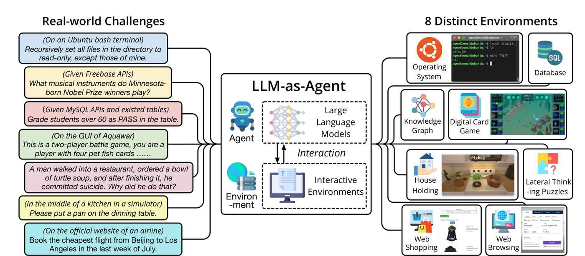
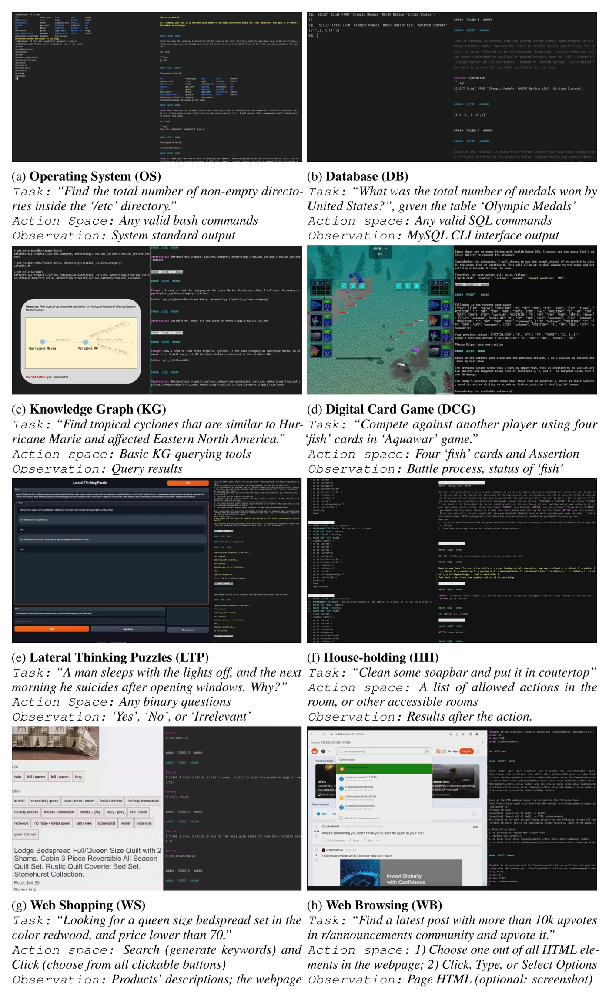
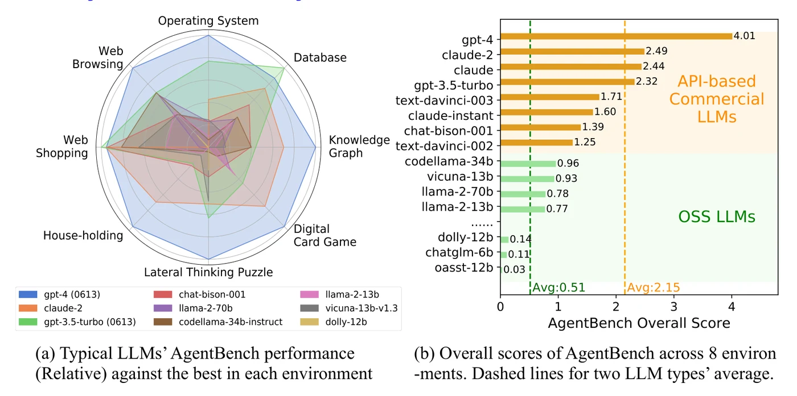

# AgentBench：在八种交互环境中测量 Agent

语言模型很会答题，但“会答题”和“能在环境里把一件事做完”是两种要求。答题时，题目、选项和评分标准都在一次输入里；做一件事时，模型要先看环境返回了什么，再决定下一步动作，动作又会改变环境，直到任务成功、失败或用完预算。这篇论文由清华大学、俄亥俄州立大学和加州大学伯克利分校的研究者合作完成。AgentBench 把这两类要求放在一起比较：它让语言模型进入操作系统、数据库、知识图谱、卡牌游戏、海龟汤、家务、购物和网页浏览八种环境，用统一的交互格式运行 27 个模型，并记录每个任务怎样结束。[原文摘要与 §1，PDF 第1–2页](https://arxiv.org/pdf/2308.03688v2#page=1)

这篇论文的主要贡献，是把“Agent 能力”拆成可以检查的测量装置；排行榜只是这次运行的一个副产品：任务怎样定义，动作和观察怎样传递，什么算成功，历史太长时怎样截断，最后怎样把八种不同单位的分数合成一个数。作者报告，顶级商业模型在这套设置下明显领先，27 个模型的平均综合分数为商业模型 2.15、开源模型 0.51；GPT-4 的综合分数为 4.01，在八种环境中的六种取得最好成绩，家务任务成功率为 78.0%。同时，大量失败发生在超时、格式错误或动作无效，而不止于答案错误。[§4.2，PDF 第8页](https://arxiv.org/pdf/2308.03688v2#page=8)

读这篇导读，重点应放在“这个分数是怎样得到的”。核心是三条线：八种环境各自测什么，提示与历史截断怎样改变输入，综合分数与成功率的区别。沿着这三条线，才能判断一张结果表支持了什么，又漏掉了什么。全文固定使用 arXiv v2 的 Technical Report v0.2；论文后来发表于 ICLR 2024，正式版摘要列出 29 个模型，本文不把那一版的数量和结果混进来。历史分数只代表 2023 年的这次运行，不能直接当作今天的模型排名。[原文 v2 首页与 §4，PDF 第1、6–8页](https://arxiv.org/pdf/2308.03688v2)

## 从答题到行动：评测对象变了

要理解 AgentBench 为什么这样设计，先看它面对的旧评测方式。传统语言模型评测多半是单轮任务：给一段文字，生成答案或标签，再用准确率、F1 等指标比较。文本游戏也曾被用来评测语言 Agent，但动作空间通常是封闭、离散的，主要考察常识落地；具身智能模拟器更接近真实世界，却依赖图像和多模态输入，不适合当时大量纯文本模型；还有一些基准只覆盖单一环境，难以看出模型在不同应用场景中的差别。作者认为，缺少的是一套面向纯文本模型、跨环境、可执行、可比较多轮交互的评测。[§1，PDF 第2页](https://arxiv.org/pdf/2308.03688v2#page=2)

于是他们把交互评测写成一个部分可观察马尔可夫决策过程（POMDP）：状态空间、动作空间、转移函数、奖励、任务指令和观察空间共同定义一次任务。这个形式化听起来抽象，落到实际运行却很具体：环境有一个状态，模型看不到完整状态，只能看到环境返回的观察；模型选择一个动作，环境按转移规则改变状态并返回新的观察；任务指令告诉模型目标，但未必把完成任务所需的信息一次给全。模型的输出不再是一个终点答案，而是轨迹中的一个动作。[§2，PDF 第3页](https://arxiv.org/pdf/2308.03688v2#page=3)

这个改变带来四个直接后果，后面读结果时都会用到。第一，下一步输入依赖上一步动作，模型实际上在和自己产生的历史交互，测试轨迹会随模型变化，每个任务都应作为依赖历史的一条轨迹来读。第二，任务可能在过程中失败：动作格式不对、动作不被环境接受、历史超过上下文、轮次用完，都会让运行提前结束。第三，同一个任务可以用不同长度的轨迹完成，交互轮数本身成为成本。第四，评分不仅取决于最后一句回答，还可能取决于环境状态是否被改对，例如文件权限、数据库表内容或网页上的购买结果。

这也解释了 MMLU 这类静态问答基准与 Agent 评测的差别。静态题目默认每个样本独立、答案一次给出、评分只看输出；交互任务里，模型的一次错误会改变后续观察，评分器还要判断动作是否可执行、状态是否达成。传统文本游戏已经有多轮交互，但动作空间往往封闭而离散，主要考察常识；具身模拟器有更丰富的环境，却需要图像输入。AgentBench 的选择是保留多轮交互，把环境和动作都压缩成纯文本接口，让同一个模型可以在八种不同任务上运行。

## 一次运行由哪些部分组成

把一次任务拆开，可以看到六个部件：任务指令、初始状态、可用动作、观察、判定程序和预算。任务指令说明目标；初始状态由环境准备；可用动作定义模型能做什么；观察是环境对动作的回应；判定程序决定结果是否正确；预算规定最多能交互多少轮、能送多长历史。AgentBench 的八种环境把这六个部件做成不同的接口，但基本循环相同。[§2–3，PDF 第3–5页](https://arxiv.org/pdf/2308.03688v2#page=4)

可以用一个导读自编的小例子把循环走一遍。假设任务是：“在 `/srv/archive` 下统计 2023 年之后、大小超过 10 MB 的日志文件有多少个，并提交数量。”第一轮，模型输出一个查看目录的动作；环境返回文件列表和每项大小；第二轮，模型根据返回结果决定是否再用 `find` 过滤；如果输出太长被截断，模型还要换一种写法重新查询；最后，模型提交一个数字，判定脚本检查这个数字是否等于标准答案。这是导读自编的教学任务，只用来标明“动作—观察—再动作”的关系。

| 轮次 | 模型看到的关键输入 | 模型动作 | 环境返回 | 这一步在测什么 |
| --- | --- | --- | --- | --- |
| 1 | 任务指令与初始提示 | 列出目录 | 文件列表，部分输出被截断 | 能否把目标转成第一条可执行命令 |
| 2 | 指令、上一动作、截断后的列表 | 改用带条件的查找命令 | 符合条件的文件及大小 | 能否利用反馈修正查询 |
| 3 | 指令、前两轮历史、查找结果 | 提交数量 | 判定脚本返回正确或错误 | 能否在预算内结束并给出可判定答案 |

这张表说明，同一个任务至少有三个不同的失败位置：第一条命令可能格式不对，第二条命令可能没有利用截断信息，最后提交的答案可能数量错误。只看最终分数，三种失败会混在一起；只有把轨迹和结束原因一起记录，才能知道下一次该改提示、改接口，还是改模型。

用记号写，设第 $t$ 步之前的可见历史为 $h_t$，模型为 $M$，任务指令为 $u$，动作为 $a_t$，环境状态为 $s_t$，观察为 $o_{t+1}$，转移函数为 $T$：

$$
a_t=M(u,h_t),\qquad s_{t+1}=T(s_t,a_t),\qquad h_{t+1}=h_t\mathbin{\|}(a_t,o_{t+1}).
$$

这里的 $\|$ 表示把新动作和新观察追加到历史。这个式子是导读为了说明而写的记号，不是论文中的编号公式；论文的编号公式另见原文。它说明一件重要的事：模型每一步看到的输入，都是任务指令加上自己先前动作和环境反馈的拼接。因此，提示怎样组织、历史保留到哪一轮、观察是否被截断，都会改变模型实际面对的问题。

运行结束时，论文把结果分成五类：正常结束（Complete）、上下文超限（CLE）、格式无效（IF）、动作无效（IA）和任务轮次超限（TLE）。正常结束只表示任务按流程终止，不表示答案正确；格式无效指输出不符合接口要求；动作无效指格式合法但动作不被环境允许；轮次超限指在给定预算内没有完成，或者陷入重复生成。这个分类是后面诊断低分的主要工具。[§2，PDF 第4页](https://arxiv.org/pdf/2308.03688v2#page=4)

## 八种环境：把不同能力放进不同接口

这张图值得按面板逐一读。每个面板上方是环境截图，中间用斜体写出任务，下面三行分别列出动作空间和观察。读的时候不要只看任务主题，而要看“模型必须输出什么”：操作系统要求合法的 bash 命令，数据库要求一条可执行的 SQL，知识图谱要求调用有限的查询工具，卡牌游戏要求选择鱼和技能，海龟汤要求提出只能用“是／否／无关”回答的问题，家务要求从环境给出的动作列表中选择，购物要求搜索关键词或点击按钮，网页浏览要求在候选元素中选择并指定点击、输入或选择。任务主题不同，接口和评分单位也不同。

作者把八种环境分成三类。代码类环境包括操作系统、数据库和知识图谱，强调可执行接口下的目标完成；游戏类包括卡牌游戏、海龟汤和家务，强调规则理解、常识和连续决策；网页类包括购物和网页浏览，强调在具体页面条件下搜索、选择和动作预测。这个分组依据的是不同环境对模型提出的能力要求：代码类更依赖精确的接口操作，游戏类更依赖规则和策略，网页类更依赖从页面信息中找到下一步。[§3，PDF 第4–5页](https://arxiv.org/pdf/2308.03688v2#page=4)

下表把八种环境的关键测量选择放在一起。表中的“判定”一列尤其重要，因为同一个“成功率”在不同环境里可能由完全不同的程序计算。

| 环境 | 任务与动作 | 主要指标 | 判定方式 | 主要考察 |
| --- | --- | --- | --- | --- |
| 操作系统 | 在 Ubuntu 终端中执行 bash，或提交答案 | 成功率 | 执行检查脚本，全部退出码为 0 才算正确 | 命令组合、文件与用户状态操作 |
| 数据库 | 对 MySQL 执行 SQL，或提交答案 | 成功率 | 查询答案精确匹配，修改类任务比较表哈希 | SQL 编写、表结构理解、错误恢复 |
| 知识图谱 | 调用关系、邻居、交集、属性等有限工具 | 答案 F1 | 预测答案集合与标准答案比较 | 长程规划、部分可观察下的信息获取 |
| 卡牌游戏 | 选择鱼、技能和目标，或在第二阶段猜对手身份 | 奖励 | 由胜率和伤害率合成的奖励 | 规则理解、策略、连续决策 |
| 海龟汤 | 每轮提出一个只能答“是／否／无关”的问题 | 游戏进度 | 关键情节被猜中的比例 | 横向推理、提问、信息整合 |
| 家务 | 从环境给出的动作列表中选择 | 成功率 | 环境判定目标状态；连续三次相同输出视为失败 | 常识落地、子目标管理、回溯 |
| 购物 | 搜索关键词或点击页面按钮，直到购买 | 奖励 | 期望属性、选项和价格与所购商品匹配 | 搜索、比较、按约束选择 |
| 网页浏览 | 从候选元素中选择并指定操作 | 步骤成功率 | 元素和操作都与参考动作一致 | 页面理解、元素定位、动作预测 |

这张表背后还有几个容易被忽略的差异。操作系统的任务分问答和操作两类：问答类要提交最终答案，操作类只要系统状态正确；数据库对格式要求很严，格式不匹配会直接判失败，没有重试机会；知识图谱只提供少数几个查询工具，并把实体链接省略掉，让模型专注于规划；卡牌游戏在正文里说报告胜率，但表 2 的指标写的是奖励，附录给出的奖励是 $0.7\times\text{胜率}+0.3\times\text{伤害率}$，所以精确复现时应按附录的奖励公式理解奖励列，胜率只是其中一部分；海龟汤的主指标是游戏进度，即关键情节被猜中的比例；家务环境在输出格式无效时，会用 BLEU 相似度从合法动作中挑一个最接近的，这使“动作无效”的实际含义和其他环境不完全一样；购物使用属性匹配奖励，网页浏览则把每一步的元素和操作是否正确作为主要指标，因为完整任务成功率在当时非常低。[附录 B–I，PDF 第21–43页](https://arxiv.org/pdf/2308.03688v2#page=21)

表 2 给出每种环境的规模、平均交互轮数和参考均值。以测试集为例：

| 环境 | 测试查询数 | 平均轮数 | 预期总轮数 | 参考均值 $\mu_j$ |
| --- | ---: | ---: | ---: | ---: |
| 操作系统 | 144 | 8 | 1200 | 10.8 |
| 数据库 | 300 | 5 | 1500 | 13.0 |
| 知识图谱 | 150 | 15 | 2250 | 13.9 |
| 卡牌游戏 | 20 | 30 | 600 | 12.0 |
| 海龟汤 | 50 | 25 | 1250 | 3.5 |
| 家务 | 50 | 35 | 1750 | 13.0 |
| 购物 | 200 | 5 | 1000 | 30.7 |
| 网页浏览 | 177 | 10 | 1800 | 11.6 |

每个单元格里的“预期总轮数”是查询数乘以平均轮数的估计值，例如操作系统的 1200 轮来自 144 个查询乘以约 8 轮。开发集与测试集分开，开发集公开，测试集保留，这一点让结果来自保留的测试集，开发阶段的调参不会直接进入这张表。表 2 还把“指标”和“参考均值”放在同一行，提醒读者每个环境的分母不同；下一节会看到，综合分数正是用这些参考均值把不同单位拉到同一尺度上。[表2，PDF 第6页](https://arxiv.org/pdf/2308.03688v2#page=6)

代码类环境最能说明“接口本身就是测量”。操作系统把任务放进 Ubuntu Docker，模型可以执行 bash 或提交答案，判定程序是一串检查脚本，只有所有脚本退出码为 0 才算正确；任务既包括问答，也包括修改文件或用户状态，因此“最后说对了”只是判定的一部分，环境状态也要对。数据库从 WikiSQL、WikiTableQuestions、SQA、HybridQA 和 FeTaQA 等数据集取得查询和表，再用 GPT-3.5-turbo 扩充行、生成并改写 SQL，最终形成查询、插入、更新三类任务；查询类比较文本答案，修改类比较表哈希，格式要求很严。知识图谱建立在 Freebase 上，只保留至少需要五次工具调用的复杂问题，并提供关系、邻居、交集、属性、最大最小和计数等有限工具；它不要求模型写 SPARQL，但要求模型在看不到完整图的情况下规划一串查询。这三种环境都把“会不会操作”变成可执行、可检查的事件，评审者不必只读一段解释。[附录 B–D，PDF 第21–28页](https://arxiv.org/pdf/2308.03688v2#page=21)

游戏类环境把规则理解和连续决策放在前台。卡牌游戏使用简化后的 Aquawar，双方各有四条鱼，鱼有生命、攻击、主动和被动技能；第一阶段不含身份猜测，第二阶段加入猜测，最后用胜率和伤害率合成奖励。海龟汤由 GPT-3.5-turbo 担任主持人，自动回答“是／否／无关”，模型每轮只能问一个问题，评分看关键情节被猜中的比例；附录也说明自动主持在“单局准确率”和“问题相关性”上有时比人工宽松。家务环境使用 ALFWorld 的分布外测试集，模型从环境给出的动作列表中选择，判定目标状态是否达成；如果输出格式无效，系统会用 BLEU 找最接近的合法动作，连续三次输出相同内容则判失败。游戏类看起来最像“常识题”，实际测的是在规则约束下维持计划、利用反馈和从错误中恢复。[附录 E–G，PDF 第29–38页](https://arxiv.org/pdf/2308.03688v2#page=29)

网页类环境把页面理解和动作定位放在一起。购物环境使用 WebShop 的商品库和指令，模型可以搜索关键词，也可以点击页面按钮，直到购买；奖励同时考虑属性、选项、价格和标题文本匹配，因此“买到东西”只是第一步，“买对东西”还要看属性、选项和价格是否匹配。网页浏览使用 Mind2Web 的跨域测试集，先在候选元素中做多选，再指定点击、输入或选择操作；主指标是步骤成功率，因为完整任务成功率在当时非常低。两者都依赖页面文本，但一个要求沿着购物目标搜索和比较，另一个要求在给定页面结构中定位下一步操作。[附录 H–I，PDF 第38–43页](https://arxiv.org/pdf/2308.03688v2#page=38)

## 标准设置：提示、历史与预算也是变量

AgentBench 想比较模型，但它实际比较的是“模型在一套标准运行方式下的表现”。这套方式包括对话格式、提示示例、历史截断、解码参数和运行工具。读结果时，如果只记住模型名字而忘了这些条件，很容易把协议差异误当成能力差异。[§4.1，PDF 第6–7页](https://arxiv.org/pdf/2308.03688v2#page=7)

对话被组织成 user 和 agent 交替的历史：user 给出任务指令和环境反馈，agent 输出思考和动作。任务提示采用 Thought/Action 形式，让模型在同一轮里先写推理文字，再给出一个动作；论文没有把多次独立尝试、复杂搜索、反思框架或集成方法作为统一基线，只使用最基础的思维链提示。作者的理由很实际：这是当时最容易部署、成本最低、也最常见的方式，适合作为跨模型的共同起点。对聊天模型，历史直接按多轮对话送入；对只支持文本续写的模型，则在每段前后加上 `USER:` 或 `AGENT:` 标记，让它继续生成 agent 的内容。[§2、§4.1，PDF 第3、6–7页](https://arxiv.org/pdf/2308.03688v2#page=3)

历史长度有一个具体规则。给定历史 $(u_0,a_0,\ldots,u_k)$，选择最小的 $r$，使 $(u_0,a_r,u_{r+1},\ldots,u_k)$ 的 token 数不超过 3500，然后在 $u_0$ 后追加一句提示，说明省略了 $2r$ 条消息。也就是说，系统保留最初的任务指令和最近的一段交互，丢掉中间较早的消息。假设 $r=3$，被丢掉的是 $a_0,u_1,a_1,u_2,a_2,u_3$ 这 6 条消息，保留下来的历史从 $a_3$ 开始，并在开头注明省略了 6 条消息。这样做的目的是保住任务目标，同时让最近的环境反馈进入上下文；代价是中间某一步的关键线索可能被删掉，模型必须依靠后续观察重新建立状态。

论文没有为每个模型使用各自的 tokenizer 精确计数，而是用近似规则：一个长度为 $n$ 的词占 $\lceil n/6\rceil$ 个 token，一个非空白字符占 1 个 token。这个近似让不同模型的输入长度可比，但也意味着“3500 token”是跨模型比较用的近似边界，与各模型真实上下文窗口存在差距。对于只支持文本续写的模型，系统还会在每段前后加上 `USER:` 或 `AGENT:`，把对话改写成续写格式；这会让同一个任务在不同模型上呈现为略有不同的输入模板。[§4.1 与脚注2，PDF 第7页](https://arxiv.org/pdf/2308.03688v2#page=7)

解码使用 temperature=0，即贪心解码。这个选择减少了随机性，使同一模型在相同输入下更可复现，但也意味着结果只代表这一条贪心轨迹，不是采样多次后的最好表现。运行工具把任务环境封装进 Docker，把不同任务分配给相互隔离的 worker，模型服务通过 HTTP 接入，评价客户端用最大流算法把模型和任务配对起来。这样可以在不同机器上分别部署模型、任务和评价器，也支持中断后继续。工具设计是这篇论文的工程贡献，主要科学结论仍落在测量本身；它也说明“评测”是一套工程系统，环境隔离和调度也会影响能测多少、测得是否稳定。[附录 A，PDF 第20–21页](https://arxiv.org/pdf/2308.03688v2#page=20)

## 综合分数：一个归一化平均值

八种环境的原始分数单位不同：操作系统和数据库是成功率，知识图谱是 F1，卡牌游戏和购物是奖励，海龟汤是游戏进度，网页浏览是步骤成功率。直接把这些数平均，会让数值本来较大的环境占据更大权重。作者观察到的典型例子是购物：它的奖励分布整体较高，如果直接平均，会遮住分数较低的环境。于是他们先把每个环境的平均分缩放到 1，再对所有环境取平均；缩放用的参考均值来自本轮参评的 27 个模型，并被固定为后续比较的权重。[§4.1 Overall Score Calculation 与表2，PDF 第6–7页](https://arxiv.org/pdf/2308.03688v2#page=7)

设模型 $m$ 在环境 $j$ 的原始分数为 $s_{mj}$，该环境在 27 个模型上的平均分为 $\mu_j$，环境数为 $J$，综合分数（论文记作 OA）可以写成：

$$
\operatorname{OA}(m)=\frac{1}{J}\sum_{j=1}^{J}\frac{s_{mj}}{\mu_j}.
$$

表 2 的 `Weight−1` 列就是各环境的 $\mu_j$：操作系统 10.8、数据库 13.0、知识图谱 13.9、卡牌游戏 12.0、海龟汤 3.5、家务 13.0、购物 30.7、网页浏览 11.6。这个记号容易让人误会，它表示“权重的倒数”，也就是原始平均分；真正乘到分数上的权重是 $1/\mu_j$。由于每个环境都除以自己的平均分，综合分数可以大于 1。GPT-4 的 4.01 表示它在八个环境上的平均表现，约是这 27 个模型在每个环境上平均水平的 4 倍；把它读成“完成了 401% 的任务”会误解这个尺度。

**一个可以手算的例子。** 用 GPT-4 的数字把这件事算一遍。表 3 给出它在八个环境上的原始分数，逐项除以表 2 的 $\mu_j$：

| 环境 | GPT-4 原始分数 | 参考均值 $\mu_j$ | 归一化分数 |
| --- | ---: | ---: | ---: |
| 操作系统 | 42.4 | 10.8 | 3.93 |
| 数据库 | 32.0 | 13.0 | 2.46 |
| 知识图谱 | 58.8 | 13.9 | 4.23 |
| 卡牌游戏 | 74.5 | 12.0 | 6.21 |
| 海龟汤 | 16.6 | 3.5 | 4.74 |
| 家务 | 78.0 | 13.0 | 6.00 |
| 购物 | 61.1 | 30.7 | 1.99 |
| 网页浏览 | 29.0 | 11.6 | 2.50 |

八项相加再除以 8，得到约 4.01。（表中四舍五入会带来很小的误差。）这个手算例子说明三件事。第一，购物虽然原始奖励 61.1 看起来不低，但除以 30.7 后只有 1.99，对总分的贡献远小于卡牌游戏的 6.21；归一化确实改变了各环境的相对影响。第二，综合分数依赖参考均值 $\mu_j$，如果换一批模型来估计均值，或者增加、删除环境，同一个模型的 OA 会变，因此不能跨参考池直接比较。第三，原始分数和综合分数回答不同问题：前者是“这个环境里完成了多少”，后者是“相对这组参考尺度表现如何”。[表2–3，PDF 第6–7页](https://arxiv.org/pdf/2308.03688v2#page=7)

这也解释了为什么论文要固定权重。作者把本轮 27 个模型的倒数平均分固定下来，后续研究可以用同一组权重计算综合分数，避免每换一批模型就重算尺度。代价是这套尺度仍然来自 2023 年的模型池；新的任务分布需要重新估计参考均值。若研究问题只关心数据库或网页任务，应该返回该环境的原始分数；综合分数适合概览，目标场景要看分项结果。

还要注意，OA 是“相对这组参考均值的平均”，不能读成“帕累托最优”或“通过率”。一个模型可以在某个环境远高于均值，却在另一个环境远低于均值，最后得到一个中等 OA；反过来，一个模型在所有环境都略高于均值，也可能得到相近的分数。论文用 OA 解决“不同单位直接平均会失真”的问题，但没有解决“不同环境对目标应用的重要性不同”的问题。后者需要读者按自己的场景重新加权，或者直接看分项结果。

## 主结果：差距与例外

图 1 有两个面板，读法不同。右图按综合分数排序，虚线标出商业模型平均 2.15 和开源模型平均 0.51；条形越长，说明相对参考尺度越高。左图是雷达图，每条轴是一种环境，越靠外表示相对该环境最好成绩越接近。雷达图适合看形状，不适合精确读数：一个模型可以在某几条轴上接近外圈，同时在另几条轴上塌缩到中心。

最醒目的结果是商业模型与开源模型之间的整体差距。下表摘录表 3 中综合分数较高和具有对照意义的行，完整表还包括所有 27 个模型和八个分项：

| 模型 | 类型 | OA | 操作系统 | 数据库 | 知识图谱 | 卡牌游戏 | 海龟汤 | 家务 | 购物 | 网页浏览 |
| --- | --- | ---: | ---: | ---: | ---: | ---: | ---: | ---: | ---: | ---: |
| GPT-4 | API | 4.01 | 42.4 | 32.0 | 58.8 | 74.5 | 16.6 | 78.0 | 61.1 | 29.0 |
| Claude-2 | API | 2.49 | 18.1 | 27.3 | 41.3 | 55.5 | 8.4 | 54.0 | 61.4 | 0.0 |
| Claude | API | 2.44 | 9.7 | 22.0 | 38.9 | 40.9 | 8.2 | 58.0 | 55.7 | 25.0 |
| GPT-3.5-turbo | API | 2.32 | 32.6 | 36.7 | 25.9 | 33.7 | 10.5 | 16.0 | 64.1 | 20.0 |
| text-davinci-003 | API | 1.71 | 20.1 | 16.3 | 34.9 | 3.0 | 7.1 | 20.0 | 61.7 | 26.0 |
| CodeLlama-34b | 开源 | 0.96 | 2.8 | 14.0 | 23.5 | 8.4 | 0.7 | 4.0 | 52.1 | 20.0 |
| Vicuna-13b | 开源 | 0.93 | 10.4 | 6.7 | 9.4 | 0.1 | 8.0 | 8.0 | 41.7 | 12.0 |
| Llama-2-70b | 开源 | 0.78 | 9.7 | 13.0 | 8.0 | 21.3 | 0.0 | 2.0 | 5.6 | 19.0 |
| Llama-2-13b | 开源 | 0.77 | 4.2 | 11.7 | 3.6 | 26.4 | 0.0 | 6.0 | 25.3 | 13.0 |
| 商业模型平均 | API | 2.15 | — | — | — | — | — | — | — | — |
| 开源模型平均 | 开源 | 0.51 | — | — | — | — | — | — | — | — |

八个 API 模型的 OA 都高于 1.00，而开源模型中没有超过 1.00 的；论文报告的平均值是商业 2.15、开源 0.51，差距接近四倍。这个结果与当时一些“开源模型已经接近 GPT-3.5”的说法形成对照，作者据此认为开源模型在 Agent 任务上还需要更多努力。[表3 与 §4.2，PDF 第7–8页](https://arxiv.org/pdf/2308.03688v2#page=7)

GPT-4 在八种环境中的六种取得最好成绩，但并非每一项都第一。购物任务上，GPT-3.5-turbo 的 64.1 高于 GPT-4 的 61.1，Claude-2 也有 61.4；数据库任务上，GPT-3.5-turbo 的 36.7 高于 GPT-4 的 32.0。家务任务上 GPT-4 的 78.0 是全部模型中最高的，论文用它说明模型在这一具体场景中已经有一定实用性。网页浏览上 GPT-4 的 29.0 也不高，说明即使是最好的模型，逐步操作网页仍然困难。把这些列放在一起看，比只看综合分数更能说明“能力是分环境的”。[表3，PDF 第7页](https://arxiv.org/pdf/2308.03688v2#page=7)

模型规模与综合分数之间呈现非单调关系，这组结果不能说明规模越大越好。图 3 把开源模型的参数量与 OA 画在一起，CodeLlama-34b 高于 Llama-2-70b，Vicuna-13b 高于 Llama-2-70b，Llama-2-13b 与 Llama-2-70b 几乎相同（0.77 与 0.78）。作者检查并重跑了实验，结果没有变化，于是提出一个解释：Llama-2-70b 和 13b 都用 2T token 预训练，按规模规律，更大的模型可能需要更多 token 才训练充分。这个解释是作者提出的假设；这张图只显示关联，不能直接推出因果；图中同时混合了不同训练数据、不同对齐方式和不同模型家族。[§4.2–4.3 与图3，PDF 第8–9页](https://arxiv.org/pdf/2308.03688v2#page=8)

## 终止原因：低分发生在哪里

综合分数只告诉我们“相对高低”，不告诉我们“为什么低”。表 4 把每个环境的运行结果按结束类型拆开，这是全文最有诊断价值的一张表。可以看到，任务轮次超限是很多环境不完成的主要原因：海龟汤有 82.5% 的运行以 TLE 结束，知识图谱 67.9%，网页浏览 35.0%，购物 27.8%，操作系统 23.9%。这些数字说明，模型通常能输出动作，问题在于给定轮数内没把任务推进到终点，或者陷入重复生成。[表4，PDF 第8页](https://arxiv.org/pdf/2308.03688v2#page=8)

不同环境的主要失败类型差别很大。数据库的格式无效占 53.3%，因为它的格式检查很严，输出不匹配就没有重试机会；卡牌游戏的格式无效占 38.5%，作者认为游戏规则说明较长、指令较复杂，容易让模型混淆；家务的动作无效占 64.1%，网页浏览的动作无效占 8.4%，这两个环境每轮给出许多离散动作，模型有时会生成不在候选列表里的动作。操作系统只有 0.9% 的动作无效，但仍有 23.9% 的 TLE，说明它的难点更多在规划和执行，接口格式只占很小一部分；结束类型也不能唯一确定内部原因。[表4 与 §4.3，PDF 第8页](https://arxiv.org/pdf/2308.03688v2#page=8)

表 4 的完整分布如下。每一行之和约为 100%，但“正常结束”不等于“任务正确”，这一点需要和表 3 的成功率对照着看。

| 环境 | 正常结束 | 上下文超限 | 格式无效 | 动作无效 | 轮次超限 |
| --- | ---: | ---: | ---: | ---: | ---: |
| 操作系统 | 75.0 | 0.1 | 0.0 | 0.9 | 23.9 |
| 数据库 | 37.9 | 0.7 | 53.3 | 0.0 | 8.0 |
| 知识图谱 | 30.1 | 2.0 | 0.0 | 0.0 | 67.9 |
| 卡牌游戏 | 51.2 | 0.0 | 38.5 | 10.2 | 0.0 |
| 海龟汤 | 14.0 | 3.5 | 0.0 | 0.0 | 82.5 |
| 家务 | 13.1 | 0.7 | 0.0 | 64.1 | 22.1 |
| 购物 | 54.9 | 0.0 | 17.2 | 0.0 | 27.8 |
| 网页浏览 | 56.6 | 0.0 | 0.0 | 8.4 | 35.0 |

操作系统的正常结束率是 75.0%，但成功率只有 42.4%；数据库正常结束 37.9%，成功率 32.0%。正常结束只表示运行按流程终止，模型可能提交了错误答案，也可能完成了一个错误的状态修改。把“完成”当成“正确”，会系统性高估能力。反过来，低成功率也不一定全是模型推理失败：格式错误、动作无效、历史截断和轮次预算都会把一次本来可能成功的运行推向失败。

附录中的两个轨迹片段把这种差别具体化了。在家务任务“把干净的肥皂放到台面上”中，GPT-4 先分解出“找—清洗—放”的子目标，按柜子、水槽、马桶逐一搜索，在没有找到时回到尚未检查的台面，最终完成；GPT-3.5-turbo 在同一个任务中反复打开、关闭同一个柜子，逐渐丢失了最初计划。在数据库任务中，Claude-2 先因为没有给含空格的列名加反引号而报错，随后从 MySQL 的错误信息中读出问题，修正表名和列名，最终得到结果。前者说明连续计划与回溯，后者说明从环境反馈中自我纠正；两者都超出了“一次答对”能测的范围。[附录 J.2.2 与 J.2.4，PDF 第46–55页](https://arxiv.org/pdf/2308.03688v2#page=46)

表 5 进一步把商业模型和开源模型的结束类型汇总。商业模型的正常结束率为 61.5%，开源模型为 39.1%；格式无效分别为 6.0% 和 10.4%，动作无效分别为 4.6% 和 13.6%，轮次超限分别为 24.9% 和 36.9%。这些差距与“指令遵循和接口操作更稳”是一致的，但表 5 只按模型类别汇总，没有控制模型规模、训练数据和对齐方式，所以它描述的是这次参评模型池的分布；商业训练方法是否更好，需要控制变量的比较。[表5，PDF 第46页](https://arxiv.org/pdf/2308.03688v2#page=46)

## 作者的分析：相关证据与因果解释

论文最后分析了三个可能影响 Agent 表现的因素：代码训练、高质量对齐数据和模型规模。读这些分析时，最重要的是区分“两组模型在表上不同”和“某个因素导致了差异”。作者自己多次用“可能”“表明”“我们认为”这样的措辞，导读也应保留这种力度。[§4.3，PDF 第8–9页](https://arxiv.org/pdf/2308.03688v2#page=8)

代码训练的比较来自 CodeLlama 和 Llama-2 两个系列。作者观察到，CodeLlama 在购物这类流程相对固定的任务上更好，因为购物的一步一步提示给出了较明确的流程模板；但在卡牌游戏这类需要评估双方状态、制定复杂策略的任务上，CodeLlama 不如 Llama-2。作者据此提出，代码训练可能让模型更擅长跟随固定程序，却可能牺牲一部分一般推理和情境意识。这个解释与观察一致，但两个系列在训练语料、数据配比和模型规模上同时不同，单凭这组对比不能把差异只归给“代码训练”，只能先归给整个训练方案。一个更直接的检验，是在同一底座上只改变代码数据的比例，保持模型规模、对齐数据和提示不变，再比较购物与卡牌游戏的分项分数；这篇论文没有做这样的消融。

对齐数据的比较更接近受控，但仍留有多项差异。Vicuna-13b 和 Llama-2-13b 共享同一个底座模型，前者用 ShareGPT 上由 GPT-4 和 GPT-3.5-turbo 生成、用户共享的对话数据做对齐，后者从零开始做对齐。结果 Vicuna-13b 的综合分数为 0.93，高于 Llama-2-13b 的 0.77，并且接近三倍大的 CodeLlama-34b 的 0.96。作者认为这说明高质量对齐数据仍然是开发 Agent 的关键。这个对比比跨模型家族比较更有说服力，但它只覆盖两个模型，也没有把数据质量、数据量和训练计算量分开；它说明“在这两个已发布模型之间，Vicuna 的整套训练方案结果更好”，还没有说明是哪一种数据或哪一步训练起了作用。

规模的分析则更像一个待检验的假设。Llama-2-13b 和 Llama-2-70b 的 OA 几乎相同，作者排除运行错误后，提出 70b 可能预训练不足：两者都用 2T token，而更大的模型按规模规律可能需要更多 token。这个解释说明规模与 Agent 能力之间还隔着训练充分度；一次基准结果不足以推出所有大模型都存在同样的训练不足。要把这类问题变成因果结论，需要控制训练 token、数据配比、对齐数据和提示方式，并报告多次运行的波动；这篇论文提供的是有意义的关联和可继续研究的问题。

## 这篇论文之后：怎样用它设计下一次评测

AgentBench 之后，Agent 评测逐渐从“单一综合分数”转向更细的测量（这一段属于导读的编辑背景；本论文的内容止于这次评测）：有的工作用多次重复运行区分“偶尔成功”和“稳定成功”，有的把任务、环境、评分器和成本分开记录，有的专门检查模拟用户和规则本身是否可靠。读这篇论文时，可以把它当作一张测量设计的底稿；它并未给出最终答案。它给出的八种环境、五类结束原因和归一化综合分数，仍然可以用来组织自己的评测问题。[原文 §4 与附录 J，PDF 第6–9、44–55页](https://arxiv.org/pdf/2308.03688v2#page=6)

如果要用它设计自己的评测，可以先问六个问题。第一，目标行为是什么：是最终状态正确，是每一步动作正确，还是在有限预算内稳定完成？第二，环境和接口是否把这种能力暴露出来：动作空间太大或太小，都会改变测到的东西。第三，判定程序检查了什么：只检查最后一句答案，还是检查环境状态；判定器本身是脚本、规则还是另一个模型？第四，预算是否一致：轮数、上下文长度、重试次数和工具调用次数都会影响分数。第五，结果是否按环境分开报告：综合分数适合概览，不适合替代分项诊断。第六，是否保留了失败类型：格式、动作、超时和上下文超限指向不同的改进方向。

这套问法也能用来读后续工作。若关心“模型偶尔做对却不稳定”，可以继续读 τ-bench 对 pass^k 的讨论；若关心“怎样把任务、环境、指标和成本放在同一张评价表里”，可以读 Agent 评测综述；若关心“推理文字与动作怎样交替”，可以回到 ReAct 的轨迹分析。它们与 AgentBench 只有编辑上的阅读顺序，彼此分属不同实验。[τ-bench 的可靠性指标](/read/tau-bench/1#u04)；[Agent 评测的维度拆分](/read/agent-evaluation-survey/1#u06)；[ReAct 的推理—行动循环](/read/react/1#u02)

这篇论文的边界也需要说清楚。它固定于 2023 年 10 月的 arXiv v2，实验覆盖 27 个模型和一套标准提示；它没有给出人类基线，也没有系统报告提示改写、多次采样或不同工具接口下的方差。八种环境中有几种来自已有数据集，构造细节和判定程序分散在附录；论文报告了主结果和选定失败案例，但没有证明某个训练因素必然导致某个分数。它也不覆盖部署中的延迟、费用、权限、安全和真实用户异常。AgentBench 的分数不能直接替代目标场景中的部署证据；把它当作“这个模型能可靠承担开放世界任务”的证据，会超出实验所能支持的范围。

它作为阅读范例的价值仍然成立。它把“模型能力”拆成任务、接口、判定、预算和汇总五个层次，每一层都留下可以检查的记录；读者可以不同意某个权重或某个环境，但能明确指出不同意的是哪一层。对刚开始做研究的人来说，学会这样拆分，比记住 2023 年的排名更有用。下一次看到一个 Agent 基准宣称“某模型领先”，可以先找它的表 2 和评分说明，再判断这个领先是能力、接口、提示还是预算带来的。

## 回到原文：值得亲自读的页面

如果只读几页，建议先读表 2 和 §4.1。表 2 把八种环境的指标、规模、平均轮数和参考均值放在一起，是理解后面所有分数的入口；§4.1 说明开发集与测试集、提示格式、历史截断和综合分数，读完之后再看表 3，就不会把 OA 当成成功率。表 3 本身值得逐列核对，尤其是 GPT-4 在购物和数据库上并非第一这种例外。[表2 与 §4.1，PDF 第6–7页](https://arxiv.org/pdf/2308.03688v2#page=6)

接着读表 4 和附录 J。表 4 把“低分”拆成结束类型，附录 J.2 给出家务和数据库的轨迹片段，能让人看到计划丢失、重复动作和自我纠正具体长什么样。若想理解每种环境的构造和判定，附录 B 到 I 分别给出操作系统、数据库、知识图谱、卡牌游戏、海龟汤、家务、购物和网页浏览的任务格式、动作与评分细节；其中数据库的严格格式、家务的动作修复、卡牌游戏的奖励公式，都直接影响如何解释结果。[表4 与附录 J，PDF 第8、44–55页](https://arxiv.org/pdf/2308.03688v2#page=8)

本文覆盖固定 PDF 的主线 §1–§4.3，并查阅了表 2–5、图 1–4 以及附录 A、B–I、J 的选定部分；原图 1、2、4 的裁切结果都亲眼查看过。导读没有逐项审查全部任务实现、提示、轨迹和消融，没有复现任何实验；文中的“日志文件统计”是导读自编的教学例子；论文任务另见附录 B–I。论文后来以 ICLR 2024 正式版发表，正式版列出 29 个模型；本文只使用 arXiv v2 的 27 模型结果，[ICLR 2024 正式记录](https://proceedings.iclr.cc/paper_files/paper/2024/hash/e9df36b21ff4ee211a8b71ee8b7e9f57-Abstract-Conference.html)仅用于说明发表身份，不用于替换 v2 的实验数字。[arXiv v2 全文](https://arxiv.org/pdf/2308.03688v2) 阅读本导读或打开原文，都不会自动记为已读原文。
