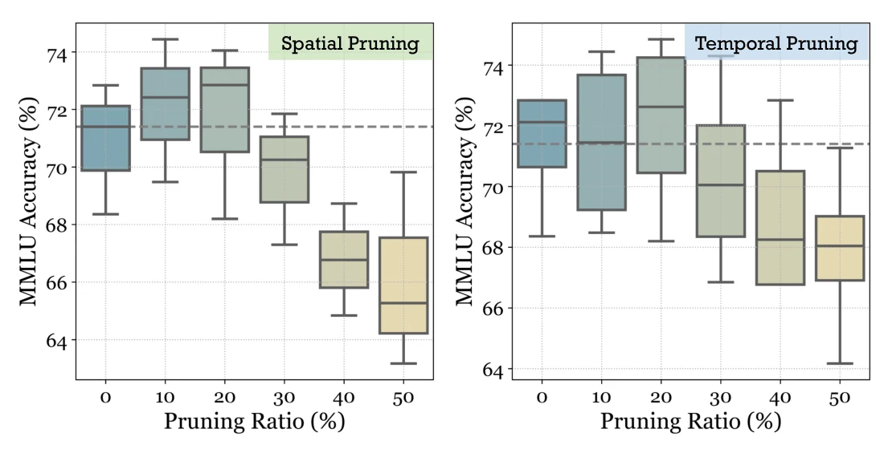

# AgentPrune: Which Agent Messages Can We Stop Sending?

Putting several large language models (LLMs) together to discuss a problem is often more effective than having one model answer alone: one proposes a solution, another checks the reasoning, and a third combines the answers. But communication has a price. An answer read once by each of four other agents enters four prompts; when the next round broadcasts the history again, the same passage is billed over and over. Worse, what everyone reads may be a highly persuasive mistake. "Let everyone communicate fully" thus brings at once a chance to improve quality, extra cost and the risk that errors spread.

In *Cut the Crap: An Economical Communication Pipeline for LLM-based Multi-Agent Systems*, nine authors including Guibin Zhang, Yanwei Yue and Zhixun Li propose AgentPrune. They split a system into two graphs, "who reads whose message within the same round" and "who reads whose history in the next round". They first use a small amount of task feedback to learn the relative importance of connections, then delete part of the connections in one go, so that later reasoning proceeds along a sparser graph. What the method mainly trains is a mask over communication connections, not the weights of the underlying language model. [Paper identity, authors and abstract](https://arxiv.org/abs/2410.02506v1)

The paper tests this idea on six benchmarks in knowledge question answering, mathematical reasoning and code generation. One easily checked example: when AgentPrune is added to an AutoGen system of five GPT-4 agents on HumanEval, input tokens fall from 492,273 to 315,105, a reduction of about 36%, and the reported Pass@1 changes from 85.41% to 86.65%. This shows that communication graphs do have room worth optimizing; the specific effect depends on the original structure, the task and the cost of learning. [Table 3, PDF p. 9](https://arxiv.org/pdf/2410.02506v1#page=9)

What is most worth understanding in this paper is **how a multi-agent conversation is turned into a communication graph that can be optimized, executed and accounted for**. The guide first explains why the authors suspected there was too much communication, then follows one round of message passing against the original figure, then takes apart graph masks, policy gradients, the low-rank constraint and one-shot pruning, and finally returns to the experiments and costs. After reading it, you should be able to say, for a deleted edge, which message it originally carried to whom, and how deleting it changes later inputs. This guide is pinned to arXiv v1 of 3 October 2024; several formulas and numbers in that version are inconsistent, which is noted where it affects conclusions, with detailed recalculations kept in the review notes.

## Background: Why another agent can mean many more inputs

To understand AgentPrune, first separate "a few more agents" from "a few more messages". Agents can use the same underlying model while having different role prompts, states or tools. One solves, one looks for counterexamples, one synthesizes, and none of this requires training three different language models. What actually makes them collaborate is that the input to a later model call includes content an earlier call has already generated.

The paper divides existing ways of communicating into two kinds. The first organizes work within a round: a chain structure has each member read the previous member's result; a tree structure summarizes through levels; denser graphs let several members supply material to each other. The second passes information between rounds: the next round can read everyone's answers from the previous round, or only filtered answers or a summary. LLM-Debate, for example, has each member continue answering on the basis of the other members' outputs from the previous round, which increases the opportunities for exchange. [§1 and §5, PDF pp. 2, 10](https://arxiv.org/pdf/2410.02506v1#page=2)

Both kinds of design have reasonable motivations. Answering independently can lack chances to correct errors; chaining lets a checker catch a predecessor's mistakes; and multi-round discussion lets the system revise judgments already formed. But whether a given piece of content helps depends on what the receiver is doing. A summarizer may need two independent answers, while a solver may be led astray by a wrong draft; a counterexample just produced in this round is important, while repeatedly copying an old answer that has already been refuted may waste budget.

**Why do input tokens grow so fast?** A token is the basic unit in which a model processes text, and charges are usually computed separately for input and output tokens. Here is a communication-counting example made up for the guide: four members each write 100 tokens, and in the next round each member reads all four answers. Counting only this cross-round transfer, $4\times4\times100=1600$ tokens have to be placed into four inputs. The four original answers total only 400 tokens, but they are read four times. This does not yet include the question, role instructions or newly generated answers.

Dense communication within a round amplifies in the same way. If $n$ members are arranged in order and each later member reads the outputs of everyone before it, there are $n(n-1)/2$ within-round edges; if in the next round everyone receives everyone's output from the previous round, there may be $n^2$ cross-round edges. This count shows that cost growth comes both from more members and from more and more connections among them. It is an editorial explanation for simple structures; real systems also have to account for messages of different lengths, early stopping and tool calls.

From this the authors change the research question from "how to add more collaboration" to "which pathways of collaboration are worth keeping". Compared with compressing each message into a summary, AgentPrune changes the relations of transmission; compared with calling fewer agents, it first keeps the set of nodes and reduces the edges between them. This lets it be embedded in existing systems without redesigning every role's workflow from scratch.

## Graph model: Edges within and between rounds

The authors represent the whole multi-agent system as $G=(V,E)$. $V$ is the set of nodes, each corresponding to an agent; $E$ is the set of edges, where a directed edge $i\to j$ means that agent $i$ passes information to agent $j$. The paper's Equation (1) writes a node as four parts: the underlying model, a role, a state and external plugins. Plugins in turn include functions and configurations, such as search or code execution. [§2, Equations (1)–(4), PDF p. 3](https://arxiv.org/pdf/2410.02506v1#page=3)

A node is not a fixed prompt. It produces new output based on the current question, its own duty, its existing state and the messages it receives. Even if the same model is called twice, a change of input may change the output. Deleting an edge therefore has two layers of effect: directly, one less piece of text is passed on; indirectly, what the receiver writes afterward changes. The second layer is one reason why output tokens sometimes rise and sometimes fall in the experiments.

The paper divides edges into spatial edges $E^S$ and temporal edges $E^T$. These names describe dependencies in the conversation, not positions in a physical network. A spatial edge connects two nodes within the same round, and a temporal edge connects a sender in the previous round with a receiver in the current round. The rounds of outputs are written explicitly below to make the distinction easier:

| Connection | What the receiver actually reads | Work it can support |
| --- | --- | --- |
| $i^{(t)}\to j^{(t)}$, spatial edge | The message member $i$ has just produced this round | Continuing a predecessor's computation, or checking it immediately |
| $i^{(t-1)}\to j^{(t)}$, temporal edge | Member $i$'s message from the previous round | Keeping the previous round's results to revise or compare them |
| $i^{(t-1)}\to i^{(t)}$, temporal self-connection | One's own answer from the previous round | Continuing one's own line of reasoning |

The same role can influence another through both kinds of edge at once. For example, in this round the checker receives the solver's new proposal, and in the next round the solver reads the checker's comments from the previous round. If rounds are ignored and one just draws "A and B are connected to each other", it is impossible to see who acts first or which content has to enter the history.

To show what makes up an input, the paper's Equation (4) can be rewritten in the following more explicit teaching notation:

$$
M_i^{(t)}\sim P_\theta\left(\,\cdot\mid q,\mathrm{Role}_i^{(t)},\mathrm{State}_i^{(t)},\{M_j^{(t-1)}:j\in N^T(i)\},\{M_{ji}^{(t)}:j\in N^S(i)\}\right).
$$

$q$ is the question; $N^S(i)$ and $N^T(i)$ are the spatial and temporal in-neighbors that send messages to node $i$; $M_{ji}$ is a message sent from $j$ to $i$; and $P_\theta$ is the distribution from which the model generates output given these conditions. The braces mean collecting the messages received, and a real system also has to organize them into a prompt. The most important part of the expression is the conditioning bar: deleting an edge changes the set of material visible to the receiver.

**How is execution order guaranteed within a round?** If A must first read B's output from this round and B must first read A's output from this round, both will wait. The paper therefore requires the spatial graph actually executed to be a directed acyclic graph, a DAG, and uses topological sorting to find an order that "handles all dependencies first, then the current node". Cross-round edges have no such problem, because the previous round's outputs have already been generated.

The original candidate spatial graph may contain cycles. DAGSampling in Appendix A finds a cycle, randomly deletes one edge on it, repeats until no cycles remain, and then performs topological sorting. Appendix I.1 also explains that the sparse graph shown after final pruning may still contain cycles, so this step is still needed before use. What is fixed, then, is the range of connections allowed after pruning, and the specific execution graph may still go through cycle removal. Only once "candidate graph", "pruned graph" and "executable DAG" are distinguished does the paper's method form a closed procedure. [Appendix A, PDF p. 16](https://arxiv.org/pdf/2410.02506v1#page=16) · [Appendix I.1, PDF p. 30](https://arxiv.org/pdf/2410.02506v1#page=30)

## Communication redundancy: The motivating experiment

The authors do not simply assume that every message is valuable. They first ask: what happens if some connections are deleted at random? This is a very instructive motivating experiment, because it temporarily introduces no complicated optimizer and tests only the premise "more communication is always better".

The left side of Figure 3 uses a dense mesh spatial structure, and the right side a temporal structure in the style of LLM-Debate. The configuration is four GPT-3.5-turbo agents, and the task is MMLU, a multiple-choice benchmark covering many fields of knowledge. The horizontal axis moves gradually from deleting no edges to deleting half of the connections, the vertical axis is accuracy, and a gray dashed line gives the original performance as a reference. The boxes and whiskers show the distribution of results; at this point the paper does not fully state the number of repetitions or the statistics behind the boxes, so the figure is suited to reading trends, and readers should not add conclusions about significance of their own. [§2 and Figure 3, PDF p. 4](https://arxiv.org/pdf/2410.02506v1#page=4)

The most important phenomenon in the figure is that after light pruning, performance does not collapse immediately, and some settings even score above the original. As the deletion ratio keeps growing, performance on both sides gets clearly worse. From this the authors conclude that part of the communication in existing graphs contributes very little to the task and may even have a negative effect. At the same time, the figure also shows that collaboration depends on certain necessary connections, so the inference "the more deleted, the better" does not hold.

The authors use a utility function $\phi(G)$ to denote the task quality of the system when it runs along graph $G$. The core condition in the paper's definition is that there exists a subgraph:

$$
G_{\mathrm{sub}}=(V,E'\cup E''),\qquad E'\subseteq E^S,\quad E''\subseteq E^T,\quad \phi(G_{\mathrm{sub}})\geq\phi(G).
$$

That is, keeping the original members and only part of the spatial and temporal edges still achieves at least comparable quality. The actual research objective further allows a deviation threshold $\epsilon$, deleting as many connections as possible under the condition $|\phi(G_{\mathrm{sub}})-\phi(G)|\leq\epsilon$. This is the intent of the paper's Equations (5) and (6); because the original formulas allow the subset to be equal, a genuinely useful discovery of redundancy should also require that edges were actually deleted, rather than taking the original graph itself as the answer.

"Redundancy" here is **redundancy relative to task quality**. Two identical pieces of text sent to two members who each need it may both be important; a distinctive and detailed message that leads its receiver in the wrong direction may be worth deleting. The algorithm has to measure this relation through running and feedback; the surface of the language alone cannot decide it.

The understanding the motivating experiment gives is also concrete: there is room for optimization between the quantity of communication and the quality of the task. The difficulty to solve next is finding a good subgraph among many possible ones without spending all the savings on the search.

## Figure 4: How one message affects this round and the next

Figure 4 puts the abstract edges back into a concrete conversation. It is the most important flow diagram in the paper: the left half is the original way of communicating, the right half the way after pruning; the upper half shows who reads whom within the round, and the lower half shows which outputs enter the next round's history.

The question at the top of the figure asks how many consecutive odd integers form an arithmetic sequence whose sum is 240. On the left, Thinker 1 answers first and gives 5; Thinker 2, having read Answer 1, gives 8; Thinker 3 reads the first two answers and also gives 8. Finally the Summarizer combines the three answers and accepts 8. The red cross in the figure shows that the authors mark this result as wrong. [Figure 4 and §3.1, PDF p. 5](https://arxiv.org/pdf/2410.02506v1#page=5)

The change on the right happens first in the inputs. The part of Thinker 2's prompt that originally quoted Answer 1 is crossed out, and it answers from the original question instead. Thinker 1's direct connection to the summarizer is also deleted. Thinker 3 can still receive the results of Thinker 1 and Thinker 2, so the first solver is not removed from the system entirely; its direct influence on the various receivers is reduced. In the figure, Thinker 2 and Thinker 3 then output 12, and the summarizer accepts 12 as well.

The text in the figure needs to be read as "what the model actually said". The equation Thinker 3 writes on the right does not match the solution it claims, and the green tick in the figure is only the authors' mark on the final answer; the whole trajectory should not be taken as a verified mathematical proof. The information truly useful for this section is which quotations were crossed out, which inputs were kept, and how changing the inputs changed the downstream answers.

**Now look at the token counts on the arrows.** On the left, Answer 1 is 378 tokens long and is sent to Thinker 2, Thinker 3 and the summarizer, so this one answer counts as $378\times3$ within the round. Answer 2's 432 tokens are sent twice and Answer 3's 261 tokens once, so the message inputs within the round total:

$$
378\times3+432\times2+261=2259.
$$

In the cross-round stage, the three answers and the 188-token summary all enter the history and are supplied to four roles, giving $(378+432+261+188)\times4=5036$. Adding the two gives the 7295 tokens shown in the figure. This shows the cost of the same content being consumed many times, rather than simply counting how much text was generated.

On the right, four within-round edges are kept, counted with the new output lengths as $378+402\times2+299=1481$. The history keeps only Answer 3 and the summary, so the cross-round part becomes $(299+187)\times4=1944$, for a total of 3425. The message lengths have changed here too, so between "how many edges were deleted" and "how many tokens were saved" lies the change in downstream outputs. These numbers are the figure's illustrative account of message passing and do not include the learning cost of finding the structure, which is added back separately later.

Figure 4 shows what pruning does but does not yet tell us how the position of the scissors is decided. AgentPrune does not know in advance what is wrong with Thinker 1's answer, nor does it arrange an extra judge to review every message sentence by sentence. The graph masks of the next section are the way of turning "which pathways to choose" into a learnable problem.

## Graph masks: Turning switches into learnable scores

The original communication graph answers only one question: may this connection be used? To compare the importance of connections, the authors attach an updatable value to each candidate edge. Arranging all these values in a matrix gives the graph mask. Multiplying the mask by the original graph forms a parameterized communication structure for learning.

Suppose the system has $n$ nodes. The spatial adjacency matrix $A^S$ and the temporal adjacency matrix $A^T$ are both $n\times n$, where a 1 in row $i$, column $j$ means $i\to j$ is allowed, and a 0 means the original system has no such edge. The corresponding masks $S^S, S^T$ are also $n\times n$. The paper's Equation (7) writes:

$$
A(\widetilde G)=\{A^S\odot S^S,\ A^T\odot S^T\}.
$$

$\odot$ denotes elementwise multiplication, not ordinary matrix multiplication. For example, if $A^S[1,2]=1$ in the original graph and the mask at that position is 0.2, the product is 0.2; if a position in the original graph is 0, the product is still 0 however large the mask is there. The original graph gives the range of choices, and the mask helps choose within that range. [§3.1, Equation (7), PDF p. 5](https://arxiv.org/pdf/2410.02506v1#page=5)

This restriction matters: the method mainly selects among existing edges. If the original system never allowed some checker to report back to the summarizer, multiplying by a mask will not create that pathway out of nothing. The same optimization method starting from different initial graphs therefore faces different spaces of choice. This is why the experiments report three versions separately, starting from a complete graph, a layered graph and a random graph.

To see the shapes clearly, the four roles of Figure 4 are reused below, numbered 1, 2, 3 and 4, with 4 as the summarizer. **The mask values below are assigned by the guide for teaching only; they are not parameters trained in the paper.** Suppose the original graph allows each earlier role to send messages to every later role; then:

$$
A^S=\begin{bmatrix}
0&1&1&1\\
0&0&1&1\\
0&0&0&1\\
0&0&0&0
\end{bmatrix},\qquad
A^S\odot S^S=\begin{bmatrix}
0&0.10&0.85&0.20\\
0&0&0.90&0.80\\
0&0&0&0.95\\
0&0&0&0
\end{bmatrix}.
$$

The first row has three candidate edges, meaning role 1's output can be sent to 2, 3 and 4; the third column has two nonzero entries, meaning role 3 can read 1 and 2. The convention is "rows send, columns receive", the reverse of some graph implementations that use rows for in-neighbors, so keep the same direction throughout when reading the formulas.

For now, these continuous values express only a tendency in choosing connections. A mask value of 0.2 does not multiply a message by 0.2, nor keep only a fifth of its words. A model call ultimately needs a concrete set of messages, so the learning stage samples structures according to the current parameters and runs conversations, and later decides which edges to keep based on the scores.

Setting the objects side by side shows that the scale of the whole learning problem is very different from that of the language model itself:

| Object | Shape or type | Role in the method |
| --- | --- | --- |
| $A^S,A^T$ | Two $n\times n$ binary matrices | Specify the range of original connections |
| $S^S,S^T$ | Two $n\times n$ continuous matrices | Hold the updatable connection parameters |
| One sampled structure | A concrete message graph | Decides who actually receives whose output this time |
| $\phi$ | Task score | Feeds back how good the answer from this exchange was |
| $B^S,B^T$ | Two $n\times n$ binary matrices | The edges kept fixed after learning ends |

Although the number of parameters to learn is limited, obtaining one feedback signal may still require several expensive model calls. The difficulty of the authors' method is therefore how to use a small amount of feedback effectively, not that the matrices are too large for memory.

## Policy gradients: How task scores teach the graph to select connections

With masks in place, the next step is to have them improve with task performance. The difficulty is that answer quality is usually given by multiple-choice grading, code execution or an external interface. When the model answers a question along some graph and gets "right" or "wrong", that score cannot be backpropagated in the ordinary way to decide which edges to delete, as a continuous loss inside a neural network could. The authors use policy gradients, treating the choice of graph structure as a stochastic policy. [§3.2, Equations (9)–(10), PDF p. 6](https://arxiv.org/pdf/2410.02506v1#page=6)

The "policy" here has as its action the choice of a communication graph. Parameters $S$ determine the tendency for different structures to be chosen; the system executes the chosen structure and obtains utility $\phi$; the update raises the chance of high-utility structures appearing. The underlying model can still be called through an API, and training does not require access to its internal gradients. The score, however, must be provided by the specific task, which is one of the inputs needed to put the method into practice.

Writing the whole spatial–temporal graph in the paper's Equation (9) as $g$, it can be expressed as:

$$
\nabla_S\mathbb E_{g\sim p_S}[\phi(g)]
\approx\frac1M\sum_{k=1}^{M}\phi(g_k)\nabla_S\log p_S(g_k).
$$

Here $S=\{S^S,S^T\}$, $M$ is the number of sampled structures, $g_k$ is the graph drawn at the $k$-th sample, and $p_S(g_k)$ is the probability the current parameters assign to it. $\nabla_S\log p_S(g_k)$ describes in which direction the parameters should change to make this graph more likely to appear; multiplying by the score means good results push the update harder. Averaging over several samples estimates the overall trend from a limited number of trials.

It can be understood as a feedback loop: the current connection tendencies produce several candidate graphs, each graph has the agents actually collaborate, the evaluator gives a result, and the optimizer updates the connection tendencies. No edge needs a human label of "useful" or "useless" in advance; learning happens indirectly from the performance on complete tasks. What results is therefore a score under the joint effect of other connections, roles and tasks, not an unchanging value of some message.

**A hand calculation with only one optional edge.** To understand the formula, consider for now only the connection from role 1 to role 2 in Figure 4. This is again an example made up for the guide, simplified to an independent Bernoulli switch: the edge is kept with probability $s$ and deleted with probability $1-s$. Set by hand the task score to 0.2 when it is kept and 0.8 when it is deleted, with everything else fixed. The expected score is then:

$$
J(s)=0.2s+0.8(1-s)=0.8-0.6s,\qquad J'(s)=-0.6.
$$

The negative gradient tells us to lower the probability of keeping this edge. Now check with the policy gradient: at $s=0.5$, the derivative of the log probability is $1/s=2$ for the graph that keeps the edge and $-1/(1-s)=-2$ for the graph that deletes it. Weighted by their respective probabilities of 0.5, the result is $0.5\times0.2\times2+0.5\times0.8\times(-2)=-0.6$, matching direct differentiation. With a teaching learning rate of 0.1, one step of gradient ascent moves $s$ from 0.5 to 0.44.

This step explains "how a task score becomes a connection update", and also why the complete result after deletion has to be examined. A message does not naturally earn a high weight just because it appears everywhere; if it makes later members more likely to err, the utility feedback for structures containing it gets worse. Conversely, a message that is occasionally very short may supply key corrective information for the final answer.

The paper's Equation (10) expresses the probability of a structure as the product of the weights of the selected edges, but it does not fully expand the factors for absent edges in a general Bernoulli graph distribution, nor does it explain how cycle removal affects the final graph's probability. The Bernoulli derivation above is therefore a teaching model for understanding policy gradients and should not be taken as a line-by-line reconstruction of the paper's implementation. When reading the original formula, the key is to grasp the logic "sample–execute–evaluate–raise the probability of good structures"; exact reproduction still requires checking the sampler and the code.

A final practical difficulty is that edges interact. Sending a solver's draft to a checker may be good, while sending it directly to the summarizer may cause interference; the effect of one edge changes with whether other edges exist. The authors optimize the utility of the whole graph precisely to bring these combined effects into the feedback. The low-rank constraint that follows adds, beyond task feedback, a structural preference to the search.

## Low-rank constraints: What regularity should the graph learn?

Task rewards encourage finding effective graphs, but with rewards alone, learning might keep many connections, or follow the chance feedback of a few questions too closely. The authors therefore add a low-rank constraint, hoping the masks' patterns of connection will be more regular overall, and borrowing the idea from graph learning research that low-rank structure resists noise. This is the method's second optimization objective. [§3.2, Equations (8) and (11), PDF pp. 5–6](https://arxiv.org/pdf/2410.02506v1#page=6)

"Rank" can first be understood as the number of independent patterns in a matrix. If several rows are identical or can be combined linearly from each other, the patterns they express overlap, and the matrix's rank is lower. In a graph mask, one row is one sender's tendencies to connect to each receiver. Low rank tends to let these patterns be combined from a few basic directions, instead of letting every position vary unrelatedly.

The paper's Equation (8) considers task utility, the rank of the masks and a limit on staying close to the original graph together. Writing the sampled communication structure as $g$, its core is:

$$
\max_{S^S,S^T}\ \mathbb E[\phi(g)]-\sum_{X\in\{S,T\}}\operatorname{rank}(S^X),
\qquad
\sum_{X\in\{S,T\}}\|A^X-S^X\|_F\leq\delta.
$$

The first term wants a high task score, and the second penalizes too many independent patterns. $\|\cdot\|_F$ is the Frobenius norm, which sums the squares of all the matrix's entries and takes the square root, measuring overall difference; $\delta$ is the allowed degree of deviation. The constraint expresses the idea of "looking for a simpler pattern of connections near the original structure", rather than building a graph anew, detached from the original system. [Equation (8), PDF p. 5](https://arxiv.org/pdf/2410.02506v1#page=5)

Minimizing rank directly is hard, so the authors substitute the nuclear norm. The nuclear norm is the sum of all singular values:

$$
\|S\|_* = \sum_i\sigma_i(S).
$$

Singular values can be understood as the strength of a matrix's different independent directions. Penalizing their sum encourages some directions to weaken, giving a simpler structure. The paper's Equation (11) minimizes the nuclear norms of the spatial and temporal masks while keeping the constraint of staying close to the original adjacency matrices. One need not master the full singular value decomposition algorithm first to understand its role: beyond "which structures score high", it further prefers "which structural patterns are simpler".

**How does low rank differ from fewer edges?** Look at two small matrices made up for the guide: $U=\begin{bmatrix}1&1\\1&1\end{bmatrix}$ and $I=\begin{bmatrix}1&0\\0&1\end{bmatrix}$. The former's two rows are identical, so its rank is 1, yet it has four nonzero entries; the latter has rank 2 but only two nonzero entries. Their singular values are $(2,0)$ and $(1,1)$ respectively, and both nuclear norms equal 2. This small example shows that low rank is not the same as fewer edges, and the nuclear norm does not directly count nonzero connections.

In this paper, then, the two operations each have their own job. Low-rank regularization shapes the distribution of scores during learning; what actually reduces the number of edges is the binary pruning of the next section. Calling the two together "low rank automatically deletes useless messages" would skip the most important step of the algorithm, and would make it hard to explain why a pruning ratio still has to be specified.

The authors also expect low-rank structure to improve resistance to attacks, a reason drawn from related experience in graph learning. The later attack experiments in the paper offer system-level support for this expectation, but they do not mark message by message which malicious messages were identified, nor do they show separately that some singular direction is the "direction of lies". The safest understanding is that low rank is an inductive preference used to guide structure search, and whether it helps should be answered by ablation results with the term removed.

## One-shot pruning: From continuous scores to fewer messages

Once the continuous masks have learned differences, the system still needs a sparse graph it can execute directly. The authors do not let optimization run to the end of every conversation; after a short learning stage they prune once by magnitude, and then fix the structure of allowed communication. This is One-Shot Pruning; "one-shot" here stresses that the structure is finalized only once, a different meaning from the single example in one-shot prompting. [§3.3, Equation (12), PDF p. 6](https://arxiv.org/pdf/2410.02506v1#page=6)

The original uses $p\%$ for the proportion deleted and keeps the high-scoring connections among those the original graph supports. To avoid the mixed notation in the original formula's TopK parameter between "count" and "proportion", this step is written below in the guide's notation. Let $\rho\in[0,1]$ be the deletion ratio, $m_X=|E^X|$ the number of original candidate edges, and $\mathcal T_X$ the roughly $(1-\rho)m_X$ highest-scoring edges among these candidates; then:

$$
B^X_{ij}=\mathbf 1\{A^X_{ij}=1\ \text{and}\ (i,j)\in\mathcal T_X\},\qquad
A^X_{\mathrm{sub}}=A^X\odot B^X,\quad X\in\{S,T\}.
$$

$\mathbf 1$ is the indicator function, which is 1 when the condition holds and 0 otherwise. $B^X$ is thus a pure table of switches. The spatial and temporal graphs each form a binary mask, which is then applied back to its original graph. How the number kept is rounded and how ties are handled are implementation details the original formula does not adequately specify; the hand calculation below chooses a whole number of kept edges to avoid introducing extra conventions.

Return to the four-role matrix from before. The scores of the six original spatial edges are 0.10, 0.85, 0.20, 0.90, 0.80 and 0.95. Deleting one third, that is, two edges, and keeping the top four gives:

$$
B^S=\begin{bmatrix}
0&0&1&0\\
0&0&1&1\\
0&0&0&1\\
0&0&0&0
\end{bmatrix}.
$$

Deleted are $1\to2$ and $1\to4$; kept are $1\to3$, $2\to3$, $2\to4$ and $3\to4$. This happens to reproduce the two within-round scissors of Figure 4: the second role can answer independently, the summarizer reads the second and third roles directly, and the third role can still compare the first two results. The teaching scores serve to show how such a structure emerges from a ranking; the paper does not report these six mask values for Figure 4.

The steps of running one conversation are now clear:

| Order | Messages received this round | Output produced |
| --- | --- | --- |
| Role 1 | None; still has the original question and role instructions | A first independent solution |
| Role 2 | None; still has the original question and role instructions | A second independent solution |
| Role 3 | The solutions of roles 1 and 2 | A compared or corrected answer |
| Role 4 | The answers of roles 2 and 3 | The summarized answer |

A member with no incoming edges can still answer the original question. Deleting an edge straight to the summarizer does not mean its content can never arrive: role 1's view may enter the final answer indirectly through role 3. Graph optimization changes direct visibility and the paths of propagation; it does not block a viewpoint at the semantic level.

**Why not keep learning?** On the one hand, continually sampling structures requires extra runs; on the other, later tasks need to actually enjoy the benefit of the sparse structure. Borrowing the idea that "usable sparse structures may appear early in training", the authors learn only in the first $K'$ rounds and then reuse the result in the remaining $K-K'$ of $K$ rounds in total. The learning stage explores and the fixed stage exploits, and this division of labor is exactly what turns structure optimization into an investment with a chance of paying off.

## Temporal pruning and multi-query reuse: Where the savings last

Spatial pruning decides who reads whom first within the round, and temporal pruning decides which existing outputs continue into the next round. The two have similar mathematical forms but different practical effects: the former changes the dependencies of the current division of labor, and the latter changes which results of the discussion the system carries forward.

Figure 30 unfolds time more clearly than Figure 4. On the left, before pruning, each role's output from the previous round has the chance to influence several roles in the next round. On the right, a more selective set of pathways is kept: for example, the programming expert's output from the previous round goes to the programming expert and the test analyst in the next round, the test analyst's output goes to the bug fixer, and the bug fixer's output can enter the next round's project manager. The arrow back to the "project manager" crosses rounds, so it creates no circular waiting within one round's execution. [Appendix I.2 and Figure 30, PDF p. 35](https://arxiv.org/pdf/2410.02506v1#page=35)

These arrows are well suited to understanding why the two graphs have to be distinguished. Who checks the code is an arrangement that can be made within a round; to whom in the next round the checking comments are handed is an arrangement of history. Even when the member names are exactly the same, the two kinds of edge still represent messages at different times. The remaining connections in Figure 30 look consistent with the division of work, which is an intuitive explanation offered by the visualization; the authors did not remove these kept edges one by one to verify each one's independent effect.

Compared with compressing the history into a summary, temporal pruning chooses sender–receiver relations directly. It can keep a detailed piece of test feedback and send it only to the member responsible for fixing in the next round; it can also send the previous round's final conclusion to several members. A summary, by contrast, rewrites the content itself. The two operations can be combined in a system, but what this paper mainly optimizes is relations, and it should not be treated as a memory compressor guaranteed to keep every important detail.

**If each question is discussed for only two rounds, can learning still save money?** This is the practical problem the authors face in §3.4. For a very long task, it makes sense to learn for a few rounds and reuse for many; but multiple-choice or basic math questions often need only one or two rounds, and if the graph is reoptimized for each question, the learning cost recurs again and again. The paper therefore proposes multi-query training: learn one graph from a small number of earlier questions, then use it for many later questions. [§3.4, PDF pp. 6–7](https://arxiv.org/pdf/2410.02506v1#page=7)

Appendix D makes this more explicit: given a benchmark of $Q$ questions in total, the first $Q'$ questions serve as the training stage, solving, evaluating and updating the graph as they go; after one-shot pruning, the remaining $Q-Q'$ questions use the fixed structure. This forms two arrangements alongside multi-round learning within one question:

| Organization | What it learns from | Where it reuses | Suitable situation |
| --- | --- | --- | --- |
| Conversation level | The first $K'$ rounds of the same question | The last $K-K'$ rounds of that question | Complex tasks with a long enough continuation |
| Query level | The first $Q'$ questions of the same batch of tasks | The remaining $Q-Q'$ questions | Many similar tasks with few rounds each |

What query-level learning saves is the communication structure, not the answers to earlier questions stuffed into later prompts. A new question still has its own input and output; what is shared is which roles are allowed to communicate with each other. The benefit therefore depends on whether the division-of-labor pattern learned earlier continues to apply to later questions. [Appendix D, PDF pp. 16–17](https://arxiv.org/pdf/2410.02506v1#page=17)

This protocol also determines how the experiments should be interpreted: the graph uses task feedback from a prefix of the benchmark, so it belongs to a system adapted on a small number of tasks, not to a fixed zero-shot graph that never touched task feedback. The v1 text and appendices read here do not fully explain whether the training prefix counts toward the final score, nor every task's evaluator and split. The results can support "learning on this batch of tasks and then reusing is valuable"; the ability to transfer across domains would need a separate evaluation on independent tasks.

## Cost accounting: How long until learning the graph pays off?

The token accounting of Figure 4 showed what sparse communication might save; now the cost of finding the sparse graph has to be added back. Even if a method is cheap per question once fixed, the total may still be more expensive if the early trials are many and the fixed structure is used only a few times afterward.

§3.4 of the paper writes the average spatial message length as $c_S$, the average temporal message length as $c_T$, and the question length as $c_q$. To make the expressions easier to read, two guide notations are defined here: $L=c_S|E^S|+c_T|E^T|$, the volume of messages passed along edges per round; and $H=c_q|V|$, the fixed part that sends the question to every node. Under this simplified model, running the original system for $K$ rounds costs:

$$
C_{\mathrm{base}}=K(L+H).
$$

If $M$ structures are sampled in each of the first $K'$ rounds, the learning cost is approximated by the cost of the complete graph, and a fraction $\rho$ of edges is deleted afterward, AgentPrune's two-stage cost is:

$$
C_{\mathrm{AP}}=MK'(L+H)+(K-K')[(1-\rho)L+H].
$$

The first term is learning, and the second is reuse of the sparse graph. This model assumes that average message length stays roughly the same, and that deleting the same proportion of edges reduces the input along edges by roughly the same proportion; it does not fully account for output charges, the different fixed prompts of different roles, or differences in the length of different edges. It is suited to explaining the payback relation, not to predicting an API bill directly. [Cost analysis in §3.4, PDF p. 7](https://arxiv.org/pdf/2410.02506v1#page=7)

Subtracting the two expressions directly gives the net saving, rearranged by the guide:

$$
\Delta=C_{\mathrm{base}}-C_{\mathrm{AP}}
=\rho(K-K')L-(M-1)K'(L+H).
$$

This form is very intuitive. The first term is the gain from passing fewer messages in the later rounds; the second is the extra cost of the learning stage compared with running once as originally. Only when the difference is positive does it really save money. The fixed question still has to be sent to every member, and deleting edges cannot reduce that part of the cost in the same proportion.

Here the guide must be distinguished from the original: the expansion of v1's Equation (13) does not match the result of subtracting the two-stage costs given just before it. The expressions above are the guide's algebraic rearrangement based on the original's definitions of cost, consistent with the logic of the multi-query formulas in Appendix E, and are not a cost guarantee copied from the original. When checking formulas, keeping cost components that can be checked is worth more than adopting a neat final savings formula.

**Continue with a hand-computable example.** Suppose $L=600$ tokens are passed along edges per round and the fixed question part is $H=400$; learn for $K'=2$ rounds, sampling $M=3$ graphs per round, then delete half the edges. All these values are idealized parameters set by the guide. The extra cost of learning is $(3-1)\times2\times1000=4000$; once fixed, each round saves $0.5\times600=300$. To pay off requires $300(K-2)>4000$, that is, at least 16 rounds in total before a positive net saving appears.

If there are only 10 rounds in total, the original system costs 10,000 and AgentPrune costs $3\times2\times1000+8\times700=11,600$, actually 1600 more. If 20 rounds are run in total, the original system costs 20,000 and the new one $6000+18\times700=18,600$, saving only 1400. With exactly the same deletion ratio, the conclusion changes with the number of reuses.

The query-level arrangement follows the same logic. With $K$ rounds per question, learning on the first $Q'$ questions and reusing on the remaining $Q-Q'$, Equations (14)–(17) in Appendix E can be rearranged into:

$$
\Delta_{\mathrm{queries}}=K\left[\rho(Q-Q')L-(M-1)Q'(L+H)\right].
$$

Large numbers of short tasks amount to a longer payback period. This also explains why the authors fix the graph after a short learning period instead of searching forever. Still, the real benefit must ultimately be accounted for with all inputs, outputs, learning calls and model prices; "half the edges deleted" describes only a change of structure and does not mean "total cost halved". [Appendix E, PDF pp. 17–18](https://arxiv.org/pdf/2410.02506v1#page=18)

## Experimental setup: What does each comparison compare?

Before reading the results, three levels of experiment need to be separated. The random deletion in Figure 3 is a motivating experiment; the main table compares different ways of communicating; and the plug-in experiments compare an existing framework before and after AgentPrune is added. They answer "is there redundancy", "how does the method perform as a complete scheme" and "can it improve existing systems" respectively, and use somewhat different configurations.

The main experiments cover six benchmarks. MMLU tests general-knowledge multiple-choice questions; GSM8K, MultiArith, SVAMP and AQuA are mathematical reasoning tasks, consisting of arithmetic word problems or multiple-choice questions with reasoning; HumanEval provides function descriptions and tests, testing the ability to generate code that passes them. The first five are read as the accuracy the paper reports, and HumanEval uses Pass@1, the success rate of one candidate program passing the task's tests; higher is better for all. [§4.1, PDF p. 7](https://arxiv.org/pdf/2410.02506v1#page=7)

The paper calls models through APIs, mainly gpt-3.5-turbo-0301 and gpt-4-1106-preview, with generation temperature set to 1. Temperature affects the randomness of generation, which also means that the wording and result of one trajectory may vary. General-knowledge and math tasks use two rounds and code tasks four; multi-query learning uses $Q'\in\{5,10\}$. Each member's role prompt was generated by GPT-4. [§4.1, PDF p. 8](https://arxiv.org/pdf/2410.02506v1#page=8)

In Table 1, apart from the single-agent category, every method uses five GPT-4 agents. AgentPrune has three versions: C starts from a complete spatial graph, L from a layered graph and R from a random graph; on the temporal side all uniformly use dense connections in the style of LLM-Debate. The letters stand for different starting spatial topologies, and all three versions learn and prune both spatial and temporal connections.

The comparison methods also form three groups. The single-agent group includes direct answering, CoT chain-of-thought prompting, and more complex prompting or aggregation over multiple samples. The spatial group includes chain, star, tree and complete graphs, as well as GPTSwarm, which parameterizes communication relations. The temporal group includes LLM-Debate, PHP, which uses the previous round's decision as a hint for the next round, and DyLAN, which selects members or outputs by scoring. What they provide for the paper is comparisons among different ways of organizing communication, not a strict ablation in which the same optimizer changes only one parameter. [§4.2, PDF p. 8](https://arxiv.org/pdf/2410.02506v1#page=8)

The authors also adapted these frameworks. Appendix G.1 explains that in the comparison with GPTSwarm, roles and tool arrangements were unified, and MMLU communication was changed from passing only the option to passing both the option and the reasoning; PHP was adapted into a multi-agent, cross-round prompting scheme. AutoGen was organized as a dynamic group chat with a user proxy, a manager, an engineer, a critic and an executor. The results in the table therefore belong to the specific systems built in this paper and cannot be taken directly as a unified ranking of these frameworks in all configurations. [Appendix G.1, PDF pp. 22–24](https://arxiv.org/pdf/2410.02506v1#page=22)

The description of the method recommends using it when there are more than three members and the communication structure has some complexity, since simple chains or direct-output structures leave little room for deletion; yet the appendix experiments also include configurations with three members. It is more apt to read this as the authors' recommendation on applicability and the range they actually explored than as a strict theoretical threshold of "more than three". What really affects the benefit is whether there are enough optional pathways, and how many times a good structure can be reused.

## Main results: Can less communication preserve task quality?

Table 1 answers the question of quality first. Below are excerpts of some methods and four tasks from the same main table; all numbers are scores out of 100, HumanEval being Pass@1 and the other three columns accuracy. The multi-agent configurations in the table all use five GPT-4 agents, and the methods differ in their prompts and communication processes as described in the previous section. [Table 1, PDF p. 7](https://arxiv.org/pdf/2410.02506v1#page=7)

| Method | MMLU | GSM8K | AQuA | HumanEval |
| --- | ---: | ---: | ---: | ---: |
| Single agent, direct answer | 82.14 | 85.40 | 70.34 | 71.68 |
| Single agent, CoT | 82.65 | 87.17 | 73.91 | 75.52 |
| Complete graph | 83.15 | 86.49 | 79.21 | 83.75 |
| GPTSwarm | 83.98 | 89.74 | 78.16 | 88.49 |
| LLM-Debate | 83.69 | 90.23 | 77.52 | 83.79 |
| AgentPrune-C | 84.72 | 95.62 | 79.47 | 89.38 |
| AgentPrune-L | 83.50 | 93.78 | 78.44 | 88.61 |
| AgentPrune-R | 83.94 | 95.83 | 78.60 | 90.30 |

First, multiple agents can indeed bring gains, especially on the code task, where the complete graph scores far above the single agent answering directly. But other topologies in Table 1 also have declines; the star structure, for example, scores 80.79 on MMLU, below the single agent's 82.14. The way of collaborating decides whether members correct each other or interfere with each other, and the number of members alone says nothing about the result.

Second, all three starting points of AgentPrune achieve good scores, but with different strengths. C is highest on MMLU in this table, R is higher on HumanEval, and L is relatively weaker in these columns. The explanation of the method should be "the starting structure still shapes the search space, and learning-based pruning can find competitive schemes within it", not "as long as it is sparse, it is all equally good".

Third, these task scores do not yet answer the question of efficiency. AgentPrune-C uses spatial and temporal connections plus a learning process, while the complete-graph baseline belongs to the category of spatial communication. The difference in scores between the two should first be attributed to the whole system design; the entire improvement cannot be attributed to pruning or the low-rank term alone. The later ablations come closer to the question of "how much each component contributes".

The original tables have some clear numerical problems, so only the individual scores are excerpted here, without the Avg. column or the colored improvement figures. For example, C's HumanEval score of 89.38 relative to the single agent's 71.68 should be an increase of 17.70 percentage points, but Table 1 prints 15.70, while the same row in Table 2 gives 17.70. When reading tables, "raw scores", "differences" and "averages" should each be computed separately, rather than assumed consistent with each other because they sit in the same row.

Figure 5 puts task quality and input tokens on one plot, intending to emphasize the lower-right region of high quality and low cost. However, in v1 the figure's vertical-axis label and numerical scale, as well as the positions of some points, are inconsistent with Table 1, so this guide does not read cost multiples or new scores closely from Figure 5. Clearer evidence on cost is Table 3 in the next section: it lists raw input and output tokens before and after integration, which can be computed item by item.

The overall understanding the main table provides is that communication pruning and high task quality can occur together. To judge further whether the technique is worthwhile, turn to the before-and-after accounts within the same framework, rather than only comparing the highest column of scores.

## Integration with existing frameworks: Inputs, outputs and bills

Table 3 is the most useful system comparison in the whole paper. The authors add AgentPrune to AutoGen and GPTSwarm and list task performance, input tokens, output tokens and cost in dollars. Below are excerpts of four sets of results for MMLU and HumanEval with five GPT-4 agents; the raw counts are kept, and the differences and proportions in the text are recomputed by the guide. [§4.3, Table 3, PDF p. 9](https://arxiv.org/pdf/2410.02506v1#page=9)

| Framework and task | Performance before → after | Input tokens: before → after | Output tokens: before → after | Cost in original table (USD): before → after |
| --- | --- | --- | --- | --- |
| AutoGen / MMLU | 82.13 → 82.78 | 486,034 → 349,583 | 89,224 → 86,582 | 7.537 → 6.093 |
| AutoGen / HumanEval | 85.41 → 86.65 | 492,273 → 315,105 | 130,196 → 139,714 | 8.828 → 7.342 |
| GPTSwarm / MMLU | 83.98 → 83.05 | 3,055,230 → 990,312 | 569,124 → 439,551 | 47.60 → 23.05 |
| GPTSwarm / HumanEval | 84.49 → 84.96 | 2,736,136 → 745,617 | 1,004,616 → 745,926 | 57.49 → 29.80 |

Look first at AutoGen / HumanEval. Input falls by $492273-315105=177168$ tokens, about 36.0% of the original; output, however, rises by 9518 tokens. Simply adding input and output, total tokens go from 622,469 to 454,819, a drop of about 26.9%. The dollar cost in the original table falls by about 16.8%. The three proportions differ because "input", "total tokens" and "charges computed at different unit prices" are three different measures.

These data correspond to the mechanism. Deleting edges directly reduces what receivers read, but less input may lead the model to develop its own analysis afresh, and output length changes with it. If output has a higher unit price, part of the input saving is offset by the extra output. The most fitting conclusion is therefore: in this configuration, the method preserved and slightly raised the reported code pass rate with about a 36% reduction in input, while lowering the total bill. The paper gives no statistics from repeated trials here sufficient to judge the significance of the 1.24-point change.

Now look at GPTSwarm / MMLU. Input falls sharply, but accuracy drops from 83.98 to 83.05. This row is very important, because it moves the paper's goal from "every ability must rise" back to "a trade-off between quality and cost". Whether a drop of about 0.93 percentage points is worth accepting has to be decided by how much quality loss a specific application can tolerate. The paper can show this option but cannot make the decision for every application.

The room for savings also differs between the two frameworks. GPTSwarm itself includes communication-structure optimization and its original costs are high, so the savings after integration are larger; AutoGen in the authors' configuration has smaller original costs, so the absolute gains differ. When comparing, look first at the before-and-after change within the same framework, then discuss differences between frameworks. The GPTSwarm / HumanEval baseline score in Table 3 also differs from Table 1, so this guide keeps each local comparison separately and does not splice them across tables into one chain of improvement.

In v1, the input proportions for the two GSM8K rows do not match the raw counts, and the cost in AutoGen's row cannot be explained consistently by the pricing relation shown in the other rows of the same table; this guide therefore does not repeat, from these rows, promotional figures of "how much is saved across the board". The dollar amounts are the paper's billing results at the time, not current service prices. Detailed discrepancies and recalculations are kept in the review notes; the understanding the text needs to keep is that effectiveness, input, output and learning cost must all enter the evaluation of efficiency together.

## Robustness and ablation: Evidence for the design

Besides asking "can it save money", the authors ask "can it be less disturbed by erroneous messages". This question connects with the motivation for graph pruning: if one member deliberately misleads the others, dense communication gives it more chances to spread; reducing unnecessary pathways may lower the system's dependence on it. The paper tests this with two kinds of attack. [§4.4, PDF pp. 9–10](https://arxiv.org/pdf/2410.02506v1#page=9)

The first kind is a role-prompt attack: a member is chosen at random and its role is replaced with a prompt requiring it to lie, output wrong answers and give misleading analysis. The second is a member-replacement attack: a member is chosen at random and replaced with a "fake" interface that generates random options and incoherent text. The other members keep their original functions. These two experiments test how the system performs after one member has been compromised, which is clearly different from a scenario in which an attacker gradually induces tool operations from an external web page. [Appendix G.3, PDF p. 27](https://arxiv.org/pdf/2410.02506v1#page=27)

Figure 6 reports the role-prompt attack on MMLU. Below are four sets of values excerpted from the figure; higher accuracy is better:

| Configuration | Before attack | After attack |
| --- | ---: | ---: |
| Complete graph | 83.1 | 78.4 |
| AgentPrune-C | 84.7 | 83.9 |
| AutoGen | 82.1 | 76.2 |
| AutoGen + AgentPrune | 82.7 | 82.5 |

The complete graph drops 4.7 percentage points after the attack and AgentPrune-C drops 0.8; the drop in the AutoGen comparison also shrinks markedly. This result supports the authors' judgment that limiting pathways of propagation helps collaboration stay robust. What it shows is improved overall performance under the specified condition of one compromised member; it is not a general defense against prompt injection, nor does it show the algorithm identifying lies sentence by sentence. [Figure 6, PDF p. 9](https://arxiv.org/pdf/2410.02506v1#page=9)

**Does the low-rank term really help?** Table 6 tests the components more directly. The authors remove role differences and the low-rank regularization separately, running the other parts as in the original scheme. Below are the raw scores excerpted for three tasks, HumanEval being Pass@1:

| Version | MMLU | GSM8K | HumanEval |
| --- | ---: | ---: | ---: |
| AgentPrune-C | 84.72 | 95.62 | 89.38 |
| C without role differences | 84.3 | 93.7 | 87.8 |
| C without the low-rank term | 84.6 | 94.5 | 88.9 |
| AgentPrune-R | 83.94 | 95.83 | 90.30 |
| R without role differences | 83.3 | 95.6 | 88.6 |
| R without the low-rank term | 83.5 | 95.4 | 89.3 |

These columns support two design choices: the division of work brought by different roles helps, and the low-rank term also brings improvements on several tasks. But the size of the gain varies with the starting point and task; on AQuA in the original table, C without the low-rank term scores 79.5, slightly above the full version's 79.47. The paper summarizes the effect of low rank rather strongly, while reading the table row by row better supports the judgment "it helps in most settings". The table has no uncertainty intervals, and differences of a few hundredths in particular should not be interpreted as a stable advantage. [Table 6, PDF p. 30](https://arxiv.org/pdf/2410.02506v1#page=30)

Figure 21 further varies the number of members and the number of questions used in early learning. In the left panel, going from three to five members brings a clear rise, after which the curve fluctuates and the gain levels off; in the right panel, increasing $Q'$ also brings fluctuations rather than a steady rise. The authors' final choice of 5 or 10 questions for early optimization is a choice between quality and cost. $Q'$ here means the number of questions used for learning; although the horizontal axis is labeled Early Stopping Round, it should be understood under the multi-query protocol.

Linking the sets of evidence together makes each experiment's role clear: random deletion shows there is room for optimization, the main table shows that a competitive problem-solving system can be obtained, the integration experiments show that actual call costs can be reduced, the ablations help explain which designs are useful, and the attack tests examine another benefit that reducing communication may bring. Each set answers a different question, and together they form the chain of evidence for the method.

## After the paper: Communication structure as a research object

What follows is editorial extension, not follow-up experiments the paper has already done, nor a judgment about research gaps today. The value of AgentPrune lies in breaking "let the agents communicate" further into observable decisions about connections: who needs what information, when they need it, and how much input cost it is worth paying for. This perspective is well suited to analyzing newly emerging collaborative systems.

First, structure and content are worth observing together. An edge from "test analyst to bug fixer" in Figure 30 looks reasonable, but what it actually carries might be test cases, a summary of errors, or just a sentence of agreement. Later research could keep the message content and the receiver's behavior, distinguishing between "the edge was kept" and "key corrective information actually entered later answers". The number of connections offers clues about cost; content and downstream reactions explain why a connection is useful.

Second, fixed graphs and dynamic selection have different trade-offs. Once learning is complete, a fixed graph makes no further decisions per message, so its cost is easier to amortize; dynamic selection can vary with the question but has to pay for the selector. When comparing the two, it is apt to fix the total budget and then look at how each performs on hard questions, easy questions and distribution shifts, rather than comparing only how sparse the final graph is. AgentPrune's multi-query protocol provides a clear fixed-structure starting point for such research.

Third, the scoring method decides what it learns to keep. If only a correct final option is rewarded, the optimizer may favor a set of pathways that are good at most questions; if factual sources, tool results or process constraints are required to be preserved, the definition of utility needs to include these requirements. The policy gradient described earlier only raises the probability of structures with higher reward; whether the reward covers the abilities one truly cares about is a separate layer of design.

Further reading can proceed in three directions. To understand how roles and turn-taking conversation are organized, read the pinned revision of [CAMEL](/read/camel/1); to see how message handling, tools and group chat form an executable system, read [AutoGen](/read/autogen/1); to put accuracy, cost and other abilities into one evaluation protocol, read [HELM](/read/helm/2). These are editorially recommended comparisons, and no earlier paper serves as experimental grounds for a later one.

The most useful habit this paper leaves readers is to reread a complex architecture diagram as an account book and a dependency graph: what each line carries, why the receiver needs it, what would change if it were removed, and how much it cost to find this graph. Read this way, multiple agents turn from "several people thinking together" into an information-flow system that can be analyzed and verified.

## Return to the paper: Where to read closely

The main text of the paper ends on PDF page 10, and the references and appendices run to page 37. The [pinned HTML full text](https://arxiv.org/html/2410.02506v1) and the [pinned PDF](https://arxiv.org/pdf/2410.02506v1) provide two entry points, and all page numbers in this guide count physical PDF pages. If you plan to understand the method in depth, the places most worth reading together are the following, rather than only the savings ratio in the abstract.

- **§2 and Algorithm 1, PDF pp. 3–4.** These define nodes, the two kinds of edges, in-neighbors, topological sorting and the final aggregation of answers. They determine what the "graph" in later formulas actually is. [§2, PDF p. 3](https://arxiv.org/pdf/2410.02506v1#page=3)
- **Figure 4, Equation (7) and §3.2, PDF pp. 5–6.** Match up the message graph, continuous masks, task feedback and the low-rank constraint; the answer trajectory in the figure and the graph structure are two kinds of information. [Core of the method, PDF p. 5](https://arxiv.org/pdf/2410.02506v1#page=5)
- **Appendices A and D and Algorithm 3, PDF pp. 16–18.** Cycle removal, multi-query reuse and two-stage execution, sketched briefly in the main text, are expanded here. It is especially worth distinguishing learning by round from learning by question. [Appendices A–E, PDF p. 16](https://arxiv.org/pdf/2410.02506v1#page=16)
- **Tables 3 and 6, PDF pp. 9, 30.** The former tests the accounts after real integration, and the latter tests the role and low-rank components. These two tables show how to evaluate a structure-optimization method better than remembering a single overall improvement rate. [Table 3, PDF p. 9](https://arxiv.org/pdf/2410.02506v1#page=9) · [Table 6, PDF p. 30](https://arxiv.org/pdf/2410.02506v1#page=30)
- **Figure 30, PDF p. 35.** With rounds unfolded, the message relations between the previous and next rounds are most intuitive. [Cross-round connection case, PDF p. 35](https://arxiv.org/pdf/2410.02506v1#page=35)

This guide read through the main text §1–6 of the pinned arXiv v1, and additionally read the settings and attack descriptions in Appendices A–E and G, the ablations and sensitivity analyses in H.4, and the text in I related to the cases used here. The text reuses Figures 3, 4 and 30, all cropped from the same PDF and inspected by AI; the relevant content of Figures 5, 6 and 21 and Tables 1, 3 and 6 was also checked at the level of pixels and numbers. The original figures are under arXiv's default non-exclusive distribution license, with no general permission to republish, and are cited only for personal academic reading in a private repository.

The coverage is the main line of method and evidence; the guide does not explain every baseline, appendix topology case, role prompt and reference item by item, nor did it run the authors' code, reproduce model calls or audit training logs. The four-member broadcast count, the mask matrices, the Bernoulli policy gradient, the low-rank matrices and the payback calculation are all teaching examples made up for the guide; the rearrangement of the cost formulas is clearly marked. Inconsistencies in v1's probability notation, cost expansion, some tables and figures are all recorded in the review document, and this guide does not quietly substitute a later version. Reading the guide helps in going back to check these details in the original, but does not automatically mean the original paper has been read or mastered.
