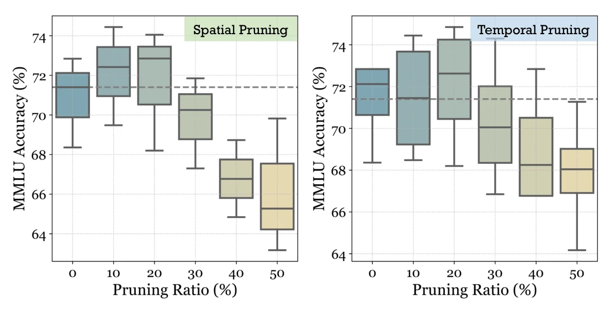
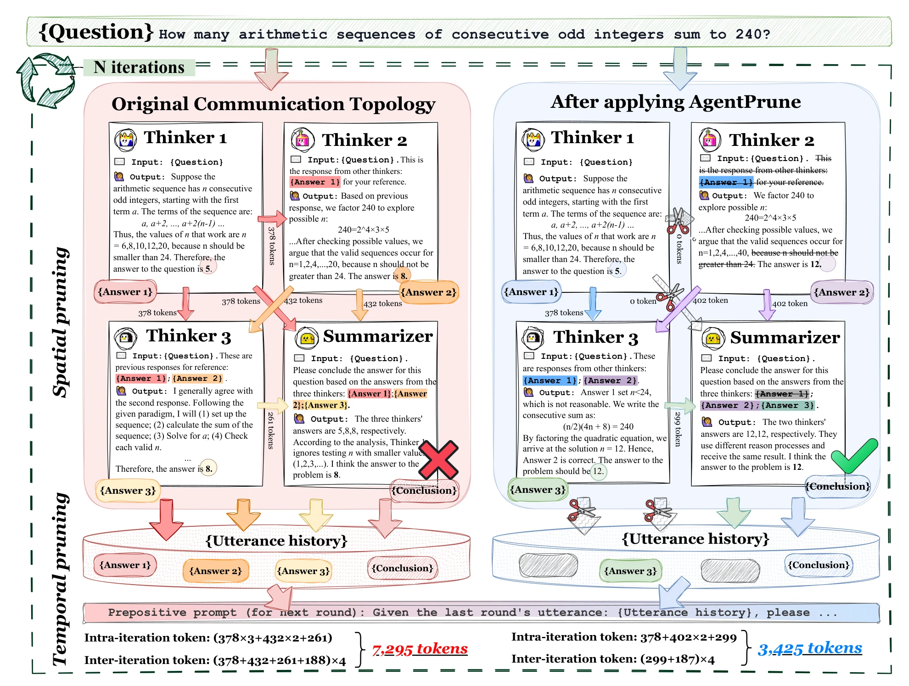
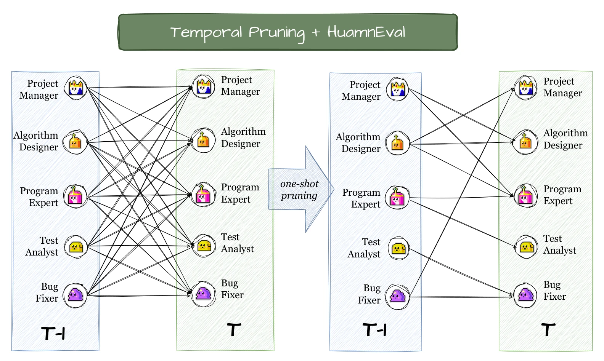

# AgentPrune：哪些智能体消息可以不再发送

把几个大语言模型（LLM）放到一起讨论，常常比让一个模型独自作答更有效：有人提出方案，有人检查推理，有人汇总答案。但交流有价格。一段回答被另外四个智能体各读一次，就进入了四份提示；下一轮再把历史广播一遍，同一段话又会被反复计费。更麻烦的是，大家读到的也可能是一个很有说服力的错误。于是，“让所有人充分交流”同时带来了提高质量的机会、额外的开销和错误传播的风险。

Guibin Zhang、Yanwei Yue、Zhixun Li 等九位作者在《Cut the Crap: An Economical Communication Pipeline for LLM-based Multi-Agent Systems》中提出 AgentPrune。他们把系统拆成“谁在同一轮读谁的消息”和“谁在下一轮读谁的历史”两张图，先用少量任务反馈学习连接的相对重要程度，再一次性删掉一部分连接，让后面的推理沿较稀疏的图进行。方法主要训练的是通信连接的掩码，不是底座语言模型的权重。[论文身份、作者与摘要](https://arxiv.org/abs/2410.02506v1)

论文在知识问答、数学推理和代码生成六个基准上检验这个想法。一个容易核对的例子是：五个 GPT-4 智能体构成的 AutoGen 系统在 HumanEval 上接入 AgentPrune 后，输入词元从 492,273 降到 315,105，约减少 36%，报告的 Pass@1 从 85.41% 变为 86.65%。这说明通信图确实存在值得优化的空间；具体效果取决于原有结构、任务和学习开销。[表 3，PDF 第9页](https://arxiv.org/pdf/2410.02506v1#page=9)

这篇论文最值得读懂的，是**怎样把一段多智能体对话变成可优化、可执行、可核算的通信图**。正文先解释作者为何怀疑通信过多，再对照原图走完一次消息传递，接着拆开图掩码、策略梯度、低秩约束和一次裁剪，最后回到实验和成本。读完后，读者应能指出一条被删边原本把哪段消息送给谁，以及删掉它怎样改变后续输入。本文固定采用 2024 年 10 月 3 日的 arXiv v1；原版的若干公式和数值存在不一致，涉及结论的地方会说明，详细核算另存于核对记录。

## 背景：多一个同伴，为什么会多出许多输入

理解 AgentPrune，先要把“多几个智能体”和“多传几条消息”分开。智能体（Agent）可以使用同一个底座模型，却拥有不同的角色提示、状态或工具。一个负责解题，一个负责找反例，一个负责综合，并不要求训练三个不同的语言模型。真正让它们协作的是：后一个模型调用的输入里，加入了前一个模型已经生成的内容。

论文把已有交流方式分成两类。第一类在一轮内部组织工作：链式结构让后一个成员读取前一个成员的结果；树形结构通过层级汇总；更密集的图让多个成员互相提供材料。第二类在轮次之间传递信息：下一轮可以读所有人的上轮答案，也可以只读筛选后的答案或一份摘要。例如 LLM-Debate 让每个成员依据其他成员上一轮的输出继续作答，交流机会因此增加。[§1 与 §5，PDF 第2、10页](https://arxiv.org/pdf/2410.02506v1#page=2)

这两类设计都有合理动机。独立作答容易缺少纠错机会，串联可以让检查者接住前人的错误，多轮讨论则允许系统修改已经形成的判断。可是，某段内容有没有帮助，取决于接收者要做什么。汇总者也许需要两份独立答案，解题者却可能被一份错误草稿带偏；一轮刚产生的反例很重要，反复复制已经被推翻的旧答案则可能浪费预算。

**输入词元为什么会增长得这么快？** 词元（token）是模型处理文字的基本单位，费用通常分别按输入和输出词元计算。以下是导读自编的通信计数例子：四个成员都写了 100 个词元，下一轮每个成员都读四份回答，那么只算这次跨轮传递，就需要在四份输入中放入 $4\times4\times100=1600$ 个词元。原来的四份回答合计只有 400 个词元，但它们被读了四遍。这里尚未包括问题、角色指令或新生成的答案。

密集的轮内交流也有类似放大。按先后顺序排列 $n$ 个成员，每个后来的成员都读取前面所有人的输出，就有 $n(n-1)/2$ 条轮内边；如果下一轮每个人都接收所有人的上一轮输出，则可能有 $n^2$ 条跨轮边。这个计数说明，成本增长既来自更多成员，也来自成员之间越来越多的联系。它是对简单结构的编辑解释，真实系统还要计入不同消息长度、提前停止和工具调用。

作者由此把研究问题从“怎样增加合作”改成了“哪些合作通路值得保留”。和把每段话压缩成摘要相比，AgentPrune 改的是传递关系；和少调用几个智能体相比，它首先保留节点集合，减少节点之间的边。这使它能嵌入已有系统，而不必从头设计每个角色的工作流程。

## 图模型：同一轮的边与跨轮的边

作者用 $G=(V,E)$ 表示整个多智能体系统。$V$ 是节点集合，一个节点对应一个智能体；$E$ 是边集合，一条有向边 $i\to j$ 表示第 $i$ 个智能体向第 $j$ 个智能体传递信息。论文式 (1) 把节点写成四部分：底座模型、角色、状态、外部插件。插件又包含功能与配置，例如搜索或代码执行能力。[§2、式 (1)–(4)，PDF 第3页](https://arxiv.org/pdf/2410.02506v1#page=3)

节点不是一句固定的提示。它会根据当前问题、自己的职责、已有状态和收到的消息产生新输出。即使两次都调用同一个模型，只要输入变了，输出也可能改变。因此删边的影响包含两层：直接少传一段文字，间接改变接收者随后写出的内容。后一层正是实验中输出词元有时增加、有时减少的原因之一。

论文将边分为空间边 $E^S$ 和时间边 $E^T$。这两个名称描述的是对话依赖，不是物理网络位置。空间边连接同一轮中的两个节点，时间边连接上一轮的发送者和本轮的接收者。以下把输出的轮次显式写出，便于区别：

| 连接 | 接收者实际读到什么 | 可以承担的工作 |
| --- | --- | --- |
| $i^{(t)}\to j^{(t)}$，空间边 | 第 $i$ 个成员本轮刚产生的消息 | 接着前人的方案继续计算，或立即检查 |
| $i^{(t-1)}\to j^{(t)}$，时间边 | 第 $i$ 个成员上一轮的消息 | 保留上轮结果，继续修改或比较 |
| $i^{(t-1)}\to i^{(t)}$，时间自连接 | 自己上一轮的回答 | 延续自己的推理状态 |

同一个角色可以同时通过两类边影响另一个角色。例如，本轮检查者接收解题者的新方案，下一轮解题者再读检查者上轮的意见。若忽略轮次，只画“甲和乙互相连接”，就看不清谁先行动，也看不清哪些内容要进入历史。

为说明输入组成，可以把论文式 (4) 改写成下面这个更明确的教学记号：

$$
M_i^{(t)}\sim P_\theta\left(\,\cdot\mid q,\mathrm{Role}_i^{(t)},\mathrm{State}_i^{(t)},\{M_j^{(t-1)}:j\in N^T(i)\},\{M_{ji}^{(t)}:j\in N^S(i)\}\right).
$$

$q$ 是问题，$N^S(i)$ 和 $N^T(i)$ 分别是给节点 $i$ 发消息的空间、时间入邻居，$M_{ji}$ 表示从 $j$ 发往 $i$ 的消息，$P_\theta$ 表示模型在给定这些条件下生成输出的分布。花括号表示收集收到的消息，实际系统还需要把它们组织成提示。这个式子最重要的部分是条件栏：删掉一条边，就改变了接收者可见的材料集合。

**同一轮怎样保证执行顺序？** 若甲必须先读乙的本轮输出、乙又必须先读甲的本轮输出，双方都会等待。论文因此要求实际执行的空间图是有向无环图，即 DAG，并用拓扑排序找到“先处理所有依赖，再处理当前节点”的次序。跨轮边没有这个问题，因为上一轮的输出已经生成。

原始候选空间图可以有环。附录 A 的 DAGSampling 会查找一个环，随机删去环上的一条边，重复直到无环，再执行拓扑排序。附录 I.1 还说明，最终裁剪后展示的稀疏图也可能有环，实际使用前仍需这个步骤。因此，固定的是裁剪后允许使用的连接范围，具体执行图还可能经过删环处理。把“候选图”“裁剪图”“可执行 DAG”分清之后，论文的方法流程才真正闭合。[附录 A，PDF 第16页](https://arxiv.org/pdf/2410.02506v1#page=16) · [附录 I.1，PDF 第30页](https://arxiv.org/pdf/2410.02506v1#page=30)

## 通信冗余：作者先做了什么实验

作者并没有直接假设每条消息都有价值，而是先问：如果随便删掉一些连接，会发生什么？这是一种很有启发性的动机实验，因为它暂时不引入复杂的优化器，只检验“更多通信是否总有利”这个前提。

图 3 的左侧使用密集网状空间结构，右侧使用 LLM-Debate 式时间结构。实验配置是四个 GPT-3.5-turbo 智能体，任务为 MMLU——一个覆盖多种知识领域的选择题基准。横轴从不删边逐渐移向删掉一半连接，纵轴是准确率，灰色虚线提供原有表现的参考。箱体及上下须呈现结果的分布；论文在这一处没有把重复次数和箱线统计口径交代完整，适合据此看趋势，而不宜自行补上显著性结论。[§2 与图 3，PDF 第4页](https://arxiv.org/pdf/2410.02506v1#page=4)

图中最重要的现象是，轻度删边后，成绩没有立即崩溃，有些设置还高于原来。继续增大删除比例，两边的表现都明显变差。作者由此认为，现有图中有一部分通信对任务贡献很小，甚至可能产生负面影响。与此同时，图也说明协作依赖某些必要联系，删得越多越好的推论并不成立。

作者用效用函数 $\phi(G)$ 表示系统沿图 $G$ 运行时的任务质量。论文定义的核心条件是存在一个子图：

$$
G_{\mathrm{sub}}=(V,E'\cup E''),\qquad E'\subseteq E^S,\quad E''\subseteq E^T,\quad \phi(G_{\mathrm{sub}})\geq\phi(G).
$$

也就是保留原来的成员，只保留部分空间和时间边，仍能取得至少相当的质量。实际研究目标进一步允许一个偏差阈值 $\epsilon$，在 $|\phi(G_{\mathrm{sub}})-\phi(G)|\leq\epsilon$ 的条件下尽量多删连接。这是论文式 (5)、(6) 的意图；由于原式允许子集取等号，真正有用的冗余发现还应要求确实删掉了边，而不是把原图本身当作答案。

这里的“冗余”是**相对于任务质量的冗余**。两段话文字相同，却分别发给两个需要它的成员，仍可能都重要；一段话写得独特而详细，却把接收者引向错误方向，也可能值得删去。算法需要通过运行和反馈来衡量这种关系，单看语言表面无法决定。

动机实验给出的认识也很具体：通信数量与任务质量之间存在可优化的余地。接下来要解决的难题，是从许多可能子图中找到一个好子图，而不把省下的钱全花在搜索上。

## 对照图 4：一条消息怎样影响本轮和下一轮

图 4 把抽象的边放回具体对话。它是全文最重要的流程图：左半是原来的通信方式，右半是裁剪后的方式；上半看本轮谁读谁，下半看哪些输出进入下一轮历史。

图顶的问题问，有多少个连续奇整数构成的等差数列，其和为 240。左侧的 Thinker 1 先作答，给出 5；Thinker 2 读到 Answer 1 后给出 8；Thinker 3 读前两份回答，也给出 8。最后的 Summarizer 汇总三人的回答，接受了 8。图中红色叉号表示作者将这个结果标为错误。[图 4 与 §3.1，PDF 第5页](https://arxiv.org/pdf/2410.02506v1#page=5)

右侧发生的变化首先在输入。Thinker 2 提示里原本引用 Answer 1 的部分被划掉了，它改为从原问题出发作答。Thinker 1 到汇总者的直接连接也被删掉。Thinker 3 仍然可以接收 Thinker 1 和 Thinker 2 的结果，因此这并非把第一个解题者从系统里完全移除，而是减少它对不同接收者的直接影响。图中的 Thinker 2、Thinker 3 随后输出 12，汇总者也接受了 12。

原图的文字需要按“模型实际说了什么”阅读。右侧 Thinker 3 写出的方程与它声称的解并不相符，图中的绿色对勾只是作者对最终答案的标记，不能把整段轨迹当作已经核实的数学证明。对本节真正有用的信息，是哪些引用被划掉、哪些输入仍然保留，以及改变输入后下游回答跟着改变的过程。

**再看箭头上的词元数。** 左侧 Answer 1 长 378 个词元，分别发给 Thinker 2、Thinker 3 和汇总者，所以这一份回答在轮内被计为 $378\times3$。Answer 2 的 432 个词元发送两次，Answer 3 的 261 个词元发送一次，轮内消息输入共计：

$$
378\times3+432\times2+261=2259.
$$

到跨轮阶段，三份回答和 188 个词元的汇总结果都进入历史，并向四个角色提供，因此是 $(378+432+261+188)\times4=5036$。两项相加得到图中的 7295 个词元。这展示了同一内容被多次消费的成本，而非单纯统计生成了多少文字。

右侧保留四条轮内边，按新输出长度计为 $378+402\times2+299=1481$。历史只保留 Answer 3 和汇总结果，跨轮部分变为 $(299+187)\times4=1944$，合计 3425。这里的消息长度也变了，所以“删掉几条边”和“省下多少词元”之间还隔着下游输出的变化。这组数字是原图的传话示意账，不包含寻找结构的学习开销，后面会单独把它补回来。

图 4 说明了裁剪的作用，却还没有告诉我们剪刀的位置怎样决定。AgentPrune 并没有预先知道 Thinker 1 的回答有什么问题，也没有安排一个额外裁判逐句审核所有消息。下一节开始的图掩码，就是把“选哪些通路”变成可学习问题的办法。

## 图掩码：把开关变成可学习的分数

原有通信图只回答一件事：这条连接能不能用。要比较连接的重要程度，作者为每条候选边加一个可以更新的数值。所有数值排成矩阵，就得到图掩码。掩码与原图相乘，形成用于学习的参数化通信结构。

设系统有 $n$ 个节点。空间邻接矩阵 $A^S$ 和时间邻接矩阵 $A^T$ 都是 $n\times n$，其中第 $i$ 行、第 $j$ 列为 1，表示允许 $i\to j$；为 0，表示原系统没有这条边。对应的掩码 $S^S,S^T$ 也是 $n\times n$。论文式 (7) 写为：

$$
A(\widetilde G)=\{A^S\odot S^S,\ A^T\odot S^T\}.
$$

$\odot$ 表示逐元素乘法，而非通常的矩阵乘法。例如原图中 $A^S[1,2]=1$，掩码该位置为 0.2，乘积就是 0.2；原图中某个位置为 0，无论掩码那里多大，乘积仍为 0。原图给出可选范围，掩码帮助在这个范围里取舍。[§3.1、式 (7)，PDF 第5页](https://arxiv.org/pdf/2410.02506v1#page=5)

这个限制很重要：方法主要在已有边中做筛选。如果原系统从未允许某个检查者向汇总者反馈，乘一个掩码也不会凭空建立这条通路。因此，同样的优化方式从不同初始图出发，会面对不同的选择空间。这就是实验中要分别报告完全图、分层图和随机图三个版本的原因。

为了把形状看清，以下沿用图 4 的四个角色，记为 1、2、3、4，其中 4 是汇总者。**下面的掩码数值由导读人为指定，只用于教学，不是论文训练出的参数。** 假设原图允许每个较早角色向所有较晚角色发消息，那么：

$$
A^S=\begin{bmatrix}
0&1&1&1\\
0&0&1&1\\
0&0&0&1\\
0&0&0&0
\end{bmatrix},\qquad
A^S\odot S^S=\begin{bmatrix}
0&0.10&0.85&0.20\\
0&0&0.90&0.80\\
0&0&0&0.95\\
0&0&0&0
\end{bmatrix}.
$$

第一行有三条候选边，表示角色 1 的输出可送给 2、3、4；第三列有两个非零位置，表示角色 3 可以读 1 和 2。这个约定是“行发送、列接收”，与一些用行表示入邻居的图实现相反，读公式时应始终保持同一方向。

这些连续值暂时只表达连接选择的倾向。一个掩码值为 0.2，不是把一段中文消息乘以 0.2，也不是只保留其五分之一的字。模型调用最终需要具体的消息集合，学习阶段因此要根据当前参数采样结构、执行对话，后面再依据分数决定保留哪些边。

把几个对象并排看，会发现整个学习问题的规模与语言模型本身差别很大：

| 对象 | 形状或类型 | 在方法中的职责 |
| --- | --- | --- |
| $A^S,A^T$ | 两个 $n\times n$ 二值矩阵 | 指定原有连接范围 |
| $S^S,S^T$ | 两个 $n\times n$ 连续矩阵 | 保存可更新的连接参数 |
| 一次采样结构 | 一个具体消息图 | 决定本次谁实际收到谁的输出 |
| $\phi$ | 任务得分 | 反馈这次交流得到的答案好不好 |
| $B^S,B^T$ | 两个 $n\times n$ 二值矩阵 | 学习结束后固定保留的边 |

虽然待学参数数量有限，取得一次反馈仍可能需要多次昂贵的模型调用。作者的方法难点因而是如何有效利用少量反馈，而不是矩阵太大放不进内存。

## 策略梯度：任务得分怎样教会图选择连接

有了掩码，下一步是让它随任务表现改善。困难在于，答案质量通常由选择题判分、代码执行或外部接口给出。模型沿某张图回答了一道题，得到“对”或“错”，这个分数无法像神经网络内部的连续损失那样，直接对删掉哪条边做普通反向传播。作者使用策略梯度，把图结构的选择视为一个随机策略。[§3.2、式 (9)–(10)，PDF 第6页](https://arxiv.org/pdf/2410.02506v1#page=6)

这里“策略”的行动是选一张通信图。参数 $S$ 决定不同结构被选中的倾向；系统执行选中的结构，得到效用 $\phi$；更新时增加高效用结构出现的机会。底座模型可以继续通过 API 调用，训练不要求取得其内部梯度。得分则必须由具体任务提供，这也是方法落地时必需的输入之一。

把论文式 (9) 中整张空间—时间图简记为 $g$，可以写成：

$$
\nabla_S\mathbb E_{g\sim p_S}[\phi(g)]
\approx\frac1M\sum_{k=1}^{M}\phi(g_k)\nabla_S\log p_S(g_k).
$$

这里 $S=\{S^S,S^T\}$，$M$ 是采样结构数，$g_k$ 是第 $k$ 次抽到的图，$p_S(g_k)$ 是当前参数赋予它的概率。$\nabla_S\log p_S(g_k)$ 描述参数往哪个方向变化会让这张图更容易出现；乘上得分，意味着好结果对更新的推动更大。多次采样取平均，是为了用有限试验估计总体趋势。

可以把它理解为一次反馈循环：当前连接倾向产生若干候选图，每张图都让智能体实际协作，评价器给出结果，优化器再更新连接倾向。它不需要先给每条边贴上“有用”或“没用”的人工标签，而是从完整任务表现中间接学习。因此得到的是在其他连接、角色和任务共同作用下的分数，而非某段话永恒不变的价值。

**一个只有一条可选边的手算。** 为了看懂式子，暂时只考虑图 4 中角色 1 到角色 2 的连接。以下仍是导读自编例子，简化成独立的伯努利开关：以概率 $s$ 保留该边，以概率 $1-s$ 删除它。人为设定保留时任务得分为 0.2，删除时为 0.8；其余过程固定。于是期望得分为：

$$
J(s)=0.2s+0.8(1-s)=0.8-0.6s,\qquad J'(s)=-0.6.
$$

负梯度告诉我们，应减小这条边被保留的概率。再用策略梯度核算：当 $s=0.5$，保留图的对数概率导数为 $1/s=2$，删除图为 $-1/(1-s)=-2$。按各自 0.5 的发生概率加权，结果是 $0.5\times0.2\times2+0.5\times0.8\times(-2)=-0.6$，与直接求导一致。若教学中取学习率 0.1，做一次梯度上升，$s$ 就从 0.5 变成 0.44。

这一步解释了“任务得分怎样变成连接更新”，也说明为什么需要看删除后的完整结果。只要一段消息到处出现，并不会自然得到高权重；如果它让后续成员更容易出错，相关结构的效用反馈会变差。相反，一条消息偶尔很短，却可能为最终答案提供关键纠错信息。

原论文式 (10) 用入选边权的乘积表示结构概率，但没有完整展开一般伯努利图分布中的缺边因子，也未说明删环过程对最终图概率的影响。因此，上面的伯努利推导是用来理解策略梯度的教学模型，不应视为论文实现的逐行还原。阅读原式时，关键是掌握“采样—执行—评价—提高好结构概率”的逻辑，精确复现还需要核查采样器和代码。

最后还有一个实际困难：多条边会交互。解题者的草稿送给检查者可能很好，直接送给汇总者却可能造成干扰；一条边的作用会随其他边是否存在而变化。作者优化整张图的效用，正是为了把这种组合影响纳入反馈。接下来的低秩约束则在任务反馈之外，给搜索增加一个结构偏好。

## 低秩约束：作者希望图学出什么样的规律

任务奖励鼓励找到有效的图，但单靠奖励，学习可能保留大量连接，或者过度追随少量题目中的偶然反馈。作者因此加入低秩约束，希望掩码的连接模式更有整体规律，并借鉴图学习研究中低秩结构抗噪的思路。这是方法的第二个优化目标。[§3.2、式 (8)、(11)，PDF 第5–6页](https://arxiv.org/pdf/2410.02506v1#page=6)

“秩”可以先理解成一个矩阵里独立模式的数量。如果几行相同或能互相线性组合，说明它们所表达的模式有重复，矩阵的秩就较低。放到图掩码里，一行表示某个发送者对各接收者的连接倾向。低秩倾向于让这些模式由较少的基本方向组合出来，而非让每个位置都毫无关联地变化。

论文式 (8) 同时考虑任务效用、掩码的秩和接近原图的限制。用 $g$ 简记抽到的通信结构，其主干是：

$$
\max_{S^S,S^T}\ \mathbb E[\phi(g)]-\sum_{X\in\{S,T\}}\operatorname{rank}(S^X),
\qquad
\sum_{X\in\{S,T\}}\|A^X-S^X\|_F\leq\delta.
$$

第一项希望任务得分高，第二项惩罚过多独立模式。$\|\cdot\|_F$ 是 Frobenius 范数，把矩阵所有元素的平方加起来再开方，用于度量整体差异；$\delta$ 是允许的偏离程度。约束表达了“在原有结构附近寻找更简单连接模式”的想法，而非完全脱离原系统重新建图。[式 (8)，PDF 第5页](https://arxiv.org/pdf/2410.02506v1#page=5)

直接最小化秩很困难，作者用核范数替代。核范数是所有奇异值之和：

$$
\|S\|_* = \sum_i\sigma_i(S).
$$

奇异值可以理解为矩阵不同独立方向的强度。惩罚它们的和，会鼓励部分方向变弱，从而得到较简单的结构。论文式 (11) 就是最小化空间、时间掩码的核范数，同时保留与原邻接矩阵接近的约束。无需先掌握完整奇异值分解算法，也能理解它的职责：它在“哪些结构得分高”之外，进一步偏好“哪些结构模式更简洁”。

**低秩与少边有什么区别？** 看两个导读自编的小矩阵：$U=\begin{bmatrix}1&1\\1&1\end{bmatrix}$ 与 $I=\begin{bmatrix}1&0\\0&1\end{bmatrix}$。前者两行相同，秩为 1，却有四个非零元素；后者秩为 2，却只有两个非零元素。它们的奇异值分别为 $(2,0)$ 与 $(1,1)$，核范数都等于 2。这个小例子说明，低秩并不等于少边，核范数也不是直接对非零连接计数。

因此，这篇论文中两种操作各有职责。低秩正则在学习阶段塑造分数分布；真正把边数降下来的是下一节的二值裁剪。若把二者合称“低秩自动删除无用消息”，就会跳过算法里最关键的一步，也难以解释为什么还需要指定裁剪比例。

作者还预期低秩结构能提高抗攻击能力，理由来自图学习中的相关经验。本文的后续攻击实验对这个预期提供了系统层面的支持，但没有逐条标注哪些恶意消息被识别，也没有单独证明某个奇异方向就是“谎言方向”。最稳妥的理解是：低秩是一个用于引导结构搜索的归纳偏好，它是否有用，应由移除该项后的消融结果来回答。

## 一次裁剪：从连续分数回到真正少传消息

连续掩码学出差异之后，系统还需要一张可以直接执行的稀疏图。作者没有让优化持续到每轮对话结束，而是在较短学习阶段后进行一次按数值大小的裁剪，之后固定允许通信的结构。这就是 One-Shot Pruning，即一次性裁剪；这里强调只做一次结构定稿，与少样本提示中的“单样本”是不同含义。[§3.3、式 (12)，PDF 第6页](https://arxiv.org/pdf/2410.02506v1#page=6)

原文用 $p\%$ 表示删去的比例，并从原图支持的连接中保留高分项。为避开原式 TopK 参数在“个数”和“比例”之间的记号混用，下面用导读记号写清这一步。令 $\rho\in[0,1]$ 为删边比例，$m_X=|E^X|$ 为原有候选边数，$\mathcal T_X$ 为这些候选边中分数最高的约 $(1-\rho)m_X$ 条，则：

$$
B^X_{ij}=\mathbf 1\{A^X_{ij}=1\ \text{且}\ (i,j)\in\mathcal T_X\},\qquad
A^X_{\mathrm{sub}}=A^X\odot B^X,\quad X\in\{S,T\}.
$$

$\mathbf 1$ 是指示函数，满足条件就取 1，否则取 0。$B^X$ 因而是一张纯粹的开关表。空间图和时间图分别形成二值掩码，再作用回各自原图。保留数如何取整、同分如何处理属于实现细节，原式没有充分交代；后面的手算选择整数个保留项，避免引入额外约定。

回到前面四角色矩阵。六条原有空间边的分数是 0.10、0.85、0.20、0.90、0.80、0.95。若删掉三分之一，即删除两条，留下最高的四条，就得到：

$$
B^S=\begin{bmatrix}
0&0&1&0\\
0&0&1&1\\
0&0&0&1\\
0&0&0&0
\end{bmatrix}.
$$

删掉的是 $1\to2$ 和 $1\to4$，保留的是 $1\to3$、$2\to3$、$2\to4$、$3\to4$。它恰好体现图 4 的两把轮内剪刀：第二个角色可以独立作答，汇总者直接阅读第二、第三个角色，第三个角色仍可比较前两份结果。教学分数是为了展示这种结构如何从排序中产生，论文没有报告图 4 对应的这六个掩码值。

此时运行一次对话的步骤已经很明确：

| 顺序 | 接收到的本轮消息 | 产生的输出 |
| --- | --- | --- |
| 角色 1 | 无；仍有原问题和角色指令 | 第一份独立解答 |
| 角色 2 | 无；仍有原问题和角色指令 | 第二份独立解答 |
| 角色 3 | 角色 1、2 的解答 | 比较或修正后的回答 |
| 角色 4 | 角色 2、3 的回答 | 汇总答案 |

没有入边的成员仍然能够回答原问题。删除一条直达汇总者的边，也不表示它的内容从此绝对不可达：角色 1 的观点可能通过角色 3 间接进入最终答案。图优化改变的是直接可见性和传播路径，而非对某个观点进行语义级封锁。

**为什么不一直学习？** 一方面，持续采样结构需要额外运行；另一方面，后面的任务需要真正享受到稀疏结构的收益。作者借鉴“训练早期就可能出现可用稀疏结构”的思路，只用前 $K'$ 轮学习，随后在总共 $K$ 轮中的剩余 $K-K'$ 轮复用它。学习阶段负责探索，固定阶段负责使用，正是这一分工把结构优化变成一项有机会回本的投资。

## 时间裁剪与多查询复用：省下来的东西留在哪里

空间裁剪决定本轮谁先读谁，时间裁剪决定哪些已有输出继续进入下一轮。两者的数学形式相似，实际作用却不同：前者改变当前分工的依赖，后者改变系统延续哪些讨论结果。

图 30 比图 4 更清楚地把时间展开了。左边裁剪前，每个角色的上一轮输出都有机会影响下一轮的多个角色。右边保留了一组更有选择性的通路：例如上一轮编程专家的输出送往下一轮编程专家和测试分析者，测试分析者的输出送往错误修复者，错误修复者的输出又能进入下一轮项目经理。这里回到“项目经理”的箭头跨越了轮次，因此没有造成同一轮执行中的循环等待。[附录 I.2 与图 30，PDF 第35页](https://arxiv.org/pdf/2410.02506v1#page=35)

这些箭头很适合用来理解为什么要区分两张图。代码被谁检查，是轮内可以做的安排；检查意见交给下一轮谁继续处理，是历史传递的安排。即使成员名称完全一样，两类边仍然代表不同的消息时间。图 30 中剩余联系看起来符合工作分工，这是可视化提供的直观解释；作者没有逐条移除这些保留边、验证每一条的独立作用。

和把历史压成一段摘要相比，时间裁剪直接选择发送者—接收者关系。它可以保留一份详细的测试反馈，只发给下一轮负责修复的成员；也可以把上一轮最终结论发给多个成员。摘要则会改写内容本身。两种操作可以在系统中组合，但本文主要优化的是关系，不能把它当作一个保证保留所有重要细节的记忆压缩器。

**如果每道题只讨论两轮，学习还能省钱吗？** 这是作者在 §3.4 面对的现实问题。对一个很长的任务，先学习少数轮，再复用很多轮有意义；可是选择题或基础数学题往往只需一两轮，若每题都重新优化图，学习成本会反复出现。论文因此提出多查询训练：用前面的少量问题学习一张图，然后把它用于后面更多问题。[§3.4，PDF 第6–7页](https://arxiv.org/pdf/2410.02506v1#page=7)

附录 D 把它说得更明确：给定共有 $Q$ 道题的基准，前 $Q'$ 道题充当训练阶段，边解题、边评价、边更新图；一次裁剪之后，剩下 $Q-Q'$ 道题使用固定结构。这与单题内的多轮学习形成两种安排：

| 组织方式 | 用什么学习 | 在哪里复用 | 适合的情境 |
| --- | --- | --- | --- |
| 对话级 | 同一道题的前 $K'$ 轮 | 这道题的后 $K-K'$ 轮 | 有足够长后续过程的复杂任务 |
| 查询级 | 同一批任务的前 $Q'$ 道题 | 剩余 $Q-Q'$ 道题 | 大量相似、每题轮数较少的任务 |

查询级学习保存的是通信结构，而不是把前几道题的答案全部塞进后面提示中。新的问题仍然有自己的输入和输出；共享的是哪些角色之间允许交流。因此收益依赖于前面学到的分工模式能否在后续问题中继续适用。[附录 D，PDF 第16–17页](https://arxiv.org/pdf/2410.02506v1#page=17)

这个协议也决定了实验应该怎样解释：图使用了基准前缀的任务反馈，所以它属于经过少量任务适配后的系统，而不是完全没有接触任务反馈的固定零样本图。已读的 v1 正文和附录没有把训练前缀是否计入最终分数、各任务评价器与划分细节全部说明清楚。结果可以支持“在该批任务中学习后复用有价值”，跨领域迁移能力则需要另外安排独立任务评测。

## 成本核算：学习图要多久才能回本

图 4 的词元账展示了稀疏通信可能省下什么，现在要把寻找稀疏图的代价加回来。一个方法即使固定之后每题都便宜，若前期试验次数很多、后续只使用几次，总账仍可能更贵。

论文 §3.4 将平均空间消息长度记为 $c_S$，平均时间消息长度记为 $c_T$，问题长度记为 $c_q$。为了让式子更容易读，这里定义两个导读记号：$L=c_S|E^S|+c_T|E^T|$，表示每轮沿边传递的消息量；$H=c_q|V|$，表示把问题送给各节点的固定部分。按这个简化模型，原系统运行 $K$ 轮需要：

$$
C_{\mathrm{base}}=K(L+H).
$$

如果前 $K'$ 轮每轮采样 $M$ 个结构，并以完整图开销近似学习成本，后面删掉比例 $\rho$ 的边，AgentPrune 的两阶段成本就是：

$$
C_{\mathrm{AP}}=MK'(L+H)+(K-K')[(1-\rho)L+H].
$$

第一项是学习，第二项是稀疏图复用。这个模型假定消息平均长度基本不变，而且删掉相同比例的边就近似减少相同比例的沿边输入；它没有完整计入输出计费、各角色不同的固定提示或不同边的长度差异。它适合说明回本关系，不宜直接作为 API 账单预测。[§3.4 成本分析，PDF 第7页](https://arxiv.org/pdf/2410.02506v1#page=7)

由上面两项直接相减，得到导读重新整理的净节省：

$$
\Delta=C_{\mathrm{base}}-C_{\mathrm{AP}}
=\rho(K-K')L-(M-1)K'(L+H).
$$

这个写法很直观。前一项是后续各轮因为少传消息得到的收益；后一项是学习阶段相对于原本只运行一次所多付的代价。两者之差为正，才真正省钱。固定问题仍然要发给各成员，删边无法把这部分成本按相同比例消掉。

这里必须与原文区分：v1 式 (13) 的展开与它前面给出的两阶段成本相减结果不一致。上述式子是导读按原文成本定义重新做的代数整理，和附录 E 多查询公式采用的逻辑一致，并非照抄原文的成本保证。核对公式时，保留可检查的成本分项比沿用一个漂亮的最终节省式更有价值。

**继续用一个可手算的例子。** 设每轮沿边传话 $L=600$ 个词元，固定问题部分 $H=400$；学习 $K'=2$ 轮，每轮采样 $M=3$ 张图，然后删除一半边。这里所有数值都是导读指定的理想化参数。学习的额外代价为 $(3-1)\times2\times1000=4000$；固定之后每轮节省 $0.5\times600=300$。要回本，就得让 $300(K-2)>4000$，即总轮数至少到 16 轮，才能出现正的净节省。

若总共只有 10 轮，原系统需要 10,000，AgentPrune 需要 $3\times2\times1000+8\times700=11,600$，反而多花 1600。若总共运行 20 轮，原系统需要 20,000，新系统需要 $6000+18\times700=18,600$，才省下 1400。删边比例完全相同，结论却因复用次数改变。

查询级安排也是同一逻辑。若每题 $K$ 轮，前 $Q'$ 题学习，余下 $Q-Q'$ 题复用，附录 E 的式 (14)–(17)可以整理成：

$$
\Delta_{\mathrm{queries}}=K\left[\rho(Q-Q')L-(M-1)Q'(L+H)\right].
$$

大量短任务相当于提供了更长的回收期。这也解释了为什么作者选择短时间学习后固定图，而非永远搜索。不过，真实收益最终仍要按全部输入、输出、学习调用和模型价格核算；“删了一半边”只描述结构变化，不等于“总成本减半”。[附录 E，PDF 第17–18页](https://arxiv.org/pdf/2410.02506v1#page=18)

## 实验设置：每一组比较究竟比较什么

读结果前，需要把三个实验层次分开。图 3 的随机删边是动机实验；主表比较不同交流方式；插件实验则在同一个已有框架上比较接入前后。三者分别回答“是否存在冗余”“方法作为完整方案表现怎样”“它能否改善已有系统”，使用的配置也有所不同。

主实验覆盖六个基准。MMLU 考察一般知识选择题；GSM8K、MultiArith、SVAMP、AQuA 是数学推理任务，包含文字算术题或带推理过程的选择题；HumanEval 提供函数说明和测试，考察生成代码通过测试的能力。前五项以论文报告的准确率阅读，HumanEval 使用 Pass@1，即一次候选代码通过任务测试的成功率，都是越高越好。[§4.1，PDF 第7页](https://arxiv.org/pdf/2410.02506v1#page=7)

论文通过 API 调用模型，主要涉及 gpt-3.5-turbo-0301 与 gpt-4-1106-preview，生成温度设为 1。温度影响生成的随机性，也意味着一次轨迹的措辞和结果可能变化。一般知识与数学任务设两轮，代码任务设四轮；多查询学习使用 $Q'\in\{5,10\}$。各成员的角色提示由 GPT-4 生成。[§4.1，PDF 第8页](https://arxiv.org/pdf/2410.02506v1#page=8)

表 1 中除单智能体类别外，各方法使用五个 GPT-4 智能体。AgentPrune 有三个版本：C 从完全空间图出发，L 从分层图出发，R 从随机图出发；时间侧统一采用 LLM-Debate 式密集连接。这里的字母代表不同的起始空间拓扑，三个版本都要学习和裁剪空间、时间连接。

对照方法也有三组。单智能体组包括直接作答、CoT 思维链提示及更复杂的提示或多次采样汇总。空间组包括链、星、树、完全图，以及把交流关系参数化的 GPTSwarm。时间组包括 LLM-Debate、把上一轮决策当作下一轮提示的 PHP，以及通过评分筛选成员或输出的 DyLAN。它们为论文提供的是不同通信组织方式的对照，而非同一个优化器只换一项参数的严格消融。[§4.2，PDF 第8页](https://arxiv.org/pdf/2410.02506v1#page=8)

作者还对这些框架做了适配。附录 G.1 说明，GPTSwarm 的比较中统一了角色与工具安排，并把 MMLU 交流从只传选项修改成同时传选项和推理；PHP 被改造成多智能体的跨轮提示方式。AutoGen 则按动态群聊场景组织用户代理、经理、工程师、批评者和执行者。因此表中的结果属于本文具体搭建的系统，不能直接当作这些框架所有配置的统一排名。[附录 G.1，PDF 第22–24页](https://arxiv.org/pdf/2410.02506v1#page=22)

方法说明建议在多于三个成员、通信结构有一定复杂度时使用，简单链或直接输出结构可删余地较小；附录实验又包含三个成员的配置。将这点理解为作者的适用建议与实际探索范围，比把“三个以上”视为严格理论门槛更合适。真正影响收益的是可选通路是否充足，以及好结构能被重复使用多少次。

## 主要结果：少交流是否还保得住任务质量

表 1 先回答质量问题。下面摘录同一张主表的部分方法与四个任务，所有数字均为百分制得分；HumanEval 为 Pass@1，其他三列为准确率。表中的多智能体配置都是五个 GPT-4，方法之间的提示和交流过程按上一节所述各不相同。[表 1，PDF 第7页](https://arxiv.org/pdf/2410.02506v1#page=7)

| 方法 | MMLU | GSM8K | AQuA | HumanEval |
| --- | ---: | ---: | ---: | ---: |
| 单智能体直接作答 | 82.14 | 85.40 | 70.34 | 71.68 |
| 单智能体 CoT | 82.65 | 87.17 | 73.91 | 75.52 |
| 完全图 | 83.15 | 86.49 | 79.21 | 83.75 |
| GPTSwarm | 83.98 | 89.74 | 78.16 | 88.49 |
| LLM-Debate | 83.69 | 90.23 | 77.52 | 83.79 |
| AgentPrune-C | 84.72 | 95.62 | 79.47 | 89.38 |
| AgentPrune-L | 83.50 | 93.78 | 78.44 | 88.61 |
| AgentPrune-R | 83.94 | 95.83 | 78.60 | 90.30 |

首先，多智能体确实可能带来收益，尤其在代码任务上，完全图比单智能体直接作答高出很多。但是表 1 的其他拓扑也有下降项，例如星形结构在 MMLU 上为 80.79，低于单智能体的 82.14。合作方式会决定大家是在互相纠错，还是互相干扰，成员数量本身无法说明结果。

其次，AgentPrune 的三种起点都能得到较好的成绩，但强项不同。C 在此表的 MMLU 上最高，R 的 HumanEval 更高，L 在这几列中相对弱一些。对方法的解释应是“起始结构仍然影响搜索空间，而学习裁剪能够在其中找到有竞争力的方案”，而非“只要稀疏就都一样好”。

第三，这些任务分数还没有回答效率问题。AgentPrune-C 同时使用空间、时间连接及学习过程，而完全图基线的类别是空间通信。因此二者分数之差应首先归于整个系统方案，不能把全部提升单独归因于裁剪或低秩项。后面的消融才更接近“某个组件贡献多少”的问题。

原表有一些明确的数值问题，所以这里只摘单项得分，没有沿用 Avg. 和彩色提升量。例如 C 的 HumanEval 89.38 相对单智能体 71.68，应增加 17.70 个百分点，表 1 却印成 15.70；表 2 的同一行则为 17.70。读取表格时，“原始成绩”“差值”“平均值”应分别核算，不能因为放在同一行就默认彼此一致。

图 5 将任务质量与输入词元放在同一张图，意图强调高质量、低开销的右下方区域。不过 v1 中该图的纵轴标注与数值尺度，以及部分点位与表 1 存在不一致，因此本文不从图 5 精读成本倍数或新分数。更清楚的成本证据是下一节的表 3：它列出了接入前后的原始输入、输出词元，可以逐项计算。

主表提供的整体认识是，通信裁剪与较高任务质量可以同时出现。要进一步判断这项技术是不是划算，应转向同一框架接入前后的账本，而不仅是比较最高的一列分数。

## 接入已有框架：输入省了，输出和账单怎样变

表 3 是整篇论文最有用的一张系统比较表。作者把 AgentPrune 接入 AutoGen 和 GPTSwarm，分别列出任务表现、输入词元、输出词元和美元成本。下面摘录五个 GPT-4 配置下 MMLU 与 HumanEval 的四组结果；保留原始计数，下文的差值与比例由导读重新计算。[§4.3、表 3，PDF 第9页](https://arxiv.org/pdf/2410.02506v1#page=9)

| 框架与任务 | 接入前后表现 | 输入词元：前 → 后 | 输出词元：前 → 后 | 原表成本（USD）：前 → 后 |
| --- | --- | --- | --- | --- |
| AutoGen / MMLU | 82.13 → 82.78 | 486,034 → 349,583 | 89,224 → 86,582 | 7.537 → 6.093 |
| AutoGen / HumanEval | 85.41 → 86.65 | 492,273 → 315,105 | 130,196 → 139,714 | 8.828 → 7.342 |
| GPTSwarm / MMLU | 83.98 → 83.05 | 3,055,230 → 990,312 | 569,124 → 439,551 | 47.60 → 23.05 |
| GPTSwarm / HumanEval | 84.49 → 84.96 | 2,736,136 → 745,617 | 1,004,616 → 745,926 | 57.49 → 29.80 |

先看 AutoGen / HumanEval。输入减少 $492273-315105=177168$ 个词元，约为原来的 36.0%；输出却增加了 9518 个词元。将输入和输出简单相加，总词元从 622,469 变成 454,819，下降约 26.9%。原表美元成本则下降约 16.8%。三个比例不同，因为“输入”“总词元”“按不同单价计算的费用”是三种口径。

这组数据与机制能够对应起来。删边直接减少接收者读到的内容，但更少的输入可能让模型重新展开自己的分析，输出长度随之变化。若输出单价更高，输入节省的一部分会被新增输出抵消。因此，最合适的结论是：在这一配置中，方法以约 36% 的输入减少，保住并略提高了报告的代码通过率，同时降低了总账单。论文没有在这里给出足以判断这 1.24 个百分点变化显著性的重复试验统计。

再看 GPTSwarm / MMLU。输入大幅减少，准确率却从 83.98 降到 83.05。这一行非常重要，因为它把论文的目标从“每项能力都必须上升”放回“质量与成本之间的取舍”。是否值得接受约 0.93 个百分点的下降，要由具体应用对质量的容忍度决定。论文可以展示这个可选点，无法替所有应用作决定。

两个框架的空间也不同。GPTSwarm 本身包含通信结构优化，原始开销较大，接入后的节省更明显；AutoGen 在作者所用配置下原始费用较小，绝对收益随之不同。比较时应该先看同一框架前后变化，再讨论框架之间的差异。表 3 的 GPTSwarm / HumanEval 基准分数与表 1 又不同，本文保留各自局部对照，不跨表拼接成一条提升链。

v1 的 GSM8K 两组输入比例与原始计数对不上，AutoGen 的该行费用也无法用同表其他行所呈现的计价关系一致解释；所以本文没有据这些行复述“统一节省多少”的宣传数字。美元数都是论文当时的计费结果，并非当前服务报价。详细差异与重算保存在核对记录，正文需要保留的认识是：效果、输入、输出和学习成本要一同进入效率评价。

## 鲁棒性与消融：哪些证据支持设计理由

作者除了问“能否省钱”，还问“能否少受错误消息干扰”。这个问题与图裁剪的动机相连：如果一个成员有意误导别人，密集通信会给它更多传播机会；减少不必要通路，可能降低系统对它的依赖。论文用两类攻击检验这一点。[§4.4，PDF 第9–10页](https://arxiv.org/pdf/2410.02506v1#page=9)

第一类是角色提示攻击：随机选一个成员，把其角色替换为要求撒谎、输出错误答案和误导性分析的提示。第二类是成员替换攻击：随机选一个成员，换成一个生成随机选项与不连贯文本的“虚假”接口。其余成员保留原功能。这两个实验测试的是一个成员已被破坏后的系统表现，和攻击者从外部网页逐步诱导工具操作的场景有明显区别。[附录 G.3，PDF 第27页](https://arxiv.org/pdf/2410.02506v1#page=27)

图 6 报告 MMLU 的角色提示攻击。下面摘录图中四组数值，准确率越高越好：

| 配置 | 攻击前 | 攻击后 |
| --- | ---: | ---: |
| 完全图 | 83.1 | 78.4 |
| AgentPrune-C | 84.7 | 83.9 |
| AutoGen | 82.1 | 76.2 |
| AutoGen + AgentPrune | 82.7 | 82.5 |

完全图在攻击后下降 4.7 个百分点，AgentPrune-C 下降 0.8；AutoGen 对照中的下降也明显缩小。这个结果支持作者关于限制传播通路有助于稳健协作的判断。它证明的是指定单成员破坏条件下的整体表现改善，不是通用提示注入防御，也没有展示算法逐句识别谎言的能力。[图 6，PDF 第9页](https://arxiv.org/pdf/2410.02506v1#page=9)

**低秩项是否真的有用？** 表 6 更直接地检验组件。作者分别去掉角色差异和低秩正则，其他部分按原方案运行。下面摘录三个任务的原始分数，HumanEval 是 Pass@1：

| 版本 | MMLU | GSM8K | HumanEval |
| --- | ---: | ---: | ---: |
| AgentPrune-C | 84.72 | 95.62 | 89.38 |
| C 去掉角色差异 | 84.3 | 93.7 | 87.8 |
| C 去掉低秩项 | 84.6 | 94.5 | 88.9 |
| AgentPrune-R | 83.94 | 95.83 | 90.30 |
| R 去掉角色差异 | 83.3 | 95.6 | 88.6 |
| R 去掉低秩项 | 83.5 | 95.4 | 89.3 |

这几列支持两个设计选择：不同角色带来的任务分工有帮助，低秩项也在若干任务上带来改善。但收益大小随起点和任务变化，原表 AQuA 上 C 去掉低秩项的 79.5 还略高于完整版本的 79.47。论文将低秩作用概括得较强，逐行读表更适合得到“多数设置有帮助”的判断。表中没有不确定性区间，几百分之一的差异尤其不适合解释成稳定优势。[表 6，PDF 第30页](https://arxiv.org/pdf/2410.02506v1#page=30)

图 21 进一步改变成员数量与前期学习题数。左图从三个增加到五个成员时上升较明显，此后曲线有波动，收益趋缓；右图增加 $Q'$ 后也有波动，并非一直上升。作者最终使用 5 或 10 道题进行前期优化，是质量和成本之间的选择。这里 $Q'$ 指学习用的题目数，尽管横轴写成 Early Stopping Round，也应按多查询协议理解。

将几组证据连起来，各项实验的职责就清楚了：随机删边说明存在优化余地，主表说明可以得到有竞争力的解题系统，接入实验说明可以减少实际调用费用，消融帮助解释哪些设计有用，攻击测试则检验减少通信可能带来的另一种收益。每一组回答不同问题，共同构成方法的证据链。

## 论文之后：把通信结构当作研究对象

以下是编辑性的延伸思考，不是原论文已经完成的后续实验，也不是对今天研究空白的判断。AgentPrune 的价值在于，它把“让智能体交流”进一步拆成可观察的连接决策：谁需要什么信息，什么时候需要，值得为它支付多少输入成本。这个视角适合用于分析新出现的协作系统。

首先，结构和内容值得放到一起观察。图 30 中一条“测试分析者到错误修复者”的边看起来合理，但它真正承载的可能是测试用例、报错摘要，也可能只是一句赞同。后续研究可以保留消息内容与接收者行为，区分“边保留了”和“关键纠错信息真正进入后续答案”这两种结果。连接数量提供成本线索，内容与下游反应才解释为什么它有用。

其次，固定图与动态选择具有不同取舍。固定图学习完成后不再为每条消息单独决策，开销比较容易摊薄；动态选择可以随题目变化，却需要支付选择器的成本。比较两者时，适合固定总预算，再看复杂题、简单题与分布变化时各自表现，而非只比较最终图有多稀疏。AgentPrune 的多查询协议为这种研究提供了一个清晰的固定结构起点。

第三，评分方式决定它学会保留什么。若只奖励最后选项正确，优化器可能偏向一组擅长多数题的通路；若要求事实来源、工具结果或过程约束得到保留，效用定义就需要包含这些要求。前面策略梯度只负责提高奖励较高结构的出现概率，奖励是否覆盖真正关心的能力，是另外一层设计问题。

继续阅读可以按三个方向展开。想理解角色与轮流对话如何组织，可读 [CAMEL 的固定修订](/read/camel/1)；想看消息处理、工具和群聊怎样组成可执行系统，可读 [AutoGen](/read/autogen/1)；想把准确率、成本与其他能力放进同一评价协议，可读 [HELM](/read/helm/2)。这些是编辑推荐的对照关系，前一篇不构成后一篇的实验依据。

这篇论文留给读者最有用的习惯，是把一张复杂架构图改读成一张账本和依赖图：每条线传什么，接收者为什么需要它，取消之后哪里会改变，寻找这张图又花了多少成本。这样读，多智能体就从“多个人一起想”变成了可以分析和验证的信息流系统。

## 回到原文：哪些位置值得亲自读

原论文正文到 PDF 第10页结束，参考文献和附录延续到第37页。[固定 HTML 全文](https://arxiv.org/html/2410.02506v1)与[固定 PDF](https://arxiv.org/pdf/2410.02506v1)提供两种阅读入口，本文页码均按 PDF 物理页计算。若准备深入理解方法，最值得连起来读的是以下几处，而不只是摘要中的节省比例。

- **§2 与算法 1，PDF 第3–4页。** 这里定义节点、两类边、入邻居、拓扑排序和最终答案汇总。它决定后面公式中的“图”究竟是什么。[§2，PDF 第3页](https://arxiv.org/pdf/2410.02506v1#page=3)
- **图 4、式 (7) 与 §3.2，PDF 第5–6页。** 把消息图、连续掩码、任务反馈和低秩约束对应起来；图中回答轨迹与图结构是两类信息。[方法核心，PDF 第5页](https://arxiv.org/pdf/2410.02506v1#page=5)
- **附录 A、D 与算法 3，PDF 第16–18页。** 正文略写的删环、多查询复用和两阶段执行在这里展开。尤其值得分清按轮学习和按题学习。[附录 A–E，PDF 第16页](https://arxiv.org/pdf/2410.02506v1#page=16)
- **表 3 与表 6，PDF 第9、30页。** 前者检验真实接入后的账本，后者检验角色与低秩组件。比起只记一个总提升率，这两张表更能说明如何评价一个结构优化方法。[表 3，PDF 第9页](https://arxiv.org/pdf/2410.02506v1#page=9) · [表 6，PDF 第30页](https://arxiv.org/pdf/2410.02506v1#page=30)
- **图 30，PDF 第35页。** 将轮次展开之后，前一轮与后一轮的消息关系最直观。[跨轮连接案例，PDF 第35页](https://arxiv.org/pdf/2410.02506v1#page=35)

本导读通读了固定 arXiv v1 的正文 §1–6，并补读附录 A–E、G 的设置与攻击描述、H.4 的消融和敏感性分析，以及 I 中与本文采用案例有关的文字。正文复用了图 3、4、30，均从同一 PDF 裁切并由 AI 查看；图 5、6、21 及表 1、3、6 的相关内容也进行了像素与数值核对。原图采用 arXiv 默认非独占分发许可，未获得一般再发布授权，仅在私有仓库中作个人学术阅读引用。

覆盖范围是方法与证据主线，没有逐项讲解全部基线、附录拓扑案例、角色提示与参考文献；没有运行作者代码、复现模型调用或审计训练日志。四成员广播计数、掩码矩阵、伯努利策略梯度、低秩矩阵与回本计算都是导读自编的教学例子；成本公式的重排已明确标注。v1 的概率记号、成本展开、部分表格和图示不一致均记录在核对文档中，本文未用后续版本悄悄替换。读完导读有助于回到原文检查这些细节，但不会自动表示已经读过或掌握原论文。
