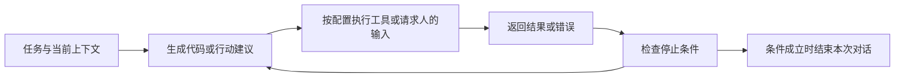

# AutoGen：把多智能体通信组织成可执行的协作

多个模型轮流说话，还不足以构成能工作的系统。上一条消息交给谁、接收者能做什么、执行失败怎样返回、什么时候停止，这些安排共同决定了协作。AutoGen 把这些问题放进“可交谈的 Agent”和“由对话组织计算”两个抽象中，适合用来建立多智能体通信的工程视角。

本文依据 [固定版本记录](https://arxiv.org/abs/2308.08155v2) 的 2023 年 v2，讲解论文架构与代表性实验。它不对应当前软件包的接口教程，也不把框架支持一种编排方式当作该方式一定有效的证据。

## 从一条执行错误理解通信的作用

设想一个教学任务：根据给定数据计算均值并绘图。负责写代码的 Agent 返回程序，负责执行的 Agent 运行后发现缺少一列，把错误信息发回；写代码者依据这个结果修改程序，再交给执行者。这里传递的不是两份独立答案，而是能改变下一步行为的反馈。该例用于说明机制，没有作为本文实验运行。

AutoGen 的双 Agent 代码执行例子体现了这种闭环。AssistantAgent 通常承担基于语言模型生成回复的角色；UserProxyAgent 可以收集人的输入，也可以执行代码并返回结果。具体能力受配置影响，不能仅凭角色名断定每次调用都有人参与或代码一定被执行。[论文 §2.1](https://arxiv.org/html/2308.08155v2#S2.SS1)

这也是阅读通信论文时一个有用的起点：先问一条消息给接收者增加了什么可用信息，再问它改变了哪个动作。把同一个答案换一种措辞转发，与把实际执行错误交给能修改代码的角色，虽然都消耗 token，作用却很不同。

## 一个 Agent 如何接收、处理和回复

论文把 Agent 的通用交互接口概括为 send、receive 和 generate_reply。接收到消息后，Agent 依据当前对话上下文与自己的回复规则产生输出；回复可以来自模型、人的输入或工具执行，也可以由自定义函数完成。因此，Agent 不是语言模型的同义词，而是带有交互接口和能力配置的参与者。

默认自动回复机制把这些接口连起来：收到消息会触发相应处理，回复又成为对方的新输入，直到达到终止条件。这里“自动”的关键是消息驱动的控制流程，不能理解成模型自主掌握了全部任务状态。注册回复函数、安排调用关系和设置停止条件，仍是应用设计的一部分。[论文 §2.2 与图 2](https://arxiv.org/html/2308.08155v2#S2.SS2)

图 2 中，Agent、回复内部执行的代码和整个应用的运行流程处于不同层次。读图时可以沿着“收到消息 → 运行回复逻辑 → 发出下一条消息”追踪一次循环。自定义回复逻辑还可以先调用其他 Agent，再把它们的结果用于当前回复；因此表面上两方之间的一次对话，内部可能包含更复杂的协作。

## 对话同时承载信息和控制

AutoGen 区分 computation 与 control flow：前者是为了生成回复而进行的计算，后者是参与者之间的调用次序和条件。自然语言消息可以提出下一步要求，代码也可以决定分支、路由和停止。二者共同组织任务，并非所有控制都交给自然语言提示。

这是根据 §2 机制绘制的教学示意，省略了多方路由与具体终止策略，不是原论文架构图的复刻。图中执行结果回到下一轮输入，解释了为什么消息的类型和来源值得单独记录：工具观察、人的指令和模型推测，不能因为都显示成文字就被视为同一类依据。

双 Agent 之外，论文还展示了 GroupChatManager：管理者选择发言者，收集回复，再向组内广播。它使发言顺序可以随上下文变化，但广播也扩大了上下文和通信成本。集中管理、全员可见与动态发言是不同设计选择，应该分别比较，而不是合并成一个“多 Agent”开关。[群聊应用 A5](https://arxiv.org/html/2308.08155v2#S3)

## 六类应用说明了什么

论文 §3 涵盖数学、检索问答、交互决策、运筹代码、动态群聊和对话式棋类应用。共同点是把某种反馈接回生成过程；各自的有效性仍要在任务设置里判断。

检索问答应用通过额外检索请求让助手获得新上下文，帮助区分“当前材料不够”与“生成器不会使用材料”。ALFWorld 应用把计划者、执行者和补充环境约束的 grounding Agent 放在一起，展示了错误重复出现时加入针对性反馈的做法。棋类例子则说明，语言上看起来合法的行动仍需要规则程序核验。[应用与实验](https://arxiv.org/html/2308.08155v2#S3)

阅读结果时需要保留比较边界。ALFWorld 中，论文的 AutoGen 系统使用 GPT-3.5，而报告的 ReAct 基线使用 text-davinci-003；跨系统差异不能单独归因于通信机制。数学应用中，各基线覆盖的测试范围也并不完全相同。群聊例子使用的是小规模人工构造任务，适合证明系统能表达这些流程，不能据此推断任意群聊都优于单 Agent。

因此，这篇论文最稳固的阅读收获是一个可复用的系统组织方式，以及一组带条件的应用证据。工具的存在不保证执行正确，反馈循环的存在也不保证一定收敛。

## 把框架读成通信研究问题

对 Multi-Agent Communication 来说，AutoGen 提供了清楚的比较单位：谁发给谁、传什么、何时传、接收后做什么。后续若研究“减少通信是否仍能完成任务”，需要先固定角色能力、模型、任务和预算，再改变消息路由。否则，少说话带来的变化可能混入了工具、模型或停止策略的影响。

一个可讨论的方向是把执行错误只发给有修改权限的 Agent，与向所有成员广播作比较。另一个方向是检查总结消息是否丢掉了错误条件：短摘要可能节省上下文，也可能删除下一步必须知道的限制。这些是由论文机制引出的研究建议，不是作者已经验证的结论。

建议先把一次任务画成消息序列，标明哪些节点是实际观察、哪些只是模型建议，再读 CAMEL 的角色协议和 AgentPrune 的通信图裁剪。这样可以分别理解“怎么约束交流”和“哪些交流有必要”。

## 原文入口与本次覆盖

回到 [固定 PDF](https://arxiv.org/pdf/2308.08155v2) 或 [HTML 全文](https://arxiv.org/html/2308.08155v2)，优先读 §2.1–2.2 与图 2，然后按关心的任务读 §3。本文核对了方法主线及六类应用描述，并实际查看了 PDF 第 3、4 页的能力说明与机制图。

没有逐个复现应用、逐页分析全部附录，或验证当前 AutoGen SDK。论文中的执行和安全配置属于具体系统条件；本导读也不把生成代码或回答当作已经运行成功。继续阅读时，应结合原文实验设置检查底座模型、工具权限、任务集合和终止条件。
