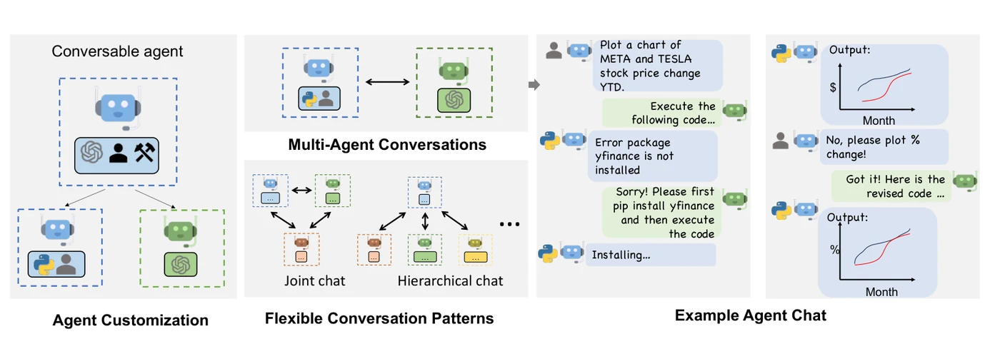
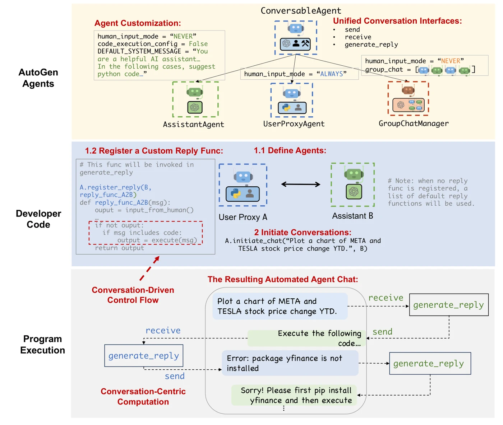
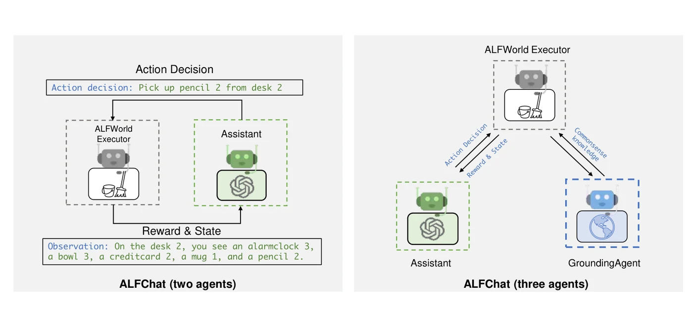
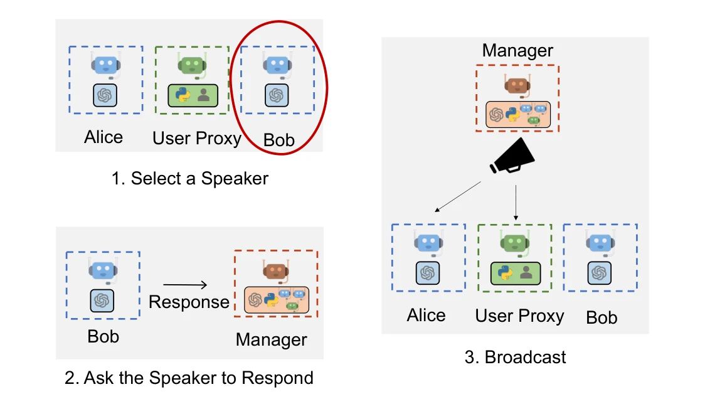

# AutoGen: Organizing Multi-Agent Communication into Executable Collaboration

In August 2023, researchers from Microsoft Research, Pennsylvania State University, the University of Washington and Xidian University released a technical report introducing the open-source framework AutoGen. The problem the authors set out to solve is not how to make one model answer better. It is this: when a task needs several models, some tools and a person to take part, what unit should be used to organize and reuse that collaboration? Their answer is to write every interaction as a message, to write each participant's abilities as a configurable agent, and to connect the two through conversation. [Abstract and §1](https://arxiv.org/html/2308.08155v2#S1)

The paper puts forward two concepts. One is the conversable agent: it can be backed by a language model, a person, tools or a combination of the three; it can send and receive messages, and it acts according to its own reply rules. The other is conversation programming: an application is split into "the computations that produce replies" and "the order and conditions in which these computations happen", and both are threaded through messages. Around these two concepts the authors present six kinds of application and report figures on tasks in mathematics, retrieval question answering, decision-making in text environments and code safety.

The use of reading this paper today is that it supplies a concrete vocabulary: who sends a message to whom, what the receiver can do, under what conditions things continue and under what conditions they stop. This vocabulary recurs in research after 2023 on communication pruning, message routing and orchestration, and comparing those works requires a common unit of observation. The guide is pinned to arXiv v2 of 3 October 2023, which describes the framework design of that time; the current software package's interfaces are different. [Pinned version record](https://arxiv.org/abs/2308.08155v2)

The core of the paper is two sections: what an agent is made of, and how automatic replies hand control over to messages. Together these two sections correspond to Figure 2 in the paper. Once they are understood, the speaker selection in group chat and the six kinds of application can be read with a clear sense of which parts are capabilities of the framework and which are results of a particular experiment. The reading order is: first the problem the authors faced and the gaps in existing systems, then an overall picture built from Figure 1, then agents and conversation programming taken apart, then one task walked through the process, and finally group chat, the experiments and the design trade-offs.

## Background: Why organize applications as conversations?

To understand why the authors chose conversation as the unit of organization, first look at the tools developers had in 2023. Language models could already reason, call tools and adjust their next step based on new observations, and tasks were getting longer. Existing work showed that several cooperating agents can encourage divergent thinking, improve factuality and reasoning, and verify one another. From this the authors raise a more basic question: how can such applications be made to scale in both breadth and complexity? [§1 Introduction](https://arxiv.org/html/2308.08155v2#S1)

The paper's three reasons all come from the characteristics of models at the time. Conversational models can take in feedback, so agents can exchange reasoning, observations, criticism and verification through rounds of questions and answers. A single model has broad abilities under the right prompting and inference configuration, so putting agents with different configurations together combines these abilities in a modular way. Models perform better when a task is broken into subtasks, and multi-agent conversation is itself a way of splitting and integrating. These three reasons turn "conversation" from a form of exchange into a form of organizing computation.

Following this line of thought, the authors reduce the design difficulties to two questions: how to build individual agents that are capable, reusable and customizable; and how to provide a unified interface that accommodates every kind of conversation pattern, single-turn and multi-turn, static and dynamic, with or without a person in the loop. These two questions set the order of the later sections, and also the paper's position relative to existing systems.

Appendix A of the paper compares the representative systems of the time in a table. AutoGPT, ChatGPT with the code interpreter or plugins, LangChain Agents and Transformers Agent all follow a single-agent paradigm, in which the model deals with only one execution environment. BabyAGI, CAMEL, multi-agent debate and MetaGPT all involve several agents, but their conversation order is fixed before running. BabyAGI advances through a fixed chain of creating, prioritizing and executing tasks. CAMEL uses role-playing prompts to have two agents take turns talking, with no native support for code execution. Multi-agent debate treats several model inferences as agents that debate for a preset number of rounds. MetaGPT targets software development and writes the division of roles into a fixed workflow. [Appendix A and Table 1, PDF pp. 14–15](https://arxiv.org/pdf/2308.08155v2#page=15)

| System | Positioning | Conversation pattern | Executes code | Human involvement |
| --- | --- | --- | --- | --- |
| AutoGen | General infrastructure | Static and dynamic | Supported | Can converse, can skip |
| Multi-agent debate | Research method | Static | Not supported | None |
| CAMEL | General infrastructure | Static | Not supported | None |
| BabyAGI | Script implementation | Static | Not supported | None |
| MetaGPT | Specialized system for software development | Static | Supported | None |

The table shows how AutoGen positions itself: it aims to provide a foundation on which each of the systems above could be built, rather than one particular application. "Static" in the table means that the conversation topology does not change with the input; "dynamic" means that who speaks next, and whether to look something up again, can be decided by the current conversation. This positioning also explains why the paper spends so much space on interfaces and configuration rather than only reporting scores.

## Overview: Three layers in Figure 1

Figure 1 is the entry point to the whole paper. It actually draws three different kinds of thing, and they are best read separately. [§1 and Figure 1, PDF p. 1](https://arxiv.org/html/2308.08155v2#S1)

The leftmost layer is about the individual. The central box reads Conversable agent, and inside it a language-model chat icon, a human figure and a crossed-tools icon sit side by side, meaning that these three kinds of backend can be combined freely. Two arrows point to two concrete agents below. One has a Python mark and a human figure in its icon, corresponding to a use that can execute code and take human input; the other has a language-model mark, corresponding to a use in which the model generates replies. [§2.1 Conversable agents](https://arxiv.org/html/2308.08155v2#S2.SS1)

The middle layer is about topology. The upper half shows two agents talking with a two-way arrow, labeled Multi-Agent Conversations. The lower half shows two more complex forms: Joint chat, in which three parties are connected pairwise, and Hierarchical chat, in which one agent at the top connects downward to several agents. The members and connections in these two forms are fixed before running. What the paper calls "dynamic", where who speaks next can be decided by the content of the conversation, is not drawn separately in Figure 1; it appears only in the group-chat example in Section 3.

The right layer is about one concrete conversation, and it is the easiest part of the figure to read. A person asks, "Plot a chart of META and TESLA stock price change YTD." The assistant does not answer directly but gives a block of code. Execution returns "package yfinance is not installed". On that basis the assistant asks for the dependency to be installed first. Once it is installed, the first chart has amounts on its vertical axis; the person replies "No, please plot % change!", the assistant rewrites the code, and the output switches to percentages. This conversation shows three things at once: the model writes code, the code fails, and the failure message changes the next step.

Notice that the conversation on the right contains automatic back-and-forth and also a request inserted by a person. This is exactly what the authors mean by "conversable": agents converse with each other automatically, and a person can insert instructions in the turns the configuration allows, or, as here, change the goal directly. When reading later systems papers, this layer is the most worth comparing against: if the same message goes to a different receiver, or a different termination condition applies, the whole process turns out completely differently.

The three labels at the bottom of the figure give the organization of the paper: Agent Customization corresponds to §2.1, Flexible Conversation Patterns to §2.2 and §3, and Example Agent Chat is the running result of the two. The next two sections take apart the first two labels, and the third section then expands the third label into a complete sequence of messages.

## What an agent is made of

This section answers "what is an agent". The paper's definition is brief: it is an entity with a specific role that can send messages to and receive messages from other conversable agents, can maintain an internal context based on its record of sent and received messages, and can be configured with a set of capabilities. Capabilities can come from a language model, a person, tools, or a combination of them. [§2.1 Conversable agents](https://arxiv.org/html/2308.08155v2#S2.SS1)

Each of the three kinds of backend contributes something different. The language-model backend provides role-playing, inferring the current progress from the conversation history, giving feedback and revising according to feedback, and writing code; the framework also provides inference-layer features such as caching, error handling and message templates. The human path is connected through a "human proxy": the default user proxy lets the developer specify, at construction time, how often and under what conditions a person takes part, and a person can also choose to skip a turn without speaking. The tool path is implemented through code execution or function calls; the default user proxy can execute code the model suggests, or issue function calls the model suggests.

The framework's class hierarchy has only three levels. ConversableAgent is the top-level abstraction and by default can use a language model, a person and tools. AssistantAgent and UserProxyAgent are its two preconfigured subclasses, corresponding to the two common uses "a model plays the assistant" and "speaks for a person or executes code". GroupChatManager is another preconfigured role, responsible specifically for arranging who speaks in a group chat; it will appear again in a later section.

| Class | Backend | Default responsibility | Configuration shown in Figure 2 |
| --- | --- | --- | --- |
| ConversableAgent | Language model, person, tools | Send and receive messages, maintain context, act by reply rules | Unified interfaces send, receive, generate_reply |
| AssistantAgent | Language model | Generate plans and code | System message; human_input_mode set to NEVER; code_execution_config set to False |
| UserProxyAgent | Person, tools | Take a person's input, or execute code and return the result | human_input_mode set to ALWAYS |
| GroupChatManager | Language model plus orchestration | Select the speaker and broadcast the reply | group_chat lists the members |

One point in this table is easy to overlook: a class name only indicates a default tendency, and behavior is determined by configuration. The same UserProxyAgent waits for a person's input when human_input_mode is ALWAYS, and stops asking a person when it is NEVER; with code execution turned off, all it has left is forwarding messages. The paper itself stresses that one cannot conclude from a role name alone that a person takes part in every call or that code is always executed.

Part of an agent's behavior is also written in its prompt. Appendix C gives the default system message of the built-in assistant at the time (v0.1.1), and the authors color it in five ways according to purpose: role-playing, control flow, output constraints, facilitating automation, and grounding (anchoring the answer to facts that can be checked). [Appendix C default system message, PDF p. 18](https://arxiv.org/pdf/2308.08155v2#page=18)

The content of this prompt is very concrete. When information needs to be collected or an operation performed, give a script in a Python or shell code block. If the code should be saved to a file, write `# filename:` on the first line of the code block. Give only one code block per reply. Do not ask the person to copy and paste results; use `print` for output instead. After getting the execution result, check it; if there is an error, fix it and give the complete code, not just the changed fragment. If it cannot be fixed, go back, analyze the assumptions and try another approach. Finally, verify the answer and give checkable evidence where possible. When everything is done, reply "TERMINATE".

Comparing this passage with what follows shows that it does two different jobs at once. "Give a script in a code block" is an output-format constraint that makes parsing easier for the next agent; "if it cannot be fixed, try another approach" is control flow, setting the path after failure; "TERMINATE" is a termination signal. The appendix also admits that language models do not follow these instructions perfectly, so the system needs other mechanisms to handle exceptions; within what the authors observed, GPT-4 followed these instructions better than GPT-3.5-turbo.

## Conversation programming: How automatic replies take control

Once there are agents that can send and receive messages, it still has to be decided in what order they speak. The paper splits this into two concepts. Computation is what an agent does to produce a reply, and control flow is the order and conditions in which these actions happen. In AutoGen both are threaded through conversation: an agent's action produces the next message, and the message in turn decides who computes what next. [§2.2 Conversation programming](https://arxiv.org/html/2308.08155v2#S2.SS2)

Figure 2 draws this mechanism in three blocks, which from top to bottom correspond to "which agents exist", "what the developer writes" and "what happens at runtime". [§2.2 and Figure 2, PDF p. 4](https://arxiv.org/html/2308.08155v2#S2.SS2)

The top block is agents and interfaces. Next to ConversableAgent three unified interfaces are listed: send sends a message, receive receives a message, and generate_reply produces a reply based on the message received. Three arrows below point to AssistantAgent, UserProxyAgent and GroupChatManager, each with its construction parameters, such as the system message of the first and the member list of the last.

The middle block is the developer's code, which has only two parts. One defines the agents, using configuration to decide backends and permissions. The other registers a custom reply function: the code writes A's reply rule as `reply_func_A2B`, which first takes a person's input and, if there is no input and the message contains code, executes the code and returns the result as the reply. The last line, `initiate_chat`, is just one call to start; after it, no further ordering needs to be arranged. A note beside it explains that if no reply function is registered, the framework tries a set of default reply functions in order.

The bottom block is the running result. The arrows on the left of the speech bubbles are labeled receive and send, and the box on the right is labeled generate_reply, showing that every round is "receive a message → generate a reply → send the reply", and that once the reply is sent, control passes to the other party. This is what the paper calls the automatic reply mechanism: when an agent receives a message, it automatically calls generate_reply and sends the reply back to the sender, unless a termination condition has been met. [§2.2 design pattern 1](https://arxiv.org/html/2308.08155v2#S2.I1.i1)

The significance of automatic replies is that the process no longer needs a central control module. In the paper's words, as long as reply functions are registered and the conversation is initialized, the conversation flow unfolds naturally, with no extra control plane needed. The benefit is decentralization and modularity: each agent can be developed and replaced independently. The cost is that the global process is not written down in one place, and someone reading the code has to follow the messages and reply functions to reconstruct the whole path.

As for where control is actually written, the paper gives three routes. [§2.2 design pattern 2](https://arxiv.org/html/2308.08155v2#S2.I1.i2)

| Carrier of control | Examples | Decided by |
| --- | --- | --- |
| Natural language | In the system message: "fix the code if there is an error", "reply TERMINATE when finished", "reply UPDATE CONTEXT if the material is insufficient" | The model, following the prompt as it generates |
| Code | Termination conditions, maximum number of automatic replies, human input mode, registered reply functions | The program at runtime |
| Between the two | Calling a model inside a reply function to reason about control logic; or having the model propose a function call that is turned into a code path | The developer, who designs the handover points |

The third route is the most distinctive part of this design. Code can decide when to hand a judgment to the model, and the model can decide when to call a function and hand control back to code. One process can therefore contain strict budgets and termination conditions alongside flexible intermediate steps that change with content.

The conversations in Figures 1 and 2 can be arranged into a table of messages. The division into steps is the guide's own arrangement for ease of reading; the bubble contents are taken from the two original figures.

| Step | Message content | Direction | What the receiver does |
| --- | --- | --- | --- |
| 1 | "Plot a chart of META and TESLA stock price change YTD." | Person → assistant (via the user proxy) | The assistant generates a reply |
| 2 | A code block and "Execute the following code…" | Assistant → user proxy | The user proxy executes the code |
| 3 | "Error: package yfinance is not installed" | User proxy → assistant | The assistant takes the error as new input |
| 4 | "Sorry! Please first pip install yfinance…" | Assistant → user proxy | The person installs the dependency |
| 5 | "No, please plot % change!" | Person → assistant | The assistant rewrites the goal |
| 6 | Revised code | Assistant → user proxy | Executes and reports the result |

This table shows what it means for "conversation to carry both information and control". The error text in step 3 is information (a package is missing) and also a control signal (do not finish; deal with this first). The single sentence in step 5 changes the task's goal and also changes how the subsequent code is written. In the RAG application, an agreed word serves as the control signal: "UPDATE CONTEXT" makes the user proxy fetch another batch of documents, while "I don't know" ends the round. An agreed word is a protocol in natural-language form, and whether it takes effect depends on whether the model says the word as required.

Custom reply functions also allow more complex nesting. The paper points out that an agent can first converse with another agent before replying, and use the result obtained there in its current reply. So what looks on the surface like one question and one answer between two agents may contain a longer sub-conversation inside. This is also the basis on which the group chat and "ask an expert" patterns later become possible.

## Walking one task through the conversation

The previous section covered the mechanism. This section uses three of the paper's applications to see what the mechanism looks like in concrete tasks: retrieval question answering, code analysis for supply chains, and decision-making in text environments. All three share the same interface; they differ in who makes decisions, who executes, and where feedback comes back from.

Start with the retrieval question-answering application. Retrieval-augmented Chat consists of two agents. The user proxy side is connected to a vector database and is responsible for splitting documents into chunks, encoding them and retrieving them by similarity; the assistant side is responsible for generating code or text from the question and the retrieved passages. The workflow has four steps. Retrieve passages and send them along with the question. The assistant generates an answer, and if the material is insufficient, it replies "UPDATE CONTEXT". On seeing this word, the user proxy fetches the next batch of similar passages; on seeing a code block, it executes the code and returns the result. If there are no more documents to fetch, the conversation ends. [Appendix D application A2 workflow, PDF p. 22](https://arxiv.org/pdf/2308.08155v2#page=22)

This application writes "retrieve once more" as a message rather than as a loop in code. The benefit is that the trigger condition can be judged directly by the model, which can say clearly "what is missing now". The cost falls on the user proxy, which must actually have the next batch of documents ready; otherwise nothing follows once the agreed word is sent. [§3 application A2](https://arxiv.org/html/2308.08155v2#S3.SSx2)

The second example is OptiGuide, a code-analysis system for supply-chain scenarios. Users ask hypothetical questions, such as "what happens if shipping from supplier 1 to roastery 2 is prohibited", and the system has to rewrite the optimization model, run it and then explain the result. AutoGen splits this into three agents. The Commander receives the question, coordinates the process and keeps memory of the interaction with the user; the Writer writes code and explains the output; the Safeguard checks whether the code is safe, for example whether it would leak information or perform malicious operations. [Appendix D application A4 and Figure 11, PDF p. 26](https://arxiv.org/pdf/2308.08155v2#page=26)

| Step | Participants | What happens |
| --- | --- | --- |
| ① | User → Commander | Asks a hypothetical question |
| ②③ | Commander → Writer | Passes on the question; the Writer gives constraint code and an explanation |
| ④⑤ | Commander → Safeguard | Sends it for checking; gets back clearance or a safety red flag |
| ⑥⑦ | Commander | Executes the code; asks the Writer to explain the output |
| ⑧ | Commander → user | Gives the conclusion, for example costs rising by 10.5% |
| Exception | Commander → Writer | Sends it back with the log for rewriting, until the answer is complete or time runs out |

What deserves attention in this table is the division of labor between two roles. The Writer both writes code and explains results, because it needs to know what it changed. The Safeguard takes no part in generation and only checks, so it can judge risk independently without loosening the requirements on generation. In their discussion, the authors call this relationship "collaborative plus adversarial": the Commander and the Writer cooperate to move things forward, and the Safeguard plays a virtual adversarial checker.

The third example is ALFWorld's text-based household tasks. In the two-agent version, an assistant proposes plans and actions, and an executor carries them out in the environment and reports the state. The executor also has to map the model's output onto a legal action; the paper uses BLEU similarity to pick the closest one among all legal action options. The authors found that the assistant often conflated "finding an object" with "picking up an object", and so repeated the same action again and again, for example opening the desk lamp over and over. [Appendix D application A3, PDF p. 24](https://arxiv.org/pdf/2308.08155v2#page=24)

The three-agent version adds a grounding agent. At the start of the task, and whenever the assistant outputs the same action three times in a row, it supplies commonsense such as "you must find and pick up an object before you can examine it" and "you must go to where the target object is before you can use it". The right side of Figure 9 draws exactly this new pathway: the grounding agent produces no actions itself; it only supplies background knowledge to the executor at the right moments, which the executor then relays to the assistant.

Looking at the three examples together makes the framework's unit of reuse clear. What is reused is a combination of "role + reply rules + backend configuration", not a fixed process. Retrieval question answering reuses the two built-in agents and replaces the user proxy's data-fetching ability; OptiGuide adds a checker role; ALFWorld adds a source of knowledge after a failure mode was observed. Each time a role is added, what changes is the receivers and contents of messages; no central scheduling code is modified.

## Group chat: Speaking order decided by the conversation

The topologies in the three examples above are all fixed: who speaks first and who speaks later is settled before running. When there are more participants and the task needs to switch speakers at any time, a fixed order is not enough. The paper handles this case with GroupChatManager, the only component in the paper dedicated to choosing "the next speaker". [§3 application A5](https://arxiv.org/html/2308.08155v2#S3.SSx5)

Figure 12 draws the manager's work as three steps executed in a loop. The first step selects the speaker; in the figure, the chosen Bob is circled in red. The second step asks that speaker to respond, and the reply comes back to the manager. The third step broadcasts the reply to the other members, here Alice and the user proxy. All participants share the same conversation context, so after the broadcast everyone's next judgment rests on the same message. [Figure 12 and §3 application A5, PDF p. 28](https://arxiv.org/pdf/2308.08155v2#page=28)

The prompt for selecting a speaker can be written in two ways, with different effects. One is a task-style prompt, which puts role information, the conversation history and "what the next speaker should do" into one prompt. The other is a role-playing prompt, which has the model consider, in the persona of a role, "who should speak now, and what they should say". The authors made a preliminary comparison on 12 hand-built complex tasks, including a two-agent system and a group chat with the same members but using the task-style prompt.

| Configuration (12 tasks) | Successes with GPT-3.5 | Successes with GPT-4 | Mean LLM calls (GPT-3.5 / GPT-4) | Termination failures (GPT-3.5 / GPT-4) |
| --- | ---: | ---: | --- | --- |
| Two agents | 8 | 9 | 9.9 / 6.8 | 9 / 3 |
| Group chat, role-playing selection | 9 | 11 | 5.3 / 4.5 | 0 / 0 |
| Group chat, task-style selection prompt | 7 | 8 | 4.0 / 4.0 | 0 / 0 |

These numbers carry more information than they first appear to. The group chat completed 11 tasks on GPT-4 and the two-agent system 9, yet the group chat did not use more calls on average; it was the two-agent system that used 6.8. The termination-failure column differs even more: on GPT-4 the two-agent system failed to end properly 3 times, while both group chats did so 0 times. The authors explain this by saying that the role-playing prompt makes the selection take both the conversation context and the roles' responsibilities into account.

The row for the task-style prompt warns against simplifying the conclusion. It used the fewest calls and also achieved the fewest successes; on this small sample, saving calls and completing tasks did not move in the same direction. Twelve hand-built tasks, each configuration run once: a scale like this is suited to checking whether a mechanism is feasible, and too small to rank methods. [Appendix D application A5 and Tables 5–6, PDF p. 28](https://arxiv.org/pdf/2308.08155v2#page=28)

Dynamic group chat also brings new costs. Broadcasting lets every member read every message, so the context grows with the number of rounds and the cost rises with it. The quality of the manager's selection directly determines the process, and when it picks the wrong speaker, the error spreads to everyone through the broadcast. In discussing future work, the paper mentions that as workflows become more complex, logging and debugging become harder, and if this is handled poorly the result is "incomprehensible, meaningless multi-party chatter". That remark is aimed at exactly this kind of topology.

## Six applications: What the evidence supports

Section 3 of the paper presents six kinds of application, each answering a different question: whether the framework can support a real task out of the box, whether one more agent makes a measurable difference, and whether a newly added role actually solves an observed failure. Figure 3 draws the conversation topologies of the six applications side by side; most of them have only two or three roles, and they differ in who executes, who verifies and who supplies background knowledge. This section puts their settings and numbers together so they can be read against each other. [§3 overview of applications and Figure 3](https://arxiv.org/html/2308.08155v2#S3)

| Application | Task and data | Agent structure | Source of feedback or verification | Result reported in the paper |
| --- | --- | --- | --- | --- |
| A1 Mathematics | MATH, 120 Level-5 problems; full test set | Assistant + executor | Code execution results | 52.5% on the 120 problems; 69.48% on the full set |
| A2 Retrieval QA | Natural Questions, 6775 queries | Retrieval user proxy + assistant | Retrieved passages and code execution | F1 25.88, recall 66.65 |
| A3 Text environment | ALFWorld, 134 unseen tasks | Assistant + executor; plus grounding agent | Environment state and action reports | Three agents 69% on average, two agents 54% |
| A4 Code analysis | OptiGuide; 100 coding tasks | Commander + Writer + Safeguard | Code execution and safety checks | F1 for identifying unsafe code up by 8 and 35 percentage points |
| A5 Group chat | 12 hand-built tasks | Manager + four members | Whether the task was completed | 11/12 on GPT-4 |
| A6 Conversational chess | Games in natural language | Two players + board agent | Rule checking | Cases and ablation, no aggregate score |

**The mathematics application answers "does it work out of the box?"** The authors built a two-agent system from the built-in assistant and user proxy and compared it with several approaches of the time on the MATH dataset. The small-scale test used 120 Level-5 problems, 20 from each of six categories, excluding geometry; the full test set used all 5000 problems. On the small-scale test, AutoGen's success rate was 52.5%, ChatGPT with the code interpreter 48.33%, ChatGPT with the Wolfram plugin 45.0%, GPT-4 alone 30.0%, multi-agent debate 26.67% and LangChain's ReAct 23.33%. On the full test set, AutoGen scored 69.48% and GPT-4 55.18%. [Appendix D application A1, PDF pp. 19–20](https://arxiv.org/pdf/2308.08155v2#page=19) · [Figure 4a, PDF p. 7](https://arxiv.org/pdf/2308.08155v2#page=7)

Several conditions in this comparison need to be kept in mind. The full test set has only two rows, AutoGen and GPT-4, because the authors did not have ChatGPT run the whole set (the manual cost was high, and there was a limit on messages per hour). Multi-agent debate and LangChain ReAct were also tested only on the smaller set, because on that set they did worse than GPT-4 alone. A qualitative test additionally picked two problems and ran each three times, and the reasons for failure were very specific: AutoGPT's code lacked a print, so the result was never printed; with ChatGPT and the plugin, Wolfram returned two simplified results and the model picked the wrong one; LangChain's ReAct gave a different wrong answer all three times. [Table 2, PDF p. 19](https://arxiv.org/pdf/2308.08155v2#page=19)

Putting the success rates together with these reasons for failure shows that what AutoGen mainly adds on this task is a closed execution loop: the model writes code, the environment executes it, the result or the error goes back to the model, and the next step is revised accordingly. This is the same kind of mechanism as ReAct's action–observation loop; the difference is that the executor is made into a separate agent, and both code and results travel between the two as messages. The authors also demonstrate two ways for a person to take part. Setting the user proxy to ask a person every turn made a problem that none of the compared systems could solve on their own come out right in all three attempts. Connecting the assistant to an "ask an expert" function call let another user step in with their own assistant.

**Retrieval question answering answers "what is one agreed message worth?"** On Natural Questions, the version with interactive retrieval reached F1 25.88 and recall 66.65. After the agreed word was changed from "UPDATE CONTEXT" to "I don't know", F1 fell to 15.12 and recall to 58.56. The difference comes from the same framework and the same retriever, with only the action taken when material is lacking changed, which makes this one of the cleanest mechanism comparisons in the paper. [Figure 4b and §3 application A2](https://arxiv.org/html/2308.08155v2#S3.SSx2)

The same figure also shows DPR at 22.79 F1 and 62.59 recall. This comparison is under different conditions: the DPR row uses the prompts of an existing evaluation and DPR's own retriever, while AutoGen uses simple vector retrieval with all-MiniLM-L6-v2 embeddings. From this the authors conclude that AutoGen's lead over DPR comes mainly from the difference in retrievers rather than from the framework itself. The appendix adds an execution detail: about 19.4% of questions triggered "UPDATE CONTEXT", that is, cost one extra model call. The gain from this agreed word and the extra calls it brings should be read together.

**The text environment answers "does adding a role help?"** On ALFWorld's 134 unseen tasks, the two-agent version had a mean success rate of 54%, level with ReAct's 54%; adding the grounding agent raised it to 69%, which the authors describe in the main text as an average improvement of 15%. By task type, the improvement is concentrated in three categories, Pick, Look and Heat: Pick went from 61% to 79%, Look from 50% to 78% and Heat from 57% to 70%, while Clean went only from 58% to 64%, and Pick 2 from 19% to 41%. Taking the best of three runs, the three-agent version averaged 77%. [Table 3 and §3 application A3, PDF p. 25](https://arxiv.org/pdf/2308.08155v2#page=25)

The mechanism explanation for this experiment is fairly credible, because the authors show the failure trajectories. Without the commonsense hint, the assistant takes "found the desk lamp" to mean "can use the desk lamp", and so repeats the same action; with the hint added, the same trajectory reaches "first pick up the bowl, then look" and succeeds. The two sides of the comparison still differ in conditions: ALFChat uses GPT-3.5-turbo, while the ReAct row was produced with the official code and text-davinci-003, so cross-model differences are mixed into the result. The authors attribute the closeness of the two-agent version to ReAct to the difference between two task forms, "chat completion" and "text completion"; this is their conjecture, with no separate experiment.

**Code analysis answers "is multi-agent just spending more money?"** The authors rewrote OptiGuide as a single-agent version in which one agent both writes code and performs the safety check, then compared the two on 100 coding tasks, half safe and half unsafe. The multi-agent design's F1 for identifying unsafe code rose from 88 to 96 on GPT-4 and from 48 to 83 on GPT-3.5-turbo, corresponding to the 8 and 35 percentage points mentioned in the main text. [Figure 4d and §3 application A4](https://arxiv.org/html/2308.08155v2#S3.SSx4)

This group is the experiment in the paper that comes closest to attributing an effect to a mechanism: the same tasks, the same model, with only the division of roles changed. Its explanation also follows naturally: writing code and looking for risks are two conflicting demands, and once they are separated, the checker does not have to defend what was generated. The cost is recorded in another number: the implementation code for the same function shrank from over 430 lines to 100, but each request goes through more model calls.

Besides scores, the authors report two sets of engineering observations. One concerns human effort: on 10 randomly chosen supply-chain questions, ChatGPT with the code interpreter and the AutoGen version each answered 8 correctly, but the former took 4 minutes 35 seconds on average and the latter about a minute and a half, a gap the authors describe as roughly a threefold saving in time. The other concerns the number of interactions: across five applications and 2000 questions, the number of prompts users needed to enter fell to between a third and a fifth of the original, with Table 4 giving ratios from 3.03 to 4.88. [Appendix D application A4 user study and Table 4, PDF p. 27](https://arxiv.org/pdf/2308.08155v2#page=27)

**Conversational chess answers "who guarantees the rules?"** The two players can both be models, both be people, or one of each, and can switch within the same game. A third-party board agent parses moves given in natural language into standard notation and checks their legality; for an illegal move it returns an error and asks for the move to be made again. The authors' ablation removed the board agent and only required in the prompt "make sure both sides play legal moves"; as a result, illegal moves directly disrupted the game. This example has no aggregate score, and what the authors use it to demonstrate is still the same point: taking verification out of the generation prompt and handing it to a role that only verifies is more reliable than adding a sentence of instruction to the prompt. This is a difference observed in a game. [§3 application A6](https://arxiv.org/html/2308.08155v2#S3.SSx6)

Putting the six together makes the shape of the evidence fairly clear. A1 and A2 show that the framework can build a known feedback loop and achieve competitive scores; A3, A4 and A6 each use one comparison to show what an added role does; A5 uses 12 tasks to check whether dynamic speaking is feasible. The common unit of these experiments is "whether the system can complete the task and beat some baseline", so what they support is the usability of the framework, not the general superiority of any particular communication design.

## Design trade-offs and their costs

After reading the applications, it is worth looking at several of the authors' choices on their own. Each of these choices brings both capability and cost, and understanding them is more useful than remembering the scores.

The first choice is to write control into natural language. This lets the process change flexibly with content: the model can say "there isn't enough material, fetch another batch" or "the code raised an error, fix the dependency first", branches that are hard to foresee completely when writing code. The cost is that the reliability of control depends on whether the model complies. The authors state explicitly in Appendix C that language models do not follow instructions perfectly, so the system needs extra exception handling, and also needs termination conditions and budgets set outside the prompt.

The second choice is decentralized automatic replies. They let agents be developed, replaced and reused independently, and adding a role only requires registering a reply function and connecting it to the conversation. The cost is that the whole process has no single readable location: to find out what happened in one run, one has to reconstruct it from each agent's reply rules and the message history. In discussing future work, the authors list logging and debugging as problems that need dedicated tool support.

The third choice is broadcast-style group chat. It lets all members see the same context, which suits tasks that need a shared judgment. The cost is that context and call costs grow with the number of members and rounds, and the manager's selection becomes a single point of failure. In the earlier table of 12 tasks, both group chats used fewer calls than the two-agent system, but this was the combined result of how the tasks were built and the termination conditions; it cannot be taken as evidence that broadcasting is generally cheaper.

The fourth choice is to make the person's place a configurable option. A person can be a participant asked every turn, can skip a particular turn, or can be "asked in" as an expert through a function call. This lets the granularity of human–machine collaboration be adjusted, but it also means that the same code behaves very differently under different configurations. The order Appendix B recommends to developers runs the other way: first use the mode that asks a person every turn to work out the prompts and edge cases, then switch to automatic mode.

The fifth choice is to hand execution ability directly to agents. Code execution and function calls let the system actually change the external environment, for example by installing packages, modifying models or running optimizers. The ethics statement lists such operations separately as a source of risk and advises developers to assess safeguards themselves. The two responses the paper offers both work at the level of roles: the Safeguard, which only checks, and the board agent, which only checks rules. Neither can prevent a model from writing code that is dangerous but conforms to the rules; they can only stop some obvious problems.

The paper's statement of its own limitations is concentrated in Section 4 and Appendix B. The authors say the work is still at an early, experimental stage. Future work should study which agent topologies and conversation patterns are most effective and assess whether further scaling really solves more complex tasks. They also caution that greater autonomy brings greater risk, requiring fail-safes, protection against cascading failures and reward hacking, and effective human oversight. These are judgments the authors wrote in 2023; later evolution of the framework has changed some of the specific practices, but the direction of the trade-offs they identify still applies. [§4 Discussion](https://arxiv.org/html/2308.08155v2#S4)

## Reading the framework as research questions about communication

If what you care about is multi-agent communication rather than how to use the framework, the most useful thing in this paper is the unit of comparison it provides: who sends a message to whom, what is sent, when it is sent, and what the receiver can do with it. Only by writing these four items as variables can the differences between systems be compared. [Appendix B future work, PDF p. 17](https://arxiv.org/pdf/2308.08155v2#page=17)

By this unit, the paper contains at least three design points worth pursuing further.

The first is the set of receivers. Point-to-point, broadcast and relay through a manager change how much information each member sees. Broadcast in group chat keeps everyone in sync, but it also multiplies the cost of each message by the number of members; in ALFWorld, the commonsense hint goes only to the executor, which relays it, a much smaller scope. When studying "whether sending less is still enough", first fix the roles' abilities, the model and the task, then vary the set of receivers; otherwise the changes caused by speaking less get mixed up with differences in models or tasks. The library's [AgentPrune guide](/read/agentprune/1#u03) discusses exactly the approach of pruning connections into a sparse graph, which can be compared with the default of broadcasting here.

The second is control words and termination conditions. TERMINATE, UPDATE CONTEXT and "I don't know" are all protocols written in natural language, and they turn "whether to continue" into something the model can judge. This is flexible, but whether the protocol will be followed cannot be guaranteed before running. One testable direction is to spell out "what is missing", for example by having the assistant reply with a structured note of the missing items instead of a fixed word, and then compare the hit rate of the additional retrieval under the two ways of writing it. This is a question the guide raises; the paper runs no such experiment.

The third is the position of the verifier. The Safeguard, the grounding agent and the board agent each do one thing: use a different criterion to check content someone else produced. Their positions differ, and so does their scope: the board agent checks every move, the Safeguard checks whether code may be executed, and the grounding agent supplies knowledge only after repeated failures. When comparing these designs, the questions worth asking are whether verification happens before or after generation, and how much of the original information the verifier sees.

To read further, start with the [CAMEL guide](/read/camel/1#u03), which covers agreeing on a communication protocol through prompts, matching this paper's route of "writing control in natural language". Then read the [ReAct guide](/read/react/2#cycle), which presents the "act–observe–act again" loop in single-agent form and can be compared with this paper's two-agent version. Finally, read the [multi-agent communication survey guide](/read/multi-agent-communication-survey/1#u04), which organizes speaking order and shared spaces into dimensions that can be compared. These three form an editorially suggested order and do not imply any relation of proof among the papers.

## Back to the paper: Entry points and coverage

The method part of the original is only Section 2; it is short and worth reading in full. If time is limited, read three places first: §2.1 and §2.2 together with Figure 2, to see how the interfaces and automatic replies fit together; the example conversation on the right of Figure 1, to see how messages change the next step in one real exchange; and the default system message in Appendix C, to see how control is written into the prompt. After that, read applications A1 to A6 in Section 3 according to your interests; the numbers and experimental details are all in Appendix D. [§2.1–2.2 and Figure 2](https://arxiv.org/html/2308.08155v2#S2.SS2)

To compare AutoGen's positioning with other systems, Table 1 is the page that saves the most time. To check the evidence, Appendix D contains the settings, reasons for failure and user studies for each kind of application, and Tables 2 to 6 collect the main numbers. [Pinned PDF](https://arxiv.org/pdf/2308.08155v2) · [HTML full text](https://arxiv.org/html/2308.08155v2)

This guide is based on the main text §1–4 and Appendices A–D of arXiv v2, covering the framework design, the six kinds of application and the main experimental numbers, and it consulted Figures 1, 2, 3, 9 and 12 and Tables 1 to 6 as needed. Figures 1, 2, 9 and 12 are original figures from the paper, cropped from the pinned PDF; the MATH and ALFWorld numbers were checked against the tables in the appendix. The paper is licensed under Creative Commons Attribution 4.0, and the original figures are used with attribution.

Parts not covered include the following. The example outputs in Appendix E (Tables 8 to 19) were only spot-checked at the places related to reasons for failure, not read page by page. No experiment was reproduced, and no code was run on the framework version of that time. The cited systems were not each read closely; the descriptions of CAMEL, MetaGPT, multi-agent debate and BabyAGI are taken from Appendix A and Table 1 of this paper. The pinned version is the 2023 v2, and the interfaces and configuration in the text differ from the current AutoGen package. The research suggestions in the section "Reading the framework as research questions about communication" are the guide's own extension, not the authors' experimental conclusions; the message-sequence table and the OptiGuide step table were arranged by the guide from the paper's figures and appendix. The numbers the paper reports are tied to their respective models, data and comparison conditions, and a different base model or task set would need to be measured again. Reading this guide or opening the original does not automatically mark it as read.
