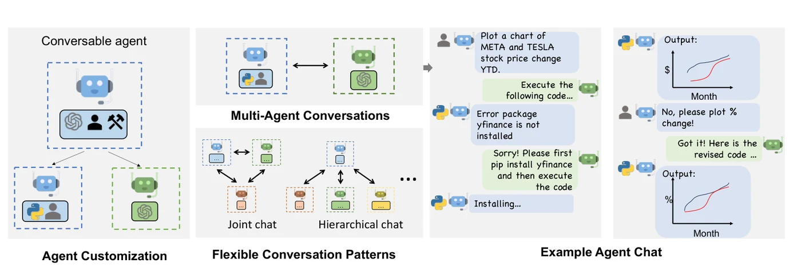
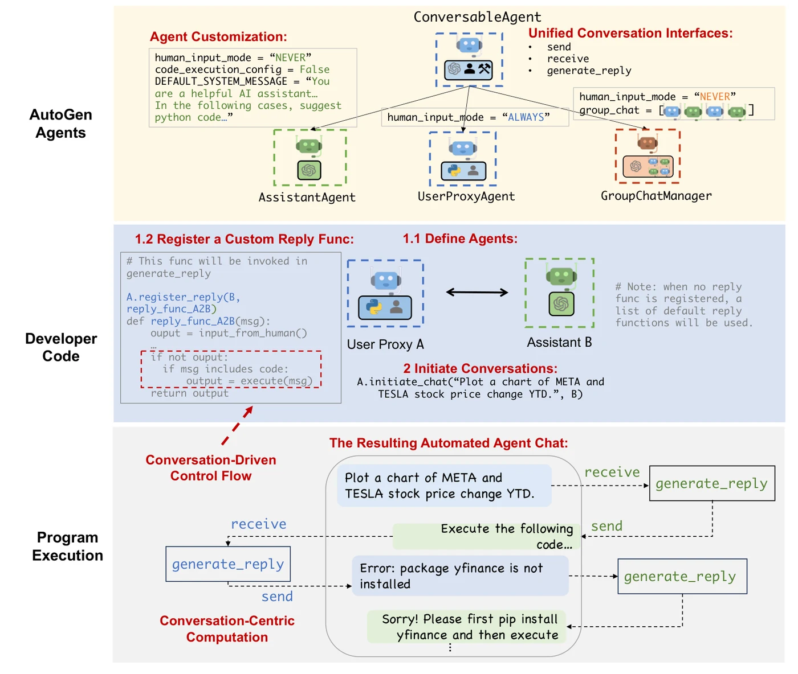
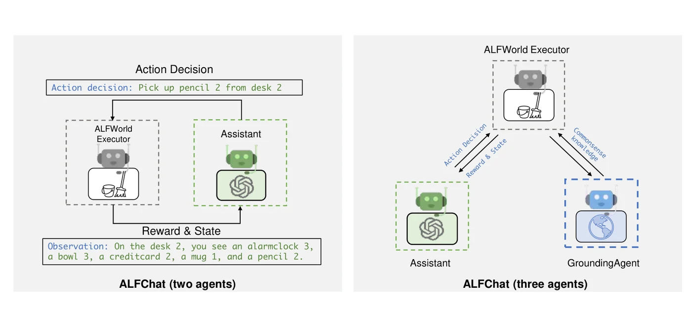
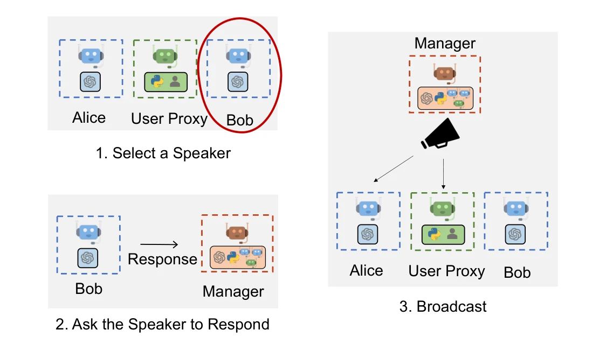

# AutoGen：把多智能体通信组织成可执行的协作

2023 年 8 月，Microsoft Research 与宾夕法尼亚州立大学、华盛顿大学、西安电子科技大学的研究者发布了一份技术报告，介绍开源框架 AutoGen。作者要解决的问题不是让一个模型答得更好，而是：当一个任务需要多个模型、若干工具和人的参与时，用什么单位来组织和复用这套协作。他们的回答是把每次交互都写成消息，把参与者的能力写成可配置的 Agent，再用对话把二者接起来。[摘要与 §1](https://arxiv.org/html/2308.08155v2#S1)

论文提出两个概念。一个是可交谈 Agent：它可以由语言模型、人、工具或三者的组合支撑，能收发消息，并按自己的回复规则行动。另一个是对话编程：把应用拆成“产生回复的计算”和“这些计算发生的顺序与条件”两部分，两者都以消息为线索。围绕这两个概念，作者给出六类应用，并报告了数学、检索问答、文本环境决策和代码安全等任务的数字。

今天读这篇论文，用处在于它给了一套具体词汇：谁把消息发给谁，接收者能做什么，什么条件下继续，什么条件下停机。这套词汇在 2023 年之后的通信裁剪、消息路由和编排研究里反复出现，比较这些工作时需要一个共同的观察单位。导读固定采用 2023 年 10 月 3 日的 arXiv v2，它描述的是当时的框架设计，与当前的软件包接口已经不同。[固定版本记录](https://arxiv.org/abs/2308.08155v2)

全文的核心是两节：Agent 由什么组成，以及自动回复怎样把控制交给消息。这两节合起来对应论文图 2。读懂之后再去看群聊的发言者选择和六类应用，就能分清哪些是框架能力，哪些是某次实验的结果。阅读顺序是：先看作者面对的问题和已有系统的缺口，再对照图 1 建立整体印象，然后拆开 Agent 与对话编程，用一次任务把流程走一遍，最后读群聊、实验和设计取舍。

## 背景：为什么把应用组织成对话

要理解作者为什么选择对话作为组织单位，先看 2023 年开发者手里的工具。语言模型已经能推理、调用工具、根据新的观察调整下一步，任务也越做越长。已有工作显示多个 Agent 合作能鼓励发散思考、提高事实性与推理，还能互相验证。作者由此提出一个更基础的问题：怎样让这类应用在广度和复杂度上都能扩展。[§1 导言](https://arxiv.org/html/2308.08155v2#S1)

论文给出的三条理由都来自当时模型的特点。对话式模型能吸收反馈，所以 Agent 之间可以通过一轮轮问答交换推理、观察、批评和验证；单个模型在正确的提示与推理配置下能力很宽，把不同配置的 Agent 放在一起，就能以模块化方式组合这些能力；模型在任务被拆成子任务时表现更好，而多智能体对话本身就是一种拆分与整合的方式。这三条把“对话”从交流形式变成了计算的组织形式。

沿着这个思路，作者把设计难点归成两个问题：怎样做出有能力、可复用、可定制的单个 Agent；怎样提供一个统一接口，容纳单轮与多轮、静态与动态、有无人在环等各种对话模式。这两个问题决定了后文的章节顺序，也决定了对已有系统的取舍。

论文附录 A 用一张表对比了当时的代表系统。AutoGPT、ChatGPT 加代码解释器或插件、LangChain Agents、Transformers Agent 都是单 Agent 范式，模型只和一个执行环境打交道。BabyAGI、CAMEL、多智能体辩论和 MetaGPT 都涉及多个 Agent，但对话顺序在运行前就已固定：BabyAGI 按任务创建、排序、执行的固定链条推进；CAMEL 用角色扮演提示让两个 Agent 轮流对话，不原生支持代码执行；多智能体辩论把若干次模型推理当成 Agent，按预设轮次辩论；MetaGPT 面向软件开发，把角色分工写进固定流程。[附录 A 与表 1，PDF 第14–15页](https://arxiv.org/pdf/2308.08155v2#page=15)

| 系统 | 定位 | 对话模式 | 执行代码 | 人工参与 |
| --- | --- | --- | --- | --- |
| AutoGen | 通用基础设施 | 静态与动态 | 支持 | 可对话，可跳过 |
| 多智能体辩论 | 研究性方法 | 静态 | 不支持 | 无 |
| CAMEL | 通用基础设施 | 静态 | 不支持 | 无 |
| BabyAGI | 脚本实现 | 静态 | 不支持 | 无 |
| MetaGPT | 面向软件开发的专门系统 | 静态 | 支持 | 无 |

这张表说明了 AutoGen 的自我定位：它想提供的是可以搭建上述各系统的底座，而不是某一种应用。表中的“静态”指对话拓扑不随输入变化，“动态”指谁下一个说话、要不要再查一次，都可以由当前对话决定。这一定位也解释了为什么论文把大量篇幅放在接口和配置上，而不只是报告分数。

## 全貌：图 1 里的三个层次

图 1 是全文的入口，它其实画了三层不同的东西，读的时候最好分开看。[§1 与图 1，PDF 第1页](https://arxiv.org/html/2308.08155v2#S1)

最左边一层讲个体。中心方框写 Conversable agent，里面并排放着语言模型的对话图标、人像和交叉的工具图标，意思是这三类后端可以任意组合；两条箭头指向下面两个具体 Agent：一个的图标里是 Python 标记和人像，对应能执行代码、能取人输入的用法；另一个里是语言模型标记，对应由模型生成回复的用法。[§2.1 可交谈 Agent](https://arxiv.org/html/2308.08155v2#S2.SS1)

中间一层讲拓扑。上半幅画两个 Agent 用双向箭头对话，标注 Multi-Agent Conversations；下半幅画了两种更复杂的形态，Joint chat 是三方两两相连，Hierarchical chat 是上方一个 Agent 向下连接多个 Agent。这两种形态的成员和连接在运行前就确定了；论文所说的“动态”指谁下一个说话可以由对话内容决定，那种模式在图 1 里没有单独画出，要等到第 3 节的群聊例子才出现。

右边一层讲一次具体对话，也是全图最容易读的部分。人提出“画一张 META 和 TESLA 年初至今股价变化的图”，助手没有直接作答，而是给出一段代码；执行返回“package yfinance is not installed”；助手据此请求先安装依赖；装好之后第一次画出来的图纵轴是金额，人回了一句“No, please plot % change!”，助手改写代码，输出换成了百分比。这段对话把三件事同时展示出来：模型会写代码，代码会失败，失败信息会改变下一步。

值得注意的是，右侧对话里既有自动往返，也有人插入的一句要求。这正是作者所说的“可交谈”：Agent 之间自动对话，人可以在配置允许的轮次插入指令，也可以像这里一样直接改变目标。读后续系统论文时，这一层最值得对照：同一条消息如果换一个接收者，或者换一种终止条件，整个流程会完全不同。

图底部三行标签给出了论文的组织方式：Agent Customization 对应 §2.1，Flexible Conversation Patterns 对应 §2.2 与 §3，Example Agent Chat 是两者的运行结果。下面两节分别拆开前两个标签，第三节再把第三个标签展开成完整的消息序列。

## Agent 由什么组成

这一节回答“一个 Agent 是什么”。论文的定义很简短：它是一个有特定角色的实体，能向其他可交谈 Agent 发送消息、接收消息，能根据自己的收发记录维护内部上下文，还能被配置上一组能力。能力可以来自语言模型、人、工具，或它们的组合。[§2.1 可交谈 Agent](https://arxiv.org/html/2308.08155v2#S2.SS1)

三类后端各自贡献不同的东西。语言模型后端提供角色扮演、从对话历史推断当前进展、给出反馈并根据反馈修改、写代码这些能力，框架还提供缓存、错误处理、消息模板等推理层功能。人这一路通过“人的代理”接入：默认的用户代理可以让开发者在构造时指定人的参与频率与条件，人也可以选择跳过某一轮不发言。工具这一路通过代码执行或函数调用实现，默认的用户代理就能执行模型建议的代码，或者发出模型建议的函数调用。

框架的类层次只有三级。ConversableAgent 是最上层的抽象，默认可以使用语言模型、人和工具。AssistantAgent 与 UserProxyAgent 是它的两个预配置子类，分别对应“由模型扮演助手”和“替人发言或执行代码”这两种常见用法。GroupChatManager 是另一个预配置角色，专门负责群聊的发言安排，下一节会再看到它。

| 类 | 后端 | 默认职责 | 图 2 中出现的配置 |
| --- | --- | --- | --- |
| ConversableAgent | 语言模型、人、工具 | 收发消息、维护上下文、按回复规则行动 | 统一接口 send、receive、generate_reply |
| AssistantAgent | 语言模型 | 生成方案与代码 | 系统消息；human_input_mode 设为 NEVER；code_execution_config 设为 False |
| UserProxyAgent | 人、工具 | 取人的输入，或执行代码并回传结果 | human_input_mode 设为 ALWAYS |
| GroupChatManager | 语言模型加编排 | 选择发言者并广播回复 | group_chat 列出成员 |

这张表有一个容易忽略的要点：类名只说明默认倾向，行为由配置决定。同一个 UserProxyAgent 在 human_input_mode 设为 ALWAYS 时会等待人的输入，设为 NEVER 时就不再询问人；把代码执行关掉，它只剩转发消息的功能。论文自己也强调，不能仅凭角色名断定每次调用都有人参与或代码一定被执行。

Agent 的行为还有一部分写在提示里。附录 C 给出了当时（v0.1.1）内置助手的默认系统消息，作者按用途给它标了五种颜色：角色扮演、控制流、输出约束、便于自动化，以及 grounding（把回答锚定到可核对的事实）。[附录 C 默认系统消息，PDF 第18页](https://arxiv.org/pdf/2308.08155v2#page=18)

这段提示的内容很具体。需要收集信息或执行操作时，用 Python 或 shell 代码块给出脚本；如果希望把代码存成文件，就在代码块第一行写 `# filename:`；一次回复只给一个代码块；不要让人复制粘贴结果，改用 `print` 输出；拿到执行结果后要检查，如果报错就修正并给出完整代码，而不是只给改动片段；如果修不好，就退回去分析假设，换一种做法；最后要核对自己的答案，尽可能给出可核对的依据；全部完成后回复 “TERMINATE”。

把这段话与后文对照，会发现它同时承担了两件不同的事。“用代码块给出脚本”是输出格式约束，方便下一个 Agent 解析；“修不好就换一种做法”是控制流，规定失败后的路径；“TERMINATE” 是终止信号。附录里也承认语言模型并不会完美遵守这些指令，所以系统还需要别的机制处理异常；在作者观察到的范围里，GPT-4 比 GPT-3.5-turbo 更遵守这些说明。

## 对话编程：自动回复怎样接住控制

有了能收发消息的 Agent，还需要决定它们按什么顺序说话。论文把这件事拆成两个概念：计算（computation）是 Agent 为产生回复所做的动作，控制流（control flow）是这些动作发生的顺序与条件。在 AutoGen 里，两者都以对话为线索：Agent 的动作会产生下一条消息，而消息又决定接下来谁计算什么。[§2.2 对话编程](https://arxiv.org/html/2308.08155v2#S2.SS2)

图 2 把这一机制画成三块，自上而下分别对应“有哪些 Agent”“开发者写了什么”“运行时发生了什么”。[§2.2 与图 2，PDF 第4页](https://arxiv.org/html/2308.08155v2#S2.SS2)

最上面一块是 Agent 与接口。ConversableAgent 旁列出三个统一接口：send 发送消息，receive 接收消息，generate_reply 依据收到的消息产生回复。下方三个箭头指向 AssistantAgent、UserProxyAgent 和 GroupChatManager，每个都配有构造时的参数，例如前者的系统消息、后者的成员列表。

中间一块是开发者代码，只有两处。一处是定义 Agent，用配置决定后端与权限；另一处是注册自定义回复函数，代码里把 A 的回复规则写成 `reply_func_A2B`：先取人的输入，如果没有输入且消息里带代码，就执行代码，再把结果作为回复返回。最下面一行 `initiate_chat` 只是一次发起，之后就不需要再安排顺序。旁边的注释说明，如果没有注册任何回复函数，框架会按顺序尝试一组默认回复函数。

下面一块是运行结果。对话气泡左侧标着 receive 与 send 的箭头，右侧标着 generate_reply 方框，可以看出每一轮都是“收到消息 → 生成回复 → 发出回复”，而发出之后控制权就交给了对方。这正是论文所说的自动回复机制：一个 Agent 收到消息后自动调用 generate_reply，把回复发回发送者，除非终止条件已经满足。[§2.2 设计模式一](https://arxiv.org/html/2308.08155v2#S2.I1.i1)

自动回复的意义在于，它让流程不再需要一个中央控制模块。论文的说法是，只要注册好回复函数并初始化对话，对话流就会自然展开，不需要额外的控制平面。好处是去中心化、模块化，每个 Agent 可以独立开发和替换；代价是全局流程没有被写在一个地方，读代码的人要沿着消息和回复函数才能还原整条路径。

控制究竟写在哪里，论文给了三条路。[§2.2 设计模式二](https://arxiv.org/html/2308.08155v2#S2.I1.i2)

| 控制的载体 | 例子 | 由谁决定 |
| --- | --- | --- |
| 自然语言 | 系统消息里的“出错就改代码”“完成回 TERMINATE”“查不到材料回 UPDATE CONTEXT” | 模型在生成时按提示判断 |
| 代码 | 终止条件、最大自动回复次数、人的参与模式、注册的回复函数 | 运行时按程序执行 |
| 两者之间 | 在回复函数里调用一次模型来推理控制逻辑；或让模型提出函数调用，转成代码路径 | 开发者设计交接点 |

第三条路是这套设计里比较特别的部分。代码可以决定何时把判断交给模型，模型也可以决定何时调用一个函数把控制交回代码，于是同一套流程里可以既有严格的预算与终止条件，又有灵活的、按内容变化的中间步骤。

用图 1 和图 2 的对话可以整理出一张消息表。表中的步骤划分是导读为了方便阅读而做的整理，气泡内容取自这两张原图。

| 步 | 消息内容 | 方向 | 接收者的处理 |
| --- | --- | --- | --- |
| 1 | “Plot a chart of META and TESLA stock price change YTD.” | 人 → 助手（经用户代理） | 助手生成回复 |
| 2 | 代码块与“Execute the following code…” | 助手 → 用户代理 | 用户代理执行代码 |
| 3 | “Error: package yfinance is not installed” | 用户代理 → 助手 | 助手把错误当作新输入 |
| 4 | “Sorry! Please first pip install yfinance…” | 助手 → 用户代理 | 人安装依赖 |
| 5 | “No, please plot % change!” | 人 → 助手 | 助手改写目标 |
| 6 | 修订后的代码 | 助手 → 用户代理 | 执行并回报结果 |

这张表说明了“对话同时承载信息和控制”的含义。第 3 步的错误文本既是信息（缺少某个包），也是控制信号（不要结束，先处理它）；第 5 步的一句话既改了任务目标，也改变了后续代码的写法。在 RAG 应用里，充当控制信号的是一个约定的词：“UPDATE CONTEXT” 会让用户代理再取一批文档，而 “I don't know” 会结束这一轮。约定词是自然语言形式的协议，它能否生效，取决于模型是否按要求说出这个词。

自定义回复函数则允许更复杂的嵌套。论文指出，一个 Agent 可以在回复前先与另一个 Agent 对话，把那边得到的结果用于当前回复。因此表面上两个 Agent 的一问一答，内部可能包含一段更长的子对话。这也是后面群聊和“请专家”模式能够实现的基础。

## 一次任务在对话里怎样走完

上一节讲的是机制，这一节用论文的三个应用看机制在具体任务里的样子：检索问答、供应链代码分析、文本环境决策。三者共用同一套接口，区别在于谁负责决策、谁负责执行、反馈从哪里回来。

先看检索问答应用。Retrieval-augmented Chat 由两个 Agent 组成：用户代理一侧接了向量数据库，负责把文档切块、编码、按相似度取回；助手一侧负责根据问题与取回的片段生成代码或文字。流程是四步：取回片段并连同问题发出；助手生成回答，如果材料不足就回复 “UPDATE CONTEXT”；用户代理看到这个词就去取下一批相似片段，看到代码块就执行并回传结果；如果没有更多文档可取，对话结束。[附录 D 应用 A2 工作流，PDF 第22页](https://arxiv.org/pdf/2308.08155v2#page=22)

这个应用把“再检索一次”写成了一条消息，而不是一段循环代码。好处是触发条件可以直接由模型判断，它能说清“现在缺的是什么”；代价落在用户代理一侧，它必须真的准备好下一批文档，否则约定词发出后没有下文。[§3 应用 A2](https://arxiv.org/html/2308.08155v2#S3.SSx2)

第二个例子是供应链场景的代码分析系统 OptiGuide。用户问的是假设性问题，例如“如果禁止从供应商 1 运往烘焙厂 2 会怎样”，系统要改写优化模型、运行、再解释结果。AutoGen 把它拆成三个 Agent：Commander 接收问题、协调流程并保存与用户的交互记忆；Writer 写代码并解释输出；Safeguard 检查代码是否安全，例如会不会泄露信息或执行恶意操作。[附录 D 应用 A4 与图 11，PDF 第26页](https://arxiv.org/pdf/2308.08155v2#page=26)

| 步 | 参与者 | 发生了什么 |
| --- | --- | --- |
| ① | 用户 → Commander | 提出假设性问题 |
| ②③ | Commander → Writer | 转交问题；Writer 给出约束代码与解释 |
| ④⑤ | Commander → Safeguard | 送检；返回放行或安全红旗 |
| ⑥⑦ | Commander | 执行代码；请 Writer 解释输出 |
| ⑧ | Commander → 用户 | 给出结论，例如成本上升 10.5% |
| 异常 | Commander → Writer | 带着日志退回重写，直到回答完成或超时 |

这张表里值得注意的是两个角色分工。Writer 同时承担写代码和解释结果，因为它需要知道自己改了什么；Safeguard 不参与生成，只做检查，因此可以在不放宽生成要求的前提下独立判断风险。作者在讨论中把这种关系称为“协作加对抗”：Commander 与 Writer 合作推进，Safeguard 扮演虚拟的对抗检查者。

第三个例子是 ALFWorld 的文本家务任务。两 Agent 版本由一个助手负责提出计划和动作、一个执行者负责在环境里执行并回报状态；执行者还要把模型输出映射到合法动作上，论文用 BLEU 相似度在所有合法动作选项里挑最接近的一个。作者发现，助手经常把“找到物体”和“拿起物体”混为一谈，于是连续重复同一个动作，例如反复打开台灯。[附录 D 应用 A3，PDF 第24页](https://arxiv.org/pdf/2308.08155v2#page=24)

三 Agent 版本加了一个 grounding agent，它在任务开始时、以及助手连续三次输出同一个动作时，给出“必须先找到并拿起物体才能检查它”“必须走到目标物体所在位置才能使用它”这类常识。图 9 右边画的正是这条新增的通路：它不直接产生动作，只在适当的时候向执行者补充背景知识，再由执行者转达给助手。

三个例子放在一起看，框架的复用单位就清楚了：可复用的不是一个固定流程，而是“角色 + 回复规则 + 后端配置”的组合。检索问答复用两个内置 Agent 并替换用户代理的取数能力；OptiGuide 新增一个检查者角色；ALFWorld 在失败模式被观察到之后新增一个知识来源。每次增加角色，都是在调整消息的接收者和内容，而不是改动一套中央调度代码。

## 群聊：发言顺序由对话决定

前面三个例子的拓扑都是固定的：谁先说话、谁后说话，在运行前就确定了。当参与者变多、任务又需要随时换人时，固定顺序就不够用。论文用 GroupChatManager 处理这种情况，它是论文里唯一专门负责“下一位发言者”的组件。[§3 应用 A5](https://arxiv.org/html/2308.08155v2#S3.SSx5)

图 12 把管理者的工作画成三步，循环执行。第一步选择发言者，图中用红圈标出被选中的 Bob；第二步请这位发言者回应，回复回到管理者；第三步把这条回复广播给其余成员，图中是 Alice 与用户代理。所有参与者共享同一段对话上下文，因此广播之后每个人的下一步判断都建立在同一条消息上。[图 12 与 §3 应用 A5，PDF 第28页](https://arxiv.org/pdf/2308.08155v2#page=28)

选择发言者的提示有两种写法，效果不同。一种是任务式提示：把角色信息、对话历史和“下一位该做什么”拼进同一个提示。另一种是角色扮演式提示，让模型以某个角色的身份考虑“现在该谁说话、说什么”。作者在 12 个手工构造的复杂任务上做了初步比较，其中既有两 Agent 系统，也有同一组成员但改用任务式提示的群聊。

| 配置（12 个任务） | GPT-3.5 成功数 | GPT-4 成功数 | 平均 LLM 调用（GPT-3.5 / GPT-4） | 终止失败数（GPT-3.5 / GPT-4） |
| --- | ---: | ---: | --- | --- |
| 两 Agent | 8 | 9 | 9.9 / 6.8 | 9 / 3 |
| 群聊，角色扮演式选择 | 9 | 11 | 5.3 / 4.5 | 0 / 0 |
| 群聊，任务式选择提示 | 7 | 8 | 4.0 / 4.0 | 0 / 0 |

这组数字比表面看起来更有信息量。群聊在 GPT-4 上完成了 11 个任务，两 Agent 完成 9 个，但群聊的平均调用次数并没有更多，反而是两 Agent 用了 6.8 次。终止失败一栏差别更大：两 Agent 在 GPT-4 上有 3 次没能正常结束，两种群聊都是 0 次。作者把这解释为角色扮演提示让选择时同时考虑了对话上下文与角色职责。

任务式提示那一行提醒读者不要简化结论。它的调用次数最少，成功数也最少；节省调用与完成任务之间在这个小样本上没有同向变化。12 个手工任务、每个配置只跑一遍，这样的规模适合检查机制是否可行，不足以排出方法的优劣。[附录 D 应用 A5 与表 5、表 6，PDF 第28页](https://arxiv.org/pdf/2308.08155v2#page=28)

动态群聊也带来新的代价。广播让每个成员都读到全部消息，上下文随轮数增长，成本也随之上升；管理者的选择质量直接决定流程，选错人时错误会沿着广播扩散到所有人。论文在讨论未来工作时提到，随着工作流变复杂，记录和调试会变难，处理不好就会出现“难以理解的、无意义的多方闲聊”。这句话针对的正是这类拓扑。

## 六类应用：证据支持了什么

论文第 3 节给出六类应用，每一类都在回答一个不同的问题：框架能不能开箱支撑一个真实任务，多一个 Agent 是否带来可测量的差别，以及新增的角色是否真的解决了观察到的失败。图 3 把六个应用的对话拓扑并排画出来，可以看到它们大多只有两三个角色，差别在于谁执行、谁校验、谁提供背景知识。这一节把它们的设置与数字放在一起，方便对照着读。[§3 应用总览与图 3](https://arxiv.org/html/2308.08155v2#S3)

| 应用 | 任务与数据 | Agent 结构 | 反馈或验证来源 | 论文报告的结果 |
| --- | --- | --- | --- | --- |
| A1 数学 | MATH，120 道 Level-5 题；整套测试集 | 助手 + 执行者 | 代码执行结果 | 120 题 52.5%；整套 69.48% |
| A2 检索问答 | Natural Questions，6775 个查询 | 检索用户代理 + 助手 | 检索片段与代码执行 | F1 25.88，召回 66.65 |
| A3 文本环境 | ALFWorld，134 个未见过任务 | 助手 + 执行者；加 grounding agent | 环境状态与动作回报 | 三 Agent 平均 69%，两 Agent 54% |
| A4 代码分析 | OptiGuide；100 个编码任务 | Commander + Writer + Safeguard | 代码执行与安全检查 | 不安全代码识别 F1 提高 8 与 35 个百分点 |
| A5 群聊 | 12 个手工任务 | 管理者 + 四个成员 | 任务是否完成 | GPT-4 上 11/12 |
| A6 对话象棋 | 自然语言对局 | 两名玩家 + 棋盘 Agent | 规则校验 | 案例与消融，无汇总分数 |

**数学应用回答的是“开箱能用吗”。** 作者用内置的助手与用户代理组成两 Agent 系统，在 MATH 数据集上与当时的几种方案比较。小规模测试用了 120 道 Level-5 题，每类 20 道、覆盖六类但不含几何；整套测试集用的是全部 5000 题。小规模测试上，AutoGen 成功率为 52.5%，ChatGPT 加代码解释器为 48.33%，ChatGPT 加 Wolfram 插件为 45.0%，单独的 GPT-4 为 30.0%，多智能体辩论为 26.67%，LangChain 的 ReAct 为 23.33%。整套测试集上，AutoGen 为 69.48%，GPT-4 为 55.18%。[附录 D 应用 A1，PDF 第19–20页](https://arxiv.org/pdf/2308.08155v2#page=19) · [图 4a，PDF 第7页](https://arxiv.org/pdf/2308.08155v2#page=7)

这套比较里有几处条件需要记住。整套测试集上只有 AutoGen 和 GPT-4 两行，因为作者没有让 ChatGPT 跑完整个集合（人工成本高，且受每小时消息数限制），多智能体辩论与 LangChain ReAct 也只在较小集合上测过，原因是它们在那个集合上不如单独的 GPT-4。定性测试另外挑了两道题各跑三次，失败原因很具体：AutoGPT 给出的代码缺少 print，结果打印不出来；ChatGPT 加插件时 Wolfram 返回了两个化简结果，模型选了错的那个；LangChain 的 ReAct 三次都给出不同错解。[表 2，PDF 第19页](https://arxiv.org/pdf/2308.08155v2#page=19)

把成功率和这些失败原因放在一起，可以看出 AutoGen 在这一任务上主要补的是执行闭环：模型写代码、环境执行、结果或报错回到模型，下一步据此修改。这与 ReAct 的行动—观察循环是同一类机制，区别在于执行者被单独做成一个 Agent，代码与结果都作为消息在两者之间传递。作者还展示了两种人工参与方式：把用户代理设成每轮都询问人，可以让一道所有对比系统都无法自主解出的题在三次尝试中全部正确；把助手与“请专家”的函数调用接起来，则可以让另一个用户带着自己的助手介入。

**检索问答回答的是“一条约定消息值多少”。** 在 Natural Questions 上，带交互检索的版本 F1 为 25.88、召回 66.65；把约定词从 “UPDATE CONTEXT” 改成 “I don't know” 之后，F1 降到 15.12、召回降到 58.56。差别来自同一个框架、同一个检索器，只是缺材料时的动作不同，这是全文中最干净的机制对照之一。[图 4b 与 §3 应用 A2](https://arxiv.org/html/2308.08155v2#S3.SSx2)

同一张图里还有 DPR 的 22.79 F1 与 62.59 召回。这个比较的条件不同：DPR 一行沿用已有评测的提示，检索器是 DPR 自己，而 AutoGen 用的是 all-MiniLM-L6-v2 嵌入的简单向量检索。作者据此认为 AutoGen 超过 DPR 主要来自检索器的差别，而不是框架本身。附录还补充了一个执行细节：约 19.4% 的问题触发过 “UPDATE CONTEXT”，也就是多花了一次模型调用。这条约定的收益与它带来的额外调用，应该一起读。

**文本环境回答的是“加一个角色有没有用”。** ALFWorld 的 134 个未见过任务上，两 Agent 版本的平均成功率为 54%，与 ReAct 的 54% 持平；加入 grounding agent 后升到 69%，作者在正文中把它表述为平均提升 15%。分任务看，提升集中在 Pick、Look、Heat 三类：Pick 从 61% 到 79%，Look 从 50% 到 78%，Heat 从 57% 到 70%，而 Clean 只从 58% 到 64%，Pick 2 从 19% 到 41%。三次取最好成绩的口径下，三 Agent 版本平均 77%。[表 3 与 §3 应用 A3，PDF 第25页](https://arxiv.org/pdf/2308.08155v2#page=25)

这组实验的机制解释比较可信，因为作者给出了失败轨迹：没有常识提示时，助手会把“找到台灯”当成“可以使用台灯”，于是反复执行同一个动作；加入提示后，同一段轨迹走到“先拿起碗再看”就成功了。比较双方的条件仍有差异：ALFChat 使用 GPT-3.5-turbo，而 ReAct 一行是用官方代码加 text-davinci-003 跑出来的，跨模型的差别混在结果里。作者把两 Agent 与 ReAct 的接近归因于“对话补全”和“文本补全”两种任务形式的差异，这是他们的推测，没有单独实验。

**代码分析回答的是“多 Agent 是否只是多花钱”。** 作者把 OptiGuide 改写成单 Agent 版本，让同一个 Agent 既写代码又做安全检查，然后在 100 个编码任务上比较，任务里安全与不安全各占一半。多 Agent 设计识别不安全代码的 F1 在 GPT-4 上从 88 升到 96，在 GPT-3.5-turbo 上从 48 升到 83，对应正文所说的 8 个与 35 个百分点。[图 4d 与 §3 应用 A4](https://arxiv.org/html/2308.08155v2#S3.SSx4)

这一组是全文里最接近机制归因的实验：任务相同、模型相同，只改变角色划分。它的解释也顺理成章，写代码与查风险是两种相互冲突的要求，分开之后，检查者不必为生成结果辩护。代价写在另一处数字里：同一功能的实现代码从 430 多行降到 100 行，但每次请求要经过更多次模型调用。

除了分数，作者还报告了工程侧的两组观察。一个是人工负担：在 10 个随机挑选的供应链问题上，ChatGPT 加代码解释器与 AutoGen 版各答对 8 个，但前者平均耗时 4 分 35 秒，后者约 1 分半，作者把这个差距表述为约 3 倍的时间节省。另一个是交互次数：在五个应用、2000 个问题上，用户需要输入的提示数减少到原来的三分之一到五分之一，表 4 给出的比值在 3.03 到 4.88 之间。[附录 D 应用 A4 用户研究与表 4，PDF 第27页](https://arxiv.org/pdf/2308.08155v2#page=27)

**对话象棋回答的是“规则由谁来保证”。** 两名玩家可以都是模型、都是人，或者一人一机，并在同一局中切换；第三方棋盘 Agent 负责把自然语言着法解析成标准记法、检查合法性，非法时返回错误并要求重下。作者的消融去掉了棋盘 Agent，只在提示里要求“确保双方都走合法棋步”，结果是非法着法直接干扰了对局。这个例子没有汇总分数，作者用它演示的仍是同一件事：把校验从生成提示里拿出来、交给只做校验的角色，比在提示里加一句要求更可靠。这是从一次对局里观察到的差别。[§3 应用 A6](https://arxiv.org/html/2308.08155v2#S3.SSx6)

把这六类放在一起，证据的形状就比较清楚了。A1 与 A2 说明框架能把一个已知的反馈闭环搭起来并获得有竞争力的分数；A3、A4、A6 各自用一次对照说明新增角色的作用；A5 用 12 个任务检查动态发言是否可行。这些实验的共同单位是“系统能否完成任务并优于某个基线”，因此它们支持的是框架的可用性，而不是某个通信设计的普遍优越性。

## 设计取舍与代价

读完应用之后，值得把作者做的几个选择单独拿出来看。这些选择每一个都同时带来能力和代价，理解它们比记住分数更有用。

第一个选择是把控制写进自然语言。这让流程可以按内容灵活变化：模型可以说“材料不够，再取一批”“代码报错，先修依赖”，这些分支很难在写代码时全部预见到。代价是控制的可靠性依附于模型是否照做，作者在附录 C 里明确写到语言模型不会完美遵守指令，因此系统需要额外的异常处理机制，也需要在提示之外设置终止条件和预算。

第二个选择是去中心化的自动回复。它让 Agent 可以独立开发、替换和复用，新增一个角色只需注册回复函数并把它接进对话。代价是整条流程没有单一的可读位置：要弄清一次运行发生了什么，得沿着每个 Agent 的回复规则和消息历史还原。作者在讨论未来工作时把可记录、可调试列为需要专门工具支持的问题。

第三个选择是广播式的群聊。它让所有成员看到同一段上下文，适合需要共同判断的任务；代价是上下文与调用成本随成员数和轮数增长，管理者的选择成为单点。前面那张 12 个任务的表里，两种群聊的调用次数都低于两 Agent，但这是任务构造与终止条件共同作用的结果，不能当成广播普遍更省的证据。

第四个选择是把人的位置做成可配置项。人可以是每轮都被询问的参与者，也可以在某一轮跳过，还可以通过函数调用被“请”进来做专家。这让人机协作的粒度可以调，但也意味着同一段代码在不同配置下的行为差别很大。附录 B 给开发者的建议顺序正好相反：先用每轮都询问人的模式把提示和边界情况摸清，再切到自动模式。

第五个选择是把执行能力直接交给 Agent。代码执行与函数调用让系统能真正改变外部环境，例如安装包、修改模型、运行优化器，伦理声明里把这类操作单独列为风险来源，并建议开发者自行评估保障措施。论文给出的两个应对办法都在角色层面：一个是只做检查的 Safeguard，一个是只做规则校验的棋盘 Agent。它们都不能防止模型写出危险但合规的代码，只能拦住一部分明显问题。

论文对自己局限的表述集中在第 4 节和附录 B。作者说这项工作仍在早期实验阶段，未来要研究哪种智能体拓扑与对话模式最有效，要评估进一步扩大规模是否真能解决更复杂的任务，也提醒自主性越高、风险越大，需要故障保护、需要防止级联失败与奖励投机，还需要人保持有效的监督。这些是作者在 2023 年写下的判断，之后的框架演化已经改变了其中一些具体做法，但它指出的取舍方向仍然适用。[§4 讨论](https://arxiv.org/html/2308.08155v2#S4)

## 把框架读成通信研究问题

如果关心的是多智能体通信而不是框架用法，这篇论文最有用的是它提供的比较单位：谁把消息发给谁、发的是什么、什么时候发、接收者收到后能做什么。把这四项写成变量，才能比较不同系统的差别。[附录 B 未来工作，PDF 第17页](https://arxiv.org/pdf/2308.08155v2#page=17)

按这个单位，论文里至少有三个可以继续追问的设计点。

第一个是接收者集合。点对点、广播和经管理者转发，改变的是每个成员看到的信息量。群聊里的广播让所有人同步，但也让每条消息的成本乘以成员数；在 ALFWorld 里，常识提示只发给执行者，再由它转达，范围小得多。研究“少发一些是否仍然够用”时，需要先固定角色能力、模型和任务，再改变接收者集合，否则少说话带来的变化会混入模型或任务差异。本库的 [AgentPrune 导读](/read/agentprune/1#u03) 讨论的正是把连接裁剪成稀疏图的做法，可以对照这里广播的默认设置。

第二个是控制词与终止条件。TERMINATE、UPDATE CONTEXT、“I don't know” 都是写在自然语言里的协议，它们把“要不要继续”变成了可以被模型判断的事情。这样做灵活，但协议是否被遵守无法在运行前保证。一个可检验的方向是把“缺什么”写清楚，例如让助手回一条结构化的缺项说明，而不是一个固定词，然后比较两种写法下追加检索的命中率。这是导读提出的问题，论文没有做这样的实验。

第三个是验证者的位置。Safeguard、grounding agent 和棋盘 Agent 都只做一件事：用另一套判据检查别人产生的内容。它们的位置不同，作用范围也不同：棋盘 Agent 校验每一步，Safeguard 校验代码能否执行，grounding agent 只在重复失败时补充知识。比较这些设计时，值得问的是验证发生在生成之前还是之后、验证者看到多少原始信息。

想继续读，可以先看 [CAMEL 导读](/read/camel/1#u03)，它讲的是用提示约定交流协议，正好对应本文“用自然语言写控制”的那条路；再看 [ReAct 导读](/read/react/2#cycle)，那里把“行动—观察—再行动”的循环讲成单 Agent 的形式，可以与本文的双 Agent 版本对照；最后看 [多智能体通信综述导读](/read/multi-agent-communication-survey/1#u04)，它把发言顺序与共享空间整理成了可以比较的维度。这三条是编辑建议的顺序，不代表论文之间存在证明关系。

## 回到原文：入口与覆盖

原文的方法部分只有第 2 节，篇幅不长，值得完整读。时间有限的话，优先读三处：§2.1 与 §2.2 配合图 2，看接口与自动回复怎样接起来；图 1 右侧的示例对话，看一次真实的往返里消息怎样改变下一步；附录 C 的默认系统消息，看控制如何被写进提示。之后按关心的应用读第 3 节的 A1 到 A6，数字与实验细节都在附录 D。[§2.1–2.2 与图 2](https://arxiv.org/html/2308.08155v2#S2.SS2)

想比较 AutoGen 与其他系统的定位，表 1 是最省时间的一页；想检查证据，附录 D 里有每类应用的设置、失败原因和用户研究，表 2 到表 6 集中了主要数字。[固定 PDF](https://arxiv.org/pdf/2308.08155v2) · [HTML 全文](https://arxiv.org/html/2308.08155v2)

本导读依据 arXiv v2 的正文 §1–4、附录 A–D，覆盖框架设计、六类应用与主要实验数字，并按需要查看了图 1、图 2、图 3、图 9、图 12 与表 1 至表 6。图 1、图 2、图 9、图 12 为原论文图，截取自固定 PDF；MATH 与 ALFWorld 的数字按附录中的表格核对。论文采用知识共享署名 4.0 许可，原图在注明出处的前提下使用。

没有覆盖的部分包括：附录 E 的示例输出（表 8 至表 19）只抽查了与失败原因相关的几处，没有逐页阅读；没有复现任何实验，也没有在当时的框架版本上运行代码；没有逐篇精读被引系统，CAMEL、MetaGPT、多智能体辩论与 BabyAGI 的描述取自本文附录 A 与表 1；固定的是 2023 年 v2，文中接口与配置与当前的 AutoGen 软件包已经不同。“把框架读成通信研究问题”一节中的研究建议属于导读的延伸，不是作者的实验结论；消息序列表与 OptiGuide 步骤表是导读按原文图与附录整理的。论文报告的数字都绑定各自的模型、数据与对照条件，换一个底座模型或任务集合需要重新测量。阅读本导读或打开原文，都不会自动记为已读。
