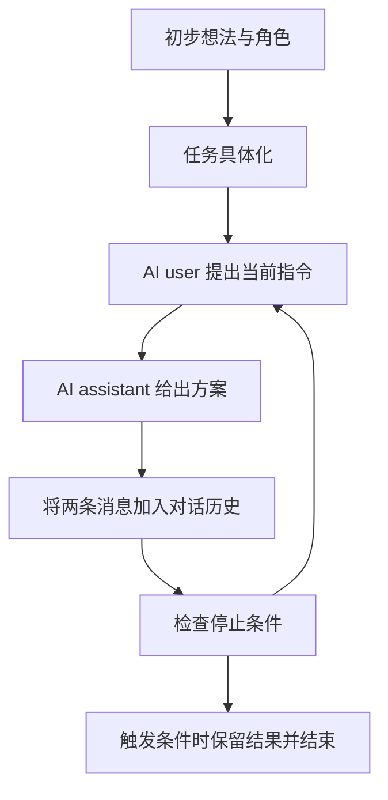

# CAMEL：用角色和对话协议组织双智能体协作

如果两个语言模型可以互相回应，能否让一个负责提出下一步要求，另一个负责完成，从而减少人逐轮提示的负担？CAMEL 研究了这种角色扮演式协作。它的价值既在于给出一个简单的消息循环，也在于展示这个循环怎样偏离任务。

本讲解依据 [论文 v2 记录](https://arxiv.org/abs/2303.17760v2)（2023-11-02），重点是角色协议、失败行为和评价条件。这里的 AI user 是系统中的规划角色，不代表真实读者，也不能替代真实人的意图确认。

## 先把任务具体化，再分配交谈角色

CAMEL 的基本流程从一个初步想法开始，由 task specifier 结合两个角色，把想法展开成更具体的任务。随后，AI user 与 AI assistant 各自接收包含任务和角色的系统提示，才开始交流。AI user 负责给出指令，AI assistant 负责回应和提供解决方案。[方法 §3.1 与图 1](https://arxiv.org/html/2303.17760v2#S3.SS1)

设想一个教学任务：整理一份公开文本的词频统计。规划角色先要求定义输入格式，执行角色给出读取方案；规划角色再提出清洗规则，执行角色补充实现。这个例子帮助区分角色分工，没有作为论文案例或真实实验执行。

任务具体化是一个重要的边界。模型可以让模糊需求更可操作，却也可能补入人没有指定的假设。因此，能够自动扩展任务不等于扩展后的内容已经获得人认可。把这一点用于研究助手时，必须区分讨论中的候选想法和已确认的执行范围。

## 下一条指令来自上一轮的结果

用 M_t 表示当前已经形成的对话记录。论文的交互式规划可以写成一个循环：AI user 读取 M_t，生成下一条指令；AI assistant 读取同一历史和新指令，给出回复；两条消息一起加入历史，形成下一轮的 M。这里最关键的是后续指令可以响应前一步输出，而不是把一份静态计划逐行复读。

这是根据 §3.1 公式 1–4 绘制的教学示意。论文允许扩展到更多参与者，并介绍了可由人或 AI 担任的 critic；本导读集中讲双角色主线，不把这些扩展当作都具有同样的实验证据。

还要区分“给出程序”和“运行程序”。角色叫执行者，并不自动意味着每条回复都有环境执行记录。判断任务是否完成，需要独立可检查的结果，而不能只检查对话是否顺利走到结束。

## Inception prompting 约束的是交流协议

论文在对话开始前设置任务具体化提示、assistant 系统提示和 user 系统提示；随后两个角色自动互相提示直到停止。提示中不仅描述身份，还规定谁发指令、回复应包含什么、如何避免角色反转以及如何结束。[提示设计 §3.2](https://arxiv.org/html/2303.17760v2#S3.SS2)

角色名称本身不是核心。把一个模型称作程序员，只提供了行为倾向；约定它接收指令并返回具体方案，才形成可观察的交互约束。相应地，要求另一个角色一次推进当前步骤，有助于形成可以追踪的任务过程。

这些提示的目标是减少不希望出现的行为，不能把提示语本身当作可靠保证。论文使用了明确的协议和停止检查，正是因为单靠“请合作完成任务”会出现角色混乱、空泛承诺和循环交流。

## 四种失败让通信质量可以被观察

论文记录了角色反转、重复指令、只承诺将来行动却不交付结果，以及重复致谢等无进展循环。这些问题并不都表现为事实错误：一段措辞流畅的对话也可能没有推进任何任务。[行为观察与停止条件](https://arxiv.org/html/2303.17760v2#S4.SS1)

因此，评价通信时可以分别检查角色是否保持、是否出现新的有效产出、消息是否改变下一步，以及结束是否有实际依据。这是根据论文现象整理的阅读问题，不是论文发布的一套通用评分标准。

在 AI Society 数据生成设置中，对话遇到 user 连续三轮未给指令、assistant 反向发指令、user 发出任务完成标记、达到 token 限制或达到 40 条消息上限时会结束。几种停止原因必须分开看：达到上限只是预算用尽，触发角色反转意味着协议失败，而完成标记也首先只是一个模型判断。它们都不能被统一统计成真实任务成功。

## 评价支持了什么，又没有支持什么

论文从 AI Society 与 Code 数据中各随机选取 100 项任务，用 GPT-4 把 CAMEL 对话总结成最终方案，再与 GPT-3.5-turbo 的单次回答比较。人工评价只覆盖 AI Society，收集了 453 份比较回应；GPT-4 评价覆盖两个任务集。[评价 §5.1 与表 1](https://arxiv.org/html/2303.17760v2#S5.SS1)

表 1 报告 AI Society 的人工比较中，CAMEL 方案获得 76.3% 的偏好。这个数的分母是该设置中的人工评价回应，不能改写成 76.3% 的任务经过执行验证成功，也不是所有模型或任务上的普遍优势。多轮协作与单次生成的预算不同，而且 CAMEL 方案经历了 GPT-4 汇总，这些都影响我们怎样解释比较。

论文还用生成数据微调 LLaMA-7B，并在 HumanEval 与 HumanEval+ 上测试。那是训练后的单个模型的代码生成结果，不是两角色运行时通信的直接成功率。[微调模型评价 §5.3](https://arxiv.org/html/2303.17760v2#S5.SS3) 阅读时应把“对话产生有用材料”和“这些材料训练出的模型有什么表现”分成两条证据链。

## 下一步怎样研究角色间通信

CAMEL 适合作为一个最小可分析结构：两个角色、共享的历史、交替的指令和方案、明确的停止条件。若想研究协议的价值，可以保持模型与总预算不变，比较固定角色、允许角色变化和无角色约束的交谈，记录实际产出、重复消息以及停止原因。

另一个问题是历史怎样传递。完整历史使角色能够追踪细节，却增加成本；压缩历史可能让约束和未解决错误消失。这与 AgentPrune 的跨轮通信选择有关，但 CAMEL 自身没有证明某种压缩方案最优。以上是由机制导出的候选研究问题，仍需任务与对照设计来验证。

## 原文入口与本次覆盖

可从 [固定 PDF](https://arxiv.org/pdf/2303.17760v2) 或 [HTML 全文](https://arxiv.org/html/2303.17760v2) 的图 1、§3.1–3.2、§4.1 与§5.1 开始。本文核对了双角色机制、数据生成中的失败与停止条件，以及结果评价方式；实际查看了 PDF 第 4、5、8、9 页的流程、公式与评价表。

没有展开全部提示模板、完整数据生成附录和 critic 案例，也没有复现对话或微调实验。这是一篇围绕通信主线的讲解，不把自动对话拟人化为真实社会认知，也不把 2023 年模型上的观察外推成当前所有系统的规律。
