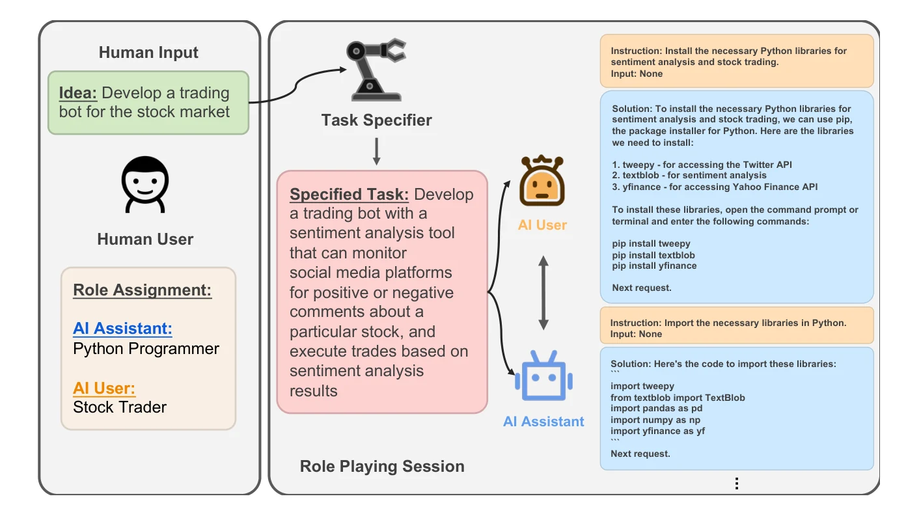
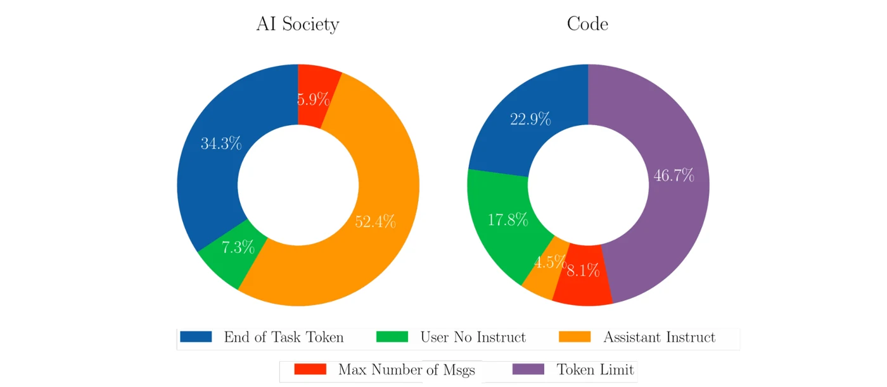
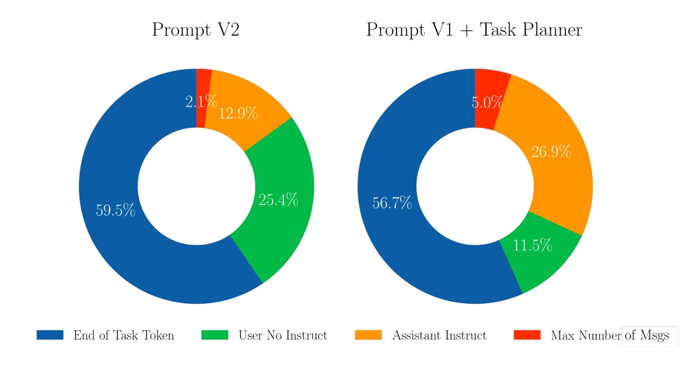
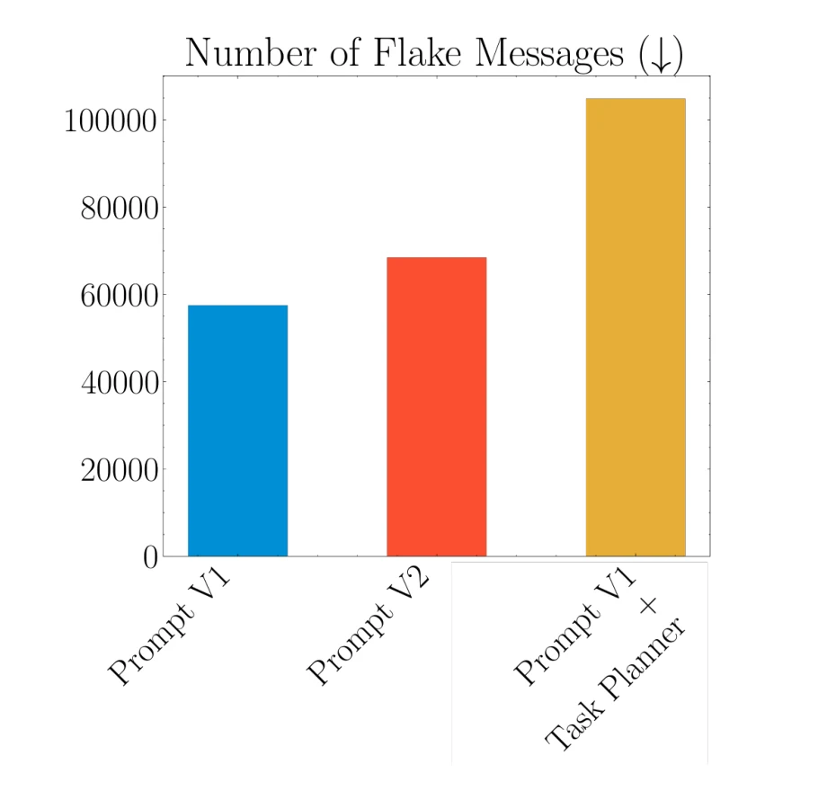

# CAMEL: How Two Roles Keep a Conversation Moving

In 2023, five authors at King Abdullah University of Science and Technology (KAUST) published *CAMEL: Communicative Agents for "Mind" Exploration of Large Language Model Society*. They turned their attention to a question more basic than "gaining a few points on some question-answering task". Chat models could already carry out single instructions. Could two instances of a model play "the person making requests" and "the person doing the work", and push a multi-turn conversation forward on their own, with a human giving only an idea and two roles at the start? [Paper v2 record](https://arxiv.org/abs/2303.17760v2)

The framework the paper presents is called role-playing. A human first gives a preliminary idea and a pair of roles, and a task specifier writes the idea up as a concrete task. Then the AI user gives one instruction at a time and the AI assistant gives the corresponding solution. Both share a growing conversation history, until the AI user issues an end marker, one side breaks the protocol, or the budget runs out. The authors call this approach inception prompting: before the conversation begins, and only then, the roles, task, communication format and termination conditions are written into three starting prompts, after which the two roles prompt each other automatically. [Abstract and §3, PDF pp. 1–5](https://arxiv.org/pdf/2303.17760v2#page=1)

The paper contributes more than this loop. Using the same process, the authors generated conversation and question-answer data in bulk, including AI Society, Code, Math and Science; they used preference evaluations and fine-tuning experiments to show that these data are useful; and they recorded four kinds of failure: role flipping, repeated instructions, empty promises and loops that make no progress. CAMEL is therefore a methods paper, a data paper and an evaluation paper at once, and when reading it these three chains of evidence need to be kept apart.

The value of reading CAMEL today is that it shrinks "multi-agent collaboration" down to a message loop that can be inspected line by line. Figure 1 draws the relations among the roles, the task specifier and the conversation transcript; the three starting prompts show how a protocol is written into text; and the termination conditions and the failure examples in the appendix show where the protocol breaks down. The result most worth remembering is also here: in the AI Society data, 52.4% of conversations ended with "the assistant giving instructions back to the user", and only 34.3% reached the task-completion marker. "The conversation ended" and "the task was completed" are two different things.

The core of this guide is the loop in Figure 1 and the prompt design in §3.2, and most of its length goes to these two parts. The reading order is: first why human prompting became a bottleneck, then how an idea becomes a concrete task; next, a round of conversation walked through against Figure 1 and Equations 1–4, and the three prompts taken apart; then two turns of messages followed through the paper's own trading-bot example; and finally the failure statistics, preference evaluations, fine-tuning results and prompt ablations. The guide is based on arXiv v2 of 2 November 2023, the NeurIPS 2023 version; page numbers count from the first page of the PDF. [§3.1 and Figure 1, PDF p. 4](https://arxiv.org/pdf/2303.17760v2#page=4)

## Why human prompting became a bottleneck

The more capable chat models become, the more the human work of prompting seems to matter. A model can write code, make plans and explain concepts, but first it has to know "what to do now". In ordinary use a person does this: they read the model's reply, judge what to ask next, and write a new prompt. The longer the task, the more of this back-and-forth there is; the more specialized the prompt, the more the person needs to know the field. [§1, PDF pp. 1–2](https://arxiv.org/pdf/2303.17760v2#page=1)

The paper gives a very concrete difficulty. Someone knows nothing about stock trading but wants to build a trading program. They can describe "I want a trading bot", but from their own knowledge they would struggle to write a task description such as "monitor social media with sentiment analysis and execute trades based on the results". Without a suitable prompt the model lacks enough context, and the person in turn has to keep revising the prompt in response to the model's feedback. This process is time-consuming, requires domain knowledge, and sometimes cannot be completed at all. [§1, PDF p. 1](https://arxiv.org/pdf/2303.17760v2#page=1)

The authors borrowed several threads from existing research. Communication between agents had long been studied, and natural language was regarded as the most natural form of communication; research on cooperative AI studies how multiple systems coordinate toward a common goal; and instruction tuning and prompt engineering had made models better at acting on human intent. The paper ties these threads together: since models can understand natural-language instructions, could one model be dedicated to "what to ask next" and another to "how to do it", freeing humans from turn-by-turn prompting? [§2, PDF pp. 2–3](https://arxiv.org/pdf/2303.17760v2#page=2)

Before formally presenting the framework, the authors made a preliminary observation and ran into four kinds of problem: the assistant and user swapped roles; the assistant repeated the user's instruction verbatim; the assistant only promised "I will do it" without giving a concrete method; and the two roles thanked each other or said goodbye, falling into a loop with no progress. These four problems later became the paper's organizing thread: the prompt design targets them, the termination conditions catch them, and the appendix gives instances of them. [§1 and §4.1, PDF pp. 2, 8](https://arxiv.org/pdf/2303.17760v2#page=2)

The scope of the paper's experiments needs stating first. The "society" in the title is a research vision; the actual experiments are two gpt-3.5-turbo instances conversing in text, with no real environment, no tool calls and no third role in the main experiments. In the conclusion and appendices the authors discuss possible extensions to more agents, competitive settings, critics and embodied agents, but these are outlooks or case studies, not conclusions of the main experiments. [§3.1, §6 and Appendix N, PDF pp. 4–5, 10, 52](https://arxiv.org/pdf/2303.17760v2#page=4)

There is one more easily overlooked boundary. "Minimal human intervention" means that a person no longer writes prompts turn by turn; a person still has to give the idea and the roles at the start. The authors call this starting point a "preliminary idea" and assume the person at least knows which two kinds of role should do the job. Whether the idea is understood accurately, and whether the details the task specifier fills in match the person's intent, the paper does not evaluate separately. This gap runs through all the evidence that follows.

## From one idea to an executable task

CAMEL takes only two inputs: a preliminary idea and a pair of roles. The example in Figure 1 is "develop a trading bot for the stock market", with the AI assistant assigned to play a Python programmer and the AI user to play a stock trader. The human does not need to write a complete task, only to give this starting point. [§3.1 and Figure 1, PDF p. 4](https://arxiv.org/pdf/2303.17760v2#page=4)

The task specifier takes over next. It receives the idea and the two roles and expands the vague wish into a concrete task. The output in Figure 1 is: "Develop a trading bot with a sentiment analysis tool that can monitor social media platforms for positive or negative comments about a particular stock, and execute trades based on sentiment analysis results." This sentence is much longer and much more specific than the original idea: it specifies a data source, a method of analysis and a mode of action. [§3.1, PDF p. 4](https://arxiv.org/pdf/2303.17760v2#page=4)

The authors explain the reason for this design: conversational agents usually need a concrete task prompt, and having non-experts write such prompts is both difficult and time-consuming. The task specifier is therefore treated as an "enhanced imagination module" that expands the idea on the person's behalf. The description is apt: what it does is imagine and fill in, and whether the filled-in content equals the person's need has to be confirmed separately. The original idea contained neither "social media" nor "sentiment analysis"; these are reasonable options the model supplied. [§3.1, PDF p. 4](https://arxiv.org/pdf/2303.17760v2#page=4)

This step sets the direction of the whole conversation that follows. If the assumptions filled in match the person's intent, the task will be easier to advance; if not, the two roles will cooperate very diligently on the wrong task. The paper's evaluation looks only at whether the final solution is preferred, and does not check whether the concrete task is consistent with the original idea. When reading CAMEL, treat the task specifier's output as a "proposal" that needs a person to confirm it; the paper simply leaves out the confirmation step.

Once the task is settled, each of the two roles receives a system message. Let the assistant's system prompt be $P_A$, the user's system prompt $P_U$, and the two underlying models $F_1$ and $F_2$. The two agents can then be written as

$$
A \leftarrow F_1(P_A), \qquad U \leftarrow F_2(P_U)
$$

Here $A$ and $U$ each consist of a model and a system prompt; only the prompts differ. In the paper's experiments both $F_1$ and $F_2$ are gpt-3.5-turbo; the framework itself allows different models. [§3.1, PDF pp. 4–5](https://arxiv.org/pdf/2303.17760v2#page=4)

The division of roles is as follows. The AI user is the task planner, responsible for interactive planning and for deciding what the assistant should do next. The AI assistant is the task executor, responsible for giving solutions, carrying out the steps of the plan and replying to the user. "Executor" here refers to a duty in the prompt; actually running code would require connecting an environment, which the paper's experiments do not do. Appendix N says explicitly that these agents sit in a sandbox with no external tools and no real-world interaction; their "execution" takes the form of writing out a solution or a piece of code. [§3.1 and Appendix N, PDF pp. 5, 52](https://arxiv.org/pdf/2303.17760v2#page=5)

When the task counts as complete is also decided inside the conversation: when the AI user believes the task is solved, it outputs the end marker. The model makes this judgment; tests, running results and human acceptance are all outside the loop. Understanding this keeps one from mistaking "the conversation ended" for "the task succeeded" when looking at the evaluations and failure statistics later.

## Figure 1: How two roles take turns

Figure 1 is the master diagram of the paper and worth getting to know well first. It has three parts: on the left, Human Input, containing an idea and the role assignment; in the middle, the Task Specifier, which turns the idea into a Specified Task; and on the right, the Role Playing Session, in which the AI user and AI assistant converse about the task. When reading the figure, follow how information is processed from left to right, then on the right follow how messages accumulate from top to bottom. [§3.1 and Figure 1, PDF p. 4](https://arxiv.org/pdf/2303.17760v2#page=4)

The left side has two layers of information. At the top is the idea: "Develop a trading bot for the stock market." Below it are the roles the person assigns: the AI assistant is a Python programmer and the AI user is a stock trader. The idea answers "what do we want to do", and the roles answer "who will do it". The paper assumes the person can supply at least these two; it does not require the person to write out the steps of the task, nor to understand sentiment analysis or trading interfaces.

In the middle is the task specifier. It receives the idea and the roles and outputs a more concrete task sentence. Figure 1 shows this transformation with an arrow, and the pink box under the arrow contains the specified task. This box is the common goal of the whole conversation, repeated in both roles' system prompts. All later instructions and solutions revolve around this sentence.

On the right is the conversation transcript. Orange boxes are the AI user's instructions and blue boxes the AI assistant's solutions. Every turn follows a fixed format: the user writes an Instruction and an Input, and the assistant writes a Solution ending with Next request. Figure 1 shows the first two turns: the first installs Python libraries, the second imports them. The two-way arrow between the roles indicates that they share the same conversation history; the AI User at the top and the AI Assistant at the bottom are only role labels, and the actual model can be the same one.

Putting this figure into equations makes it clearer. Let $M_t$ be all messages up to turn $t$, $I_t$ the $t$-th instruction and $S_t$ the corresponding solution. The paper writes the history as

$$
M_t=\{(I_0,S_0),\ldots,(I_t,S_t)\}
$$

In the next turn, the AI user reads the whole history and produces a new instruction; the AI assistant reads the same history and the new instruction and produces a solution; and the two new messages are appended to the history:

$$
I_{t+1}=U(M_t),\qquad S_{t+1}=A(M_t,I_{t+1}),\qquad M_{t+1}=M_t\cup\{(I_{t+1},S_{t+1})\}
$$

These are the paper's Equations 1–4; the guide writes Equations 2–4 side by side. The three expressions say, respectively, that the instruction comes from the history, the solution comes from the history plus the new instruction, and the history only grows. Both $U$ and $A$ read $M_t$, so the user can see what the assistant did in the previous turn, and the assistant can see all of the user's earlier requests. [§3.1 and Equations 1–4, PDF pp. 4–5](https://arxiv.org/pdf/2303.17760v2#page=4)

The key to this structure is $I_{t+1}=U(M_t)$. The next instruction is generated on the spot by the user after reading the previous turn's result; it need not correspond to a plan written in advance. If installing the libraries succeeded in the first turn, the user can go on to ask for them to be imported; if the first turn exposed a missing dependency, the user can change the request to fill in the dependency first. "Interactive planning" refers precisely to this process of rewriting the next step in response to feedback.

| Moment | Who speaks | What they see | What they produce | How the history changes |
| --- | --- | --- | --- | --- |
| Start | Human | Idea and roles | Specified task | $M_0$ is empty |
| Turn 1 | AI user | $M_0$, task, user system prompt | Instruction $I_1$ (install libraries) | Waiting for a solution |
| Turn 1 | AI assistant | $M_0$, $I_1$, assistant system prompt | Solution $S_1$ (pip commands) | $M_1=M_0\cup\{(I_1,S_1)\}$ |
| Turn 2 | AI user | $M_1$ | Instruction $I_2$ (import libraries) | Waiting for a solution |
| Turn 2 | AI assistant | $M_1$, $I_2$ | Solution $S_2$ (import code) | $M_2=M_1\cup\{(I_2,S_2)\}$ |

This table makes "shared history" concrete: the two roles see the same $M_t$, and the difference lies in the system prompts each receives. The user's prompt requires it to give one instruction at a time; the assistant's prompt requires it to give a concrete solution and end with Next request. The history is common; the roles are separate.

What Figure 1 does not draw matters just as much. It draws no execution environment, tool calls, file system or tests; the solutions on the right are text, and running results lie outside the loop. Appendix N says it plainly: these agents are in a sandbox and do not really interact with the outside world. The "install libraries" and "import libraries" in the figure are therefore two pieces of planning text, and the second turn does not check whether the pip commands of the first turn actually succeeded. [Appendix N, PDF p. 52](https://arxiv.org/pdf/2303.17760v2#page=52)

The framework also leaves several openings for extension. Equations 1–4 can be generalized to more than two agents, using a message-passing graph to describe who sends messages to whom. The authors also propose critic-in-the-loop, in which an AI or human critic chooses among several candidate solutions or gives feedback, forming a decision process similar to tree search. The appendix also has an example of embodied agents, in which a role calls tools through code to generate images. These extensions show that the framework's boundaries are fairly wide, but the main experiments are still two text-based roles. [§3.1 and Appendix O, PDF pp. 5, 54](https://arxiv.org/pdf/2303.17760v2#page=5)

Finally, look at the cost structure. Every turn involves at least two model calls, and each one re-sends the ever-longer history to the model. In discussing the 40-message limit, the paper points out that the cost of a conversation grows quadratically with its length: turn $t$ has to process the full text of the previous $t$ turns, so the more turns, the more total tokens. This cost determines the hard limit of 40 messages and also affects the later statistics on "why conversations end".

## How three prompts fix the communication protocol

CAMEL puts most of its control before the conversation begins. The authors call this inception prompting, meaning that the roles, task and rules are "implanted" into the two agents' system prompts, after which they prompt each other and the human no longer intervenes. There are only three prompts: the task-specifier prompt $P_T$, the assistant system prompt $P_A$ and the user system prompt $P_U$. [§3.2, PDF p. 5](https://arxiv.org/pdf/2303.17760v2#page=5)

$P_T$ is responsible for expanding the idea into a task. It contains information about both roles, asks the model to "be more creative and imaginative", and requires a concrete task within a word limit. It runs only once, and its output is written into both $P_A$ and $P_U$. The tone of this prompt differs from the system prompts that follow: it encourages expansion, while the later prompts stress constraints. [§3.2 and Figure 2, PDF pp. 5–6](https://arxiv.org/pdf/2303.17760v2#page=5)

$P_A$ and $P_U$ are broadly symmetrical. Both contain the task, the roles, the common interest, one instruction at a time and a refusal clause; the end marker is written mainly into the user prompt, and the assistant prompt cooperates with "unless I say the task is completed". The asymmetry lies in the direction of action: the assistant is asked to give solutions, and the user is asked to give instructions. Figure 2 gives the full template for the AI Society setting, and the key clauses are taken apart below. [§3.2 and Figure 2, PDF p. 6](https://arxiv.org/pdf/2303.17760v2#page=6)

| Requirement in the prompt | Written mainly for | Behavior it targets | Its role in the protocol |
| --- | --- | --- | --- |
| Remember you are one role and I am the other | Both | Role drift | Fixes identity and task |
| Never flip roles | Both | Role flipping | Fixes identity first, then duties |
| Never instruct me | Assistant | Assistant overstepping | Makes "who gives instructions" a checkable constraint |
| Give only one instruction at a time | User | Instructions too coarse, too much asked at once | Makes each turn correspond to one manageable step |
| Refuse honestly and explain when you cannot perform | Both | Fabrication, overreach, harmful content | Leaves a legitimate exit for refusal |
| Start with Solution and give a concrete implementation or example | Assistant | Empty promises | Turns "I will do it" into "here is how it is done" |
| End with Next request | Assistant | The conversation stalling | Actively asks for the next instruction |
| Use the two formats Instruction and Input | User | Inconsistent instruction formats | Makes each turn a parseable training example |
| Reply only with the end marker when you believe the task is done | User | Endless thanks, loops | Provides a clear stop signal |
| Say the task is complete only when my replies have solved it | User | Ending too early | Ties ending to "solved" |

This table groups the clauses by function; Figure 2 keeps the original wording. The original prompts are more blunt: the assistant prompt repeats "Never forget", "Never flip roles" and "Never instruct me", while the user prompt says "You will always instruct me". These sentences look like emotional emphasis, but each one in fact corresponds to an observed failure: role flipping, repeated instructions, talking without doing, and endless loops. [§3.2 and Figure 2, PDF pp. 6–7](https://arxiv.org/pdf/2303.17760v2#page=6)

The output format is the most easily underestimated part of the whole design. Every assistant reply must start with Solution and end with Next request; every user message must be written as Instruction plus Input, with Input: None when there is no input. This has three effects. First, every turn of the conversation has a fixed structure, so it is fairly easy to see whether a role overstepped or whether a solution was given. Second, messages can be paired directly into "instruction–solution" examples for later data generation and fine-tuning. Third, Next request makes the assistant actively hand the floor back to the user, reducing the cases where the conversation stops in mid-air. [§3.2, PDF pp. 6–7](https://arxiv.org/pdf/2303.17760v2#page=6)

The design of the end marker deserves a close look too. When the user believes the task is complete, it replies with only a special token instead of continuing to chat; the prompt also adds "say the task is complete only when my replies have solved it". This writes the stopping condition into a role and lets the model judge for itself. The paper then lists five termination conditions, one of which is exactly this end marker, while the other four check roles, instructions and budget from outside. This shows that the authors do not fully trust the model's self-judgment: it may declare completion too early, or fall into a loop before finishing. [§3.2 and §4.1, PDF pp. 7–8](https://arxiv.org/pdf/2303.17760v2#page=7)

A prompt can constrain behavior but cannot enforce it. It is a piece of text, and the model can choose to follow it or to deviate. The paper itself reports that 52.4% of conversations in the AI Society data still ended with the assistant giving the user instructions, which is exactly the role flipping the prompt is meant to prevent. The authors do not claim that the prompts eliminate failures; they set up separate termination conditions to catch failures, and then used the data to count how common the failures are. [§4.1 and Appendix J, PDF pp. 8, 38](https://arxiv.org/pdf/2303.17760v2#page=8)

There is another design tension: the task-specifier prompt encourages "imagination", while the system prompts demand "following the rules". The former makes the task concrete, and the latter keeps the conversation controllable. Different prompts carry the two, and they run one after the other. When reading other role-playing frameworks, check whether they also separate "expanding the task" from "constraining the exchange"; if both are mixed into one prompt, the model may be asked to improvise and to stay within bounds at the same time.

## Two turns through the trading-bot example

Figure 1 and Appendix A of the paper give a complete trading-bot example. Only the first two turns are used here, to see clearly how messages follow one another. The messages below are excerpted from the paper with cuts; an ellipsis marks a longer list or code in the original. [Figure 1 and Appendix A, PDF pp. 4, 11](https://arxiv.org/pdf/2303.17760v2#page=4)

In the first turn, the AI user says:

> Instruction: Install the necessary Python libraries for sentiment analysis and stock trading.
> Input: None

The AI assistant replies:

> Solution: To install the necessary Python libraries for sentiment analysis and stock trading, we can use pip... Here are the libraries we need to install: 1. tweepy... 2. textblob... 3. yfinance... pip install tweepy; pip install textblob; pip install yfinance.
> Next request.

In the second turn, the AI user says:

> Instruction: Import the necessary libraries in Python.
> Input: None

The AI assistant replies:

> Solution: Here's the code to import these libraries: import tweepy; from textblob import TextBlob; import yfinance as yf.
> Next request.

Plug these two turns into Equations 1–4: $M_0$ is empty; $I_1$ is installing the libraries, $S_1$ the pip commands, and $M_1=\{(I_1,S_1)\}$; $I_2$ is importing the libraries, $S_2$ the import code, and $M_2=\{(I_1,S_1),(I_2,S_2)\}$. When writing $I_2$, the user has read $S_1$, so it knows the "install" step has been dealt with, and the next step naturally moves on to "import". This is the minimal form of interactive planning: the next step comes from the previous turn's result, with no need for a ten-step checklist written beforehand.

The example also exposes the framework's boundary. The assistant says "we can use pip to install" and lists the commands; it does not actually open a terminal, nor does it return output showing that installation succeeded. After seeing this text, the user assumes installation is complete and goes on to ask for the import. If the pip commands had failed because of the network or permissions, the second turn would still proceed as usual. Appendix N says explicitly that these agents are in a sandbox with no external tools; what is being continued here is planning text, and execution results would have to come from an external environment. [Appendix N, PDF p. 52](https://arxiv.org/pdf/2303.17760v2#page=52)

Three places in this example are worth watching. First, the system prompts are not shown in Figure 1's message boxes, but they determine how the two roles "should speak"; with the same model and a different system prompt, the style of messages changes. Second, both messages carry the fixed format, and Solution and Next request keep the conversation moving in one direction; without Next request, the assistant might stop at its solution and wait for the user to speak again. The full prompt templates can also be viewed in Figure 2 of the [HTML full text](https://arxiv.org/html/2303.17760v2). Third, the end marker has not yet appeared, so the conversation will continue; when it appears is the user's judgment, not something decided by whether the code runs.

In Appendix A the paper unfolds the whole conversation, including many later turns. Figure 1 excerpts only the first two turns, to illustrate the framework; whether the task was completed lies outside its scope of evidence. Reading the appendix, one sees the solutions grow longer and longer, covering APIs, data processing and trading logic; they read like a complete implementation guide, but they are still text. This distinction comes up again in the section on evaluation: what the evaluation compares is the compiled solution text, and program running results are not part of it.

Reproducing this minimal loop yourself takes very little: two model calls, a message list that keeps being appended to, each system prompt, and a loop controller that checks for the end marker and the budget. The paper open-sourced a library that packages these parts; this guide does not go into the code and only stresses the three inputs at the protocol level: role prompts, shared history and stopping conditions. Without any one of them, the loop becomes either an ordinary single-turn exchange or a chat that cannot stop.

## Four failures and five ways to end

One of CAMEL's contributions to multi-agent research is breaking "failed cooperation" down into observable types. In §4.1 the authors list four kinds of problem, and Appendix G gives a conversation excerpt for each. These excerpts are valuable because they show how a fluent, polite conversation can continue without advancing the task. [§4.1 and Appendix G, PDF pp. 8, 28](https://arxiv.org/pdf/2303.17760v2#page=8)

The first kind is role flipping. The assistant suddenly starts giving the user instructions, and the user follows them. The appendix example occurs in a scenario about accessing a Google Docs folder: the assistant should have been waiting for the user to provide documents, but instead issued an instruction along the lines of "I have obtained access; please give me the first document", completely reversing the roles. The paper's termination conditions include one specifically for "the assistant issues an instruction", which ends the conversation as soon as it is triggered. [Appendix G, PDF p. 28](https://arxiv.org/pdf/2303.17760v2#page=28)

The second kind is the assistant repeating the instruction. The user asks for an exercise to help actors understand a director's intentions, and instead of giving an exercise, the assistant repeats the user's Instruction and Input word for word. It does not flip roles and does not refuse, but this turn produces nothing new. For downstream data generation this is an invalid example; for the task it is a wasted turn.

The third kind is the flake reply, an empty promise. The assistant says "I will write a script that generates all combinations of the inputs" and stops there, with no script, no steps and no example. This kind of reply looks most like "cooperation in progress", because its tone is positive and forward-looking; yet it pushes the action into a next step that never happens. In its data statistics, the paper counts messages beginning with "I will..." specifically, using this surface feature to approximate empty promises. [§4.1 and Appendix G, PDF pp. 8, 28](https://arxiv.org/pdf/2303.17760v2#page=8)

The fourth kind is the loop without progress. The two roles thank each other and say goodbye, back and forth for many turns; in the appendix example the assistant even says "we seem to be stuck in a loop", yet the conversation continues. The roles have not flipped, and the messages conform to the norms of politeness, but the task does not move forward. This kind of failure shows that judging by tone and format alone whether something "looks like cooperation" is not enough to tell whether the cooperation is effective. [Appendix G, PDF p. 28](https://arxiv.org/pdf/2303.17760v2#page=28)

| Termination condition | How it is triggered | What it indicates |
| --- | --- | --- |
| User No Instruct | The user gives the assistant no instruction for 3 turns in a row | The user has stopped advancing, or does not know what to ask |
| Assistant Instruct | The assistant issues an instruction to the user | Role flipping; the protocol has failed |
| End of Task Token | The user outputs the end marker | The user believes the task is complete; a judgment by the model |
| Token Limit | The assistant or user reaches the model's length limit | The budget is exhausted; long code or long solutions trigger it more easily |
| Max Number of Messages | The conversation reaches 40 messages | Cost protection against endless chat |

These five conditions answer "why the conversation stopped"; whether the task was completed requires a separate check. Counting them all together would give a nice-looking "termination rate" that hides how many were successes, how many failures and how many simply ran out of budget. The paper's approach is to draw each reason separately in Figure 8, and this distinction is one of the things in the paper most worth learning from.

The left side of Figure 8 is AI Society and the right side is Code. Read it by first checking the color legend, then comparing the largest segment in each chart. In AI Society, the largest is the orange Assistant Instruct at 52.4%; the blue End of Task Token is 34.3%; the green User No Instruct is 7.3%; the red Max Number of Messages is 5.9%; and the purple Token Limit is barely visible. In Code, the largest is the purple Token Limit at 46.7%; the blue end marker is 22.9%; the green User No Instruct is 17.8%; the orange Assistant Instruct is 8.1%; and the red message limit is 4.5%. [Appendix J and Figure 8, PDF p. 38](https://arxiv.org/pdf/2303.17760v2#page=38)

These numbers say two things. First, in AI Society the most common reason for ending is role flipping, with task completion in second place; although the prompts repeatedly say "Never flip roles", more than half of the conversations still ended because roles flipped. Second, in Code the most common reason is the token limit, because code replies are long and model output easily hits the length limit; this is a budget problem, separate from whether the role protocol was followed.

The 40-message limit also affects this chart. The paper says the limit was set to control cost, since the cost of a conversation grows quadratically with its length. The red segments in Figure 8 are small on both sides (5.9% and 4.5%), showing that most conversations ended for other reasons before reaching 40 messages. The limit still truncates a few long tasks, so the "distribution of termination reasons" reflects both protocol behavior and cost design.

The unit of counting in Figure 8 needs to be distinguished: it counts each conversation's reason for termination, and the proportion of messages showing each kind of failure would require another kind of count. The four failures, role flipping, repetition, empty promises and loops, can all occur within one conversation; Figure 8 records only which "fuse" blew at the end. The paper separately counts empty messages in Figure 10, but gives no overall incidence of the four failures across all messages. When reading, keep "52.4% of conversations ended because of role flipping" apart from "52.4% of tasks failed".

## Generating conversation data in bulk with the same protocol

CAMEL's second contribution is turning this protocol into a data-generation pipeline. A person gives only an idea and roles, and the model can generate the roles, the tasks and the specified tasks; the same set of prompts can be run again and again to produce large numbers of conversations. The paper built two multi-turn datasets, AI Society and Code, in this way, and used a similar process to generate Math, Science and Misalignment data. [§4.1, PDF pp. 7–8](https://arxiv.org/pdf/2303.17760v2#page=7)

The scale of AI Society is stated clearly in the main text: 50 assistant roles and 50 user roles, with 10 tasks generated for each role combination, for a total of 25,000 conversations. The roles and tasks are generated by the model: first the model lists different assistant roles and user roles, then it generates, for each pair of roles, tasks they could complete together, and finally the task specifier makes each task concrete. Figure 3 gives the prompts for role generation, task generation and task specification. [§4.1 and Figure 3, PDF pp. 7–8](https://arxiv.org/pdf/2303.17760v2#page=7)

The Code data follows another axis of combination: 20 programming languages and 50 application domains, with tasks generated by the model along the lines of "what a given language can help programmers do in a given domain". Figure 6 lists these languages and domains, including Python, Java, C++, SQL and Go, and accounting, biology, law and medicine. The main text does not give the total number of Code conversations, only how roles, languages and domains are generated; do not read 20×50 directly as the number of conversations, because each combination generates several tasks. [Appendix E and Figure 6, PDF p. 25](https://arxiv.org/pdf/2303.17760v2#page=25)

Math and Science are single-turn question-answer data. Math has 50,000 question–answer pairs: GPT-4 first generated 25 mathematical topics, 25 subtopics for each topic, and 80 problems for each subtopic, which it also solved. Science generated 20,000 pairs for each of physics, biology and chemistry, with 25 topics per subject, 25 subtopics per topic and 32 problems per subtopic. The Misalignment data has the model simulate possible malicious applications, such as "a hacker helping an artificial general intelligence (AGI) take over the world", to illustrate the risks of misaligned agents; it is a set of risk examples and serves a purpose outside the evaluation of capability. [Appendix F and Table 4, PDF p. 26](https://arxiv.org/pdf/2303.17760v2#page=26)

These datasets serve different purposes. AI Society and Code are used to study multi-turn cooperative behavior and can also serve as fine-tuning corpora; Math and Science are used to observe how a model's abilities change as data from new domains is added step by step; Misalignment is used to discuss risk. The paper places them all under one narrative of "role-playing can scale", but their generation methods, evaluation methods and strength of evidence differ. When reading, ask: which dataset does a given conclusion come from?

The "social" meaning of the data also needs qualifying. AI Society consists of model-to-model conversations, with roles and tasks generated by the model; sampling from human populations would have to be done separately. It can help in studying how chat models behave in cooperative scenarios, but it cannot be taken directly as a sample of human social interaction. The paper uses information maps (Figures 11–14) to show topic coverage; these maps show which topics appear in the data, but cannot prove that the distribution of topics represents real society. [Appendix J, PDF pp. 40–43](https://arxiv.org/pdf/2303.17760v2#page=40)

On licensing, the paper says the code is under Apache 2.0 and the data under CC BY-NC 4.0, permitting only non-commercial use; models trained on these data are also recommended for research use only. This restriction is consistent with the paper's positioning as a "research resource". The datasets are released on HuggingFace; their specific versions and fields are outside the scope of this guide. [Appendix K.4, PDF p. 45](https://arxiv.org/pdf/2303.17760v2#page=45)

## Evaluation: What does it mean that people preferred it?

CAMEL's evaluation starts from a very practical question: are the solutions produced by multi-turn collaboration preferred over single-shot answers? The authors randomly sampled 100 tasks each from AI Society and Code, first used GPT-4 to compile each whole CAMEL conversation into one complete solution, and then compared it with gpt-3.5-turbo's single-shot answer to the same task. [§5.1, PDF pp. 8–9](https://arxiv.org/pdf/2303.17760v2#page=8)

The compilation step is crucial. CAMEL's raw output is a multi-turn, formatted conversation, while a single-shot answer is one block of text; compared directly, evaluators might be swayed by length and format. The paper has GPT-4 extract a complete solution from the conversation, and the prompt in Appendix H asks to "extract the complete solution, do not summarize", keeping the explanations and code from the conversation. The main text calls this step summarization, while the appendix wording is extraction; both point to "compressing the multi-turn content into one final solution that can be compared". [Appendix H, PDF p. 29](https://arxiv.org/pdf/2303.17760v2#page=29)

Human evaluation covers only AI Society. Evaluators saw two anonymous solutions side by side and chose the better one, or chose "equally good"; the paper collected 453 responses. Code has no human evaluation, and the authors' explanation is that without running the code, it is hard for people to judge whether a code solution is good. GPT-4 evaluation covers both datasets; its prompt asks for scores on four aspects, helpfulness, relevance, accuracy and level of detail, and then a judgment of which solution is better. [§5.1 and Appendix K.5, PDF pp. 9, 46](https://arxiv.org/pdf/2303.17760v2#page=9)

| Dataset | Evaluation method | Tie | gpt-3.5-turbo wins | CAMEL solution wins |
| --- | --- | ---: | ---: | ---: |
| AI Society | Human evaluation, 453 responses | 13.3% | 10.4% | 76.3% |
| AI Society | GPT-4 evaluation, 100 tasks | 4.0% | 23.0% | 73.0% |
| Code | GPT-4 evaluation, 100 tasks | 0.0% | 24.0% | 76.0% |

The three rows have different denominators: for human evaluation it is 453 responses, and for GPT-4 evaluation it is 100 tasks. The 76.3% shows that in this batch of human comparisons, evaluators preferred CAMEL's solutions; it is a preference proportion, and a task success rate would need a different measurement. The paper's own wording is likewise that "CAMEL solutions substantially outperform single-shot answers in both human and GPT-4 evaluations", and it does not present this as a code pass rate or task completion rate. [§5.1 and Table 1, PDF p. 9](https://arxiv.org/pdf/2303.17760v2#page=9)

What can this set of results support? Under the evaluation criteria of "helpful, relevant, accurate and sufficiently detailed", solutions that were expanded over multiple turns and compiled by GPT-4 were preferred by people and by GPT-4 over gpt-3.5-turbo's one-shot answers. It shows that multi-turn decomposition and division of roles can produce text that is more complete and more like an implementation guide. The example in Appendix H.1 is a post-production workflow tool, and the CAMEL solution runs from installing Python, installing libraries and reading and writing video all the way to concrete code; the paper argues that single-shot answers are usually not this detailed. More detail is exactly what the evaluation criteria reward.

What can it not support? First, the evaluation did not run code or check whether the solutions are feasible in a real environment; a solution with complete steps and professional wording may still contain errors. Second, the baseline is only gpt-3.5-turbo's single-shot answer, while the CAMEL side used multi-turn calls plus compilation by GPT-4, so the two have different token budgets and model configurations. Third, human evaluation covers only AI Society, and Code's 76.0% comes entirely from GPT-4; GPT-4 both took part in the compilation and served as the evaluator, a risk of bias from the same model family appearing at both ends. Fourth, 100 tasks and 453 responses make a medium-sized preference study, and the paper reports no significance tests, inter-rater agreement or per-task vote distributions. Fifth, the paper itself notes among its limitations that people may prefer longer answers, and longer is not automatically better. [Appendix K.1, PDF p. 44](https://arxiv.org/pdf/2303.17760v2#page=44)

The "high agreement" between humans and GPT-4 also deserves a closer look. Both cast most of their votes for CAMEL, so the direction agrees; but the tie rate falls from 13.3% to 4.0%, and gpt-3.5's win rate rises from 10.4% to 23.0%. This shows that the two evaluations differ in strictness and in what they count as a tie. Agreement in direction can serve as weak evidence, while the specific percentages cannot substitute for each other.

At this point, Table 1 can be treated as "preference evidence", the HumanEval results in the next section as "benchmark evidence for the trained model", and Figure 8 as "evidence of runtime behavior". The three kinds of evidence answer different questions and cannot be combined into a single figure such as "CAMEL's task success rate is X%".

## The fine-tuned model: A separate chain of evidence

The paper's second object of evaluation is a model; the runtime conversations are a separate line. The authors fine-tuned LLaMA-7B step by step in the order AI Society, Code, Math, Science, observing how the model's performance in that domain and in the others changed as data from each domain was added. The evaluation sets contain 20 AI Society tasks, 20 coding tasks, 20 math tasks and 60 science tasks; judging is again done by GPT-4 comparing the answers of two models in pairs. [§5.2, PDF p. 9](https://arxiv.org/pdf/2303.17760v2#page=9)

The structure of Table 2 needs to be understood first. Each block of four rows compares two models: Model 1 is the model before the new data is added, and Model 2 the model after. The four rows are the four evaluation domains, and each cell gives three numbers in order: ties, wins for Model 1 and wins for Model 2. For example, in the first block Model 1 is the original LLaMA-7B and Model 2 is the model with only AI Society data added; on the AI Society evaluation, there are 0 ties, 6 wins for Model 1 and 14 for Model 2. [§5.2 and Table 2, PDF p. 10](https://arxiv.org/pdf/2303.17760v2#page=10)

| Data newly added in Model 2 | Evaluation domain | Ties | Previous model wins | New model wins |
| --- | --- | ---: | ---: | ---: |
| AI Society | AI Society | 0 | 6 | 14 |
| Code | Science | 1 | 19 | 40 |
| Math | Math | 1 | 3 | 16 |
| Science | Science | 9 | 2 | 49 |
| Science | Math | 10 | 5 | 5 |

The first four rows show that "after data from a domain is added, the model usually gets better in that domain": AI Society is 6 to 14, Math 3 to 16 and Science 2 to 49, mostly favoring the new model. The second row also shows a cross-domain effect: after Code data is added, the Science evaluation is 19 to 40 in favor of the new model, which the authors explain by the code data containing tasks from scientific domains. The last row is a counterexample: after Science data is added, the Math evaluation is 5 to 5 with 10 ties, no clear improvement. The paper's wording is that the model "almost always" improves, and the "almost" needs to be kept. [§5.2 and Table 2, PDF p. 10](https://arxiv.org/pdf/2303.17760v2#page=10)

The denominators of these pairwise comparisons are 20 or 60 questions, small samples, and GPT-4's judgments use no reference answers; they compare two answers. Cross-domain gains may come from data overlap, the distribution of roles or similarity of format, and neither the main text nor the appendix reports ablations of the data mixture or checks for overlap between the generated data and the evaluation questions. Table 2 is therefore suited to showing that "after generated data is added step by step, GPT-4 prefers the model's answers on these evaluations", and not suited to attributing each domain's gain to that domain's data itself.

Coding ability is tested with HumanEval and HumanEval+. HumanEval contains 164 function-level programming problems: the model writes an implementation from a function signature and description, and pass@k is the probability that at least one of k samples passes all tests. Table 3 reports pass@1 and pass@100. CAMEL-7B scores 14.0 and 57.9 on HumanEval and 12.2 and 50.0 on HumanEval+; LLaMA-7B scores 10.5 and 36.5; Vicuna-7B scores 11.0 and 42.9, and 9.9 and 34.7 on HumanEval+; gpt-3.5-turbo scores 69.4 and 94.0, and 61.7 and 89.8 on HumanEval+. [§5.3 and Table 3, PDF p. 10](https://arxiv.org/pdf/2303.17760v2#page=10)

These numbers should be read on two levels. CAMEL-7B scores higher than LLaMA-7B and Vicuna-7B, showing that after fine-tuning on this generated data, the 7B model does improve on HumanEval. It is still far behind gpt-3.5-turbo, a stronger closed-source model, and "beating two 7B baselines" should not be read as "coding ability close to a commercial model". HumanEval has only 164 problems, and pass@100 gives many chances to sample, so the two numbers answer different questions: pass@1 is closer to the success rate of a single attempt, and pass@100 closer to "can it get there given several tries".

The fine-tuning experiments and the runtime evaluation are two independent chains of evidence. The former measures how a 7B model performs on benchmark problems; the latter measures whether solutions compiled from a conversation between two gpt-3.5-turbo roles are preferred. CAMEL-7B's HumanEval score cannot be used to infer the success rate of the two-role system on real tasks; conversely, the preference proportions in Table 1 cannot prove that the fine-tuned model is stronger. The paper places the two near each other in the same section, and readers need to separate them themselves.

The training configuration gives the order of magnitude needed for reproduction: 4 A100-80GB GPUs, 3 epochs, a learning rate of $2\times10^{-5}$, a batch size of 4 per GPU, 8 steps of gradient accumulation, a cosine schedule and a warm-up ratio of 0.04. These details do not change the interpretation above, but they show that the fine-tuning was not a small experiment; dataset size, training cost and evaluation scale should be considered together. [Appendix K.2, PDF p. 44](https://arxiv.org/pdf/2303.17760v2#page=44)

## Prompt ablations: What did the protocol change?

CAMEL's prompts are so long; which parts actually do the work? The paper answers with two sets of experiments. The first deletes the communication protocol and alignment statements from the prompts outright and compares the solutions produced by the original and ablated prompts. The second changes the assistant's output format or adds a task planner, then counts the conversations' termination reasons and the number of empty messages. [Appendix T and Appendix J, PDF pp. 38–39, 68](https://arxiv.org/pdf/2303.17760v2#page=68)

The result of the first set is clear-cut. The ablated prompt keeps the roles, the common task, "do not flip roles" and the end marker, and deletes constraints such as one instruction at a time, the Solution format, Next request and the refusal clause; GPT-4 then compares the solutions produced by the original and ablated prompts. On the same batch of AI Society tasks, the original prompt wins 75.0%, the ablated prompt 25.0%, with 0.0% ties. This shows that the protocol text in the prompts has a clear effect on "whether the solution is preferred", at least for this batch of tasks and this judge. [Appendix T and Table 9, PDF p. 68](https://arxiv.org/pdf/2303.17760v2#page=68)

The second set looks at the shape of conversations. Prompt V2 removes the assistant's output format, no longer requiring it to start with Solution and end with Next request. Prompt V1 + Task Planner adds a task planner to the original prompt, which first generates a breakdown into subtasks and then has the two roles proceed according to it. Figure 9 compares the termination reasons under these two changes with the original AI Society results in Figure 8. [Appendix J and Figure 9, PDF p. 39](https://arxiv.org/pdf/2303.17760v2#page=39)

In the original AI Society data, the end marker accounts for 34.3%, role flipping 52.4%, the user no longer instructing 7.3% and the message limit 5.9%. Prompt V2 raises the end marker to 59.5%, lowers role flipping to 12.9%, raises "user no longer instructs" to 25.4% and lowers the message limit to 2.1%. With the task planner added, the end marker is 56.7%, role flipping 26.9%, user no longer instructing 11.5% and the message limit 5.0%. Both changes let more conversations reach the end marker and markedly reduce role flipping. [Appendix J and Figure 9, PDF p. 39](https://arxiv.org/pdf/2303.17760v2#page=39)

But "more end markers" is not the same as "more tasks completed". The end marker is the user's judgment, and Prompt V2 also pushes "user no longer instructs" from 7.3% to 25.4%, which may mean the user stops advancing sooner, or that it decides earlier that the task is over. Figure 9 provides no independent check of whether tasks were actually completed, so these numbers describe how conversations end; whether tasks succeeded needs an independent check.

The number of empty messages shows the other side. Figure 10 counts messages beginning with "I will...": the original prompt has the fewest, Prompt V2 more, and Prompt V1 + Task Planner the most, roughly 1.8 times the original by reading the chart. The paper only reports this phenomenon and gives no causal explanation. One reasonable reading is that the task planner encourages the model to describe its plan first, so the model more readily begins with "I will do…"; and with the output format removed, the assistant also loses the constraint of "give the Solution directly". This explanation is the guide's conjecture; the paper itself does not test it. [Appendix J and Figure 10, PDF p. 39](https://arxiv.org/pdf/2303.17760v2#page=39)

Putting the two sets of experiments together gives a fairly solid conclusion: the prompt protocol changes how conversations end and the style of messages. The original prompt has the fewest empty messages but the most role flipping; removing the format or adding a planner reduces role flipping and raises the share of end markers, but brings more empty promises. The share of role flipping and whether solutions are preferred are different dimensions: in Table 9's comparison of original and ablated prompts, the original wins with 75%, while Figure 9's comparison of format and planner shows that termination reasons change. The two measure different things. This trade-off is closer to what the paper actually found than "adding a module makes it better". The paper did no human evaluation to judge which kind of conversation is more useful, nor did it calibrate "share of end markers" against task success rate, so these numbers are suited to generating hypotheses, not to choosing a design directly.

## After the paper: How role protocols entered multi-agent systems

After CAMEL, "two or more conversable agents sharing one message history" became a common structure in multi-agent frameworks. Microsoft's AutoGen organizes conversable agents, tools and human input into programmable conversations, allowing custom replies, termination conditions and ways of combining agents; it belongs to the same line of thinking as CAMEL's two-role loop and makes the ways of composing conversations more general. The library's [AutoGen guide](/read/autogen/1#u01) starts from an execution error and explains how messages pass between agents, and can be read alongside this one.

Another later thread is communication efficiency. Every turn of CAMEL re-sends the full history to the model, so the more turns, the higher the cost. AgentPrune represents messages within and across rounds as a graph, learns which connections matter, and prunes away part of the message passing, while accounting for both performance and the cost of learning. The library's [AgentPrune guide](/read/agentprune/1#u01) explains this approach in detail. Read together, the two papers show that the "shared history" CAMEL proposed is both the basis of collaboration and a source of cost.

These later works are editorial background; CAMEL's conclusions stop at its main experiments. CAMEL itself points out that the two-role setup can be extended to more agents, competitive settings, critics and embodied agents, and it does not verify these extensions in the main experiments. When reading later papers, bring CAMEL's three questions with you: how roles are assigned, how history is shared, and who judges the stopping condition. The differences between frameworks often lie in exactly these three places.

CAMEL also leaves some questions unanswered. Whether the assumptions the task specifier fills in match the person's intent, the paper does not evaluate. Whether "complete" at the end of a conversation corresponds to a real result, the paper does not check independently. How much of the gain from multi-turn conversation comes from extra computation, the paper does not test with matched budgets. Whether the diversity of roles and tasks represents real usage, the paper does not verify by sampling. These questions were later taken up, respectively, by research on task verification, tool calls, cost analysis and multi-agent evaluation.

## Back to the paper: Which pages to read

The main text of this paper is only 10 pages, while the whole PDF runs to 77 pages, with long appendices. If time is limited, first read Figure 1 and §3.1 (PDF pp. 4–5), matching up the roles, the task specifier and Equations 1–4; then read §3.2 and Figure 2 (pp. 5–7) to see how the three prompts lock in the protocol; then read the failures and termination conditions in §4.1 (p. 8), and Table 1 (p. 9). These four places form the paper's main line. [§3.1–3.2, §4.1 and Table 1, PDF pp. 4–9](https://arxiv.org/pdf/2303.17760v2#page=4)

If you care about failure behavior, the four examples in Appendix G (p. 28) are more vivid than the main text's summary; the distribution of termination reasons in Figure 8 is on p. 38, and the prompt ablations in Figures 9–10 on p. 39. If you care about the details of evaluation, Appendix H gives the full prompts for solution extraction and GPT-4 judging (p. 29), and Appendix K.5 gives the guidelines for human evaluation (p. 46). If you care about fine-tuning, Tables 2–3 are on p. 10 and the training configuration is in Appendix K.2 (p. 44).

This guide actually read through the main text §1–6 (pp. 1–10) and selected the parts of Appendices A, C–H, J–K, N–O and Q–T relevant to the main line; it did not read all the cases in Appendices L, M and P page by page, nor the text of the references. Figures 1, 8, 9 and 10 were taken from the pinned PDF and checked one by one after cropping to confirm that no legend or axis was cut off; the metadata for all four figures records their page and license. The arXiv v2 page is marked CC BY 4.0, and the guide reproduces the figures under that license with attribution.

The paper's limitations are written by the authors themselves in Appendix K.1: the tasks are numerous and span many domains, so evaluation needs many experts; both human and GPT-4 evaluations may be biased; people may prefer longer answers; the models may generate false information; and this work touches only the tip of the iceberg of an "AI society". This guide puts these limitations where they belong: Table 1 is interpreted as preference evidence, Table 2 as the benchmark performance of the fine-tuned model, and Figure 8 as runtime behavior. The guide reproduced no experiments and did not independently verify whether tasks were actually completed; the trading-bot example and the appendix conversations all come from the paper, and the guide only restates and explains them.

Reading this guide or opening the original does not automatically mark the paper as read; notes, highlights and reading status require the reader's own action.
