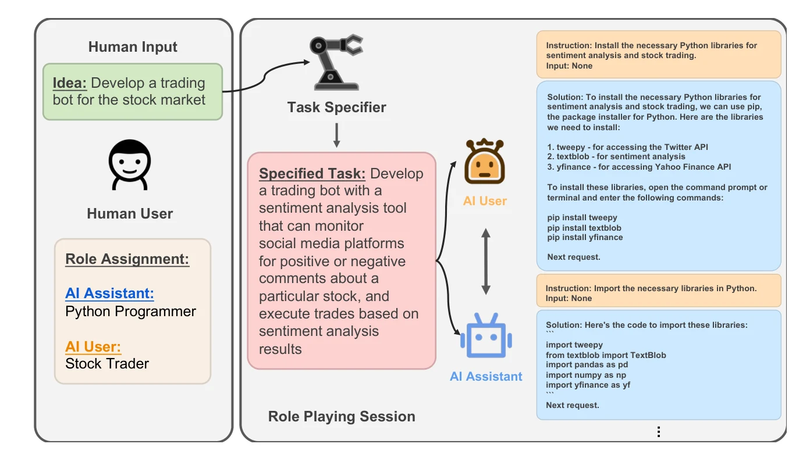
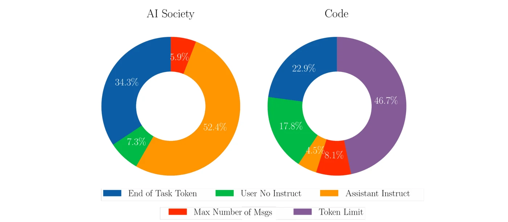
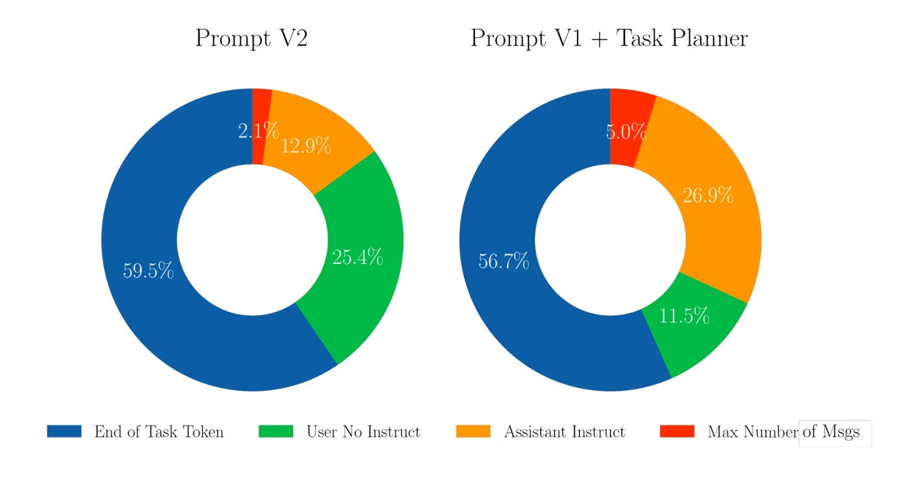
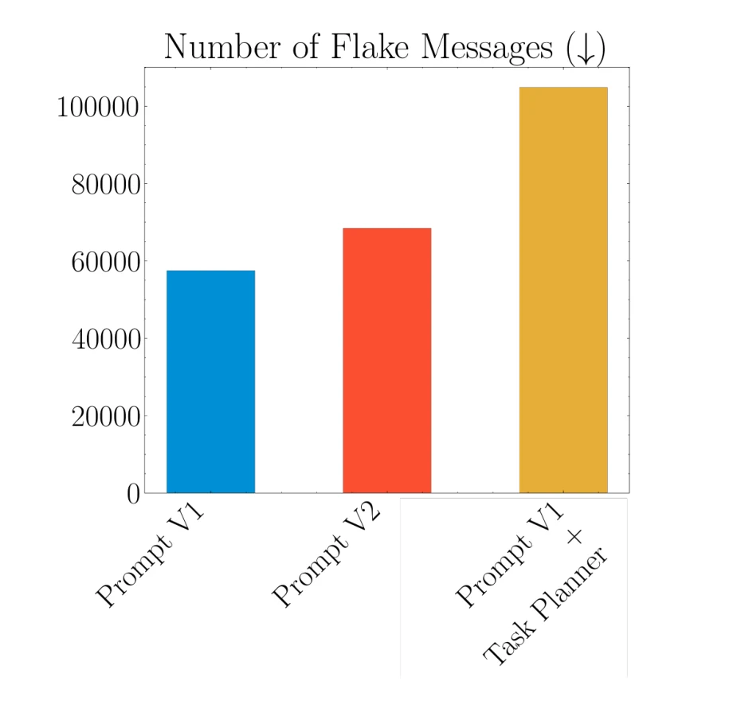

# CAMEL：两个角色怎样把一段对话推进下去

2023 年，沙特阿卜杜拉国王科技大学（KAUST）的五位作者发表了《CAMEL: Communicative Agents for “Mind” Exploration of Large Language Model Society》。他们把注意力放在一个比“某个问答任务多拿几分”更基础的问题上：对话模型已经能完成单条指令，能否让两个模型实例分别扮演“提要求的人”和“做事的人”，自己把多轮对话推进下去，人只在开始时给一个想法和两个角色？[论文 v2 记录](https://arxiv.org/abs/2303.17760v2)

论文给出的框架叫 role-playing。人类先给出一个初步想法和一对角色，任务具体化器（task specifier）把想法写成一个明确任务；随后 AI user 一次给出一条指令，AI assistant 给出对应方案，双方共享不断增长的对话历史，直到 AI user 发出结束标记、某一方违反协议或预算用完。作者把这种做法称为 inception prompting：只在对话开始前，把角色、任务、交流格式和结束条件写进三条起始提示，之后让两个角色自动互相提示。[摘要与 §3，PDF 第1–5页](https://arxiv.org/pdf/2303.17760v2#page=1)

论文的贡献不止这个循环。作者用同一套流程批量生成了 AI Society、Code、Math、Science 等对话或问答数据，用偏好评价和微调实验说明这些数据有用，也记录了角色反转、重复指令、空泛承诺和无进展循环四类失败。CAMEL 因此同时是一篇方法论文、一篇数据论文和一篇评价论文；读的时候需要把这三条证据链分开。

今天读 CAMEL，价值在于它把“多智能体协作”缩小到了一个可以逐条检查的消息循环。图 1 画出了角色、任务具体化器和对话记录的关系；三条起始提示说明协议怎样被写进文字；结束条件与附录里的失败例子说明协议会在哪里失效。论文最值得记住的结果也在这里：在 AI Society 数据中，52.4% 的对话以“assistant 反过来给 user 下指令”结束，只有 34.3% 走到任务完成标记。这说明“对话结束了”与“任务完成了”是两件事。

本导读的核心是图 1 的循环与 §3.2 的提示设计，篇幅也主要给这两部分。阅读顺序是：先看人类提示为什么成为瓶颈，再看想法怎样变成具体任务；接着对照图 1 和式 1–4 走一轮对话，拆开三条提示；然后用论文自己的交易机器人例子把两轮消息走一遍；最后看失败统计、偏好评价、微调结果与提示消融。全文依据 2023 年 11 月 2 日的 arXiv v2，也就是 NeurIPS 2023 版本；页码从 PDF 第一页算起。[§3.1 与图 1，PDF 第4页](https://arxiv.org/pdf/2303.17760v2#page=4)

## 人类提示为什么成了瓶颈

对话模型的能力越强，人的提示工作反而越显得关键。一个模型可以写代码、做计划、解释概念，但它要先知道“现在要做什么”。在通常的用法里，这件事由人完成：人读模型的回复，判断下一步该追问什么，再写一条新提示。任务越长，这种来回越多；提示越专业，越需要人懂这个领域。[§1，PDF 第1–2页](https://arxiv.org/pdf/2303.17760v2#page=1)

论文举了一个很具体的困难：一个人不懂股票交易，却想做一个交易程序。他可以描述“我想要一个交易机器人”，却很难凭自己的知识写出“用情感分析监控社交媒体，再根据结果执行交易”这样的任务说明。写不出合适的提示，模型就得不到足够的上下文；人又必须根据模型的反馈不断修正提示。这个过程耗时，要求领域知识，有时甚至无法完成。[§1，PDF 第1页](https://arxiv.org/pdf/2303.17760v2#page=1)

作者从已有研究中借来了几条线索。智能体之间的通信早有人研究，自然语言被认为是最自然的通信形式；合作式人工智能研究多个系统怎样为了共同目标协调；指令微调与提示工程则让模型更能按人的意图行动。论文把这几条线接在一起：既然模型能理解自然语言指令，能否让一个模型专门负责“下一步问什么”，另一个专门负责“怎样做”，把人类从逐轮提示中解放出来？[§2，PDF 第2–3页](https://arxiv.org/pdf/2303.17760v2#page=2)

在正式提出框架之前，作者先做了一次初步观察，遇到四类问题：assistant 和 user 互换角色；assistant 把 user 的指令原样重复一遍；assistant 只承诺“我会去做”，却不给出具体做法；两个角色互相道谢或告别，陷入没有进展的循环。这四类问题后来成为论文的组织线索：提示设计针对它们，结束条件捕捉它们，附录给出它们的实例。[§1 与 §4.1，PDF 第2、8页](https://arxiv.org/pdf/2303.17760v2#page=2)

这里要先说明论文的实验范围。标题里的“社会”（society）是一个研究愿景，实际实验是两个 gpt-3.5-turbo 实例在文本里对话，没有真实环境、没有工具调用，也没有第三个角色参与主实验。作者在结论和附录里讨论了扩展到更多智能体、竞争场景、评论者和具身智能体的可能，但这些属于展望或案例，不是主实验的结论。[§3.1、§6 与附录 N，PDF 第4–5、10、52页](https://arxiv.org/pdf/2303.17760v2#page=4)

还有一个容易被忽略的边界：所谓“最少人工干预”，指的是人不再逐轮写提示，人仍然要在开始时给出想法和角色。作者把这个起点称为“初步想法”，并假设人至少知道应该由哪两类角色来做这件事。至于这个想法是否被准确理解、任务具体化器补进去的细节是否符合人的意图，论文没有做单独评价。这个缺口会贯穿后面的所有证据。

## 从一句想法到一个可执行任务

CAMEL 的输入只有两样：一个初步想法，和一对角色。图 1 的例子是“为股票市场开发一个交易机器人”，角色分配为 AI assistant 扮演 Python 程序员，AI user 扮演股票交易员。人类不需要写出完整任务，只需要给出这个起点。[§3.1 与图 1，PDF 第4页](https://arxiv.org/pdf/2303.17760v2#page=4)

接下来由 task specifier 接手。它接收想法和两个角色，把模糊的愿望展开成一个具体任务。图 1 中的输出是：“开发一个带情感分析工具的交易机器人，能够监控社交媒体平台上关于某只股票的正面或负面评论，并根据情感分析结果执行交易。”这句话比原始想法长得多，也具体得多：它指定了数据来源、分析方法和行动方式。[§3.1，PDF 第4页](https://arxiv.org/pdf/2303.17760v2#page=4)

作者解释了这个设计的原因：对话智能体通常需要一个具体的任务提示，而让非领域专家写出这种提示既困难又耗时。task specifier 因此被当作一个“增强的想象模块”，替人把想法展开。这个说法很准确：它做的是想象和补全；补出来的内容是否等于人的需求，需要另行确认。原始想法里没有“社交媒体”，也没有“情感分析”，这些是模型补上的合理选项。[§3.1，PDF 第4页](https://arxiv.org/pdf/2303.17760v2#page=4)

这一步决定了后面整段对话的方向。如果补入的假设符合人的意图，任务会更容易推进；如果不符合，两个角色会在一个错误的任务上很努力地合作。论文的评价只看最终方案是否受偏好，没有检查具体任务与原始想法的一致性。读 CAMEL 时，可以把 task specifier 的输出当作一份“提案”，它需要人来确认，只是论文把确认这一步省略了。

任务确定后，两个角色各自收到一条系统消息。设 assistant 的系统提示为 $P_A$，user 的系统提示为 $P_U$，两个底层模型分别为 $F_1$ 和 $F_2$，那么两个智能体可以写成

$$
A \leftarrow F_1(P_A), \qquad U \leftarrow F_2(P_U)
$$

这里 $A$ 和 $U$ 都由一个模型和一条系统提示组成，只是提示不同。论文的实验里 $F_1$ 和 $F_2$ 都是 gpt-3.5-turbo；框架本身允许换成不同模型。[§3.1，PDF 第4–5页](https://arxiv.org/pdf/2303.17760v2#page=4)

角色分工是：AI user 是任务规划者，负责做交互式规划，决定 assistant 下一步应该做什么；AI assistant 是任务执行者，负责给出方案、执行计划中的步骤，并回复 user。这里的“执行者”指提示中的职责；真正运行代码需要另接环境，论文的实验没有接。附录 N 明确说，这些智能体处在没有外部工具、没有真实世界交互的沙盒中；它们的“执行”表现为写出一段方案或代码。[§3.1 与附录 N，PDF 第5、52页](https://arxiv.org/pdf/2303.17760v2#page=5)

任务何时算完成，也由对话内部决定：AI user 认为任务解决了，就输出结束标记。这个判断由模型作出；测试、运行结果和人的验收都在这个循环之外。理解这一点，后面看评价和失败统计时就不会把“对话结束”误当成“任务成功”。

## 图 1：两个角色怎样轮流说话

图 1 是全文的总图，值得先读熟。它分成三块：左边是 Human Input，包含一个想法和角色分配；中间是 Task Specifier，把想法变成一个 Specified Task；右边是 Role Playing Session，AI user 和 AI assistant 围绕这个任务对话。读图时可以从左往右看信息怎样被加工，再在右边从上往下看消息怎样累积。[§3.1 与图 1，PDF 第4页](https://arxiv.org/pdf/2303.17760v2#page=4)

左边有两层信息。最上面是想法：“为股票市场开发一个交易机器人。”下面是人指定的角色：AI assistant 是 Python 程序员，AI user 是股票交易员。想法回答“想做什么”，角色回答“谁来做”。论文假设人至少能给出这两样；它没有要求人写出任务步骤，也没有要求人懂情感分析或交易接口。

中间是 task specifier。它接收想法和角色，输出一句更具体的任务。图 1 用一条箭头表示这个转换，箭头下方的粉色框写着具体任务。这个框是整段对话的共同目标，两个角色的系统提示里都会重复它。后面的指令和方案都要围绕这句话展开。

右边是对话记录。橙色框是 AI user 的指令，蓝色框是 AI assistant 的方案。每一轮都遵循固定格式：user 写 Instruction 和 Input，assistant 写 Solution，并以 Next request 结尾。图 1 展示了前两轮：第一轮安装 Python 库，第二轮导入这些库。两个角色之间的双向箭头表示它们共享同一段对话历史；上方的 AI User 和下方的 AI Assistant 只是角色标签，真正的模型可以是同一个。

把这张图放进式子里，会更清楚。设 $M_t$ 是到第 $t$ 轮为止的全部消息，$I_t$ 是第 $t$ 条指令，$S_t$ 是对应的方案。论文把历史写成

$$
M_t=\{(I_0,S_0),\ldots,(I_t,S_t)\}
$$

下一轮，AI user 读取整段历史，产生一条新指令；AI assistant 读取同一段历史和新指令，产生方案；两条新消息再追加到历史里：

$$
I_{t+1}=U(M_t),\qquad S_{t+1}=A(M_t,I_{t+1}),\qquad M_{t+1}=M_t\cup\{(I_{t+1},S_{t+1})\}
$$

这是论文的式 1–4，导读把式 2–4 并排写在一起。三个式子分别说明：指令来自历史，方案来自历史加新指令，历史只增不减。$U$ 和 $A$ 都读取 $M_t$，所以 user 能看到 assistant 上一轮做了什么，assistant 也能看到 user 之前的所有要求。[§3.1 与式 1–4，PDF 第4–5页](https://arxiv.org/pdf/2303.17760v2#page=4)

这个结构的关键在 $I_{t+1}=U(M_t)$。下一条指令由 user 读完上一轮的结果后现场生成，不必对应一份预先写好的计划。如果第一轮安装库成功，user 可以接着要求导入；如果第一轮暴露了缺依赖，user 可以改要求先补依赖。所谓“交互式规划”，指的就是这个根据反馈改写下一步的过程。

| 时刻 | 谁在说话 | 看到什么 | 产生什么 | 历史怎样变化 |
| --- | --- | --- | --- | --- |
| 开始 | 人 | 想法与角色 | 指定任务 | $M_0$ 为空 |
| 第 1 轮 | AI user | $M_0$、任务、user 系统提示 | 指令 $I_1$（安装库） | 等待方案 |
| 第 1 轮 | AI assistant | $M_0$、$I_1$、assistant 系统提示 | 方案 $S_1$（pip 命令） | $M_1=M_0\cup\{(I_1,S_1)\}$ |
| 第 2 轮 | AI user | $M_1$ | 指令 $I_2$（导入库） | 等待方案 |
| 第 2 轮 | AI assistant | $M_1$、$I_2$ | 方案 $S_2$（import 代码） | $M_2=M_1\cup\{(I_2,S_2)\}$ |

这张表把“共享历史”具体化了：两个角色看到的是同一份 $M_t$，区别在各自收到的系统提示。user 的提示要求它一次给一条指令，assistant 的提示要求它给出具体方案并以 Next request 结尾。历史是共同的，角色是分开的。

图 1 没有画出的东西同样重要。它没有画执行环境、工具调用、文件系统或测试；右边的方案是文字，运行结果在循环之外。论文附录 N 说得很直接：这些智能体在沙盒里，没有真正与外部世界交互。因此，图中的“安装库”与“导入库”是两段计划文本，第二轮并不会检查第一轮的 pip 命令是否真的成功。[附录 N，PDF 第52页](https://arxiv.org/pdf/2303.17760v2#page=52)

框架还留了几个扩展口。式 1–4 可以推广到两个以上的智能体，用消息传递图描述谁把消息发给谁；作者还提出 critic-in-the-loop，让一个 AI 或人类评论者在多个候选方案里挑选或给反馈，形成类似树搜索的决策过程。附录里还有具身智能体的例子，让角色用代码调用工具生成图片。这些扩展说明框架的边界比较宽，但主实验仍是两个文本角色。[§3.1 与附录 O，PDF 第5、54页](https://arxiv.org/pdf/2303.17760v2#page=5)

最后要看到成本结构。每一轮至少两次模型调用，而且每次都要把不断变长的历史重新送进模型。论文在讨论 40 条消息上限时指出，对话成本随长度呈平方增长：第 $t$ 轮要处理前 $t$ 轮的全部文本，轮数越多，总 token 越多。这个成本决定了 40 条消息的硬上限，也影响后面“对话为什么结束”的统计。

## 三条提示怎样固定交流协议

CAMEL 把大部分控制放在对话开始之前。作者把这种做法叫 inception prompting，意思是把角色、任务和规则“植入”两个智能体的系统提示，之后它们互相提示，人不再介入。提示只有三条：任务具体化提示 $P_T$、assistant 系统提示 $P_A$、user 系统提示 $P_U$。[§3.2，PDF 第5页](https://arxiv.org/pdf/2303.17760v2#page=5)

$P_T$ 负责把想法展开成任务。它包含两个角色的信息，要求模型“更有创意、更富想象力”，并在限定词数内给出具体任务。它只运行一次，输出会同时写进 $P_A$ 和 $P_U$。这个提示的语气与后面的系统提示不同：它鼓励扩展，后面的提示强调约束。[§3.2 与图 2，PDF 第5–6页](https://arxiv.org/pdf/2303.17760v2#page=5)

$P_A$ 和 $P_U$ 大体对称。两条都包含任务、角色、共同利益、一次只给一条指令和拒绝条款；结束标记主要写在 user 提示里，assistant 提示以“除非我说任务完成”来配合。不对称的地方是动作方向：assistant 被要求给出方案，user 被要求给出指令。图 2 给出了 AI Society 场景的完整模板，下面把关键条款拆开看。[§3.2 与图 2，PDF 第6页](https://arxiv.org/pdf/2303.17760v2#page=6)

| 提示中的要求 | 主要写给谁 | 针对的行为 | 在协议里的作用 |
| --- | --- | --- | --- |
| 记住你是某角色，我是另一角色 | 双方 | 角色漂移 | 固定身份和任务 |
| 绝不交换角色 | 双方 | 角色反转 | 先固定身份，再谈职责 |
| 绝不给我下指令 | assistant | assistant 越位 | 把“谁发指令”变成可检查的约束 |
| 一次只给一条指令 | user | 指令过粗、一次要求太多 | 让每轮对应一个可处理的步骤 |
| 不能执行时诚实拒绝并说明原因 | 双方 | 编造、越权、有害内容 | 给拒绝留出合法出口 |
| 以 Solution 开头，给出具体实现或例子 | assistant | 空泛承诺 | 把“我会做”改成“做法是什么” |
| 以 Next request 结尾 | assistant | 对话停住 | 主动索取下一条指令 |
| 用 Instruction 和 Input 两种格式 | user | 指令格式不一 | 让每轮成为可解析的训练样本 |
| 认为任务完成时只回复结束标记 | user | 无休止道谢、循环 | 提供明确的停止信号 |
| 只有我的回复解决了任务，才能说完成 | user | 过早结束 | 把结束与“已解决”绑定 |

这张表按功能归类；图 2 保留了原始措辞。原提示的措辞更直接，例如 assistant 提示里反复出现“Never forget”“Never flip roles”“Never instruct me”，user 提示里则写“You will always instruct me”。这些句子看起来像情绪化的强调，实际上每条都对应一个观察到的失败：角色反转、重复指令、只说不做、无限循环。[§3.2 与图 2，PDF 第6–7页](https://arxiv.org/pdf/2303.17760v2#page=6)

输出格式是整套设计里最容易被低估的部分。assistant 的每条回复都要以 Solution 开头、以 Next request 结尾；user 的每条消息都要写成 Instruction 加 Input，没有输入时写 Input: None。这样做有三重效果。第一，对话的每一轮都有固定结构，角色是否越界、是否给出方案，比较容易看出来。第二，消息可以直接配对成“指令—方案”样本，供后面的数据生成和微调使用。第三，Next request 让 assistant 主动把话头交回 user，减少对话停在半空的情况。[§3.2，PDF 第6–7页](https://arxiv.org/pdf/2303.17760v2#page=6)

结束标记的设计也值得细看。user 在认为任务完成时只回复一个特殊词元，而不是继续聊天；提示还加了一句“只有我的回复解决了任务，才能说完成”。这相当于把停止条件写进角色，让模型自己判断。论文随后又列出五种终止条件，其中一种正是这个结束标记，另外四种从外部检查角色、指令和预算。这说明作者并不完全相信模型的自我判断：它可能过早说完成，也可能在没完成时陷入循环。[§3.2 与 §4.1，PDF 第7–8页](https://arxiv.org/pdf/2303.17760v2#page=7)

提示能约束行为，却无法强制执行。它是一段文字，模型可以选择遵守，也可以偏离。论文自己报告，AI Society 数据里仍有 52.4% 的对话以 assistant 给 user 下指令结束；这正是提示要防的角色反转。作者没有声称提示能消除失败，他们另设了终止条件来捕捉失败，再用数据统计失败有多常见。[§4.1 与附录 J，PDF 第8、38页](https://arxiv.org/pdf/2303.17760v2#page=8)

还有一层设计张力：任务具体化提示鼓励“想象”，系统提示要求“守规矩”。前者让任务变得具体，后者让对话保持可控。两者由不同的提示承担，运行时分先后。读其他角色扮演框架时，可以检查它们是否也把“扩展任务”和“约束交流”分开；如果混在一条提示里，模型可能一边被要求发挥，一边被要求不要越界。

## 沿交易机器人例子走两轮

论文的图 1 和附录 A 给出了一个完整的交易机器人例子。这里只用前两轮，目的是看清消息怎样接续。下面的消息摘自论文，做了删节；省略号表示原文更长的列表或代码。[图 1 与附录 A，PDF 第4、11页](https://arxiv.org/pdf/2303.17760v2#page=4)

第一轮，AI user 说：

> Instruction: Install the necessary Python libraries for sentiment analysis and stock trading.
> Input: None

AI assistant 回复：

> Solution: To install the necessary Python libraries for sentiment analysis and stock trading, we can use pip... Here are the libraries we need to install: 1. tweepy... 2. textblob... 3. yfinance... pip install tweepy; pip install textblob; pip install yfinance.
> Next request.

第二轮，AI user 说：

> Instruction: Import the necessary libraries in Python.
> Input: None

AI assistant 回复：

> Solution: Here's the code to import these libraries: import tweepy; from textblob import TextBlob; import yfinance as yf.
> Next request.

把这两轮代进式 1–4：$M_0$ 为空；$I_1$ 是安装库，$S_1$ 是 pip 命令，$M_1=\{(I_1,S_1)\}$；$I_2$ 是导入库，$S_2$ 是 import 代码，$M_2=\{(I_1,S_1),(I_2,S_2)\}$。user 在写 $I_2$ 时读到了 $S_1$，所以它知道“安装”这一步已经被处理，下一步自然转到“导入”。这就是交互式规划的最小形态：下一步来自上一轮的结果，不必对应一份事先写好的十步清单。

这段例子也暴露了框架的边界。assistant 说“我们可以用 pip 安装”，并列出命令；它没有真的打开终端，也没有返回安装成功的输出。user 看到这段文字后，假定安装完成，继续要求导入。假如 pip 命令因为网络或权限失败，第二轮仍会照常进行。论文附录 N 明确说这些智能体在沙盒里，没有外部工具；所以这里接续的是计划文本，执行结果要由外部环境提供。[附录 N，PDF 第52页](https://arxiv.org/pdf/2303.17760v2#page=52)

读这段例子时，可以留意三个位置。第一，系统提示没有显示在图 1 的消息框里，但它决定了两个角色“应该怎样说话”；同样的模型，换一条系统提示，消息风格会变。第二，两条消息都带固定格式，Solution 和 Next request 让对话保持单向推进；如果没有 Next request，assistant 可能停在方案里，等 user 再开口。完整的提示模板也可在 [HTML 全文](https://arxiv.org/html/2303.17760v2) 的图 2 中查看。第三，结束标记尚未出现，所以对话还会继续；什么时候出现，由 user 判断，而不是由代码是否跑通决定。

论文在附录 A 里把整段对话展开，包括后续的更多轮。图 1 只截取前两轮，作用是说明框架；任务是否完成不在它的证据范围内。读附录时可以看到，方案会越来越长，涉及 API、数据处理和交易逻辑；这些内容看起来像一份完整的实现指南，但仍然是文本。这个区别在评价一节会再次出现：评价比较的是整理后的方案文本，程序运行结果不在其中。

如果想自己复现这个最小循环，需要的东西并不多：两个模型调用、一份不断追加的消息列表、每条系统提示、一个检查结束标记和预算的循环控制器。论文开源了库，把这些部件封装起来；本导读不展开代码，只强调协议层面的三个输入：角色提示、共享历史、停止条件。缺少任何一个，循环都会变成普通的单轮问答或无法停止的聊天。

## 四种失败与五种结束方式

CAMEL 对多智能体研究的贡献之一，是把“合作失败”拆成了可观察的类型。作者在 §4.1 列出四类问题，附录 G 给出每类的对话片段。这些片段很有价值，因为它们展示了语言流畅、语气礼貌的对话怎样在没有推进任务的情况下继续。[§4.1 与附录 G，PDF 第8、28页](https://arxiv.org/pdf/2303.17760v2#page=8)

第一类是角色反转（role flipping）。assistant 突然开始给 user 下指令，user 又照着做。附录的例子发生在 Google Docs 文件夹访问的场景：assistant 本应等待 user 提供文档，却发出“我已经获得访问权限，请把第一份文档给我”这样的指令，角色完全倒转。论文的终止条件里专门有一项“assistant 发出指令”，一旦触发就结束对话。[附录 G，PDF 第28页](https://arxiv.org/pdf/2303.17760v2#page=28)

第二类是 assistant 重复指令。user 要求设计一个帮助演员理解导演意图的练习，assistant 没有给出练习，而是把 user 的 Instruction 和 Input 原样重复了一遍。它没有反转角色，也没有拒绝，但这一轮没有产生任何新内容。对下游的数据生成来说，这是一条无效样本；对任务来说，这是一次空转。

第三类是空泛承诺（flake reply）。assistant 说“我会写一个生成所有输入组合的脚本”，然后就停在这里，没有脚本、没有步骤、没有例子。这类回复最像“合作正在进行”，因为语气是积极的、面向未来的；但它把行动推到了并未发生的下一步。论文在数据统计里专门数了以“I will...”开头的消息，用这个表层特征近似空泛承诺。[§4.1 与附录 G，PDF 第8、28页](https://arxiv.org/pdf/2303.17760v2#page=8)

第四类是无进展循环。两个角色互相感谢、道别，来回很多轮；附录的例子甚至让 assistant 说出“我们似乎卡在循环里了”，但对话仍然继续。角色没有反转，消息也符合礼貌规范，任务却没有前进。这类失败说明，单看语气和格式是否“像合作”不足以判断合作是否有效。[附录 G，PDF 第28页](https://arxiv.org/pdf/2303.17760v2#page=28)

| 结束条件 | 触发方式 | 它说明什么 |
| --- | --- | --- |
| User No Instruct | user 连续 3 轮没有给 assistant 指令 | user 停止推进，或不知道该问什么 |
| Assistant Instruct | assistant 给 user 发指令 | 角色反转，协议失败 |
| End of Task Token | user 输出结束标记 | user 认为任务已完成，属于模型判断 |
| Token Limit | assistant 或 user 达到模型长度上限 | 预算耗尽，长代码或长方案更容易触发 |
| Max Number of Messages | 对话达到 40 条消息 | 成本保护，防止无限聊天 |

这五种条件回答“对话为什么停下”；任务是否完成需要另一套检查。把它们混在一起统计，会得到一个很好看的“结束率”，却看不出其中多少是成功、多少是失败、多少只是预算用完。论文的做法是把每种原因分开画在图 8 里，这个区分是整篇论文最值得学习的地方之一。

图 8 左边是 AI Society，右边是 Code。读法是先看颜色图例，再比较两块的最大扇区。AI Society 中最大的是橙色 Assistant Instruct，占 52.4%；蓝色 End of Task Token 占 34.3%；绿色 User No Instruct 占 7.3%；红色 Max Number of Messages 占 5.9%；紫色 Token Limit 几乎看不见。Code 中最大的是紫色 Token Limit，占 46.7%；蓝色结束标记占 22.9%；绿色 User No Instruct 占 17.8%；橙色 Assistant Instruct 占 8.1%；红色消息上限占 4.5%。[附录 J 与图 8，PDF 第38页](https://arxiv.org/pdf/2303.17760v2#page=38)

这组数字说明两件事。第一，AI Society 里最常见的结束原因是角色反转，任务完成排在第二；提示里反复写“Never flip roles”，实际仍有超过一半的对话以角色反转换来终止。第二，Code 里最常见的是 token 上限，因为代码回复很长，模型输出容易撞到长度限制；这属于预算问题，和角色协议是否被遵守是两回事。

40 条消息的上限也影响这张图。论文说设置上限是为了控制成本，因为对话成本随长度平方增长；图 8 中红色扇区在两边都不大（5.9% 和 4.5%），说明多数对话在到达 40 条之前就因为别的原因结束了。这个上限仍然会截断少数长任务，所以“结束原因分布”同时反映了协议行为和成本设计。

需要区分图 8 的统计口径：它统计每条对话的终止原因；每类失败消息的比例要看另一类统计。角色反转、重复、空泛承诺、循环这四类失败可以同时出现在一段对话里；图 8 只记录最后是哪根“保险丝”断掉。论文另外用图 10 统计空泛消息的数量，但没有给出四类失败在全部消息中的总体发生率。读的时候，把“52.4% 的对话因角色反转结束”与“52.4% 的任务失败”分开。

## 用同一套协议批量生成对话数据

CAMEL 的第二项贡献是把这套协议变成数据生成流水线。人只给一个想法和角色，模型可以生成角色、任务和具体化任务；同一套提示可以反复运行，产出大量对话。论文用这种方式构造了 AI Society 和 Code 两个多轮数据集，又用类似流程生成了 Math、Science 和 Misalignment 数据。[§4.1，PDF 第7–8页](https://arxiv.org/pdf/2303.17760v2#page=7)

AI Society 的规模在正文里写得很清楚：50 个 assistant 角色、50 个 user 角色，每个角色组合生成 10 个任务，合计 25,000 段对话。角色和任务由模型生成：先让模型列出不同的 assistant 角色和 user 角色，再让模型为每一对角色生成可合作完成的任务，最后用 task specifier 把任务具体化。图 3 给出了角色生成、任务生成和任务具体化的提示。[§4.1 与图 3，PDF 第7–8页](https://arxiv.org/pdf/2303.17760v2#page=7)

Code 数据走的是另一条组合轴：20 种编程语言和 50 个应用领域，任务由模型按“某种语言在某个领域能帮程序员做什么”生成。图 6 列出了这些语言和领域，包括 Python、Java、C++、SQL、Go 等，以及会计、生物、法律、医学等。论文没有在正文给出 Code 对话的总数，只说明了角色、语言和领域的生成方式；读的时候不要把 20×50 直接当成对话数，因为每个组合还会生成多个任务。[附录 E 与图 6，PDF 第25页](https://arxiv.org/pdf/2303.17760v2#page=25)

Math 和 Science 是单轮问答数据。Math 有 50,000 个问题—答案对：先用 GPT-4 生成 25 个数学主题，每个主题生成 25 个子主题，每个子主题生成并求解 80 道题。Science 按物理、生物、化学三科各生成 20,000 对，每科 25 个主题、每个主题 25 个子主题、每个子主题 32 道题。Misalignment 数据则是让模型模拟可能的恶意应用，例如“黑客帮助通用人工智能（AGI）控制世界”，用来展示不对齐智能体的风险；它是一组风险示例，作用在能力评价之外。[附录 F 与表 4，PDF 第26页](https://arxiv.org/pdf/2303.17760v2#page=26)

这些数据的用途不同。AI Society 和 Code 用来研究多轮合作行为，也可以作为微调语料；Math 和 Science 用来观察模型在逐步加入新领域数据后的能力变化；Misalignment 用来讨论风险。论文把它们放在同一个“角色扮演可以扩展”的叙事下，但它们的生成方式、评价方式和证据强度并不相同。读的时候要问：某个结论来自哪一组数据？

数据的“社会”含义也需要限定。AI Society 是模型与模型之间的对话，角色和任务由模型生成；人群抽样需要另做。它可以帮助研究对话模型在合作场景中的行为，但不能直接当作人类社会互动的样本。论文用信息地图（图 11–14）展示主题覆盖范围，这些图能说明数据里出现了哪些话题，不能证明话题分布代表了真实社会。[附录 J，PDF 第40–43页](https://arxiv.org/pdf/2303.17760v2#page=40)

许可方面，论文说代码用 Apache 2.0，数据用 CC BY-NC 4.0，只允许非商业用途；用这些数据训练出的模型也被建议只用于研究。这个限制和论文的“研究资源”定位一致。数据集发布在 HuggingFace，具体版本和字段不在本导读的覆盖范围内。[附录 K.4，PDF 第45页](https://arxiv.org/pdf/2303.17760v2#page=45)

## 评价：人说更喜欢，说明了什么

CAMEL 的评价从一个很实际的问题出发：多轮协作产生的方案，是否比单次回答更受偏好？作者从 AI Society 和 Code 各随机抽 100 个任务，先用 GPT-4 把整段 CAMEL 对话整理成一份完整方案，再把它与 gpt-3.5-turbo 对同一任务的单次回答放在一起比较。[§5.1，PDF 第8–9页](https://arxiv.org/pdf/2303.17760v2#page=8)

整理这一步很关键。CAMEL 的原始输出是多轮、带格式的对话，单次回答是一段文本；如果直接比较，评价者可能被长度和格式影响。论文让 GPT-4 从对话中提取完整方案，附录 H 的提示要求“提取完整解决方案，不要总结”，保留对话中的解释和代码。论文正文把这一步叫 summarization，附录的措辞是 extraction；两者都指向“把多轮内容压成一份可比较的最终方案”。[附录 H，PDF 第29页](https://arxiv.org/pdf/2303.17760v2#page=29)

人工评价只覆盖 AI Society。评价者并排看到两份匿名方案，选择更好的一份，或者选择“一样好”；论文收集了 453 份回应。Code 没有人工评价，作者的解释是：不运行代码，人很难判断代码方案的好坏。GPT-4 评价覆盖两个数据集，提示要求从有用性、相关性、准确性、细节程度四个方面打分，再判断哪一份更好。[§5.1 与附录 K.5，PDF 第9、46页](https://arxiv.org/pdf/2303.17760v2#page=9)

| 数据集 | 评价方式 | 平局 | gpt-3.5-turbo 胜 | CAMEL 方案胜 |
| --- | --- | ---: | ---: | ---: |
| AI Society | 人工评价，453 份回应 | 13.3% | 10.4% | 76.3% |
| AI Society | GPT-4 评价，100 个任务 | 4.0% | 23.0% | 73.0% |
| Code | GPT-4 评价，100 个任务 | 0.0% | 24.0% | 76.0% |

表中三行的分母不同：人工评价的分母是 453 份回应，GPT-4 评价的分母是 100 个任务。76.3% 说明在这批人工比较中，评价者更偏好 CAMEL 方案；它说明的是偏好比例；任务执行成功率需要另一套测量。论文自己的表述也是“CAMEL 方案在人工和 GPT-4 评价中都大幅优于单次回答”，并没有把它写成代码通过率或任务完成率。[§5.1 与表 1，PDF 第9页](https://arxiv.org/pdf/2303.17760v2#page=9)

这组结果能支持什么？在“有用、相关、准确、细节充分”这套评价标准下，经过多轮展开并由 GPT-4 整理的方案，比 gpt-3.5-turbo 的一次性回答更受人和 GPT-4 欢迎。它说明多轮分解和角色分工可以产出更完整、更像实施指南的文本。论文附录 H.1 的例子是一个后期制作工作流工具，CAMEL 方案从安装 Python、装库、读写视频一直写到具体代码；论文认为单次回答通常没有这么细。细节更多，正是评价标准会奖励的东西。

它不能支持什么？第一，评价没有运行代码，也没有检查方案在真实环境中是否可行；一个步骤完整、措辞专业的方案仍可能包含错误。第二，基线只有 gpt-3.5-turbo 的单次回答，CAMEL 一侧却用了多轮调用加 GPT-4 整理，二者的 token 预算和模型配置不同。第三，人工评价只覆盖 AI Society，Code 的 76.0% 完全来自 GPT-4；GPT-4 既参与整理，又担任评价者，存在同一模型家族参与两端的偏置风险。第四，100 个任务、453 份回应是一个中等规模的偏好研究，论文没有报告显著性检验、评价者一致性或每个任务的投票分布。第五，论文自己在局限里提到，人可能偏好更长的答案，而更长并不自动等于更好。[附录 K.1，PDF 第44页](https://arxiv.org/pdf/2303.17760v2#page=44)

人工与 GPT-4 的“高度一致”也值得细看。两边都把多数票投给 CAMEL，方向一致；但平局比例从 13.3% 降到 4.0%，gpt-3.5 的胜率从 10.4% 升到 23.0%。这说明两种评价的严厉程度和“平局”标准不同。方向一致可以作为弱证据，具体的百分比不能互相替代。

读到这里，可以把 Table 1 当成“偏好证据”，把下一节的 HumanEval 当成“训练后模型的基准证据”，把图 8 当成“运行时行为证据”。三类证据回答不同问题，不能拼成一个“CAMEL 任务成功率为 X%”的数字。

## 微调后的模型：另一条证据链

论文的第二个评价对象是模型；运行时对话是另一条线。作者把 LLaMA-7B 按 AI Society、Code、Math、Science 的顺序逐步微调，观察每加入一个领域的数据后，模型在该领域和其他领域上的表现怎样变化。评测集包含 20 个 AI Society 任务、20 个代码任务、20 个数学任务和 60 个科学任务；评判方式仍是 GPT-4 对两个模型的回答做成对比较。[§5.2，PDF 第9页](https://arxiv.org/pdf/2303.17760v2#page=9)

表 2 的结构需要先读懂。每个四行块比较两个模型：Model 1 是加入新数据之前的模型，Model 2 是加入之后的模型；四行分别是四个评测领域；每格给出三个数，依次是平局、Model 1 胜、Model 2 胜。比如第一个块中，Model 1 是原始 LLaMA-7B，Model 2 是只加了 AI Society 数据的模型；在 AI Society 评测上，平局 0、Model 1 胜 6、Model 2 胜 14。[§5.2 与表 2，PDF 第10页](https://arxiv.org/pdf/2303.17760v2#page=10)

| Model 2 新增的数据 | 评测领域 | 平局 | 前一个模型胜 | 新模型胜 |
| --- | --- | ---: | ---: | ---: |
| AI Society | AI Society | 0 | 6 | 14 |
| Code | Science | 1 | 19 | 40 |
| Math | Math | 1 | 3 | 16 |
| Science | Science | 9 | 2 | 49 |
| Science | Math | 10 | 5 | 5 |

前四行说明“加入某领域数据后，模型在该领域通常变好”：AI Society 是 6 比 14，Math 是 3 比 16，Science 是 2 比 49，多数支持新模型。第二行还说明跨领域效应：加入 Code 数据后，Science 评测是 19 比 40，偏向新模型，作者解释为代码数据里包含科学领域的任务。最后一行是一个反例：加入 Science 数据后，Math 评测是 5 比 5、10 个平局，没有明显提升。论文的措辞是“几乎总是”变好，这个“几乎”有必要保留。[§5.2 与表 2，PDF 第10页](https://arxiv.org/pdf/2303.17760v2#page=10)

这些成对比较的分母是 20 或 60 个问题，样本不大；GPT-4 的评判也没有用标准答案，而是比较两份回答。跨领域的提升可能来自数据重叠、角色分布或格式相似，正文与附录没有报告数据混合的消融，也没有报告生成数据与评测问题的重叠检查。因此，表 2 适合用来说明“逐步加入生成数据后，模型在这些评测上更受 GPT-4 偏好”，不适合把每个领域的增益归因于该领域数据本身。

代码能力用 HumanEval 和 HumanEval+ 测。HumanEval 包含 164 道函数级编程题，模型根据函数签名和说明写出实现，pass@k 表示采样 k 次至少有一次通过全部测试的概率。表 3 报告 pass@1 和 pass@100：CAMEL-7B 在 HumanEval 上是 14.0 和 57.9，在 HumanEval+ 上是 12.2 和 50.0；LLaMA-7B 是 10.5 和 36.5；Vicuna-7B 是 11.0 和 42.9，HumanEval+ 是 9.9 和 34.7；gpt-3.5-turbo 是 69.4 和 94.0，HumanEval+ 是 61.7 和 89.8。[§5.3 与表 3，PDF 第10页](https://arxiv.org/pdf/2303.17760v2#page=10)

这组数字要分两层读。CAMEL-7B 比 LLaMA-7B 和 Vicuna-7B 高，说明用这批生成数据微调后，7B 模型在 HumanEval 上确实有提升；它和 gpt-3.5-turbo 仍有很大差距，后者是更强的闭源模型，不能把“超过两个 7B 基线”读成“代码能力接近商用模型”。HumanEval 只有 164 道题，pass@100 又给了很多次采样机会，两个数字回答的是不同问题：pass@1 更接近一次尝试的成功率，pass@100 更接近“多试几次能否做出来”。

微调实验和运行时评价是两条独立的证据链。前者测的是一个 7B 模型在基准题上的表现，后者测的是两个 gpt-3.5-turbo 角色对话后整理出的方案受不受偏好。CAMEL-7B 在 HumanEval 上的分数，不能用来推断双角色系统在真实任务中的成功率；反过来，Table 1 的偏好比例也不能证明微调后的模型更强。论文把两者放在同一节附近，读者需要自己分开。

训练配置提供了复现所需的量级：4 块 A100-80GB，3 个 epoch，学习率 $2\times10^{-5}$，每 GPU 批大小 4，梯度累积 8 步，余弦调度，warmup 比例 0.04。这些细节不改变上面的解释，但说明微调不是一次小实验；数据集规模、训练成本和评测规模要一起看。[附录 K.2，PDF 第44页](https://arxiv.org/pdf/2303.17760v2#page=44)

## 提示消融：协议改变了什么

CAMEL 的提示写得这么长，究竟哪些部分在起作用？论文用两组实验回答。第一组直接删掉提示里的交流协议和对齐语句，比较原始提示与消融提示产出的方案；第二组改动 assistant 的输出格式，或者增加一个任务规划器，再统计对话的结束原因和空泛消息数量。[附录 T 与附录 J，PDF 第38–39、68页](https://arxiv.org/pdf/2303.17760v2#page=68)

第一组的结果很干脆。消融提示保留角色、共同任务、不交换角色和结束标记，删掉一次一条指令、Solution 格式、Next request、拒绝条款等约束；然后让 GPT-4 比较原始提示和消融提示产出的方案。在 AI Society 的同一批任务上，原始提示胜 75.0%，消融提示胜 25.0%，平局 0.0%。这说明提示里的协议文本对“方案受不受偏好”有明显影响，至少在这批任务和这个评判者上是这样。[附录 T 与表 9，PDF 第68页](https://arxiv.org/pdf/2303.17760v2#page=68)

第二组看的是对话形状。Prompt V2 去掉 assistant 的输出格式，也就是不再要求以 Solution 开头、以 Next request 结尾；Prompt V1 + Task Planner 在原始提示上增加一个任务规划器，先生成子任务分解，再让两个角色按分解推进。图 9 把这两种改动的结束原因与图 8 的原始 AI Society 放在一起比较。[附录 J 与图 9，PDF 第39页](https://arxiv.org/pdf/2303.17760v2#page=39)

原始 AI Society 的结束标记占 34.3%、角色反转占 52.4%、user 不再指令占 7.3%、消息上限占 5.9%。Prompt V2 把结束标记提高到 59.5%，角色反转降到 12.9%，user 不再指令升到 25.4%，消息上限降到 2.1%。加入任务规划器后，结束标记是 56.7%，角色反转 26.9%，user 不再指令 11.5%，消息上限 5.0%。两种改动都让更多对话走到结束标记，也让角色反转明显减少。[附录 J 与图 9，PDF 第39页](https://arxiv.org/pdf/2303.17760v2#page=39)

但“更多结束标记”并不等于“更多任务完成”。结束标记是 user 的判断；Prompt V2 同时把“user 不再指令”从 7.3% 推到 25.4%，这可能意味着 user 更快地停止推进，也可能意味着它更早认为任务结束。图 9 没有提供任务是否真的完成的独立检查，所以这组数字描述对话如何结束；任务是否成功需要独立检查。

空泛消息的数量给出了另一面。图 10 统计以“I will...”开头的消息：原始提示最少，Prompt V2 更多，Prompt V1 + Task Planner 最多，按图读数大约是原始提示的 1.8 倍。论文只报告了这个现象，没有给出因果解释。一个合理的读法是：任务规划器鼓励模型先描述计划，模型更容易用“我将要做……”来开头；去掉输出格式后，assistant 也少了“直接给 Solution”的约束。这个解释是导读的推测，论文本身没有验证。[附录 J 与图 10，PDF 第39页](https://arxiv.org/pdf/2303.17760v2#page=39)

把两组实验放在一起，可以得到一个比较稳的结论：提示协议会改变对话的结束方式和消息风格。原始提示的空泛消息最少，但角色反转最多；去掉格式或增加规划器减少了角色反转、提高了结束标记比例，却带来更多空泛承诺。角色反转比例与方案受不受偏好属于不同维度：Table 9 的原始—消融对照里，原始提示以 75% 胜出；图 9 的格式/规划器对照则显示结束原因会变。两者测的不是同一件事。这个权衡比“加一个模块就更好”更接近论文的实际发现。论文没有做人类评价来判断哪种对话更有用，也没有把“结束标记比例”校准成任务成功率，所以这些数字适合用来提出假设，不适合直接选型。

## 论文之后：角色协议怎样进入多智能体系统

CAMEL 之后，“两个或多个可对话智能体共享一段消息历史”成了多智能体框架的常见结构。微软的 AutoGen 把可对话智能体、工具和人类输入组织成可编程的对话，允许自定义回复、终止条件和组合方式；它和 CAMEL 的双角色循环属于同一类思路，并把对话的组合方式做得更一般。本库的 [AutoGen 导读](/read/autogen/1#u01)从一条执行错误讲起，说明消息怎样在智能体之间传递，可以对照阅读。

另一条后续线索是通信效率。CAMEL 的每一轮都要把完整历史送进模型，轮数越多，成本越高；AgentPrune 把同一轮和跨轮的消息表示成图，学习哪些连接重要，再裁剪掉一部分消息传递，同时核算性能与学习成本。本库的 [AgentPrune 导读](/read/agentprune/1#u01)详细讲了这套做法。把两篇放在一起，可以看到 CAMEL 提出的“共享历史”既是协作的基础，也是成本的来源。

这些后续工作属于编辑背景；CAMEL 的结论到主实验为止。CAMEL 自己指出，双角色设置可以扩展到更多智能体、竞争场景、评论者和具身智能体；它没有在主实验里验证这些扩展。读后续论文时，可以带着 CAMEL 的三个问题：角色怎样分配，历史怎样共享，停止条件由谁判断。不同框架的差别，往往就在这三个位置上。

CAMEL 也留下了一些没有回答的问题。任务具体化器补入的假设是否符合人的意图，论文没有评价；对话结束时的“完成”是否对应真实结果，论文没有独立检查；多轮对话的收益有多少来自额外计算，论文没有做预算匹配；角色和任务的多样性是否代表真实使用场景，论文没有做抽样验证。这些问题后来分别被任务验证、工具调用、成本分析和多智能体评测研究接手。

## 回到原文：哪些页值得读

这篇论文正文只有 10 页，整份 PDF 共 77 页，附录很长。时间有限时，建议先读图 1 与 §3.1（PDF 第4–5页），把角色、任务具体化器和式 1–4 对上；再读 §3.2 与图 2（第5–7页），看三条提示怎样把协议写死；然后读 §4.1 的失败与结束条件（第8页），以及表 1（第9页）。这四处构成论文的主线。[§3.1–3.2、§4.1 与表 1，PDF 第4–9页](https://arxiv.org/pdf/2303.17760v2#page=4)

如果关心失败行为，附录 G 的四个例子（第28页）比正文的概括更直观；图 8 的结束原因分布在第38页，图 9–10 的提示消融在第39页。如果关心评价细节，附录 H 给出了方案提取和 GPT-4 评判的完整提示（第29页），附录 K.5 给出了人工评价指南（第46页）。如果关心微调，表 2–3 在第10页，训练配置在附录 K.2（第44页）。

本导读实际通读了正文 §1–6（第1–10页），并选读了附录 A、C–H、J–K、N–O、Q–T 中与主线相关的部分；没有逐页阅读附录 L、M、P 的全部案例，也没有阅读参考文献正文。图 1、图 8、图 9、图 10 取自固定 PDF，裁切后逐张查看，确认没有切掉图例或坐标；四张图在元数据里记录了页码与许可。arXiv v2 页面标注 CC BY 4.0，导读按该许可复制并署名。

论文的局限由作者自己写在附录 K.1：任务规模大、领域多，评价需要大量专家；人工和 GPT-4 评价都可能带有偏见；人可能偏好更长的答案；模型可能生成虚假信息；这项工作只触及“AI 社会”的冰山一角。本导读把这些局限放在它们该在的位置：Table 1 解释为偏好证据，表 2 解释为微调后的基准表现，图 8 解释为运行时行为。本导读没有复现实验，也没有独立验证任务是否真正完成；交易机器人例子和附录对话都来自论文；本导读只做转述和解释。

阅读本导读或打开原文，都不会自动把这篇论文记为已读；笔记、标记和阅读状态需要读者自己操作。
