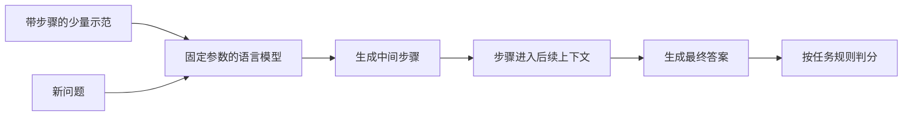

# Chain-of-Thought：中间步骤怎样改变语言模型的解题方式

一个语言模型能流畅续写，并不表示它会在复杂问题中组织好必要的中间步骤。这篇论文研究一个具体改变：在少样本提示的示例中，除了问题和答案，再写出通向答案的推理过程，让模型在新问题上先生成类似步骤，再给最终答案。它把“语言模型能够模仿输入输出关系”推进到“如何借助生成过程处理多步任务”，是连接上下文学习与后续 Agent 推理的重要读物。[主文 §1–2，PDF 第1–3页](https://proceedings.neurips.cc/paper/2022/file/9d5609613524ecf4f15af0f7b31abca4-Paper-Conference.pdf)

本文依据 NeurIPS 2022 正式主文及独立补充材料，重点解释提示机制、实验对照、规模条件与证据边界。这里的 CoT 是带人工示范的提示方法，不是后来的推理模型训练配方，也不是自动调用工具的完整 Agent。以下教学例子和概率写法用于解释，不冒充论文原实验或原公式。

## 从示范答案，转向示范解题过程

标准少样本提示把若干“问题—答案”放进上下文，再接上新问题。模型参数保持不变，输入中的例子告诉它当前任务和输出形式。CoT 把示例改为“问题—中间步骤—答案”三部分。新问题到来时，模型也先续写步骤，最后续写答案；改变发生在上下文及生成序列，而不是当场更新模型权重。[主文 §2–3.1，PDF 第2–4页](https://proceedings.neurips.cc/paper/2022/file/9d5609613524ecf4f15af0f7b31abca4-Paper-Conference.pdf#page=3)

例如，考虑一个独立教学题：“货架原有 12 个盒子，搬走 5 个，又运来两批，每批 4 个，现在有多少个？”直接给出 15 只展示终点；写出“搬走后剩 7 个，两批增加 8 个，合计 15 个”，则把数量关系、运算顺序和中间状态一起放进生成文本。读者因此能检查到底是把两批理解错、减法算错，还是合并步骤遗漏了条件。这种可检查性有价值，但它还不等于已经看到了神经网络内部全部计算。

示范是输入的一部分，生成的步骤是输出的一部分。二者都消耗上下文或生成预算。若只改变提示却同时增加模型规模、更换底座或调用外部计算器，就不能把全部改善归因于 CoT。本论文最直接的比较，是在相同模型和任务下，将标准示范改为带推理步骤的示范。

还需要把“任务适应”和“参数学习”分开。模型在当前上下文中看到示范，可以改变这一次的输出分布；这不表示它把刚才的步骤永久写入权重，也不意味着另开一个没有这些示范的输入会保留相同行为。预训练提供语言、知识和模式能力，提示选择如何调用这些能力，具体生成则产生这一次的问题求解轨迹。把这三层分开，才能理解为什么同一检查点可能在不同提示下表现很不一样。

## 中间文本为什么能够影响后面的答案

自回归模型根据已经出现的词元继续生成。设提示示例集合为 $D$，新问题为 $x$，中间文本为 $r$，答案为 $a$，可以用概率链式法则写出：

$$
p_\theta(r,a\mid D,x)=p_\theta(r\mid D,x)\,p_\theta(a\mid D,x,r).
$$

这是解释用的通用分解，不是论文提出的新训练目标。它强调，先写出的 $r$ 会成为随后生成 $a$ 的上下文。把运算或状态分步写出，就给后续预测提供了一个可再次利用的文字工作区。若先输出答案再补解释，后面的解释无法倒过来影响已生成的答案。论文的顺序消融正是围绕这一点展开。[主文 §2、§3.3，PDF 第3、5–6页](https://proceedings.neurips.cc/paper/2022/file/9d5609613524ecf4f15af0f7b31abca4-Paper-Conference.pdf#page=6)

这是原创教学示意，表达提示、生成和评测的顺序。它没有检索、工具执行或环境回传箭头，因为本方法的主要实验不依赖这些组件。模型写出一个计算过程，仍是生成文字；只有执行器真的运行计算，才能得到外部运算的结果。

这个工作区也可能扩大错误：前一步把实体、单位或关系写错，后续步骤会在错误前提上继续展开。因此，长度本身没有正确性的含义。能否选择合适的分解、保持状态一致并得出答案，仍取决于模型、任务和示例。

测试时，中间步骤通常是模型自己生成的，而不是每走一步都有人提供标准答案。若一个步骤遗漏了条件，后续文字即使局部连贯，也可能偏离原问题。检查 CoT 时，应当回到题目约束逐步核对，而不只是检查句子是否自然、结尾是否自信。这也是“能展示过程”与“过程受到验证”的实际区别。

## 如何读懂规模与任务共同决定的实验结果

算术实验覆盖 GSM8K、SVAMP、ASDiv、AQuA 和 MAWPS。除多选形式的 AQuA 使用四个示例外，作者把同一组八个人工编写的 CoT 示例用于其余算术任务。主要解码采用贪心策略；LaMDA 结果对五种示例排列取平均，其他模型主要报告一个排列。多条采样后投票属于后续改进，不能混入本表的单条生成结果。[主文 §3.1，PDF 第3–4页](https://proceedings.neurips.cc/paper/2022/file/9d5609613524ecf4f15af0f7b31abca4-Paper-Conference.pdf#page=4)

以下只抽取同一 PaLM 系列在两个任务上的解题正确率，单位为百分比。它用于比较提示变化和规模条件，而不是给今天的模型排名：

| PaLM 规模 | GSM8K：标准提示 | GSM8K：CoT | SVAMP：标准提示 | SVAMP：CoT |
|---|---:|---:|---:|---:|
| 8B | 4.9 | 4.1 | 15.1 | 16.8 |
| 62B | 9.6 | 29.9 | 48.2 | 46.7 |
| 540B | 17.9 | 56.9 | 69.4 | 79.0 |

来源为补充表2；这是补充 PDF 第7页，页面印刷页码为21，不能把它误写成主文第7页。[补充表2–3，补充 PDF 第7页](https://proceedings.neurips.cc/paper_files/paper/2022/file/9d5609613524ecf4f15af0f7b31abca4-Supplemental-Conference.pdf#page=7)

表中有两类同时成立的事实。最大的模型在这些任务上获得显著收益，但 8B 的 GSM8K 以及 62B 的 SVAMP 并未改善。作者用“随规模出现”描述所研究模型的总体趋势，不意味着存在一个适用于所有架构、数据和训练方式的固定参数门槛。补充讨论也指出，参数规模经常与训练计算量等因素混在一起，本文没有给出完整的因果解释。[补充 §A.1，补充 PDF 第2–3页](https://proceedings.neurips.cc/paper_files/paper/2022/file/9d5609613524ecf4f15af0f7b31abca4-Supplemental-Conference.pdf#page=2)

任务难度同样重要。容易的一步问题，标准提示可能已经能处理，增加一段文字不一定带来好处；涉及多个条件的任务才可能更依赖显式分解。因此，“用了 CoT”不能替代对问题结构的分析。比较时要问：示例是否教会了正确的分解，评测是否真正要求这种分解，额外生成成本是否值得。

## 消融告诉我们什么，又没有证明什么

主文设计了三种有针对性的替代提示。第一种只生成数学表达式；它对较简单问题可能有效，却未在 GSM8K 上复现完整自然语言步骤的收益。第二种生成一定长度的点号，用来考察额外生成本身；表现接近基线。第三种先给答案再写步骤，也没有获得相近收益。这些对照支持一个有限解释：在这些设定里，答案之前的有内容的中间步骤，比单纯拉长输出或事后解释更有帮助。[主文 §3.3、图5，PDF 第5–6页](https://proceedings.neurips.cc/paper/2022/file/9d5609613524ecf4f15af0f7b31abca4-Paper-Conference.pdf#page=5)

但对照不是万能归因。点号不能代表所有可能的额外计算策略；一种表达式提示没有成功，也不能证明形式化推理普遍不如自然语言。正确的阅读方式，是把对照支持的范围限制在实际测过的方法和数据上。若要提出新机制解释，还需设计能区分该解释与竞争解释的实验。

作者也更换了示例作者、措辞、示例来源和排列。不同提示会带来波动，但多组带步骤的示范仍明显优于标准基线。这说明收益不完全依赖一份特殊措辞，同时并没有取消提示敏感性。阅读或复现时，应保留完整提示、顺序、模型版本及解码规则，而不能只记住一句“逐步思考”。[主文 §3.4、图6，PDF 第6–7页](https://proceedings.neurips.cc/paper/2022/file/9d5609613524ecf4f15af0f7b31abca4-Paper-Conference.pdf#page=6)

## 从算术推广到常识与符号，仍需检查边界

CoT 的媒介是自然语言，因此论文还评测常识问答、日期理解、运动常识、机器人动作序列描述，以及末字母拼接、硬币状态跟踪等符号任务。任务形式不同，所需示例数和判分方式也不同；不能把某个算术设置当作全部实验的统一协议。[主文 §4–5，PDF 第7–8页](https://proceedings.neurips.cc/paper/2022/file/9d5609613524ecf4f15af0f7b31abca4-Paper-Conference.pdf#page=7)

符号实验的一个价值，是明确区分示例长度内的任务和更长输入。若示例只展示两项操作，而测试增加到三项或四项，模型需要把过程延伸，而不只是照抄最终输出格式。CoT 在充分大的所测模型上改善了这种长度泛化，但分布外表现仍弱于同分布表现。论文也明确称这些是结构清晰的玩具任务，不能由此推断长程开放环境中的规划已经解决。[主文 §5、图8，PDF 第8页](https://proceedings.neurips.cc/paper/2022/file/9d5609613524ecf4f15af0f7b31abca4-Paper-Conference.pdf#page=8)

还要区分三个判据：最终答案正确、写出的每一步正确、文字真实反映模型内部因果过程。它们不是同一件事。论文人工分析发现，少数正确答案可以伴随错误过程；讨论部分也明确保留“模型是否真的以人类意义推理”的问题。这里可以把 CoT 当作检查行为的窗口，却不能把一段流畅文字当作内部机制的认证。[主文 §3.2、§6，PDF 第5、9页](https://proceedings.neurips.cc/paper/2022/file/9d5609613524ecf4f15af0f7b31abca4-Paper-Conference.pdf#page=9)

## 它在 LLM 到 Agent 的路径上处于什么位置

从上下文学习到 CoT，改变的是模型如何利用示范并组织输出。进一步成为与环境交互的 Agent，还需要行动接口、外部观测、状态更新和终止判断。比如，写出“下一步查询资料”仍只是文字计划；系统实际发起检索、接收文档并据此修订后续动作，才加入了反馈闭环。这是本平台连接 CoT 与 ReAct 的编辑性阅读建议，不是本论文已经验证了后者。

因此可以用三个问题承接后续阅读：哪些中间状态只在生成文本里存在；哪些事实需要外部证据；哪些步骤可以由工具执行并验证。CoT 提供的是组织推理文本的一个起点。把它接入 Agent 时，应重新衡量错误如何传播、外部信息是否真正被利用，以及多轮交互下的总体成功，而非只看模型是否愿意写步骤。

## 回到原文与继续阅读

先看图1，区分提示中的人工示范和模型新生成的内容；再读 §3.1，并对照补充表2，确认模型、示例数量与贪心解码条件。随后看图5的消融，把“中间文本可能有用”与“已解释全部内部机理”分开。最后读 §6 与补充 §A.1，保留错误路径、成本和规模混杂因素。[方法入口，PDF 第3页](https://proceedings.neurips.cc/paper/2022/file/9d5609613524ecf4f15af0f7b31abca4-Paper-Conference.pdf#page=3)

本文覆盖主线机制与必要实验，没有逐个复核补充材料中所有提示、输出案例和引用研究，也没有运行历史模型复现实验。继续阅读 GPT-3 可以回到上下文学习基础，阅读 ReAct 可以观察推理如何与行动、观测结合；这是学习顺序建议，不代表必须先读完某篇，也不代表已经掌握相关方法。
