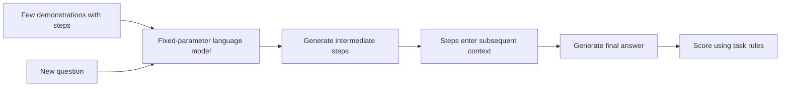

# Chain-of-Thought: How Intermediate Steps Change Language Models' Problem Solving

Fluent continuation alone leaves open whether a language model organizes the intermediate steps needed for a complex problem. This paper studies a specific change: add a reasoning process between question and answer in few-shot prompt examples, so that the model generates similar steps before answering a new question. It moves from asking how a language model imitates input–output relationships to asking how generation can help with multistep tasks. The paper is an important link between in-context learning and later Agent reasoning. [Main paper §§1–2, PDF pp. 1–3](https://proceedings.neurips.cc/paper/2022/file/9d5609613524ecf4f15af0f7b31abca4-Paper-Conference.pdf)

This guide draws on the NeurIPS 2022 conference paper and its separate supplement. It focuses on the prompting mechanism, experimental comparisons, scale conditions, and limits of the evidence. Chain-of-thought (CoT) here is a prompting method with human-written demonstrations, not a later recipe for training reasoning models or a complete Agent that automatically uses tools. The teaching example and probability notation below are explanations, not experiments or a formula from the paper.

## From Demonstrating Answers to Demonstrating Solutions

A standard few-shot prompt puts several question–answer examples in the context, followed by a new question. The model's parameters remain fixed; the examples communicate the task and output format. CoT changes each demonstration to three parts: question, intermediate steps, and answer. For the new question, the model continues by generating steps and then an answer. The change is in the context and generated sequence, rather than an immediate update to model weights. [Main paper §§2–3.1, PDF pp. 2–4](https://proceedings.neurips.cc/paper/2022/file/9d5609613524ecf4f15af0f7b31abca4-Paper-Conference.pdf#page=3)

Consider an independent teaching example: “A shelf held 12 boxes. Five were removed, then two batches of four arrived. How many boxes are there now?” Giving 15 alone shows the endpoint. Writing “Seven remain after removal; two batches add eight; the total is 15” puts the quantities, order of operations, and intermediate state into the generated text. A reader can check whether the two batches were misunderstood, the subtraction was wrong, or a condition was omitted when combining the quantities. This inspectability is valuable, though it does not reveal every computation inside the neural network.

Demonstrations are part of the input, while generated steps are part of the output. Both consume context or generation budget. If a comparison changes the prompt while also increasing model size, replacing the base model, or adding an external calculator, the whole improvement cannot be attributed to CoT. The paper's most direct comparison changes standard demonstrations into step-by-step demonstrations for the same model and task.

Task adaptation also differs from parameter learning. Examples in the current context can change the output distribution for this request; they do not permanently write the steps into the weights or ensure the same behavior in a separate input without those examples. Pretraining supplies language, knowledge, and pattern capabilities; the prompt selects how to invoke them; generation produces this particular solution trajectory. Keeping these layers distinct helps explain why the same checkpoint can behave very differently under different prompts.

## Why Intermediate Text Can Affect the Answer

An autoregressive model continues from the tokens already present. Let $D$ be the prompt demonstrations, $x$ the new question, $r$ the intermediate text, and $a$ the answer. The probability chain rule gives:

$$
p_\theta(r,a\mid D,x)=p_\theta(r\mid D,x)\,p_\theta(a\mid D,x,r).
$$

This general decomposition is explanatory notation, not a new training objective proposed by the paper. It highlights how the generated $r$ becomes context for the subsequent $a$. Writing calculations or states step by step gives later predictions a textual workspace to reuse. If the answer comes first and the explanation follows, the later explanation cannot affect the answer already generated. The paper's ordering ablation investigates precisely this distinction. [Main paper §§2, 3.3, PDF pp. 3, 5–6](https://proceedings.neurips.cc/paper/2022/file/9d5609613524ecf4f15af0f7b31abca4-Paper-Conference.pdf#page=6)

This original teaching diagram shows the sequence of prompting, generation, and evaluation. It has no arrows for retrieval, tool execution, or environmental feedback, because the method's main experiments do not depend on those components. Writing a calculation is still generating text; an external computation requires an executor to actually run it.

The workspace can also amplify mistakes. If an early step gets an entity, unit, or relationship wrong, later steps proceed from that faulty premise. Length alone says nothing about correctness. Suitable decomposition, consistent state, and a correct answer depend on the model, task, and examples.

At test time the model usually generates intermediate steps itself, rather than receiving a reference answer at each step. An omitted condition can send even locally coherent text away from the original problem. Checking CoT therefore means comparing each step with the question's constraints, rather than judging only the naturalness of the sentences or confidence of the ending. A visible process and a verified process are different things.

## Reading Results Across Scale and Task

The arithmetic experiments cover GSM8K, SVAMP, ASDiv, AQuA, and MAWPS. Except for the multiple-choice AQuA task, which uses four demonstrations, the authors use the same eight human-written CoT demonstrations for the other arithmetic tasks. The main decoding strategy is greedy; LaMDA results are averaged over five demonstration orders, while other models primarily report one order. Voting over multiple samples is a later improvement and should be kept separate from the single-generation results here. [Main paper §3.1, PDF pp. 3–4](https://proceedings.neurips.cc/paper/2022/file/9d5609613524ecf4f15af0f7b31abca4-Paper-Conference.pdf#page=4)

The table selects answer accuracy, in percent, for two tasks within the same PaLM family. It compares prompt changes and scale conditions rather than ranking today's models:

| PaLM size | GSM8K: standard prompt | GSM8K: CoT | SVAMP: standard prompt | SVAMP: CoT |
|---|---:|---:|---:|---:|
| 8B | 4.9 | 4.1 | 15.1 | 16.8 |
| 62B | 9.6 | 29.9 | 48.2 | 46.7 |
| 540B | 17.9 | 56.9 | 69.4 | 79.0 |

These values come from Supplementary Table 2. They are on page 7 of the supplementary PDF, printed page 21, rather than page 7 of the main paper. [Supplementary Tables 2–3, supplementary PDF p. 7](https://proceedings.neurips.cc/paper_files/paper/2022/file/9d5609613524ecf4f15af0f7b31abca4-Supplemental-Conference.pdf#page=7)

Two observations hold at once: the largest model gains substantially on these tasks, while GSM8K at 8B and SVAMP at 62B show no improvement. The authors describe the overall trend among the studied models as emerging with scale; this is not a fixed parameter threshold for every architecture, dataset, and training method. The supplement also notes that parameter count is often entangled with factors such as training compute, and the paper offers no complete causal explanation. [Supplement §A.1, supplementary PDF pp. 2–3](https://proceedings.neurips.cc/paper_files/paper/2022/file/9d5609613524ecf4f15af0f7b31abca4-Supplemental-Conference.pdf#page=2)

Task difficulty matters too. Standard prompting may already handle an easy one-step question, so extra text may bring no benefit; a task with several conditions may depend more on explicit decomposition. Using CoT is therefore no substitute for analyzing the problem's structure. A comparison should ask whether the examples teach the right decomposition, whether the evaluation actually requires it, and whether the additional generation cost is worthwhile.

## What the Ablations Show and Leave Open

The main paper designs three targeted alternative prompts. The first generates mathematical expressions alone: it can work on simpler problems, while on GSM8K it falls short of the gain from full natural-language steps. The second generates a string of dots to test extra generation itself; its performance is close to the baseline. The third gives the answer before the steps and also fails to obtain a comparable gain. These controls support a limited interpretation: in these settings, meaningful intermediate steps before the answer help more than simply lengthening the output or explaining it afterward. [Main paper §3.3 and Figure 5, PDF pp. 5–6](https://proceedings.neurips.cc/paper/2022/file/9d5609613524ecf4f15af0f7b31abca4-Paper-Conference.pdf#page=5)

Controls do not settle every attribution question. Dots cannot represent every possible strategy for extra computation, and the failure of one expression prompt does not establish that formal reasoning is generally inferior to natural language. The comparisons support conclusions about the methods and data actually tested. A new mechanistic explanation would require experiments that distinguish it from competing explanations.

The authors also varied demonstration authors, wording, sources, and order. Performance fluctuated across prompts, yet several sets of step-by-step demonstrations still substantially outperformed the standard baseline. The gain thus appeared across several wordings, although sensitivity to prompts remained. Reading or reproducing the work requires the full prompt and order, model version, and decoding rules, rather than just the phrase “think step by step.” [Main paper §3.4 and Figure 6, PDF pp. 6–7](https://proceedings.neurips.cc/paper/2022/file/9d5609613524ecf4f15af0f7b31abca4-Paper-Conference.pdf#page=6)

## Beyond Arithmetic: Commonsense and Symbolic Tasks

Because CoT uses natural language, the paper also evaluates commonsense question answering, date understanding, sports commonsense, descriptions of robot action sequences, and symbolic tasks such as last-letter concatenation and coin-state tracking. These tasks differ in format, number of examples, and scoring; an arithmetic setup is not a uniform protocol for all the experiments. [Main paper §§4–5, PDF pp. 7–8](https://proceedings.neurips.cc/paper/2022/file/9d5609613524ecf4f15af0f7b31abca4-Paper-Conference.pdf#page=7)

One contribution of the symbolic experiments is the distinction between tasks within the demonstrated length and longer inputs. If examples show only two operations and a test has three or four, the model must extend the process rather than merely copy the final output format. CoT improved this length generalization in sufficiently large models tested, but out-of-distribution performance remained weaker than in-distribution performance. The paper explicitly calls these structurally clear toy tasks; they do not establish that planning in long-horizon open environments is solved. [Main paper §5 and Figure 8, PDF p. 8](https://proceedings.neurips.cc/paper/2022/file/9d5609613524ecf4f15af0f7b31abca4-Paper-Conference.pdf#page=8)

Three criteria also need separating: a correct final answer, correct written steps, and text that faithfully reflects the model's internal causal process. These are distinct. The authors' manual analysis found that a small number of correct answers can accompany flawed reasoning; their discussion also leaves open whether the model really reasons in the human sense. CoT offers a window onto behavior, but fluent text cannot certify the internal mechanism. [Main paper §§3.2, 6, PDF pp. 5, 9](https://proceedings.neurips.cc/paper/2022/file/9d5609613524ecf4f15af0f7b31abca4-Paper-Conference.pdf#page=9)

## Where CoT Sits on the Path from LLMs to Agents

From in-context learning to CoT, the change is in how a model uses demonstrations and organizes its output. An Agent that interacts with an environment additionally needs an action interface, external observations, state updates, and a stopping decision. Writing “search for information next” is still a textual plan. A system adds a feedback loop when it actually searches, receives documents, and revises subsequent actions accordingly. This is the platform's editorial suggestion for connecting CoT to ReAct, not a claim that this paper validated the latter.

Three questions can guide further reading: Which intermediate states exist only in generated text? Which facts need external evidence? Which steps can tools execute and verify? CoT provides a starting point for organizing reasoning text. When connecting it to an Agent, reassess error propagation, whether external information is actually used, and overall success across interactions, rather than only whether the model writes steps.

## Return to the Paper and Further Reading

Begin with Figure 1 to distinguish human-written demonstrations in the prompt from newly generated model output. Then read §3.1 alongside Supplementary Table 2 to establish the model, demonstration count, and greedy decoding conditions. Figure 5's ablations separate the possible usefulness of intermediate text from a complete explanation of internal mechanisms. Finally, §6 and Supplement §A.1 retain the issues of error paths, cost, and confounding factors in scale. [Method entry point, PDF p. 3](https://proceedings.neurips.cc/paper/2022/file/9d5609613524ecf4f15af0f7b31abca4-Paper-Conference.pdf#page=3)

This guide covers the main mechanism and essential experiments. It does not individually verify every supplementary prompt, output example, or cited study, and it does not reproduce the historical model experiments. The box problem, diagram, and probability decomposition are teaching aids created for the guide. GPT-3 provides a return to the foundations of in-context learning; ReAct shows how reasoning can be combined with action and observation. This suggested learning order neither requires finishing a particular paper first nor certifies mastery of the methods.
