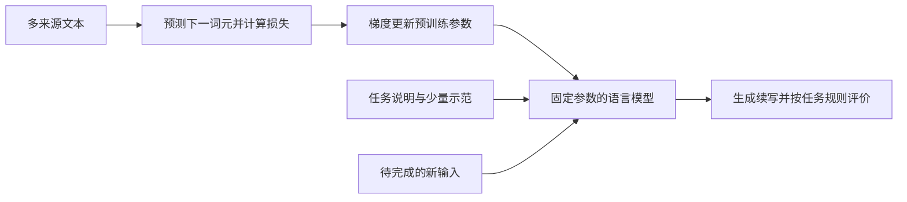

# GPT-3：预训练如何支撑上下文中的少样本学习

同一个语言模型，为什么可以在看到几组翻译、问答或分类示范之后，继续完成新的例子？GPT-3 将这个问题放在大规模实验中研究：先训练一个自回归语言模型，再把任务说明和少量示范写进输入，在不更新参数的情况下评测不同任务。论文的重要性在于揭示这种使用方式的潜力和不均衡的边界，而不只是展示一个很大的模型。[主文 §1–2，PDF 第1–3页](https://proceedings.neurips.cc/paper/2020/file/1457c0d6bfcb4967418bfb8ac142f64a-Paper.pdf)

本文以 NeurIPS 2020 正式会议论文及配套补充材料为依据，解释自回归预训练、上下文学习、规模实验与关键评价条件。它讨论的是基础语言模型，不是后来经过指令训练的聊天产品，也没有把少样本学习直接证明为完整的 Agent 能力。

## 先学文本分布，再用文本指定任务

自回归语言模型把一段词元序列的概率分解成一串下一词元概率。用来理解训练的教学写法是：

$$
p_\theta(x_1,\ldots,x_T)=\prod_{t=1}^{T}p_\theta(x_t\mid x_{<t}),\qquad
\mathcal L(\theta)=-\sum_{t=1}^{T}\log p_\theta(x_t\mid x_{<t}).
$$

$x_{<t}$ 是已出现的文本，$\theta$ 是模型参数。训练降低真实下一词元的负对数概率，使模型更擅长预测训练分布中的续写。这组式子是本篇对自回归目标的教学表达，不是原论文中的编号公式。词元是模型处理的子词或文本片段，不能机械地等同于汉字或英文单词。

这个目标没有显式要求“成为翻译器”或“成为问答系统”。但大规模文本包含多种结构，任务也可以写成文本前缀。例如给出“英文：…… 法文：……”并停在法文一侧，后续生成便可被解释为翻译。问题随之变成：从广泛文本预测中学到的能力，能否被输入中的任务描述和示范可靠地调用？[主文 §2、§5，PDF 第3、8页](https://proceedings.neurips.cc/paper/2020/file/1457c0d6bfcb4967418bfb8ac142f64a-Paper.pdf#page=3)

这里要分清两次变化。预训练通过大量样本和梯度更新改变参数；使用模型时，输入内容改变了条件概率，但参数可以保持固定。模型这一次答对了一个新任务，不等于它已经把该任务永久学进参数，也不等于建立了跨会话的个人记忆。

## 模型变大，也必须说明数据和架构

论文训练了八种规模，从 1.25 亿参数到 1750 亿参数；最大配置称为 GPT-3。它沿用 GPT-2 式自回归 Transformer 的若干设计，包括预归一化和相应的分词方式，并在层间交替使用稠密注意力与局部带状稀疏注意力。因此，它不是把原始翻译 Transformer 的编码器—解码器直接放大，也不能把全部计算都当成每层完全相同的全局注意力。[主文 §2.1，PDF 第3页](https://proceedings.neurips.cc/paper/2020/file/1457c0d6bfcb4967418bfb8ac142f64a-Paper.pdf#page=3)

预训练材料以经过质量筛选的 Common Crawl 为主，并加入 WebText2、书籍语料和英语 Wikipedia。筛选依赖与参考语料的相似性，另有文档级模糊去重；“高质量”在这里对应一套具体筛选代理，并不是每条事实都有人核验。更大的语料可以增加覆盖面，也可能包含重复、偏差和评测材料。[主文 §2.2，PDF 第3–4页](https://proceedings.neurips.cc/paper/2020/file/1457c0d6bfcb4967418bfb8ac142f64a-Paper.pdf#page=3)；[补充材料 §A，PDF 第1页](https://proceedings.neurips.cc/paper_files/paper/2020/file/1457c0d6bfcb4967418bfb8ac142f64a-Supplemental.pdf#page=1)

补充材料表 C.1 按 3000 亿训练词元报告数据混合。采样比例并不等于各语料占总文件量的比例：有的语料不到一轮，有的被重复采样数轮。因此，模型规模、候选语料总量和实际训练词元数是不同变量。只比较参数量，无法完整描述训练投入或数据分布。[补充材料 §C、表C.1，PDF 第4–5页](https://proceedings.neurips.cc/paper_files/paper/2020/file/1457c0d6bfcb4967418bfb8ac142f64a-Supplemental.pdf#page=5)

模型的上下文窗口为 2048 个词元。训练时，较短文档可以拼接到同一窗口，以文档结束标记分隔；作者没有为文档边界另外设置特殊的隔离遮罩。这个限制同样影响使用方式：任务说明、示范、待回答输入都要竞争有限上下文，不能无限增加例子。[补充材料 §B，PDF 第1页](https://proceedings.neurips.cc/paper_files/paper/2020/file/1457c0d6bfcb4967418bfb8ac142f64a-Supplemental.pdf#page=1)

## 零样本、单样本和少样本究竟差在哪里

论文把三种推理设定明确区分。零样本给任务描述而不给完整示范；单样本给一组输入与答案；少样本给 $K$ 组示范，然后只给最后一个待完成输入。这里的“样本”指当前提示中提供的任务例子，不是模型全部训练数据的数量。零样本模型仍经过大规模预训练，也可能在其中见过相关知识或格式。

设示范集合为 $D_K=\{(u_1,v_1),\ldots,(u_K,v_K)\}$，待回答输入为 $u_*$。上下文学习可以教学性地表示为：

$$
p_\theta(v_*\mid \text{任务说明},D_K,u_*),\qquad \theta\ \text{保持固定}.
$$

示范影响的是本次条件分布。微调则会利用任务数据计算损失并更新 $\theta$。两者都可能改善任务表现，但改变的位置不同，成本、持久性和评测方式也不同。论文典型少样本设置的 $K$ 在 10 到 100 之间，具体数量受示范长度及窗口限制；不是每个任务一律用同一个 $K$。[主文 §2，PDF 第3页](https://proceedings.neurips.cc/paper/2020/file/1457c0d6bfcb4967418bfb8ac142f64a-Paper.pdf#page=3)

这是原创教学图，不是论文原图。左侧箭头表示训练产生参数，右侧输入表示推理时提供上下文；右侧没有一条把当前答案自动写回参数的训练回路。

例如，一个格式转换任务可以先展示“红色 → RED、蓝色 → BLUE”，再输入“绿色 →”。模型输出符合格式，可能同时利用了预训练知识、示范中的映射形式和任务约定。这是说明机制的自创例子，不是论文测试样本，也不能仅凭一个例子断言模型发现了新的普遍算法。

## 上下文学习的证据，需要控制提示和测试条件

论文通常从任务训练集抽取示范，再评价测试问题；LAMBADA 与 StoryCloze 没有可用的监督训练集，于是从开发集抽示范、在测试集评价。不同任务还会改变自然语言提示、答案格式或候选答案评分。由此得到的分数，属于“模型加具体任务表达”的表现，不是脱离提示就存在的一个常数。[主文 §2.4，PDF 第4页](https://proceedings.neurips.cc/paper/2020/file/1457c0d6bfcb4967418bfb8ac142f64a-Paper.pdf#page=4)

图1.1显示，在所测规模范围内，较大模型整体更强，少样本设置的改善也更明显。这支持规模与上下文使用能力之间的经验联系。作者把它解释为可能具有元学习性质，但论文没有用这些曲线证明内部必然运行某一种特定学习算法，也没有排除任务识别、格式适配和已有知识调用等不同成分。[主文 图1.1，PDF 第2页](https://proceedings.neurips.cc/paper/2020/file/1457c0d6bfcb4967418bfb8ac142f64a-Paper.pdf#page=2)

读图时还有一个容易遗漏的条件：图1.1中的 GPT-3 SuperGLUE 分数来自开发集，不能直接与图中作为参考的其他系统测试集线当作严格同条件比较。正文表3.5才明确给出测试集对比。曲线用于观察趋势，表格用于核对对应评价条件，两者不能随意拼接。

## 结果不是一种能力在所有任务上同时增长

下表摘录 1750 亿参数 GPT-3 的闭卷问答结果。闭卷表示回答时不额外提供检索文章，仍然允许任务说明和设定内的示范。数字为论文所报问答准确率，三列是不同数据集，不能相互视为同一难度的考试。

| 推理设定 | Natural Questions | WebQuestions | TriviaQA |
| --- | ---: | ---: | ---: |
| 零样本 | 14.6 | 14.4 | 64.3 |
| 单样本 | 23.0 | 25.3 | 68.0 |
| 少样本 | 29.9 | 41.5 | 71.2 |

这组结果说明示范在所测问答设置中有帮助，但幅度与绝对水平依赖数据集。Natural Questions 的 29.9 仍低于同表中经过微调的 T5-11B+SSM 的 36.6；TriviaQA 的关系则不同。表中还包含使用外部信息的开放域系统，它们的信息条件不同，不宜仅按一个数字排名。TriviaQA 的少样本结果注明在 wiki split 测试服务器上评价；其余两个数据集的测试划分也可在补充材料表 C.2 中核对。[主文 §3.2、表3.2，PDF 第5页](https://proceedings.neurips.cc/paper/2020/file/1457c0d6bfcb4967418bfb8ac142f64a-Paper.pdf#page=5)

反例同样重要。SuperGLUE 测试中，GPT-3 每个任务给 32 个上下文示范，不更新梯度，平均分为 71.8；它超过该表中微调 BERT-Large 的 69.0，却仍明显低于当时表列最优系统的 89.0。WiC 子任务只有 49.4% 准确率，接近随机水平。一个较好的平均值不能抹去某类任务的薄弱点。[主文 §3.4、表3.5，PDF 第6–7页](https://proceedings.neurips.cc/paper/2020/file/1457c0d6bfcb4967418bfb8ac142f64a-Paper.pdf#page=7)

示范数也不是保证单调增益的旋钮。LAMBADA 的零样本准确率为 76.2，单样本为 72.5，少样本为 86.4；作者讨论了填空格式与模式识别的可能影响。少样本成绩提升，不能反推“随便增加一个例子总会更好”。阅读这些结果时，应同时问任务如何表达、示范怎样选择、答案如何评分。[主文 §3.1、表3.1，PDF 第4–5页](https://proceedings.neurips.cc/paper/2020/file/1457c0d6bfcb4967418bfb8ac142f64a-Paper.pdf#page=4)

## 数据污染为什么不能用一句话排除

大规模网络预训练可能包含评测材料。论文试图在训练前删除重合内容，但补充材料承认过滤程序存在错误，部分重合未被移除；由于成本，作者没有重新训练整个模型。因此，后续分析是对已有模型做审计，不是提供一个已完全清洁的重新训练对照。[补充材料 §C，PDF 第2、5页](https://proceedings.neurips.cc/paper_files/paper/2020/file/1457c0d6bfcb4967418bfb8ac142f64a-Supplemental.pdf#page=2)

基本方法是把与训练语料存在词组重合的评测样本标出，比较全部样本与剩余“干净”子集的表现。主文用 13-gram 作概括；附录进一步说明，各数据集采用的词组长度会随样本长度调整，非合成任务限制在 8 到 13 之间。不能把主文的简述误写成所有任务统一使用一个阈值。[补充材料 §C、表C.2，PDF 第4–6页](https://proceedings.neurips.cc/paper_files/paper/2020/file/1457c0d6bfcb4967418bfb8ac142f64a-Supplemental.pdf#page=6)

多数任务的变化较小，但这不是“没有记忆”的证明。重合可能只是背景文章，不含问答对；过滤也可能改变样本难度。附录对 PIQA 和 Winograd 保留了污染标记，并讨论 LAMBADA 存在实质重合却分数变化很小的情况。图 C.2 的纵轴还是干净子集相对完整集合的变化，不能当作又一张无条件能力排行榜。[补充材料 §C、图C.2，PDF 第3–5页](https://proceedings.neurips.cc/paper_files/paper/2020/file/1457c0d6bfcb4967418bfb8ac142f64a-Supplemental.pdf#page=3)

对阅读者更有用的判断是：同一篇论文可以同时有有价值的能力证据和未完全解决的识别问题。必须逐项保留这些条件，既不把所有增益都归为背答案，也不把一次重合分析当作彻底排除污染。

## 从会续写到能完成目标，中间还缺什么

上下文学习让同一个模型可以通过文本切换任务，但“能按给定格式续写”与“可靠地帮助完成一个目标”之间仍有距离。论文 §5明确讨论重复、长文本失去连贯性、前后矛盾，以及某些比较两段文本的任务表现较弱。它还指出，平等对待每个词元的预测目标没有直接表达哪些错误对使用者更重要。[主文 §5，PDF 第8页](https://proceedings.neurips.cc/paper/2020/file/1457c0d6bfcb4967418bfb8ac142f64a-Paper.pdf#page=8)

这为后续阅读提供了清晰的分岔：InstructGPT 研究如何让训练信号更接近人的要求；工具学习研究怎样把外部执行能力接入模型；Agent 系统还要组织状态、观察、行动及反馈。GPT-3 是理解这些工作的语言模型基础，而不是已经包含了全部系统设计。

这条阅读联系是编辑性组织，不是对未来工作的实验背书。本篇也没有通过少样本成绩认定模型具有稳定推理、真实世界因果理解或长期自主行动能力。若要讨论这些问题，需要另行定义任务、观察过程并评价失败方式。

## 带着具体问题回到原文

- 先读 §2 与 §2.4，分别标记“参数在何时更新”和“示范从何处抽取”，再看图1.1中规模、示范数量与分数的关系。[主文 §2，PDF 第3–4页](https://proceedings.neurips.cc/paper/2020/file/1457c0d6bfcb4967418bfb8ac142f64a-Paper.pdf#page=3)
- 对问答感兴趣，读表3.2与相邻讨论，核对闭卷、开放域、微调和上下文示范这些标签；不要只抄最高分。[主文 表3.2，PDF 第5页](https://proceedings.neurips.cc/paper/2020/file/1457c0d6bfcb4967418bfb8ac142f64a-Paper.pdf#page=5)
- 若要用这些历史结果支持一个研究判断，连读 §4–5 与附录 §C。尤其检查过滤错误、子集分布改变，以及表 C.2 使用不同示范随机种子造成的小幅分数差异。[补充材料 §C，PDF 第2–6页](https://proceedings.neurips.cc/paper_files/paper/2020/file/1457c0d6bfcb4967418bfb8ac142f64a-Supplemental.pdf#page=2)

本篇覆盖预训练与上下文学习主线、部分正负结果及污染分析。没有逐任务展开全部提示、所有额外实验、社会影响分析或训练实现，也没有复现实验。教学公式、例子和流程图为独立解释；所列历史结果不代表当前模型排名。生成这篇阅读材料不会创建或更改个人阅读完成状态。
