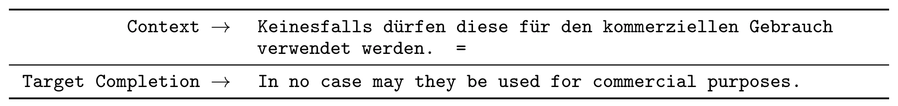
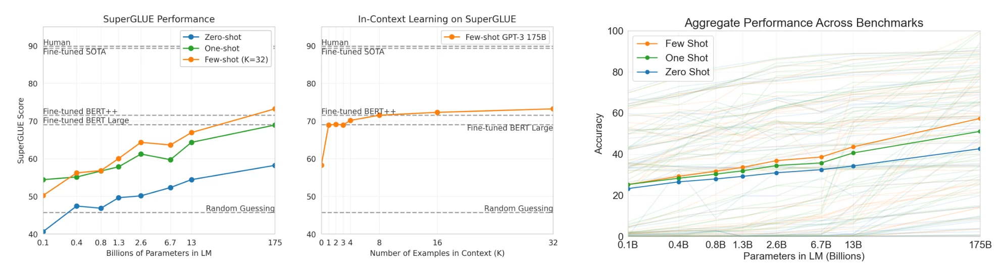
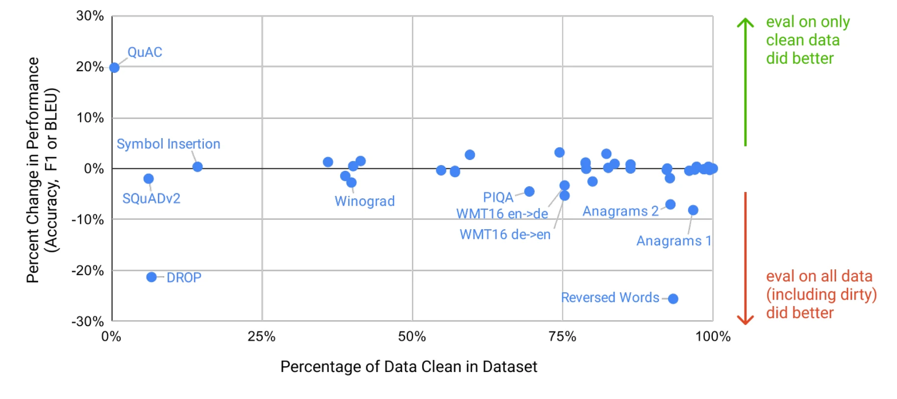

# GPT-3: How Pretraining Supports Few-Shot Learning in Context

How can one model switch from translator to question-answering system, and then on to reading comprehension or classification, on the strength of a few examples alone? In 2020, Tom B. Brown, Benjamin Mann and their co-authors studied this question systematically in *Language Models are Few-Shot Learners*. They trained a family of autoregressive language models of different sizes, the largest with 175 billion parameters, called GPT-3. At use time they no longer updated the parameters; instead, they wrote the task description and demonstrations as text and placed them in front of the question to be answered. [Abstract and §1, main PDF pp. 1–2](https://proceedings.neurips.cc/paper/2020/file/1457c0d6bfcb4967418bfb8ac142f64a-Paper.pdf)

The paper's contribution goes beyond making a model larger: it turns a new way of using a model into an experiment that can be compared. Given the same pretrained model, what happens when it receives zero, one or several demonstrations? The authors find that larger models are usually better at using these in-context demonstrations. On some tasks the few-shot results already approach systems trained specifically for them, while on others they stay close to random guessing. This uneven result is the way into the paper: it shows the potential of a general text interface, and also the problems that this interface has not yet solved.

Read today, the thing most worth understanding is "why performance can change while the parameters stay fixed". That requires connecting three processes: what pretraining writes into the parameters; how a prompt turns a task into text waiting to be continued; and how the model's next-token probabilities are converted into a translation, an answer to a question or a choice in a multiple-choice item. Once this chain is clear, later work on prompt engineering, instruction training and model evaluation has a common point of reference.

The guide first covers the problem of per-task fine-tuning that the authors faced, then takes apart pretraining, the zero-, one- and few-shot settings, the flow of information in the prompt, and the scoring of candidate answers. The core sections include actual task formats from the paper, a table of steps and an example that can be worked by hand. After that come architecture and data, the scaling curves, several groups of representative positive and negative results, and finally the contamination audit and the limitations. Throughout, the guide is pinned to the NeurIPS 2020 conference PDF and its accompanying supplementary material. These two files are arranged differently from the common long arXiv version, and page numbers in the text count from the first page of each file.

## The authors' problem: fine-tune again for every task?

To understand GPT-3, first go back to how natural language processing worked at the time. Early on, translation, question answering and sentiment classification each often required its own model and features. Pretraining changed this: a model first learns general representations from large amounts of text, and is then trained further on labeled data for a specific task. The second step is called fine-tuning, which starts from the existing parameters, computes gradients from a task loss and actually modifies the model's weights. [§1, main PDF p. 1](https://proceedings.neurips.cc/paper/2020/file/1457c0d6bfcb4967418bfb8ac142f64a-Paper.pdf#page=1)

This approach works well, but it still leaves a per-task step. Building a new text classifier usually means preparing a set of "text–label" pairs; building a new question answerer means preparing "question–answer" pairs. The authors wanted to keep the general ability that pretraining provides while reducing this step's dependence on large amounts of specialized labeling and specialized training. A real user will often just say "please translate this sentence into French", or give two demonstrations; they rarely have a ready-made training set.

The paper also raises two concerns at the research level. First, cues in a training set may be spuriously correlated: the model learns that a certain word often goes with a certain label, and fails when the same thing is written another way. Second, on text from a different source, the model may lose its advantage because the data distribution has shifted. The authors therefore chose to fix one pretrained model and observe, across many tasks, how it uses task information in its input. [Discussion of fine-tuning in §2, main PDF p. 3](https://proceedings.neurips.cc/paper/2020/file/1457c0d6bfcb4967418bfb8ac142f64a-Paper.pdf#page=3)

GPT-2 had already offered a clue: given a suitable prefix, a language model can perform different tasks to some degree. For example, if the prefix is written as a question followed by `A:`, the continuation can be treated as the answer. GPT-2's results were still far from generally matching specially trained systems, but on some tasks its performance kept improving as the model grew. The authors therefore asked: if parameter count, data diversity and training investment were pushed further, would this trend continue? [§1, main PDF p. 2](https://proceedings.neurips.cc/paper/2020/file/1457c0d6bfcb4967418bfb8ac142f64a-Paper.pdf#page=2)

There is an easily overlooked contribution here: the authors redefined what "zero-shot" means. Some earlier so-called zero-shot tasks had in fact already put demonstrations in the input; although those examples were not used for gradient updates, they still told the model how the task should be done. GPT-3 separates no demonstrations, one demonstration and several demonstrations explicitly, and reports results for each. This makes the later comparisons clearer: how much the model already knew, how much seeing the task format once helped, and how much a few more examples helped on top of that.

From this the authors arrive at the core hypothesis of the paper: **large-scale general pretraining can let a model, with its parameters fixed, adapt quickly to a task through the task description and demonstrations in its input.** The next step is to connect pretraining with this kind of adaptation and see what each of them changes in the model.

## Pretraining: one set of general parameters from a next-token objective

The most basic job of a language model is to assign probabilities to the next token, given the text that has already appeared. A token is the unit the tokenizer works with; it may be a word, a subword or some other piece of text. Autoregressive means that it predicts from left to right: after the first token it predicts the second, after the first two it predicts the third, and so on.

In the guide's teaching notation, the process can be written as:

$$
p_\theta(x_1,\ldots,x_T)=\prod_{t=1}^{T}p_\theta(x_t\mid x_{<t}),\qquad
\mathcal L(\theta)=-\sum_{t=1}^{T}\log p_\theta(x_t\mid x_{<t}).
$$

$x_1,\ldots,x_T$ are the tokens of the training text, $x_{<t}$ is everything before the $t$-th token, and $\theta$ is the full set of trainable parameters. The first expression decomposes the probability of the whole text into a chain of conditional probabilities. The second is the training loss: if the next token that actually appears was given a very low probability by the model, it incurs a large penalty. Training repeatedly lowers this loss, so that real text becomes easier to predict. [Autoregressive pretraining and its lineage, §2, main PDF p. 3](https://proceedings.neurips.cc/paper/2020/file/1457c0d6bfcb4967418bfb8ac142f64a-Paper.pdf#page=3)

For example, when the text reaches "the river washed away both of its", the next word "banks" is more plausible than "keyboard". At first the model guesses poorly; through gradient updates, parameters such as the token representations, attention projections and feed-forward networks all adjust. Because one set of parameters has to reduce prediction error across an enormous variety of texts, the model needs to capture whatever regularities in words, syntax, factual associations and stylistic structure help with prediction.

The inputs and targets during training can be laid out in a table. The short sentence and the arrangement below are a teaching example made up for the guide; for simplicity, each word is treated as one token:

| Prefix already given at this position | Target to predict at this position | What happens in training |
| --- | --- | --- |
| ⟨start⟩ | the | Compute a loss from the probability and the true target |
| ⟨start⟩ the | river | Compute the loss at one more position |
| ⟨start⟩ the river | washed | Continue computing the loss |
| Losses at all positions summed | — | Backpropagate and update the same set of parameters |

During training the whole text is already known, so the losses at many positions can be computed at once, but a causal mask lets each position read only itself and the input before it. That way, the position predicting "washed" cannot read the answer that follows it. At generation time there is no complete target to use in parallel: one token must be produced first, appended to the prefix, and then the next one predicted. This is the computational basis of an autoregressive Transformer; for the details of attention and masking, see the [pinned revision of the Transformer guide](/read/transformer/5#u04).

Why should predicting text have anything to do with doing tasks? Because text contains all kinds of "input followed by output" structures. A question may be followed by an answer, an entry by an explanation, a passage of German by its English translation. As long as a task is written as such a prefix, the original "predict the next token" can be used as "continue by writing the answer to the task". Pretraining provides the ability to generate language and to use these structures; the prompt specifies which structure to continue this time.

Seen this way, pretraining builds a set of abilities that can be called up by many different text prefixes. One prefix can draw out an explanation and another a translation, and both outputs are produced through the same next-token objective. The next question, then, is how to express a task clearly enough at use time that the model continues with the kind of text we want.

## Zero-, one- and few-shot: what actually changes?

After pretraining, the authors freeze the model's parameters and specify the task through the input. "Freezing" here means that no gradients for updating the weights are computed at inference; the model still performs a complete forward pass. The paper calls this phenomenon of using demonstrations in the input context in-context learning (ICL). [§2, main PDF p. 3](https://proceedings.neurips.cc/paper/2020/file/1457c0d6bfcb4967418bfb8ac142f64a-Paper.pdf#page=3)

The four approaches can be placed side by side using the same translation task:

| Approach | Where the task information is | Are parameters updated after using new task data? |
| --- | --- | --- |
| Fine-tuning | Input–translation pairs form training examples used to compute a task loss | Updated |
| Zero-shot | The input contains a task description or task invocation, with no complete demonstration | Not updated |
| One-shot | The input contains one complete input and answer, then the new input | Not updated |
| Few-shot | The input contains $K$ complete demonstrations, then the new input | Not updated |

The "number of shots" counts **the demonstrations in the current prompt**, not all the training material the model has read. All three settings use a model that has already completed large-scale pretraining: zero-shot specifies the task through a description, and one-shot and few-shot add complete examples. Compared with fine-tuning, task information takes another path here: it takes part in the forward pass as conditioning text, and the weights stay fixed throughout.

Continuing the guide's notation, let a demonstration be $(u_i,v_i)$, where $u_i$ is the input and $v_i$ the answer. Concatenating the task description, $K$ demonstrations and the input to be answered, $u_*$, the model has to produce:

$$
p_\theta(v_*\mid \text{task description},u_1,v_1,\ldots,u_K,v_K,u_*),\qquad \theta\ \text{fixed}.
$$

This expression separates what is known from what is to be predicted: in the demonstrations, both inputs and answers are given; in the part under test, $u_*$ is given and $v_*$ is left as the prediction target. The model can thus recognize the task from the complete demonstrations and apply the same treatment to the new input.

Demonstrations can carry several kinds of information at once. They tell the model "translation is wanted here", and through actual outputs they show "what the translation should look like"; they may also supply task-specific meanings for labels. Suppose a classification task uses A and B for its two classes. From the letters alone it is hard to know which class is which, but complete examples establish the correspondence between labels and texts. One complete example can therefore convey the task, the format and the labeling convention all at once, which also gives an intuition for the one-shot gains discussed later.

Few-shot also has a practical cost. Every demonstration occupies the context window, and each additional one leaves a little less room for the new question and its answer. GPT-3's window is 2048 tokens, and the authors can usually fit about 10 to 100 demonstrations, depending on task length; one example of long-form reading comprehension may be longer than many examples of short question answering. The $K$ actually used for each task therefore has to be adjusted to the length of the examples and the window budget. [§2, main PDF p. 3](https://proceedings.neurips.cc/paper/2020/file/1457c0d6bfcb4967418bfb8ac142f64a-Paper.pdf#page=3)

This adaptation happens in the internal activations and output distribution produced by the current input. Each request can specify its task through its own prefix: put in translation examples, and translation is invoked; switch to question-answering examples, and the model turns to answering questions. The parameters stay fixed, and the current context plays the role of a temporary task specification. The next section follows an actual prompt through one such forward pass.

## The core process: demonstrations and the new question as one text

The previous section defined in-context learning; this section reconstructs it as an actual computation. For GPT-3, the task description, the demonstrations and the new question are all encoded into the same token sequence and enter the forward pass together. The model computes a representation at each position along the sequence and finally continues predicting text.



Figure G.36 comes from the conference supplementary material. Look first at the Context at the top: the German sentence is followed only by an equals sign. Then look at the Target Completion below: the English translation starts here. The arrows in the figure label the role of each part, and the horizontal line separates the known input from the reference answer. The appendix uses records like this from the dataset to show where the model should start continuing and what the continuation should aim at. [Supplementary §G, Figure G.36, PDF pp. 11, 24](https://proceedings.neurips.cc/paper_files/paper/2020/file/1457c0d6bfcb4967418bfb8ac142f64a-Supplemental.pdf#page=24)

The original figure shows only one task record. When building a few-shot prompt, the earlier records are written out in full, source and translation both; the last one keeps only the source and the equals sign and waits for the model to complete it. To make this concatenation easier to see, the example below is a teaching example made up for the guide, and the probability values later on are also assigned for teaching; they are not measured outputs of GPT-3:

```text
German: Guten Morgen.
English: Good morning.

German: Danke.
English: Thank you.

German: Gute Nacht.
English:
```

This prefix contains two complete demonstrations, each showing the model how German corresponds to English. The third `English:` has no reference answer after it. What the model receives is one continuous text with a repeated structure; the representation at the end can draw on the language, field names and output format of the first two pairs and assign probabilities to the English tokens that come next.

The whole process can be laid out in five steps of input, processing and output:

| Step | What enters this stage | What this stage does | What it produces |
| --- | --- | --- | --- |
| Concatenate the prefix | Task description, complete demonstrations, new input | Arrange them as text with the separators the task specifies | A sequence that is not yet finished |
| Tokenize and embed | The whole prefix | Convert to token IDs, then to vectors carrying position information | An initial representation for each position |
| Transformer forward pass | The representations of these positions | Read earlier text through causal attention and process it through many layers | Hidden representations that carry contextual information |
| Output vocabulary probabilities | The final representation at the last position | Apply a linear map and normalize | The conditional probability of the next token |
| Continue or score | One generated token, or one candidate answer | Append it to the prefix and keep predicting, or accumulate the candidate's probability | A complete answer, or a score for the candidate |

In terms of shapes, if the prefix has $L$ tokens and the model's representation width is $d$, its representation can be written as an $L\times d$ matrix. The output layer produces scores over the vocabulary of size $V$ for the positions it computes; when generating the next token, attention goes to the $V$-dimensional distribution in the row for the last position. Here $L, d, V$ are shape notations the guide uses to illustrate the data flow.

Now look at how the demonstrations affect the last position. Causal attention lets the new question, which comes later, read the demonstrations before it, so the fields `German:` and `English:` and the translations already present can all change the new question's representation. Different layers and heads can combine earlier text in different ways, and the feed-forward networks process this information further. In the end, the representation of "Gute Nacht" already carries information from the German-to-English demonstrations before it. The output layer assigns probabilities on that basis, making an English continuation that fits the current translation format more likely to be chosen.

Along this pathway, the demonstrations take part in predicting the new question: they are read as earlier text, processed by the existing parameters and shape the representation at the end. The paper then tests this way of using the model through task performance: when demonstrations are added to the same model, scores on many tasks change, and larger models usually benefit more from them.

The design has one more modest but important advantage: different tasks need not first be turned into different neural-network output heads. Translation can stop after the equals sign, question answering after `A:`, classification after `answer:`. The model always continues text, and the external evaluation interprets the continuation as the answer to the task. The next section continues with this last step, because "generating a sentence" and "ranking several candidate answers" use the same probabilities but mean different things for evaluation.

## From token probabilities to answers: a score you can compute by hand

What the model outputs is next-token probabilities, yet what the paper reports is accuracy, F1 or BLEU. In between there has to be a set of task rules that turns probabilities into answers that can be scored. This stage directly affects results: how the prompt is written, how long the answer is and how candidates are compared all affect the final score.

Continue with the teaching translation from the previous section. Suppose the model has already decided to start with `Good` after `English:`, and now has to compare what follows. To make hand calculation possible, simplify the candidates to `night`, `morning` and one other token, and let their unnormalized scores, given the whole prefix, be $\ln 6, \ln 3, \ln 1$. Taking exponentials in the softmax gives $6, 3, 1$; dividing by the sum, 10, gives probabilities of $0.6, 0.3, 0.1$.

With greedy decoding, which picks the highest-probability token at each step, this step selects `night`. But there is also the question of stopping: the evaluation program needs to decide where the translation ends and extract the corresponding span as the answer. The decoding and scoring of each real task must specify how output is handled; "generating a long passage that contains the right word" and "outputting exactly the required answer" may receive different scores. The main text states that free-generation tasks use beam search with beam width 4 and length penalty 0.6, and the supplementary material lists the specific formulation of each task. [§2.4, main PDF p. 4](https://proceedings.neurips.cc/paper/2020/file/1457c0d6bfcb4967418bfb8ac142f64a-Paper.pdf#page=4)

To compare complete candidate translations, the probabilities at several positions have to be multiplied together. In the guide's notation, with prefix $P$, the conditional probability of a candidate answer $a=(a_1,\ldots,a_m)$ is:

$$
p_\theta(a\mid P)=\prod_{j=1}^{m}p_\theta(a_j\mid P,a_{<j}).
$$

Note that the probability of each later token is computed given the first part of the candidate. Suppose the first word `Good` has probability $0.6$, and the conditional probability of then producing `night` is the $0.6$ from above; the joint probability of candidate A, `Good night`, is then $0.36$. Candidate B, `Thank you`, has the two probabilities $0.3$ and $0.9$, giving a joint probability of $0.27$. If both are restricted to candidates of these two tokens, A ranks ahead of B. The product combines the conditional probability at each step into a score for the whole candidate, so the two answers can be compared directly.

Multiple-choice items can be handled the same way: compute the continuation probability of each option separately, then choose according to the task's rules. The paper's appendix marks options as Correct Answer and Incorrect Answer for the reader's benefit. At evaluation time, the model receives the prefix and scores the candidates, and the program then compares the chosen answer with the reference.

Comparing probabilities directly has one more problem: some answers are common in themselves and may have high probability in many unrelated contexts. The paper therefore states in the captions for some multiple-choice tasks, such as RACE and ARC, that candidates are normalized by their unconditional probability. In the guide's simplified notation this can be written $p(a\mid P)/p(a)$, expressing "how much extra support this question gives the answer, relative to how common it already is"; the exact implementation follows each task's description. [Supplementary Figures G.1 and G.11, PDF pp. 12, 16](https://proceedings.neurips.cc/paper_files/paper/2020/file/1457c0d6bfcb4967418bfb8ac142f64a-Supplemental.pdf#page=12)

Here is a teaching calculation showing why this correction can change the ranking. Suppose an item has two candidates: A has probability $0.12$ given the question and B has $0.09$, so in a direct comparison A wins. If A's prior probability is $0.06$ and B's is only $0.015$, then after normalization A scores $2$ and B scores $6$, and B wins instead. Intuitively, A is something people say often anyway, while B, though slightly lower in absolute probability, is supported more strongly by the current question. A normalized score is a ratio to the prior probability, not the probability of the answer, so it can exceed 1; the two ratios can be used directly for ranking.

Different tasks also use different final metrics. Accuracy counts how many items were answered correctly; F1 measures the overlap between the predicted answer and the reference, with the aggregation method set by each task; BLEU compares the overlap of word sequences between a translation and the reference translation. These metrics turn model behavior into the results the task cares about: whether an answer is correct, and whether a translation is close to the reference. Text-prediction ability shows up in these scores through the chain of formulation, decoding and scoring.

With this, the object of the paper's experiments is complete: **a model with fixed parameters + a task prefix + answer rules**. Demonstrations express the task and the format to the model, the model computes continuation probabilities, and the evaluation program turns them into task results. The scaling experiments that follow compare how this whole interface changes with model capacity and the number of demonstrations.

## Model and data: more than parameter count grows

With the core way of using the model clear, the next question is what kind of model and training material it rests on. The authors trained eight sizes, from 125 million to 175 billion parameters; figures often use B for a billion parameters, so 175B means 175 billion. The largest model is called GPT-3, and the smaller ones let the authors track changes in performance across many scales. [§2.1, main PDF p. 3](https://proceedings.neurips.cc/paper/2020/file/1457c0d6bfcb4967418bfb8ac142f64a-Paper.pdf#page=3)

The architecture follows the GPT-2-style autoregressive Transformer, including pre-normalization, the corresponding initialization and reversible tokenization. Pre-normalization places normalization before each sublayer, a different position from the post-sublayer normalization of the original translation Transformer. GPT-3 also alternates dense attention with locally banded sparse attention across layers: the former can read every permitted earlier position, while the latter reads only a local band. In this way some layers read the global context and others concentrate on local information, and together they form the autoregressive decoder.

For understanding in-context learning, the most important common point is that the model processes one autoregressive text sequence. The demonstrations and the question under test are both in this sequence and are processed by the same set of parameters. Models of different sizes have different capacities, but the task interface stays text, which is what makes it possible to compare how the same way of using a model changes with scale.

On the data side, the main source is Common Crawl, a large corpus of crawled web pages, supplemented by WebText2, two book corpora, Books1 and Books2, and English Wikipedia. Faced with the sprawl of raw web pages, the authors first filtered by similarity to reference corpora and then performed fuzzy deduplication at the document level, to reduce low-quality and near-duplicate content. [§2.2, main PDF pp. 3–4](https://proceedings.neurips.cc/paper/2020/file/1457c0d6bfcb4967418bfb8ac142f64a-Paper.pdf#page=3)

The supplementary material explains what filtering means concretely: a document classifier was trained with reference material such as WebText as positive examples and raw Common Crawl as negative examples, and pages with higher scores were preferentially kept. So "high quality" at this step specifically means "more like the chosen reference corpus"; the classifier measures how close a document's features are to the reference set. The authors also kept some out-of-distribution documents, to avoid shrinking the corpus entirely to the shape of the reference set. [Supplementary §A, PDF p. 1](https://proceedings.neurips.cc/paper_files/paper/2020/file/1457c0d6bfcb4967418bfb8ac142f64a-Supplemental.pdf#page=1)

The data mixture introduces another layer of choice. Table C.1 lists, on one side, the total number of tokens available for sampling and, on the other, the sampling proportion during training, the "weight in training mix". The table below is excerpted from the original; B still means a billion, and epochs are reported for training on 300B tokens:

| Corpus | Available tokens | Weight in training mix | Reported epochs when training on 300B |
| --- | ---: | ---: | ---: |
| Filtered Common Crawl | 410B | 60% | 0.44 |
| WebText2 | 19B | 22% | 2.9 |
| Books1 | 12B | 8% | 1.9 |
| Books2 | 55B | 8% | 0.43 |
| Wikipedia | 3B | 3% | 3.4 |

[Supplementary Table C.1, PDF p. 5](https://proceedings.neurips.cc/paper_files/paper/2020/file/1457c0d6bfcb4967418bfb8ac142f64a-Supplemental.pdf#page=5)

The original weights are approximate, and the displayed values add up to 101%; the weights and epochs in the table are copied as printed. The table's meaning is clear: the authors sampled more often from sources regarded as high quality, so some small corpora were seen for several epochs, while Common Crawl and Books2 were not traversed even once. The total amount of data, the amount actually trained on and the number of times each source was reused have to be understood separately.

What does this mean for the scaling experiments? Parameter count says how large the model is, the number of training tokens says how much text the optimization process saw, and the mixture proportions decide which text the model mainly learns from. GPT-3's scaling experiments rest on this route of filtering and sampling: model capacity grows, and at the same time there is organized text from multiple sources for it to learn from. Architecture, data and the actual amount of training together form the training background of the results that follow.

## Training and evaluation recipe: making the comparison hold

A set of scaling experiments needs a common training framework and an explicit evaluation protocol for tasks. This section connects the key parts of training and evaluation: how the models were trained, where demonstrations come from at test time, and which data split the results are reported on.

Training uses the Adam optimizer. The supplementary material gives the two momentum coefficients as $\beta_1=0.9$ and $\beta_2=0.95$, the numerical-stability term as $\epsilon=10^{-8}$, a global gradient-norm clipping threshold of 1.0 and weight decay of 0.1. The learning rate first warms up and then decays along a cosine curve, reaching 10% of its initial value at 260B tokens and staying at that level afterward; the warm-up lasts 375 million tokens. Training progress is measured here in tokens processed. [Supplementary §B, PDF p. 1](https://proceedings.neurips.cc/paper_files/paper/2020/file/1457c0d6bfcb4967418bfb8ac142f64a-Supplemental.pdf#page=1)

The authors also gradually increased the batch size to make training of the large models more stable. Every model has a context window of 2048 tokens; shorter documents are concatenated into the same training sequence, separated by a special end-of-text token. There is no extra mask isolating document boundaries, so the model has to learn from the marker that "another piece of material starts here". The ordinary causal mask continues to control the direction of time, letting each position read the earlier text; the end-of-text marker tells the model which parts of the earlier text belong to another document.

Training large models also raises problems of memory and communication. The authors split the model both within matrix multiplications and across network layers, spreading the computation over many GPUs; the main text says that V100 GPUs and a high-bandwidth cluster were used. This parallel recipe is what makes large-scale training possible: each device handles part of the parameters and computation, and devices pass the computation along through communication. The memory, computation and data transfer needed for 175 billion parameters thus become an engineering task that can be coordinated. [§2.3, main PDF p. 4](https://proceedings.neurips.cc/paper/2020/file/1457c0d6bfcb4967418bfb8ac142f64a-Paper.pdf#page=4)

At evaluation time, for each example under test, $K$ demonstrations are usually drawn at random from the training set of the corresponding task, separated by one or two newlines, and followed by the input under test. This labeled task information enters inference as conditioning text. LAMBADA and StoryCloze have no usable supervised training set, so the authors drew demonstrations from the development set and evaluated on the test set. [§2.4, main PDF p. 4](https://proceedings.neurips.cc/paper/2020/file/1457c0d6bfcb4967418bfb8ac142f64a-Paper.pdf#page=4)

This sampling procedure also tells us that a few-shot result depends on what was drawn as well as on $K$. Whether the short answers cover the output format, whether some class happens to be missing, whether the demonstrations are of suitable difficulty: all of these can affect one test. The paper sets further details for some tasks. For example, most SuperGLUE tasks draw fresh demonstrations for each question, but WSC and MultiRC use one fixed set of drawn demonstrations. Each task therefore has its own arrangement of demonstration sampling and prompting.

Finally, the development and test sets. The main text states that results are reported on the test set wherever a public one exists; some test sets require sending the model to a private server, but the model is too large to fit, so development-set results are reported instead. A development set lets researchers look repeatedly during method design, while a test set usually serves as the final check, so the two kinds of score play different roles. In particular, the SuperGLUE curves in Figure 1.1 and the test results in Table 3.5 are explained separately in the next section.

The whole recipe allocates cost to different stages: pretraining invests a large amount of computation once, and at use time a small number of labeled demonstrations specify the task. On this basis the authors compare one central question: on top of the existing general parameters, how much improvement can this task information in the context actually bring?

## Evidence from scale: what each panel of Figure 1.1 answers

The preceding sections explained how in-context learning can happen; now the question is whether it actually grows stronger in experiments. The paper condenses its claim into Figure 1.1: increase model size, increase the number of demonstrations, and look across many tasks in aggregate. The three panels each change the axis of comparison, and together they present the scaling character of in-context learning.



Start with the left panel. The horizontal axis is parameter count in billions; the blue line is zero-shot, the green one-shot and the orange few-shot, where few-shot is fixed at 32 demonstrations per task. As the model grows, all three lines rise overall, and the gap between the orange and blue lines widens overall as well. In other words, larger models do better without demonstrations, and they are also usually better at using the task examples they are given. [§1 and Figure 1.1, main PDF p. 2](https://proceedings.neurips.cc/paper/2020/file/1457c0d6bfcb4967418bfb8ac142f64a-Paper.pdf#page=2)

The figure lays out the trained models by size, and the last step, from 13B to 175B, is an especially large jump in parameters. There are still local fluctuations along the curves: one-shot or few-shot results for small models drop between some adjacent sizes. Looking past these fluctuations, the overall rise at large scale and the widening benefit of demonstrations are the most striking pattern in the panel.

The middle panel fixes the largest model and varies only the number of in-context demonstrations, $K$. Going from no demonstrations to one example brings a clear improvement; increasing to several continues to improve the score, but the later growth on the plot is gentler than the first jump. Combined with the prompting process described earlier, this curve is easy to understand intuitively: the first example can already convey what the task means and what the output format is, and further demonstrations may give fuller coverage of the task. What the curve measures is the change in results that these effects bring about together.

Putting the left and middle panels together explains why the authors use the term "meta-learning". Meta-learning can be roughly understood as learning how to adapt quickly to new tasks: an outer loop builds ability through long training, and an inner loop adjusts behavior quickly when a little task information arrives. For GPT-3, the outer loop is the gradient updates of pretraining, and the inner loop is the use of context within one forward pass. The authors take the fact that large models use demonstrations more effectively as a sign that this perspective is worth exploring. [§1, main PDF p. 2](https://proceedings.neurips.cc/paper/2020/file/1457c0d6bfcb4967418bfb8ac142f64a-Paper.pdf#page=2)

Here, "meta-learning" is the authors' framework for explaining external behavior; the curves themselves cannot determine which adaptation algorithm is used internally. What the figure directly observes is the change in results after demonstrations are added.

The right panel extends the observation to 42 benchmarks scored by accuracy. The light lines keep each task's distinct trajectory, and the heavy lines show the aggregate trend for the three settings. The few-shot heavy line rises faster with scale, supporting the empirical conclusion that "larger scale is associated with more effective use of context"; the spread of the light lines is a reminder that many different task behaviors lie under one average. This panel uses accuracy throughout; F1 and BLEU results are reported separately in the task tables that follow.

The figure also has a set of gray horizontal lines marking the scores of reference systems such as fine-tuned BERT. The caption states clearly that GPT-3's SuperGLUE values come from the development set and cannot be compared strictly, under the same conditions, with the reference lines. The formal test results are listed in Table 3.5. The two sources thus serve different purposes: the curves show how ability changes with scale and the number of demonstrations, and the test table presents each system's concrete performance under the final protocol.

## Question answering and completion: where few-shot really helps

Figure 1.1 gives the overall trend; specific tasks show the nature of the improvement. This section first looks at two kinds of task closest to the language-model interface: closed-book factual question answering, and completing the ending of a passage. Both use text continuation; one leans on factual knowledge in the parameters and the other on the context of the current passage.

"Closed-book" in closed-book question answering means that no extra retrieved article is given at answer time. The model can see the task description and whatever demonstrations the setting allows, but the answer depends mainly on knowledge acquired in pretraining and on the current question. The table below excerpts the reported scores of the largest GPT-3 on three datasets. All are percentages of correct answers, higher is better; the TriviaQA few-shot result is noted as coming from the wiki-split test server. The comparison, T5-11B+SSM, is a fine-tuned closed-book system, where SSM refers to masking salient spans such as entities during pretraining and then recovering them, to strengthen knowledge-related prediction. [§3.2, Table 3.2, main PDF p. 5](https://proceedings.neurips.cc/paper/2020/file/1457c0d6bfcb4967418bfb8ac142f64a-Paper.pdf#page=5)

| Setting | Natural Questions | WebQuestions | TriviaQA |
| --- | ---: | ---: | ---: |
| GPT-3 zero-shot | 14.6 | 14.4 | 64.3 |
| GPT-3 one-shot | 23.0 | 25.3 | 68.0 |
| GPT-3 few-shot | 29.9 | 41.5 | 71.2 |
| Fine-tuned T5-11B+SSM, closed book | 36.6 | 44.7 | 60.5 |

All three columns show that demonstrations help, but by different amounts. Natural Questions goes from 14.6 to 29.9, a gain of 15.3 percentage points; TriviaQA goes from 64.3 to 71.2, a gain of 6.9 points. The latter column has higher absolute scores but a smaller gain, so "how much it improved" and "how strong it ends up" are two different questions. The gains here are simple differences of the scores in the table, which makes it easy to look at the size of the change alongside the final level.

Compared with the specially fine-tuned T5, the relation also changes with the dataset. GPT-3's few-shot result on TriviaQA is higher than the T5 row, but it still trails on Natural Questions and WebQuestions. The authors suggest that Natural Questions involves finer-grained Wikipedia knowledge and may run into the limits of model capacity and of the broad pretraining distribution. The three columns present clear differences between tasks: the same few-shot interface has its own starting point and its own gain on each knowledge distribution.

Now look at LAMBADA. This task gives a passage and asks for the last word, which often requires using a fairly long context, beyond local collocations among the last few words. The paper rewrites the few-shot task in a fill-in-the-blank format, using complete examples to tell the model to output just one word. Table 3.1 reports accuracies for the largest model of 76.2 zero-shot, 72.5 one-shot and 86.4 few-shot; the corresponding perplexities are 3.00, 3.35 and 1.92, where lower is better. [§3.1, Table 3.1, main PDF pp. 4–5](https://proceedings.neurips.cc/paper/2020/file/1457c0d6bfcb4967418bfb8ac142f64a-Paper.pdf#page=4)

The most telling point here is the dip in the middle: giving one example is worse than giving none. The authors conjecture that the fill-in-the-blank format is easy to recognize only after several demonstrations, and one is not enough to establish the pattern reliably. The prompt format and the number of demonstrations thus jointly shape performance, producing this task's own in-context learning curve.

Placing perplexity next to accuracy has another meaning too. Perplexity looks at how much probability the model gave the true target, while accuracy looks at whether the answer finally chosen is correct. A model can raise the probability of the correct word without yet pushing it to first place among all candidates; it can also change the ranking on only a few borderline items, which changes accuracy. Together, the two metrics show both how strongly the model supports the true answer and whether its final choice is correct.

Question answering and completion thus show two effects of in-context learning: demonstrations can help the model draw on knowledge it already has, and they can help it adapt to the format of the target answer. The gains vary with the knowledge distribution and the way the task is expressed. The paper then extends this text interface to translation and reading comprehension, examining further which operations it can cover.

## Translation and reading comprehension: one text interface across tasks

Translation and reading comprehension push the demands of the task one step further: the former requires output in another language, and the latter requires using the article given with the item. The same parameters and the same continuation interface have to complete the task under these more specific constraints. This section picks several groups of results to see how ability is shaped by the training distribution and by what the task requires the model to do.

Translation prompts use the earlier "source = translation" structure; one-shot gives one sentence pair and few-shot gives 64. The authors did not train GPT-3 on translation task by task with specialized parallel corpora, but the pretraining text was not monolingual either: counted by words, the main text says about 93% is English and the rest non-English. The dominance of English in pretraining also offers a line of explanation for the differences between translation directions below. [§3.3, main PDF p. 6](https://proceedings.neurips.cc/paper/2020/file/1457c0d6bfcb4967418bfb8ac142f64a-Paper.pdf#page=6)

The table below excerpts results in both directions for English–French and English–German. French–English uses WMT 2014 and German–English uses WMT 2016; the metric is BLEU from `multi-bleu.perl` with XLM tokenization, higher is better, and all comparisons below use this tokenization. [Table 3.4, main PDF p. 6](https://proceedings.neurips.cc/paper/2020/file/1457c0d6bfcb4967418bfb8ac142f64a-Paper.pdf#page=6)

| GPT-3 setting | En→Fr | Fr→En | En→De | De→En |
| --- | ---: | ---: | ---: | ---: |
| Zero-shot | 25.2 | 21.2 | 24.6 | 27.2 |
| One-shot | 28.3 | 33.7 | 26.2 | 30.4 |
| Few-shot | 32.6 | 39.2 | 29.7 | 40.6 |

All four directions improve from zero-shot to few-shot, but results for translating into English stand out clearly. Fr→En goes from 21.2 to 39.2, while En→Fr ends at 32.6. This difference in direction is consistent with training material that is mostly English: after understanding input in another language, the model has an advantage on the English output side. The authors also discuss the possible effects of an English-oriented tokenizer on other languages, noting in particular that translation from English into Romanian was weaker.

These results come from a setting with a few paired translation demonstrations. The authors set them beside existing translation work, while noting the informational advantage of parallel demonstrations and the limited literature coverage of their supervised comparisons for Fr→En and De→En; the supervised comparisons they found may not represent the strongest systems of the time. For the four directions in this section, the conclusion is quite specific: the same model gained competitive translation performance through text demonstrations, and directions into English stood out in particular. [§3.3, main PDF pp. 6–7](https://proceedings.neurips.cc/paper/2020/file/1457c0d6bfcb4967418bfb8ac142f64a-Paper.pdf#page=6)

Reading comprehension puts the needed material directly into the prefix. CoQA gives an article and a sequence of questions and answers, and asks the model to keep answering based on the article; DROP also provides an article, but its questions often involve counting, comparison or numerical reasoning. Both kinds of task require the model to obtain from the current article the information needed to answer. [§3.2, Table 3.3, main PDF pp. 5–6](https://proceedings.neurips.cc/paper/2020/file/1457c0d6bfcb4967418bfb8ac142f64a-Paper.pdf#page=5)

| Model / setting | CoQA F1 | DROP F1 |
| --- | ---: | ---: |
| GPT-3 zero-shot | 81.5 | 23.6 |
| GPT-3 one-shot | 84.0 | 34.3 |
| GPT-3 few-shot | 85.0 | 36.5 |
| Best fine-tuned system listed for each column in the original table | 90.7 | 89.1 |

Both metrics are F1, higher is better, but the items and difficulty differ between the columns. On CoQA, few-shot already comes very close to the strongest system in the original table; on DROP, demonstrations raise the score from 23.6 to 36.5, which is still far from 89.1. Finding a suitable phrase in an article and reading off several quantities to perform discrete operations on them make different operational demands on the model.

The authors treat this difference as an important boundary. Breaking "reading comprehension" further into passage-based question answering, counting and comparison of quantities allows a more accurate description of where the model is strong and where it is weak. The gap between CoQA and DROP therefore provides a line of research: general text prediction supports the first kind of operation fairly well, while discrete reasoning remains a clear weakness.

These results also ground the earlier explanation of the mechanism. Translation requires converting the source language into the target language, CoQA requires continuing from the article and the history of questions and answers, and DROP further requires handling numerical relations. The shared autoregressive computation and text prefix connect these different operations to the same evaluation interface. This is what let the authors compare which tasks can already make good use of the interface and which operations remain difficult.

## SuperGLUE: clear weak spots behind the average

The paper's title makes it easy to focus on the successes; SuperGLUE provides a more systematic set of positive and negative results. It is a composite benchmark of eight tasks, covering relations between sentences as well as word meaning, coreference and reading comprehension. The authors give each task 32 in-context demonstrations, with no gradient updates. [§3.4, main PDF pp. 6–7](https://proceedings.neurips.cc/paper/2020/file/1457c0d6bfcb4967418bfb8ac142f64a-Paper.pdf#page=7)

Here the discussion moves to Table 3.5, using the formal test-set results. The table below excerpts only the overall score and three subtasks that illustrate the differences; the overall score is aggregated as the benchmark specifies, and the three subtasks are all accuracies, higher is better. [Table 3.5, main PDF p. 7](https://proceedings.neurips.cc/paper/2020/file/1457c0d6bfcb4967418bfb8ac142f64a-Paper.pdf#page=7)

| System | Overall | COPA | WiC | WSC |
| --- | ---: | ---: | ---: | ---: |
| Fine-tuned BERT-Large | 69.0 | 70.6 | 69.6 | 64.6 |
| GPT-3, 32 demonstrations | 71.8 | 92.0 | 49.4 | 80.1 |
| Best fine-tuned system for each column in the original table | 89.0 | 94.8 | 76.1 | 93.8 |

Read the overall score first: GPT-3's 71.8 exceeds BERT-Large's 69.0, showing that in-context demonstrations alone can already reach the overall level of an important supervised baseline, while the distance to the best system in the original table, 89.0, remains large. Reducing task fine-tuning does not mean lower total training or deployment cost: GPT-3 uses a pretrained model far larger than BERT and adapts through in-context demonstrations, while BERT-Large is further fine-tuned for the task.

Next, COPA. It asks the model to choose the more plausible cause or effect among candidates, and GPT-3 reaches 92.0, close to the best system's 94.8. The model can treat the candidates as different continuations and compare their probabilities given the text, so this kind of task connects directly with the language-model interface. This shows that the few-shot interface can draw on knowledge the model already has to make such commonsense judgments among candidates.

WiC is almost the opposite case. It gives two sentences and asks whether the same word is used with the same meaning in both. The actual example in the paper's appendix uses `outfitter`: in one sentence it is a supplier of travel gear, in the other a shop that specializes in boots, and the question asks the model to compare the two meanings. The main text reports that the authors tried many phrasings and formats, and few-shot accuracy was still only 49.4%, close to chance for a binary task. [§3.4, main PDF p. 7](https://proceedings.neurips.cc/paper/2020/file/1457c0d6bfcb4967418bfb8ac142f64a-Paper.pdf#page=7) · [Supplementary Figure G.32, PDF p. 23](https://proceedings.neurips.cc/paper_files/paper/2020/file/1457c0d6bfcb4967418bfb8ac142f64a-Supplemental.pdf#page=23)

Why would a model that can translate and answer questions fail at a seemingly simple comparison of word meanings? The authors noticed a pattern in their experiments: tasks that require looking back and carefully comparing two pieces of text are often weak spots for one-shot and few-shot use. How well the task's formulation fits the autoregressive objective may matter more than whether the item seems easy to a human. This also explains why an average score needs to be read together with the operations the tasks require.

WSC tests what a pronoun refers to. GPT-3's 80.1 is again clearly above BERT-Large's 64.6, but below the best system's 93.8. Tasks that all involve relations between sentences or entities still differ in performance. Measuring consistency of word meaning, pronoun resolution and causal choice separately reveals how strength and weakness are distributed across specific operations.

The main value of SuperGLUE is that it makes the paper's strengths and weaknesses visible at the same time. It spreads out the few-shot interface's performance across many tasks and presents a sharp distribution of strengths and weaknesses. The same questions can be asked of composite evaluations read later: which subtasks contribute the average gain, whether key weaknesses are masked by high-scoring tasks, and whether failures correspond to some shared structure of input or operation. This is a way of reading papers that can be taken away from the GPT-3 experiments.

## The contamination audit: telling material seen from answers memorized

The model is pretrained on large amounts of web pages and books, and evaluation material also comes from web pages and books, so the two overlap easily. Data contamination means that evaluation information has entered the training material, so that a test no longer fully reflects generalization to unseen content. GPT-3 discusses this risk and also discloses a filtering failure and an after-the-fact audit, which makes this section a necessary part of interpreting the results.



Start with the axes. The farther right on the horizontal axis, the higher the proportion of examples in which no training overlap was found; the vertical axis is the change in performance when only the clean subset is tested, relative to the full set. Points above the line mean the clean subset scored better, and points below mean the full set scored better. Most tasks lie near the zero line, and from this the authors conclude that most reported results show no clear effect of contamination; tasks with larger deviations, or with too few remaining examples, are examined further one by one. [§4, main PDF p. 7](https://proceedings.neurips.cc/paper/2020/file/1457c0d6bfcb4967418bfb8ac142f64a-Paper.pdf#page=7) · [Supplementary §C, Figure C.2, PDF pp. 2–5](https://proceedings.neurips.cc/paper_files/paper/2020/file/1457c0d6bfcb4967418bfb8ac142f64a-Supplemental.pdf#page=3)

Before the audit there was a filtering pass over the training data. The authors had tried to remove text that overlapped with the benchmarks, but a bug left some overlaps in place, and the supplementary material says explicitly that long documents such as books were affected. Because retraining was too expensive, they did not retrain on a corrected corpus but analyzed the model they already had. What resulted is an after-the-fact audit, not a randomized comparison between "a contaminated model and a fully clean model". [Supplementary §C, PDF pp. 2, 5](https://proceedings.neurips.cc/paper_files/paper/2020/file/1457c0d6bfcb4967418bfb8ac142f64a-Supplemental.pdf#page=2)

The basic unit of detection is the N-gram, a span of $N$ consecutive words. The main text summarizes it as 13-grams; the supplementary material explains further that the after-the-fact check chose $N$ according to each dataset's example length, limited to between 8 and 13 for non-synthetic tasks, with shorter spans for some short synthetic tasks. Any match between an evaluation example and the candidate training corpus conservatively marks the example "dirty" first; only examples with no match go into the "clean" subset. The check covers the full candidate corpus, a wider range than the content actually sampled during training. [Supplementary §C, PDF pp. 4–6](https://proceedings.neurips.cc/paper_files/paper/2020/file/1457c0d6bfcb4967418bfb8ac142f64a-Supplemental.pdf#page=4)

Which part of an item overlaps directly affects how it can help the model. A reading-comprehension item usually consists of a background article, a question and an answer: having seen the article can supply background knowledge, while having seen the complete question–answer pair may let the model remember that particular item. When the authors examined QuAC, SQuAD2 and DROP, they found that the overlaps they checked came mainly from the background articles, and the question–answer pairs were still new additions.

Another confound is item difficulty. In word-reversal or anagram tasks, easy examples such as palindromes are more likely to appear on web pages and also more likely to be removed by overlap detection. The remaining clean subset is naturally harder, and the change in difficulty alone lowers the score. The authors therefore unpack each task that deviates from the zero line, checking which kinds of example were removed.

The supplementary material keeps contamination warnings for PIQA and Winograd. For PIQA, the authors suspect that part of the difference may also come from selection bias among the examples, but say explicitly that they cannot prove it rigorously; for Winograd, they did find instances of the items in the training material. LAMBADA also has substantial overlap, although its clean-subset score changes very little. Where some language-modeling benchmarks appear almost entirely in the training corpus, the authors simply do not report their results, because there is no reliable clean portion to compare with. [Supplementary §C, PDF pp. 3–5](https://proceedings.neurips.cc/paper_files/paper/2020/file/1457c0d6bfcb4967418bfb8ac142f64a-Supplemental.pdf#page=3)

The vertical axis of Figure C.2 is worth clarifying with a small calculation. Suppose the full set scores 80 and the clean subset 76: the absolute drop is 4 percentage points, while the relative change is $(76-80)/80=-5\%$. This audit example, made up for the guide, makes the axis's units concrete: −5% on the figure means a reduction of one twentieth relative to the original score, while in this case the actual reduction is 4 percentage points.

The audit turns a vague contamination problem into a chain of evidence that can be followed: first locate the overlaps, then compare the subsets, and finally go back to the specific items for analysis. For most tasks the differences are small, supporting the view that the measured contamination had a limited effect on many reported results; for suspicious tasks, the authors keep warnings or withdraw the results. Changes in difficulty within the clean subsets remain a limitation of the audit, and the item-by-item checks make the range within which each result can be trusted clearer.

## From fluent continuation to reliable use: the limits the authors acknowledge

In-context learning lets one model switch tasks, but adapting to a task does not automatically solve reliability. This section connects the authors' discussion of limitations with their discussion of social impact: where the model still fails, why these failures relate to the training objective, and why more fluent text increases both beneficial uses and risks.

First, generation quality. The authors report that GPT-3 still repeats itself semantically over long texts, gradually loses coherence, contradicts itself, or suddenly inserts unrelated passages. Natural short passages do not guarantee factual and logical consistency across a whole article. The problem is related to the structure of autoregressive generation: each step continues from what has already been written, so an earlier error also becomes part of the condition for what follows. [§5, main PDF p. 8](https://proceedings.neurips.cc/paper/2020/file/1457c0d6bfcb4967418bfb8ac142f64a-Paper.pdf#page=8)

Second, the distance between the objective and the task. Pretraining computes prediction error for every token, but a useful assistant needs to tell what the user wants done, which facts must be accurate, and when it should stop or admit that it does not know. The authors point out that forcing every task into a prediction problem may not be the best description of a goal-directed system. They suggest that learning objectives from humans, introducing reinforcement learning or adding other modalities could all be future directions.

The comparison of architectures is limited too. The paper does not systematically compare bidirectional models, denoising objectives or other training structures, so poor performance on some tasks that require looking back and forth between two passages may be related to the autoregressive setup, or to prompts, data and objectives. The authors did not separate all these factors with this set of experiments. Scaling up brought real improvements, and it also left open the question of whether a different objective or structure would do better.

Deployment cost is another practical limitation. Large models need more memory and computation, so the authors mention task distillation: having a smaller model learn the large model's behavior on a particular task, to reduce the cost of use. Few-shot use moves task adaptation into inference, where demonstrations continually occupy the window and the processing budget. Distillation therefore offers another trade-off: use the large model to adapt to the task, then hand the specific task ability to a smaller model to execute.

The section on social impact starts from the dual use of capability. A more fluent and more easily adapted model can help with writing, search and question answering, and it may also lower the barrier to generating misleading text, spam or deceptive content. The paper goes on to discuss who might misuse it, for what purposes, and how generating text at scale changes the costs and incentives of such behavior. [Broader Impacts, §7.1, main PDF pp. 9–10](https://proceedings.neurips.cc/paper/2020/file/1457c0d6bfcb4967418bfb8ac142f64a-Paper.pdf#page=9)

The bias analysis turns to a different question: as capability grows, what social associations has the model learned? Using controlled prompts, the authors observe associations between occupation and gender, and the descriptive words and sentiment attached to different groups, and find that the model reflects stereotyped associations in its training material. They also explain that these probes cover only the dimensions chosen, and that word co-occurrence and sentiment scoring have methodological limits of their own: negative sentiment may come from discussion of historical harms, and not only from disparagement of a group. The measurements here describe model behavior under particular probes; they are not factual judgments about the groups concerned. [§7.2, main PDF pp. 10–14](https://proceedings.neurips.cc/paper/2020/file/1457c0d6bfcb4967418bfb8ac142f64a-Paper.pdf#page=10)

The news-generation experiment provides another instructive example. The authors had the model generate short news articles from previous articles, a title and a subtitle, then asked participants to judge whether each article came from a person or a model. In Table 7.3, the mean accuracy of identifying the 175B model's output is 52%, with a 95% confidence interval of 49%–54%; this accuracy is computed excluding "don't know" judgments. The result supports the claim that "under these conditions, generated text is hard for people to distinguish", but what it measures is distinguishability, not the factual correctness of the news. The authors also point out in their discussion of samples that generated content may still contain factual errors. [§7.4, Table 7.3, main PDF pp. 15–16](https://proceedings.neurips.cc/paper/2020/file/1457c0d6bfcb4967418bfb8ac142f64a-Paper.pdf#page=15)

Taken together, these observations give a coherent research picture: large-scale pretraining provides general text ability, in-context demonstrations make it easy to call on, and generation errors, task weaknesses and risks of use point to new directions for improvement. Training objectives, fact-checking and resource efficiency thus become several lines of follow-up research on the path from general ability to practical use.

## After the paper: connections to instruction training, retrieval and agents

What follows is editorial background linking to later reading. GPT-3 established a general interface for text tasks, and later research extended it along the lines of training objectives, sources of information and action loops.

The first line is instruction training and preference alignment. GPT-3 showed how convenient it is to call on a model with natural language and demonstrations, but the base model still optimizes for continuation and offers no guarantee of responding according to what the person intends. The later InstructGPT brought human demonstrations and preference feedback into the training pipeline, focusing on "which answer better matches what the user asked for". When reading the two side by side, place the change back on the distinction between parameters and context: in-context demonstrations affect this one input, while supervised fine-tuning and preference optimization update the parameters and change how the model responds from then on. [The InstructGPT training pipeline](/read/instructgpt/2#u01)

The second line is external knowledge. Closed-book question answering relies mainly on knowledge in the model's parameters, which is limited when details, updates or sources are required. RAG puts retrieved documents into the answering process, letting the model use external material. Both may use conditioning text, but "giving a few task demonstrations" and "giving factual evidence for this item" serve different functions: the former tells the model how to do the task, and the latter supplies the information needed for this particular item. In one system, the two can also coexist. [The pinned revision of the original RAG paper](/read/rag/2#u02)

The third line is systems that act. GPT-3 mainly compares single task inputs with their answers, whereas an agent must also organize observations, state, tool calls and feedback. A model can continue a prompt with an action that looks plausible, but the action becomes a process that can be checked only when an external system actually executes it, records the result and sends the observation back. Reading about agents after understanding GPT-3 makes it possible to separate the underlying language-model ability from the interaction control above it, instead of taking a high question-answering score directly as evidence of sustained action. [The pinned revision of the agent survey](/read/agent-survey/2#u01)

Together, these three lines show GPT-3's historical place: it made "one general model, with the task specified temporarily through text" a highly persuasive paradigm for research and use. Later work started from this interface and kept improving how parameters are learned, what the current input supplies, and how outputs are executed and evaluated afterward. Following the data flow of this paper, each of these new mechanisms can be put back in its place.

## Back to the paper: key entry points and coverage

When reading the original, the two things most worth grasping first are the four settings in §2 and the three comparisons in Figure 1.1. The former defines exactly what information the experiments allow the model to use, and the latter shows the scaling trend the authors want to explain. Once these two are understood, zero-shot, one-shot and few-shot in the tables become more than three column headings.

- **Main text §1–2 and Figure 1.1, PDF pp. 1–4.** First understand "why not fine-tune per task", then check whether each curve varies model size or the number of demonstrations, and note the remark about the development set. [§2 and Figure 1.1](https://proceedings.neurips.cc/paper/2020/file/1457c0d6bfcb4967418bfb8ac142f64a-Paper.pdf#page=2)
- **Supplementary §G and Figures G.32, G.34, G.36, PDF pp. 11, 23–24.** These pages write word-meaning judgment, question answering and translation as concrete prefixes. The targets in the figures are the datasets' reference answers, which makes them good to compare with the guide's account of prompt concatenation and candidate scoring. [Actual task formats](https://proceedings.neurips.cc/paper_files/paper/2020/file/1457c0d6bfcb4967418bfb8ac142f64a-Supplemental.pdf#page=23)
- **Main text Tables 3.1–3.5, PDF pp. 4–7.** Read the one-shot dip on LAMBADA, the task differences in closed-book question answering and the WiC weakness in SuperGLUE side by side. Together they present the structure of the paper's evidence better than remembering a single top score. [Main task results](https://proceedings.neurips.cc/paper/2020/file/1457c0d6bfcb4967418bfb8ac142f64a-Paper.pdf#page=4)
- **Supplementary §C, Figure C.2 and Table C.2, PDF pp. 2–6.** These pages explain the filtering bug, the overlap criteria, the comparison of clean subsets and the task-by-task handling, and also why scores after the audit still have to be interpreted with their conditions. [Contamination audit](https://proceedings.neurips.cc/paper_files/paper/2020/file/1457c0d6bfcb4967418bfb8ac142f64a-Supplemental.pdf#page=2)
- **Main text §5 and Broader Impacts, PDF pp. 8–16.** The former discusses the distance between the prediction objective and real goals; the latter discusses misuse, bias, resources and news generation. They help separate "writes better" from "is more reliable". [Limitations and social impact](https://proceedings.neurips.cc/paper/2020/file/1457c0d6bfcb4967418bfb8ac142f64a-Paper.pdf#page=8)

This guide is based on the NeurIPS 2020 conference main text and its supplementary material. It read through the research content of the main text, the Broader Impacts section and the news samples, with particular checks of §1–5 and §7.4; in the supplementary material it read §A–C and the relevant task formats in §G, and consulted the compute estimates in §D. Coverage is the paper's main line; it does not explain every task, every hyperparameter, every social-impact probe or every extended experiment, and it reproduced neither the training nor any performance result.

Figures 1.1, G.36 and C.2 in the text are all taken from the same conference materials and were checked by AI after cropping; Figure G.36 shows the paper's task format. The tables are the guide's text excerpts of the original tables and do not mix in experimental rows from another version. The pretraining sentence, the German–English teaching prompt, the shape notation, the candidate probabilities, the normalized scores and the relative-change example for contamination are all explanations made up for the guide; the reading connections in "After the paper" are editorial background. The original figures keep their attribution and are used only for personal academic reading in a private repository, with no claim to an open redistribution license. Reading this guide or opening the original does not automatically record the original as read.
