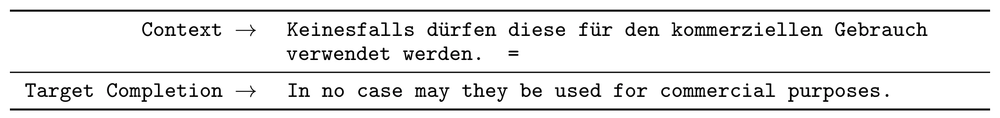
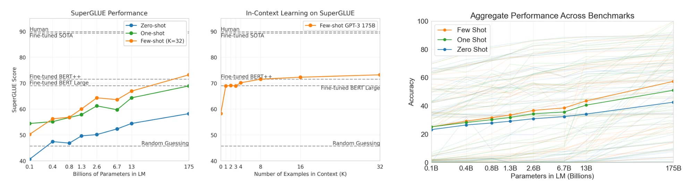
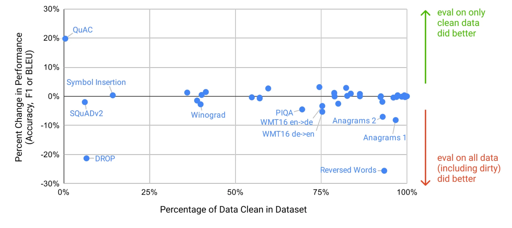

# GPT-3：预训练如何支撑上下文中的少样本学习

同一个模型，怎样仅凭几组例子，就从翻译器切换成问答系统，再完成阅读理解或分类？2020 年，Tom B. Brown、Benjamin Mann 等作者在《Language Models are Few-Shot Learners》中系统研究了这个问题。他们训练了一组不同大小的自回归语言模型，最大的有 1750 亿个参数，称为 GPT-3；使用时不再更新参数，而是把任务说明和示范写成文字，接在待回答的问题前面。[摘要与 §1，主文 PDF 第1–2页](https://proceedings.neurips.cc/paper/2020/file/1457c0d6bfcb4967418bfb8ac142f64a-Paper.pdf)

这篇论文的贡献，不只是把模型做大，而是把一种新的使用方式变成可以比较的实验：同样一个预训练模型，给它零组、一组或多组示范，会发生什么？作者发现，模型越大，通常越能利用这些上下文示范；有些任务的少样本成绩已经接近经过专门训练的系统，也有些任务几乎停留在随机猜测。这个不均衡的结果，正是理解论文的入口：它展示的是通用文本接口的潜力，以及这种接口还没有解决的问题。

今天读它，最值得弄懂的是“参数不变，表现为什么还能变化”。这需要把三个过程连起来：预训练把什么写进参数；提示怎样把一个任务变成待续写的文本；模型输出的下一词元概率怎样被转换成翻译、问答或选择题答案。读清这条链，后来的提示工程、指令训练和模型评测就有了共同的参照物。

导读先讲作者面对的逐任务微调问题，再拆解预训练、零／单／少样本设定、提示里的信息流和候选答案评分。核心部分配有原论文的实际任务格式、步骤表和一个可以手算的例子。之后再看架构与数据、规模曲线、几组代表性正反结果，以及污染审计和局限。全文固定采用 NeurIPS 2020 会议 PDF 与配套补充材料；这两个文件与常见的 arXiv 长版在编排上不同，文中页码分别从各自文件第一页计数。

## 作者面对的问题：每换一个任务都要微调吗

理解 GPT-3，先要回到当时自然语言处理的工作方式。早期做翻译、问答、情感分类，常常要分别设计模型和特征；预训练改变了这个局面：先让一个模型在大量文本上学习通用表示，再用具体任务的标注数据继续训练。后一步叫微调，也就是从已有参数出发，用任务损失计算梯度，真正修改模型的权重。[§1，主文 PDF 第1页](https://proceedings.neurips.cc/paper/2020/file/1457c0d6bfcb4967418bfb8ac142f64a-Paper.pdf#page=1)

这条路线很有效，但仍留下一个逐任务步骤。要做新的文本分类器，通常得准备一批“文本—标签”；要做新的问答器，又得准备“问题—答案”。作者希望保留预训练的通用能力，同时减少这一步对大量专门标注和专门训练的依赖。真实使用者往往只会说“请把这句话翻成法文”，或者给两组示范，并没有一个已经整理好的训练集。

论文还提到两个研究层面的顾虑。第一，训练集里的线索可能是偶然相关的：模型学会了某个词经常对应某个标签，换到另一种写法就失效。第二，换到不同来源的文本时，模型可能因数据分布变化而失去原有优势。于是，作者选择固定同一个预训练模型，在很多任务上观察它怎样利用输入中的任务信息。[§2 中微调的讨论，主文 PDF 第3页](https://proceedings.neurips.cc/paper/2020/file/1457c0d6bfcb4967418bfb8ac142f64a-Paper.pdf#page=3)

GPT-2 已经给出一条线索：语言模型只要看到合适的前缀，就能在一定程度上做不同的任务。例如，前缀写成问题和 `A:`，后面的续写就可以当作答案。GPT-2 的成绩还远未普遍赶上专门训练的系统，但它在一些任务上的表现会随着模型变大而持续改善。作者于是问：如果再把参数规模、数据多样性和训练投入往上推，这种趋势会不会延续？[§1，主文 PDF 第2页](https://proceedings.neurips.cc/paper/2020/file/1457c0d6bfcb4967418bfb8ac142f64a-Paper.pdf#page=2)

这里有一个容易忽略的贡献：作者重新整理了“零样本”的口径。过去有些所谓零样本任务，其实已经在输入中放了示范；这些例子虽没有被用于梯度更新，却仍然向模型透露了任务应该怎么做。GPT-3 把没有示范、一个示范和多个示范明确分开，分别报告成绩。这使后面的比较更清楚：模型原本会多少，第一次看到任务格式帮助了多少，再加几组例子又帮助了多少。

作者由此提出全文的核心假设：**大规模通用预训练，可以让模型在参数固定时，通过输入中的任务说明和示范快速适配任务。** 接下来要把预训练与这种适配连接起来，看看两者各自改变了模型的什么。

## 预训练：用下一词元目标得到一套通用参数

语言模型最基本的工作，是根据已经出现的文本，给下一个词元分配概率。词元（token）是分词器处理的单位，可能是一个词、子词或其他文本片段。自回归表示它从左往右预测：第一个词元之后预测第二个，前两个之后预测第三个，依次继续。

用导读的教学记号，可以把这个过程写成：

$$
p_\theta(x_1,\ldots,x_T)=\prod_{t=1}^{T}p_\theta(x_t\mid x_{<t}),\qquad
\mathcal L(\theta)=-\sum_{t=1}^{T}\log p_\theta(x_t\mid x_{<t}).
$$

$x_1,\ldots,x_T$ 是训练文本的词元，$x_{<t}$ 是第 $t$ 个词元之前的内容，$\theta$ 是所有可训练参数。第一个式子把整段文本的概率分解成一串条件概率；第二个式子是训练损失：真实出现的下一个词元，如果被模型分配了很低的概率，就会产生较大的惩罚。训练反复降低这个损失，使真实文本更容易被预测出来。[自回归预训练及其沿用关系，§2，主文 PDF 第3页](https://proceedings.neurips.cc/paper/2020/file/1457c0d6bfcb4967418bfb8ac142f64a-Paper.pdf#page=3)

例如，文本走到“河流冲刷了两侧的”，接下来“河岸”可能比“键盘”更合理。模型一开始猜不好，通过梯度更新，词元表示、注意力投影和前馈网络等参数都会调整。同一套参数要在海量不同文本上共同降低预测误差，因此模型需要捕捉词语、句法、事实关联和文体结构中有助于预测的规律。

训练中的输入和目标可以排成一张表。以下短句与排法是导读自编的教学例子，为便于说明暂把每个词当成一个词元：

| 当前位置已经给出的前缀 | 这个位置要预测的目标 | 训练时发生什么 |
| --- | --- | --- |
| 〈起始〉 | 河流 | 根据概率与真实目标计算损失 |
| 〈起始〉 河流 | 冲刷 | 再计算一个位置的损失 |
| 〈起始〉 河流 冲刷 | 河岸 | 继续计算损失 |
| 所有位置的损失汇总 | — | 反向传播，更新同一套参数 |

训练时整段文本已经知道，可以一次计算多个位置的损失，但因果遮罩让每个位置只读取自己及之前的输入。这样，预测“河岸”的位置读不到它后面的答案。生成时则没有完整目标可供并行使用，要先产生一个词元，再把它接回前缀，继续预测下一个。这是自回归 Transformer 的计算基础；注意力与遮罩的细节可参照 [Transformer 的固定修订](/read/transformer/5#u04)。

为什么预测文本会与做任务发生联系？因为文本中存在各种“输入后面跟着输出”的结构。问句后面可能跟答案，词条后面可能跟解释，一段德文后面可能跟英文译文。只要把任务写成这样的前缀，原本的“预测下一词元”就可以被用作“继续写出任务答案”。预训练提供了生成语言和利用这些结构的能力，提示则规定这一次把哪种结构接下去。

从这个角度看，预训练建立的是一套可被多种文本前缀调用的能力。一个前缀可以引出解释，另一个可以引出译文；两种输出都通过同一个下一词元目标产生。接下来的问题便是：使用时怎样把任务表达得足够明确，让模型接上我们想要的那一种文本。

## 零样本、单样本、少样本：究竟改变了哪里

预训练结束之后，作者冻结模型参数，再通过输入来指定任务。这里的“冻结”就是推理时不计算用于更新权重的梯度；模型仍然要进行完整的前向计算。论文把这种在输入上下文中利用示范的现象称为上下文学习（in-context learning，ICL）。[§2，主文 PDF 第3页](https://proceedings.neurips.cc/paper/2020/file/1457c0d6bfcb4967418bfb8ac142f64a-Paper.pdf#page=3)

可以用同一个翻译任务把四种方式并排放在一起：

| 方式 | 任务信息放在哪里 | 使用新任务数据后参数是否更新 |
| --- | --- | --- |
| 微调（fine-tuning） | 输入—译文构成训练样本，用来计算任务损失 | 更新 |
| 零样本（zero-shot） | 输入里有任务描述或任务调用，没有完整示范 | 不更新 |
| 单样本（one-shot） | 输入里有一组完整的输入与答案，再给新输入 | 不更新 |
| 少样本（few-shot） | 输入里有 $K$ 组完整示范，再给新输入 | 不更新 |

这里的“样本数”数的是**当前提示中的示范**，不是模型读过的全部训练材料。三种设定都使用已经完成大规模预训练的模型：零样本通过描述指定任务，单样本与少样本再提供完整例子。与微调相比，任务信息在这里走的是另一条路径——作为条件文本参与前向计算，权重始终保持固定。

沿用导读的记号，设一组示范为 $(u_i,v_i)$，其中 $u_i$ 是输入，$v_i$ 是答案。把任务描述、$K$ 组示范和待回答输入 $u_*$ 拼起来，模型要给出的是：

$$
p_\theta(v_*\mid \text{任务描述},u_1,v_1,\ldots,u_K,v_K,u_*),\qquad \theta\text{固定}.
$$

这个式子把已知与待预测的部分分开了：示范中的输入和答案都已给出，待测部分则给出 $u_*$，把 $v_*$ 留作预测目标。这样，模型可以从完整示范中识别任务，再把同样的处理方式用到新输入上。

示范可以同时传递几类信息。它告诉模型“这里要做翻译”，也用实际输出展示“译文应该写成什么样”；还可能提供任务特有的标签含义。比如一个分类任务用 A、B 代表两类，单靠字母很难知道哪类对应什么，完整例子便能建立标签与文本的对应关系。一组完整例子因此能同时说明任务、格式和标签约定，这也为理解后面的单样本增益提供了直觉。

少样本也有实际成本。所有示范都占用上下文窗口，每多一组，就少一点空间留给新问题和答案。GPT-3 的窗口为 2048 个词元，作者通常能放下约 10 到 100 组示范，具体取决于任务长度；长篇阅读理解的一个例子，可能比短问答的很多个例子还长。所以，各任务实际采用的 $K$ 要随例子长度和窗口预算调整。[§2，主文 PDF 第3页](https://proceedings.neurips.cc/paper/2020/file/1457c0d6bfcb4967418bfb8ac142f64a-Paper.pdf#page=3)

这种适配发生在本次输入引起的内部激活和输出分布中。每次请求都可以通过自己的前缀指定任务：放入翻译例子，就调用翻译；换成问答例子，就转向问答。参数保持固定，当前上下文承担了临时任务说明的作用。下一节沿实际提示，把这次前向计算走一遍。

## 核心过程：把示范和新问题接成同一条文本

上一节定义了上下文学习，这一节把它还原成一次实际计算。对 GPT-3 来说，任务描述、示范和新问题都被编码成同一条词元序列，一起进入前向计算。它沿序列计算各位置的表示，最后继续预测文本。



图 G.36 来自会议版补充材料。先看上面的 Context：德文句子后面只有一个等号；再看下面的 Target Completion：英文译文从这里开始。图中的箭头标注两部分的身份，横线把已知输入与参考答案分开。附录用这样的数据集记录，展示模型应在什么位置开始续写、续写的目标是什么。[补充材料 §G、图 G.36，PDF 第11、24页](https://proceedings.neurips.cc/paper_files/paper/2020/file/1457c0d6bfcb4967418bfb8ac142f64a-Supplemental.pdf#page=24)

这张原图只画了一组任务记录。构造少样本提示时，前面的记录要把原文和译文都写完整；最后一条只留下原文与等号，等待模型补完。为了把这种拼接方式看得更清楚，下面使用导读自编的教学例子，后面的概率数值也为教学指定，不是 GPT-3 的实测输出：

```text
German: Guten Morgen.
English: Good morning.

German: Danke.
English: Thank you.

German: Gute Nacht.
English:
```

这段前缀里有两个完整示范，分别告诉模型德文与英文怎样对应。第三组的 `English:` 后面没有参考答案。模型接收到的是一段带重复结构的连续文本；末尾的表示可以利用前两组的语言、字段名称和输出格式，给接下来出现的英文词元分配概率。

整个过程可以按输入、处理和输出列成五步：

| 步骤 | 进入这一环的内容 | 这一环做什么 | 产生什么 |
| --- | --- | --- | --- |
| 拼接前缀 | 任务描述、完整示范、新输入 | 用任务规定的分隔方式排成文本 | 一条尚未写完的序列 |
| 分词与嵌入 | 整条前缀 | 转成词元编号，再转成带位置信息的向量 | 每个位置的初始表示 |
| Transformer 前向计算 | 这些位置的表示 | 用因果注意力读取前文，多层加工 | 包含上下文信息的隐藏表示 |
| 输出词表概率 | 末尾位置的最终表示 | 线性映射并归一化 | 下一个词元的条件概率 |
| 继续或评分 | 一个已生成词元，或一个候选答案 | 接回前缀继续预测，或累计候选的概率 | 完整答案，或候选的分数 |

用形状来看，若前缀有 $L$ 个词元、模型表示宽度为 $d$，它的表示可以写成 $L\times d$ 的矩阵。输出层会为所计算的位置产生词表大小 $V$ 上的分数；生成下一个词元时，关注末尾对应的一行 $V$ 维分布。这里的 $L,d,V$ 是导读用来说明数据流的形状记号。

现在看示范怎样影响最后一个位置。因果注意力允许后面的新问题读取前面的示范，因此字段 `German:`、`English:` 和已经出现的译文都可能改变新问题的表示。不同的层和头可以对前文做不同的组合，前馈网络再加工这些信息。最终，“Gute Nacht”的表示已经带上了前面德译英示范的信息。输出层据此分配概率，使符合当前翻译格式的英文续写更容易被选中。

沿着这条信息通路，示范就能参与新问题的预测：它们作为前文被读取，经由已有参数加工，影响末尾的表示。论文随后从任务表现检验这一使用方式：同一个模型加入示范之后，很多任务的分数会变化，而且大模型通常更能从中获益。

这个设计还有一个朴素却重要的优点：不同任务不必先改造成不同的神经网络输出头。翻译可以停在等号后，问答可以停在 `A:` 后，分类可以停在 `answer:` 后。模型始终做续写，外部评测再把续写解释为任务答案。下一节将继续讲这最后一步，因为“生成一句话”和“给几个候选答案排分”使用的是同一套概率，却有不同的评测含义。

## 从词元概率到任务答案：一次可以手算的评分

模型输出的是下一词元概率，论文报告的却是准确率、F1 或 BLEU。中间必须有一套任务规则，把概率变成可评分的答案。这一环直接影响成绩：提示怎么写、答案写多长、候选如何比较，都会影响最终分数。

先沿上一节的教学翻译继续。假设模型在 `English:` 后已经决定以 `Good` 开头，现在要比较后续。为了能手算，暂时把候选简化为 `night`、`morning` 和另一个词元；设给定整个前缀后，它们的未归一化分数分别为 $\ln 6,\ln 3,\ln 1$。softmax 取指数后得到 $6,3,1$，再除以总和 10，因此概率是 $0.6,0.3,0.1$。

如果采用每步选择最高概率词元的贪心方式，这一步就选 `night`。但这里还有一个结束问题：评测程序需要确定译文在哪里结束，取出相应片段作为答案。实际任务的解码与评分必须规定怎样处理输出；“生成了包含正确词的一大段文本”和“准确输出要求的答案”可能得到不同的分数。主文说明，自由生成任务使用束宽 4、长度惩罚 0.6 的束搜索，具体任务表达在补充材料列出。[§2.4，主文 PDF 第4页](https://proceedings.neurips.cc/paper/2020/file/1457c0d6bfcb4967418bfb8ac142f64a-Paper.pdf#page=4)

若比较完整的候选译文，就需要把多个位置的概率连乘。用导读记号，前缀为 $P$，候选答案 $a=(a_1,\ldots,a_m)$ 的条件概率为：

$$
p_\theta(a\mid P)=\prod_{j=1}^{m}p_\theta(a_j\mid P,a_{<j}).
$$

注意后一个词元的概率，要在已经给出候选前半部分的条件下计算。假设首词 `Good` 的概率为 $0.6$，接着生成 `night` 的条件概率沿用上面的 $0.6$，候选甲 `Good night` 的联合概率就是 $0.36$；候选乙 `Thank you` 的两个概率是 $0.3$ 和 $0.9$，联合概率为 $0.27$。若都限定为这两个词元组成的候选，甲排在乙之前。乘积把每一步的条件概率合成完整候选的分数，让两个答案可以直接比较。

选择题也可以这样做：分别计算每个备选答案的延续概率，再按该任务的规则选择。论文附录用 Correct Answer 和 Incorrect Answer 向读者标示选项身份。评测时，模型接收前缀并对候选评分，程序再将所选答案与标准答案比对。

直接比较概率还有一个问题：某些答案本身就常见，可能在很多不相关的上下文里也有高概率。因此，论文在 RACE、ARC 等部分选择题的图注里说明，会按候选答案的无条件概率作归一化。可以用导读的简化记号写成 $p(a\mid P)/p(a)$，表达“相对于本来就常见的程度，这个问题额外支持了它多少”；具体实现应以任务说明为准。[补充材料图 G.1 与 G.11，PDF 第12、16页](https://proceedings.neurips.cc/paper_files/paper/2020/file/1457c0d6bfcb4967418bfb8ac142f64a-Supplemental.pdf#page=12)

下面是这种校正为什么会改变排序的教学手算。设某道题有两个候选：甲在问题条件下的概率是 $0.12$，乙为 $0.09$，直接比是甲胜。若甲本来的概率为 $0.06$，乙只有 $0.015$，归一化后甲得 $2$，乙得 $6$，反而是乙胜。直觉上，甲原本就常被说出，而乙虽然绝对概率稍低，却更强地被当前问题所支持。归一化分数是相对于原有概率的比值，不是答案概率，所以可以大于 1；两个比值可直接用于排名。

不同任务还要使用不同的最终指标。准确率数答对了多少题；F1 用来衡量预测答案与参考答案的重合，具体聚合方式随任务规定；BLEU 比较译文与参考译文的词组重合。这些指标把模型表现转成了任务所关心的结果：答案是否正确、译文是否贴近参考。文本预测能力通过表达、解码和评分这条链路，最终体现在这些分数上。

这样，论文的实验对象就完整了：**固定参数的模型 + 任务前缀 + 答案规则**。示范把任务和格式表达给模型，模型算出续写概率，评测程序再把它变成任务成绩。后面的规模实验，比较的正是这套完整接口怎样随模型容量和示范数量变化。

## 模型与数据：放大的不只是参数量

核心使用方式已经清楚，接下来再看它建立在什么样的模型与训练材料上。作者训练了八个规模，从 1.25 亿参数到 1750 亿参数；图中常以 B 表示十亿参数，因此 175B 对应 1750 亿。最大模型被称为 GPT-3，较小模型则让作者能够沿着多个尺度追踪表现变化。[§2.1，主文 PDF 第3页](https://proceedings.neurips.cc/paper/2020/file/1457c0d6bfcb4967418bfb8ac142f64a-Paper.pdf#page=3)

架构沿用 GPT-2 式的自回归 Transformer，包括预归一化、相应的初始化和可逆分词方式。预归一化是把归一化放在子层之前，与原始翻译 Transformer 的子层后归一化位置不同。GPT-3 还在层间交替采用稠密注意力与局部带状稀疏注意力：前者可以读取全部允许的前文位置，后者只读取局部带状范围。这样，部分层读取全局前文，部分层集中处理局部信息，共同组成自回归解码器。

对理解上下文学习而言，最关键的共同点是它处理的是一条自回归文本序列。示范和待测问题都在这条序列里，由同一套参数处理。不同规模的模型具有不同容量，但任务接口保持为文本，这样才能比较同一种使用方式随规模怎样变化。

数据方面，主要来源是 Common Crawl，即大规模网页抓取语料；另外加入 WebText2、两组书籍语料 Books1、Books2，以及英语 Wikipedia。面对庞杂的原始网页，作者先按与参考语料的相似性筛选，再做文档级模糊去重，以减少低质量与近重复内容。[§2.2，主文 PDF 第3–4页](https://proceedings.neurips.cc/paper/2020/file/1457c0d6bfcb4967418bfb8ac142f64a-Paper.pdf#page=3)

补充材料说明了筛选的具体含义：用 WebText 等参考材料作为正例、原始 Common Crawl 作为负例，训练一个文档分类器，再优先保留评分较高的网页。因此，“质量高”在这一步具体指更像所选参考语料，分类器衡量的是文档特征与参考集的接近程度。作者还保留了一部分分布之外的文档，避免把语料完全收缩成参考集的样子。[补充材料 §A，PDF 第1页](https://proceedings.neurips.cc/paper_files/paper/2020/file/1457c0d6bfcb4967418bfb8ac142f64a-Supplemental.pdf#page=1)

数据混合又引入了另一层选择。表 C.1 一边列出可供抽样的词元总量，另一边列出训练时的抽样比例，即“训练混合权重”。下表按原表摘录，B 仍表示十亿，轮数按训练 300B 词元时报告：

| 语料 | 可用词元量 | 训练混合权重 | 300B 训练时的报告轮数 |
| --- | ---: | ---: | ---: |
| 筛选后的 Common Crawl | 410B | 60% | 0.44 |
| WebText2 | 19B | 22% | 2.9 |
| Books1 | 12B | 8% | 1.9 |
| Books2 | 55B | 8% | 0.43 |
| Wikipedia | 3B | 3% | 3.4 |

[补充材料表 C.1，PDF 第5页](https://proceedings.neurips.cc/paper_files/paper/2020/file/1457c0d6bfcb4967418bfb8ac142f64a-Supplemental.pdf#page=5)

原表权重是近似值，显示值相加为 101%；表中的权重与轮数均按原文照录。表的意思很明确：作者更频繁地抽取被视为高质量的来源，因此某些小语料被看了多轮，而 Common Crawl 和 Books2 连一整轮都没有遍历完。数据总量、实际训练量、各来源被重复使用的次数，必须分开理解。

这对规模实验有什么影响？参数量说明模型有多大，训练词元量说明优化过程看了多少文本，混合比例则决定它主要在什么文本上学习。GPT-3 的规模实验建立在这套筛选与采样路线之上：模型容量扩大，同时有经过组织的多来源文本供它学习。架构、数据和实际训练量，合在一起构成了后面成绩的训练背景。

## 训练与评测配方：怎样让比较真正成立

一组规模实验需要共同的训练框架，也需要明确的任务评测协议。这一节把训练与评测的关键环节连接起来：模型怎样被训练，测试时示范从哪里来，最后用哪个数据划分报告结果。

训练使用 Adam 优化器。补充材料给出的两项动量系数为 $\beta_1=0.9$、$\beta_2=0.95$，数值稳定项为 $\epsilon=10^{-8}$，全局梯度范数裁剪阈值为 1.0，权重衰减为 0.1。学习率先热身，再按余弦曲线下降，到 260B 词元时降至初始值的 10%，之后维持该水平；热身长度是 3.75 亿词元。这里用已处理词元数来衡量训练进度。[补充材料 §B，PDF 第1页](https://proceedings.neurips.cc/paper_files/paper/2020/file/1457c0d6bfcb4967418bfb8ac142f64a-Supplemental.pdf#page=1)

作者还逐渐增大批量，让大模型的训练过程更稳定。所有模型的上下文窗口都是 2048 个词元；较短文档会被拼接到同一条训练序列中，用专门的文本结束词元隔开。文档边界没有额外的隔离遮罩，模型需要从标记中学到“下面开始了另一篇材料”。普通因果遮罩继续控制时间方向，让每个位置读取已有前文；文本结束标记则提示模型，前文中哪些内容属于另一篇文档。

大模型训练还有显存与通信问题。作者同时在矩阵乘法内部和网络层之间切分模型，把计算分摊到多块 GPU；主文说明使用 V100 GPU 和高带宽集群。这样的并行配方让大规模训练得以执行：单块设备负责一部分参数与运算，设备之间通过通信接续计算。1750 亿参数所需的显存、计算和数据传输，由此成为可以协调处理的工程任务。[§2.3，主文 PDF 第4页](https://proceedings.neurips.cc/paper/2020/file/1457c0d6bfcb4967418bfb8ac142f64a-Paper.pdf#page=4)

评测时，每个待测例子通常从对应任务的训练集随机抽取 $K$ 组示范，用一到两个换行分隔，再接上待测输入。这些带标签的任务信息作为条件文本进入推理过程。LAMBADA 和 StoryCloze 没有可用的监督训练集，所以作者从开发集抽示范，在测试集评价。[§2.4，主文 PDF 第4页](https://proceedings.neurips.cc/paper/2020/file/1457c0d6bfcb4967418bfb8ac142f64a-Paper.pdf#page=4)

这套抽样方式也告诉我们，少样本成绩不只取决于 $K$，还取决于抽到了什么。短答案是否覆盖了输出格式，某种类别是否恰好没出现，示范的难度是否适当，都可能影响一次测试。论文对部分任务的细节另有规定，例如 SuperGLUE 中大多数任务会为不同问题重新抽示范，但 WSC、MultiRC 使用同一组抽出的示范。各任务因此具有自己的示范抽样与提示安排。

最后是开发集与测试集。主文说明，有公开测试集时尽量在测试集报告；有些测试集需要把模型送上私有服务器，但模型太大无法容纳，于是改报开发集。开发集允许研究者在方法设计过程中反复观察，测试集通常承担最终检验，两种分数的使用角色不同。尤其是图 1.1 的 SuperGLUE 曲线与表 3.5 的测试结果，下一节会把它们分开解释。

整套配方把成本分配到了不同阶段：预训练一次投入大量计算，使用时用少量带标签示范指定任务。作者据此比较一个核心问题——在已有的通用参数之上，上下文中的这些任务信息究竟能带来多大的改善。

## 规模证据：图 1.1 的三幅图分别回答什么

前面说明了上下文学习可以怎样发生，现在要看它是否真的在实验中变强。论文把主张浓缩在图 1.1 中：增加模型规模，增加示范数量，以及在很多任务上汇总观察。三个面板分别改变比较的轴，合起来呈现上下文学习的规模特征。



先看左图。横轴是参数规模，单位为十亿；蓝线是零样本，绿线是单样本，橙线是少样本，这里的少样本固定为每个任务 32 组示范。随着模型变大，三条线总体向上，而橙线与蓝线之间的距离也整体拉大。换句话说，大模型不仅在没有示范时表现更好，也通常更能利用额外给出的任务例子。[§1 与图 1.1，主文 PDF 第2页](https://proceedings.neurips.cc/paper/2020/file/1457c0d6bfcb4967418bfb8ac142f64a-Paper.pdf#page=2)

图上把所训练的模型按规模排开，其中最后一段从 13B 跨到 175B，参数增量尤其大。曲线中间仍有局部波动，小模型的单样本或少样本成绩会在某些相邻尺度间下降。跨过这些波动来看，大尺度上的总体上升和示范收益扩大，才是这幅图最突出的模式。

中图固定最大模型，只改变上下文示范数 $K$。从没有示范到给一组例子，有明显提升；再增加到多组，分数继续改善，但图上的后续增长比第一次跳升平缓。结合前面的提示过程，可以直观地理解这条曲线：第一组例子就能传递任务含义和输出格式，后续示范则可能提供更充分的任务覆盖。曲线测到的是这些作用共同带来的成绩变化。

把左、中两图放在一起，就能理解作者为什么使用“元学习”这个说法。元学习可以粗略理解为学会怎样快速适应新任务：外层通过长期训练建立能力，内层在遇到少量任务信息时快速调整行为。GPT-3 的外层是预训练中的梯度更新，内层则是一次前向计算里对上下文的使用。作者认为，大模型能更有效地利用示范，说明这种视角值得探索。[§1，主文 PDF 第2页](https://proceedings.neurips.cc/paper/2020/file/1457c0d6bfcb4967418bfb8ac142f64a-Paper.pdf#page=2)

在这里，“元学习”是作者对外部行为的解释框架，曲线本身不能确定内部采用了哪一种适配算法。图中直接观察到的，是加入示范后的成绩变化。

右图把观察扩展到 42 个以准确率计分的基准。淡线保留各任务的不同轨迹，粗线显示三种设定的汇总趋势。少样本粗线随规模上升得更快，支持“规模扩大与更有效的上下文使用相关”这一经验结论；淡线的分散则提醒我们，同一个平均值下面存在很多不同的任务行为。这张图统一采用准确率口径；F1 与 BLEU 的结果在后面的各任务表格中分别报告。

图中还有一组灰色横线，标出微调 BERT 等参考系统的分数。图注明确说明：GPT-3 的 SuperGLUE 数值来自开发集，不能与参考线作严格同条件比较。正式测试成绩列在表 3.5。这样，两种材料各有作用：曲线展示能力怎样随规模和示范数变化，测试表呈现最终协议下各系统的具体表现。

## 问答与补全：少样本在哪些地方真的有帮助

图 1.1 给出总体趋势，具体任务则告诉我们提升的性质。这一节先看两类与语言模型接口最贴近的任务：闭卷事实问答，以及根据一段文字补出结尾。它们都使用文本续写，分别侧重参数中的事实知识与当前篇章的语境。

闭卷问答的“闭卷”是指，回答时不给额外的检索文章。模型可以看到任务描述和设定允许的示范，但答案主要依赖预训练获得的知识以及当前问题。下表摘录最大 GPT-3 在三个数据集上的报告分数，均是问答正确性百分比，越高越好；TriviaQA 少样本结果注明来自 wiki split 测试服务器。对照 T5-11B+SSM 是经过微调的闭卷系统，其中 SSM 指在预训练中遮住实体等显著片段再恢复，以强化知识相关预测。[§3.2、表 3.2，主文 PDF 第5页](https://proceedings.neurips.cc/paper/2020/file/1457c0d6bfcb4967418bfb8ac142f64a-Paper.pdf#page=5)

| 设定 | Natural Questions | WebQuestions | TriviaQA |
| --- | ---: | ---: | ---: |
| GPT-3 零样本 | 14.6 | 14.4 | 64.3 |
| GPT-3 单样本 | 23.0 | 25.3 | 68.0 |
| GPT-3 少样本 | 29.9 | 41.5 | 71.2 |
| 微调 T5-11B+SSM，闭卷 | 36.6 | 44.7 | 60.5 |

三列都显示示范有帮助，但帮助的幅度不同。Natural Questions 从 14.6 到 29.9，增加 15.3 个百分点；TriviaQA 从 64.3 到 71.2，增加 6.9 个百分点。后一列的绝对成绩更高，增幅却更小，因此“改善了多少”和“最后有多强”是两个不同的问题。这里的增幅按表中分数直接相减，便于把变化幅度与最终水平放在一起观察。

与专门微调的 T5 比较，关系也随数据集改变。GPT-3 的 TriviaQA 少样本成绩高于该行 T5，但 Natural Questions 和 WebQuestions 仍落后。作者认为 Natural Questions 涉及更细的 Wikipedia 知识，可能触及模型容量和广泛预训练分布的限制。三列结果呈现了清楚的任务差异：同一种少样本接口，在不同知识分布上的起点和收益各有特点。

再看 LAMBADA。这个任务给出一段文字，要求预测最后一个词，常常需要利用较长的语境，而不只是最后几个词的局部搭配。论文把少样本任务改写成填空格式，用完整例子告诉模型只输出一个词。表 3.1 报告最大模型的准确率为：零样本 76.2，单样本 72.5，少样本 86.4；对应困惑度为 3.00、3.35、1.92，困惑度越低越好。[§3.1、表 3.1，主文 PDF 第4–5页](https://proceedings.neurips.cc/paper/2020/file/1457c0d6bfcb4967418bfb8ac142f64a-Paper.pdf#page=4)

这里最有解释力的是中间那个下降：给一组例子反而比不给差。作者猜测，填空格式需要多个示范才容易被识别，一组还不足以稳定建立模式。提示格式与示范数量因此共同影响表现，形成了这个任务自己的上下文学习曲线。

困惑度与准确率的并列还有另一层意义。困惑度看的是模型给真实目标分配了多大概率，准确率看的是最终选中的答案对不对。一个模型可以提高正确词的概率，却还没有把它推到所有候选的第一名；也可以只在少数边界题上改变排名，带来准确率变化。两个指标合起来，既呈现模型对真实答案的支持程度，也呈现最终选择是否正确。

问答与补全由此展示了上下文学习的两种效果：示范可以帮助模型调动已有知识，也可以帮助它适应目标答案的格式。任务收益随知识分布和表达方式而变化；论文随后把这种文本接口扩展到翻译和阅读理解，进一步考察它能够覆盖哪些操作。

## 翻译与阅读理解：文本接口怎样跨任务工作

翻译和阅读理解把任务要求推进了一步：前者要求跨语言输出，后者要求利用本题给出的文章。同一套参数、同样的续写接口，要在这些更具体的约束下完成任务。这一节选择几组结果，看看能力怎样受训练分布和任务操作要求影响。

翻译提示使用前面的“原文 = 译文”结构，单样本给一对句子，少样本给 64 对。作者没有用专门的平行语料对 GPT-3 做逐任务翻译训练，但预训练文本本身并非只有一种语言；主文按词数统计，约 93% 为英语，其余为非英语内容。英语在预训练中的优势，也为后面翻译方向上的差异提供了一条解释线索。[§3.3，主文 PDF 第6页](https://proceedings.neurips.cc/paper/2020/file/1457c0d6bfcb4967418bfb8ac142f64a-Paper.pdf#page=6)

下表摘录英法、英德的双向结果。法英使用 WMT 2014，德英使用 WMT 2016；指标为采用 XLM 分词的 `multi-bleu.perl` 所得 BLEU，越高越好，以下比较统一采用这一分词口径。[表 3.4，主文 PDF 第6页](https://proceedings.neurips.cc/paper/2020/file/1457c0d6bfcb4967418bfb8ac142f64a-Paper.pdf#page=6)

| GPT-3 设定 | 英→法 | 法→英 | 英→德 | 德→英 |
| --- | ---: | ---: | ---: | ---: |
| 零样本 | 25.2 | 21.2 | 24.6 | 27.2 |
| 单样本 | 28.3 | 33.7 | 26.2 | 30.4 |
| 少样本 | 32.6 | 39.2 | 29.7 | 40.6 |

从零样本到少样本，四个方向都提升；但翻成英文的成绩明显更突出。法→英从 21.2 到 39.2，而英→法最终为 32.6。这个方向差异与训练材料以英语为主相吻合：从其他语言理解输入之后，模型在英文输出端更有优势。作者还讨论了英语导向的分词器对其他语言的潜在影响，尤其英译罗马尼亚语表现较弱。

这些成绩来自带少量成对翻译示范的设定。作者将它们放在既有翻译工作旁边考察，同时说明平行示范的信息优势，以及法→英、德→英监督对照的文献覆盖限制；所找到的监督对照未必代表当时真正最强的系统。就本节四个方向来看，结论十分具体：同一个模型通过文本示范获得了有竞争力的翻译表现，其中译成英文的方向尤其突出。[§3.3，主文 PDF 第6–7页](https://proceedings.neurips.cc/paper/2020/file/1457c0d6bfcb4967418bfb8ac142f64a-Paper.pdf#page=6)

阅读理解则把所需材料直接放进前缀。CoQA 给出文章及连续问答，要求模型根据文章接着回答；DROP 也提供文章，但问题经常涉及计数、比较或数值推理。两类任务都要求模型从当前文章中取得回答所需的信息。[§3.2、表 3.3，主文 PDF 第5–6页](https://proceedings.neurips.cc/paper/2020/file/1457c0d6bfcb4967418bfb8ac142f64a-Paper.pdf#page=5)

| 模型／设定 | CoQA F1 | DROP F1 |
| --- | ---: | ---: |
| GPT-3 零样本 | 81.5 | 23.6 |
| GPT-3 单样本 | 84.0 | 34.3 |
| GPT-3 少样本 | 85.0 | 36.5 |
| 各列原表所列微调最优系统 | 90.7 | 89.1 |

两项指标都是 F1，越高越好，但每列的具体题目和难度不同。CoQA 上，少样本已经很接近原表最强系统；DROP 上，示范虽把 23.6 提升到 36.5，与 89.1 仍有很大距离。从文章里找到合适短语，与读出几个数量再作离散运算，对模型提出了不同的操作要求。

作者把这种差异视为重要边界。把“阅读理解”继续拆成篇章问答、计数和数量比较，就能更准确地描述模型强在哪里、弱在哪里。CoQA 与 DROP 的差距因此提供了一条研究线索：通用文本预测较好地支持了前一类操作，离散推理仍是明显弱项。

这些结果还让前面的机制解释落到实处：翻译需要把来源语言转换成目标语言，CoQA 要从文章与历史问答中续写，DROP 还要求处理数量关系。共同的自回归计算和文本前缀，把这些不同操作接到了同一个评测接口上。作者由此得以比较：哪些任务已经能很好地利用这种接口，哪些操作仍然困难。

## SuperGLUE：平均分背后有哪些明显弱项

论文标题容易让人把注意力集中在成功案例上，SuperGLUE 则提供一组更系统的正反结果。这是由八个任务组成的综合基准，既有判断句子之间关系的任务，也有词义、指代和阅读理解任务。作者对每个任务给 32 组上下文示范，不做梯度更新。[§3.4，主文 PDF 第6–7页](https://proceedings.neurips.cc/paper/2020/file/1457c0d6bfcb4967418bfb8ac142f64a-Paper.pdf#page=7)

这里转到表 3.5，使用正式测试集成绩。下表只摘录综合分及三个能说明差异的子任务；综合分依基准规定聚合，三个子任务列出的均为准确率，越高越好。[表 3.5，主文 PDF 第7页](https://proceedings.neurips.cc/paper/2020/file/1457c0d6bfcb4967418bfb8ac142f64a-Paper.pdf#page=7)

| 系统 | 综合分 | COPA | WiC | WSC |
| --- | ---: | ---: | ---: | ---: |
| 微调 BERT-Large | 69.0 | 70.6 | 69.6 | 64.6 |
| GPT-3，32 示范 | 71.8 | 92.0 | 49.4 | 80.1 |
| 各列原表微调最优系统 | 89.0 | 94.8 | 76.1 | 93.8 |

先读综合分：GPT-3 的 71.8 超过 BERT-Large 的 69.0，说明仅靠上下文示范已经能达到一个重要监督基线的总体水平；距离原表最优系统的 89.0 仍明显。减少任务微调并不意味着总训练或部署成本更低：GPT-3 使用远大于 BERT 的预训练模型，通过上下文示范适配；BERT-Large 则继续接受任务微调。

再看 COPA。它要求在候选中选择更合理的原因或结果，GPT-3 达到 92.0，接近最优系统的 94.8。模型可以把候选当成不同的续写，根据文本条件比较概率，因此这类任务与语言模型接口有直接联系。这表明，少样本接口能够调动模型已有的知识，完成这类常识候选判断。

WiC 则几乎是反面。它给出两句话，问同一个词在两处是否用了相同含义。论文附录的实际示例使用 `outfitter`：一处是提供旅行用品，一处是专门购买靴子的商店，问题要求比较两处词义。主文报告，作者尝试过多种问法和格式，少样本准确率仍只有 49.4%，接近二分类随机水平。[§3.4，主文 PDF 第7页](https://proceedings.neurips.cc/paper/2020/file/1457c0d6bfcb4967418bfb8ac142f64a-Paper.pdf#page=7) · [补充材料图 G.32，PDF 第23页](https://proceedings.neurips.cc/paper_files/paper/2020/file/1457c0d6bfcb4967418bfb8ac142f64a-Supplemental.pdf#page=23)

为什么一个会翻译、会问答的模型，会在看似简单的词义比较上失败？作者从实验中注意到一种现象：需要回看并仔细比较两段文本的任务，往往是单／少样本的弱项。任务表述与自回归目标的契合程度，可能比“题目对人来说简单不简单”更重要。这也解释了为什么平均分需要与任务操作一并阅读。

WSC 考察代词指向谁，GPT-3 的 80.1 又明显高于 BERT-Large 的 64.6，却低于最优系统的 93.8。同样涉及句间或实体关系，表现仍有差别。将词义一致性、代词消解和因果选择分别测量，就能看出具体操作之间的强弱分布。

SuperGLUE 的主要价值在于使论文的强项和弱项同时可见。它把少样本接口在多种任务上的表现展开，呈现出鲜明的强弱分布。对后来读到的综合评测，同样可以追问：平均提升由哪些子任务贡献，关键弱项是否被高分任务掩盖，失败是否对应某种共同的输入或操作结构。这是从 GPT-3 实验里可以带走的一种读论文方法。

## 污染审计：看过材料与背过答案怎样区分

模型在大量网页和书籍上预训练，评测材料也来自网页和书籍，两者很容易重合。数据污染（data contamination）指评测信息进入训练材料，使测试不再完全反映对未见内容的泛化。GPT-3 不仅讨论这个风险，还公开了过滤失败和事后审计，因此这一节是解释结果所必需的部分。



先看坐标。横轴越靠右，未发现训练重合的样本比例越高；纵轴为只测干净子集后，相对于完整集合的性能变化。上方表示干净子集成绩更好，下方表示完整集合更好。多数任务在零线附近，作者据此认为，大多数报告结果没有呈现明显的污染影响，但对偏离较大或剩余样本太少的任务继续逐项检查。[§4，主文 PDF 第7页](https://proceedings.neurips.cc/paper/2020/file/1457c0d6bfcb4967418bfb8ac142f64a-Paper.pdf#page=7) · [补充材料 §C、图 C.2，PDF 第2–5页](https://proceedings.neurips.cc/paper_files/paper/2020/file/1457c0d6bfcb4967418bfb8ac142f64a-Supplemental.pdf#page=3)

审计前有一次训练数据过滤。作者原本尝试删除与基准重合的文本，但程序错误导致部分重合未被移除，补充材料明确说长文档如书籍受到影响。由于重新训练成本太高，他们没有在修正后的全新语料上重训，而是对已经得到的模型进行分析。这样得到的是一项事后审计，不是“有污染模型与完全清洁模型”的随机对照实验。[补充材料 §C，PDF 第2、5页](https://proceedings.neurips.cc/paper_files/paper/2020/file/1457c0d6bfcb4967418bfb8ac142f64a-Supplemental.pdf#page=2)

基本检测单位是 N-gram，也就是连续 $N$ 个词的片段。主文用 13-gram 概括；补充材料进一步说明，事后检查依据各数据集样本长度选择 $N$，非合成任务限制在 8 到 13 之间，部分短合成任务采用更短片段。发现评测样本与候选训练语料有任意匹配，就先保守标为“脏”；没有匹配的才进入“干净”子集。检查覆盖完整候选语料，范围还大于训练时实际抽到的内容。[补充材料 §C，PDF 第4–6页](https://proceedings.neurips.cc/paper_files/paper/2020/file/1457c0d6bfcb4967418bfb8ac142f64a-Supplemental.pdf#page=4)

重合发生在哪一部分，直接影响它能给模型什么帮助。阅读理解题通常由背景文章、问题和答案组成：见过文章能提供背景知识，见过完整问答对则可能让模型记住那一道题。作者检查 QuAC、SQuAD2 和 DROP 时，发现所检查的重合主要来自背景文章，问答对仍是新加入的部分。

另一种混淆是题目难度。词反转或字母重排任务中，像回文词这样的简单样本更容易在网页里出现，也更容易被重合检测剔除。剩下的干净子集自然更难，难度变化本身就会使分数下降。因此，作者把偏离零线的任务逐个展开，检查被剔除的究竟是哪类样本。

补充材料对 PIQA 和 Winograd 保留了污染警告。PIQA 中，作者怀疑部分差值也可能来自样本选择偏差，但明确说无法严格证明；Winograd 则确实找到了训练材料中的题目实例。LAMBADA 也存在实质重合，尽管干净子集成绩变化很小。若某些语言建模基准几乎完全出现在训练语料里，作者干脆不报告其结果，因为没有可靠的干净部分可供比较。[补充材料 §C，PDF 第3–5页](https://proceedings.neurips.cc/paper_files/paper/2020/file/1457c0d6bfcb4967418bfb8ac142f64a-Supplemental.pdf#page=3)

图 C.2 的纵轴还值得用一个小算例澄清。假设完整集合得 80 分，干净子集得 76 分，绝对下降是 4 个百分点；相对变化则是 $(76-80)/80=-5\%$。这个导读自编的审计算例，把纵轴的口径具体化了：图中 −5% 表示相对于原成绩减少了二十分之一，而这次实际减少的是 4 个百分点。

这项审计把一个笼统的污染问题变成了可追查的证据链：先定位重合，再比较子集，最后回到具体题目分析。多数任务的差值很小，支持所测污染对很多报告成绩影响有限；对可疑任务，作者保留警告或撤下结果。干净子集的难度变化仍是审计的限制，而逐项检查让各个结果的可信范围变得更清楚。

## 从会续写到可靠使用：作者承认了哪些局限

上下文学习让同一个模型可以切换任务，但任务适配并没有自动解决可靠性。本节把作者的限制讨论与社会影响联系起来：模型在哪些地方仍会失败，为什么这些失败与训练目标有关，以及更流畅的文字为什么会同时增加有益用途和风险。

首先是生成质量。作者报告，GPT-3 仍会在长文本中重复语义、逐渐失去连贯性、前后矛盾，或突然插入不相干的句段。短片段自然，并不保证整篇文章的事实和逻辑一致。这个问题与自回归生成的结构有关：每一步都要根据已经写出的前文继续，而早先的一处错误也会成为后续条件的一部分。[§5，主文 PDF 第8页](https://proceedings.neurips.cc/paper/2020/file/1457c0d6bfcb4967418bfb8ac142f64a-Paper.pdf#page=8)

其次是目标与任务的距离。预训练对每个词元都计算预测误差，但一个有用的助手需要分清用户要做什么、哪些事实必须准确、什么时候应该停下来或承认不知道。作者指出，把所有任务都硬塞进预测问题，未必是目标导向系统的最佳描述。他们提出，从人类学习目标、引入强化学习或增加其他模态，都可能成为后续方向。

架构比较也有限。论文没有系统比较双向模型、去噪目标或其他训练结构，所以某些需要反复回看两段文字的任务表现差，可能与自回归设定有关，也可能与提示、数据和目标有关。作者没有通过这一组实验把所有因素分离。规模扩大带来了实际提升，同时也留下“换一种目标或结构能否更好”的开放问题。

部署成本是另一项现实限制。大模型需要更多显存和计算，作者因此提到任务蒸馏：让较小模型学习大模型在某项任务上的行为，以降低使用成本。少样本把任务适配放进了推理过程，示范会持续占用窗口和处理预算。蒸馏因此提供了另一种取舍：利用大模型适配任务，再把特定任务能力交给较小模型执行。

社会影响部分从能力的双重用途展开。更流畅、更容易适配的模型，可以帮助写作、搜索和问答，也可能降低生成误导性文本、垃圾信息或欺骗性内容的门槛。论文进一步讨论谁可能滥用、会用来做什么，以及规模化生成文本会怎样改变这些行为的成本与激励。[Broader Impacts、§7.1，主文 PDF 第9–10页](https://proceedings.neurips.cc/paper/2020/file/1457c0d6bfcb4967418bfb8ac142f64a-Paper.pdf#page=9)

偏见分析转向另一个问题：能力增长的同时，模型学到了怎样的社会关联？作者用受控提示观察职业与性别的关联、不同群体的描述词和情感倾向，发现模型会反映训练材料中的刻板关联。他们还说明，这些探测只覆盖所选维度，词语共现和情感评分本身也有方法局限：负面情感可能来自对历史伤害的讨论，而不只是对某个群体的贬低。这里的测量结果属于特定探针下的模型行为，不是对相关群体的事实判断。[§7.2，主文 PDF 第10–14页](https://proceedings.neurips.cc/paper/2020/file/1457c0d6bfcb4967418bfb8ac142f64a-Paper.pdf#page=10)

新闻生成实验提供了另一个很有启发的例子。作者让模型根据先前文章、标题与副标题生成短新闻，再请参与者判断文章来自人还是模型。表 7.3 中，175B 输出的平均辨认准确率为 52%，95% 置信区间为 49%–54%；这一准确率按排除“不知道”的判断计算。这个结果支持“这些条件下生成文本难以被人区分”，但衡量的不是新闻事实正确性。作者也在样例讨论中指出，生成内容仍可能有事实错误。[§7.4、表 7.3，主文 PDF 第15–16页](https://proceedings.neurips.cc/paper/2020/file/1457c0d6bfcb4967418bfb8ac142f64a-Paper.pdf#page=15)

结合这些观察，论文给出了一幅连贯的研究图景：大规模预训练提供通用文本能力，上下文示范让它能被方便地调用，而生成错误、任务弱项和使用风险又指向新的改进方向。训练目标、事实核查和资源效率，由此成为从通用能力走向实际使用的几条后续研究线索。

## 论文之后：把它接到指令训练、检索与 Agent

以下是编辑背景中的后续阅读联系。GPT-3 建立了一个通用的文本任务接口，之后的研究沿着训练目标、信息来源和行动回路继续扩展它。

第一条是指令训练与偏好对齐。GPT-3 让人看到，用自然语言和示范调用模型很方便，但基础模型仍优化续写，不保证按照人的意图回应。后来的 InstructGPT 把人类示范和偏好反馈引入训练链路，关注“什么回答更符合使用者要求”。对照阅读时，可以把变化放回参数与上下文的区分：上下文示范影响这一次输入，监督微调和偏好优化则会更新参数，改变以后怎样响应。[InstructGPT 的训练链路](/read/instructgpt/2#u01)

第二条是外部知识。闭卷问答主要依靠模型参数中的知识，遇到细节、更新或出处要求时会受限。RAG 把检索到的文档放进回答过程，让模型可以利用外部材料。两者都可能使用文本条件，但“给几组任务示范”与“给本题的事实证据”承担不同职责：前者告诉模型怎么做，后者提供做这道题所需的信息。在一个系统里，它们也可以同时存在。[RAG 原始论文的固定修订](/read/rag/2#u02)

第三条是行动系统。GPT-3 主要比较单次任务输入与答案，而 Agent 还要组织观察、状态、工具调用和反馈。一个模型可以在提示里续写出看似合理的行动，但只有外部系统真正执行、记录结果并把观察送回，行动才成为可检验的过程。理解 GPT-3 后再读 Agent，就能把底层语言模型能力与上层交互控制分开，而不把一个问答高分直接当作持续行动的证据。[Agent 综述的固定修订](/read/agent-survey/2#u01)

这三条线共同说明 GPT-3 的历史位置：它使“一个通用模型，通过文字临时指定任务”成为非常有说服力的研究与使用范式。后续工作从这套接口出发，继续改进参数怎样学、当前输入给什么，以及输出之后怎样执行和评价。沿着本文的数据流，就能把这些新机制放回各自的位置。

## 回到原文：关键入口与覆盖声明

读原文时，最值得先抓住两件事：§2 的四种设定，以及图 1.1 的三种比较。前者定义实验究竟允许模型使用什么信息，后者展示作者想解释的规模趋势。理解这两处之后，表格中的零样本、单样本、少样本才不只是三个成绩列名。

- **主文 §1–2 与图 1.1，PDF 第1–4页。** 先理解“为什么不逐任务微调”，再核对曲线分别改变了模型规模还是示范数量，并留意开发集说明。[§2 与图 1.1](https://proceedings.neurips.cc/paper/2020/file/1457c0d6bfcb4967418bfb8ac142f64a-Paper.pdf#page=2)
- **补充材料 §G 与图 G.32、G.34、G.36，PDF 第11、23–24页。** 这些地方把词义判断、问答和翻译写成了具体前缀。图中的目标是数据集参考答案，适合与导读的提示拼接和候选评分对照。[实际任务格式](https://proceedings.neurips.cc/paper_files/paper/2020/file/1457c0d6bfcb4967418bfb8ac142f64a-Supplemental.pdf#page=23)
- **主文表 3.1–3.5，PDF 第4–7页。** 对照阅读 LAMBADA 的单样本下降、闭卷问答的任务差异，以及 SuperGLUE 的 WiC 弱项。它们比单独记一个最高分更能呈现论文的证据结构。[主要任务结果](https://proceedings.neurips.cc/paper/2020/file/1457c0d6bfcb4967418bfb8ac142f64a-Paper.pdf#page=4)
- **补充材料 §C、图 C.2 与表 C.2，PDF 第2–6页。** 这里说明过滤错误、重合标准、干净子集的比较和逐任务处理，也说明为什么审计后的分数仍要带着条件解释。[污染审计](https://proceedings.neurips.cc/paper_files/paper/2020/file/1457c0d6bfcb4967418bfb8ac142f64a-Supplemental.pdf#page=2)
- **主文 §5 与 Broader Impacts，PDF 第8–16页。** 前者讨论预测目标与实际目标的距离，后者讨论滥用、偏见、资源和新闻生成。它们有助于把“更会写”与“更可靠”拆开。[局限与社会影响](https://proceedings.neurips.cc/paper/2020/file/1457c0d6bfcb4967418bfb8ac142f64a-Paper.pdf#page=8)

本导读依据 NeurIPS 2020 会议主文与配套补充材料。已通读主文的研究内容、Broader Impacts 和新闻样例，重点核对 §1–5、§7.4；补充材料实读 §A–C、§G 的相关任务格式，并参看 §D 的计算估算说明。覆盖为论文主线，不逐项讲解所有任务、所有超参数、全部社会影响探针或扩展实验，也没有复现训练和任何性能结果。

正文的图 1.1、图 G.36、图 C.2 均取自同一会议版材料，裁切后经 AI 查看；图 G.36 展示论文的任务格式。表格是导读对原表的文字摘录，未混入另一版本的实验行。预训练短句、德英教学提示、形状记号、候选概率、归一化分数和污染相对变化的算例都是导读自编的解释；“论文之后”的阅读联系属于编辑背景。原图保留出处，仅用于私有仓库中的个人学术阅读引用，不据此主张开放再发布许可。阅读本导读或打开原文，都不会自动记录为已读原文。
