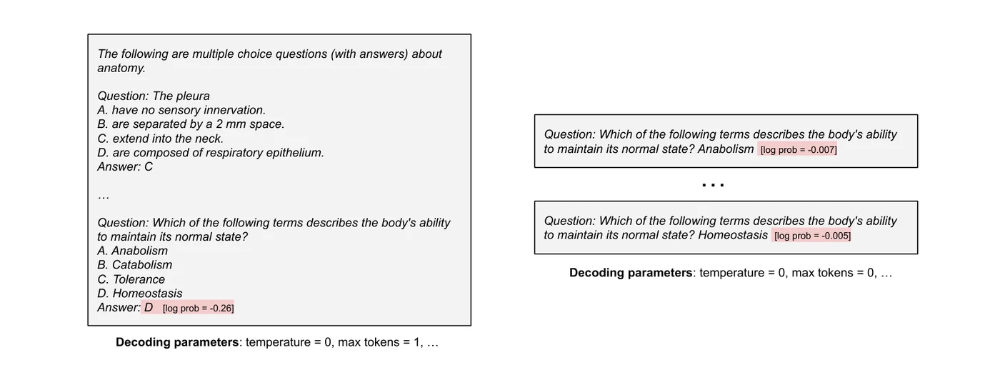
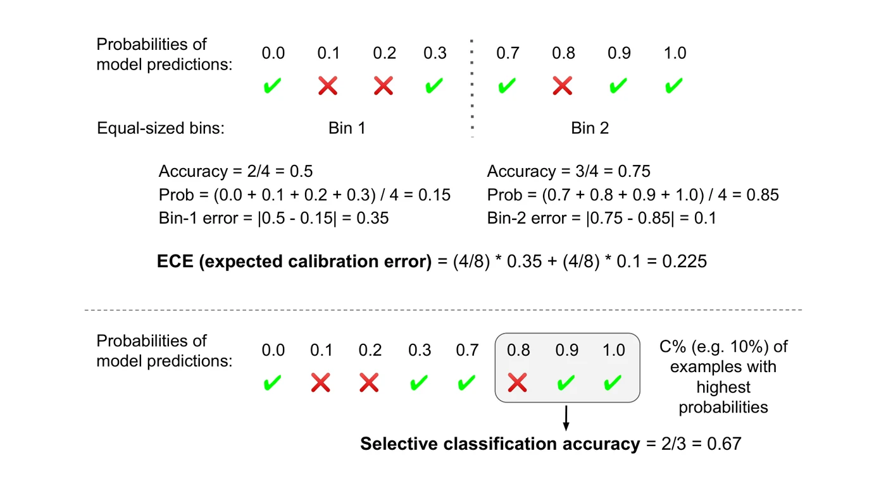

# HELM：一个模型分数是怎样产生的

一篇论文说某个语言模型“更准确”，这句话究竟告诉了我们什么？如果它做的是选择题，分数取决于题目来自哪里、模型看到了哪些提示、候选答案怎样呈现，以及怎样判分。换一套设置，同一个模型的表现可能发生很大变化。只看最后一行数字，很容易把这些选择都忽略掉。

Percy Liang、Rishi Bommasani 等人的《Holistic Evaluation of Language Models》（HELM）把这些选择放到了评价的中心。作者先整理模型可能面对的场景和希望满足的要求，再选择可以实施的一部分，以尽可能统一的方式测试 30 个模型。他们不仅测准确性，也同时考虑校准、鲁棒性、公平性、偏见、毒性和效率，试图让模型的不同优点与风险出现在同一张地图上。[摘要与 §1.1，PDF 第1–3页](https://arxiv.org/pdf/2211.09110v2#page=1)

这篇论文的价值不在于记住一份历史排行榜，而在于学会追踪一个分数：**场景与样本是什么，模型怎样被适配，指标测量什么，最后的比较又汇总了哪些条件？** 全文将沿这条路线展开。先用论文的一道选择题理解评价接口，再用图 7 对照两种适配，用图 17 手算校准，最后看多指标结果和评价边界。论文固定为 [arXiv 2211.09110v2](https://arxiv.org/pdf/2211.09110v2)；它反映的是当时的模型与任务，而非今天模型能力的完整画像。

## 各自都测过，为什么难比较

假设两个研究团队都报告了“准确率”。一个让模型直接从题目和四个选项中输出字母；另一个分别把四个候选接到题目后，比较模型对每个候选的概率。即使使用同一批题，模型收到的输入和需要完成的动作也不同。再加上一个团队提供示例、另一个没有，两个数字就不仅仅是模型差异的结果。

可以把一次模型测试想成一份试卷加一套考试规则。试卷决定考什么，规则决定考生能看到哪些材料、以何种格式作答，阅卷方法决定什么算正确。把两次考试的分数排在一起前，至少需要了解试卷和规则是否相同；如果不同，分数依然可以分别报告，只是它们回答的问题也不同。

语言模型评测比这个类比还多一层：模型本身有不同的训练历史，有的参数公开，有的只能通过接口访问。即使给了同一题，不同接口是否能返回候选概率也会影响评价方法。HELM 希望在这些现实约束下建立共同的比较基础，同时公开限制。

作者梳理过往评测时发现，不同模型所测数据集交集很少，有些模型最初发表时甚至没有共同测试的数据集。即便后来有人在相同数据上测了不同模型，微调、零样本提示或少样本提示的条件也可能不同。因此 HELM 把评价分成三个相连的目标：扩大场景覆盖并明确遗漏，在同一场景尽可能测量多种要求，以及对多个模型采用一致的适配协议。[§1、图2–4，PDF 第2–5页](https://arxiv.org/pdf/2211.09110v2#page=2)

这里有两种容易混淆的覆盖率。作者选定 16 个核心场景后，回看 30 个模型在这些场景中的已公开评价，发现平均覆盖率为 17.9%；HELM 的统一测试把它提高到 96.0%。这两项统计的是**模型—核心场景配对**：每个模型在 16 个场景中有多少可用结果。过去的结果还汇集了不同论文和不同测试条件。剩余的 4% 与特定模型的接口或技术问题有关，例如所需概率不可用。[图4及脚注5，PDF 第5页；§6，PDF 第45页](https://arxiv.org/pdf/2211.09110v2#page=5)

后文还会见到另一个覆盖率 87.5%，它数的是“场景—指标类别”组合，与模型是否参加场景是两回事。分母不同，即使都称为覆盖率，也回答不同的问题。前者关心模型之间有没有共同测试，后者关心同一场景有没有同时测量不同要求。

“全面”也有特定含义。作者先画出比实际测试更大的任务、语言和指标空间，再选择可行的子集。没有被选到的地方仍留在地图上，提醒读者哪些需求还没有得到充分评价。

这个设计和直接收集一批数据集有什么不同？假设一个基准只列出了问答和摘要两个数据集，读者能知道具体测了什么，却很难从清单看出没有测什么。HELM 把任务、领域和语言先作为场景的三个维度：任务回答要做什么，领域描述文本及其背景，语言说明采用哪种语言或语言变体。选择实例后，读者便能看出哪些区域有代表、哪些仍是空白。[§3.1–3.2，PDF 第16–19页](https://arxiv.org/pdf/2211.09110v2#page=16)

指标也采用类似做法。作者先考虑模型可能需要满足的各种要求，再结合模型访问方式和实施成本选择可测的部分。这个分类反映作者对评价空间的组织，具体选择也体现资源和价值判断。为了看清一项评价究竟怎样运转，先从论文里的真实题目开始。

## 从一道题看评价接口

论文图 6 给出 MMLU 解剖学选择题：哪个术语描述身体保持正常状态的能力？四个候选分别是 Anabolism、Catabolism、Tolerance 和 Homeostasis；参考答案把 Homeostasis，即稳态，标为正确。读懂评测过程不要求先掌握解剖学；这道题让我们看见一条样本由输入、候选参考和正确标记组成。[图5–6与 §2.1，PDF 第14页](https://arxiv.org/pdf/2211.09110v2#page=14)

在 HELM 的术语里，**场景**描述希望模型完成的用途，并用一组实例把用途具体化。MMLU 的选择题是场景中的一条实例；情感分类或摘要则会有不同的输入和参考。一个场景可以有训练实例和测试实例：前者可以用作提示中的示例，后者用来检查模型在新输入上的表现。这里的“训练实例”描述数据划分，放进提示时模型参数保持不变。

接下来要指定**模型和适配**。语言模型本来接收文本并续写文本，选择题则要求在有限候选中给出一个答案。适配就是把这两个接口接起来：如何把题目、示例、候选和说明组织为提示，如何让模型返回结果，以及怎样从结果得到预测。论文将模型作为文本接口，允许获得生成文本和对数概率，不要求取得模型内部激活或训练数据。[§2.2，PDF 第14页](https://arxiv.org/pdf/2211.09110v2#page=14)

最后是**指标**。如果系统选了 D，可以和参考标记比较，给这道题记一次正确；对许多题汇总，得到准确性指标。换一个要求，也可以观察模型预测的概率是否与正确频率相称，或轻微改变输入后结果是否稳定。一个样本因而可以支撑不同的提问，每个问题对应不同的评价规则。

这条链可以写成：场景提供样本，适配把样本转换为模型请求，模型返回输出或概率，指标再处理这些结果。论文图 5 把模型也单独列为评价组件。图 7 随即说明，即使面对完全相同的稳态题，适配方式也不止一种。[图7与 §2.3，PDF 第15页](https://arxiv.org/pdf/2211.09110v2#page=15)

把四个组件放回同一道题，可以看出它们分别控制什么。换模型而保持其他步骤，得到的是这个协议下的模型比较；换适配而保留模型和样本，可以观察该模型对接口的敏感性；换指标则可能从同一批预测得到不同认识。每种比较都需要记录实际改变了什么，否则数字变化无法归到明确的操作上。

场景还有数据来源这一层。问题来自一套考试题，还是来自搜索查询，模型需要面对的语言和背景会不同；参考答案是一个字母，还是一段摘要，决定了输出可以怎样评分。HELM 用任务、领域和语言描述这些选择，因此“问答”并非一个完全同质的场景。即使名称都叫问答，开卷时模型可以看到给定材料，闭卷时则需要仅根据提示与已有参数给出答案。[§3.1、§3.3，PDF 第16、19–20页](https://arxiv.org/pdf/2211.09110v2#page=16)

适配也不是和数据互不相干的外壳。选择题的候选答案已存在于样本的参考中，但作者可以选择一次展示全部选项，也可以逐项展示。系统如何利用这些参考，决定了模型实际上面对怎样的问题。我们接下来看到的图 7 正是对这一点的展开。

这些组件也让错误可以被定位。模型可能缺少稳态的知识，也可能看懂了问题但没有按要求输出字母；另一套评分程序还可能以不同方式处理输出。最终都表现为一道题没有得分，可要解释或修复时，需要区分不同的失败。评价记录保存提示和预测，正是为了让结果能回到具体行为。

## 图 7：两条不同的答题通路

从左侧开始。提示先说明这是解剖学选择题，再给出一道已答的示例。随后出现稳态题和 A 到 D 四个选项，提示以“Answer:”结束。模型要续写一个答案字母；图中显示的完成文本是 D。温度设为 0，最大生成长度为 1 个 token。题目和全部候选在一次请求中同时出现，所以作者称它为**联合适配**。[图7，PDF 第15页](https://arxiv.org/pdf/2211.09110v2#page=15)

左侧示例的作用是让模型从上下文里看到答题格式：先是问题和选项，再是正确字母。这种做法叫上下文学习（in-context learning）；示例被作为输入文字提供，模型参数不因这次请求而更新。图中省略号表示还有未展开的内容，不能仅凭画出来的一道示例推断整个实验都只有一道示例。

再看右侧。系统不把四个选项排在同一个请求里，而是把题目分别与每个候选文本拼接。图示画出 Anabolism 和 Homeostasis 两个候选，中间省略其他候选。系统读取模型给候选文本的对数概率，然后比较各候选；图示的最大生成 token 为 0，重点是评分已有文本，而非再续写一个答案字母。每个候选需要自己的请求，这就是**分开适配**。[§7，PDF 第47页](https://arxiv.org/pdf/2211.09110v2#page=47)

对数概率只是把概率用对数刻度表示；在可比较的评分规则下，较大的对数概率对应较大的概率。图中给出的数值用于展示接口，图注没有说明它们对应哪个模型或哪次实验，所以应把它们当作图示数值阅读，而非引用成某个模型的实测成绩。图左的字母生成和图右的候选文本评分也回答不同的操作问题：前者询问模型会写哪个标签，后者询问模型给哪段候选文字更高的分数。

分开方法还有一个**校正变体**。候选文字本身可能有不同的常见程度，作者还考虑模型在没有题目时给候选的概率，用它校正带题目时的评分。论文 §7、§8.2 和附录 J.1 只概述这两个量的作用，没有给出足以在此复算的具体公式或归一化条件；这里是概念说明，不是完整评分配方。它与后文的“校准误差”处在不同环节：前者改变如何选答案，后者评价得到的概率。[§7，PDF 第47页；附录 J.1，PDF 第160页](https://arxiv.org/pdf/2211.09110v2#page=160)

为什么这些接口选择重要？因为模型是在实际提示上作答，而非直接访问数据集中“正确选项”这一抽象标签。联合方式同时提供所有候选，分开方式每次只提供一个候选；两者还可能有不同的示例和请求成本。统一使用其中一种，能够让不同模型接受同一套规则；但它不保证这套规则同样适合所有模型。

在联合方式中，标签和选项的关系由提示建立：模型需要把“D”对应到 Homeostasis。分开方式则直接比较候选文字与问题的连接，系统而非模型生成字母。这会改变模型必须完成的中间步骤，也改变需要从接口取得什么：只提供生成文本的接口，不一定能支持逐候选概率评分。

两条通路的计算成本也不同。联合方式的一次请求要容纳所有选项和可能存在的示例；分开方式通常需要对每个候选单独查询。作者发现，哪种方式推理更快还会因模型而异，判断时还要考虑每次请求的长度。适配既是测量设计，也是运行设计。[§8.2，PDF 第58页](https://arxiv.org/pdf/2211.09110v2#page=58)

尽管两条通路的请求不同，它们最后都产生一个候选，可以用同一个正确标记检查。分开与分开校正则使用不同的评分规则，后面看结果时应把它们保留成两个设置。论文接下来用实验展示这些选择的影响。[§7、§8.2，PDF 第47、58页](https://arxiv.org/pdf/2211.09110v2#page=47)

## 同一模型，提示为什么改变结果

HellaSwag 是一个选择后续事件的常识场景：模型读到一段情境后，要从候选续写中选出合适的后续。作者在这个场景比较适配方法。对于 OPT 175B，分别提供候选、不给上下文示例的设置取得 79.1% 准确率；一次联合呈现候选、提供五个示例的设置取得 30.2%。这是同一个模型、同一个场景下很大的差别。[§1.2 发现23，PDF 第9页](https://arxiv.org/pdf/2211.09110v2#page=9)

怎样解释差别？这里至少有两处同时改变：候选是联合还是分开呈现，以及示例数量是零还是五。因此这组数能说明完整评价协议会显著影响结果，却不能单独证明“给示例导致下降”，也无法将差距全部归因于候选组织形式。若要分离其中一项影响，需要固定其他条件进行对照。

论文在图 33 还报告分开校正的 OPT 175B 准确率为 54.8%，分开、分开校正和联合三者的数值依次为 79.1%、54.8%、30.2%。该页没有明确写出 54.8% 对应的示例数量；这里不把它当作已确认同 shot 条件的消融。作者观察到，HellaSwag 上这六个所测模型的准确率顺序一致，但其他选择题场景中，不同模型偏好的适配可能不同。[图33与 §8.2，PDF 第58–59页](https://arxiv.org/pdf/2211.09110v2#page=58)

示例的**具体内容**也会影响结果。论文在 NaturalQuestions 的 open-book 场景中给模型相关材料，让它回答问题。对于 davinci 175B，三次选取不同的上下文示例，F1 分别为 0.376、0.611 和 0.636。这是同一个模型和场景的三次示例抽取，而非三个测试集。F1 衡量答案词语与参考答案的重合，和选择题的答对比例具有不同含义。[图31与 §8.2，PDF 第56页](https://arxiv.org/pdf/2211.09110v2#page=56)

论文通常在需要示例时最多放五个；如果上下文窗口装不下，实际会更少。作者还在部分模型和场景里改变示例数和提示格式，分析受成本约束，并非对所有模型穷举所有提示。由此得到的认识是：一个分数既属于模型，也属于生成它的具体评价协议。[§7、§8.2，PDF 第46、56–57页](https://arxiv.org/pdf/2211.09110v2#page=46)

在论文的图 33 中，同一类适配还在多个选择题场景上进行比较。HellaSwag 的问题天然像续写不完整的文本，作者认为分开评分较适合这种形式；这是对观察结果的解释，而不是额外进行的一项因果验证。OpenBookQA 等场景中，Anthropic 模型相对偏好联合方式，另外五个所测模型大多偏好分开校正。由此看来，适配规则与场景、模型之间可能存在交互：同一个规则在不同模型上改变的程度并不一样。[§8.2，PDF 第58–59页](https://arxiv.org/pdf/2211.09110v2#page=58)

这对比较设计提出了实际取舍。为所有模型选择同一条路径，可以直接比较相同输入规则下的行为；为每个模型挑各自最优路径，则更接近“它在指定候选方案中最好能做到什么”，但比较对象也包括不同的适配工作。报告时把这两种问题分开，比把其中一种永久规定为唯一公平的方法更清楚。

这里的 NQ 例子还说明，报告平均数之外的波动是有意义的。如果只看三次中的某一次，读者可能把由示例选择造成的变化归为模型能力的稳定差别。作者在每次运行中对测试实例使用相同的示例，再用不同随机选取重复运行；这样可以估计选择哪组示例对结果的影响。三次运行提供了一个观察窗口，所展示的最大值与最小值只涵盖这三组示例。

示例数量和示例内容是两个不同的变量。增加示例可能帮助模型理解输出格式，选择不同示例则可能改变它看到的任务线索。论文的示例数实验允许最多 0、1、2、4、8、16 个，并受上下文长度约束；它观察到的趋势随任务变化，不能简化为“示例越多必然越好”。[图32与 §8.2，PDF 第57页](https://arxiv.org/pdf/2211.09110v2#page=57) 接下来要问，即使协议固定，我们究竟用什么判断结果好坏？

## 从一个分数到七类指标

HELM 认为实用系统需要满足多种要求：答对问题只是其中一个。作者尽量在同一场景里同时计算多个指标，方便观察不同要求是否相互支持，还是发生取舍。论文将所选测量组织成七类：[§4，PDF 第25–27页](https://arxiv.org/pdf/2211.09110v2#page=25)

| 指标类别 | 它在问什么 | 本文的具体例子 |
| --- | --- | --- |
| 准确性 | 模型输出和任务要求有多接近？ | 选择题正确比例、问答 F1、检索排序、摘要 ROUGE |
| 校准 | 预测所赋概率与实际正确频率是否相称？ | 用期望校准误差比较概率与正确率 |
| 鲁棒性 | 输入经过规定变化后，任务表现如何？ | 拼写或表述扰动，以及改变正确答案的对照集 |
| 公平性 | 不同群体相关变化或群体子集上的表现如何？ | 反事实替换、按已有群体元数据比较表现 |
| 社会偏见 | 生成文本中群体的表征与关联是否不均衡？ | 群体相关词出现频率及与职业词的共现 |
| 毒性 | 生成内容是否被检测为有毒性？ | 用 Perspective API 检测生成文本 |
| 效率 | 获得这些结果需要什么资源？ | 推理时间、训练能耗及排放估计 |

“准确性”在论文里是一个统称。对选择题可统计答对比例；问答中 F1 关注词语重合，检索用排名指标，摘要用 ROUGE 等自动指标。它们都服务于任务表现的评价，却不应被读成同一个量。摘要得分高低还取决于参考文本和自动指标能否捕捉读者真正关心的质量。

作者选了 16 个**核心场景**，希望每个场景尽量覆盖上述七类要求。这里的核心指多指标共同测量的组织方式，其他场景同样重要。除此之外，还有 26 个额外场景，组成七项针对性评价，分别深入知识、推理、记忆与版权等能力和风险；总计 42 个场景。[§1.1，PDF 第3–4页](https://arxiv.org/pdf/2211.09110v2#page=3)

把 16 个场景放在行、七类指标放在列，理论上得到 16×7＝112 个“场景—指标类别”组合。论文报告其中 98 个有测量，占 87.5%。这不代表每个类别里的所有具体子指标都在每行完整存在；表 4 同时列出更细的子指标。它也不同于前文 30 个模型各参加多少场景的 96.0%。[表4，PDF 第27页](https://arxiv.org/pdf/2211.09110v2#page=27)

为什么还有 14 个组合没有测？多数是在该场景所用适配下没有定义。例如，分开适配读取候选概率而不生成回答，就没有生成文本可供计算生成毒性。其余缺口中，作者担心测量有效性，例如很难确保对长篇摘要的自动扰动仍满足预期条件。它们与模型接口导致的模型—场景技术缺口性质不同。

七类指标是一组互补问题，把它们汇总时需要考虑用途和各项权重。尤其是校准：它既不直接数答对多少，也不检查模型有没有用文字声称“我很自信”。

用稳态题回顾这个矩阵：准确性需要知道模型选了哪个答案，以及参考答案是什么；校准还需要模型对该预测的概率；鲁棒性则需要按事先定义的方法产生相关变化，再检查变化前后的任务表现。每增加一个要求，就增加了一个测量过程，而非给同一条“正确”记录换个名称。

对生成任务，评价又面对另一种困难。摘要的好坏涉及是否保留原文重要信息、有没有写入无根据的内容、表达是否清楚。论文使用自动指标评价质量和忠实性等维度，但作者也指出自动指标存在局限。一个可计算的数字使比较成为可能，它是否充分代表读者关心的质量仍需要证据。[§3.5，PDF 第21–22页](https://arxiv.org/pdf/2211.09110v2#page=21)

问答 F1 与选择题准确率也可以帮助理解“准确性大类”为什么有多种实现。选择题系统最终选出一个候选，可检查它是否与参考选项一致；自由回答的问答输出则可能和参考答案部分重合，词语重合指标可以区分完全没有交集和包含部分参考词语的回答。它仍依赖参考答案和词面处理，无法单靠一个数涵盖所有合理表述。

检索又不同：系统要为多个候选材料排序，相关材料排得靠前通常更有用。摘要则要和参考摘要或原文比较，自动指标只能捕捉被设计出来的某些性质。把这些结果都写在“准确性”大类里，是为了在不同任务下找到常用的任务表现指标；解释 0.7 的问答结果与 0.7 的摘要结果时仍需保留各自的定义。[§3.4–3.5、§4.3，PDF 第20–22、27页](https://arxiv.org/pdf/2211.09110v2#page=20)

效率需要考察模型参数之外的因素。训练能源及排放需要训练设备、时长和能源等信息，论文在可得时采用披露值，缺少时用假设估计；推理时间还会受到模型架构、硬件和请求长度影响。不同维度的成本应和实际效果一同阅读。[§4.9，PDF 第33页](https://arxiv.org/pdf/2211.09110v2#page=33)

资源指标还可以帮助理解为什么评价本身需要取舍。查询模型需要时间和计算；对收费接口还可能产生成本。作者同时使用开放模型与不同访问条件的模型，因此扩大场景、样本和提示变体都需要预算。测量越全面，越需要明确哪些组合得以运行，哪些缺口需要保留在结果里，让读者看见实际覆盖。[§1.2、§6，PDF 第6、45页](https://arxiv.org/pdf/2211.09110v2#page=6) 下一节借助图17手算校准，看看一类指标怎样从模型输出得到。

## 图 17：校准和选择性分类分别在算什么

校准问的是：模型赋予自己预测的概率，能否反映长期正确频率？如果一批预测都给出 0.8 的概率，其中大约八成正确，就符合这个概率的含义；如果只有一半正确，模型在这批预测上就过于自信。准确率告诉我们答对多少，校准还考虑模型对自己预测的把握是否与结果相符。[§4.4，PDF 第27–28页](https://arxiv.org/pdf/2211.09110v2#page=27)

图 17 上半部分列出八次预测。数字是模型对自己所选答案赋予的概率，绿色勾和红色叉表示这次预测是否正确。作者把它们按概率分成两个等大小的组，每组四条：前一组是 0.0、0.1、0.2、0.3，后一组是 0.7、0.8、0.9、1.0。这是原图为了讲解而给出的示例，而非某个模型的实验成绩。

先算第一组。四次预测里有两次正确，所以准确率是 2/4＝0.5；平均概率为 (0.0＋0.1＋0.2＋0.3)/4＝0.15。模型在这一组平均给出 0.15 的概率，实际正确率却是 0.5，两者绝对差为 0.35。它反映的是这一组的平均概率与观察到的正确频率有多远。

第二组有三次正确，准确率是 3/4＝0.75；平均概率为 (0.7＋0.8＋0.9＋1.0)/4＝0.85。两者绝对差为 0.10。第一组的平均概率低于实际正确率，第二组则高于实际正确率；取绝对值后，我们衡量的是偏离的大小，正负方向不会相互抵消。

期望校准误差（expected calibration error，ECE）把各组误差按组内样本占总样本的比例加权。两组各有四个样本，因此这张图的 ECE 是：

$$
\frac{4}{8}\times0.35+\frac{4}{8}\times0.10=0.225
$$

这一数值描述图示样本按这种分组得到的校准误差，越低表示分组平均概率与正确频率越接近。图里为了便于手算只分两组；论文实际默认分成十组，每组含相等数量的概率，而不是默认把 0 到 1 切成十个等宽区间。[图17与 §4.4，PDF 第28页](https://arxiv.org/pdf/2211.09110v2#page=28)

图的下半部分转而问另一个问题：如果系统只处理模型最有把握的一部分样本，其余交给人处理，这部分能有多准确？图中圈出最高的三个概率 0.8、0.9、1.0，对应一次错误和两次正确，因此选择性分类准确率为 2/3。这个 3/8 的选择比例是示例画法；论文另外报告选择比例 C＝0.1 时的准确率，以及覆盖率—准确率曲线下面积。

两种测量的区别很重要。一个模型可能把所有概率都报得偏高，却仍能把容易的问题排在困难问题之前。它的数值校准可能不好，按置信度排序后挑出的样本却仍然比较准确。反过来，知道一个分组平均校准良好，也不能只凭这个平均数断定每一道题的风险。校准看概率值与频率的对应，选择性分类看按这个信号筛选后得到什么结果。

假如把低置信度样本交给人工，模型自己处理其余样本，降低覆盖率会增加人工工作量。因此比较选择性分类时，要同时说明保留比例和对应准确率。覆盖率—准确率曲线把不同保留比例下的变化放在一起，展示筛选质量和处理量之间的关系。

ECE 汇总了每组的概率与对错，也遮住了一部分组内差异。比较不同论文的 ECE 时，需要查看样本、组数及分组方法：分组改变了哪些预测被放在一起，小样本的组内正确率也可能波动。图17让我们看清这项汇总如何把预测概率和实际结果联系起来。

## 扰动、群体表现与生成风险

校准处理模型对预测的概率判断；鲁棒性则问，输入发生变化时，模型表现是否保持。作者考虑两种不同的变化。第一种是不变性：改动拼写、大小写或近义词等，同时期望正确答案保持不变。第二种是等变性：使用改变语义、因而需要改变正确答案的对照样本，检查模型是否随之作出合适变化。[§4.5，PDF 第28–30页](https://arxiv.org/pdf/2211.09110v2#page=28)

例如，一道题只是出现拼写错误，理想答案仍与原题相同；但如果对照题改变了关键事实，继续给原答案反而可能错。论文在规定的一组扰动上看最差表现，因此模型要在这些变化下都做得好，才能获得高分。这是对样本附近、所选变化的局部鲁棒性测量，不等于覆盖了所有分布变化或攻击。

公平性在本文中有两条测量路径。第一是反事实扰动：替换与群体相关的表述，再看任务表现；第二是在数据已有群体元数据时，分别报告各子集的表现。两者有不同局限：替换可以受控地比较表述变化，但真实群体数据还可能有更复杂的分布差异；元数据方法则依赖数据集实际提供哪些标记。[§4.6，PDF 第30–31页](https://arxiv.org/pdf/2211.09110v2#page=30)

作者把公平性与生成偏见分开。这里的公平性侧重任务表现的差异；生成偏见侧重模型生成文本里群体词出现得是否均衡，以及群体词与职业等词语是否形成不均衡关联。词表与共现计数容易受表达方式影响，因此它只提供某个操作化视角，不能穷尽社会偏见。毒性则使用 Perspective API 对生成文本检测；检测器本身有已知局限，检测结果也可能与人类判断不同。[§4.7–4.8，PDF 第31–33页](https://arxiv.org/pdf/2211.09110v2#page=31)

这些类别之所以要分开，是因为一个模型可能在某项任务上群体准确率相近，却仍生成带有刻板关联的内容；也可能在一种检测下毒性较低，而表现出另一类风险。评价时，指标名称背后的数据、扰动和检测方法与数字本身同样重要。

还要留意评价场景和测量方法之间的关系。分类任务通常有清楚的标签，扰动后可以比较标签是否仍适用；长文本生成涉及许多可能合适的输出，判断某次变化应当怎样影响整篇回答更困难。这正是作者没有对摘要计算某些扰动指标时提出的有效性顾虑。缺少一格结果应先问方法是否适用；空格表示没有报告该项，和零分含义不同。[表4，PDF 第27页](https://arxiv.org/pdf/2211.09110v2#page=27)

## 不同指标在结果中怎样关联

有了多种指标，作者可以问：更准确的模型，在其他维度上通常也更好吗？论文图 24 把准确性放在横轴，分别用六张小图把校准误差、鲁棒性、公平性、性别表征偏差、毒性和去噪推理时间放在纵轴；不同颜色代表不同场景。每一类点都要放回它的场景和指标定义下理解。[图24与 §8.1，PDF 第48页](https://arxiv.org/pdf/2211.09110v2#page=48)

读图时先看方向。准确性和这里所示的鲁棒性、公平性表现分数越高越好；校准误差、性别表征偏差、毒性以及推理时间则是越低越好。因此，纵轴数值上升有时表示改善，有时表示误差或成本增加。尤其不能把公平性表现分数与生成偏见分数当作同一个量。

准确性和校准提供了一个清楚的对照。在所测模型中，HellaSwag 上准确性越高往往伴随更高的校准误差；OpenBookQA 是另一个科学知识选择题场景，观察到的趋势则是准确性和校准一起改善。这些关系还依赖适配方法。图中的关联比较的是不同模型在特定场景和协议下的点，不能直接推出把一个模型训练得更准确就会导致它的校准必然变差。[§1.2、§8.1，PDF 第6、48–50页](https://arxiv.org/pdf/2211.09110v2#page=6)

作者也报告准确性、鲁棒性和公平性表现之间较强的相关，但他们提醒读者注意这些指标的定义：此处鲁棒性和公平性都与扰动条件下的任务表现有关。即使整体相关，最准确的模型也未必在每个维度上最好。生成偏见、毒性和效率则呈现不同程度的场景差异。多指标测量的价值就在于暴露这些差异，让读者看清不同曲线的方向。[§1.2、§8.1，PDF 第7、48–50页](https://arxiv.org/pdf/2211.09110v2#page=7)

这也解释了为什么需要保留具体结果和原始条件。平均趋势让我们看到总体关系；按场景查看则能发现某个任务上相反的现象。

比如，把 HellaSwag 与 OpenBookQA 的模型点混成一团，可能只看到一条模糊的总体趋势，却看不到两种任务内部校准关系的差异。按场景分色的目的就是让这些关系保持可辨认。然后再对同一场景内不同模型作相关分析，问题才从“混合结果看上去怎样”变成“在这类任务中，两个指标怎样一起变化”。

指标之间还有尺度问题。F1、准确率、毒性比例和秒数的单位各不相同，读图时应分别理解各自的刻度。坐标轴回答的是每个指标自己的变化；解释取舍时还要知道变化对应用意味着什么。例如推理时间的几分之一秒和正确率的几个百分点，是否值得交换取决于场景和使用条件。接下来，再把观察单位从一个场景里的指标，转向模型之间的比较。

## 模型比较与汇总的条件

统一协议的重要性是让模型参加可比较的测试。HELM 对所选模型使用相同场景、指标和相同的五示例提示规则，使很多过去没有共同结果的模型有了对照。但模型的训练方式、可用数据、计算预算和设计目标存在差异。作者举例，T0++ 原本面向零样本提示，却在统一评价中采用五示例设置；这说明统一规则和各模型发挥各自最佳表现是两种不同目标。[§6–7，PDF 第45页](https://arxiv.org/pdf/2211.09110v2#page=45)

图 33 的另一个结果说明规则选择会怎样改变比较。OpenBookQA 中，作者比较了 OPT 175B 和 Anthropic-LM v4-s3：分开校正方法下，OPT 为 58.6%，Anthropic 为 55.8%；联合方法下分别为 30.9% 和 69.6%。两种方法各自回答“按照这套接口谁表现更好”：前者相差 2.8 个百分点，后者相差 38.7 个百分点。如果只报告其中一个差距，读者就会错过模型对接口的不同敏感性。[§8.2，PDF 第58–59页](https://arxiv.org/pdf/2211.09110v2#page=58)

规模与成本也需要放在一起看。作者在所测的同一模型家族中观察到，更大的模型通常更准确，但训练和推理成本也更高；跨家族时，仅凭参数数量难以预测下游准确性。不同模型还可能采用不同训练目标、数据和人类反馈，因而不能把跨家族表现差异简单归给参数量。[§1.2、§8.1，PDF 第7、53–55页](https://arxiv.org/pdf/2211.09110v2#page=7)

多场景、多指标带来另一个问题：怎样把整张结果矩阵压缩成一个总分？假如一种模型在某场景更准确，另一种更省资源，哪一个更适合取决于应用的预算和风险。作者认为，不存在能够满足所有价值、偏好和使用情况的通用聚合方法；单个数字可以帮助决策，但其权重选择需要被看见。[§11.3，PDF 第82页](https://arxiv.org/pdf/2211.09110v2#page=82)

可以把汇总想成两次选择。第一次决定哪些任务、模型和指标进入比较：如果一个模型缺少某个所需概率，它在相关指标上的缺失就需要保留，而不是默认为零。第二次决定怎样权衡剩余结果：对延迟敏感的用途可能更重视推理时间，另一个用途可能更重视误判和群体差异。这两次选择都需要公开，读者才能理解最终排序。

论文并不拒绝聚合。作者自己也用两两胜率帮助浏览结果，承认单数在实际决策中有便利。它的观点是让汇总与底层明细共存：从概览发现值得追问的差异，再回到具体场景、模型、提示及预测。

同样的思路也适用于效率。推理时间可能随输入长度和输出长度变化；一个摘要任务和一个选择题任务的请求规模通常不同。论文因此在图 24 里按场景呈现准确性与去噪推理时间的关系，并提醒读者硬件和模型架构共同影响效率。比较两个点以前，确认它们来自什么场景，比直接说“这个模型快多少倍”更有意义。[图24及 §8.1，PDF 第48–50页](https://arxiv.org/pdf/2211.09110v2#page=48) 读者因此可以针对自己的用途重新判断，而不必把某一套权重当成通用事实。若将来增加一个新的场景，结果矩阵也可以增加对应的一行，再检查原先的总体判断是否仍然成立。评价由此成为可以持续补充和修订的过程。

作者还用逐场景的两两比较来整理大量结果。图26针对某个指标、某个模型，把它与其他模型在各核心场景中逐对比较：一次比较的单位是“一个场景、一个对手模型”，图注所说的比例是该模型指标数值更高的比较次数占两两比较次数的比例。准确性、鲁棒性和公平性数值高是好；校准误差、偏见和毒性则要反向解读：数值高的比例高，代表误差或风险指标更高。效率没有列入图26的两两汇总，作者强调需要结合表现考虑。[图26及 §8.1，PDF 第50–51页](https://arxiv.org/pdf/2211.09110v2#page=50)

用导读自编的教学例子走一遍：只考虑准确率，模型 A 与 B、C 两个对手在两个场景都有结果，因而有四次比较。假设 A 在第一个场景分别高于 B 和 C，在第二个场景高于 B、低于 C，那么数值更高的次数为三，比例为 3/4。如果换看 ECE，就需要先比较两模型各自的 ECE 数值，再按照“误差越低越好”的方向解释；较高的误差对应更差而非更好的校准。假如只选第一个场景，A 的比例就是 2/2；加入第二个场景后才变成 3/4。因此汇总比例取决于纳入哪些场景和对手，要结合这些比较对象理解。这个例子仅说明比较单位及分母，并非图26的实际模型数据。图注没有交代缺失结果和平局的具体计入规则；真实汇总需要查明这些规则，不能直接假定所有模型都有相同数量的有效比较，或将缺失当成零分。

因此，读模型比较时可以先保留一条完整关系：**在哪个场景、使用什么适配、按什么指标，模型之间出现了什么差异**。这比把一个跨任务总分当作模型的固定属性更能解释结果，也方便别人复查。

例如，对于一个需要人工复核的应用，选择性分类的覆盖率与保留样本准确率可能很重要；对于需要大量快速查询的应用，推理时间可能成为主要限制。HELM 提供的结果矩阵让两位使用者都能从同一份评价中挑出相关证据，同时看到各自忽略了哪些维度。具体部署仍需要针对真实数据与使用流程另行验证。

## 评价边界在哪里

HELM 的场景比许多此前评价更广，但仍是所选任务的子集。本版主要评价英语，也考虑了一些英语变体；非英语语言以及英语变体在社会重要应用中的覆盖仍不足。作者还指出临床、金融、教育等领域和新型生成应用的缺口。QuAC 虽包含对话形式的问题，使用这类数据不等于对一个真实多轮交互系统完成了评价。[§3.2、§10.1，PDF 第19、78–79页](https://arxiv.org/pdf/2211.09110v2#page=19)

训练—测试污染是另一个难题。如果模型训练时已经见过测试内容或相近分布，分数就可能混入记忆带来的影响。多数模型的训练数据披露不充分；论文标出已知证据，但整体污染程度及其对结果的影响仍不清楚。这种未知要求读者在解释统一测试时，留意各模型先前的数据暴露可能不同。[§6、§11.1，PDF 第45、81页](https://arxiv.org/pdf/2211.09110v2#page=45)

成本也影响了证据的精度。作者用三组随机示例估计提示选择的变化，并在评价中限制测试实例数量；论文指出常用的三次随机种子和 1000 个实例未必足以让所有差异达到统计显著。某些提示或解码细节的敏感性也没有充分检验。评价需要考虑有效性——指标是否测到想测的对象——以及可靠性——不希望影响结果的偶然变化有多大。[§7、§11.2，PDF 第46、81–82页](https://arxiv.org/pdf/2211.09110v2#page=46)

这些缺口也是作者要求评价透明的一部分：明确已测范围，才能决定下一项需要补什么证据。使用结果时，先找与实际用途相关的场景与指标，再看该结果的协议、样本与限制。

有效性还包括一个更基本的问题：数据集里的题目是否代表我们关心的实际任务？例如，新闻摘要基准可以测试对新闻文本的表现，却不能自动代表对临床记录、教学材料或复杂长文档的摘要质量。即使同属“摘要”，输入来源、长度、参考答案和错误后果都可能不同。把场景拆成任务、领域、语言，正是为了让这种差异可见。

数据标签也有局限。毒性判断涉及语境和标注者对有害表达的理解，缺乏背景时，一句文字可能难以可靠判定。论文在任务选择时讨论了毒性检测数据的这些问题；后来使用自动检测器评价生成文本时，检测器本身的定义和误差又进入了测量过程。因此，“测得的毒性”应和所使用的工具、输入与评价背景一起报告。[§3.7、§4.8，PDF 第23–24、32–33页](https://arxiv.org/pdf/2211.09110v2#page=23)

对英语变体的考察也有类似的测量选择。论文在语言建模数据及自动扰动中考虑部分英语变体，但作者希望进一步把它们放到实际用途里测量。语言、应用和指标是交叉的：分别覆盖某种语言与某种任务，还需要验证它们的组合，才能回答该语言在这项任务中的表现。

可靠性则提醒我们区别模型差距和测量波动。少数示例的不同抽取已经造成 NQ 上可见的分数变化；测试样本、标注以及提示格式也会影响结果。更充分的重复、显著性分析和适用场景数据，能够让后续比较更有说服力。

交互缺口同样涉及评价对象。静态数据集可以含有一段过去的对话，并要求模型回答其中一个问题；真正的交互系统还要面对自己的回答改变后续状态、用户追问或外部环境反馈。静态任务里的得分是对给定样本和协议的证据，若要判断交互系统，应另行设计与其行动和反馈相符的评价。

## 回到原文与本导读范围

如果想沿一条具体样本理解论文，先读[图5–7与 §2，PDF 第14–15页](https://arxiv.org/pdf/2211.09110v2#page=14)：场景怎样给出问题和参考，模型如何通过不同接口作答。再读[表4和图17，PDF 第27–28页](https://arxiv.org/pdf/2211.09110v2#page=27)，比较矩阵缺口与校准手算；随后读[图24，PDF 第48页](https://arxiv.org/pdf/2211.09110v2#page=48)和[提示分析，PDF 第56–59页](https://arxiv.org/pdf/2211.09110v2#page=56)，把指标方向和适配条件放回真实结果。

本导读固定采用 arXiv 2211.09110v2，讲解场景、适配、指标和所选结果的评价主线。作者核对使用了 PDF 第1–33、45–59、77–82页的文字；图7和图17的原图裁切，以及表4、图24和图33所在 PDF 页面已由 AI 视觉查看；表4未逐格复核，图24与图33未逐点核验。第34–44、60–76、83–159页未在作者核对范围内，第160–162页只查阅了附录J的部分适配说明；已有一份范围受限的独立抽查，见 `docs/research/helm-r3-independent-review.md`；它不是全文核对、复现或读者验收。图17的数字是论文图示例；图7的对数概率来源未明确，只用于展示接口。原图来自 Liang 等人的固定论文，arXiv 页面标示 CC BY 4.0。阅读导读或打开原文不会自动记为读过原文。
