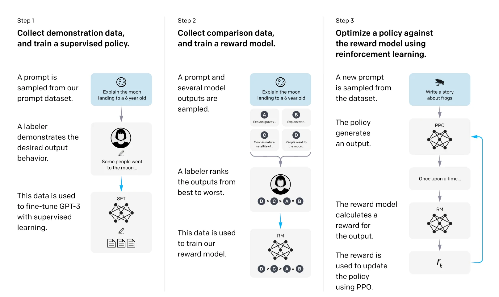
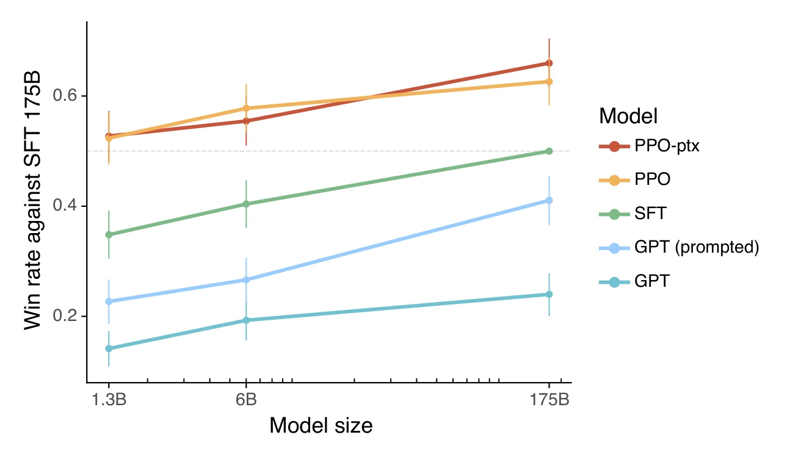
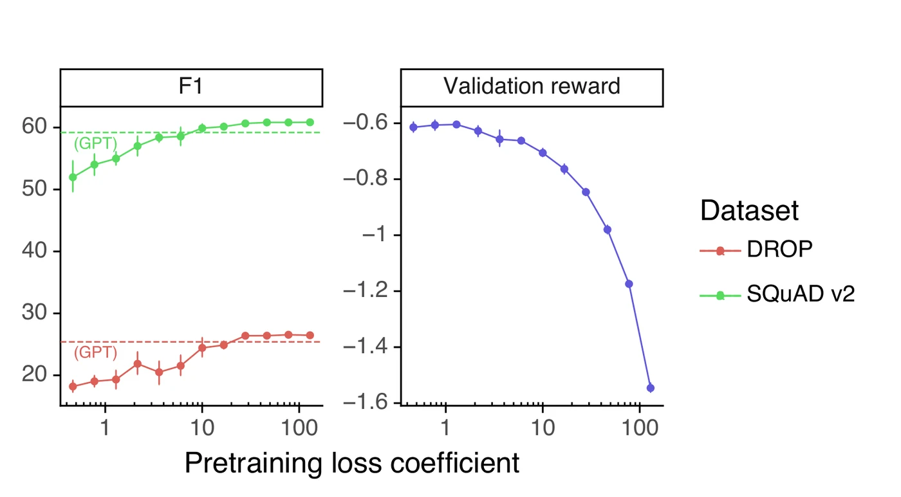

# InstructGPT: How Human Feedback Shapes Model Responses

In 2022, Long Ouyang, Jeff Wu, Xu Jiang and other OpenAI researchers published *Training language models to follow instructions with human feedback*. Their concern was how language models behave in actual use: a model clearly capable of answering may still keep rewriting the question, ignore requirements or fluently make things up. Why? Building on GPT-3, the authors added human demonstrations, rankings of answers and reinforcement learning, and obtained InstructGPT. On the paper's distribution of test prompts, when answers from the 175B InstructGPT were compared directly with those of a GPT-3 of the same size, they won a human preference rate of $85\pm3\%$. Here B stands for billion, so 175B means 175 billion parameters, and the error range is the 95% confidence interval the authors report. [Abstract, §1 and main results, PDF pp. 1–4](https://arxiv.org/pdf/2203.02155v1#page=1)

The key to this work is reorganizing the training signal on top of GPT-3, not inventing a new network backbone. People first demonstrate "how a good answer is written", then compare "which of these answers is better". A model learns to predict the comparisons, and the predicted score is then used to adjust the way the answering model generates, over and over. This is the paper's reinforcement learning from human feedback (RLHF): human judgments first enter the data, and then influence answers through a scoring model and an optimization process.

The most useful thing to take from reading this paper today is an understanding of three questions: why preferences still need to be collected after demonstrations; how a model that can only score answers helps another model write better; and why higher reward, reader preference and factual correctness still need to be tested separately. The guide gives the most space to the training pipeline in Figure 2 and to the computations of the reward model and of reinforcement learning. A short, invented example of summarizing a notice runs through these stages, to help match up the prompts, answers, scores and probabilities in the formulas.

The guide is pinned to arXiv v1 of 4 March 2022. It first covers the background, the task and the data, then takes the method apart against the original figures, and finally returns to the experiments and limitations. The main text of the original runs to 20 pages, with long appendices; some of the implementation details are more complicated than the main text's three-step overview. Understanding these details shows how the authors turned the three-step idea into a training method that can be tested. [Pinned version record](https://arxiv.org/abs/2203.02155v1) · [Pinned PDF](https://arxiv.org/pdf/2203.02155v1)

## From continuing text to doing tasks: The gap the authors saw

To understand InstructGPT, first separate "can generate a certain answer" from "usually generates that answer when asked". The task of a pretrained language model is to predict the next token from the preceding text. A token is the basic unit in which a model processes text; it may be a character, a word or part of a word. By learning this prediction on large amounts of text, the model gradually acquires linguistic expression, knowledge associations and some reasoning ability. But the training objective itself only requires the continuation to resemble the training corpus; it does not directly specify that the model should become a reliable assistant.

For example, the input "condense the following notice into two sentences" might appear on the internet in an exercise sheet, a chat log, a task list or a teaching article. The model could go on to write an answer, or it could go on to list the next exercise. Listing another exercise fits the textual format of an exercise sheet but departs from the current user's task. Even if it starts answering, the model might add an explanation that sounds perfectly natural but that the source material never stated. This is the gap the authors saw: pretraining rewards continuations that are close to the text distribution, while users care whether this request was satisfied. [Misalignment of objectives in §1, PDF pp. 1–2](https://arxiv.org/pdf/2203.02155v1#page=2)

GPT-3 could already infer a task after seeing a few examples in its input, through few-shot prompting, and carefully designed prompts could change its output substantially. The trouble is that users had to put effort into designing such openings to steer the model toward the kind of answer they needed. InstructGPT aims to make this cooperation the norm: through training, let existing abilities show up more often in ways that fit the request.

The authors describe what they want with three words: helpful, honest and harmless. Helpful means completing the task; honest means not fabricating or misleading; harmless concerns the effects on people and the environment. To use these three intuitive goals in training, the standards of judgment in concrete situations have to be made explicit. What counts as "concise but sufficient"? Faced with a false premise, should the model correct the question or go along with it? When a user asks for harmful content, "obedient" and "harmless" conflict. The first task of the research is to turn these judgments into material that people can actually annotate.

Earlier research on human feedback had already used the route of "compare answers, learn a reward, optimize a policy" in more focused tasks such as text summarization. This paper applies it to a broader range of natural-language tasks: writing, question answering, rewriting, summarization, dialogue and information extraction. Its contribution is thus more like a complete integration and empirical test of the method: on prompts in the style of real use, can this training change model behavior consistently? Which changes genuinely improve the experience, and which merely swap one way of failing for another? [§2 related work and §3.1, PDF pp. 4–6](https://arxiv.org/pdf/2203.02155v1#page=4)

## The task: Prompts, answers and generation probabilities

Next, it has to be clear what object training actually changes. InstructGPT's input is a prompt, which may contain a direct instruction, material to be processed, an answer format or a few examples; the output is still a string of text. The model follows GPT-3's basic architecture and learns, through parameter updates, how to respond to these inputs. The authors trained answer models at three sizes, 1.3B, 6B and 175B, corresponding to 1.3 billion, 6 billion and 175 billion parameters. [Model sizes and task, PDF pp. 3, 7](https://arxiv.org/pdf/2203.02155v1#page=3)

In the guide's notation, the prompt is written $x$, the answer $y=(y_1,\ldots,y_T)$ and the model parameters $\phi$. Given a prompt, the probability of the whole answer can be decomposed as:

$$
\pi_\phi(y\mid x)=\prod_{t=1}^{T}\pi_\phi(y_t\mid x,y_{<t}).
$$

The symbol $\pi$ here denotes a "policy": in reinforcement learning, the probability of choosing an action on encountering a state. In this paper, the state is the prompt plus the text already written, and the action is choosing the next token. $y_{<t}$ is the part already generated. The model generates word by word and ends with a complete answer; parameter updates change how likely the various answers are next time. This teaching notation connects word-by-word prediction in language modeling with action selection in reinforcement learning.

The rest of the guide uses the following **teaching example invented for the guide**; the notice, answers and values are all set for explanation and are not records of the paper's experiments:

> Prompt: Condense this notice into two sentences and do not add reasons. Notice: The Qinghe Reading Room will be closed for one day on Wednesday for equipment inspection and will reopen on Thursday. Online borrowing continues as usual.

A suitable answer might be: "The Qinghe Reading Room will be closed for one day on Wednesday and will reopen on Thursday. Online borrowing continues as usual." It keeps the dates and the scope of service, meets the two-sentence requirement and adds no explanation. Another answer might expand "equipment inspection" into "emergency repairs are under way because of damaged wiring", which reads fluently but adds facts the notice did not provide. A third might copy the original word for word, accurate in information but not condensed as asked.

This example contains three judgments at once: whether a summary was made, whether the formal constraint was respected, and whether the answer is faithful to the material. "How many words it shares with a standard answer" can hardly capture these requirements, because a suitable summary can be written in many ways. Faced with many acceptable answers, the authors use two kinds of human feedback: demonstrations show the model one good way of writing, and rankings show it how to choose among several ways.

What this research changes is the model's generation habits after training is over. During development, the scoring model supplies rewards and the optimization process updates parameters; in use, the trained answer model receives a prompt and generates text directly. Figure 2, next, shows how these habits are formed during training.

## How human requirements enter the data: Demonstrations, rankings and unlabeled prompts

Turning human requirements into a training signal starts with preparing suitable data. The research team had to decide which tasks to collect, who would judge, by what rules, and how to separate training from testing. The paper employed about 40 annotators and, through screening, task instructions and ongoing communication, prepared them to handle a wide variety of natural-language requests. Annotators could skip inputs whose intent was very unclear or that required expertise they lacked. [§3.2–3.4, PDF pp. 6–8](https://arxiv.org/pdf/2203.02155v1#page=6)

Prompts come from two sources. Some were written by annotators, including direct tasks, tasks with examples and requests written from use cases; others came from requests made to an early InstructGPT through the OpenAI Playground. The paper specifies that no data submitted by customers through the API in production applications was used. The team deduplicated by long common prefixes, limited the number of prompts per user, and split training, validation and test sets by user identity, so that test users did not appear among training users; training prompts were also filtered for personally identifiable information.

What does splitting by user achieve? The same user may repeatedly submit near-variants of the same task. If these variants entered both training and testing, the model at test time might be facing a very familiar format. Splitting by user brings the experiment closer to "meeting requests from new users who took no part in training". The prompts still come from a similar product environment, however, so this is a test of generalization within a distribution from the same source.

The differences among the three kinds of training material can be set out in a table, where PPO is the policy-optimization algorithm explained later. The counts are taken from the training portion of Appendix Table 6, and the unit is **prompts**; the totals in the first two rows are the sum of the table's two sources. [Data scale and units, PDF pp. 7, 33](https://arxiv.org/pdf/2203.02155v1#page=33)

| Use | Prompts written by annotators | Prompts from usage requests | Total | What accompanies each prompt |
| --- | ---: | ---: | ---: | --- |
| Supervised fine-tuning (SFT) | 11,295 | 1,430 | 12,725 | A human demonstration answer |
| Reward model (RM) | 6,623 | 26,584 | 33,207 | A ranking of several model answers to the same prompt |
| Reinforcement learning (PPO) | 0 | 31,144 | 31,144 | No human answer or ranking; the model generates and is scored during training |

The last column of the table shows how the three kinds of material connect. The 33,207 for the RM count prompts, not comparisons: each prompt corresponds to several candidate answers, and one ranking can produce several pairs to compare. By the PPO stage, these human judgments have been learned by the reward model, which is used to evaluate newly sampled answers. A limited batch of human comparisons can thus support repeated generation and improvement afterward.

The distribution of tasks also explains why the authors did not train only on public classification items. In Table 1, open-ended generation accounts for 45.6%, brainstorming 11.2%, open question answering 12.4% and summarization 4.2%. These proportions come from use-case labels on the reward-model data. Many requests are open-ended creation or advice, for which it is hard to prepare a single answer per item. More than 96% of the paper's prompts are in English, and the experiments mainly reflect performance on English requests. [Table 1 and §3.3, PDF pp. 6–7](https://arxiv.org/pdf/2203.02155v1#page=6)

For the reading-room notice above, writing a demonstration requires the annotator to compose the two sentences themselves; ranking requires only comparing a few summaries already generated and seeing which fits the task better. Compared with writing a complete answer from scratch, comparing existing answers can focus more directly on a particular difference, such as which one left out the reopening date. It also keeps relative information among imperfect answers: even when every candidate has problems, it may still be possible to tell which errors are worse.

The labeling rules are themselves part of the method. The authors state explicitly that during training, helpfulness to the user was given priority, while the final evaluation placed more weight on truthfulness and harmlessness; Appendix B.2 also explains that the rules were adjusted continually over the project. The preferences in the training data therefore contain an explicit trade-off: when there is a conflict, helping the user complete the request comes first. This choice reappears later in the experiments with harmful instructions. [§3.4 and Appendix B.2, PDF pp. 8, 36](https://arxiv.org/pdf/2203.02155v1#page=36)

## Against Figure 2: How the three stages connect

Figure 2 is the core of the paper. It does not show three networks processing the same input; it shows three training stages unfolding in time. First distinguish, from left to right, "whom this column trains", then look from top to bottom at "how the training material is obtained". Blue arrows mean that data is used to train a model, and gray arrows mean sampling, generation or passing along. [Figure 2, PDF p. 3; §3.1, PDF p. 6](https://arxiv.org/pdf/2203.02155v1#page=3)

**Left column: supervised fine-tuning, training a starting point that can answer.** A request is taken from the prompt set, a person writes the answer they would like to see, and GPT-3 is trained to imitate these demonstrations. The figure illustrates the process with the request "explain the moon landing to a six-year-old", and the human answer begins "some people went to the moon". The output is the SFT model, SFT standing for supervised fine-tuning. It still generates text; its generation probabilities have simply been readjusted by the demonstrations.

**Middle column: learning a scoring function.** For the same prompt, several answers are sampled from the model, labeled A, B, C and D in the figure. A person ranks them from best to worst, and these relative relations are used to train a reward model (RM). In the figure, D is ranked first and A and B are judged equal; the scoring model learns the relative quality of answers from this. The RM's input is a pair of "prompt and answer", and its output is a number.

**Right column: letting the answer model use the scores to improve.** A new prompt is taken, the current policy writes an answer, the RM gives a reward, and the policy is updated with proximal policy optimization (PPO). The blue loop on the right returns to the PPO box, showing that the model doing the generating in the next round has changed. The new task in the figure is writing a story about frogs, and the reward model applies the judgments it learned from comparisons to answers to this new prompt.

Placing the objects of the three columns side by side is clearer than remembering the abbreviations:

| Stage | Core form of a training example | Object being updated | What it aims to change |
| --- | --- | --- | --- |
| SFT | Prompt $x$, human answer $y^*$ | The language model that generates answers | Raise the probability of the demonstrated answer |
| RM | Prompt $x$, answers $y_w,y_l$ and the direction of preference | The reward model that outputs a scalar | Give more-preferred answers higher scores |
| PPO | Prompt $x$, answer $y$ sampled from the current policy, reward | The answer-generating policy and an auxiliary model that predicts returns (the value function) | Raise the probability of better behavior while controlling deviation |

There are two different kinds of "learning" here. The RM learns how people evaluate, and the PPO policy learns how to produce answers that are evaluated highly. Within one PPO training stage, the reward model is fixed and provides feedback, while the policy keeps changing, exploring and generating. The authors explain that steps two and three can be iterated: collect comparisons of the new policy's outputs, train a new RM, then optimize a new policy. In the actual paper, most of the comparison data came from the supervised policy, with some from PPO policies. [Iteration among the three steps, PDF p. 6](https://arxiv.org/pdf/2203.02155v1#page=6)

For clarity, Figure 2 omits two important constraints: one uses KL divergence, a measure of the difference between two generation probability distributions, to limit how far the policy moves from the SFT starting point; the other is a mixed objective of continuing to learn from pretraining text. These two constraints are explained later. The three columns of the figure first establish a clear division of labor: people provide demonstrations and comparisons, the RM learns to evaluate, and the answer policy uses the evaluations to improve its generation.

## Stage one: How SFT turns demonstrations into generation habits

Supervised fine-tuning answers the question: "How can a model that can already write text produce the answers we want more often?" Concretely, the prompt and the human demonstration are fed to the model together, and the model predicts the next token of the demonstrated answer, given the prompt and the correct preceding text. Every time the model mispredicts a step, it gets a clear learning signal.

In the guide's earlier notation, the demonstrated answer is $y^*$. The learning objective of SFT can be summarized as minimizing the negative log-likelihood, written as the following teaching formula:

$$
\mathcal L_{\mathrm{SFT}}(\phi)
=-\mathbb E_{(x,y^*)\sim D_{\mathrm{SFT}}}
\left[\sum_{t=1}^{T}\log\pi_\phi(y_t^*\mid x,y_{<t}^*)\right].
$$

$D_{\mathrm{SFT}}$ is the demonstration dataset, and $\mathbb E$ denotes averaging over the data. Each term asks: "Given this prompt and the first part of the demonstration, how much probability does the model assign to the correct next token?" The smaller the probability, the larger the negative log and the heavier the penalty. After the parameters are updated, this kind of writing becomes more likely under similar prompts.

Think it through with the reading-room example. The human demonstration does not write "damaged wiring", so training provides no positive imitation signal for this nonexistent explanation; what it demonstrates is keeping Wednesday, Thursday and the online service, and organizing the content into two sentences. Having learned from many different tasks, the model may gradually form the habit of "complete the request first, follow the format, add little unrelated background". Shared parameters link the ways of expression learned across different tasks, giving these habits a chance to generalize to new prompts.

Why are the next two steps needed when SFT already exists? Because the supervised objective mainly tells the model "imitate this one demonstration", and does not make full use of the differences among other acceptable answers. For open tasks, one reference answer is just one of many good answers; supervising a whole text word by word also does not directly express an overall trade-off such as "this version is more concise, but that version is more faithful". What users actually read is a complete answer, and preference comparisons supply information at exactly that level.

How much benefit the extra comparison data actually brings is answered by experiment. The authors keep SFT as a baseline and compare it with models that went through PPO. The preference results later show that, with this paper's data and training conditions, demonstration training already improves behavior clearly, and PPO afterward raises overall preference further. This step-by-step comparison makes visible the part each kind of feedback plays.

SFT training also yields an illuminating observation. The main text reports that the SFT used as a comparison baseline was trained for 16 epochs, that is, 16 passes over the training data. Token-prediction loss on the validation set began to show overfitting after about one epoch, yet further training still raised reward-model scores and human preference. The authors ultimately selected models by RM score on validation prompts. This shows that "how accurately the model predicts a demonstration text" and "how much its complete generated answers are preferred" are different selection criteria. [SFT setup in §3.5, PDF p. 8](https://arxiv.org/pdf/2203.02155v1#page=8)

The supervised starting point actually used for RLHF also has its own recipe. Appendix C.3 explains that the authors fine-tuned it on demonstrations for two epochs, mixing in 10% pretraining data; the model trained for 16 epochs above serves as the SFT comparison baseline. Supervised training thus plays two roles in the research: testing the effect of demonstrations on their own, and preparing a suitable starting point for the reinforcement learning that follows. [Appendix C.3, PDF p. 42](https://arxiv.org/pdf/2203.02155v1#page=42)

## Stage two: How the RM learns a score from rankings

People can see which answer is better, but later training needs a great deal of repeated trial writing, and handing each answer to a person for evaluation would be very expensive. The reward model's role is to generalize a limited number of human comparisons to new "prompt–answer" combinations. It expresses its evaluation as a real-valued score $r_\theta(x,y)$; $\theta$ is the scoring model's parameters, separate from the answer policy's parameters $\phi$.

Structurally, a language model that generates tokens ends by mapping its hidden representation to the whole vocabulary; the RM changes the output end to a scalar score. It must read the prompt and the answer together: the same sentence can be reasonable creativity when "writing a story" and an unsupported addition when "only summarizing this notice". The main text summarizes this modification as "removing the final vocabulary output layer from SFT", while Appendix C.2 adds that the 6B RM finally used was actually initialized from a GPT-3 fine-tuned on public language tasks, mainly for historical implementation reasons; initializing from GPT-3 or from SFT gave similar results. [§3.5, PDF p. 8; Appendix C.2, PDF p. 41](https://arxiv.org/pdf/2203.02155v1#page=41)

**How rankings become pairs to compare.** The paper has annotators rank $K=4$ to $9$ answers at a time. A complete ranking without ties can be expanded into $\binom K2=K(K-1)/2$ pairs of answers. For example, ranking four answers A, B, C, D as A>B>C>D gives six pairs: A>B, A>C, A>D, B>C, B>D and C>D; nine answers give at most 36 pairs. The final RM training discards tied comparisons. [Number of comparisons and organization of training, PDF pp. 8, 41–42](https://arxiv.org/pdf/2203.02155v1#page=8)

The six comparisons expanded from one ranking are not six independent human judgments; they share the same prompt and the same few answers. If they were split up and used in turn as independent examples for updates, each answer would be used several times. The authors found that this easily leads to overfitting, so they treat all comparisons from the same prompt as one batch element: each answer's score is computed once, and the pairwise losses are built from these scores. This saves forward computation and also keeps the structure of "one ranking produces a set of related comparisons".

**How a difference in scores expresses a preference.** For a pair of answers, let $y_w$ be the answer the person prefers and $y_l$ the other. The model puts the difference between their scores into a sigmoid function:

$$
P_\theta(y_w\succ y_l\mid x)
=\sigma\!\left(r_\theta(x,y_w)-r_\theta(x,y_l)\right),
\qquad \sigma(z)=\frac{1}{1+e^{-z}}.
$$

This is an expanded notation for the comparison model used in the paper's Equation (1). When the scores are equal, the predicted probability of preference is 0.5; the higher the preferred answer's score, the closer the probability gets to 1. Training wants the model to predict the person's choice correctly, so it minimizes the negative log. The pinned v1 writes the RM loss as:

$$
\operatorname{loss}(\theta)
=-\frac{1}{\binom K2}
\mathbb E_{(x,y_w,y_l)\sim D}
\left[\log\sigma\!\left(r_\theta(x,y_w)-r_\theta(x,y_l)\right)\right].
$$

$D$ is the human comparison data, and the normalizing factor in front corresponds to the number of comparisons expanded from each prompt. Read together with the main text's description of training, this means summing the loss over the set of comparisons from one prompt, so that the answers people prefer get higher scores. The training signal therefore lands on the difference between two answers' scores: widening the gap in the right direction raises the predicted probability of the human choice. [Equation (1) and definitions of symbols, PDF p. 8](https://arxiv.org/pdf/2203.02155v1#page=8)

**Shrinking the reading-room example to one hand calculation.** Let A be the summary that keeps all three pieces of information and meets the two-sentence requirement, and B the one that adds "damaged wiring" without warrant; the person chooses A. The scores below are values assigned for teaching:

| Current scores | $r(A)-r(B)$ | Model's predicted probability that A is better | Negative log loss for this pair |
| --- | ---: | ---: | ---: |
| $r(A)=0,\ r(B)=0$ | 0 | $1/2$ | $\ln2\approx0.693$ |
| $r(A)=\ln3,\ r(B)=0$ | $\ln3$ | $3/4$ | $-\ln(3/4)\approx0.288$ |
| $r(A)=0,\ r(B)=\ln3$ | $-\ln3$ | $1/4$ | $\ln4\approx1.386$ |

The first row means the model cannot yet tell good from bad. The second row agrees with the person's choice, and the loss falls. The third row goes the opposite way, and the loss is larger. Writing the score difference as $\Delta$, the derivative of this one comparison's loss with respect to $\Delta$ is $\sigma(\Delta)-1$; at $\Delta=0$ it is $-1/2$, so gradient descent pushes the score difference upward. What is actually updated is the shared neural-network parameters, so this local direction also affects other prompts and answers.

The calculation also reveals what a reward score means. If the second row were changed to $r(A)=10+\ln3, r(B)=10$, the prediction would still be $3/4$. Comparison training cannot fix an absolute zero, so a score of zero does not mean "not helpful at all". Before RL, the authors normalize with a bias so that human demonstrations score 0 on average, establishing a common baseline for the optimization that follows. [Reward shift and normalization, PDF p. 9](https://arxiv.org/pdf/2203.02155v1#page=9)

There is a more important consequence too: even when A beats B, A may have flaws. If A leaves out the online service and B both leaves out information and invents a reason, the person may still choose A. What the RM learns is the relative preferences in the data, and the later policy pursues the predicted value of these preferences. This is why the authors limit over-optimization of the reward and check generated results with independent human evaluation. It is exactly the reason for the KL constraint in stage three and for the final tests.

## Stage three: How PPO makes high-scoring answers more common

Now there is a policy that can write answers and an RM that can score them. The problem stage three solves is: "How do scores change the way of writing in return?" The authors use reinforcement learning: let the policy sample answers itself, observe the rewards, and then update the probabilities of generating those answers. Compared with SFT, the learning target is no longer reproducing a given demonstration word for word, but the feedback the policy gets after its own attempts. [Reinforcement-learning environment and PPO, PDF p. 9](https://arxiv.org/pdf/2203.02155v1#page=9)

Seen at the level of the whole answer, this is a very short interaction: a prompt is given, an answer is handed in, a reward is received, and the episode ends. The paper calls it a bandit environment, meaning that feedback arrives after a single response, with no external task state spanning many turns. Inside the language model, though, generation still proceeds word by word, and the quality of the whole answer has to be turned into training signals for each generation step. The probability decomposition written earlier is precisely the entry point that connects the reward for the whole text to the choice of tokens.

How does the reward travel back into the generation process? The difficulty is that text generation involves discrete sampling: once the model picks "Thursday", the RM sees that definite piece of text. Policy gradients get around the problem of differentiating the text itself, using the whole answer's score to adjust the probability of choosing those tokens instead. Attempts that turn out better than expected tend to be reinforced, and worse ones tend to be weakened. A simplified calculation below shows the direction of this update.

To see the direction clearly, temporarily treat the whole answer as one action and omit KL. Again let A be the suitable summary and B the summary that adds a wrong reason. Suppose the current policy generates A and B with probability $1/2$ each, and the RM gives them 1 and 0 points. This is a simplified teaching setup; the space of answers a real model faces is far larger than two.

The current average reward is $1/2$. Using it as the baseline, A is $+1/2$ better than average and B is $-1/2$ worse; this quantity, "how much better than currently expected", is called the advantage. Now let $p=\sigma(z)$ be the probability of generating A; then $\partial\log p/\partial z=1-p$ and $\partial\log(1-p)/\partial z=-p$. At $p=1/2$:

| Answer sampled | Advantage | Derivative of the corresponding log probability | Ascent direction given by their product |
| --- | ---: | ---: | ---: |
| A | $+1/2$ | $+1/2$ | $+1/4$ |
| B | $-1/2$ | $-1/2$ | $+1/4$ |

Whether A or B is sampled, in this simplified two-action model the expected update pushes $z$ up, that is, raises the probability of A. When B is sampled, the update does not imitate B; it uses the negative advantage to lower B's chance relative to A. This is a very intuitive difference between preference-driven training and merely imitating existing demonstrations.

Real PPO has two further problems to handle. First, prompts differ in difficulty, so an answer's reward has to be compared with the expected return under the current prompt. The authors use a value function to estimate the expected return corresponding to a generated prefix and estimate the advantage from it; in this paper the value function is initialized from the RM, but during the PPO stage it is a separate object that learns. The RM supplies evaluations, and the value function helps stabilize policy learning; because they share an initialization, the two roles are easily confused. [Value function in Appendix C.4, PDF p. 42](https://arxiv.org/pdf/2203.02155v1#page=42)

Second, a batch of answers was sampled by the old policy, and changing the parameters drastically on that basis could take the updated policy too far from the one that did the sampling, so that the old data no longer represents current behavior. PPO builds a constrained optimization objective from the ratio of new to old policy probabilities, and its usual clipping mechanism suppresses overly large changes in the favorable direction. The clip ratio set in this paper's appendix is 0.2; it acts on the probability ratio in the objective and helps control the step size of one update. PPO is an existing method the authors adopted, and here it does the work of turning rewards into stable policy updates. [Original PPO paper v2, §2–3, PDF pp. 2–3](https://arxiv.org/pdf/1707.06347v2#page=3) · [PPO settings in this paper, PDF p. 42](https://arxiv.org/pdf/2203.02155v1#page=42)

Unfolding one real training iteration by object, the data flow is as follows:

| Step | Input and processing | Output and object updated |
| --- | --- | --- |
| Sample | Take $x$ from the prompt set; the current policy generates $y$ word by word | Save the answer, its generation probabilities and other training information |
| Evaluate | The fixed RM reads $(x,y)$; the fixed supervised starting point serves as a reference model and provides probabilities | The answer's reward and the per-token cost of deviation |
| Estimate | The value function estimates the expected return, combined with the actual feedback | Advantage estimates at each generation position |
| Optimize | PPO updates according to the advantages and the ratio of new to old probabilities | The answer policy and value function change; the RM and reference model are not updated in this round |

In this way a limited set of human rankings becomes a reusable source of feedback. It also creates a new risk: as the policy gets better at making the RM give high scores, it may gradually find phrasings the scorer misjudges. The authors therefore add two constraints besides the reward, keeping the policy's improvement within a safer range.

## KL and the pretraining mix: Why chasing high scores is not enough

The reward model is only an approximation of human judgment. As the training policy actively seeks high-scoring answers, the text distribution it produces gradually leaves the region the RM knows best. The authors therefore add two different safeguards: one limits the policy's deviation from the supervised starting point, and the other keeps up the original language-modeling training. The former is the KL constraint, and the latter corresponds to the pretraining mix in PPO-ptx. [§3.5 and Equation (2), PDF p. 9](https://arxiv.org/pdf/2203.02155v1#page=9)

The paper's Equation (2) is the part of the whole training objective most worth reading closely. Below, $J$ denotes the objective, and the text variable in the second term is renamed $z$ so that the same $x$ does not stand for both prompts and pretraining text; everything else keeps its original meaning:

$$
\begin{aligned}
J(\phi)={}&\mathbb E_{(x,y)\sim D_{\pi_\phi^{\mathrm{RL}}}}
\left[r_\theta(x,y)-\beta\log\frac{\pi_\phi^{\mathrm{RL}}(y\mid x)}{\pi^{\mathrm{SFT}}(y\mid x)}\right]\\
&+\gamma\mathbb E_{z\sim D_{\mathrm{pretrain}}}
\left[\log\pi_\phi^{\mathrm{RL}}(z)\right].
\end{aligned}
$$

The authors maximize this objective. $\pi_\phi^{\mathrm{RL}}$ is the answer policy being trained; $\pi^{\mathrm{SFT}}$ is the fixed reference policy from the supervised initialization; $r_\theta$ is the score given to an answer by the fixed RM. The first expectation averages over prompts and the answers the current policy generates, and the second comes from the distribution of pretraining text. $\beta$ controls the strength of the deviation cost and $\gamma$ the weight of the pretraining objective. The paper calls the variant with $\gamma=0$ PPO and the variant including the pretraining mix PPO-ptx; unless otherwise stated, InstructGPT in the paper refers to the latter.

**The first term: encourage more-preferred answers.** This is the most direct use of the RM. If the policy generates high-scoring answers more often, the average reward rises. In the reading-room example, it can encourage keeping the necessary information and following the two-sentence format, and reduce answers that miss the point or embellish without warrant.

**The second term: do not leave the original answer distribution all at once.** The numerator of the probability ratio is the current policy's probability of generating this answer, and the denominator is the fixed reference policy's probability. If the current policy greatly raises the probability of some answer, the log ratio becomes large and more is subtracted from the objective. If its probability is lowered, this quantity can be negative for a single sample; only after taking the expectation over all of the current policy's answers do we get the non-negative KL divergence:

$$
D_{\mathrm{KL}}\!\left(\pi_\phi^{\mathrm{RL}}(\cdot\mid x)\Vert\pi^{\mathrm{SFT}}(\cdot\mid x)\right)
=\sum_y\pi_\phi^{\mathrm{RL}}(y\mid x)
\log\frac{\pi_\phi^{\mathrm{RL}}(y\mid x)}{\pi^{\mathrm{SFT}}(y\mid x)}.
$$

This is the KL definition as expanded by the guide, comparing the probabilities the current policy and the reference policy assign to the various answers. Because the probability of a whole passage is the product of each token's conditional probability, the log ratio for a whole passage can be split into a sum of per-token log ratios, which is where the per-token KL penalty mentioned in the main text comes from.

**A trade-off small enough to compute by hand.** Again suppose there are only two complete answers, A and B, the reference policy gives each probability $1/2$, and the rewards are 1 and 0. If the new policy still takes each half the time, the average reward is 0.5 and KL is 0. If instead A takes $3/4$ and B $1/4$, the average reward rises to 0.75, at a cost of:

$$
D_{\mathrm{KL}}=\frac34\log\frac{3/4}{1/2}+\frac14\log\frac{1/4}{1/2}
=\frac34\log1.5+\frac14\log0.5\approx0.131.
$$

Taking the teaching coefficient $\beta=1$ and ignoring the pretraining term for now, the new objective is about $0.75-0.131=0.619$, higher than the starting 0.5. If A's probability is pushed to 1, the average reward reaches 1, but KL reaches $\log2\approx0.693$, and the objective drops to only about 0.307. The example shows that a constrained objective can encourage improvement while refusing excessive concentration for the sake of a little more reward. The $\beta=1$ here is only a teaching value; the KL coefficient used in this paper's implementation is 0.02. [Actual coefficient, PDF p. 42](https://arxiv.org/pdf/2203.02155v1#page=42)

KL and PPO's clipping limit two different distances. PPO cares how far this update moves relative to the old policy that did the sampling; the KL here cares how far the current policy, after many rounds of training, has moved from the fixed SFT starting point. Neither can replace the other: even if every step is small, a long walk can still end up far away. The per-step limit and the constraint relative to the starting point control the size of updates and the accumulated drift respectively, and together help the policy improve smoothly.

**The third term: keep up the text prediction the model was good at.** The authors found that optimizing reward only on the prompt distribution made performance on some public language tasks decline, so they additionally took GPT-3's pretraining text and had the current model keep raising the generation probability of these texts. In the implementation, pretraining text goes through the language-modeling training path and user prompts through the PPO path; gradients are computed separately on each side and finally combined to update the same answer model. [Implementation of the pretraining mix, Appendix C.4, PDF p. 42](https://arxiv.org/pdf/2203.02155v1#page=42)

The emphases of the two constraints are thus clear: KL mainly controls the drift of behavior on the current prompts, while the pretraining mix directly supplies another data distribution and learning objective. This leads to a concrete experimental question: adding the pretraining objective, or simply increasing the KL constraint, which better preserves the original task performance while maintaining preference? The later ablations compare the two approaches side by side.

## How training and evaluation are organized: Who is compared with whom

Before reading the experiments, get to know the groups of models and the evaluation methods the authors use to compare them. The paper's main comparisons all start from the same series of GPT-3 models, distinguishing how they are prompted, whether demonstrations are used, and whether preference feedback is used further. [Baselines and evaluation setup, PDF pp. 9–10](https://arxiv.org/pdf/2203.02155v1#page=9)

| Name | What changes relative to the base model | Question it tests |
| --- | --- | --- |
| GPT | The original GPT-3 | The starting point without this study's behavioral training |
| GPT (prompted) | A carefully chosen few-shot instruction prefix is added; parameters are not updated | How much changing only the prompt improves |
| SFT | Supervised training on human demonstrations | How much imitating good answers improves |
| PPO | Trained from the supervised starting point with RM rewards and the KL constraint | What happens once preference-driven optimization is added |
| PPO-ptx | Pretraining gradients are added to the PPO updates | Whether preference gains can be kept while mitigating loss of ability |

Policies at all three sizes use a 6B RM and a 6B value function. The authors chose this configuration partly to save computation and partly because training larger RMs was unstable; fixing the size of the scoring model also makes comparisons across policy sizes easier to interpret. The appendix also explains that each RL model is trained for 256k episodes, about 256,000 prompt–answer interactions, drawn from about thirty thousand deduplicated prompts. The number of prompts, the number of answer samples and the number of parameter updates are different units. [Appendix C.2–C.4, PDF pp. 41–42](https://arxiv.org/pdf/2203.02155v1#page=42)

**The main evaluations are done by people.** On held-out user prompts, annotators compare model outputs. Many figures use the same reference point: the 175B SFT. The vertical axis counts how often a model's answers are preferred to this reference, so the corresponding 50% line means roughly level with the reference. The authors also collect overall quality ratings on a 1–7 scale, along with labels for whether instructions were followed, whether constraints were met, and whether facts were added in closed-domain tasks. These evaluations describe answers from three angles: how good they are overall, which one people prefer compared with another, and what exactly was done right or wrong.

**Public datasets provide another view.** People may prefer an answer because it is clearer and more on point, or because it is longer and more like an assistant. The authors therefore separately test factuality, toxic output and bias, as well as traditional language tasks such as reading comprehension and translation. Natural language processing here is often abbreviated NLP; scores on the public NLP tasks help the authors observe how behavioral training affects different language abilities. [§3.6, PDF p. 10](https://arxiv.org/pdf/2203.02155v1#page=10)

The authors also arranged two checks on generalization. First, testing uses not only requests in the style of the early InstructGPT but also requests originally sent to GPT-3, so that not all the questions naturally favor instruction-following models. Second, a separate group of annotators who provided no training data does the scoring, to see whether the improvement holds only for the training annotators. These two checks change the source of prompts and the evaluators respectively, with a much clearer purpose than simply running one more test set.

The whole protocol thus links up into a feedback process: the RM provides a reward that can be called repeatedly in training and also helps select checkpoints; human comparisons test whether answers fit the requirements of use better; and public tasks check changes in factuality, safety proxies and language ability. Only with the optimization objective and external evaluations working together could the authors judge which behaviors the model actually improved.

## Preference results: Why a small model can beat a large one

Figure 1 is the paper's most famous results figure, but its vertical axis has to be read first. The horizontal axis is the three model sizes, 1.3B, 6B and 175B, and the vertical axis is each model's win rate against the **175B SFT** in preference, not the rate of correct answers; the error bars at each point are 95% confidence intervals, expressing the uncertainty of estimating win rates from a limited evaluation sample. Different colors correspond to the training routes in the previous section, and the gray dashed line is 0.5. Each point summarizes people's choices between two answers. [Figure 1 and caption, PDF p. 2](https://arxiv.org/pdf/2203.02155v1#page=2)

First fix one size and read from bottom to top. The original GPT-3 is lowest; adding a few-shot prefix raises it; SFT, trained on demonstrations, is higher; and PPO and PPO-ptx are higher still. The research logic shown here is a stepwise increase in how fully the goals of use are expressed: prompts can activate abilities, demonstrations can change default behavior, and comparison feedback further adjusts the trade-offs among answers. The stepwise baselines link these training signals to changes in answer preference.

Then follow the same curve across sizes: larger SFT models are preferred overall. And comparing across training routes, the 1.3B PPO-ptx already sits above the original 175B GPT-3. On this basis, together with the evaluation reports, the authors point out that under this set of prompts and labeling protocol, the 1.3-billion-parameter InstructGPT is preferred over the 175-billion-parameter GPT-3. The result shows that training aimed at behavior in use can significantly change how a model brings its existing abilities to bear.

To measure the size of the improvement directly, the authors also pitted the 175B InstructGPT against the two GPT-3 baselines. The win rates below all mean **the 175B InstructGPT's answers beating the opponent in the table**; both results come from §4.1, and the errors are 95% confidence intervals. [Direct comparisons, PDF p. 11](https://arxiv.org/pdf/2203.02155v1#page=11)

| Opponent | InstructGPT's human preference win rate | Question it answers |
| --- | ---: | --- |
| 175B GPT-3 | $85\pm3\%$ | How much the model after behavioral training improves over the base model |
| 175B GPT-3 with a few-shot prefix | $71\pm4\%$ | Whether the gain from training remains after carefully prompting the base model |

The difference between a common reference and a direct match matters a great deal. Suppose A beats the reference 70% of the time and B beats it 40% of the time; one still cannot derive A's exact win rate against B from these two numbers alone. Preferences vary with the items and the answers, which is why the authors report direct comparisons separately. This is a habit worth keeping when reading other human-preference papers too.

Figure 3 breaks the evaluation into four panels: the left and right columns change the source of prompts, and the top and bottom rows change the evaluators. Overall, switching to prompts submitted by GPT-3 users, or to annotators who took no part in training, the PPO series keeps its advantage over the GPT baseline. The other group of evaluators came through the same supplier, and this comparison supports the claim that the model's preference gains generalize to evaluators from that channel who did not take part in training. [Figure 3 and §4.1, PDF pp. 11–12](https://arxiv.org/pdf/2203.02155v1#page=11)

The authors also compared two public routes of instruction data, FLAN and T0, which rewrite existing language tasks as natural-language instructions and then train on them. To compare these two data routes, the authors fine-tuned 175B GPT-3 on each dataset as experimental baselines. The T0 data used in the paper is the T0++ variant, and both routes involved training on the order of a million examples and checkpoint selection. On this study's distribution of requests, they outperform the original GPT-3 but trail the authors' SFT, and InstructGPT leads further still. [Figure 5, §4.1 and Appendix C.5, PDF pp. 12–13, 42–43](https://arxiv.org/pdf/2203.02155v1#page=12)

The authors' explanation returns to the data distribution: public benchmarks mostly cover question answering, classification and other tasks that are easy to score automatically, while actual requests include large amounts of open-ended generation and brainstorming. In this comparison, the content and scale of the data and the subsequent optimization all change together, so the gap between routes is not the independent contribution of the PPO algorithm. The lesson the authors draw is that the match between training material and the intended use matters: collecting demonstrations and comparisons for open requests helped the model learn the kind of answers these users need more.

## Where answers actually improved: Factuality, constraints and safety

When people prefer an answer, what did the model actually do right? Figure 4 breaks the overall impression into four behaviors that can be labeled. In each panel the horizontal axis is the model type and the vertical axis is the rate at which the behavior occurs, but the four panels use different scales, so when reading bar heights go back to each panel's own axis. Because of sample size, the figure pools different model sizes. [Figure 4 and caption, PDF p. 12](https://arxiv.org/pdf/2203.02155v1#page=12)

The first panel is "attempted the correct task". A model that receives a summarization request and goes on to write another summarization exercise fails here. The second is "followed explicit constraints", such as staying within two sentences or answering in a given format. Separating the two is very meaningful: a model can really be summarizing and still write five sentences. The PPO series does better than base GPT-3 on both, showing that training improved how well the model follows tasks and their constraints.

The third panel is closed-domain hallucination. A closed-domain task is one whose answer should be supported mainly by given material, such as summarization or question answering based on a given passage; writing "damaged wiring" without warrant in the reading-room example is this kind of addition. In the figure, both SFT and the PPO series are below the original GPT-3, but SFT's bar is even lower than those of the two PPO variants. This adds a layer of concrete explanation to the overall preference: the PPO series is better at completing the task and meeting constraints, while SFT adds less unsupported information in this set of closed-domain tasks.

The fourth panel judges whether the language is appropriate for an assistant setting, attending to the fitness of role and expression. Together with the first three, it breaks "a better answer" down into observable changes: is the model carrying out the task more accurately, being more faithful to the material, or expressing itself in a way better suited to an assistant? These changes sometimes go in the same direction and sometimes trade off, and Figure 4 makes the trade-offs visible too.

**Factuality on open questions uses another set of tests.** TruthfulQA is a question-answering benchmark designed to check whether a model goes along with common misconceptions. Unlike closed-domain summarization, here the prompt does not supply all the reference material. In Figure 6 the authors report both "truthful" and "truthful and informative": gray bars show the former and colored bars the latter. Some answers avoid saying anything false only by sidestepping a substantive answer; scoring the two separately is what reveals this. [§4.2, Figure 6, PDF p. 13](https://arxiv.org/pdf/2203.02155v1#page=13)

Figure 6 also compares an ordinary question-answering prompt with one that adds "if you are unsure, say you have no comment". The PPO series is more likely to choose a truthful but uninformative answer under the latter setting. The authors report small but significant overall improvements in truthfulness and informativeness, with the 1.3B PPO-ptx as an exception, slightly below the GPT-3 of the same size. These results show a more cautious answering habit: faced with uncertain questions, the model tends to say less, while how much truthful and informative answering increases still depends on model size and the way of prompting.

**Results on toxic output depend more on instructions.** RealToxicityPrompts provides text openings to be continued, to observe whether a model goes on to generate rude, offensive or similar content. The paper uses both human ratings and automatic toxicity scores from the Perspective API. In Figure 7, 1,729 prompts were used for human labeling of the 175B models, comparing with and without the instruction "please continue in a respectful way"; the automatic scores in the same figure also use this set of prompts. The study sampled by input toxicity to cover its range approximately evenly, so it includes high-toxicity inputs more fully, and absolute scores will be higher than under the dataset's usual sampling. [Figure 7 and test conditions, PDF p. 14](https://arxiv.org/pdf/2203.02155v1#page=14)

With the respectful instruction added, InstructGPT's toxic-output scores are lower than GPT-3's; without it, the advantage largely disappears. The authors also report that when explicitly asked to generate offensive content, InstructGPT may actually be more toxic. This echoes the training rules described earlier: if training mainly rewards completing what the user asks, learning to be more obedient can also make malicious requests easier to carry out. The paper therefore lists learning to refuse certain requests as future work, to close the gap left by simply encouraging task completion.

On bias, the authors use modified versions of Winogender and CrowS-Pairs: the former concerns pronoun gender and reference, and the latter uses sentence pairs to probe social stereotypes. The paper compares the relative probabilities of candidate sentences and uses the entropy of the binary distribution as a proxy metric, and the results show no consistent improvement. Entropy here describes how certain the model is in choosing between the two candidates: the more even their probabilities, the higher the entropy. Entropy measures the certainty of a choice and cannot directly show whether a model treats real situations fairly. The authors observe that some settings mainly make the choice more certain, so more specific measurements are needed to explain the bias patterns involved. [Bias tests and interpretation, PDF p. 14; Appendix D.1, PDF p. 44](https://arxiv.org/pdf/2203.02155v1#page=14)

Taken together, these experiments support structured progress: overall preference, task following and some factuality metrics improve; truthfulness and informativeness may trade off; the safety effect changes with the prompt; and the bias proxies do not improve along with the rest. The researchers' job is not only to push the total score up but also to find where the changes happen.

## The alignment tax and ablations: Why preserving abilities needs another objective

The previous section showed that behavioral change can bring trade-offs. The authors also found that plain PPO regresses on some public tasks, such as DROP, reading comprehension requiring numerical reasoning; SQuADv2, which includes unanswerable questions; HellaSwag, commonsense choice of continuations; and French-to-English translation. The authors call this cost in task performance, paid for behavioral alignment, the "alignment tax". The next experiments test how large this cost is and how to mitigate it. [Performance regressions in §4.2, PDF pp. 14–15](https://arxiv.org/pdf/2203.02155v1#page=15)

Why does it happen? From the training objective's point of view, PPO repeatedly optimizes reward on the current distribution of requests and does not directly require performance on public reading-comprehension or translation items to be maintained. As the model becomes more like an assistant, its answer formats, generation habits and the way it uses its existing abilities may all change. Starting from the training objective, the authors propose a testable fix: keep adding the pretraining objective, and see whether task scores can be recovered while maintaining preference.

Figure 33 is a very clear test of design; Appendix E.6 explains that this sweep used the 1.3B model. The horizontal axis is the pretraining loss coefficient on a logarithmic scale. The left panel shows F1 on DROP and SQuADv2, measuring the match between predicted and reference answers, where higher is better, with dashed lines marking GPT's reference scores. The right panel shows validation reward, where higher is also wanted. The two panels together show the relation between recovering tasks and preference reward. [Figure 33, PDF p. 55](https://arxiv.org/pdf/2203.02155v1#page=55)

Moving from left to right, as the pretraining term increases, task scores in the left panel gradually recover; over a range of coefficients, the reward in the right panel loses only a little. Pushing the coefficient much higher, task scores level off while reward drops sharply. This is exactly the meaning of $\gamma$ in Equation (2): too small, and the original tasks are not protected enough; too large, and the optimization is dominated by the pretraining objective. The authors can therefore look for a useful compromise range in which task performance has clearly recovered and validation reward is also well preserved.

There is also a natural alternative: if we don't want the model to change too much, why not simply increase the KL coefficient? Figure 34 on the same page tests exactly this. The authors use the 1.3B model, turn off the pretraining mix, switch to the pretrained GPT as the KL reference model, and sweep the KL coefficient. Increasing KL does change task performance, but within the tested range it does not fully recover the regressions on DROP and SQuADv2, and stronger constraints hurt validation reward. From this the authors conclude that mixing in pretraining updates is more effective than simply strengthening KL. This matches the difference in mechanism: one constrains relative behavior on the current prompts, while the other actually brings the original data distribution back into training. [Figure 34, PDF p. 55](https://arxiv.org/pdf/2203.02155v1#page=55) · [Size, reference and mixing conditions in Appendix E.6, PDF p. 53](https://arxiv.org/pdf/2203.02155v1#page=53)

Back to the final model: PPO-ptx greatly mitigates the regressions and reaches or exceeds the base model on some tasks; but the main text still states clearly that it trails GPT-3 on DROP, SQuADv2 and translation. The pretraining mix is therefore an effective mitigation, and the remaining regressions provide concrete targets for further improving the training recipe.

As a lesson in how to read papers, this set of experiments is especially worth learning from. The authors first observe a side effect, then offer two remedies that differ in mechanism, and finally check both "the metric to be protected" and "the metric originally meant to rise". With the two kinds of metric displayed side by side, readers can see how much preference reward was paid to recover the original abilities. Experiments like this turn "balancing both as far as possible" into a design choice that can be observed and compared.

## Limitations and failures: What is still missing once the model is more obedient

The last question about the training pipeline is: whom exactly is it aligned to, and in which situations does it fail? Section 5 of the paper discusses these questions starting from the participants in the data and the actual failures, putting the preferences in the reward model back into the process that formed them. [§5.2–5.4, PDF pp. 18–20](https://arxiv.org/pdf/2203.02155v1#page=18)

First, the preferences in training are shaped jointly by three kinds of participant: researchers choose the tasks and labeling instructions, annotators make judgments accordingly, and product users decide what prompts are actually submitted. The requests users submit are evaluated by a different group, the annotators, who infer intent mainly from the text in front of them and know little about the context of use behind it. The behavioral adjustment in this paper is therefore aimed at this set of application scenarios, labeling rules and reference groups.

Second, people do disagree. §3.4 reports an inter-annotator agreement rate of $72.6\pm1.5\%$ among training annotators and $77.3\pm1.3\%$ among held-out annotators, with errors given as the 95% confidence intervals used throughout. These results show that the feedback has a common, learnable part, while leaving a considerable proportion of differing judgments. §5.3 also points out that, to control costs, most comparisons were labeled by only one annotator; compressing different opinions into one average reward may hide differences that should be kept separately. [Annotator agreement, PDF p. 8; limitations of the method, PDF p. 19](https://arxiv.org/pdf/2203.02155v1#page=8)

Now look at the model itself. Figure 9 of the paper gives two very representative failures: faced with a question built on an absurd premise, the model may go along with the premise and invent an explanation; faced with a commonsense question whose answer is fairly clear, it may overstress that "it depends on many factors". The two behaviors look opposite, one too credulous and one too hesitant, yet both may come from not having learned the boundary between "when to correct and when to answer directly". [§4.3 and Figure 9, PDF pp. 16–17](https://arxiv.org/pdf/2203.02155v1#page=16)

The authors suspect that excessive hedging arises because the labeling instructions reward epistemic humility, so the RM learns to prefer answers containing many qualifiers; and that going along with false premises may relate to a shortage of such prompts in training. These are explanatory hypotheses the authors put forward, not causes confirmed by controlled experiments. But they point to a very important research direction: a labeling principle that seems reasonable can, through the reward proxy, turn into an unexpected writing habit.

Combinations of constraints also remain difficult. A model may follow a time range, a location and a number of items individually, yet drop one of them when several conditions appear together. In the reading-room example, meeting "two sentences" is only one requirement; a truly reliable answer must also keep the reopening date, distinguish in-person from online service and avoid adding reasons. A high overall preference can coexist with repeated failure on one key condition.

The authors also show qualitative examples of non-English and code requests, arguing that the model sometimes generalized "following instructions" to domains that rarely appeared in the feedback. The prompts in Figure 8 were selected to illustrate the phenomenon, while the answers are kept as the model generated them, so these qualitative examples cannot be used to estimate success rates. They show the authors that the ways of answering learned in training have a chance of extending to rare tasks, and provide leads for measuring this generalization systematically later. [§4.3, Figure 8, PDF pp. 15–16](https://arxiv.org/pdf/2203.02155v1#page=15)

Finally, the controllability that instruction following brings can also be used maliciously. The authors therefore discuss RLHF within a broader safety system, including restricting certain uses, monitoring misuse, and continuing to improve the model's abilities to refuse and to check facts. A fair assessment of the paper is that it found an effective and observable path for improving behavior, while also exposing the limits of proxy rewards, data distributions and human judgment itself.

## After the paper: Placing the training pipeline on the map of knowledge

What follows connects this paper with related research from an editorial point of view. The analytical framework InstructGPT leaves behind is more worth taking away than any particular fixed hyperparameter: first a goal, then demonstrations and comparisons, then an optimizable proxy, and finally independent evaluation to check the result. For any preference-training method read later, one can follow this chain to judge where exactly it made changes.

If a work adds a new source of feedback, what it changes first is "who evaluates and what is evaluated"; if it replaces the reward model or the optimization method, it changes "how feedback is turned into parameter updates"; if it adds some kind of test, it changes "which failures finally get measured". These changes may happen together, but each needs to be stated separately to explain the final improvement.

This also helps distinguish several lines of research that often appear side by side. GPT-3 emphasizes how, after pretraining, a model completes tasks through instructions and examples in context, with parameters not updated in a single use; InstructGPT changes the default answering behavior afterward through additional training. To fill in this foundation, go on to read [GPT-3's in-context learning](/read/gpt3/1#u02).

Retrieval-augmented generation (RAG) mainly deals with another gap: how to obtain grounds beyond the model's parameters when answering. A model that answers as requested may still lack a particular document, and a model that has retrieved documents may still misread or fabricate. Behavioral training and external evidence can therefore complement each other. For the related line of work, see the [original RAG paper](/read/rag/2#u02) and the [method map of the RAG survey](/read/rag-survey/5#u02).

If what you care about most is "what a win rate actually shows", it is more fitting to go on to the [HELM evaluation guide](/read/helm/2#u01). This paper has already shown that overall preference, factuality, toxicity and task scores can move in different directions; evaluation papers go on to discuss how to choose scenarios, control the way of adapting, and understand several metrics together. Moving from training to evaluation continues exactly the question this paper leaves open: once a model's behavior has changed, how do we judge which changes are genuinely beneficial?

## Back to the paper: Key entry points and coverage

After reading the guide, the three connections most worth checking against the original are: how data enters the model, how reward enters the policy, and how the experiments return to the goal. They correspond to the following places:

- **Figure 2 and §3.1–3.5, PDF pp. 3, 6–9.** Which model each of the three columns trains, which arrows carry human data and which carry model-produced scores: this is the main line for understanding the method. Equation (1) is on p. 8 and Equation (2) on p. 9, good to compare with the guide's hand calculations of ranking and KL. [Figure 2](https://arxiv.org/pdf/2203.02155v1#page=3) · [Reward-model formula](https://arxiv.org/pdf/2203.02155v1#page=8) · [Reinforcement-learning objective](https://arxiv.org/pdf/2203.02155v1#page=9)
- **Figures 1 and 3 and §4.1, PDF pp. 2, 11–13.** First distinguish the common reference, then read the direct comparisons; then see whether the results hold after changing the source of prompts and the evaluators. [Preference results and generalization checks](https://arxiv.org/pdf/2203.02155v1#page=11)
- **Figures 4, 6 and 7 and §4.2, PDF pp. 12–15.** Once answers are preferred overall, which specific behaviors improved and which did not: this is the most important second-level question in the experiments. [Behavioral and safety evaluations](https://arxiv.org/pdf/2203.02155v1#page=12)
- **Appendix Table 6, C.2–C.4 and Figures 33–34, PDF pp. 33, 41–42, 55.** When preparing to implement or cite details of the method, the data units, the initializing models and the pretraining mix all deserve separate checking. [Data scale](https://arxiv.org/pdf/2203.02155v1#page=33) · [Implementation details](https://arxiv.org/pdf/2203.02155v1#page=41) · [Ablation experiments](https://arxiv.org/pdf/2203.02155v1#page=55)
- **§5.2–5.4, PDF pp. 18–20.** How the authors explain the sources of preference, differences among groups and the limits of safety determines what the word "alignment" actually promises in this paper. [Discussion and limitations](https://arxiv.org/pdf/2203.02155v1#page=18)

This revision is based on the full main text §1–5 of arXiv 2203.02155v1, with selected appendices on data scale, labeling instructions, training implementation and ablations, covering the main lines of the method and evidence. Figures 1, 2, 4 and 33 are taken from the same PDF, and the crops were actually inspected by AI; the original figures are credited to Ouyang and colleagues, and arXiv's default non-exclusive distribution license grants no right of redistribution, so they are cited only for personal academic reading in a private repository. The tables are excerpted or arranged by the guide, the links to the original are all pinned to this version, and page numbers count from the first page of the PDF.

The Qinghe Reading Room notice, the candidate summaries, the RM scores, the two-action policy gradient and the KL values are all invented teaching examples. The guide did not reproduce the paper's training or evaluation, did not explain every appendix benchmark, hyperparameter, sample and reference item by item, and did not derive the full PPO algorithm. The general explanations of probability and reinforcement learning, and the connections after the paper, are editorial background. Differences in recipe between the main text and the appendices that would affect implementation are noted where they arise. Reading the guide or opening the source does not automatically record the original as read.
