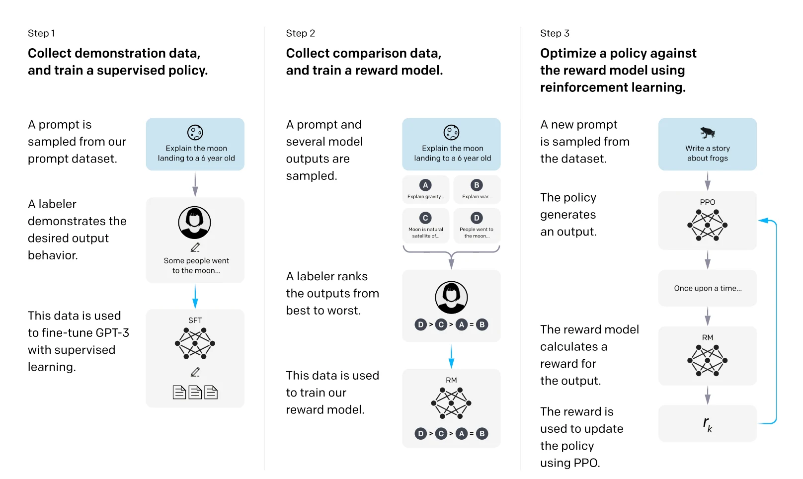
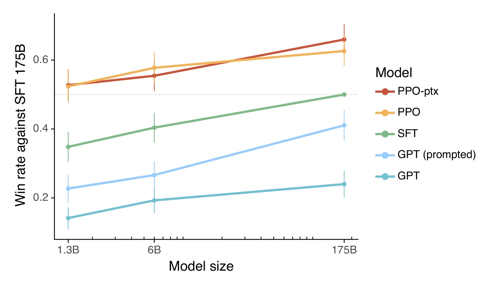
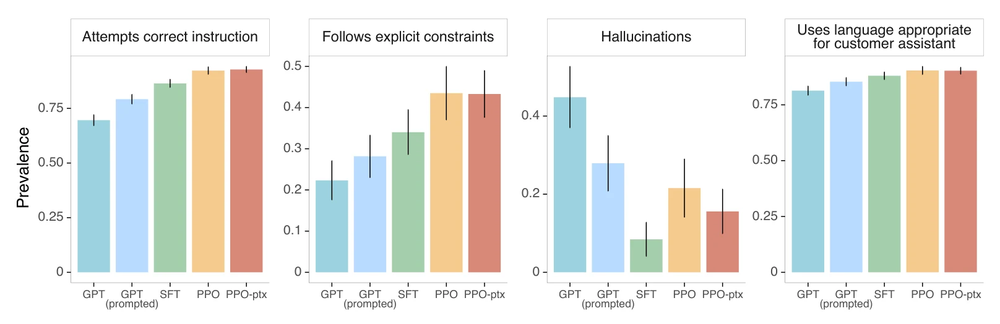
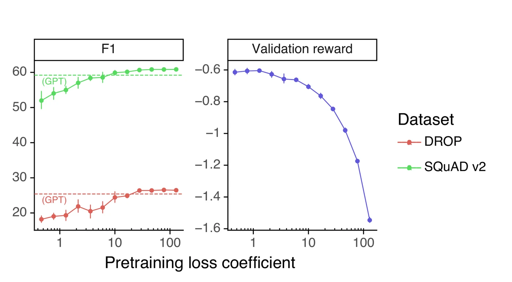

# InstructGPT：人类反馈怎样变成模型的回答习惯

2022 年，Long Ouyang、Jeff Wu、Xu Jiang 等 OpenAI 研究者发表了《Training language models to follow instructions with human feedback》。他们关注的是语言模型在实际使用中的表现：模型明明有能力回答，为什么还会继续改写问题、忽略要求，或者流畅地编造信息？作者在 GPT-3 的基础上加入人工示范、回答排序和强化学习，得到 InstructGPT。在论文的测试提示分布上，175B InstructGPT 的回答与同规模 GPT-3 直接比较时，获得了 $85\pm3\%$ 的人类偏好胜率；其中 B 表示十亿，175B 即 1750 亿参数，误差范围为作者报告的 95% 置信区间。[摘要、§1 与主要结果，PDF 第1–4页](https://arxiv.org/pdf/2203.02155v1#page=1)

这项工作的关键不是发明新的网络骨架，而是在 GPT-3 上重新组织训练信号。人工先示范“好的回答怎样写”，再比较“这几份回答哪份更好”；模型学会预测比较结果，随后用这个预测出来的分数，反复调整自己的生成方式。这就是本文的人类反馈强化学习（RLHF）：人的判断先进入数据，再通过评分模型和优化过程影响回答。

今天读这篇论文，最有用的收获是理解三个问题：为什么示范之后还要收集偏好；一个只会给回答打分的模型，怎样帮助另一个模型写得更好；为什么奖励更高、读者更喜欢、事实更正确，仍需分别检验。导读将最多的篇幅放在图 2 的训练链路，以及奖励模型和强化学习的计算上。一个自编的简短通知摘要例子会贯穿这些环节，帮助把公式里的提示、回答、分数和概率对应起来。

本文固定采用 2022 年 3 月 4 日的 arXiv v1，先讲背景、任务和数据，再对照原图拆解方法，最后回到实验与局限。原文正文共 20 页，另有较长附录；其中有些实现细节比正文的三步概述更复杂。理解这些细节，能看清作者怎样把三步思路落实成一套可检验的训练方法。[固定版本记录](https://arxiv.org/abs/2203.02155v1) · [固定原文 PDF](https://arxiv.org/pdf/2203.02155v1)

## 从会续写到会做事：作者看见了什么差距

理解 InstructGPT，要先把“能生成某种答案”和“收到要求后通常会生成这种答案”分开。预训练语言模型的任务是根据前面的文字，预测下一个词元。词元是模型处理文字的基本单位，可以是字、词或词的一部分。模型在大量文本上学习这种预测，逐渐获得语言表达、知识关联和一些推理能力；但训练目标本身只要求后续文字像训练语料，没有直接规定它应当成为一个可靠的助手。

例如，输入“把下面的通知压缩成两句话”，在互联网上可能出现在练习题、聊天记录、任务清单或教学文章里。模型可以接着写答案，也可以继续列下一道题。继续列题符合练习题的文本格式，却偏离了当前用户的任务。即使开始作答，模型还可能补上一段听起来很自然、原材料却没有说过的解释。作者看到的差距正在这里：预训练奖励的是接近文本分布的续写，用户关心的是这次要求是否得到满足。[§1 的目标错位，PDF 第1–2页](https://arxiv.org/pdf/2203.02155v1#page=2)

GPT-3 已经能通过少样本提示，在输入中看到几个例子后推断任务；精心设计提示也能显著改变输出。问题是，使用者需要花心思设计这样的开场白，才能把模型引到所需的回答方式上。InstructGPT 想把这种配合变成常态：通过训练，让已有能力更经常以符合请求的方式表现出来。

作者用三个词描述期望：有帮助（helpful）、诚实（honest）、无害（harmless）。有帮助要求完成任务；诚实要求不编造、不误导；无害涉及对人和环境的影响。要把这三个直观目标用于训练，还需要明确具体情境中的判断标准。什么叫“简洁而充分”？面对错误前提，应该纠正问题还是顺着答？用户要求有害内容时，“听话”和“无害”又会冲突。研究的第一项工作，是把这些判断变成人能实际标注的材料。

此前的人类反馈研究已经在文本摘要等较集中的任务中使用“比较回答、学习奖励、优化策略”的路线。本文把它应用到更广泛的自然语言任务：写作、问答、改写、摘要、对话和信息提取。它的贡献因此更像一次完整的方法整合与实证检验：在真实使用风格的提示上，这套训练能否持续改变模型行为？哪些变化确实改善体验，哪些只是换了一种失败方式？[§2 相关工作与 §3.1，PDF 第4–6页](https://arxiv.org/pdf/2203.02155v1#page=4)

## 任务是什么：提示、回答与生成概率

接下来需要明确，训练到底在改变什么对象。InstructGPT 的输入是一段提示，里面可以有直接指令、需要处理的材料、回答格式，或者几个示例；输出仍然是一串文本。模型沿用 GPT-3 的基本架构，通过参数更新学习怎样回应这些输入。作者训练了 1.3B、6B 和 175B 三种规模的回答模型，分别对应 13 亿、60 亿和 1750 亿参数。[模型规模与任务，PDF 第3、7页](https://arxiv.org/pdf/2203.02155v1#page=3)

用导读的记号，提示写作 $x$，回答写作 $y=(y_1,\ldots,y_T)$，模型参数写作 $\phi$。给定提示，整份回答的概率可以分解为：

$$
\pi_\phi(y\mid x)=\prod_{t=1}^{T}\pi_\phi(y_t\mid x,y_{<t}).
$$

这里的符号 $\pi$ 表示“策略”：在强化学习里，它表示遇到一个状态后选择行动的概率。在本文中，状态就是提示加上已经写出的前文，行动就是选择下一个词元。$y_{<t}$ 表示前面已生成的部分。模型逐词生成，最后得到一份完整回答；参数更新则改变下一次各种回答出现的可能性。这组教学记号把语言建模中的逐词预测，连接到了强化学习中的行动选择。

后文使用下面这个**导读自编的教学例子**，通知、回答和数值均为讲解所设，不是论文实验记录：

> 提示：把这则通知压缩成两句话，不要添加原因。通知：青禾阅览室周三因设备检查暂停开放一天，周四恢复开放。线上借阅服务照常。

一份合适的回答可以是：“青禾阅览室周三暂停开放一天，周四恢复开放。线上借阅服务照常。”它保留了时间和服务范围，满足两句话的要求，也没有增加解释。另一份回答可能把“设备检查”扩写成“由于线路损坏正在紧急维修”，读起来流畅，却增加了通知没有提供的事实。第三份可能逐字复制原文，信息正确但没有按要求压缩。

这个例子同时包含三种判断：有没有做摘要、有没有遵守形式约束、有没有忠实于材料。只用“和标准答案有几个相同的词”很难概括这些要求，因为合适的摘要可以有多种写法。面对多种可行答案，作者采用了两种人类反馈：示范告诉模型一种好写法，排序告诉模型在多种写法中如何取舍。

这项研究改变的是模型在训练结束后的生成习惯。开发时，评分模型提供奖励，优化过程更新参数；使用时，训练好的回答模型收到提示，直接生成文本。接下来图 2 展示的，正是这种习惯如何在训练阶段形成。

## 人的要求如何进入数据：示范、排序和无标签提示

把人的要求变成训练信号，首先要准备合适的数据。研究团队需要决定收集什么任务、谁来判断、用什么规则，以及怎样把训练和测试分开。本文约聘用了 40 位标注者，并通过筛选、任务说明和持续沟通，让他们能够处理各种自然语言请求。对任务意图很不清楚、或缺乏所需专业知识的输入，标注者可以跳过。[§3.2–3.4，PDF 第6–8页](https://arxiv.org/pdf/2203.02155v1#page=6)

提示有两个来源。一部分由标注者编写，包括直接任务、带示例的任务，以及根据使用场景写出的请求；另一部分来自 OpenAI Playground 中使用早期 InstructGPT 的请求。论文特别说明，这里没有使用客户通过 API 在生产应用中提交的数据。团队按长公共前缀去重，限制每位用户的提示数量，并按用户身份划分训练、验证和测试集，使测试用户没有出现在训练用户中；训练提示还经过个人可识别信息过滤。

按用户划分有什么作用？同一个用户可能反复提交同一任务的近似版本。如果这些变体同时进入训练和测试，模型在测试时面对的就可能是非常熟悉的格式。按用户分开，是为了让实验更接近“遇到未参与训练的新用户请求”。不过提示仍来自相近的产品环境，因此这是同源分布上的泛化检验。

三种训练材料的区别可以放在一张表里，其中 PPO 是后文会展开的策略优化算法。数量摘自附录表 6 的训练部分，计数单位是**提示**；前两行的合计由表中两个来源相加得到。[数据规模与单位，PDF 第7、33页](https://arxiv.org/pdf/2203.02155v1#page=33)

| 用途 | 标注者编写的提示 | 使用请求中的提示 | 合计 | 伴随提示提供什么 |
| --- | ---: | ---: | ---: | --- |
| 监督微调 SFT | 11,295 | 1,430 | 12,725 | 人工示范回答 |
| 奖励模型 RM | 6,623 | 26,584 | 33,207 | 同一提示下多份模型回答的排序 |
| 强化学习 PPO | 0 | 31,144 | 31,144 | 不附人工答案或排序，训练时由模型生成并评分 |

表中最后一列说明了三种材料怎样衔接。RM 的 33,207 条计的是提示，不是比较次数：每条提示对应多份候选回答，一次排序可以产生多个比较对。到了 PPO 阶段，这些人工判断已经被学进奖励模型，用来评价新采样的回答。于是，一批有限的人工比较能够支持后续反复生成与改进。

任务分布也解释了为什么作者没有只拿公开分类题来训练。表 1 中，开放生成占 45.6%，头脑风暴占 11.2%，开放问答占 12.4%，摘要占 4.2%。这些比例来自奖励模型数据中的使用场景标注。大量请求是开放式创作或建议，很难为每道题准备唯一答案。论文的提示超过 96% 为英文，实验主要反映英语请求下的使用表现。[表 1 与 §3.3，PDF 第6–7页](https://arxiv.org/pdf/2203.02155v1#page=6)

对前面的阅览室通知，写示范时，标注者需要亲自组织两句话；做排序时，只需比较几份已经生成的摘要，看哪份更符合任务。相比从头写出一份完整答案，比较已有回答可以更直接地聚焦某个差别，例如哪份遗漏了恢复开放时间。它也保留了不完美答案之间的相对信息：即使所有候选都有问题，仍可能分出哪些错误更严重。

标注规则本身是方法的一部分。作者明确说，训练阶段优先考虑对用户有帮助，而最终评价更强调真实性和无害性；附录 B.2 还说明规则在项目中持续调整。训练数据中的偏好因此包含了明确的取舍：发生冲突时，先帮助用户完成请求。这项选择会在后面的有害指令实验中重新出现。[§3.4 与附录 B.2，PDF 第8、36页](https://arxiv.org/pdf/2203.02155v1#page=36)

## 对照图 2：三个阶段怎样接起来

图 2 是本文的核心：它画的不是三个网络处理同一输入，而是按时间顺序展开的三个训练阶段。先从左到右区分“这一列在训练谁”，再从上往下看“训练材料怎样得到”。蓝色箭头表示数据用于训练模型，灰色箭头表示采样、生成或传递。[图 2，PDF 第3页；§3.1，PDF 第6页](https://arxiv.org/pdf/2203.02155v1#page=3)

**左列：监督微调，训练一个会回答的起点。** 从提示集中取一条请求，人类写出希望看到的回答，再让 GPT-3 模仿这些示范。图中用“向六岁孩子解释登月”的请求说明流程，人类回答从“有人去了月球”开始。输出是 SFT 模型，SFT 即监督微调（Supervised Fine-Tuning）。它仍然会生成文字，只是生成概率被示范重新调整过。

**中列：学习一个评分函数。** 针对同一个提示，从模型中采样多份回答，图中标为 A、B、C、D。人类把它们从好到坏排序，再用这些相对关系训练奖励模型（Reward Model，RM）。图中的 D 排在最前，A 与 B 被判为相当；评分模型据此学习回答之间的相对好坏。RM 的输入是一对“提示和回答”，输出是一个数。

**右列：让回答模型利用评分改进。** 再取一个新提示，当前策略写出回答，RM 给出奖励，用近端策略优化（Proximal Policy Optimization，PPO）更新策略。右侧蓝色回路回到 PPO 方框，说明下一轮负责生成的模型发生了变化。图中的新任务是写青蛙故事，奖励模型把从比较中学到的判断用于这个新提示下的回答。

把三列的对象并排，会比只记缩写清楚：

| 阶段 | 训练样本的核心形式 | 被更新的对象 | 希望改变什么 |
| --- | --- | --- | --- |
| SFT | 提示 $x$、人工回答 $y^*$ | 生成回答的语言模型 | 提高示范回答的概率 |
| RM | 提示 $x$、回答 $y_w,y_l$ 及偏好方向 | 输出标量的奖励模型 | 让更受偏好的回答分数更高 |
| PPO | 提示 $x$、当前策略采样的回答 $y$、奖励 | 生成回答的策略及辅助的回报预测模型（价值函数） | 提高较好行为的概率，同时控制偏离 |

这里有两个不同的“学习”。RM 学人怎样评价，PPO 策略学怎样产生高评价的回答。在一个 PPO 训练阶段内，奖励模型固定，负责提供反馈；策略持续变化，负责探索和生成。作者说明第二、三步可以迭代：收集新策略的输出比较，训练新 RM，再优化新策略。实际论文中的大部分比较数据来自监督策略，也有一部分来自 PPO 策略。[三步之间的迭代关系，PDF 第6页](https://arxiv.org/pdf/2203.02155v1#page=6)

图 2 为了清楚省略了两项重要约束：一项用 KL 散度衡量两个生成概率分布的差异，限制策略偏离 SFT 起点；另一项是继续学习预训练文本的混合目标。这两项约束稍后展开。图中的三列先建立了清楚的分工：人提供示范与比较，RM 学习评价，回答策略利用评价改善生成。

## 第一阶段：SFT 怎样把示范变成生成习惯

监督微调回答的是：“已经会写文本的模型，怎样更经常写出我们希望的回答？”具体做法是把提示和人工示范一起送入模型，让模型在知道提示和正确前文的条件下，预测示范回答的下一个词元。模型每预测错一步，都会得到明确的学习信号。

用前面的导读记号，示范回答为 $y^*$。SFT 的学习目标可以概括为最小化负对数似然，写成下面这个教学公式：

$$
\mathcal L_{\mathrm{SFT}}(\phi)
=-\mathbb E_{(x,y^*)\sim D_{\mathrm{SFT}}}
\left[\sum_{t=1}^{T}\log\pi_\phi(y_t^*\mid x,y_{<t}^*)\right].
$$

$D_{\mathrm{SFT}}$ 是示范数据集，$\mathbb E$ 表示对数据取平均。每一项都在问：“给了这条提示和示范的前半段，模型给正确的下一个词元多大概率？”概率越小，负对数越大，惩罚越重。更新参数后，类似提示下的这类写法会更容易出现。

沿阅览室的例子想一遍。人工示范没有写“线路损坏”，训练也不会为这条不存在的解释提供正向模仿信号；它示范了保留周三、周四和线上服务，把内容组织成两句话。模型从许多不同任务中学习后，可能逐渐形成“先完成请求、遵守格式、少补无关背景”的习惯。共享参数把不同任务中学到的表达方式联系起来，使这些习惯有机会推广到新提示。

为什么已经有 SFT，还需要后面两步？因为监督目标主要告诉模型“模仿这一份示范”，没有充分利用其他可行回答之间的差别。对开放任务来说，一份参考答案只是众多好答案之一；给整篇文本逐词监督，也不直接表达“这一版更简洁，但那一版更忠实”这样的整体取舍。用户实际读到的是一份完整回答，偏好比较恰好在这个层面提供信息。

额外的比较数据究竟能带来多少收益，作者用实验来回答。他们保留 SFT 作为基线，再与经过 PPO 的模型比较。后面的偏好结果显示，在本文的数据与训练条件下，示范训练已经明显改善行为，随后用 PPO 还能进一步提高总体偏好。这样的逐步对照，让两种反馈各自发挥的作用显现出来。

SFT 的训练还有一处很有启发性的观察。正文报告，作为比较基线的 SFT 训练了 16 个 epoch，即把训练数据遍历 16 轮；验证集上的词元预测损失在约一轮后就开始表现出过拟合，但继续训练仍提高了奖励模型分数和人工偏好。作者最终按验证提示上的 RM 分数选模型。这说明“对某份示范文本预测得多准”和“生成的完整回答多受偏好”是不同的选择标准。[§3.5 的 SFT 设置，PDF 第8页](https://arxiv.org/pdf/2203.02155v1#page=8)

实际进入 RLHF 的监督起点还有专门的配方。附录 C.3 说明，作者为它进行了两轮示范微调，并混入 10% 预训练数据；上面训练 16 轮的模型则作为 SFT 比较基线。这样，监督训练在研究中承担了两个角色：一是单独检验示范的效果，二是为后续强化学习准备合适的起点。[附录 C.3，PDF 第42页](https://arxiv.org/pdf/2203.02155v1#page=42)

## 第二阶段：RM 怎样从排序学出一个分数

人可以看出哪份回答更好，但后续训练需要大量反复试写，逐份交给人评价会很昂贵。奖励模型的作用，是把有限的人工比较推广到新的“提示—回答”组合。它用一个实数分数 $r_\theta(x,y)$ 表达评价；$\theta$ 是评分模型的参数，与回答策略的参数 $\phi$ 分开。

从结构看，原来生成词元的语言模型最后要把隐表示映射到整个词表；RM 则把输出端改成标量评分。它必须同时读提示和回答：同一句话在“写故事”时可以是合理创作，在“只总结这段通知”时却可能是无依据的添加。正文用“从 SFT 去掉最终词表输出层”概述这个改造，附录 C.2 则补充，最终使用的 6B RM 实际从一个在公开语言任务上微调过的 GPT-3 初始化，主要是历史实现原因；从 GPT-3 或 SFT 初始化也得到相近结果。[§3.5，PDF 第8页；附录 C.2，PDF 第41页](https://arxiv.org/pdf/2203.02155v1#page=41)

**排序怎样变成比较对。** 论文让标注者一次排序 $K=4$ 到 $9$ 份回答。一份没有平局的完整排序，可以展开成 $\binom K2=K(K-1)/2$ 个回答对。例如四份回答 A、B、C、D 排成 A>B>C>D，就得到 A>B、A>C、A>D、B>C、B>D、C>D 六对；九份回答最多得到 36 对。最终 RM 训练会丢弃平局比较。[比较数量与训练组织，PDF 第8、41–42页](https://arxiv.org/pdf/2203.02155v1#page=8)

一次排序展开出的六个比较，并不是六次独立的人类判断；它们共享同一个提示和几份回答。如果拆散后当成独立样本轮流更新，每个回答会被重复使用多次。作者发现这样做容易过拟合，因此把同一提示的所有比较作为一个批元素：每份回答先算一次分数，再从这些分数构造各对损失。这样既节省前向计算，也保留了“一次排序产生一组相关比较”的结构。

**一个分数差怎样表示偏好。** 对一对回答，用 $y_w$ 表示人更喜欢的回答，$y_l$ 表示另一份。模型将两者的分数差放进 sigmoid 函数：

$$
P_\theta(y_w\succ y_l\mid x)
=\sigma\!\left(r_\theta(x,y_w)-r_\theta(x,y_l)\right),
\qquad \sigma(z)=\frac{1}{1+e^{-z}}.
$$

这是对原文式（1）所用比较模型的展开记号。分数相同，预测偏好概率是 0.5；更受偏好的回答分数越高，概率越接近 1。训练时希望模型把人的选择预测对，所以最小化它的负对数。固定 v1 将 RM 损失写作：

$$
\operatorname{loss}(\theta)
=-\frac{1}{\binom K2}
\mathbb E_{(x,y_w,y_l)\sim D}
\left[\log\sigma\!\left(r_\theta(x,y_w)-r_\theta(x,y_l)\right)\right].
$$

$D$ 是人工比较数据，前面的归一化系数对应每个提示展开出的比较数量。结合正文的训练说明理解，就是在同一提示的一组比较上汇总损失，让人偏好的回答取得更高分。训练信号因此落在两份回答的分数差上：拉大正确方向的差距，就会提高对人类选择的预测概率。[式（1）及符号定义，PDF 第8页](https://arxiv.org/pdf/2203.02155v1#page=8)

**把阅览室例子缩成一次手算。** 设 A 是保留三项信息、满足两句话要求的摘要；B 擅自加入“线路损坏”，人类选择 A。下面的分数是教学指定值：

| 当前分数 | $r(A)-r(B)$ | 模型预测 A 更好的概率 | 这一对的负对数损失 |
| --- | ---: | ---: | ---: |
| $r(A)=0,\ r(B)=0$ | 0 | $1/2$ | $\ln2\approx0.693$ |
| $r(A)=\ln3,\ r(B)=0$ | $\ln3$ | $3/4$ | $-\ln(3/4)\approx0.288$ |
| $r(A)=0,\ r(B)=\ln3$ | $-\ln3$ | $1/4$ | $\ln4\approx1.386$ |

第一行表示模型还分不出好坏。第二行与人的选择一致，损失下降。第三行方向相反，损失更大。如果把分数差记作 $\Delta$，这一个比较的损失对 $\Delta$ 的导数是 $\sigma(\Delta)-1$；当 $\Delta=0$ 时为 $-1/2$，梯度下降会推动分数差增大。实际更新的是共享神经网络参数，所以这个局部方向还会影响其他提示和回答。

这个计算同时揭示奖励分数的含义。若把第二行改成 $r(A)=10+\ln3,r(B)=10$，预测仍是 $3/4$。比较训练无法确定一个绝对零点，因而零分也不等于“完全没有帮助”。作者在 RL 前用偏置归一化，使人工示范的平均分为 0，给后续优化建立统一的基准。[奖励平移与归一化，PDF 第9页](https://arxiv.org/pdf/2203.02155v1#page=9)

还有一个更重要的后果：即使 A 胜过 B，A 也可能有缺点。假如 A 漏掉线上服务，B 既漏信息又编原因，人仍可能选 A。RM 学到的是数据中的相对偏好，后续策略追求的是这个偏好的预测值。因此作者要限制奖励的过度优化，并用独立的人类评价检查生成结果。这正是第三阶段中 KL 约束和最终测试存在的理由。

## 第三阶段：PPO 怎样让高分回答更常出现

现在有了会写回答的策略，也有了会给回答打分的 RM。第三阶段解决的问题是：“分数如何反过来改变写作方式？”作者使用强化学习：让策略自己采样回答，观察奖励，再更新生成这些回答的概率。和 SFT 相比，学习目标不再是一份给定示范的逐词复现，而是策略自己尝试后得到的反馈。[强化学习环境与 PPO，PDF 第9页](https://arxiv.org/pdf/2203.02155v1#page=9)

从整份回答看，这是一个很短的交互：给提示、交回答、得到奖励，本轮结束。论文称它为 bandit 环境，即一次响应之后就获得反馈，没有跨很多轮的外部任务状态。但语言模型内部仍然是逐词生成，整份回答的好坏需要转化成各生成步骤的训练信号。前面写的概率分解，正是把整篇奖励连接到词元选择的入口。

奖励怎样传回生成过程？难点在于文本生成包含离散采样：模型一旦选出“周四”，RM 看到的就是这段确定的文字。策略梯度绕过了对文字本身求导的问题，转而利用整份回答的得分，调整选择这些词元的概率。相对预期更好的尝试倾向于被强化，更差的尝试倾向于被削弱。下面用一个简化计算说明这种更新方向。

为了看清方向，先暂时把整份回答当成一个行动，并省略 KL。仍用 A 表示合适摘要，B 表示添加错误原因的摘要。假设当前策略生成 A、B 的概率各为 $1/2$，RM 分别给 1 分和 0 分。这是简化教学设定，真实模型面对的回答空间远不止两种。

当前平均奖励是 $1/2$。若用它作基线，A 相对平均好 $+1/2$，B 相对平均差 $-1/2$；这种“比当前预期好多少”的量叫优势（advantage）。再设 $p=\sigma(z)$ 是生成 A 的概率，那么 $\partial\log p/\partial z=1-p$，而 $\partial\log(1-p)/\partial z=-p$。在 $p=1/2$ 时：

| 采样到的回答 | 优势 | 对应对数概率的导数 | 两者相乘给出的上升方向 |
| --- | ---: | ---: | ---: |
| A | $+1/2$ | $+1/2$ | $+1/4$ |
| B | $-1/2$ | $-1/2$ | $+1/4$ |

无论采到 A 还是 B，在这个两行动简化模型里，期望更新都推动 $z$ 增大，也就是提高 A 的概率。采到 B 时，更新并不是模仿 B，而是利用负优势降低它相对于 A 的机会。这是偏好驱动训练与只模仿现有示范之间很直观的差别。

真实 PPO 还要处理两个问题。第一，不同提示本身难度不同，因此要把一份回答的奖励与当前提示下的预期回报比较。作者使用价值函数估计生成前缀对应的预期回报，再据此估计优势；本文的价值函数从 RM 初始化，但在 PPO 阶段作为另一个会学习的对象。RM 提供评价，价值函数帮助稳定策略学习，这两个角色容易因同源初始化而被混淆。[附录 C.4 的价值函数，PDF 第42页](https://arxiv.org/pdf/2203.02155v1#page=42)

第二，一批回答是旧策略采出来的，若据此猛改参数，更新后的策略可能离采样时太远，旧数据就难以代表当前行为。PPO 用新旧策略概率比构造受限的优化目标，常见的剪裁机制会抑制有利方向上的过大变化。本文附录设置的 clip ratio 为 0.2，它作用于优化目标中的概率比，帮助控制一轮更新的步幅。PPO 是作者采用的既有方法，在这里承担把奖励转成稳定策略更新的工作。[PPO 原论文 v2，§2–3、PDF 第2–3页](https://arxiv.org/pdf/1707.06347v2#page=3) · [本文 PPO 设置，PDF 第42页](https://arxiv.org/pdf/2203.02155v1#page=42)

把一次真实训练迭代按对象展开，数据流如下：

| 步骤 | 输入与处理 | 输出及更新对象 |
| --- | --- | --- |
| 采样 | 从提示集取 $x$，当前策略逐词生成 $y$ | 保存回答、生成时的概率等训练信息 |
| 评价 | 固定 RM 读取 $(x,y)$；固定的监督起点作为参考模型提供概率 | 回答奖励及逐词偏离代价 |
| 估计 | 价值函数估计预期回报，与实际反馈结合 | 各生成位置的优势估计 |
| 优化 | PPO 根据优势和新旧概率比更新 | 回答策略与价值函数变化；RM 和参考模型不随本轮更新 |

这样，有限的人工排序变成了一个可反复使用的反馈器。它也产生一个新风险：策略越来越擅长让 RM 打高分，可能逐渐找到评分器误判的表达方式。作者因此在奖励之外加入两项约束，让策略的改进保持在较稳妥的范围内。

## KL 与预训练混合：为什么不能只追高分

奖励模型只是人类判断的近似。训练策略主动寻找高分回答时，面对的文本分布也会逐渐离开 RM 最熟悉的区域。作者因此加入两种不同的保护：一项限制策略相对监督起点的偏离，另一项继续维持原来的语言建模训练。前者是 KL 约束，后者对应 PPO-ptx 中的预训练混合。[§3.5 与式（2），PDF 第9页](https://arxiv.org/pdf/2203.02155v1#page=9)

原文式（2）是整个训练目标最值得细读的地方。下面用 $J$ 表示目标，并把第二项的文本变量改名为 $z$，避免同一个 $x$ 同时表示提示与预训练文本，其余内容保持原意：

$$
\begin{aligned}
J(\phi)={}&\mathbb E_{(x,y)\sim D_{\pi_\phi^{\mathrm{RL}}}}
\left[r_\theta(x,y)-\beta\log\frac{\pi_\phi^{\mathrm{RL}}(y\mid x)}{\pi^{\mathrm{SFT}}(y\mid x)}\right]\\
&+\gamma\mathbb E_{z\sim D_{\mathrm{pretrain}}}
\left[\log\pi_\phi^{\mathrm{RL}}(z)\right].
\end{aligned}
$$

作者最大化这个目标。$\pi_\phi^{\mathrm{RL}}$ 是正在训练的回答策略；$\pi^{\mathrm{SFT}}$ 是固定的监督初始化参考策略；$r_\theta$ 是固定 RM 给出的回答分数。第一个期望是在提示以及当前策略生成的回答上取平均，第二个期望来自预训练文本分布。$\beta$ 控制偏离代价的强度，$\gamma$ 控制预训练目标的权重。论文把 $\gamma=0$ 的变体称为 PPO，把包含预训练混合的变体称为 PPO-ptx；没有特殊说明时，文中的 InstructGPT 指后者。

**第一项：鼓励更受偏好的回答。** 这是 RM 最直接的用途。策略若更常生成高分回答，平均奖励就上升。回到阅览室例子，它可以鼓励保留必要信息、遵循两句话格式，而减少答非所问或擅自扩写。

**第二项：不要一下离开原来的回答分布。** 概率比的分子是当前策略生成这份回答的概率，分母是固定参考策略的概率。如果某份回答被当前策略大幅提高概率，$\log$ 比值会变大，目标里就扣掉更多。若它被降低概率，单个样本的这个量也可能为负；对当前策略的所有回答取期望后，得到的才是非负的 KL 散度：

$$
D_{\mathrm{KL}}\!\left(\pi_\phi^{\mathrm{RL}}(\cdot\mid x)\Vert\pi^{\mathrm{SFT}}(\cdot\mid x)\right)
=\sum_y\pi_\phi^{\mathrm{RL}}(y\mid x)
\log\frac{\pi_\phi^{\mathrm{RL}}(y\mid x)}{\pi^{\mathrm{SFT}}(y\mid x)}.
$$

这是导读展开的 KL 定义，比较的是当前策略与参考策略对各种回答分配的概率。由于整段概率是各词元条件概率的乘积，整段的对数比可以拆成逐词对数比之和，这就是正文所说的 per-token KL penalty 的来源。

**一个小到可以手算的权衡。** 仍假设只有 A、B 两种完整回答，参考策略各给 $1/2$ 概率，奖励分别为 1、0。如果新策略仍各取一半，平均奖励为 0.5，KL 为 0。若改为 A 占 $3/4$、B 占 $1/4$，平均奖励升至 0.75，但同时付出：

$$
D_{\mathrm{KL}}=\frac34\log\frac{3/4}{1/2}+\frac14\log\frac{1/4}{1/2}
=\frac34\log1.5+\frac14\log0.5\approx0.131.
$$

取教学系数 $\beta=1$、先不计预训练项，新目标约为 $0.75-0.131=0.619$，高于起点的 0.5。若把 A 的概率推到 1，平均奖励虽然达到 1，KL 却达到 $\log2\approx0.693$，目标反而只有约 0.307。这个例子说明，带约束的目标可以鼓励改善，又拒绝为了多拿一点奖励而过度集中。这里的 $\beta=1$ 只是教学值，本文实现用的 KL 系数为 0.02。[实际系数，PDF 第42页](https://arxiv.org/pdf/2203.02155v1#page=42)

KL 与 PPO 剪裁限制的是两种不同距离。PPO 关心本次更新相对采样旧策略走了多远；这里的 KL 关心当前策略经过多轮训练后，离固定的 SFT 起点多远。二者不能互相替代：即使每步很小，走久了仍可能偏离很远。单步限制与起点约束分别控制更新幅度和累积偏移，共同帮助策略平稳地改进。

**第三项：继续做原来擅长的文本预测。** 作者发现，只在提示分布上优化奖励，会使部分公开语言任务性能下降，于是额外取 GPT-3 的预训练文本，让当前模型继续提高这些文本的生成概率。实现时，预训练文本走语言建模这条训练通路，用户提示走 PPO 通路；两边分别计算梯度，最后合并更新同一个回答模型。[预训练混合实现，附录 C.4，PDF 第42页](https://arxiv.org/pdf/2203.02155v1#page=42)

这两项约束的侧重点因此很清楚：KL 主要控制在当前提示上的行为偏移，预训练混合则直接提供另一种数据分布和学习目标。这也引出了一个具体的实验问题：加入预训练目标，与单纯增大 KL 约束，哪种更能在维持偏好的同时保留原有任务表现？后面的消融会把两种做法放在一起比较。

## 训练与评价怎样组织：谁和谁比较

读实验之前，先认识各组模型，以及作者用来比较它们的评价方式。论文的主要比较从同一系列 GPT-3 出发，区分提示方式、是否使用示范，以及是否进一步利用偏好反馈。[基线与评价设置，PDF 第9–10页](https://arxiv.org/pdf/2203.02155v1#page=9)

| 名称 | 相对基础模型改变了什么 | 它检验的问题 |
| --- | --- | --- |
| GPT | 原始 GPT-3 | 未做本研究行为训练的起点 |
| GPT (prompted) | 加入精心选择的少样本指令前缀，不更新参数 | 只改提示能改善多少 |
| SFT | 用人工示范监督训练 | 模仿好回答能改善多少 |
| PPO | 在监督起点上，用 RM 奖励和 KL 约束训练 | 加入偏好驱动优化后怎样 |
| PPO-ptx | PPO 更新中加入预训练梯度 | 能否保留偏好提升并缓解能力退化 |

三种规模的策略都使用 6B 的 RM 和 6B 的价值函数。作者选择这个配置，一方面为了节省计算，另一方面较大的 RM 训练存在不稳定性；固定评分模型规模，也使比较回答策略规模更容易解释。附录还说明，每个 RL 模型训练 256k 个 episode，即约 25.6 万次提示—回答交互，来自约三万条去重提示。提示数、回答采样次数和参数更新次数是不同单位。[附录 C.2–C.4，PDF 第41–42页](https://arxiv.org/pdf/2203.02155v1#page=42)

**主要评价由人完成。** 在留出的用户提示上，让标注者比较模型输出。许多图使用同一个参照物：175B SFT。纵轴统计某模型的回答被偏好于这个参照的频率，因此相应的 50% 水平线表示与参照大致相当。作者另收集 1–7 分的整体质量评分，以及是否遵循指令、是否满足约束、是否在闭域任务中添加事实等标注。这些评价从三个角度描述回答：整体质量怎样、与另一份相比更喜欢谁，以及具体做对或做错了什么。

**公共数据集提供另一种观察。** 人更喜欢某份回答，可能是因为它更清楚、更切题，也可能是因为它更长、更像助手。作者因此另外测试事实性、有毒输出、偏见，以及阅读理解、翻译等传统语言任务。这里的自然语言处理常缩写为 NLP；各项公开 NLP 任务的成绩，帮助作者观察行为训练对不同语言能力的影响。[§3.6，PDF 第10页](https://arxiv.org/pdf/2203.02155v1#page=10)

作者还安排了两项泛化检查。第一，测试不仅使用早期 InstructGPT 风格的请求，也使用原先发送给 GPT-3 的请求，避免所有问题都天然更适合指令模型。第二，请未提供训练数据的另一组标注者来评分，观察提升是否只对训练标注者成立。这两项检查分别改变提示来源和评价者，目的比单纯多跑一个测试集明确得多。

整套协议由此连成一个反馈过程：RM 提供可反复调用的训练奖励，也帮助选择检查点；人类比较检验回答是否更符合使用要求，公开任务再检查事实性、安全代理和语言能力的变化。优化目标与外部评价相互配合，作者才能判断模型究竟改善了哪些行为。

## 偏好结果：小模型为何能胜过大模型

图 1 是论文最著名的结果图，但它需要先读纵轴。横轴是 1.3B、6B、175B 三种模型规模，纵轴是各模型对 **175B SFT** 的偏好胜率，而不是回答正确率；每个点的误差线为 95% 置信区间，表达由有限评价样本估计胜率的不确定性。不同颜色对应上一节的训练路线，灰色虚线是 0.5。每个点汇总的是人类在两份回答之间的选择。[图 1 与图注，PDF 第2页](https://arxiv.org/pdf/2203.02155v1#page=2)

先固定一个规模，从下往上看。原始 GPT-3 最低，加上少样本前缀后提高，经过示范训练的 SFT 更高，PPO 与 PPO-ptx 又进一步提高。这里呈现的研究逻辑是逐步增加对使用目标的表达：提示可以激活能力，示范可以改变默认行为，比较反馈进一步调整回答之间的取舍。逐步增加的基线，让这些训练信号与回答偏好的变化对应起来。

再沿同一条曲线看规模，更大的 SFT 整体更受偏好。而跨训练路线比较，1.3B 的 PPO-ptx 已经位于 175B 原始 GPT-3 的上方。作者据此并结合评价报告指出：在这套提示与标注协议上，13 亿参数的 InstructGPT 比 1750 亿参数的 GPT-3 更受偏好。这个结果说明，面向使用行为的训练，能够显著改变模型把已有能力表现出来的方式。

为直接衡量提升幅度，作者又让 175B InstructGPT 分别与两个 GPT-3 基线对战。下面的胜率均指 **175B InstructGPT 的回答胜过表中对手**；两项结果来自 §4.1，误差为 95% 置信区间。[直接比较，PDF 第11页](https://arxiv.org/pdf/2203.02155v1#page=11)

| 对手 | InstructGPT 的人类偏好胜率 | 要回答的问题 |
| --- | ---: | --- |
| 175B GPT-3 | $85\pm3\%$ | 行为训练后的模型相对基础模型改善多大 |
| 加少样本前缀的 175B GPT-3 | $71\pm4\%$ | 精心提示基础模型之后，训练收益是否仍然存在 |

共同参照与直接对战的区别非常重要。假设 A 对参照胜率 70%，B 对参照胜率 40%，也不能仅凭这两个数推得 A 对 B 的准确胜率。偏好会随题目和回答而变化，所以作者单独报告直接比较。这是读其他人类偏好论文时也值得保留的习惯。

图 3 把评价拆成四格：左右两列换提示来源，上下两行换评价者。总体上，改用 GPT-3 用户提交的提示，或改用没有参与训练的标注者，PPO 系列相对 GPT 基线的优势仍在。另一组评价者来自相同供应渠道，这一对照支持模型的偏好提升可以推广到该渠道中未参与训练的评价者。[图 3 与 §4.1，PDF 第11–12页](https://arxiv.org/pdf/2203.02155v1#page=11)

作者又比较了两种公开指令数据路线：FLAN 和 T0，它们把已有语言任务写成自然语言指令再训练。为比较这两种数据路线，作者分别用相应数据微调了 175B GPT-3，作为实验基线。本文采用的 T0 数据为 T0++ 变体，两路都进行了约百万级样本训练和检查点选择。在本研究的请求分布上，它们优于原始 GPT-3，但落后于作者的 SFT，InstructGPT 又进一步领先。[图 5、§4.1 与附录 C.5，PDF 第12–13、42–43页](https://arxiv.org/pdf/2203.02155v1#page=12)

作者的解释回到了数据分布：公开基准较多覆盖便于自动评分的问答、分类等任务，实际请求中却有大量开放生成和头脑风暴。这组对照中，数据内容、规模和后续优化方式一起变化，因此路线之间的差距不等于 PPO 算法的独立贡献。作者从中得到的认识是，训练材料与目标使用方式的匹配很重要：面向开放请求收集示范和比较，帮助模型学会了这类用户更需要的回答方式。

## 回答究竟改善在哪里：事实性、约束与安全

人更喜欢回答，究竟是因为模型做对了什么？图 4 把总体印象拆成四种可标注行为。它的横轴都是模型类型，纵轴是相应行为的发生比例，但四个面板使用不同的刻度，读柱高时要回到各自的纵轴。由于样本量原因，图中合并了不同模型规模。[图 4 与图注，PDF 第12页](https://arxiv.org/pdf/2203.02155v1#page=12)

第一个面板是“是否尝试了正确的任务”。模型收到摘要要求后却继续写另一条摘要题，就在这里失败。第二个是“是否遵循明确约束”，例如两句话以内、按给定格式作答。二者分开非常有意义：模型可以真的在做摘要，却写成五句话。PPO 系列在这两项上都比基础 GPT-3 更好，说明训练提高了模型对任务及其约束的遵循程度。

第三个面板是闭域幻觉。闭域任务指答案应主要由给定材料支持，例如摘要或基于给定段落问答；阅览室例子里擅自写“线路损坏”，就属于这种添加。图中 SFT 与 PPO 系列都低于原始 GPT-3，但 SFT 的柱子比两个 PPO 变体还低。这为总体偏好增加了一层具体解释：PPO 系列在完成任务和满足约束上更好，而 SFT 在这组闭域任务中添加无据信息更少。

第四个面板判断语言是否适合助手场景，关注角色和表达的合宜性。它与前三个面板一起，把“回答更好”拆成了可观察的变化：模型是在更准确地执行任务，还是更忠实于材料，或是表达更适合助手角色？这些变化有时同向，有时存在取舍，图 4 让取舍也显现出来。

**开放问题的事实性用另一套测试。** TruthfulQA 是一个专门检查模型是否会顺着常见误解作答的问答基准。和闭域摘要不同，这里没有在提示中给出全部参考材料。作者在图 6 中同时报告“真实”和“真实且有信息量”：灰色柱表示前者，彩色柱表示后者。有些回答不说错话，只是因为避开了实质回答；两种评分分开，才能看出这一点。[§4.2、图 6，PDF 第13页](https://arxiv.org/pdf/2203.02155v1#page=13)

图 6 还比较普通问答提示，与额外说明“不确定就表示无可奉告”的提示。PPO 系列更容易在后一种设置下选择真实但信息不足的回答。作者报告总体上有小而显著的真实性与信息量改善，但 1.3B PPO-ptx 是例外，略低于同规模 GPT-3。这些结果呈现出一种更谨慎的回答习惯：遇到不确定的问题时，模型更倾向于少说；同时，真实且有信息量的回答能增加多少，还取决于模型规模和提示方式。

**有毒输出的结果更依赖指令。** RealToxicityPrompts 提供需要续写的文本开头，用来观察模型会不会继续生成粗鲁、冒犯等内容。论文同时使用人工评分和 Perspective API 的自动毒性评分。在图 7 中，175B 模型共有 1,729 条提示用于人工标注，分别比较有无“请以尊重的方式续写”的指令；同图的自动评分也使用这组提示。研究按输入毒性取样以近似均匀覆盖其范围，因此更充分地包含了高毒性输入，绝对分数会高于该数据集常规采样下的结果。[图 7 与测试条件，PDF 第14页](https://arxiv.org/pdf/2203.02155v1#page=14)

加入尊重性指令时，InstructGPT 的有毒输出评分低于 GPT-3；不加这条指令，优势基本消失。作者还报告，明确要求生成冒犯性内容时，InstructGPT 反而可能更有毒。这与前面的训练规则相呼应：如果训练主要奖励完成用户要求，学得更会听话就可能同时提高恶意请求的可执行性。原文因此把学习拒绝某些请求列为后续工作，以补上单纯鼓励完成任务留下的缺口。

偏见方面，作者使用改造后的 Winogender 和 CrowS-Pairs：前者围绕代词性别与指代，后者用句子对探查社会刻板印象。本文比较候选句的相对概率，并用二元分布的熵作为代理指标，结果没有显示出稳定改善。熵在这里描述模型对两个候选的选择有多确定：两者概率越平均，熵越高。熵衡量选择的确定程度，不能直接说明模型能否公平处理真实情境。作者观察到，某些设置主要让选择变得更确定，因此还需要更具体的测量来解释其中的偏见模式。[偏见测试及解释，PDF 第14页；附录 D.1，PDF 第44页](https://arxiv.org/pdf/2203.02155v1#page=14)

把这些实验合在一起，论文支持的是有结构的进展：总体偏好、任务遵循和部分事实性指标改善；真实性与信息量可能取舍；安全效果随提示改变；偏见代理指标没有同步改善。研究者的工作不只是把总分推高，还要找出改变发生在哪里。

## 对齐税与消融：保留能力为何需要另一种目标

上一节看到，行为改变可以带来取舍。作者还发现，普通 PPO 在一些公开任务上退步，例如需要数字推理的阅读理解 DROP、包含无答案问题的 SQuADv2、常识续写选择 HellaSwag，以及法语到英语的翻译任务。作者把这种为了行为对齐而付出的任务性能代价称为“对齐税”（alignment tax）。接下来的实验检验这种代价有多大，以及怎样缓解。[§4.2 的性能回退，PDF 第14–15页](https://arxiv.org/pdf/2203.02155v1#page=15)

为什么会发生？从训练目标看，PPO 反复优化的是当前请求分布上的奖励，未直接要求公开阅读理解题或翻译题保持原有表现。模型变得更像助手之后，回答格式、生成习惯和原有能力的使用方式都可能变化。作者从训练目标入手，提出一个可检验的修法：继续加入预训练目标，观察能否在维持偏好的同时恢复任务分数。

图 33 是一个很清楚的设计检验，附录 E.6 说明这组扫描使用 1.3B 模型。横轴为预训练损失系数，采用对数刻度；左图是 DROP 和 SQuADv2 的 F1，用来衡量预测答案与参考答案的匹配，越高越好，虚线标出 GPT 的参考成绩；右图是验证集奖励，也希望越高越好。两幅图共同展示任务恢复与偏好奖励之间的关系。[图 33，PDF 第55页](https://arxiv.org/pdf/2203.02155v1#page=55)

从左向右，增加预训练项后，左图的任务分数逐渐恢复；在一段系数范围内，右图的奖励只损失少量。继续把系数推得很大，任务分数趋于平缓，奖励却明显下跌。这正是式（2）中 $\gamma$ 的意义：太小，原有任务保护不够；太大，优化又被预训练目标主导。作者因此能够寻找一个有用的折中区间：任务表现已经明显恢复，验证奖励也保留得较好。

还有一个自然的替代方案：既然不希望模型改变太多，直接增大 KL 系数行不行？同页图 34 专门检验它：作者使用 1.3B 模型，关闭预训练混合，并改用预训练 GPT 作为 KL 参考模型，再扫描 KL 系数。增大 KL 确实会改变任务表现，但在测试范围内没有完全恢复 DROP 和 SQuADv2 的退化，同时较强约束会损害验证奖励。作者据此认为，混入预训练更新比单纯强化 KL 更有效。这与机制上的区别一致：一项是在当前提示上约束相对行为，另一项把原有数据分布真正重新带入训练。[图 34，PDF 第55页](https://arxiv.org/pdf/2203.02155v1#page=55) · [附录 E.6 的规模、参考与混合条件，PDF 第53页](https://arxiv.org/pdf/2203.02155v1#page=53)

回到最终模型，PPO-ptx 大幅缓解了退化，并在一些任务上达到或超过基础模型；但正文仍明确说，它在 DROP、SQuADv2 和翻译上落后于 GPT-3。预训练混合因而是一个有效的缓解办法，剩余的回退则为继续改进训练配方提供了具体目标。

从读论文的方法看，这组实验尤其值得学习。作者先观察到副作用，再给出有机制区分的两种补救，最后同时检查“要保护的指标”和“原先要提高的指标”。两类指标并排展示，读者就能看清恢复原有能力时付出了多少偏好奖励。这样的实验把“尽量兼顾”变成了可观察、可比较的设计选择。

## 局限与失败：更会听话以后还缺什么

训练链路的最后一个问题是：它究竟对齐了谁，又在哪些情形下失效？论文第 5 节从数据参与者和实际失败出发讨论这些问题，把奖励模型里的偏好放回它形成的过程。[§5.2–5.4，PDF 第18–20页](https://arxiv.org/pdf/2203.02155v1#page=18)

首先，训练中的偏好由三类参与者共同塑造：研究者选择任务和标注说明，标注者据此作出判断，产品用户决定实际提交什么提示。用户提交的请求由另一组标注者评价，后者主要根据眼前的文字推断意图，对背后的使用情境了解有限。因此，本文的行为调整面向的是这套应用场景、标注规则与参考群体。

其次，人之间确实会分歧。§3.4 报告训练标注者的相互一致率为 $72.6\pm1.5\%$，留出的标注者为 $77.3\pm1.3\%$，误差沿用全文的 95% 置信区间。这样的结果说明反馈具有可学习的共同部分，同时留下相当比例的不同判断。§5.3 还指出，为控制成本，大部分比较只由一位标注者标注；把不同意见压成一个平均奖励，可能掩盖应该被单独保留的差异。[标注一致性，PDF 第8页；方法局限，PDF 第19页](https://arxiv.org/pdf/2203.02155v1#page=8)

再看模型本身。论文图 9 给出了两个很有代表性的失败：面对带有荒谬前提的问题，模型可能顺着前提编解释；面对答案较清楚的常识问题，又可能过分强调“取决于很多因素”。这两种行为看起来相反，一个太轻信，一个太犹疑，却都可能源于没有学好“什么时候该纠正，什么时候该直接回答”的边界。[§4.3 与图 9，PDF 第16–17页](https://arxiv.org/pdf/2203.02155v1#page=16)

作者怀疑，过分保留是因为标注说明奖励认识上的谦逊，RM 学会偏好含有许多限定语的回答；顺从错误前提则可能与这类训练提示不足有关。这些是作者提出的解释假设，并不是已由控制实验证实的原因。但它们展示了很重要的研究方向：一个看似合理的标注原则，会通过奖励代理变成意料之外的写作习惯。

约束组合也仍然困难。模型可能能单独遵循时间范围、地点和条目数量，却在多个条件同时出现时遗漏其中一个。回到阅览室例子，满足“两句话”只是其中一项；真正可靠的回答还要保留恢复时间、区分线下与线上服务，并避免增加原因。总偏好较高，可以与某个关键条件反复失败同时存在。

作者还展示了非英语和代码请求的定性例子，认为模型有时把“遵循指令”的行为推广到了反馈中很少出现的领域。图 8 的提示为说明现象而挑选，回答则直接保留模型生成的结果，因此这些定性例子不能用来估计成功率。它们让作者看到，训练中学到的回答方式有机会延伸到少见任务上，也为后续系统测量这种泛化提供了线索。[§4.3、图 8，PDF 第15–16页](https://arxiv.org/pdf/2203.02155v1#page=15)

最后，指令跟随带来的可控性也可以被恶意使用。作者因此把 RLHF 放在更广的安全体系中讨论，包括限制某些用途、监测误用，以及继续改善模型的拒绝与事实核查能力。对本文的恰当评价是：它找到了一条有效且可观察的行为改进路径，同时也暴露出代理奖励、数据分布和人类判断本身的边界。

## 论文之后：把训练链路放回知识地图

下面从编辑视角，把这篇论文与相关研究联系起来。InstructGPT 留下的分析框架，比某一个固定超参数更值得带走：先有目标，再有示范与比较，随后形成可优化的代理，最后用独立评价检查结果。后续阅读任何偏好训练方法，都可以沿这条链判断它究竟改了哪里。

如果一项工作增加了新的反馈来源，它首先改变的是“谁在评价、评价什么”；如果换掉奖励模型或优化方法，它改变的是“怎样把反馈转成参数更新”；如果增加某类测试，它改变的是“哪些失败终于被测到了”。这些变化可能一起发生，但需要分别说明，才能解释最后的提升。

这也帮助区分几条常相邻出现的研究路线。GPT-3 强调预训练后怎样通过上下文中的指令和示例完成任务，参数在一次使用时不更新；InstructGPT 则通过额外训练改变之后的默认回答行为。需要补这层基础，可以接着读 [GPT-3 的上下文学习](/read/gpt3/1#u02)。

检索增强生成（RAG）主要处理另一种缺口：回答时怎样获得模型参数之外的依据。会按要求回答的模型仍可能缺少某篇资料，检索到资料的模型也仍可能误读或编造。行为训练与外部证据因此可以互补。相关路线见 [RAG 原始论文](/read/rag/2#u02) 与 [RAG 综述的方法地图](/read/rag-survey/5#u02)。

若最关心“一个胜率究竟说明了什么”，接着读 [HELM 的评价导读](/read/helm/2#u01) 更合适。本文已经显示，总偏好、事实性、毒性、任务成绩可以朝不同方向变化；评价论文会进一步讨论怎样选择场景、控制适配方式，并把多个指标放在一起理解。从训练转向评价，正好延续本文留下的问题：模型行为改变以后，怎样判断哪些变化真正有益？

## 回到原文：重点入口与覆盖说明

读完导读后，最值得回原文核对的是三条连接：数据如何进入模型，奖励如何进入策略，实验如何回到目标。它们分别对应下列位置：

- **图 2 与 §3.1–3.5，PDF 第3、6–9页。** 图中三列分别训练谁、哪一条箭头传递的是人工数据、哪一条是模型产生的分数，是理解方法的主线。式（1）在第8页，式（2）在第9页，适合与导读的排序和 KL 手算对照。[图 2](https://arxiv.org/pdf/2203.02155v1#page=3) · [奖励模型公式](https://arxiv.org/pdf/2203.02155v1#page=8) · [强化学习目标](https://arxiv.org/pdf/2203.02155v1#page=9)
- **图 1、图 3 与 §4.1，PDF 第2、11–13页。** 先分清共同参照，再读直接比较；随后看换提示来源、换评价者以后结果是否保持。[偏好结果与泛化检查](https://arxiv.org/pdf/2203.02155v1#page=11)
- **图 4、图 6、图 7 与 §4.2，PDF 第12–15页。** 总体更受偏好之后，哪些具体行为改善、哪些没有，是实验部分最重要的第二层问题。[行为与安全评价](https://arxiv.org/pdf/2203.02155v1#page=12)
- **附录表 6、C.2–C.4 与图 33–34，PDF 第33、41–42、55页。** 准备实现或引用方法细节时，数据单位、初始化模型和预训练混合都值得单独核查。[数据规模](https://arxiv.org/pdf/2203.02155v1#page=33) · [实现细节](https://arxiv.org/pdf/2203.02155v1#page=41) · [消融实验](https://arxiv.org/pdf/2203.02155v1#page=55)
- **§5.2–5.4，PDF 第18–20页。** 作者怎样解释偏好来源、群体差异与安全边界，决定了“对齐”一词在这篇论文中究竟承诺什么。[讨论与局限](https://arxiv.org/pdf/2203.02155v1#page=18)

本修订依据 arXiv 2203.02155v1 正文 §1–5 全文，并选读数据规模、标注说明、训练实现及消融附录，覆盖方法和主要证据主线。图 1、2、4、33 取自同一 PDF，裁切结果经 AI 实际查看；原图署名为 Ouyang 等，arXiv 默认非独占分发许可未授予再发布权，仅在私有仓库中作个人学术阅读引用。表格由导读摘录或整理，原文链接均固定版本，页码从 PDF 第一页计数。

青禾阅览室通知、候选摘要、RM 分数、两行动策略梯度与 KL 数值均为自编教学例子。未复现论文训练与评测，未逐项解释全部附录基准、超参数、样例和参考文献，也没有推导 PPO 的完整算法。通用概率与强化学习解释、论文后的联系属于编辑背景。正文与附录中会影响实现的配方差别已就近说明。阅读导读或打开来源，都不会自动记为已读原文。
