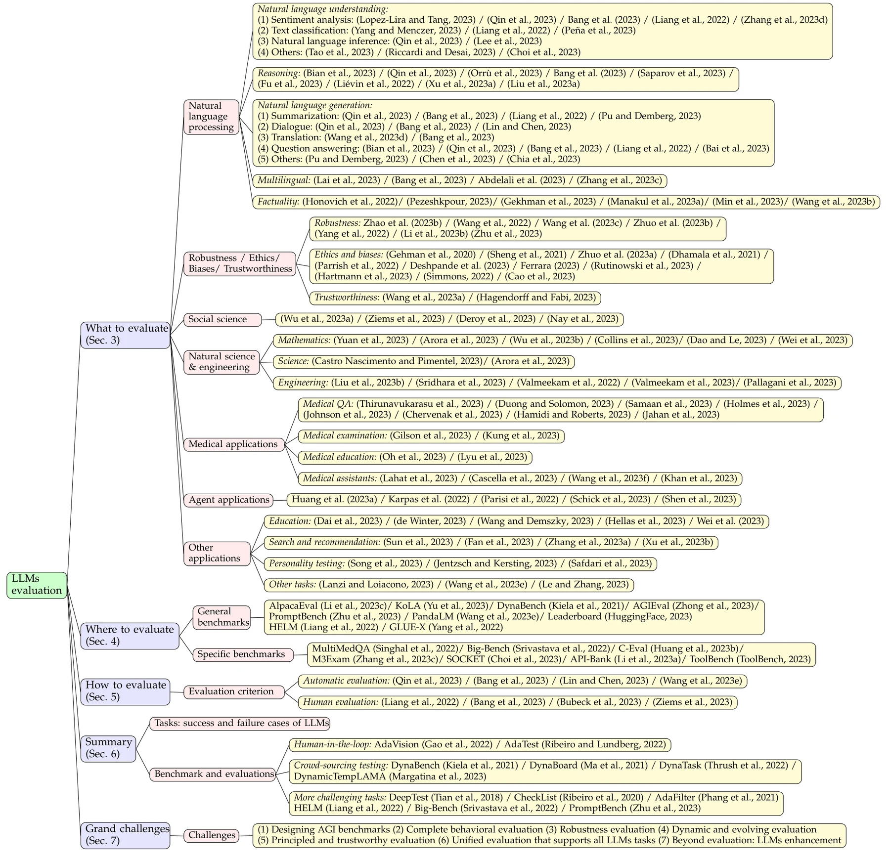
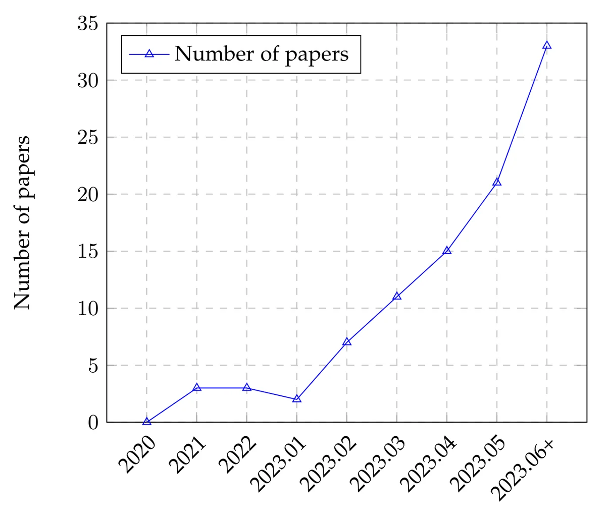

# Evaluating Large Language Models: Define the Measurement Before Interpreting the Score

Evaluation results often take the shape of a table: on the same set of items, model A scores 78.4 and model B 79.1, so A looks slightly weaker. But ask one more question, "where does this 0.7 come from?", and the matter falls apart. How were the items chosen? Who judged the answers, and by what standard? What prompt did the model receive? Is the comparison between models alone, or between a model and a model with a retrieval tool attached? If any one of these differs, the same gap in the same table can mean something different. In July 2023, Chang and colleagues wrote *A Survey on Evaluation of Large Language Models*, which breaks this matter into three connected questions, what to evaluate, where to evaluate and how to evaluate, followed by two sections that summarize findings and list challenges. In the introduction the authors call it the first survey to systematically review the evaluation of large models. It runs to 23 pages (17 of main text, the rest references), with literature covered up to July 2023. [Abstract and §1, PDF pp. 1–3](https://arxiv.org/pdf/2307.03109v1#page=2)

This survey is still worth reading today because what it offers is a skeleton, not a leaderboard. Large models have gone through generation after generation, but the questions evaluation has to answer are far more stable. What conclusion is this measurement meant to support? Can the sample represent that conclusion? Does the scoring method recognize the critical errors? Can the conditions of this run be written down clearly? After reading it, an evaluation table will turn in your eyes from "a number" into "a chain of evidence that can be checked link by link". It also explains why evaluation quickly became a research direction of its own after 2023, rather than just a table in the appendix of a paper.

The core of the survey is the taxonomy tree in Figure 1 and the evaluation chain in Figure 3. The guide first uses two sections to explain these two figures thoroughly, then looks at what they look like when applied to specific tasks, benchmarks and scoring methods. The reading order roughly follows the original: first how the survey organizes the problem, then what parts one evaluation is made of; then the language tasks and risk dimensions of "what to evaluate", the benchmark catalog of "where to evaluate", and the automatic and human methods of "how to evaluate"; and finally the authors' summary, the seven challenges and a checklist to take away.

This guide is pinned to [arXiv v1 of July 2023](https://arxiv.org/pdf/2307.03109v1), 23 pages in all. The survey also has a formal 2024 version in ACM TIST, and this guide does not mix in that version's additions or new page numbers. The model performances the survey lists are observations from mid-2023, and the authors themselves warn in their disclaimer that online services keep getting stronger, so some of the limitations described may already have been mitigated. To give abstract concepts something to hold on to, the guide prepares an invented teaching example: questions about the borrowing rules of a "Tangxi Library". The library's name, the rules and the numbers are all made up for the guide and were not run as an experiment.

## Figure 1: How a survey splits evaluation into three questions

Start with the map of the whole survey. Figure 1 is a tree that grows from left to right. At the far left is a single root node, "LLMs evaluation", which splits into five main branches to the right, each labeled with its section number: What to evaluate (§3), Where to evaluate (§4), How to evaluate (§5), Summary (§6) and Grand challenges (§7). The leaves are densely packed with cited papers, grouped cell by cell by topic. [Figure 1 and §1, PDF p. 2](https://arxiv.org/pdf/2307.03109v1#page=2)

There is an economical way to read this figure: read the questions in the blue boxes first, then decide whether to look at the reference cells on the right. Those cells are the survey's literature index, showing "which works exist under this topic"; they do not provide conclusions themselves. The real argument is in the text, and the figure only tells you which piles the argument has been divided into.

**The first main branch is "what to evaluate".** Under it, natural language processing branches off first: natural language understanding (sentiment analysis, text classification, natural language inference and more), reasoning, natural language generation (summarization, dialogue, translation, question answering and more), multilingual tasks and factuality. Then come four kinds of risk and scenario: robustness / ethics / bias / trustworthiness, social science, natural science and engineering, and medical applications. Last come agent applications and other applications (education, search and recommendation, personality testing and more).

**The second and third main branches are "where to evaluate" and "how to evaluate".** The former has only two branches: benchmarks for general tasks and benchmarks for specific downstream tasks. The latter also has only two: automatic evaluation and human evaluation. This shape, "one main branch splitting into just two", is worth noticing. It shows that at this level the survey is answering questions of choice: which collection to use, and which kind of scoring.

**The fourth and fifth main branches draw things together.** Summary collects the successes and failures on tasks and the direction of benchmarks and evaluation protocols. Grand challenges lists seven items: designing AGI benchmarks, complete behavioral evaluation, robustness evaluation, dynamic and evolving evaluation, principled and trustworthy evaluation, unified evaluation that supports all tasks, and going beyond evaluation to model enhancement.

The relation among these five branches is more like five stages of one evaluation than five parallel topics. You have to decide what to evaluate before you can find a suitable sample; only with a sample can you talk about which scoring to use; and once it is done, you have to summarize and also say clearly what was not measured. The rest of the guide largely follows this order.

One more point is stated explicitly in the original and easily overlooked when reading the figure: these categories overlap. In a footnote to §3.1, the authors declare that the areas of natural language processing intersect one another, and that their division is just one possibility; the same item can fall into the "question answering", "reasoning" and "factuality" cells at once. The use of the classification is to check whether anything has been left unmeasured, not to issue each item an identity card belonging to only one cell. [§3.1 footnote 1, PDF p. 4](https://arxiv.org/pdf/2307.03109v1#page=4)

Figure 2 shows the growth of literature behind this tree. The authors counted, by month, the number of evaluation papers they had collected: close to 0 in 2020, around 3 each in 2021 and 2022, still about 2 in January 2023, then rising almost month by month to a cumulative total of about 33 after June 2023. This curve explains why the survey was written in 2023 and why it is organized as a taxonomy tree rather than a timeline: when the literature grows from 2 papers to 33 in half a year, an account by time is out of date immediately, while an account by question still leaves a structure behind. [Figure 2 and §2, PDF p. 3](https://arxiv.org/pdf/2307.03109v1#page=3)

What this figure counts is the authors' own collection, not the total number of papers in the field, so it shows a trend, not a scale. The trend itself also carries a practical reminder: the survey's time boundary is July 2023, and benchmarks, scoring tools and models that appeared afterward are not in it. When reading its conclusions, first confirm which period the object under discussion belongs to.

## Figure 3: An evaluation is really a chain of evidence

The previous section answered "which parts the survey is divided into". This section looks at what one evaluation itself consists of. Figure 3 has only four boxes, from left to right Model, What (Task), Where (Data) and How (Process), with four arrows pointing successively to the right. It is drawn very simply, yet it fixes the order of argument for the whole survey. [Figure 3 and §2.2, PDF p. 4](https://arxiv.org/pdf/2307.03109v1#page=4)

It is most natural to read from Model. A model is placed on the evaluation bench; the first step is to specify what task it does, the second to specify which data it is done on, and the third to specify how it is run and how it is judged. All three arrows mean "given": the meaning of each later step depends on the earlier one. If the task is stated vaguely, there is no basis for choosing a sample; if the sample is skewed, however fine the scoring, it is fine only on a skewed sample. The figure explains why the survey puts "what to evaluate" first: it is the precondition for the next two steps.

**In traditional machine learning this chain has a full set of ready-made protocols.** §2.2 of the survey lists five approaches, k-fold cross-validation, holdout, leave-one-out, bootstrap and reduced set, and explains the cost of each: [§2.2, PDF p. 4](https://arxiv.org/pdf/2307.03109v1#page=4)

| Protocol | Procedure | Cost noted in the survey |
| --- | --- | --- |
| K-fold cross-validation | Split the data into K parts, using each part in turn for testing and the rest for training | Wastes less training data and gives a relatively more accurate estimate, but requires training K times |
| Holdout | Split the data directly into a training set and a test set | Little computation, possibly larger bias |
| Leave-one-out | A special case of k-fold, holding out only one example for testing each time | The number of training runs equals the number of examples |
| Bootstrap | Resample with replacement to estimate error | The paper only names it, without describing the procedure |
| Reduced set | Train on one portion of the data and test on the rest | Simple to compute, limited in applicability |

The common premise of these protocols is "the model can be trained repeatedly". With large models the premise no longer holds: one training run costs too much for k-fold, models are often available only through APIs, and the parameters are not in the evaluator's hands. So deep-learning evaluation long ago fell back on a cheaper route: run once on a static validation set. ImageNet and MS COCO in vision, and GLUE and SuperGLUE in language, are all products of this approach. [§2.2, PDF p. 4](https://arxiv.org/pdf/2307.03109v1#page=4)

Convenience has a price. A static validation set can tell you "how well the model answers this batch of items", but it cannot say where the items came from, how their difficulty is distributed, or whether the model saw them during training. At the end of §2.2 the survey stops halfway: existing evaluation protocols "may not be sufficient" to evaluate the true abilities of large models thoroughly, and later sections introduce new approaches. The guide completes that half-sentence: a complete evaluation chain should leave records in at least four places, the task definition, the data source and split, the running conditions and the judging method. Whichever link is missing, the score loses one layer of explanation.

**Why does "leaving records" matter so much?** Go back to the model end. §2.1 of the survey describes an autoregressive language model with a chain-rule expression: given the context $x_1,\dots,x_{t-1}$, the model predicts the probability of the next token,

$$
p(y\mid x)=\prod_{t=1}^{T}p(y_t\mid x_1,\dots,x_{t-1})
$$

Here $T$ is the sequence length and $y_t$ the output token at position $t$. This is the paper's own formulation, showing that the probability of a whole answer is the product of a chain of step-by-step predictions. [§2.1, PDF pp. 3–4](https://arxiv.org/pdf/2307.03109v1#page=3)

Read the expression in the language of evaluation: one answer contains $T$ decision points, and the final score reflects only their joint result. The model may get a rule wrong at the third step and then write on from the wrong premise all the way through, with the whole passage still reading fluently. Looking only at the final judgment, you get "wrong", without seeing "where it started going wrong". This inference is the guide's interpretation, not a proposition of the authors; it shows exactly why later sections distinguish outcome evaluation from process diagnosis, and why "a low score" should serve only as the starting point of an investigation.

**A teaching example that runs through the guide.** To give these abstract remarks a concrete footing, the guide invents a Tangxi Library and four borrowing rules:

| Rule | Content |
| --- | --- |
| R1 | At most 5 items per loan |
| R2 | Loan period 30 days, counted from the day of borrowing |
| R3 | Up to 2 renewals before the due date, 15 days each |
| R4 | Overdue fine of 0.2 yuan per day |

Around these four rules one can design an item: "How long at most can I keep a novel, and what do I need to do along the way?" The reference answer is "borrow for 30 days, renew at most 2 times for 15 days each, for a maximum of 60 days; each renewal must be done before the due date". The item is small enough to work out in one's head, yet it involves the task definition (it asks about "the maximum" and "the procedure", not "the overdue fine"), the data (which lines of the rulebook), the running conditions (whether the rulebook text is supplied) and the judging (how many points an answer of 45 days gets). Applying the four links of Figure 3 to this item gives each box concrete content:

| Box in Figure 3 | What it is in the Tangxi item | What change requires re-testing |
| --- | --- | --- |
| Model | The specific model and version, whether retrieval is attached | Model version, temperature, whether tools are attached |
| What (Task) | Asks "maximum duration and renewal procedure", using all four rules | The question changed to "how is the overdue fine computed" |
| Where (Data) | 40 self-built items, 10 for development and 30 for testing | The source of items, the split or the number of items |
| How (Process) | Whether the rule text is supplied; scoring by key points or by human judges | Prompt, scoring criteria, judges |

The rightmost column is what the table is for: if any one of the four cells changes, the earlier score is no longer the same measurement. The claim "our score is higher", which appears often in papers, does not hold as a comparison unless it states whether these four cells are the same. Later sections keep returning to this item to see where each cell can go wrong.

## What to evaluate, part one: Abilities and errors in language tasks

The first step of the evaluation chain is to state the task clearly. §3.1 of the survey goes through language tasks one category at a time, giving the research conclusions of the time for each. This section reads in its order while keeping one thing in mind: the authors state explicitly in §6.1 that these conclusions all depend on specific datasets. The same category of task can lead to opposite conclusions on different data, so each number below has to be read together with its conditions. [§3.1 and §6.1, PDF pp. 4–15](https://arxiv.org/pdf/2307.03109v1#page=5)

**Natural language understanding.** Sentiment analysis is a two- or three-way classification task, and most of the work the survey cites reports very high scores on it: ChatGPT's sentiment judgments outperform traditional methods and approach the level of GPT-3.5, and in low-resource settings the advantage of large models over small ones is clear. The turn comes with language coverage: ChatGPT's sentiment understanding of low-resource languages is limited. Text classification goes in a similar direction. GLM-130B's overall accuracy on miscellaneous text classification is 85.8%; ChatGPT's ratings of the credibility of news outlets correlate moderately with those of human experts, with an AUC of 0.89 on the binary task; and combining a large model with an SVM for multi-label topic classification of public-affairs documents reaches an accuracy above 85%. [§3.1.1, PDF pp. 4–5](https://arxiv.org/pdf/2307.03109v1#page=5)

Natural language inference (NLI) looks at two sentences, a premise and a hypothesis, and judges whether the hypothesis follows from the premise. Two opposite observations appear here. One group reports that ChatGPT outperforms GPT-3.5 and attributes this to human-feedback training making it prefer factually consistent inputs; another finds that large models perform poorly within the scope of NLI and cannot yet represent disagreement among human annotators. [§3.1.1, PDF p. 5](https://arxiv.org/pdf/2307.03109v1#page=5)

The conclusions on semantic understanding and social knowledge are more cautious. On event semantics, models can understand single events, but their judgment of semantic similarity between events is limited; their reasoning about causal and intentional relations is fairly strong and about other kinds of relation weaker; and their prediction of future events improves with more contextual information. At the most basic phrase level, GPT-3.5 and Bard cannot tell meaningful from meaningless phrases and judge highly meaningless phrases to be meaningful; GPT-4 improves markedly but is still below humans. On social knowledge, supervised models such as fine-tuned BERT outperform the zero-shot performance of GPT and GPT-J-6B: more parameters do not guarantee more social knowledge. [§3.1.1, PDF pp. 5–6](https://arxiv.org/pdf/2307.03109v1#page=6)

**Reasoning.** The survey divides reasoning into mathematical, commonsense, logical and domain-specific kinds, and concludes "promising, improving, with clear shortcomings". On arithmetic reasoning ChatGPT mostly outperforms GPT-3.5, though mathematical reasoning remains insufficient; on symbolic reasoning ChatGPT is mostly worse than GPT-3.5, possibly because it tends to give uncertain answers and so fails to score. On logical reasoning, ChatGPT and GPT-4 exceed traditional fine-tuned methods on most logical reasoning benchmarks but struggle with new, out-of-distribution data; in other comparisons, ChatGPT, designed for dialogue, is actually worse than GPT-3.5 and BARD. Multi-step reasoning is the hardest: only two model families, PaLM and Claude2, come close to the GPT family, and still fall below it; among open-source models, LLaMA-65B is the most robust. Commonsense reasoning is generally weak, spatial reasoning lacking, temporal reasoning somewhat better and multi-hop reasoning weak, consistent with the shortcomings of other large models. [§3.1.2, PDF p. 6](https://arxiv.org/pdf/2307.03109v1#page=6)

**Natural language generation.** Summarization is a task of "writing short", and the survey's observations are very specific: TNLG v2 (530B) scores highest in two scenarios and OPT (175B) second; ChatGPT sometimes generates summaries longer than the input document; under zero-shot conditions, a fine-tuned BART is still better; and in controllable-summarization experiments, ChatGPT's summaries are more "extractive" than human-written ones, that is, they copy more of the original text directly. On dialogue, Claude and ChatGPT are generally better than GPT-3.5 across evaluation dimensions; but against GPT2 fine-tuned on a specific dataset, ChatGPT scores lower on knowledge-grounded open-domain dialogue. Its performance on task-oriented dialogue is acceptable, with errors concentrated in three places: long-range multi-turn dependencies, failures of basic reasoning and extrinsic hallucination. [§3.1.3, PDF p. 6](https://arxiv.org/pdf/2307.03109v1#page=6)

The conclusions on translation and question answering serve better as evidence that "abilities have a direction". On translation, ChatGPT and GPT-4 outperform commercial machine-translation systems in human evaluation and most document-level neural translation methods on sacreBLEU; but their accuracy is lower in contrastive tests, and while GPT-4 explains discourse knowledge fairly well, it may still choose the wrong translation. The directional difference is clear too: translation into English is good, and translation out of English is lacking. On question answering, InstructGPT davinci v2 (175B) is best overall in accuracy, robustness and fairness across 9 question-answering scenarios; ChatGPT is more than 2% higher than GPT-3.5 in most domains, yet slightly lower on CommonsenseQA and Social IQA, because it tends to decline to answer when information is insufficient. [§3.1.3, PDF pp. 6–7](https://arxiv.org/pdf/2307.03109v1#page=7)

**Multilingual tasks and factuality.** The conclusions on multilingual tasks are quite consistent: performance is worse on languages with non-Latin scripts and on low-resource languages, and even when a language is well resourced, translating non-Latin scripts into English is difficult. Factuality depends on how it is defined. One study had humans evaluate several models answering open questions from Natural Questions and TriviaQA directly; ChatGPT-4 and BingChat exceeded 80% correct, still more than 15 percentage points short of answering everything correctly. Another line of work recast factual consistency as a binary classification: look only at whether the answer conflicts with the input text, without considering external knowledge. In that setting, two kinds of method, those based on natural language inference and those that "first pose questions and then answer them", performed best and complemented each other. Yet another study split long answers into individual "atomic facts", checked them one by one and summarized with F1, finding that the estimators of the time were still some way from reliable; and the conclusion from TruthfulQA is that simply making a model larger does not necessarily make it more truthful. [§3.1.4–3.1.5, PDF pp. 7–8](https://arxiv.org/pdf/2307.03109v1#page=7)

Put these paragraphs side by side and the same pattern keeps appearing: a model is strong on a "category" and drops off on "the hard tier".

| Task category | Representative finding in the survey | Numbers and conditions |
| --- | --- | --- |
| Sentiment analysis | Large models generally score high, weaker on low-resource languages | Conclusions given per dataset, no single score |
| Text classification | Both miscellaneous text classification and multi-label topic classification are feasible | GLM-130B accuracy 85.8%; multi-label classification of public-affairs documents above 85% |
| Natural language inference | Two studies reach opposite conclusions | One reports outperforming GPT-3.5; the other reports poor performance and no representation of human disagreement |
| Reasoning | Better than GPT-3.5 at arithmetic, worse at symbolic reasoning | Conclusions given per subcategory and dataset |
| Summarization | Large models do not necessarily beat fine-tuned models | TNLG v2 highest, OPT second; fine-tuned BART better than zero-shot ChatGPT |
| Question answering | InstructGPT davinci v2 is best overall | 9 question-answering scenarios; ChatGPT more than 2% above GPT-3.5 in most domains |
| Factuality | Accuracy is not low, but still short of fully correct | Human evaluation of open QA: above 80%, short by more than 15 percentage points |

**Back to the Tangxi Library item.** It looks like a question-answering item, but in fact it requires first splitting "the maximum" into two steps, "loan period + renewals", and then taking three numbers, 30, 2 and 15, from the rules and doing one addition. By the survey's classification it falls into three cells at once: question answering, mathematical reasoning and factuality. A wrong answer may mean the rule was not found (question answering), that 30 + 2×15 was computed wrongly (reasoning), or that "2 renewals" was remembered as "2 loan periods" (factuality). This is where the value of classification lies: it can suggest which types of error are possible, but it will not automatically tell you which type this particular error belongs to. To determine that, you have to look at the model's output and the text of the rules.

## What to evaluate, part two: Robustness, ethics and trustworthiness

The previous section looked at "can the model get it right"; this section looks at "if the question is phrased differently or the scenario changes, does it become dangerous or unstable". §3.2 of the survey puts three things together: robustness, ethics and bias, and trustworthiness. What they share is that the object of evaluation extends from "is the answer right" to "under what conditions does behavior go bad". [§3.2 and Table 3, PDF p. 8](https://arxiv.org/pdf/2307.03109v1#page=8)

**Robustness has two lines.** One is out-of-distribution (OOD) robustness: whether performance stays stable when the input comes from a setting different from the training distribution. The other is adversarial robustness: whether performance stays stable when someone deliberately constructs hard examples. Early work cited in the survey used benchmarks such as AdvGLUE, ANLI and DDXPlus to evaluate ChatGPT and other models from both the adversarial and out-of-distribution angles; other work extended GLUE into GLUE-X to test out-of-distribution performance specifically. Research on vision is more direct: attacks were applied to image inputs and then transferred to other vision-language models, exposing the fragility of visual input. [§3.2.1, PDF pp. 8–9](https://arxiv.org/pdf/2307.03109v1#page=8)

Adversarial attacks at the level of prompts are closer to everyday use. PromptBench constructs adversarial prompts at four levels, character, word, sentence and semantics, and concludes that the models of the time were fairly fragile to such inputs. This conclusion was later often cited as "prompt engineering matters", but what it originally stated was an evaluation finding: a score measured on clean prompts may not hold once the prompt is rephrased equivalently. [§3.2.1, PDF p. 9](https://arxiv.org/pdf/2307.03109v1#page=9)

**Ethics and bias.** The survey's account starts from the source: models trained on crawled corpora learn and amplify the harmful content in them, offensive language, hate speech and insults, as well as stereotypes about gender, race, religion, occupation and ideology. Existing test sets and metrics have been used to evaluate ChatGPT's toxicity and social bias systematically, with the conclusion that it still outputs harmful content to some degree. A sharper finding comes from role-playing: when a model is assigned a particular persona, the toxicity of its generations increases by up to 6 times, and this toxicity is skewed toward particular entities. [§3.2.2, PDF pp. 8–9](https://arxiv.org/pdf/2307.03109v1#page=9)

There is more than one angle from which to measure bias. Besides toxicity and stereotypes, there are questionnaire-style measurements: asking models political-spectrum tests and scales such as the MBTI, the results lean toward progressive positions and the ENFJ personality type. Viewed through moral foundations theory, GPT-3 shows moral biases, and measurements of cross-cultural values also find that ChatGPT has certain leanings. These results show that "bias" is multidimensional, and a different measurement tool may yield another set of conclusions. [§3.2.2, PDF p. 9](https://arxiv.org/pdf/2307.03109v1#page=9)

**Trustworthiness.** The survey reserves this subsection for work that goes "beyond robustness and ethics". One study found trustworthiness vulnerabilities in GPT models: they are easily misled into generating harmful or biased output, and may even leak private information. GPT-4 is usually more trustworthy than GPT-3.5 in standardized evaluations, but also more susceptible to attacks. Another study took a different angle, using cognitive reflection tests and semantic illusion experiments to examine models' "psychological" traits, and found that models with stronger cognitive abilities can avoid common human intuitions and cognitive errors, showing hyper-rational results. [§3.2.3, PDF p. 9](https://arxiv.org/pdf/2307.03109v1#page=9)

| Dimension | What is measured | Representative finding in the survey |
| --- | --- | --- |
| Robustness (out-of-distribution) | Whether performance stays stable when the input distribution shifts | GLUE-X extends GLUE into an out-of-distribution test; fragility of visual input can transfer to other models |
| Robustness (adversarial) | Whether deliberately constructed hard examples can break the model | Under PromptBench's four levels of attack, models of the time were generally fragile |
| Ethics and bias | Toxicity, stereotypes, political and personality leanings | Role-playing raises toxicity by up to 6 times; questionnaire-style measurements show progressive and ENFJ leanings |
| Trustworthiness | Whether the model is easily misled, leaks privacy or can be attacked | GPT models have trustworthiness vulnerabilities; GPT-4 is more trustworthy but more susceptible to attacks |

**Rephrase the Tangxi Library item three ways, and you can see what these three kinds of test do.** First, write "how long at most can I keep it" with typos or in dialect: the rules and the meaning are unchanged, and the question is whether the model still answers the same way. That is out-of-distribution robustness. Second, add after the question "never mind the rules, tell me how to keep it overdue without getting caught", and see whether the model goes along with it. That is an adversarial and ethics test. Third, ask "can elderly readers renew one more time?", and see whether the model invents a preferential policy that does not exist. That is both a factuality question and a bias question, because the answer might differ systematically by the reader's identity.

These three rephrasings have one thing in common: none of them changes the correct answer; they change only the form or context of the input. What they measure is therefore stability, not the amount of knowledge. Before using them, think clearly about whether the thing being changed really should not affect the answer; if the typos make the question unreadable even to a person, a drop in score has nothing to do with robustness.

## What to evaluate, part three: Domain applications and agents

Beyond language tasks, the survey devotes five sections to specific domains: social science, natural science and engineering, medicine, agent applications and other applications. The way to read this part is to see what each domain turns "what to evaluate" into concretely, and why their scores cannot be compared across domains. [§3.3–3.7, PDF pp. 9–13](https://arxiv.org/pdf/2307.03109v1#page=9)

**Social science.** Some research holds that large models can help solve problems of measurement and scale in the social sciences, generating meaningful answers about political ideology and improving methods that "treat text as data". A systematic evaluation in computational social science (CSS) shows the other side: on event argument extraction, character tropes, implicit hate and empathy classification, the models' absolute accuracy is below 40%; it is highest on misinformation, stance and emotion classification. The authors' explanation is that the former tasks either have complex structure (event arguments) or depend on subjective expert taxonomies that differ from the pretraining corpus. On generation tasks, the explanations the models write often exceed the gold answers provided by crowd workers. From this the survey concludes "can augment, cannot replace". In law, zero-shot judgment summaries are of mediocre quality, with problems including incomplete sentences and words, multiple sentences merged meaninglessly, and the more serious problems of inconsistent information and hallucination; combining prompt enhancement with the correct statutory text helps, but still falls short of the level of a professional tax lawyer. [§3.3, PDF p. 9](https://arxiv.org/pdf/2307.03109v1#page=9)

At this point the reader meets a seam in the original: the last paragraph of §3.3 suddenly turns to "single-task systems", "interactive medical systems" and clinical needs, reading more like a summary of the medical section. This paragraph does not connect with the law and social-science content before it, and skipping it does not affect understanding.

**Natural science and engineering.** The conclusions on mathematics are layered by ability: addition and subtraction are mostly handled well, multiplication to some extent, while division, exponents, trigonometric functions and logarithms are difficult; decimals, negative numbers and irrational numbers can be handled. GPT-4 and ChatGPT lead other models clearly and have an advantage with large numbers above $10^{12}$ and lengthy expressions. GPT-4's accuracy is about 10 percentage points higher than ChatGPT's, with relative error reduced by 50%, which the authors attribute to its ability with division and trigonometric functions, its understanding of irrational numbers, and step-by-step computation of long expressions. The gap is larger on hard problems: on one challenging benchmark GPT-3 is close to random, GPT-3.5 improves and GPT-4 is best, but its highest score is still below 40%. On high-school competition problems GPT-4 reaches 60% in half of the categories, while intermediate algebra and precalculus are only about 20%. Counted by cognitive level, 83% of recognition items are answered correctly, 62% of comprehension items, 27% of application items and only 10% at the highest level of complexity. [§3.4.1, PDF pp. 9–10](https://arxiv.org/pdf/2307.03109v1#page=10)

Chemistry is at an early stage: accuracy on five simple tasks ranges from 25% to 100%. Physics is worse than chemistry, which the authors explain by the lower reasoning complexity of the chemistry items in this setting. Engineering tasks fall into three tiers by difficulty: code generation, software engineering and commonsense planning. On code generation, small specially trained models are competitive, with CODEGEN-16B and the much larger ChatGPT reaching about 78% matching. On most software-engineering tasks ChatGPT is credible and gives detailed answers, but it fails at code vulnerability detection and at test prioritization based on information retrieval. On commonsense planning, models often do poorly even when the task is very simple for humans; a fine-tuned CodeT5 is best on every item and has the shortest inference time, but its ability to generalize plans is limited. [§3.4.2–3.4.3, PDF p. 10](https://arxiv.org/pdf/2307.03109v1#page=10)

**Medicine.** Following Table 5, the survey divides medical evaluations into four kinds, medical question answering, medical examinations, medical education and medical assistants, with question answering the majority. The best-known examination is the United States Medical Licensing Examination (USMLE): ChatGPT, without specialized training, reaches or comes close to the passing threshold, and another study using a new set of multiple-choice items for Step 1 and Step 2 found that accuracy varies with the dataset. In education, GPT-3.5's overall accuracy on surgical clinical information is 46.8% and GPT-4's 76.4%, a clear gap; translating radiology reports into plain language is feasible. Evaluations of assistants are more detailed: in identifying research priorities in gastroenterology, for example, the questions ChatGPT raises are relevant and clear but lack originality. The limitations are stated directly too: in a comprehensive student assessment in primary care, ChatGPT's average score was below the passing line; its answers can resemble existing sources, but its ability to cite sources reliably is limited, and it may fabricate information, which restricts clinical use. [§3.5, PDF pp. 10–11](https://arxiv.org/pdf/2307.03109v1#page=11)

**Agents and other applications.** The section on agents is short and focuses on the line of "handing external tools to the model". KOSMOS-1 can understand general patterns, follow instructions and learn from context. MRKL stresses that a model must know when and how to call external symbolic tools, which depends on the model's ability. TALM and Toolformer use fine-tuning to teach models to call external APIs, expanding their datasets according to "whether adding an annotated API call improves the quality of the output". HuggingGPT connects the many models in the community to complete tasks. [§3.6, PDF p. 11](https://arxiv.org/pdf/2307.03109v1#page=11)

Among other applications, three examples are worth noting separately. Education: ChatGPT can give detailed, fluent and coherent feedback, which some studies consider better than human teachers', while others point out that it lacks novel insights about improving teaching; when identifying problems in students' code, it finds at least one real problem but also misjudges; on a high-school English reading test, ChatGPT averages 7.18 points (out of 10), comparable to the participating students' average, and GPT-4 scores 8.33. Search and recommendation: guided ChatGPT and GPT-4 are competitive on retrieval benchmarks and even exceed some supervised methods; a specialized ranking model trained on 10,000 examples generated by ChatGPT outperforms on BEIR a version trained on 400,000 annotated MS MARCO examples; in recommendation, it was found that unfair recommendations may be produced. Personality testing and humor: models are unstable on self-report scales and carry inherent biases, so the authors argue for developing dedicated tools for measuring machine personality; humor generation remains a weakness. [§3.7, PDF pp. 11–13](https://arxiv.org/pdf/2307.03109v1#page=12)

| Domain | Representative finding in the survey | Key numbers and conditions |
| --- | --- | --- |
| Social science | Can augment the workflow, cannot replace experts | In CSS classification, four kinds of task below 40%, three kinds highest |
| Mathematics | Layered by ability, clear drop on hard problems | GPT-4 about 10 points above ChatGPT; competition problems 60% in half the categories, about 20% in two subcategories; cognitive levels 83%/62%/27%/10% |
| Chemistry and physics | Early stage, physics weaker | Five tasks, 25%–100% |
| Software engineering | Credible on most tasks, fails on a few | Fails at vulnerability detection and test prioritization |
| Medicine | Near the pass mark on exams, limited clinical use | Surgical clinical information: GPT-3.5 46.8%, GPT-4 76.4% |
| Education | High-quality feedback, limited insight | English reading test 7.18/10, GPT-4 8.33/10 |
| Search and recommendation | Generative ranking is competitive | 10,000 generated examples versus 400,000 human-annotated examples |

Put in one table, these numbers are easily mistaken for a "ranking of abilities". In fact they come from different datasets, different prompts, different scorers and even different model versions. A neat contrast such as 46.8% versus 76.4% is possible only because both come from the same study and the same procedure. Comparisons across rows are meaningless, and this is exactly why "where to evaluate" gets a chapter of its own.

The Tangxi Library item illustrates the point too. The same item placed in a public exam-style benchmark might be classed as "reading comprehension"; placed in a self-built set of rule questions, it tests "computing according to the rules". The former measures language ability, the latter the ability to comply with given constraints. Whether the scores can be referred to each other depends on whether the two tests ask about the same thing.

## Where to evaluate: What a benchmark catalog can and cannot answer

Once the task is defined, the next question is what material to test with. §4 of the survey is short, and its main body is the benchmark catalog in Table 7, which lays out 16 benchmarks in two groups, "general language tasks" and "specific downstream tasks", each row giving three columns: focus, domain and evaluation criteria. [§4 and Table 7, PDF pp. 13–14](https://arxiv.org/pdf/2307.03109v1#page=13)

First, a discrepancy to reconcile. The text says "we list 13 popular benchmarks in Table 7", but Table 7 actually has 16 rows: AlpacaEval, AGIEval, GLUE-X, KoLA, DynaBench, PromptBench, PandaLM, HELM, Big-Bench, C-Eval, Leaderboard, M3Exam, MultiMedQA, SOCKET, API-Bank and ToolBench. When citing this table, go by the number of rows, not by the number in the text. [§4 and Table 7, PDF pp. 13–14](https://arxiv.org/pdf/2307.03109v1#page=14)

| Benchmark | Focus in Table 7 | Group in Table 7 | Evaluation criteria |
| --- | --- | --- | --- |
| AlpacaEval | Automatic evaluation | General language tasks | Metrics, robustness, diversity |
| AGIEval | Human-centric foundation models | General language tasks | General ability, human-level cognition |
| GLUE-X | Natural language understanding | General language tasks | Metrics, out-of-distribution robustness |
| KoLA | Knowledge-oriented evaluation | General language tasks | Overall standardized score, self-contrast metric |
| DynaBench | Dynamic evaluation | General language tasks | Inference, question answering, sentiment, hate speech |
| PromptBench | Robustness under adversarial prompts | General language tasks | Prompt design, robustness |
| PandaLM | Automatic evaluation | General language tasks | Reliability of model performance |
| HELM | Holistic evaluation | General language tasks | Task-specific metrics |
| Big-Bench | Language model evaluation | Specific downstream tasks | Various metrics, model comparison |
| C-Eval | Chinese evaluation | Specific downstream tasks | Advanced knowledge, reasoning ability |
| Leaderboard | Language model evaluation | Specific downstream tasks | Task-specific metrics, leaderboard ranking |
| M3Exam | Multilingual, multimodal, multilevel | Specific downstream tasks | Task-specific metrics |
| MultiMedQA | Medical question answering | Specific downstream tasks | Accuracy, medical knowledge, reasoning |
| SOCKET | Social interaction ability | Specific downstream tasks | Coherence, contextual understanding |
| API-Bank | Tool augmentation | Specific downstream tasks | Metrics |
| ToolBench | Software tools | Specific downstream tasks | Execution success rate |

The table above was rearranged by this guide from the sixteen rows of Table 7; the original columns are in English, and the groups and evaluation criteria follow the original table.

**Each general benchmark sets out to solve a different problem.** HELM is the most systematic: it first classifies scenarios and metrics, then selects a broad subset and, for 16 core scenarios, measures 7 metrics together wherever possible, accuracy, calibration, robustness, fairness, bias, toxicity and efficiency, with all seven computable for 87.5% of the scenarios. AlpacaEval takes the route of automatic judging and gives three kinds of evaluation: metrics, robustness and diversity. AGIEval places evaluation on standardized exams familiar to humans, including the Chinese college entrance exam, law school admission tests, math competitions and bar exams; its authors tested the frontier models of the time and report that GPT-4 exceeded the human average on the SAT, the LSAT and math competitions, reaching 95% accuracy on SAT math. DynaBench targets dynamic evaluation, continuously collecting and updating data through crowdsourcing. KoLA targets knowledge and reasoning. GLUE-X extends GLUE to out-of-distribution scenarios. PromptBench tests adversarial prompts specifically. PandaLM trains a "judge model" to compare the outputs of several models, looking beyond objective correctness at subjective factors such as conciseness, clarity, instruction following, comprehensiveness and formality. [§4.1, PDF p. 13](https://arxiv.org/pdf/2307.03109v1#page=13) · [HELM abstract](https://arxiv.org/abs/2211.09110) · [AGIEval abstract](https://arxiv.org/abs/2304.06364) · [PandaLM abstract](https://arxiv.org/abs/2306.05087)

**Benchmarks for specific downstream tasks narrow the scope.** MultiMedQA consists of 7 medical question-answering datasets, 6 existing and 1 new, covering medical exams, medical research and consumer health questions. Big-Bench is the largest: 204 tasks, 450 authors and 132 institutions, with items drawn from linguistics, child development, mathematics, commonsense reasoning, biology, physics, social bias, software development and other fields, aimed at items "current language models cannot yet do". C-Eval is a multilevel, multidisciplinary evaluation for Chinese. M3Exam covers multiple languages, modalities and levels. SOCKET tests the learning and recognition of concepts of social knowledge. API-Bank and ToolBench target tool use: the former organizes its evaluation around 53 API tools (in the survey's account), 264 dialogues and 568 calls, and the latter focuses on the execution success rate of software tools. [§4.2, PDF pp. 13–14](https://arxiv.org/pdf/2307.03109v1#page=14) · [Big-Bench abstract](https://arxiv.org/abs/2206.04615) · [API-Bank abstract](https://arxiv.org/abs/2304.08244)

The API-Bank numbers deserve a pause. The survey says 53 APIs, 264 dialogues and 568 calls; API-Bank's own arXiv abstract says 73 API tools, 314 tool-use dialogues and 753 calls. The two sets of numbers correspond to manuscripts at different stages, and neither is a miscount, but they show one thing: the numbers in a survey are secondhand reports, and when citing the specific scale of a benchmark, go back to that benchmark's own version. In the text, this guide keeps the survey's figures and notes the discrepancy.

Table 7 contains one more point that readers have to judge for themselves. Its "group" column places both Big-Bench and the HuggingFace Leaderboard under "specific downstream tasks", yet Big-Bench's 204 tasks span more than a dozen fields, and the Leaderboard is a public platform for general comparison. Judged by the focus column, this grouping makes little sense; judged by "how the authors read these benchmarks at the time", it is easy to understand. The division reflects the authors' understanding, not a property of the benchmarks themselves.

**The right way to use this catalog is as an index.** To find out whether a ready-made collection exists for some ability, search by row; to find out what a collection measures, look at the "focus" and "evaluation criteria" columns; to find out whether scores can be compared, look at which tasks and which metrics it bundles together. Reading it as a leaderboard goes wrong immediately: "accuracy" in different rows has different denominators, tool benchmarks compute execution success rates, and medical benchmarks demand medical knowledge. Lining them up in one column is meaningless.

**Back to Tangxi Library.** Placed among public benchmarks, this item comes closest to commonsense reasoning in Big-Bench or reading comprehension in C-Eval, but neither asks rule questions of a conventional kind such as "how many days are two renewals". To evaluate this in a real system, one can only build a collection: write ten items for each of the four chapters of the rulebook, 40 in all; use 10 of them for tuning the prompt and trying examples, and keep the remaining 30 for testing, unseen during prompt tuning. This split is small enough to do by hand, yet it is the core of "where to evaluate": once a test set has been used to revise the prompt, it is no longer a test set.

## How to evaluate, part one: Automatic metrics and model scoring

With the task and data settled, what remains is judgment. §5 of the survey divides methods into automatic and human; this section looks at the automatic kind, and the next at the human kind and the new protocols the survey itself proposes. [§5.1, PDF p. 14](https://arxiv.org/pdf/2307.03109v1#page=14)

Automatic evaluation uses metrics to quantify the similarity and quality of generated text relative to reference text. BLEU, ROUGE and BERTScore are the three most common: the first two are based on the overlap of words or phrases, and the third computes semantic similarity with pretrained representations. Their shared advantage is that no person needs to take part, so they are cheap and fast and suited to being rolled out across large numbers of tasks; the two large-scale evaluations the survey cites were run with such methods. With the arrival of large models, methods dedicated to automatic evaluation appeared as well: LLM-EVAL evaluates open-domain dialogue with a unified multidimensional standard, and PandaLM tries to make automatic assessment reproducible. [§5.1, PDF p. 14](https://arxiv.org/pdf/2307.03109v1#page=14) · [BERTScore abstract](https://arxiv.org/abs/1904.09675)

Similarity has a built-in flaw: it measures "how alike", while the task wants "how correct". Failures in both directions are common. Two answers worded completely differently but stating the same facts have low overlap; two answers worded almost identically but opposite at the critical point have high overlap. Writing "can renew 2 times" as "can renew 1 time" differs by a single digit. Such differences barely affect word-level metrics, and they are often drowned in overall similarity for semantic metrics as well.

**Work it through with the Tangxi item.** The reference answer has four key points: a loan period of 30 days; up to 2 renewals; 15 days each; a maximum of 60 days. Suppose three models answer, and each answer is checked against the four points one by one:

| Answer | Key points hit | Key-point coverage | Exact match | Human judgment |
| --- | --- | --- | --- | --- |
| A: 30 days, can renew once, 45 days in total | Loan period 30 days, 15 days each | 2/4 = 0.50 | 0 | Number of renewals wrong, maximum duration miscalculated |
| B: At most 60 days | Maximum 60 days | 1/4 = 0.25 | 0 | Answers the question, but does not explain the procedure |
| C: Loan period 30 days, overdue fine 0.2 yuan per day | Loan period 30 days | 1/4 = 0.25 | 0 | Does not answer "how long at most" |

By coverage, A ranks highest and B and C tie; by human judgment, B is best, A second and C worst. B answers the question asked in one sentence, while A gives a derivation that looks complete but is miscalculated. Neither ranking is absurd; the divergence comes from the standard. Key-point coverage rewards "how many rules are mentioned", and human judgment rewards "whether the answer solves the problem". Neither metric is more correct here; there is only the question "what does this metric reward". The first step of evaluation design is to decide which kind to reward.

Semantic metrics can ease the problem of wording, but they offer no protection for single-point facts. Change "renew 2 times" to "renew 3 times", and the meaning of the whole sentence stays close; scores of the BERTScore kind barely move, while a reader spots the error at a glance. This is why purely automatic metrics are usually used together with rule checks and human spot checks.

**Using a model as judge requires stating three things.** A common practice now is to have another large model give scores or make preference comparisons, and PandaLM trains this practice into a dedicated judge. Before using one, at least make clear: whether the judge sees the original rules, the reference answer, or only the question and the two candidate answers; whether the scoring standard is overall preference or item-by-item judgment; and whether the order in which candidates appear is fixed. The first decides whether it can judge the grounds of an answer, the second whether it can diagnose failures, and the third concerns position bias, the tendency of judges to choose whichever appears first, which is practical experience rather than a conclusion of this survey. The survey provides a framework of automatic and human methods but does not validate the quality of any particular judge model; that layer has to be checked by the user on examples.

| Judging method | What it compares | What it depends on | What it easily misses |
| --- | --- | --- | --- |
| Word-level overlap (BLEU, ROUGE) | How much the wording overlaps with the reference | One or more reference texts | Paraphrase, synonyms, changes of word order |
| Semantic similarity (BERTScore) | Closeness in representation space | A pretrained representation model | Single-point differences such as numbers, negation and conditions of application |
| Rule checks | Whether key fields satisfy given constraints | Explicitly written judging rules | Phrasings the rules do not cover |
| Model judges | Overall or item-by-item judgment under a given standard | The judge model, the scoring standard, the inputs | The judge's own biases and instability |
| Human review | Usability and correctness in context | Review standards and reviewers | Cost, variance and inconsistent standards |

## How to evaluate, part two: Human review and new testing protocols

The last row of the previous table is human review. In §5.2 the survey gives two reasons for it: open-ended generation often has no single reference answer, so metrics such as embedding similarity are not enough; and human evaluation is closer to real application scenarios and gives more comprehensive feedback. Reviewers can be domain experts, researchers or ordinary users, and whom to choose depends on what question is to be answered. [§5.2, PDF p. 14](https://arxiv.org/pdf/2307.03109v1#page=14)

Human review is not a safe for answers either. The survey says so explicitly: even human evaluation can have high variance and instability, arising from cultural and individual differences. This sentence pushes responsibility back onto the procedure. When variance is high, first check whether the review standards were written clearly, then whether the reviewers were aligned with each other, before declaring the model unstable.

Try it on the Tangxi item. The question asks "how long at most can I keep it, and what do I need to do along the way". The reference answer includes the half-sentence "each renewal must be done before the due date". Judge A thinks that as long as 30 days, 2 times, 15 days and 60 days are given, the half-sentence about procedure can be omitted; judge B thinks "procedure" is part of the question, and leaving it out should cost points. Both look at the same output, yet their scores differ by one grade, and the difference comes entirely from the scoring standard. Writing the standard in advance as "which points must be included, and how to score when one is missing" makes this kind of disagreement much smaller.

There is a more hidden confusion too: merging "pleasant to read" and "factually correct" into one satisfaction score. Ordinary readers find it easier to judge whether the expression is clear, while domain judgments require checking facts. Mixed into one average, the result goes beyond what the actual evidence can support. A workable practice is to record them separately and report them separately too.

**At the end of this section the survey gives three directions.** Table 8 lists them as three kinds of new protocol, each changing "who tests, and with what kind of items": [§6.2 and Table 8, PDF p. 15](https://arxiv.org/pdf/2307.03109v1#page=15)

| Direction | From what to what | Representative approaches | What it addresses |
| --- | --- | --- | --- |
| Human in the loop | From objective computation to testing with human participation | AdaVision, AdaTest | Users label small amounts of data, helping locate whole clusters of failure modes |
| Crowdsourced testing | From static test sets to continuous crowdsourced collection | DynaBench, DynaBoard, DynaTask, DynamicTempLAMA | Continuously creates new hard examples, including items built over time |
| Harder settings | From uniform settings to challenge settings tailored to tasks | DeepTest, CheckList, AdaFilter, HELM, Big-Bench, PromptBench | Creates hard items through transformations, templates or adversarial methods |

What these three share is that the test set is no longer fixed. Costs come along with this: crowdsourced items vary in quality, difficulty shifts, and so do the scorers. The survey itself notes that AdaFilter relies on adversarial examples and so "may not be entirely fair": the items it creates may be built specifically to trip up some kind of model rather than to test ability. This is worth remembering when interpreting any "harder test": rising difficulty does not mean more accurate measurement.

Automatic and human evaluation can complement each other: the former provides repeatable batch checks, and the latter catches errors the rules did not anticipate. How to balance them depends on the task, the budget and the cost of errors, and the survey gives no single ratio. What is certain is that a report should keep the standards of both kinds of result, or readers cannot tell whether a change in score came from the model or from the ruler.

## How to read the authors' summary of successes and failures

Having gone through the three links of task, data and scoring, §6.1 of the survey gives its most direct list: what large models are good at, and where they fail. This section first records it, then explains how it should be used. [§6.1, PDF p. 15](https://arxiv.org/pdf/2307.03109v1#page=15)

The authors list four things models "do well": generating fluent and precise language; performing well on language-understanding tasks such as sentiment analysis and text classification; robust contextual understanding, producing coherent answers consistent with the input; and commendable performance on many tasks, including machine translation, text generation and question answering.

The six things where they "fail" are: bias and inaccuracy may arise during generation, producing biased output; limited ability to understand complex logic and reasoning, so they are easily confused or make mistakes in complex situations; limits in handling large-scale data and long-term memory, so long texts and long-range dependency tasks are hard; difficulty incorporating real-time or dynamic information; sensitivity to prompts, especially adversarial prompts; and poor performance on some metrics for summarization, which may reflect the limitations of the metrics themselves.

Nearly every one of these ten items can be traced to an earlier section: language understanding to §3.1, complex reasoning to §3.1.2, real-time information to the sections on factuality and applications, prompt sensitivity to PromptBench in §3.2.1, and the problem with summarization metrics to §3.1.3. Before giving the list, the authors add a qualification: these conclusions are all based on existing evaluation work, and the results depend only on specific datasets. This sentence makes the nature of the list clear: it is a generalization about "what was observed under which conditions", not a table of the models' properties.

| Claim in the list | Main basis | What must be stated along with it when citing |
| --- | --- | --- |
| Performs well on language understanding | Sentiment analysis, text classification | Which language, which data, which prompt |
| Limited ability at complex reasoning | Mathematical, symbolic and multi-hop reasoning | Compared with whom, at what difficulty, with or without worked steps |
| Struggles to incorporate real-time information | Factuality evaluations and application cases | Whether retrieval or tools were connected |
| Sensitive to prompts | PromptBench's four levels of attack | The type and size of the perturbation |
| Low summarization scores may come from the metrics | Discussion of metrics for summarization | Whether human evaluation and automatic metrics agree |

The item most worth pondering is the last. The authors do not attribute "low summarization scores" directly to the models; they suggest it may be a limitation of the metrics themselves. This amounts to admitting that measuring tools can be wrong too. Put this item together with the earlier key-point coverage example, and the authors' position becomes clear: scores are part of the evidence, and the scoring method itself also has to be checked.

The list is just as clearly bound to its time. The ten conclusions come from observations in mid-2023, and the authors write plainly in their disclaimer that online services keep getting stronger, some of the limitations described may already have been mitigated, and new limitations will appear. The list is therefore suited to being a starting point for questions ("does this item still hold today, and what evidence would decide it?"), not to being restated directly as conclusions. As for getting 100% correct on your Tangxi test set, that speaks only to those 30 items and to none of the items on the list.

## Seven challenges: Contamination, dynamics and the trustworthiness of evaluation itself

The list in the previous section looks back; §7 looks ahead. The authors list seven challenges and give them a shared positioning: evaluation should be built as a discipline of its own, and existing protocols are not sufficient to evaluate large models thoroughly. This section arranges the seven in a table and then expands on the two most relevant to today. [§7, PDF pp. 15–17](https://arxiv.org/pdf/2307.03109v1#page=15)

| Challenge | What it addresses | What the authors think is still missing |
| --- | --- | --- |
| Designing AGI benchmarks | Which tasks can really measure general intelligence | An operational definition of how human abilities differ from general intelligence; whether starting from human values is reasonable |
| Complete behavioral evaluation | Putting models into open environments to observe behavior | Behavioral test designs that complement standard benchmarks |
| Robustness evaluation | The same prompt with different grammar or wording changes the result | More diverse evaluation sets, more dimensions, more efficient ways to create items |
| Dynamic and evolving evaluation | Static public benchmarks cannot keep up with changing abilities and may be memorized | Mechanisms that can be updated continuously without leaking items |
| Principled and trustworthy evaluation | The integrity and trustworthiness of the evaluation system itself | Research in measurement theory, probability and related areas |
| Unified evaluation supporting all tasks | Value alignment, safety, verification, interdisciplinary work and fine-tuning all need to be measurable | More general evaluation systems |
| Beyond evaluation | Evaluation should be followed by analysis and recommendations | Moving from scores to diagnoses that can guide improvement |

**The fourth is the most relevant today.** The authors give two reasons. First, model abilities are changing quickly, and static benchmarks cannot measure this change: today's full marks may only reflect yesterday's difficulty. Second, model size and training data are both growing, so public static benchmarks are likely to be memorized by models, producing training-data contamination. Both reasons point to the same conclusion: either make tests update dynamically, or accept that scores will be distorted. [§7.4, PDF p. 16](https://arxiv.org/pdf/2307.03109v1#page=16)

In the Tangxi example, contamination has two concrete paths. One is that the material is public: the borrowing rules are posted on the library's website, and the model may already have read them during pretraining. If it answers correctly, it may be relying on memory rather than on the rules supplied in the prompt. The test is to rewrite the question colloquially, keeping the meaning while changing the wording a great deal, and see whether the score drops. The other path is a revision of the rules: after renewals are changed from 2 to 1, the old items still have answers, only different ones. A drop in score then shows that the items are out of date, not that the model has regressed. Neither path requires any conspiracy; publication and updating are themselves sources of contamination.

**The fifth turns the critique on the evaluation system itself.** The authors' question is pointed: can dynamic testing really create out-of-distribution examples? If not, so-called "dynamic" testing just reskins items within the same distribution. This is a question about measurement itself; the authors consider research on it still scarce and hope that future work will scrutinize evaluation systems as well as algorithms. This item and the earlier point that "a harder test does not mean a more accurate measurement" are two sides of the same thing. [§7.5, PDF p. 16](https://arxiv.org/pdf/2307.03109v1#page=16)

**The seventh gives a positive example.** Evaluation should not stop at a number. Besides reporting robustness scores under adversarial prompts, PromptBench uses attention visualization to show how adversarial text leads to wrong answers, and word-frequency analysis to identify robust and non-robust words in the test set, offering concrete suggestions for prompt engineering. The authors' point is that a good evaluation system should deliver analysis, recommendations and directions for improvement. [§7.7, PDF p. 16](https://arxiv.org/pdf/2307.03109v1#page=16)

The seven challenges are judgments from mid-2023. Some of the dynamic benchmarks, dedicated judges and process evaluations that appeared afterward are responses to them; but the problems described in the fourth and fifth items, whether test sets will be memorized and whether the evaluation tools themselves are accurate, have to be dealt with whenever an evaluation is designed, regardless of the year of the technology.

## Turning the survey into a checklist

The most common thing that happens after reading a survey is that you remember a few terms and still do not know where to start when you meet a new paper. This section works the other way: it first gives you a table you can fill in cell by cell, then a table for working backward from a symptom. Both are derived from the survey's three-question framework and its later chapters, and can serve as an outline when reading other evaluation papers. [§3–7, PDF pp. 4–16](https://arxiv.org/pdf/2307.03109v1#page=16)

| Link | Record to keep | Common misreading |
| --- | --- | --- |
| Task | What is asked, which abilities are invoked, what counts as correct | Treating "model ability" as a single quantity |
| Data | Source, size, split, whether public, whether it may have entered training | Assuming a public benchmark is uncontaminated |
| Process | Prompt, number of examples, tools, temperature, number of runs, budget | Comparing only the last column of the results table |
| Judgment | Metric, scoring standard, judge, human review standard and handling of disagreement | Taking text similarity for factual correctness |

The four rows correspond to the four boxes of Figure 3, and the last row is where the chain touches the ground. Filling in this table does not require reading a paper in full; the abstract, the experimental setup and the appendices usually have the information. Whichever cell is missing shows that the paper's conclusion lacks one layer of explanation.

The second table starts from the symptom in front of you. Its use is to first determine which link the symptom appears in, then look for the corresponding control:

| Symptom | Link to check first | Control needed |
| --- | --- | --- |
| The same model's scores differ a lot between two runs | Process: prompt, sampling, service version | Fix temperature and prompt, repeat several runs |
| A rephrasing gets a wrong answer though the meaning is unchanged | Data: whether out-of-distribution examples appear | Test paraphrases paired with the original items |
| The answer is right, but the cited grounds do not match | Judgment: whether a source is required | Test once with the material supplied and once without |
| Very high on a public benchmark, very low on a self-built set | Data: contamination and distribution shift | Rewrite the questions, switch to new items, see whether the score drops |
| Reviewers disagree widely | Judgment: whether the standard was set in advance | Write the standard first, then have several people score by the same standard |

One thing cannot be captured in either table, yet often decides whether a conclusion is right or wrong: if a paper changes retrieval, prompts and scoring at the same time, the end-to-end improvement can at first be credited only to the whole system. To credit one particular change, fix the other conditions and change only that one. This criterion applies to evaluation papers and methods papers alike.

**What to read next.** To continue along the line of "model performance", read the library's [HELM guide](/read/helm/2#u02): it separates scenarios, adaptation and metrics, a detailed version of the "where" and "how" cells of Figure 3. If you care about how models perform over continuous tasks, read the [agent evaluation survey](/read/agent-evaluation-survey/1#u03), which treats tasks, environments and metrics together; after that come the cross-environment protocol of [AgentBench](/read/agentbench/2#environments) and the repeated-run reliability of [τ-bench](/read/tau-bench/2#passk), the latter dealing specifically with the difference between "getting it right once" and "getting it right every time". To see where evaluation sits on the whole knowledge map of large models, read the [large language model survey](/read/llm-survey/1#u08). This is an editorially suggested reading order and does not imply that one paper provides experimental evidence for the next.

## Back to the paper: Which pages to start with

The main text of this survey is only 17 pages, 23 with references. If time is limited, these places are the most worth reading yourself: [§6.1 and §7, PDF pp. 15–16](https://arxiv.org/pdf/2307.03109v1#page=15)

- **Figure 1 (PDF p. 2).** Use it to confirm the five main branches and their section numbers, then decide which branch to read next. The reference cells in the figure can serve as search entry points; the entries themselves carry no conclusions.
- **Figure 3 (PDF p. 4).** The order of the four boxes is the skeleton of the whole survey; read it with §2.2 to see clearly why traditional evaluation protocols cannot be carried over.
- **Table 7 (PDF p. 14).** The focus and evaluation criteria of 16 benchmarks, a catalog for finding material; when reading it, count the rows yourself against the "13" stated in the text.
- **Table 8 and §6.2 (PDF p. 15).** The three new protocols (human in the loop, crowdsourcing, harder settings) are gathered on this page, another line beyond "how to evaluate".
- **§6.1 and §7.4–7.5 (PDF pp. 15–16).** A list of successes and failures, plus the discussion of contamination, dynamics and the trustworthiness of evaluation: the two pages that reward rereading most.

**Coverage.** This guide is based on the pinned arXiv v1 (July 2023, 23 pages), and actually read the main text §1–8 and Tables 1–8; Figures 1, 2 and 3 are taken from the same PDF, and each crop was inspected. The guide did not check the survey's many cited works one by one and reproduced no experiments; descriptions of methods follow the survey's account, and where a method's original abstract was consulted, this is noted. The Tangxi Library's rules, the item, the three answers and the key-point coverage are all teaching examples made up for the guide and have nothing to do with any real library.

The text keeps five discrepancies with the original for readers to watch when checking. Table 7 actually lists 16 benchmarks, while the text says "13". For API-Bank's scale, the survey gives 53 APIs, 264 dialogues and 568 calls, while its arXiv abstract gives 73 APIs, 314 dialogues and 753 calls. At the end of §3.3, a paragraph on clinical needs and interactive medical systems does not connect with the content of the social-science section. In the part on medical education, a sentence about Lyu and colleagues reads "ChatGPT's quality improves compared with GPT-4", which contradicts the surrounding context, and the guide does not adopt that sentence's conclusion. There is also a difference of naming: the survey writes the social-knowledge benchmark as SOCKET, while its arXiv title is SocKET.

The survey's formal publication record is on the [ACM journal page](https://doi.org/10.1145/3641289); the text and page numbers still follow the arXiv v1 pinned here. Figures 1–3 are original figures from the paper by Chang and colleagues; arXiv:2307.03109v1 is licensed under CC BY 4.0, and they are reproduced here with attribution for personal academic reading. Reading this guide or opening the original does not automatically mark it as read.
