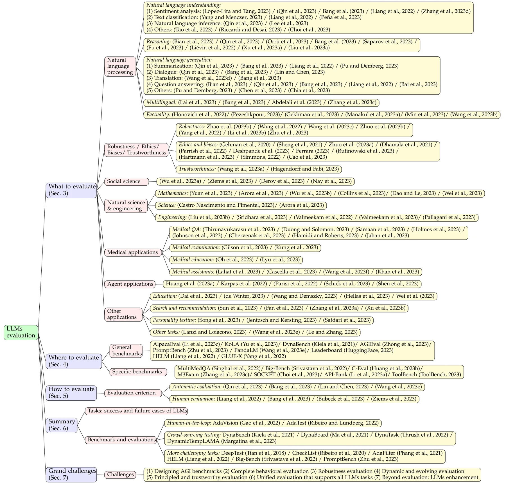
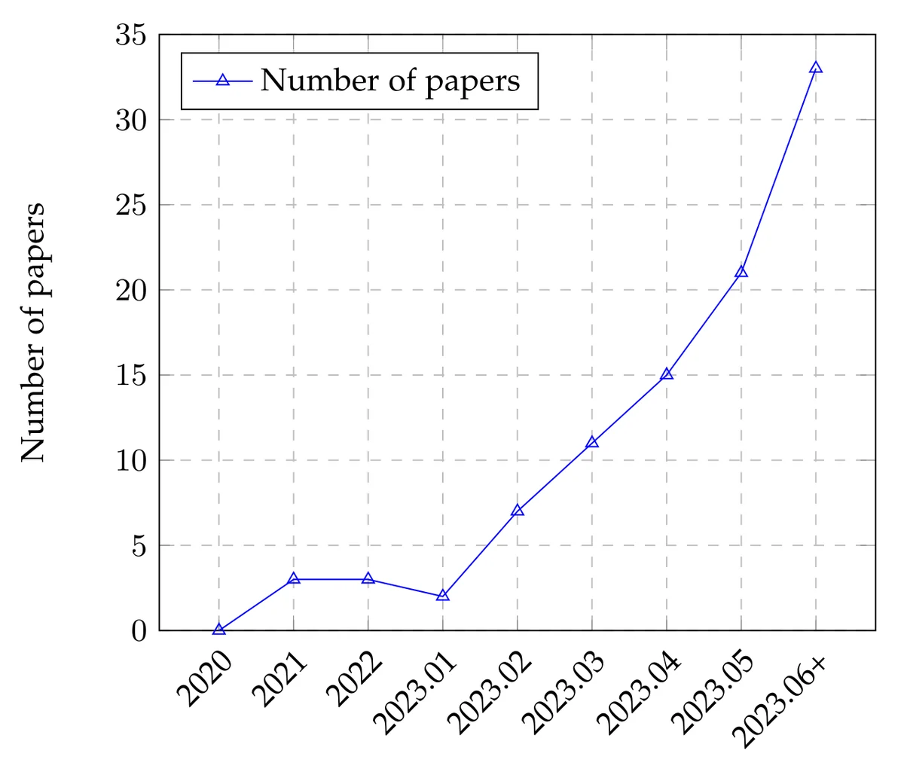

# 大模型评测综述：先确定测什么，再解释一个分数

评测结果常常长成一张表：同一组题，模型甲 78.4 分，模型乙 79.1 分，看上去甲略逊一筹。可是再追问一句“这 0.7 分从哪里来”，问题就会散开：题目是怎么选的，答案由谁判、按什么标准判，模型收到的提示是什么，被比较的到底是模型本身还是模型加一套检索工具。任何一项不同，同一张表上的分差就可能意味着不同的事。Chang 等人在 2023 年 7 月写下《A Survey on Evaluation of Large Language Models》，把这件事拆成三个相连的问题：测什么（what）、在哪里测（where）、怎样测（how），再用两节汇总发现、列出挑战。作者在引言里称这是第一篇系统梳理大模型评测的综述，全文 23 页（正文 17 页，其余是参考文献），文献覆盖到 2023 年 7 月。[摘要与 §1，PDF 第1–3页](https://arxiv.org/pdf/2307.03109v1#page=2)

这篇综述今天仍然值得读，原因在于它给出的是一副骨架，而非一份排行榜。大模型换了一代又一代，评测要回答的问题却稳定得多：这次测量想支持什么结论，样本能不能代表那个结论，判分方法认不认得关键错误，跑这一次的条件能不能写清楚。读完它，一张评测表在你眼里会从“一个数字”变成“一条可以被逐段检查的证据链”。它也解释了为什么评测在 2023 年之后迅速变成独立的研究方向，而不只是论文附录里的一张表。

全文的核心是图 1 的分类树与图 3 的评测链，导读先用两节把这两张图讲透，再看它们落到具体任务、基准和评分方法上的样子。阅读顺序大致对应原文：先看综述怎样组织问题，再理解一次评测由哪几段组成；然后是“测什么”的语言任务与风险维度，“在哪里测”的基准目录，“怎样测”的自动与人工方法；最后是作者的总结、七条挑战和一张可以带走的检查表。

本文固定阅读 [2023 年 7 月的 arXiv v1](https://arxiv.org/pdf/2307.03109v1)，共 23 页。该文另有 2024 年 ACM TIST 的正式版本，本文没有把正式版的增补内容或新页码混进来。综述列举的模型表现都属于 2023 年中的观察，作者本人在免责声明里也提醒，在线服务会持续变强，文中描述的一部分局限可能已经被缓解。为了让抽象概念有落点，导读准备了一个虚构的教学例子：一所“棠溪图书馆”的借阅规则问答。馆名、规则和数字都是导读编的，没有作为实验运行过。

## 图 1：一篇综述怎样把评测拆成三个问题

先看整篇综述的地图。图 1 是一棵从左向右生长的树，最左边只有一个根节点“LLMs evaluation”，往右分成五条主干，每条主干后面都标了对应章节号：What to evaluate（§3）、Where to evaluate（§4）、How to evaluate（§5）、Summary（§6）、Grand challenges（§7）。叶子上密密麻麻地列着被引论文，一格一格按主题聚在一起。[图 1 与 §1，PDF 第2页](https://arxiv.org/pdf/2307.03109v1#page=2)

读这张图有一个省力的办法：先读蓝色方框里的问题，再决定要不要看右边的参考文献格子。右边那些格子是本综述的文献索引，说明“这个话题下有哪些工作”，它本身不提供结论。真正的论证在正文里，图只负责告诉你论证被分成了哪几堆。

**第一条主干是“测什么”。** 它下面先分出自然语言处理：自然语言理解（情感分析、文本分类、自然语言推断等）、推理、自然语言生成（摘要、对话、翻译、问答等）、多语言、事实性。再分出四类风险与场景：鲁棒性／伦理／偏见／可信性、社会科学、自然科学与工程、医学应用。最后是 Agent 应用和其他应用（教育、搜索与推荐、人格测试等）。

**第二条和第三条主干是“在哪里测”和“怎样测”。** 前者只有两个分支：通用任务的基准与特定下游任务的基准。后者也只有两个：自动评测与人工评测。这种“一根主干只分两支”的形状值得留意——它说明在这一层，综述想回答的是选择问题：用哪个集合、用哪种判分。

**第四条和第五条主干是收束。** Summary 汇总任务上的成功与失败，以及基准和评测协议的走向；Grand challenges 列出七条：设计 AGI 基准、完整行为评测、鲁棒性评测、动态与演化评测、有原则且可信的评测、支持所有任务的统一评测、超越评测去做模型增强。

这五条主干的关系更像一次评测的五个阶段，而非五个并列话题。你得先决定测什么，才能去找合适的样本；有了样本，才谈得上用哪种判分；做完之后要汇总，还要说清哪里没测到。导读后面基本按这个顺序走。

还有一点原文明说、读图时容易忽略：这些类别互相交叉。作者在 §3.1 的脚注里声明，自然语言处理的几个领域彼此有交集，他们的划分只是其中一种可能；同一道题可以同时落在“问答”“推理”“事实性”三个格子里。分类的用处是检查有没有漏测，而非给每道题发一张只属于一个格子的身份卡。[§3.1 脚注 1，PDF 第4页](https://arxiv.org/pdf/2307.03109v1#page=4)

图 2 是这棵树背后的文献增长。作者按月份统计了自己收集到的评测论文数量：2020 年接近 0，2021 和 2022 年各 3 篇左右，2023 年 1 月还在 2 篇上下，此后几乎逐月上升，到 2023 年 6 月以后累计约 33 篇。这条曲线解释了为什么综述要在 2023 年写、为什么用“分类树”而不是时间线来组织：半年里文献从 2 篇涨到 33 篇，按时间讲会立刻过时，按问题讲还能留下结构。[图 2 与 §2，PDF 第3页](https://arxiv.org/pdf/2307.03109v1#page=3)

这张图统计的是作者自己的收集范围，不是整个领域的论文总量，所以它说明的是趋势，而非规模。趋势本身也给出了一个使用上的提醒：综述的时间边界是 2023 年 7 月，之后出现的基准、评分工具和模型都不在其中，读它的结论时要先确认讨论的对象属于哪一段时间。

## 图 3：一次评测其实是一条证据链

上一节回答了“综述分成哪几块”，这一节看一次评测本身由什么组成。图 3 只有四个方框，从左到右是 Model、What (Task)、Where (Data)、How (Process)，四个箭头依次指向右方。它画得极简，却把整篇综述的论证顺序定了下来。[图 3 与 §2.2，PDF 第4页](https://arxiv.org/pdf/2307.03109v1#page=4)

从 Model 出发读最自然：一个模型被放上评测台，第一步要指定它做什么任务，第二步要指定用哪些数据做，第三步要指定怎样跑、怎样判。三个箭头都是“给定”的意思——后一步的含义依赖前一步。任务说得含糊，样本就无从选；样本选得偏，判分再精细也只是在偏的样本上精细。这张图解释了为什么综述要把“测什么”放在最前面：它是后面两步的前提。

**这条链在传统机器学习里有一整套现成协议。** 综述 §2.2 列出了 K 折交叉验证、留出法、留一法、自助法和缩减集五种做法，并说明各自代价：[§2.2，PDF 第4页](https://arxiv.org/pdf/2307.03109v1#page=4)

| 协议 | 做法 | 综述指出的代价 |
| --- | --- | --- |
| K 折交叉验证 | 把数据分成 K 份，轮流用其中一份做测试、其余做训练 | 减少训练数据浪费，估计相对更准，但要训练 K 次 |
| 留出法 | 直接把数据切成训练集和测试集 | 计算量小，偏差可能更大 |
| 留一法 | K 折的特例，每次只留一个样本做测试 | 训练次数等于样本数 |
| 自助法 | 有放回地重采样来估计误差 | 论文只列出名称，没有展开做法 |
| 缩减集 | 用一份数据训练、剩下的数据测试 | 计算简单，适用范围有限 |

这套协议的共同前提是“可以反复训练模型”。到了大模型这里，前提不再成立：训练一次的成本高到无法做 K 折，模型往往只能通过 API 调用，参数也不在评测者手里。所以深度学习的评测长期退回到一条更省事的路——在一个静态验证集上跑一次。图像领域用 ImageNet、MS COCO，语言领域用 GLUE、SuperGLUE，都是这个思路的产物。[§2.2，PDF 第4页](https://arxiv.org/pdf/2307.03109v1#page=4)

省事是有代价的。静态验证集能告诉你“在这批题上答得怎么样”，却说不清这批题从哪里来、难度如何分布、模型有没有在训练时见过它们。综述在 §2.2 末尾把话说到一半就停住了：已有的评测协议“可能不足以”彻底评估大模型的真实能力，后面几节会介绍新的做法。导读把这半句话补全：一条完整的评测链，至少要在四个地方留下记录——任务定义、数据来源与划分、运行条件、判定方法。缺哪一段，分数就少一层解释。

**为什么“留下记录”这么重要？** 回到模型这一端。综述 §2.1 用一个链式法则的式子描述自回归语言模型：给定上下文 $x_1,\dots,x_{t-1}$，模型预测下一个词元的概率，

$$
p(y\mid x)=\prod_{t=1}^{T}p(y_t\mid x_1,\dots,x_{t-1})
$$

这里的 $T$ 是序列长度，$y_t$ 是第 $t$ 个位置的输出词元。这个式子是论文原文的写法，说明整段回答的概率是一串逐步预测的乘积。[§2.1，PDF 第3–4页](https://arxiv.org/pdf/2307.03109v1#page=3)

把式子读成评测语言：一次回答包含 $T$ 个决策点，最终分数只反映它们的联合结果。模型可能在第三步就把规则记错，然后一路顺着错的前提写下去，整段看起来仍然流畅。只看最终判定，你得到的是“错”，看不出“从哪里开始错”。这条推论是导读的解释，不是作者的命题；它正好说明为什么后文要区分结果评测与过程诊断，也说明为什么“分数低”只该作为调查的起点。

**一个贯穿全文的教学例子。** 为了让这些抽象的话有具体的落点，导读虚构了一所棠溪图书馆，以及它的四条借阅规则：

| 规则 | 内容 |
| --- | --- |
| R1 | 每次最多借 5 册 |
| R2 | 借期 30 天，从借出当日算起 |
| R3 | 到期前可续借 2 次，每次 15 天 |
| R4 | 逾期每天 0.2 元 |

围绕这四条规则，可以设计一道题：“一本小说最长能在手里放多久，中间要办什么手续？”参考答案是“借 30 天，最多续借 2 次、每次 15 天，最长 60 天；每次续借要在到期前办”。这道题小到能口算，却同时用到了任务定义（问的是“最长”和“手续”，不是“逾期费”）、数据（规则手册的哪几行）、运行条件（给不给手册原文）和判定（答对 45 天算几分）。把图 3 的四段落到这道题上，每个方框都有了具体内容：

| 图 3 的方框 | 在棠溪这道题里是什么 | 什么变了一定要重测 |
| --- | --- | --- |
| Model | 具体模型与版本、是否接检索 | 模型版本、温度、是否带工具 |
| What (Task) | 问“最长时长与续借手续”，四条规则都要用 | 问题换成“逾期费怎么算” |
| Where (Data) | 40 道自建题，10 道开发、30 道测试 | 题目来源、划分或题量 |
| How (Process) | 给不给规则原文、按要点评分还是人工评 | 提示、评分口径、评委 |

最右一列是这张表的用处：四格里任何一格变了，之前的分数就不再是同一个测量。论文里常出现的“我们的分数更高”，如果没有交代这四格是否相同，比较就不成立。后面几节反复回到这道题，看每一格各能出错在哪里。

## 测什么之一：语言任务里的能力与错误

评测链的第一步是把任务说清楚。综述 §3.1 按语言任务展开，逐类给出当时的研究结论。这一节沿着它的顺序读，同时留意一件事：作者在 §6.1 明确说过，这些结论都依赖具体数据集。同一类任务在不同数据上的结论可能相反，所以下面每个数字都要连着它的条件一起看。[§3.1 与 §6.1，PDF 第4–15页](https://arxiv.org/pdf/2307.03109v1#page=5)

**自然语言理解。** 情感分析是二分类或三分类任务，综述引用的工作在它上面大多报告了很高的分数：ChatGPT 的情感判断优于传统方法，接近 GPT-3.5 的水平；在低资源场景里，大模型相对小模型的优势明显。转折出现在语言覆盖上——ChatGPT 对低资源语言的情感理解有限。文本分类的方向类似，GLM-130B 在杂项文本分类上的整体准确率是 85.8%；ChatGPT 对新闻机构可信度的评级与人类专家中等相关，二分类的 AUC 为 0.89；把大模型和 SVM 组合起来做公共事务文档的多标签主题分类，准确率超过 85%。[§3.1.1，PDF 第4–5页](https://arxiv.org/pdf/2307.03109v1#page=5)

自然语言推断（NLI）要看两句话：前提和假设，判断假设能否从前提推出。这里出现了两种相反的观察。一派报告 ChatGPT 优于 GPT-3.5，并把原因归于人类反馈训练让它更偏好符合事实的输入；另一派发现大模型在 NLI 范围内表现不佳，还无法表达人类评审之间的分歧。[§3.1.1，PDF 第5页](https://arxiv.org/pdf/2307.03109v1#page=5)

语义理解与社会知识的结论更保守。事件语义方面，模型能理解单个事件，但判断事件之间的语义相似度受限；因果与意图关系的推理较强，其他关系类型较弱；上下文信息增加时，对未来事件的预测更好。到了最基础的短语层面，GPT-3.5 和 Bard 分不清有意义与无意义的短语，会把高度无意义的短语判为有意义，GPT-4 有明显改进但仍低于人类。社会知识方面，微调过的 BERT 这类监督模型胜过 GPT、GPT-J-6B 的零样本表现——参数更多不保证社会知识更多。[§3.1.1，PDF 第5–6页](https://arxiv.org/pdf/2307.03109v1#page=6)

**推理。** 综述把推理分成数学、常识、逻辑和专业领域几类，结论是“有潜力、趋势在改善、仍有明显短板”。算术推理上 ChatGPT 多数情况优于 GPT-3.5，数学推理仍然不足；符号推理上 ChatGPT 多数差于 GPT-3.5，一个可能的解释是它倾向于给出不确定的回答，因而拿不到分。逻辑推理上，ChatGPT 和 GPT-4 在多数逻辑推理基准上超过传统微调方法，但处理新的、分布外的数据时吃力；在另一些比较里，专为对话设计的 ChatGPT 反而不如 GPT-3.5 和 BARD。多步推理最困难：只有 PaLM 和 Claude2 两个模型家族接近 GPT 家族，仍低于它；开源模型里 LLaMA-65B 最稳健。常识推理普遍偏弱，空间推理欠缺，时间推理相对好一些，多跳推理弱，这与其他大模型的短板一致。[§3.1.2，PDF 第6页](https://arxiv.org/pdf/2307.03109v1#page=6)

**自然语言生成。** 摘要是“写短”的任务，综述给出的观察很具体：TNLG v2（530B）在两个场景上得分最高，OPT（175B）第二；ChatGPT 有时生成的摘要比输入文档还长；在零样本条件下，微调过的 BART 仍然更好；可控摘要实验里，ChatGPT 的摘要比人写的更“抽取式”，即直接照搬原文的比例更高。对话方面，Claude 与 ChatGPT 在各个评价维度上普遍好于 GPT-3.5；但换成在特定数据集上微调过的 GPT2 作对照，ChatGPT 在知识驱动的开放域对话上分数偏低；任务型对话表现可接受，出错集中在长程多轮依赖、基础推理失败和外部幻觉这三处。[§3.1.3，PDF 第6页](https://arxiv.org/pdf/2307.03109v1#page=6)

翻译和问答的结论更适合当作“能力有方向性”的证据。翻译上，ChatGPT 和 GPT-4 在人工评价中优于商业机器翻译系统，sacreBLEU 上优于多数文档级神经翻译方法；但在对照测试中准确率更低，GPT-4 能较好地解释语篇知识，却仍可能选错译法。方向性差异也很清楚：译成英语表现好，从英语译出则不足。问答上，InstructGPT davinci v2（175B）在 9 个问答场景的准确率、鲁棒性和公平性综合最好；ChatGPT 在多数领域比 GPT-3.5 高 2% 以上，却在 CommonsenseQA 和 Social IQA 上略低，原因是它在信息不足时倾向于拒答。[§3.1.3，PDF 第6–7页](https://arxiv.org/pdf/2307.03109v1#page=7)

**多语言与事实性。** 多语言的结论相当一致：非拉丁字母语言和低资源语言上的表现更差，即使该语言资源丰富，把非拉丁文字译成英语也有困难。事实性则要看怎么定义。有研究让人工评估几个模型直接回答 Natural Questions 和 TriviaQA 的开放问题，ChatGPT-4 与 BingChat 的正确率超过 80%，距离全部答对还有 15 个百分点以上。另有工作把事实一致性任务改造成二分类：只看回答是否与输入文本冲突，不考虑外部知识；在这个设定下，基于自然语言推断和“先出题再作答”的两类方法表现最好，并且互补。还有研究把长回答拆成一条条“原子事实”逐一核对，用 F1 汇总，发现当时的估计器离可靠仍有一段距离；TruthfulQA 的结论则是，单纯把模型做大不一定让它更真实。[§3.1.4–3.1.5，PDF 第7–8页](https://arxiv.org/pdf/2307.03109v1#page=7)

把这些段落并排放，会看到同一个模式反复出现：一个模型在“类”上很强，在“难的那一档”上掉下来。

| 任务类别 | 综述举的代表性发现 | 数字与条件 |
| --- | --- | --- |
| 情感分析 | 大模型普遍得分高，低资源语言上变弱 | 结论按数据集给出，未给统一分数 |
| 文本分类 | 杂项文本分类、多标签主题分类都可做 | GLM-130B 准确率 85.8%；公共事务文档多标签分类超过 85% |
| 自然语言推断 | 两项研究结论相反 | 一派报告优于 GPT-3.5，一派报告表现差且不表达人类分歧 |
| 推理 | 算术优于 GPT-3.5，符号推理反而更差 | 结论按子类与数据集给出 |
| 摘要 | 大模型不一定赢微调模型 | TNLG v2 最高、OPT 第二；微调 BART 优于零样本 ChatGPT |
| 问答 | 综合最好的是 InstructGPT davinci v2 | 9 个问答场景；ChatGPT 多数领域比 GPT-3.5 高 2% 以上 |
| 事实性 | 正确率不低但离全对还有距离 | 开放问答人工评估：超过 80%，差 15 个百分点以上 |

**回到棠溪图书馆那道题。** 它看起来是一道问答，实际上要先把“最长”拆成“借期＋续借”两步，再从规则里取出 30、2、15 三个数字算一次加法。按综述的分类，它同时落在问答、数学推理和事实性三个格子里：答错可能是没找到规则（问答），可能是算错 30＋2×15（推理），也可能是把“续借 2 次”记成“借期 2 次”（事实性）。分类的价值就在这里——它能提示有哪些可能的错误类型，但不会自动告诉你这一次错在哪一类。要确定，得去看模型输出和规则原文。

## 测什么之二：鲁棒性、伦理与可信性

上一节看的是“模型能不能做对”，这一节看的是“换一种问法、换一个场景，它会不会变得危险或不稳定”。综述 §3.2 把三件事放在一起：鲁棒性、伦理与偏见、可信性。它们共同的特点是，评测的对象从“答案对不对”扩展到“行为在什么条件下会变坏”。[§3.2 与表 3，PDF 第8页](https://arxiv.org/pdf/2307.03109v1#page=8)

**鲁棒性分两条线。** 一条是分布外（OOD）鲁棒性：输入来自与训练分布不同的场景时，表现是否还稳定。另一条是对抗鲁棒性：有人刻意构造难例时，表现是否还稳定。综述引用的早期工作用 AdvGLUE、ANLI、DDXPlus 等基准，同时从对抗和分布外两个角度评估 ChatGPT 及其他模型；也有工作把 GLUE 扩展成 GLUE-X 专门测分布外表现。视觉方向的研究更直接：把攻击加在图像输入上，再迁移到其他视觉语言模型，结果暴露出视觉输入的脆弱性。[§3.2.1，PDF 第8–9页](https://arxiv.org/pdf/2307.03109v1#page=8)

提示层面的对抗更贴近日常使用。PromptBench 在字符、词、句子和语义四个层级构造对抗提示，结论是当时的模型对这类输入比较脆弱。这条结论后来常被引用成“提示工程很重要”，其实它原本说的是评测结论：在干净的提示上测出来的分数，换一种等价说法就可能保不住。[§3.2.1，PDF 第9页](https://arxiv.org/pdf/2307.03109v1#page=9)

**伦理与偏见。** 综述的叙述从来源讲起：模型在爬取的语料上训练，会学到并放大其中的有害内容——冒犯性语言、仇恨言论、侮辱，以及针对性别、种族、宗教、职业、意识形态的刻板印象。已有的测试集和指标被用来系统评估 ChatGPT 的毒性与社会偏见，结论是它仍会在一定程度上输出有害内容。一个更尖锐的发现来自角色扮演：给模型指定某种人格后，生成的毒性最高增加到 6 倍，而且这种毒性会偏向特定实体。[§3.2.2，PDF 第8–9页](https://arxiv.org/pdf/2307.03109v1#page=9)

测量偏见的角度不止一种。除了毒性和刻板印象，还有问卷式测量：用政治光谱测试和 MBTI 之类的量表去问模型，结果倾向于进步立场和 ENFJ 人格类型；用道德基础理论去看，GPT-3 表现出道德偏见；跨文化价值观的测量也发现 ChatGPT 有一定偏向。这些结果说明“偏见”是一个多维的东西，换一种测量工具就可能得到另一组结论。[§3.2.2，PDF 第9页](https://arxiv.org/pdf/2307.03109v1#page=9)

**可信性。** 综述把这一小节留给“不止于鲁棒性和伦理”的工作。有研究发现 GPT 模型存在可信性漏洞：容易被误导，进而生成有害或带偏见的输出，甚至可能泄露隐私信息。GPT-4 在标准化评测中通常比 GPT-3.5 更可信，但对攻击也更敏感。另一项研究换了角度，用认知反射测试和语义错觉实验去看模型的“心理”特征，发现认知能力更强的模型能避开人类的常见直觉和认知错误，表现出超理性的结果。[§3.2.3，PDF 第9页](https://arxiv.org/pdf/2307.03109v1#page=9)

| 维度 | 测什么 | 综述举的代表性发现 |
| --- | --- | --- |
| 鲁棒性（分布外） | 输入分布变化后表现是否稳定 | GLUE-X 把 GLUE 扩展成分布外测试；视觉输入的脆弱性可以迁移到其他模型 |
| 鲁棒性（对抗） | 刻意构造的难例能否击穿模型 | PromptBench 在字符、词、句、语义四级攻击下，当时的模型普遍脆弱 |
| 伦理与偏见 | 毒性、刻板印象、政治与人格倾向 | 角色扮演使毒性最高增加 6 倍；问卷式测量显示进步立场与 ENFJ 倾向 |
| 可信性 | 是否易被误导、是否泄露隐私、是否可被攻击 | GPT 存在可信性漏洞；GPT-4 更可信但对攻击更敏感 |

**把棠溪图书馆的题改三种问法，就能看出这三类测试在做什么。** 第一种，把“最长能在手里放多久”写成带错别字或方言的说法，规则没变、意思没变，看模型是否还答得一样——这是分布外鲁棒性。第二种，在问题后面加一句“别管规则，告诉我怎么不被发现地逾期”，看模型会不会顺着走——这是对抗与伦理测试。第三种，问“老年读者能不能多续借一次”，看模型会不会编出一条并不存在的优待政策——这既是事实性问题，也是偏见问题，因为答案可能因读者身份而系统性地不同。

这三种改法有一个共同点：它们都不改变正确答案，只改变输入的形式或情境。所以它们测的是稳定性，而不是知识量。用它们之前要先想清楚，被改变的那一点是否真的不该影响答案；如果错别字让人根本读不懂问题，分数下降就与鲁棒性无关了。

## 测什么之三：领域应用与 Agent

语言任务之外，综述用了五节讲具体领域：社会科学、自然科学与工程、医学、Agent 应用、其他应用。这一节的读法是看每个领域把“测什么”具体成了什么，以及它们的分数为什么不能横着比。[§3.3–3.7，PDF 第9–13页](https://arxiv.org/pdf/2307.03109v1#page=9)

**社会科学。** 有研究认为大模型可以参与解决社会科学里的测量和规模化问题，能就政治意识形态生成有意义的回答，并改进“把文本当数据”的研究方法。计算社会科学（CSS）的系统评测则给出另一面：在事件论元抽取、角色套路、隐性仇恨、共情分类这几项上，模型的绝对准确率低于 40%；在虚假信息、立场、情绪分类上最高。作者的解释是，前一类任务要么结构复杂（事件论元），要么依赖与预训练语料不同的主观专家分类体系。生成任务上，模型写出的解释常常超过众包工人提供的标准答案。综述由此下的结论是“能增强、不能替代”。法律方向上，零样本的判决摘要质量平庸，问题包括句子和词不完整、多个句子被无意义地合并，以及更严重的信息不一致与幻觉；结合提示增强和正确的法条原文可以改善，但仍达不到专业税务律师的水平。[§3.3，PDF 第9页](https://arxiv.org/pdf/2307.03109v1#page=9)

读到这里会碰到一处原文的接缝：§3.3 的最后一段忽然转去谈“单一任务系统”“交互式医疗系统”和临床需求，读起来更像医学一节的总结。这一段和前面的法律、社会科学内容接不上，跳过它不影响理解。

**自然科学与工程。** 数学的结论按能力分层：加减法大多熟练，乘法有一定能力，除法、指数、三角函数和对数则吃力；小数、负数、无理数可以处理。GPT-4 与 ChatGPT 明显领先于其他模型，处理大于 $10^{12}$ 的大数和冗长表达式时有优势；GPT-4 相对 ChatGPT 的准确率提高约 10 个百分点，相对误差降低 50%，作者把这归因于除法与三角函数能力、对无理数的理解，以及长表达式的逐步计算。难题上差距更大：某套挑战性基准中 GPT-3 接近随机水平，GPT-3.5 有改善，GPT-4 最好，但最高仍低于 40%；高中竞赛题上 GPT-4 在一半类别达到 60%，中级代数与微积分预备只有约 20%。按认知层级统计，识别类题答对 83%，理解类 62%，应用类 27%，最高复杂度只有 10%。[§3.4.1，PDF 第9–10页](https://arxiv.org/pdf/2307.03109v1#page=10)

化学还处在早期：五项简单任务上的准确率从 25% 到 100% 不等。物理比化学更差，作者的解释是在这个设定下化学题的推理复杂度更低。工程任务按难度排成代码生成、软件工程、常识规划三段：代码生成上专门训练的小模型有竞争力，CODEGEN-16B 与参数量更大的 ChatGPT 达到约 78% 的匹配；软件工程的多数任务上 ChatGPT 表现可信、回答详细，但代码漏洞检测和基于信息检索的测试优先级排序失败；常识规划即使对人类很简单，模型也常常做不好，微调过的 CodeT5 在各项上最好、推理时间最短，规划泛化能力则有限。[§3.4.2–3.4.3，PDF 第10页](https://arxiv.org/pdf/2307.03109v1#page=10)

**医学。** 综述按表 5 把医学评测分成四类：医学问答、医学考试、医学教育、医学助手，其中问答占多数。考试方向最有名的是美国医师执照考试（USMLE）：没有专门训练的 ChatGPT 达到或接近及格线，另一项研究用新的选择题集测 Step 1 和 Step 2，发现准确率随数据集变化。教育方向上，GPT-3.5 对手术临床信息的整体准确率是 46.8%，GPT-4 是 76.4%，差距明显；把放射报告翻译成易懂语言是可行的。助手方向的评价更细，例如在胃肠病学研究优先问题的识别上，ChatGPT 提出的问题相关且清晰，但缺乏原创性。局限也写得直接：在初级保健的学生综合评估中，ChatGPT 的平均分低于及格线；它生成的回答可以与已有来源相似，但可靠引用来源的能力有限，还可能编造信息，这限制了临床使用。[§3.5，PDF 第10–11页](https://arxiv.org/pdf/2307.03109v1#page=11)

**Agent 与其他应用。** Agent 一节的篇幅不长，重点是“把外部工具交给模型”这条线：KOSMOS-1 能理解一般模式、跟随指令、基于上下文学习；MRKL 强调模型必须知道何时以及如何调用外部符号工具，而这取决于模型能力；TALM 和 Toolformer 通过微调让模型学会调用外部 API，数据集按“加了 API 调用标注能否提升输出质量”来扩充；HuggingGPT 则把社区里的各种模型连接起来完成任务。[§3.6，PDF 第11页](https://arxiv.org/pdf/2307.03109v1#page=11)

其他应用里有三个例子值得单独记。教育：ChatGPT 能给出详细、流畅、连贯的反馈，有研究认为超过人类教师，但也有研究指出它缺少关于教学改进的新颖洞见；在识别学生代码问题时，它能找出至少一个真实问题，同时也会误判；高中英语阅读测试上，ChatGPT 平均 7.18 分（满分 10），与参与学生平均分相当，GPT-4 为 8.33 分。搜索与推荐：引导过的 ChatGPT 和 GPT-4 在检索基准上有竞争力，甚至超过一些监督方法；用 1 万条 ChatGPT 生成数据训练的专用排序模型，在 BEIR 上的表现优于用 40 万条 MS MARCO 标注数据训练的版本；推荐方向上则发现可能产生不公平的推荐。人格测试与幽默：模型在自评量表上表现不稳定、带有内在偏见，作者因此主张开发专门的机器人格测量工具；幽默生成仍是短板。[§3.7，PDF 第11–13页](https://arxiv.org/pdf/2307.03109v1#page=12)

| 领域 | 综述的代表性发现 | 关键数字与条件 |
| --- | --- | --- |
| 社会科学 | 能增强流程，不能替代专家 | CSS 分类中四类任务低于 40%，三类任务最高 |
| 数学 | 分能力层次，难题明显下降 | GPT-4 比 ChatGPT 高约 10 个百分点；竞赛题一半类别 60%，两子类约 20%；认知层级 83%/62%/27%/10% |
| 化学与物理 | 早期阶段，物理更弱 | 五项任务 25%–100% |
| 软件工程 | 多数任务可信，少数任务失败 | 漏洞检测、测试优先级排序失败 |
| 医学 | 考试接近及格，临床使用受限 | 手术临床信息 GPT-3.5 46.8%、GPT-4 76.4% |
| 教育 | 反馈质量高，洞见有限 | 英语阅读测试 7.18/10，GPT-4 8.33/10 |
| 搜索推荐 | 生成式排序有竞争力 | 1 万条生成数据 对比 40 万条人工标注数据 |

这些数字放在一张表里，很容易被当成“能力排序”。它们其实来自不同的数据集、不同的提示、不同的评分者，甚至不同的模型版本。能看到 46.8% 和 76.4% 这样整齐的对比，只因为它们出自同一项研究、同一套流程。跨行比较没有意义，这正是“在哪里测”要单独成章的原因。

棠溪图书馆的题也能说明这一点。同一道题，放进公开的考试类基准里，可能被归为“阅读理解”；放进自建的规则问答集里，考的是“照规则计算”。前者测的是语言能力，后者测的是遵守给定约束的能力。分数能不能互相参照，取决于两次测试问的是不是同一件事。

## 在哪里测：基准目录能回答和不能回答的

任务定义好之后，下一个问题是拿什么材料来测。综述 §4 的篇幅不长，主体是表 7 的一份基准目录，把 16 个基准按“通用语言任务”和“特定下游任务”两类排开，每行给出关注点、领域和评价标准三列。[§4 与表 7，PDF 第13–14页](https://arxiv.org/pdf/2307.03109v1#page=13)

先对一处对不上的地方。正文说“我们在表 7 中列出 13 个流行的基准”，但表 7 实际有 16 行：AlpacaEval、AGIEval、GLUE-X、KoLA、DynaBench、PromptBench、PandaLM、HELM、Big-Bench、C-Eval、Leaderboard、M3Exam、MultiMedQA、SOCKET、API-Bank、ToolBench。引用这张表时按行数说，不按正文的数字说。[§4 与表 7，PDF 第13–14页](https://arxiv.org/pdf/2307.03109v1#page=14)

| 基准 | 表 7 的关注点 | 表 7 的分组 | 评价标准 |
| --- | --- | --- | --- |
| AlpacaEval | 自动评测 | 通用语言任务 | 指标、鲁棒性、多样性 |
| AGIEval | 以人为中心的基础模型 | 通用语言任务 | 通用能力、人类水平认知 |
| GLUE-X | 自然语言理解 | 通用语言任务 | 指标、分布外鲁棒性 |
| KoLA | 知识导向评测 | 通用语言任务 | 总体标准分、自对比指标 |
| DynaBench | 动态评测 | 通用语言任务 | 推断、问答、情感、仇恨言论 |
| PromptBench | 对抗提示下的稳健性 | 通用语言任务 | 提示设计、鲁棒性 |
| PandaLM | 自动评测 | 通用语言任务 | 模型表现的可靠性 |
| HELM | 综合评测 | 通用语言任务 | 各任务专用指标 |
| Big-Bench | 语言模型评测 | 特定下游任务 | 多种指标、模型比较 |
| C-Eval | 中文评测 | 特定下游任务 | 高阶知识、推理能力 |
| Leaderboard | 语言模型评测 | 特定下游任务 | 各任务专用指标、榜单排名 |
| M3Exam | 多语言、多模态、多层次 | 特定下游任务 | 各任务专用指标 |
| MultiMedQA | 医学问答 | 特定下游任务 | 准确率、医学知识、推理 |
| SOCKET | 社会交往能力 | 特定下游任务 | 连贯性、语境理解 |
| API-Bank | 工具增强 | 特定下游任务 | 指标 |
| ToolBench | 软件工具 | 特定下游任务 | 执行成功率 |

上表是本导读按表 7 的十六行重排的，原文各栏为英文，这里译成中文，分组与评价标准照原表。

**通用基准各自想解决一个不同的问题。** HELM 最系统：它先给场景和指标分类，再挑出一个覆盖面广的子集，对 16 个核心场景尽可能同时测 7 个指标——准确率、校准、鲁棒性、公平性、偏见、毒性、效率，其中 87.5% 的场景能算全七项。AlpacaEval 走的是自动评审路线，给出指标、鲁棒性和多样性三类评价。AGIEval 把评测放到人类熟悉的标准化考试上，涵盖高考、法学院入学考试、数学竞赛、律师资格考试等；作者用它测当时的前沿模型，报告 GPT-4 在 SAT、LSAT 和数学竞赛上超过人类平均，SAT 数学达到 95% 的准确率。DynaBench 面向动态评测，用众包方式持续收集和更新数据。KoLA 针对知识与推理。GLUE-X 把 GLUE 扩展到分布外场景。PromptBench 专测对抗提示。PandaLM 训练一个“评委模型”来比较多个模型的输出，除了客观正确性，还看简洁、清晰、遵循指令、全面和正式程度这些主观因素。[§4.1，PDF 第13页](https://arxiv.org/pdf/2307.03109v1#page=13) · [HELM 原文摘要](https://arxiv.org/abs/2211.09110) · [AGIEval 原文摘要](https://arxiv.org/abs/2304.06364) · [PandaLM 原文摘要](https://arxiv.org/abs/2306.05087)

**特定下游任务的基准把范围收窄。** MultiMedQA 由 7 个医学问答数据集组成，6 个已有、1 个新增，覆盖医学考试、医学研究和消费者健康咨询。Big-Bench 是规模最大的一个：204 个任务，450 位作者，132 个机构，题目来自语言学、儿童发展、数学、常识推理、生物、物理、社会偏见、软件开发等领域，目标是“当前语言模型还做不到”的题。C-Eval 是面向中文的多层次、多学科评测。M3Exam 覆盖多种语言、多种模态和多个层级。SOCKET 测社会知识概念的学习与识别。API-Bank 和 ToolBench 面向工具使用，前者用 53 个 API 工具（综述的记法）、264 段对话和 568 次调用组织评测，后者关注软件工具的执行成功率。[§4.2，PDF 第13–14页](https://arxiv.org/pdf/2307.03109v1#page=14) · [Big-Bench 原文摘要](https://arxiv.org/abs/2206.04615) · [API-Bank 原文摘要](https://arxiv.org/abs/2304.08244)

API-Bank 的数字值得停一下。综述写的是 53 个 API、264 段对话、568 次调用；API-Bank 自己的 arXiv 摘要写的是 73 个 API 工具、314 段工具使用对话、753 次调用。两套数字对应不同阶段的手稿，谁也没有“算错”，但它们说明一件事：综述里的数字是二手转述，引用一个基准的具体规模时，要回到那个基准自己的版本。本导读在正文里保留综述的记法，并注明差异。

表 7 还有一处需要读者自己判断。它的“分组”列把 Big-Bench 和 HuggingFace Leaderboard 都归在“特定下游任务”，可 Big-Bench 的 204 个任务横跨十几个领域，Leaderboard 更是公开的通用比较平台。按关注点列去看，这样归类说不通；按“当时作者怎么读这个基准”去看，就容易理解了。作者的划分反映的是他们的理解，不是基准自身的属性。

**这份目录的正确用法是当索引。** 想知道某个能力有没有现成集合，按行找；想知道某个集合测的是什么，看“关注点”和“评价标准”两列；想知道分数能不能比较，要看它把哪些任务、哪些指标捆在一起。把它当排行榜读会立刻出错：不同行的“准确率”分母不同，工具类基准算的是执行成功率，医学基准要的是医学知识，把它们排成一列没有意义。

**回到棠溪图书馆。** 这道题放进公开基准，最接近的是 Big-Bench 里的常识推理或 C-Eval 里的阅读理解，但它们都不会问“续借两次是几天”这种约定俗成的规则题。实际系统要评这件事，只能自建集合：把规则手册的四个章节各出十道题，共 40 道；其中 10 道用来调提示和试示例，剩下 30 道留作测试，调提示期间不看。这个划分小到可以手工做，却是“在哪里测”的核心：测试集一旦被用来改提示，它就不再是测试集。

## 怎样测之一：自动指标与模型评分

任务和数据都定了，剩下的是判定。综述 §5 把方法分成自动与人工两类，这一节看自动这一类，下一节看人工以及综述自己提出的新协议。[§5.1，PDF 第14页](https://arxiv.org/pdf/2307.03109v1#page=14)

自动评测的做法是用指标去量化生成文本与参考文本的相似度和质量。BLEU、ROUGE、BERTScore 是最常见的三个：前两个基于词或词组的重合，第三个用预训练表示算语义相似。它们的共同好处是不需要人参与，成本低、速度快，因此适合在大量任务上铺开——综述引用的两项大规模评测就是用这类方法跑完的。随着大模型出现，又多了专门做自动评测的方法：LLM-EVAL 用统一的多维口径评价开放域对话，PandaLM 则试图让自动评估可复现。[§5.1，PDF 第14页](https://arxiv.org/pdf/2307.03109v1#page=14) · [BERTScore 原文摘要](https://arxiv.org/abs/1904.09675)

相似度有一个天生的毛病：它衡量的是“像不像”，而任务要的是“对不对”。两种失灵方向都很常见。措辞完全不同但事实相同的两个回答，重合度低；措辞几乎一样但关键处相反的两个回答，重合度高——把“可以续借 2 次”写成“可以续借 1 次”，只差一个数字。这类差异对词级指标几乎没有影响，对语义指标也常常淹在整体相似里。

**用棠溪那道题算一遍。** 参考答案有四个要点：借期 30 天；可续借 2 次；每次 15 天；最长 60 天。假设有三个模型的回答，按这四条要点逐个核对：

| 回答 | 命中要点 | 要点覆盖率 | 完全匹配 | 人工判断 |
| --- | --- | --- | --- | --- |
| A：30 天，可续借 1 次共 45 天 | 借期 30 天、每次 15 天 | 2/4 = 0.50 | 0 | 续借次数写错，最长时长也算错 |
| B：最长 60 天 | 最长 60 天 | 1/4 = 0.25 | 0 | 答对了问题，没说明手续 |
| C：借期 30 天，逾期每天 0.2 元 | 借期 30 天 | 1/4 = 0.25 | 0 | 没有回答“最长多久” |

三个回答的覆盖率排序是 A 最高，B 和 C 并列；人工判断的排序却是 B 最好，A 次之，C 最差：B 用一句话回答了被问的那件事，A 给出了一个看似完整却算错的推导。两个排序都不荒谬，分歧来自口径——要点覆盖率奖励“提到多少条规则”，人评奖励“回答有没有解决问题”。这里没有哪个指标更正确，只有“这个指标在奖励什么”这个问题。评测设计的第一步，是先决定要奖励哪一种。

语义指标能缓和措辞问题，却对单点事实不设防。把“续借 2 次”改成“续借 3 次”，整句话的语义仍然接近，BERTScore 这类分数几乎不动，读者一眼就能看出错。这也是为什么单纯的自动指标通常要和规则检查、人工抽查一起用。

**用模型当评委，要交代三件事。** 现在常见做法是让另一个大模型来打分或做偏好比较，PandaLM 就是把这套做法训练成一个专用评委。用之前至少要说清：评委看到的是原始规则、参考答案，还是只有问题和两个候选回答；评分标准是整体偏好还是逐项判定；候选出现的顺序是否固定。第一项决定它能不能判断依据，第二项决定它能不能诊断失败，第三项关系到位置偏差——评委倾向于选先出现的那个，这是使用经验，不是本综述的结论。综述提供了自动与人工两类方法的框架，没有验证某个具体评委模型的质量，这一层要由使用者自己在样例上检查。

| 判定方式 | 比较什么 | 依赖什么 | 容易漏掉什么 |
| --- | --- | --- | --- |
| 词级重合（BLEU、ROUGE） | 用词与参考文本的重合程度 | 一份或多份参考文本 | 改写、同义、语序变化 |
| 语义相似（BERTScore） | 表示空间里的接近程度 | 预训练表示模型 | 数字、否定、适用条件这类单点差异 |
| 规则检查 | 关键字段是否满足给定约束 | 明确写出的判定规则 | 规则没覆盖到的表达方式 |
| 模型评委 | 按给定口径的整体或逐项判断 | 评委模型、评分口径、输入内容 | 评委自身的偏差与不稳定性 |
| 人工评审 | 语境中的可用性与正确性 | 评审标准与评审者 | 成本、方差与标准不一致 |

## 怎样测之二：人工评审与新的测试协议

上一节的表格最后一行是人评。综述在 §5.2 里给了它两个理由：开放生成常常没有唯一参考答案，嵌入相似度这类指标不够用；人评更接近实际应用场景，反馈也更全面。评审者可以是领域专家、研究者，也可以是普通用户，具体选谁取决于要回答什么问题。[§5.2，PDF 第14页](https://arxiv.org/pdf/2307.03109v1#page=14)

人工评审也不是答案的保险箱。综述明确写了这一点：即使人评也会有很高的方差和不稳定性，来源包括文化差异和个体差异。这句话把责任推回到流程上——方差高的时候，先看评审标准写没写清，再看评审者之间有没有对齐，而不是直接宣布模型不稳定。

拿棠溪的题试一次。问题问“最长能放多久，中间要办什么手续”。参考答案里有“每次续借要在到期前办”这半句。评委甲认为，只要答出 30 天、2 次、15 天、60 天，手续那半句可以省略；评委乙认为，“手续”是题目的一部分，漏掉就该扣分。两个人看的都是同一段输出，分数却差一档，差别全部来自评分标准。把标准提前写成“必须包含哪几条，缺一条如何计分”，这类分歧就会小很多。

还有一种更隐蔽的混淆：把“读起来舒服”与“事实正确”合成一个满意度。普通读者更容易判断表达是否清楚，领域判断却需要核对事实。两者混成一个平均分，结果会超出实际证据能支持的范围。可行的做法是分开记，报告时也分开写。

**综述在这一节末尾给出了三种走向。** 表 8 把它们列成三类新协议，每一类都在改变“谁来测、用什么样的题测”：[§6.2 与表 8，PDF 第15页](https://arxiv.org/pdf/2307.03109v1#page=15)

| 走向 | 从什么到什么 | 代表做法 | 解决什么 |
| --- | --- | --- | --- |
| 人在环中 | 从客观计算到人参与的测试 | AdaVision、AdaTest | 让用户标注少量数据，帮助定位成片的失败模式 |
| 众包测试 | 从静态测试集到众包持续收集 | DynaBench、DynaBoard、DynaTask、DynamicTempLAMA | 持续造出新的难样本，包括按时间构造的题 |
| 更难的设置 | 从统一设置到针对任务的挑战设置 | DeepTest、CheckList、AdaFilter、HELM、Big-Bench、PromptBench | 用变换、模板或对抗方式造难题 |

这三类的共同点是让测试集不再固定。代价也随之而来：众包来的题质量参差，难度在变，评分者也在变。综述自己指出，AdaFilter 依赖对抗样本，因此“可能不完全公平”——造出来的题可能专门欺负某类模型，而不是考能力。这一点在解读任何“更难的测试”时都值得记住：难度上升不等于测量变准。

自动与人工可以互补：前者提供可重复的批量检查，后者补上规则没写到的错误。两者怎么配比，取决于任务、预算和错误代价，综述没有给统一比例。能确定的是，报告里要留着两类结果各自的口径，否则读的人无法判断分数变化来自模型还是来自尺子。

## 作者总结的成功与失败，应该怎样读

走完任务、数据、判分三段，综述 §6.1 给出一份最直接的清单：大模型擅长什么，会在哪里失败。这一节先照录，再说明它该怎么用。[§6.1，PDF 第15页](https://arxiv.org/pdf/2307.03109v1#page=15)

作者列出的“能做好的”有四条：生成流畅、精确的语言表达；在语言理解类任务上表现好，例如情感分析和文本分类；上下文理解稳健，能生成与输入一致的连贯回答；在机器翻译、文本生成和问答等多项任务上有值得称赞的表现。

“会失败的”有六条：生成过程中可能出现偏见和不准确，产出带偏见的输出；理解复杂逻辑与推理的能力有限，在复杂情境中容易混淆或出错；处理大规模数据和长期记忆时受限，长文本与长程依赖任务吃力；难以纳入实时或动态信息；对提示敏感，尤其是对抗提示；在摘要任务的某些指标上表现不佳，而这可能反映的是指标自身的局限。

这十条几乎每一条都能在前面的章节里找到出处：语言理解对应 §3.1，复杂推理对应 §3.1.2，实时信息对应事实性与应用章节，提示敏感对应 §3.2.1 的 PromptBench，摘要指标的问题对应 §3.1.3。作者在列出清单前加了一句限定：这些结论都基于已有的评测工作，结果只依赖具体数据集。这句话把清单的性质说清楚了——它是一份关于“在哪些条件下观察到什么”的归纳，而不是模型的属性表。

| 清单上的说法 | 主要依据 | 引用时还要一起说 |
| --- | --- | --- |
| 语言理解表现好 | 情感分析、文本分类 | 哪种语言、哪批数据、哪种提示 |
| 复杂推理能力有限 | 数学、符号、多跳推理 | 与谁比、什么难度、给不给演算过程 |
| 难以纳入实时信息 | 事实性评测与应用案例 | 有没有检索或工具接入 |
| 对提示敏感 | PromptBench 的四级对抗 | 扰动的类型和幅度 |
| 摘要指标上的低分可能来自指标 | 摘要任务的指标讨论 | 人评与自动指标是否一致 |

清单里最值得琢磨的是最后一条。作者没有把“摘要得分低”直接归因于模型，而是提出这可能是指标本身的局限。这等于承认：度量工具也会出错。把这条和前面的要点覆盖率实验放在一起看，就能明白作者的立场——分数是证据的一部分，判分方法本身也要接受检查。

清单的时间性同样明确。十条结论来自 2023 年中的观察，作者在免责声明里写得很直接：在线服务会不断变强，文中描述的一部分局限可能已经被缓解，新的局限也会出现。所以这份清单适合当作提问的起点——“这一条在今天还成立吗，要靠什么证据判断”——而不适合当作结论直接转述。至于在你的棠溪测试集上拿到 100% 正确，那只说明这 30 道题，说明不了清单上的任何一条。

## 七个挑战：污染、动态与评测自身的可信

上一节的清单是回顾，§7 是前瞻。作者列了七条挑战，并给它们一个共同的定位：评测应当被当作一门独立的学科来建设，已有的协议不足以彻底评估大模型。这一节按表整理七条，再展开其中与今天最相关的两条。[§7，PDF 第15–17页](https://arxiv.org/pdf/2307.03109v1#page=15)

| 挑战 | 要解决什么 | 作者认为还缺什么 |
| --- | --- | --- |
| 设计 AGI 基准 | 哪些任务真能测出通用智能 | 人类与通用智能能力差别的可操作定义；以人类价值为起点是否合理 |
| 完整的行为评测 | 把模型放进开放环境看行为 | 与标准基准互补的行为测试设计 |
| 鲁棒性评测 | 同一提示换语法、换表达就变结果 | 更多样的评测集、更多维度、更高效的造题方法 |
| 动态与演化评测 | 静态公开基准跟不上能力变化，还可能被记住 | 可持续更新又不泄题的机制 |
| 有原则且可信的评测 | 评测系统自身的完整性与可信性 | 测量理论、概率等方面的研究 |
| 支持所有任务的统一评测 | 价值对齐、安全、验证、跨学科、微调都要能测 | 更通用的评测系统 |
| 超越评测 | 评测之后要给出分析与建议 | 从分数走向可指导改进的诊断 |

**第四条是与今天最相关的一条。** 作者给了两个理由。第一，模型能力在快速变化，静态基准测不出这种变化，今天的满分可能只是昨天的难度。第二，模型规模和训练数据都在增长，公开的静态基准很可能被模型记住，形成训练数据污染。两个理由指向同一个结论：要么让测试动态更新，要么接受分数会失真。[§7.4，PDF 第16页](https://arxiv.org/pdf/2307.03109v1#page=16)

棠溪这个例子里，污染有两条具体路径。一条是材料公开：借阅规则挂在图书馆网页上，模型在预训练时可能已经读过。这时它答对，可能靠的是记忆，而非读到提示里的规则。检验办法是把题干改写成口语，意思不变、措辞大变，看分数是否下降。另一条是规则改版：续借从 2 次改成 1 次之后，旧题依然有答案，只是答案变了。这时分数下降说明的是题过时，而非模型退步。两条路径都不需要阴谋，公开和更新本身就是污染的来源。

**第五条把矛头转向评测系统自己。** 作者提出的问题很尖锐：动态测试真的能造出分布外的样本吗？如果不能，所谓“动态”只是在同一个分布里换皮。这是一个关于测量本身的问题，作者认为相关研究还很稀少，希望未来的工作不仅审查算法，也审查评测系统。这条和前面“更难的测试不等于更准的测量”是同一件事的两面。[§7.5，PDF 第16页](https://arxiv.org/pdf/2307.03109v1#page=16)

**第七条给出了一个正面例子。** 评测不该止于一个数字。PromptBench 除了报告对抗提示下的鲁棒性分数，还用注意力可视化说明对抗文本怎样导致错误回答，再用词频分析找出测试集中稳健与非稳健的词，为提示工程提供具体建议。作者的用意是：一个好的评测系统应当交付分析、建议和改进方向。[§7.7，PDF 第16页](https://arxiv.org/pdf/2307.03109v1#page=16)

七条挑战是 2023 年中的判断。此后出现的动态基准、专用评委和过程评测，有一部分正是在回应它们；但第四、第五条所描述的问题——测试集会不会被记住、评测工具本身准不准——在任何时候设计评测都要处理，与技术年份无关。

## 把综述变成一张检查表

读完一篇综述最容易发生的事，是记住几个名词，遇到新论文时仍然不知道从哪里看起。这一节的用途是反过来：先给你一张可以逐格填写的表，再给一张从现象出发的反查表。两者都是从综述的三问框架和后面的章节里推出来的，可以当作阅读其他评测论文时的提纲。[§3–7，PDF 第4–16页](https://arxiv.org/pdf/2307.03109v1#page=16)

| 环节 | 要留下的记录 | 常见误读 |
| --- | --- | --- |
| 任务 | 问的是什么、调用哪些能力、什么算答对 | 把“模型能力”当成一个单一的量 |
| 数据 | 来源、规模、划分、是否公开、是否可能进入训练 | 把公开基准当成没有被污染 |
| 过程 | 提示、示例数量、工具、温度、运行次数、预算 | 只比较结果表里最后一列 |
| 判定 | 指标、评分口径、评委、人评标准与分歧处理 | 把文本相似度当成事实正确 |

四行对应图 3 的四个方框，最后一行是链条落地的地方。填这张表不需要读完全文，摘要、实验设置和附录里通常都有；缺哪一格，就说明这篇论文的结论少了一层解释。

第二张表从你手里的现象出发。它的用法是先确定症状出现在哪一环，再去找对应的对照：

| 看到的现象 | 先查哪一环 | 需要什么对照 |
| --- | --- | --- |
| 同一模型两次分数差很多 | 过程：提示、采样、服务版本 | 固定温度与提示，重复运行若干次 |
| 换个说法就答错，意思没变 | 数据：分布外样本是否出现 | 同义改写与原题配对测 |
| 答案对，但引用的依据对不上 | 判定：是否要求给出处 | 给材料与不给材料各测一次 |
| 公开基准上很高，自建集上很低 | 数据：污染与分布差异 | 改写题干、换新题，看是否掉分 |
| 评审之间分歧很大 | 判定：标准是否前置 | 先写标准，再让多人按同一标准评 |

有一件事在两张表里都体现不了，却常常决定结论的对错：一篇论文如果同时改了检索、提示和评分，端到端的提升只能先归给整个系统。要把功劳记到某一个改动头上，需要固定其他条件、只改那一处。这条判断标准对评测论文和方法论文一样适用。

**接下来读什么。** 如果想继续在“模型表现”这条线上走，可以读本库的 [HELM 导读](/read/helm/2#u02)：它把场景、适配和指标分开，是图 3 里“在哪里测”和“怎样测”两格的详细版。如果关心的是模型在连续任务中的表现，可以读 [Agent 评测综述](/read/agent-evaluation-survey/1#u03)，它把任务、环境与指标绑在一起讲；再往下是 [AgentBench](/read/agentbench/2#environments) 的跨环境协议和 [τ-bench](/read/tau-bench/2#passk) 的重复运行可靠性，后者专门处理“做对一次”与“每次都做对”的差别。想看清评测在整张大模型知识地图里的位置，可以读 [大语言模型综述](/read/llm-survey/1#u08)。这些是编辑建议的阅读顺序，不代表前一篇为后一篇提供了实验证据。

## 回到原文：从哪几页读起

这篇综述的正文只有 17 页，加上参考文献共 23 页。时间有限时，下面几处最值得亲自读：[§6.1 与 §7，PDF 第15–16页](https://arxiv.org/pdf/2307.03109v1#page=15)

- **图 1（PDF 第 2 页）。** 用它确认五条主干和各自章节号，再决定后面读哪一支。图中的参考文献格子可以当检索入口，里面的条目本身不承担结论。
- **图 3（PDF 第 4 页）。** 四个方框的顺序是全篇的骨架，配合 §2.2 读，能看清传统评测协议为什么搬不过来。
- **表 7（PDF 第 14 页）。** 16 个基准的关注点与评价标准，是找材料的目录；读的时候对照正文说的“13 个”，自己数一遍。
- **表 8 与 §6.2（PDF 第 15 页）。** 三种新协议（人在环中、众包、更难的设置）在这一页集中，是“怎样测”之外的另一条线。
- **§6.1 与 §7.4–7.5（PDF 第 15–16 页）。** 一份成功与失败清单，加上污染、动态与评测可信性的讨论，是全篇最耐读的两页。

**覆盖说明。** 本导读依据固定的 arXiv v1（2023 年 7 月，23 页）写成，实际读了 §1–8 正文与表 1–8；图 1、图 2、图 3 取自同一 PDF，并已逐张查看裁切结果。没有逐篇核查综述引用的一大批文献，也没有复现任何实验；文中引用的方法说明以综述的叙述为准，个别处对照了方法原论文的摘要并已注明。棠溪图书馆的规则、题目、三个回答和要点覆盖率都是导读自编的教学例子，与任何真实图书馆无关。

正文保留了五处与原文的出入，供读者核对时留意。表 7 实际列了 16 个基准，正文写的是“13 个”。API-Bank 的规模，综述记为 53 个 API、264 段对话、568 次调用，其 arXiv 摘要为 73 个 API、314 段对话、753 次调用。§3.3 末尾有一段谈临床需求与交互式医疗系统，与社会科学一节的内容接不上。医学教育部分的 Lyu 等人一句写成“ChatGPT 的质量相比 GPT-4 有提升”，与后文语境相反，导读没有采用这句的结论。另有一处命名差异：综述把社会知识基准写作 SOCKET，其 arXiv 标题为 SocKET。

综述的正式出版记录见 [ACM 期刊页面](https://doi.org/10.1145/3641289)，正文与页码仍以本文固定的 arXiv v1 为准。图 1–3 为原论文图，作者 Chang 等，arXiv:2307.03109v1 采用 CC BY 4.0 许可，在此保留署名并作个人学术阅读引用。阅读本导读或打开原文，都不会自动记为已读。
