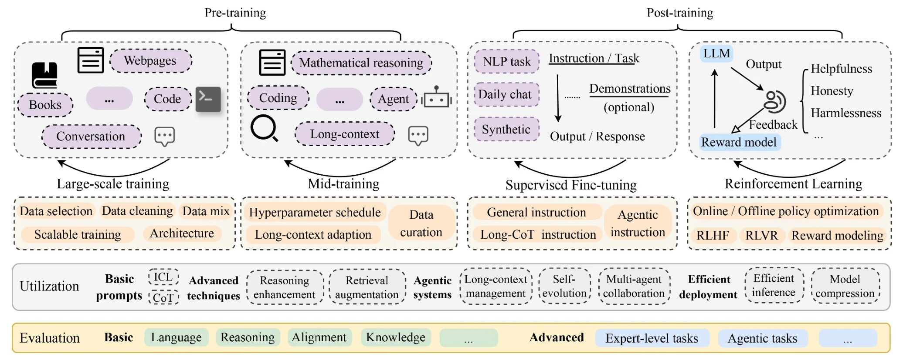
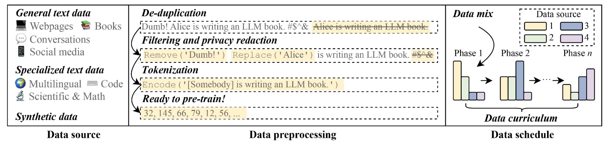
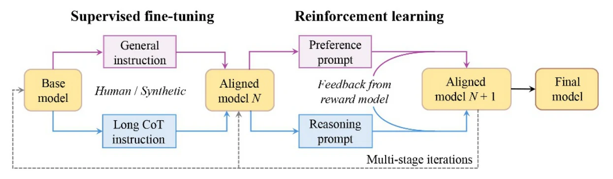
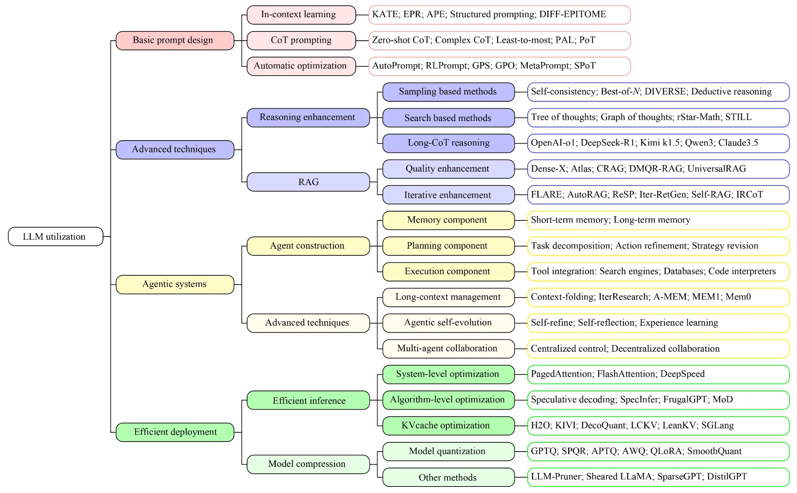

# A Survey of Large Language Models: A Map from Training and Use to Agents

Why can a large language model translate and write code and also answer math problems? Why does the same model perform differently when given a different prompt or a few demonstrations? And once a model can already answer questions, why do people still apply supervised fine-tuning and preference optimization, or even connect it to search and executors? These questions belong to different layers of research, yet they are often crowded into the same paper. Remembering only the names Transformer, SFT, RLHF, CoT and RAG, it is easy to confuse "what the model has learned" with "what the model was given this time".

*A Survey of Large Language Models*, by Wayne Xin Zhao, Kun Zhou, Junyi Li and colleagues, tries to reconnect these techniques into one complete process of development and use. It organizes the literature along four dimensions, pre-training, post-training, utilization and evaluation: pre-training builds basic abilities, post-training adjusts how the model answers, utilization methods arrange the current input and the solving process, and evaluation checks what these arrangements actually achieve. This guide is pinned to **the formal 2026 journal PDF in Frontiers of Computer Science, 40 pages in all**. It is the authors' updated and condensed version of their earlier arXiv survey; the main text ends on page 26, and what follows is mainly references and author biographies. Its organization and length differ substantially from the long arXiv version. [Abstract, §1 and version notes, PDF pp. 1–3](https://link.springer.com/content/pdf/10.1007/s11704-026-60308-3.pdf)

The contribution of this survey is organizing research, providing a literature framework that spans the stages of development and use. Its most useful feature is that, faced with a new method, a reader can say which part it changes and why the change might work. The core of this guide is placed there too. Following the original's section order, it first builds a basic understanding of language models and scale, then takes apart the data and architecture of pre-training, the demonstrations and feedback of post-training, and the prompts and interaction of utilization, and finally returns to evaluation. Four original figures give the overall picture, the data process, the post-training flow and the tree of utilization methods; the guide explains them piece by piece later, without requiring you to memorize every method name on their right-hand sides first.

## The four-dimensional map, seen from where language models came from

Why did the authors devote an entire survey to the development process rather than just listing models? Because language-model research has gone through more than an increase in parameters; it has also gone through changes in "how a model is used for a task". The original first reviews four stages, then uses Figure 2 to lay out the complexity of modern systems. [§1–2, PDF pp. 1–4](https://link.springer.com/content/pdf/10.1007/s11704-026-60308-3.pdf#page=2)

Early statistical language models estimated the probability of the next word from the few words before it. This is intuitive: if a sequence of words appears often in training text, the model considers that continuation more likely. The problem is that once combinations grow long and the vocabulary large, a great many combinations never appear at all, and frequency estimates become sparse. Neural language models place words in a continuous vector space, so that similar words can share statistical information instead of every combination being counted separately.

Pretrained language models changed how tasks are adapted once more. A model first learns representations from large-scale text, then continues training for tasks such as classification and question answering, forming the "pre-train then fine-tune" paradigm. BERT is an important representative: the same word receives different representations in different sentences, and later tasks no longer learn language from scratch. With models such as GPT-3, another way of using models was fully demonstrated: put the task description and a few input–answer demonstrations directly into the current text, and many tasks can be completed without updating the parameters. From this the authors explain why research turned from per-task models to general foundation models.

Figure 2 can first be read in two layers, upper and lower. The four large boxes in the upper half all involve training. The leftmost starts from web pages, books, code and dialogue and, through large-scale learning, produces a base model. The second box is mid-training: further strengthening targeted abilities with mathematics, code, long contexts and interaction material. The two boxes on the right belong to post-training: first supervised fine-tuning on instruction–answer demonstrations, then improving the generation policy based on feedback about preference or correctness. The small orange boxes below the figure list design questions for each stage, such as the data mixture, training scheduling and reward modeling. [Figure 2 and §2, PDF p. 3](https://link.springer.com/content/pdf/10.1007/s11704-026-60308-3.pdf#page=3)

The lower half is no longer arranged along the timeline of training; it lists how the model is used and tested. A gray bar extends from basic prompting through reasoning enhancement, retrieval and agents to efficient deployment; the yellow bar at the very bottom is evaluation, which covers language, reasoning and alignment as well as expert-level tasks and interactive tasks. Evaluation sits at the bottom because every layer of design needs continual testing.

The four dimensions depend on each other, but they do not form a fixed production line that every system must go through in full. Users can adopt an existing model directly and study prompting or retrieval; trainers also go back and adjust data based on evaluation results. Mid-training in the figure is an optional stage, and in industrial pipelines SFT and reinforcement learning may alternate over several rounds. Reading the figure as "where research choices are made" is closer to the authors' meaning than reading it as "a factory line passed through once".

This also gives a distinction the whole survey uses repeatedly: training changes parameters that are shared across calls; context changes the information visible this time; tools and environments change the actions that can be taken and the feedback they produce. A system may change all three at once, and research then needs to keep separate accounts of each.

## How next-token prediction connects tasks and scale

The four-dimensional map has a common starting point: what exactly is the model learning? §2 of the survey takes autoregressive language modeling as the mainstream training paradigm, that is, predicting the next token from the text so far. A token is the basic unit defined by the tokenizer, which may be a word, a piece of a word or a character; the tokenizer first turns text into a sequence of IDs, which the model then computes on. [§2, PDF pp. 3–4](https://link.springer.com/content/pdf/10.1007/s11704-026-60308-3.pdf#page=3)

In the guide's general notation, this can be written as:

$$
p_\theta(x_{1:T})=\prod_{t=1}^{T}p_\theta(x_t\mid x_{<t}),\qquad
\mathcal L_{\rm LM}=-\sum_{t=1}^{T}\log p_\theta(x_t\mid x_{<t}).
$$

$x_t$ is the $t$-th token, $x_{<t}$ the text before it, and $\theta$ the model parameters. The left expression decomposes the probability of a whole text into step-by-step conditional probabilities; the right one is the training loss, which wants the true next token to receive high probability. This is the guide's teaching expression of the original's training paradigm in standard probability notation. During training the true text is known, so predictions at all positions can be computed in parallel; during generation the unknown continuation has to be produced step by step, so the computation is arranged differently.

Why should such an objective connect to so many tasks? Because training text contains more than casual conversation: it also contains explanations, translations, programs and derivations. To complete accurately "the solution after a problem", the model needs to make use of the language and problem structure in such text. Likewise, at use time a task can be packaged as text to be completed: the problem, constraints or demonstrations come first, and the answer is generated after them. This explains how one common interface can carry many tasks, and also why data engineering became central to forming abilities.

Later sections occasionally use a **teaching example invented for the guide**: an entirely fictional "file summarizer" that reads a given table, computes the total for each category, and reports a gap when units are missing. This example only illustrates mechanisms. Training material might contain many explanations of tables and many programs; SFT demonstrations might specify the output format; at use time one might supply a demonstration, the actual file or a calculation tool. The task looks the same, but the place where the change happens differs. We use it only when such places need to be distinguished.

**Scaling laws answer how resources should be divided.** The survey summarizes the empirical relation in power-law form:

$$
L(X)=C_X X^{-\alpha_X},\qquad X\in\{N,D,C\}.
$$

$L$ is the cross-entropy loss in nats, $N$ the model size, $D$ the size of the training data and $C$ the training compute; $C_X$ and $\alpha_X$ are the corresponding fitted coefficients. This form summarizes, under controlled conditions, the trend of loss as one resource changes; the fitted coefficients and their range of use both depend on the experimental setup. [§2 Scaling law, PDF p. 4](https://link.springer.com/content/pdf/10.1007/s11704-026-60308-3.pdf#page=4)

Early research by Kaplan and colleagues leaned toward using larger models under a fixed budget, even without training them to convergence. The compute-optimal study by Hoffmann and colleagues then pointed out that large models are often undertrained and that parameters and data should be scaled more evenly. They fitted an allocation from experiments at different scales and then trained Chinchilla to test the prediction. The relation between these two neighboring works is that both study budget allocation, and the latter shifted the judgment of "where the money should mainly go" from favoring parameters to balancing parameters and data. [Kaplan et al. abstract](https://arxiv.org/abs/2001.08361) · [Hoffmann et al. abstract](https://arxiv.org/abs/2203.15556)

The survey also deliberately adjusts its wording about "emergent abilities". Early research called abilities that are absent in small models but appear in large ones emergent, but later research pointed out that metrics and measurement ranges can also create the impression of a sudden jump. For example, if only fully correct answers score, gradually improving partial predictions can show up abruptly in the total. The authors therefore prefer to speak of "representative abilities": in-context learning, chain-of-thought, instruction following and similar abilities should be studied, together with data and measurement, for how they change with scale. [§2 Representative abilities, PDF p. 4](https://link.springer.com/content/pdf/10.1007/s11704-026-60308-3.pdf#page=4)

The understanding this section builds is: next-token prediction provides a common learning interface, scaling laws help allocate resources, and specific abilities come from the combined effect of data, structure, optimization and the measurement of tasks. The pre-training sections that follow unfold these conditions one by one.

## Pre-training, part one: Data from sources to a training curriculum

Chapter 3 of the original places data before networks. The order matters: what distribution a model can learn from determines what the later architecture and compute are actually processing. Figure 3 splits data preparation into three columns, sources, preprocessing and scheduling, which answer "what is there", "what is kept" and "what is seen when". [§3.1 and Figure 3, PDF pp. 4–6](https://link.springer.com/content/pdf/10.1007/s11704-026-60308-3.pdf#page=4)

**The left column is sources.** Web pages, books and dialogue provide a broad distribution of language and facts; code, scientific and mathematical text provide task-relevant structure; synthetic data is generated by existing models as documents, question–answer pairs or reasoning traces. The continuity of books helps in learning long-range relations, and code and mathematical material contain clearer structural constraints. Synthetic data can also transform source material, for example adding explanations to programs, rather than only inventing another text from scratch.

The three kinds of source play different roles. Code material supplies program structure, while synthetic answers can expand demonstrations but may also repeat the teacher's mistakes. What the survey cares about here is how to keep obtaining training information that is new, of good quality and richly enough distributed, so that added text actually provides value for learning.

**The middle column is preprocessing.** Deduplication can be done at the level of URLs, documents or sentences, preventing repeated content from receiving disproportionate weight in training. Filtering removes spam, noise and harmful content, and handles identifiable private information. The figure demonstrates these different operations with the deletion of a repeated sentence, the removal of noisy symbols and the replacement of a name with a placeholder. Only after this processing does the tokenizer turn the text into ID sequences.

The common BPE tokenization starts from small units and repeatedly merges frequent adjacent sequences. For a model, the same term might take one token or be split into several; the tokenization therefore affects sequence length and computational burden. The survey also notes that some domains use special designs, such as digit-by-digit handling in mathematics. When comparing text lengths and compute budgets, counts should therefore use the tokenizer the model actually uses. [§3.1.2, PDF p. 5](https://link.springer.com/content/pdf/10.1007/s11704-026-60308-3.pdf#page=5)

**The right column is scheduling, which has two levels.** The data mix decides how much each source contributes overall; the data curriculum decides how these proportions change across training stages. The four colors in the figure stand for four sources, and the changing bar heights at each stage show that the same total budget can be used in different orders instead of keeping the same proportions from start to finish.

This distinction can be illustrated with a very small teaching budget. Suppose there are only 100 training batches in total, 60 of general text and 40 of code. Mixing six to four throughout, versus first favoring general text and then gradually increasing code, may give the same final proportions but different learning trajectories. These numbers are assigned by the guide; the original stresses that the distribution should change gradually between actual stages, to avoid unstable training caused by an abrupt switch of data. Using high-quality data together with a decaying learning rate in the later phase is also a common way to finish. [§3.1.3, PDF pp. 5–6](https://link.springer.com/content/pdf/10.1007/s11704-026-60308-3.pdf#page=5)

A long-context curriculum is another kind of scheduling. The model first handles shorter sequences, then gradually longer ones; each stage needs data of the corresponding length, and the position encoding has to be adjusted too. Concatenating random short texts into a long string increases sequence length, but may not create dependencies that genuinely require using information across segments. The survey therefore discusses upsampling naturally long texts and filtering data by features of long-range dependency. Length is the container; the relations between related pieces of information are what is learned.

The data chapter ends by turning to quality and responsibility: low-quality data harms abilities, and bias, privacy and copyright also need to be considered during collection and processing. The authors see data scarcity as a bottleneck for further scaling and discuss the informational stagnation that repeated distillation of synthetic data may bring. This line of reasoning leads naturally to the interactive environments later in the survey: if an environment can produce new tasks and feedback that can be verified, it may become a source of data beyond static text. [§3.1.4, PDF p. 6](https://link.springer.com/content/pdf/10.1007/s11704-026-60308-3.pdf#page=6)

## Pre-training, part two: Which resource burden an architecture changes

Once data is ready, a computational structure is needed to process it. §3.2 of the survey builds on the Transformer and is organized around attention, position encoding, mixture of experts and other structures. The easiest mistake in reading this section is to lump all "efficient" methods together; in fact they respectively reduce the positions that can be read, compress the cache, allocate the parameters activated, or change how history is represented. [§3.2 and Table 1, PDF pp. 6–9](https://link.springer.com/content/pdf/10.1007/s11704-026-60308-3.pdf#page=6)

**First, what attention does.** The query at each position is compared with the keys at other positions, and the values are then aggregated by the resulting weights to form a new representation. Ordinary full attention has to process many pairs of positions, so its computational burden on long sequences grows with the square of the length. During generation, the keys and values of earlier positions must also be kept, called the key–value cache (KV cache), so that the whole preceding text need not be recomputed for every new word. Computing position pairs and storing the cache are related but different burdens.

Sparse attention reduces "which positions are read". Position-based schemes can keep only a recent window and a few designated positions; content-based schemes select relevant text blocks according to the current query. The former has simple rules, but important distant information may fall outside the kept positions; the latter tries to keep relevant long-range information but needs a selection mechanism and a matching implementation. The survey also discusses linear attention: instead of storing all history item by item for direct querying, it maintains a fixed-size state updated with the input. This can lower the cost of long sequences, at the price of the question of how a finite state keeps a rich history. The authors therefore stress the trade-off between expressive power and memory capacity, as well as designs that mix linear layers with full attention. [§3.2.1, PDF pp. 6–7](https://link.springer.com/content/pdf/10.1007/s11704-026-60308-3.pdf#page=6)

**MQA, GQA and MLA mainly compress how the cache is organized.** In ordinary multi-head attention, each head has its own queries, keys and values. Multi-query attention (MQA) lets many query heads share one set of keys and values, reducing the cache read and written repeatedly during incremental generation; GQA groups the query heads, with each group sharing one set of keys and values, a compromise between multi-head and fully shared. The original GQA paper names quality degradation as one of MQA's problems, proposes an intermediate number of key–value heads to balance quality and speed, and discusses how to obtain this structure by continuing training from existing multi-head checkpoints. [MQA abstract](https://arxiv.org/abs/1911.02150) · [GQA abstract](https://arxiv.org/abs/2305.13245)

A table of cache shapes makes the difference clear. The following is a shape example made up for the guide: one layer, one sequence, length $T$, per-head width $d$, 8 query heads; batches, other caches and anything related to position encoding are not counted.

| Scheme | Query heads | Key–value heads | Scalars to store for keys and values combined |
| --- | ---: | ---: | ---: |
| Ordinary multi-head | 8 | 8 | $2T\times8d$ |
| GQA with two groups | 8 | 2 | $2T\times2d$ |
| MQA | 8 | 1 | $2T\times d$ |

In this example, GQA stores a quarter as many key–value scalars as ordinary multi-head attention, while the queries still have eight heads, each able to form different reading weights. Once keys and values are shared, the eight kinds of query are each kept. The changing subscripts for GQA and MQA in the original's Table 1 correspond exactly to this. [Table 1, PDF p. 7](https://link.springer.com/content/pdf/10.1007/s11704-026-60308-3.pdf#page=7)

Multi-head latent attention (MLA) takes another route. DeepSeek-V2 compresses keys and values with a low-dimensional latent representation, reducing the cache each position must store, and then takes part in attention through corresponding projections. GQA is more like sharing a few sets of the original key–value representations, while MLA is more like learning a compact common representation. It and the MoE in the same model target the attention cache and sparse computation respectively, and the overall efficiency comes from these components together with the training recipe. [§3.2.1, PDF p. 6](https://link.springer.com/content/pdf/10.1007/s11704-026-60308-3.pdf#page=6) · [DeepSeek-V2 abstract](https://arxiv.org/abs/2405.04434)

**Position encoding lets attention perceive order.** RoPE applies position-dependent rotations to queries and keys, so that their match can express relative position. ALiBi instead adds a penalty that grows with distance to the attention scores, favoring nearby information. Both bring position into attention, but one acts on the rotated representations and the other on a bias to the scores. The survey also discusses how to adjust RoPE to support longer contexts, and notes that length-extrapolation methods that favor locality may still struggle to use distant information. [§3.2.2, PDF p. 8](https://link.springer.com/content/pdf/10.1007/s11704-026-60308-3.pdf#page=8) · [RoPE abstract](https://arxiv.org/abs/2104.09864) · [ALiBi abstract](https://arxiv.org/abs/2108.12409)

**Mixture of experts (MoE) changes how many computational modules each token calls.** Several experts are placed where an ordinary feed-forward network would be, and a router picks a few of them based on the current representation and combines their outputs. Total capacity can thus grow while each token activates only part of the parameters. Mixtral 8×7B is an intuitive example: each layer has eight feed-forward experts, and each token selects two; the next token may select a different pair. The wording in §3.2.3 of the survey about Mixtral's number of activated experts is easily confused with the total number of experts; here, following the Mixtral paper's abstract, "eight available" and "two selected" are distinguished. [§3.2.3, PDF p. 8](https://link.springer.com/content/pdf/10.1007/s11704-026-60308-3.pdf#page=8) · [Mixtral abstract](https://arxiv.org/abs/2401.04088)

Routing brings new problems too. If some experts are always chosen and others hardly used, training and device load become unbalanced. The survey therefore goes on to discuss shared experts, fine-grained experts and load-balancing strategies. The difference between MoE and GQA is now clear: the former sparsely selects feed-forward modules, the latter shares attention keys and values; they can coexist.

The original also outlines new designs for residual connections, parametric memory, recurrent reuse of layer weights, and diffusion language models. These show that the Transformer is not the only structure that can be scaled. When making sense of these branches, the most stable coordinates remain: what information is kept, what structure computes on it, how much is activated at each step, and which resource ultimately constrains it.

## Pre-training, part three: Making training fit and run stably

As models and data grow, the question is no longer only whether the formulas are correct, but also whether the parameters fit, whether training is stable, and how much of the devices' time is actually spent computing. §3.3 of the original separates optimization settings from scalable training: the former cares whether updates stay effective, the latter how these updates are executed on devices. [§3.3, PDF pp. 9–11](https://link.springer.com/content/pdf/10.1007/s11704-026-60308-3.pdf#page=9)

More than the model's weights occupies memory during training. Gradients, optimizer states and the intermediate activations needed for backpropagation must also be stored. Data parallelism has each device process different examples and then combines the updates; tensor parallelism splits large matrices; pipeline parallelism assigns consecutive layers to different devices; context parallelism shares the work of long sequences; and expert parallelism distributes MoE modules. They split different objects and are often used in combination.

ZeRO targets the waste of storing the same states repeatedly under data parallelism. It partitions optimizer states, gradients and parameters in successive levels, so that each device stores only a part and fetches the rest from other devices when needed. Compared with "assigning different layers to different cards", its core is eliminating redundant states; the memory saved comes with requirements on how communication is organized. The survey distinguishes these levels as ZeRO-1, 2 and 3, and the original paper also analyzes memory and communication volume together. [§3.3.2, PDF p. 10](https://link.springer.com/content/pdf/10.1007/s11704-026-60308-3.pdf#page=10) · [ZeRO abstract](https://arxiv.org/abs/1910.02054)

FlashAttention addresses a different bottleneck: during attention computation, large matrices are moved back and forth between different levels of GPU memory. It uses tiled computation and online normalization to avoid writing the whole intermediate attention matrix back to slow memory, reducing reads and writes. The key difference from sparse attention is that standard FlashAttention keeps exact full attention and speeds it up with a better arrangement of memory access. On page 11 the survey abbreviates both time and memory complexity as reducing the quadratic burden, which can mislead; here, following the original paper, the optimization of memory access is distinguished from the pairwise arithmetic that full attention still requires. [§3.3.2, PDF p. 11](https://link.springer.com/content/pdf/10.1007/s11704-026-60308-3.pdf#page=11) · [FlashAttention abstract](https://arxiv.org/abs/2205.14135) · [Original paper §3.1, Theorem 1, PDF p. 5](https://arxiv.org/pdf/2205.14135v2#page=5)

The table below excerpts two rows from Table 2 of the original, showing the scale of pre-training along several different dimensions. B means billion and T trillion; training tokens are the number seen over the whole training process, and context length is the length of a single sequence. A dense model in the table passes every token through the same set of main computational modules, unlike MoE, which selects experts per token.

| Model | Architecture | Parameters | Training tokens | Context length |
| --- | --- | ---: | ---: | ---: |
| GPT-3 | Dense model | 175B | 300B | 2K |
| LLaMA-3.1 (the 405B version in the table) | Dense model | 405B | 15T | 128K |

[Table 2, PDF p. 10](https://link.springer.com/content/pdf/10.1007/s11704-026-60308-3.pdf#page=10)

What this table shows is that parameters, data and context each expanded; it does not control for date, training recipe or data quality. The parameter count after a model's name is only one of the columns. When you see a new training report, separating the columns like this is more informative than summing up every change as "bigger".

Training stability depends on choices such as initialization, learning-rate warm-up and decay, gradient clipping and numerical precision. Mixed precision runs suitable operations at lower precision while keeping higher precision for sensitive parts; overlapping communication with computation reduces the time devices spend waiting. The authors include these issues in pre-training precisely because the same learning objective becomes model ability only through a sustainable, stable execution process.

## Mid-training: Strengthening targeted abilities on a general foundation

§3.4 of the original discusses mid-training separately because today's development process often needs more targeted data and training strategies between general pre-training and instruction post-training. It is also called continued pre-training, but the emphasis here is on the stage's role: giving the model fuller exposure to the structures needed by mathematics, code, long contexts and agent tasks. [§3.4, PDF pp. 11–12](https://link.springer.com/content/pdf/10.1007/s11704-026-60308-3.pdf#page=11)

Return to the fictional file summarizer. If the base model has rarely seen tables, grouped calculations and program debugging, the learning of these basic structures needs to be strengthened first. Mid-training can raise the proportion of relevant text, programs and derivation traces, so that these structures are learned more thoroughly in the parameters. The difference from attaching an actual table at use time is that the former changes the model shared by many later tasks, while the latter provides specific information for the current problem.

The survey understands mid-training and post-training as connected stages of cultivating abilities: mid-training expands the base and strategic material, and post-training further encourages effective behavior. Long reasoning traces can appear in both stages, but with different proportions, goals and organization of data. The names of training stages have to be read together with the actual update process.

Mid-training data is usually more concentrated in the target domain and the sequences may be longer, so the learning rate and data distribution need corresponding adjustment. The original discusses practices such as lowering the learning rate, rearranging warm-up or staging the curriculum. To let the model gradually adapt to a new distribution while keeping its existing abilities, the switching of data and the strength of updates need to be designed together.

Long-context adaptation illustrates this particularly well. Expanding the range of positions requires the position encoding to cooperate, and long sequences must actually appear in training; if full attention is too expensive, a sparse mechanism may also be adopted at this stage. "Supporting longer contexts" thus involves at least three changes: position representation, training data and computational structure. The original puts them in the same section to avoid treating window length as a single switch. [§3.4.2, PDF p. 12](https://link.springer.com/content/pdf/10.1007/s11704-026-60308-3.pdf#page=12)

Mid-training's place in the survey is thus clear: it carries on the parameter learning of pre-training and prepares a more suitable foundation of abilities for post-training. When you later meet claims such as "learned a complex task from just a few demonstrations", you can go on to ask what kind of base model it depended on.

## Post-training, part one: How SFT turns continuation into task behavior

After basic training, a model can already predict many forms of text, but when given a request it does not always answer as the task requires. Chapter 4 begins with supervised fine-tuning (SFT): task descriptions, optional inputs and desired outputs are organized into demonstrations, and the model learns "what kind of answer should follow this kind of request". [§4.1, PDF pp. 12–13](https://link.springer.com/content/pdf/10.1007/s11704-026-60308-3.pdf#page=12)

Read this figure from left to right. The yellow Base model is the starting point; the purple upper path is general instructions, and the blue lower path is long chain-of-thought instructions. Both paths lead to Aligned model N, showing that general instructions and long reasoning can train the same model together. Next the model faces preference-type tasks and reasoning-type tasks respectively, and reward feedback drives its update. The dotted line along the bottom returns to the start, showing that demonstration learning and feedback optimization can iterate over several rounds. [Figure 4 and §4, PDF p. 12](https://link.springer.com/content/pdf/10.1007/s11704-026-60308-3.pdf#page=12)

SFT training still uses a conditional generation loss. In the guide's notation, if $q$ is the request and $a$ the demonstrated answer:

$$
\mathcal L_{\rm SFT}=-\sum_t\log p_\theta(a_t\mid q,a_{<t}).
$$

Each $a_t$ is a token of the answer, and $a_{<t}$ is the answer content before it. It closely resembles the language-model loss; the key difference is what conditions and what targets the data has been organized into. For the file summarizer, a demonstration might say "output totals by category; if units are missing, state that they are unknown", and the target answer shows this behavior. Through parameter updates, these demonstrations affect how the model later handles requests of the same kind.

**Where do demonstrations come from?** Early practice rewrote existing tasks as natural-language instructions, or collected real requests and answers written by people. This makes the goal explicit, but building diverse, high-quality data is laborious. Self-Instruct addresses this cost: it uses a small number of human seeds to guide a model in generating new instructions, inputs and outputs, filters out invalid or overly similar examples, and finally fine-tunes the model on what remains. Compared with collecting demonstrations directly from real tasks, it hands the work of expansion to the model; filtering then becomes key to keeping low quality and repetition from being amplified. [§4.1.1, PDF p. 12](https://link.springer.com/content/pdf/10.1007/s11704-026-60308-3.pdf#page=12) · [Self-Instruct abstract](https://arxiv.org/abs/2212.10560)

The survey further divides synthetic data into general instructions, long-reasoning instructions and agent instructions. General instructions emphasize diversity of tasks and expression; long-reasoning instructions contain fairly complete solving, self-checking and correction; agent instructions must also describe the environment, the tool specifications, and how thinking, calls and observations interleave. The last is especially different: a sentence saying "I have run the program" contains no real execution feedback, and training material needs to state where the observations actually came from. [§4.1.1, PDF pp. 12–13](https://link.springer.com/content/pdf/10.1007/s11704-026-60308-3.pdf#page=13)

**After collection come selection and mixing.** Examples that are abnormally short, hard to understand or of poor quality can be filtered first, followed by finer selection using model scoring, semantic clustering or task relevance. Mathematics, code, general dialogue and safety data also need to be balanced. The original lists proportions from industrial experience, but these are summaries of recipes from different reports, and this guide does not turn them into a general prescription. A model for a narrow task needs a different amount of demonstrations from a general assistant; the stronger the base model, the more likely a small amount of high-quality data is to work. [§4.1.2, PDF p. 13](https://link.springer.com/content/pdf/10.1007/s11704-026-60308-3.pdf#page=13)

LoRA shifts attention to "how to fine-tune more cheaply". It freezes the existing weights and trains only injected low-rank update matrices, reducing the trainable parameters and the burden of optimizer states. Compared with full-parameter SFT, it restricts how the update is parameterized; compared with ICL, it still performs training updates. The original presents it as a means of adapting to domain tasks under limited resources; questions of data quality and task coverage still rest with the training material. [§4.1.3, PDF p. 13](https://link.springer.com/content/pdf/10.1007/s11704-026-60308-3.pdf#page=13) · [LoRA abstract](https://arxiv.org/abs/2106.09685)

The core of SFT is imitating demonstrations. It can establish formats, understanding of tasks and early reasoning behavior, and it also provides a starting point for later reinforcement learning. The next question is: if several answers are all acceptable and we prefer one of them, or if we only know whether the final answer is right, how can this information be used in training?

## Post-training, part two: Turning preference and correctness into rewards

§4.2 of the original first distinguishes sources of reward and then covers optimization algorithms. The order is worth keeping: the algorithm decides how to update, and the reward decides in which direction. Comparing only optimizer names without checking the scoring signal is like comparing two ways of climbing without saying which mountain is being climbed. [§4.2.1–4.2.2, PDF pp. 14–15](https://link.springer.com/content/pdf/10.1007/s11704-026-60308-3.pdf#page=14)

**Preference rewards suit tasks for which no single answer can be written.** For the same question, two answers may both be factually correct, but one more on point and the other vaguer; or one helpful and the other carrying a safety risk. Classic RLHF first has annotators compare candidates, then trains a reward model to predict these comparisons, and finally uses the reward to adjust the generating model. A small number of human judgments is extended to many more generated samples through the reward model.

InstructGPT is representative of this route. It first collects demonstrations for SFT, then collects rankings of outputs, trains a reward and optimizes the policy. The original paper's abstract reports that in human evaluations on its prompt distribution, outputs of the 1.3B-parameter InstructGPT were preferred over those of the 175B base GPT-3. This number shows that behavioral training can change people's choices, rather than relying only on scaling parameters; what this comparison evaluates is preference among outputs on particular requests. Its difference from Self-Instruct is also clear: the former goes on to use relative preference feedback, while the latter mainly expands the demonstrations available to imitate. [§4.2.3, PDF p. 15](https://link.springer.com/content/pdf/10.1007/s11704-026-60308-3.pdf#page=15) · [InstructGPT abstract](https://arxiv.org/abs/2203.02155)

**Verifiable rewards suit tasks whose results can be checked.** Math answers can be matched or checked, programs can be run against tests, and interactive tasks can check whether the environment's goal was reached. Reinforcement learning with verifiable rewards (RLVR) uses such signals, reducing the dependence on people writing out reasoning or ranking preferences item by item. Compared with a preference model, it is usually more direct for the correctness target it defines; its coverage is determined by the verifier. The file summarizer can be checked for totals and format, but needs additional criteria to check whether categories were left out or missing units were filled in without warrant.

The survey also distinguishes rule-based rewards from model-based rewards. The former rely on clearly defined rules or checking programs, the latter learn a scoring function; real systems mix the two. Open-ended answers may be judged for usefulness by a model, while program results are judged by running tests. "Rules" here also vary in strength: executable formal checks rely on checking programs, while scoring against a natural-language rubric also depends on a judging model. [§4.2.2, PDF pp. 14–15](https://link.springer.com/content/pdf/10.1007/s11704-026-60308-3.pdf#page=14)

Rewards can also be given at different granularities. Outcome rewards score only after a whole answer or task trajectory ends; they are easy to automate, but it is hard to tell which early step went wrong. Process rewards evaluate intermediate sentences or steps, giving a finer signal, but they need an evaluator that can judge these parts reliably. For long tasks, this is the credit-assignment problem: when the end result is a failure, which early action should be held responsible?

Once a reward is used as an optimization target, "reward hacking" also appears. The model may learn to make answers longer, use wording the judge likes, or exploit loopholes in the checking program, without genuinely improving the target behavior. The survey therefore ties reward design, training monitoring and independent evaluation together. A reward model is a proxy learned from certain data and rules, and task correctness has to be tested by another layer of evidence. [§4.2.3 Training issues, PDF p. 16](https://link.springer.com/content/pdf/10.1007/s11704-026-60308-3.pdf#page=16)

The conclusion of this section is that RLHF and RLVR mainly tell us where feedback comes from, and outcome and process rewards tell us at what granularity feedback is given. Methods such as PPO, GRPO and DPO in the next section answer how these signals are turned into parameter updates.

## Post-training, part three: PPO, GRPO, DPO and filtered fine-tuning

With rewards or preference data in hand, a way of learning still has to be chosen. The original organizes algorithms into online and offline, then compares data sources and learning strategies in Table 3. "Online" here means continuing to generate new samples from the current or a recent model during training, and "offline" means using fixed data; it has nothing to do with being connected to the internet. [§4.2.3 and Table 3, PDF pp. 15–17](https://link.springer.com/content/pdf/10.1007/s11704-026-60308-3.pdf#page=15)

**PPO: generate and adjust from feedback at the same time.** In language-model post-training, the generating model is the policy: given a request and the preceding text, it decides the probabilities of the next token. The model generates an answer, the reward evaluates it, and a policy update makes better behavior more likely. Classic PPO also learns a value function to estimate expected return and uses a clipping mechanism to keep any single update from being too large; RLHF pipelines usually also use a separate KL-divergence constraint relative to a reference policy, measuring the difference between the old and new output distributions, to keep the model from drifting excessively in pursuit of reward. These are two neighboring but different means of control. [PPO abstract](https://arxiv.org/abs/1707.06347) · [§4.2.3, PDF p. 15](https://link.springer.com/content/pdf/10.1007/s11704-026-60308-3.pdf#page=15)

PPO's advantage is that it can keep learning from the answers the model is currently producing; the cost is that generation, rewards, value estimation and policy updates all have to be coordinated. The survey lists the extra value model and training stability as its burdens. Its direct difference from SFT is that it no longer only imitates one specified answer but uses feedback to judge which generated behaviors are better than expected.

**GRPO: relative comparison within a group of answers to the same question.** DeepSeekMath proposed this variant of PPO, which drops the separate value model, samples several answers to the same prompt, and constructs advantages from comparisons of rewards within the group. Intuitively, it uses "how much better this answer is than the other answers to the same question" as the baseline. It saves the burden of value estimation, while making group sampling, the distribution of rewards and normalization important choices. [GRPO abstract: DeepSeekMath](https://arxiv.org/abs/2402.03300) · [§4.2.3, PDF p. 15](https://link.springer.com/content/pdf/10.1007/s11704-026-60308-3.pdf#page=15)

A guide example that can be worked by hand: sample four answers to the same question, with verified rewards $[1,1,0,0]$. The group mean is $0.5$, and the population standard deviation is also $0.5$, so the simplified standardized relative rewards are $[1,1,-1,-1]$. In the guide's notation:

$$
A_i=\frac{r_i-\bar r}{\sigma_r}.
$$

$r_i$ is the reward of the $i$-th answer, and $\bar r$ and $\sigma_r$ are the group's mean and standard deviation. This demonstrates only the within-group relative signal, not the full GRPO objective, which also involves probability ratios, clipping, constraints and numerical handling. If all four answers are wrong, a group judged only on binary correctness has no difference between better and worse. This also shows that generating sufficiently varied candidates and designing effective feedback are preconditions for learning to happen.

**RFT: keep the sampled answers that pass verification and learn from them.** Rejection-sampling fine-tuning does not need to carry each answer's relative advantage into a policy gradient; it first generates several candidates, then filters out the qualified reasoning paths and uses them as supervised training material. Its original paper found in mathematical reasoning that adding more distinct correct reasoning paths improves results. Its difference from ordinary SFT is that part of the training demonstrations are generated by the model itself and then filtered; its difference from GRPO is that the update after filtering still proceeds as supervised learning. [RFT abstract](https://arxiv.org/abs/2308.01825)

RFT can use a fixed set of filtered samples, or repeatedly generate and filter during training, becoming online RFT. If filtering keeps only paths the model is already good at, the range of exploration is limited; the survey therefore weighs the stability of fixed data against the flexibility of adapting to current ability.

**DPO: learn directly from preference pairs.** For the same request, the data gives a preferred answer and a dispreferred one. DPO rewrites the KL-regularized reward optimization problem as a classification-style preference loss, with no need to fit an explicit reward model first and then run an online reinforcement-learning loop. Unlike RFT, which keeps only the better answers, DPO uses the relation of which one is better and which is worse; compared with PPO-style RLHF, it greatly simplifies the training components. [DPO abstract](https://arxiv.org/abs/2305.18290)

DPO's theoretical connection to reward optimization depends on its modeling assumptions and derivation; its manner of execution is best compared through Table 3: fixed preference pairs with a contrastive objective, versus online sampling, rewards and policy updates, are two different arrangements of execution. How far the preference data is from new tasks also decides how much change offline learning can adapt to.

**On-policy distillation (OPD): teach the student where it actually ends up.** Ordinary offline distillation tends to show the student only sequences produced by the teacher, while at inference the student may wander into other preceding text. OPD has the student generate its own sequences and then obtains feedback from the teacher's probability distribution on those preceding texts. Like online RFT, it uses the student's samples, but it provides dense token-level teacher signals, while online RFT relies mainly on filtering to keep answers. Online generation and teacher evaluation also have to be counted in the training cost. [OPD abstract](https://arxiv.org/abs/2306.13649)

The relations among these methods are rewritten below following Table 3 of the original; the table compares data and ways of updating and is not a ranking of effectiveness. [§4.3.1 and Table 3, PDF pp. 16–17](https://link.springer.com/content/pdf/10.1007/s11704-026-60308-3.pdf#page=16)

| Method | How the main material is produced | How the update uses the material |
| --- | --- | --- |
| SFT | Demonstrations written by people or synthesized | Raises the conditional probability of the demonstrated answer |
| Offline RFT | Fixed, already filtered answers | Supervised learning on the kept answers |
| DPO | Fixed pairs of preferred and dispreferred answers | Contrasts the relative probabilities of the two |
| OPD | Sequences generated by the current student, with feedback from a teacher | Imitates the teacher's token-level distribution |
| Online RFT | Answers generated and filtered as training proceeds | Continues supervised learning on newly kept answers |
| PPO | Answers generated by the current or a recent policy, with rewards | Optimizes with advantage estimates and controlled policy updates |
| GRPO | A group of answers sampled for the same prompt, with rewards | Builds advantages from relative feedback within the group |

The most valuable thing to learn from Table 3 is two separate questions: Are the samples updated as training proceeds? And what objective is used once the samples are in hand? Separating them makes it clear why "online" covers more than reinforcement learning, and why "post-training" is not simply PPO.

## How multi-stage post-training combines these parts

Chapter 4 ends by returning to industrial pipelines, because real models usually do not choose just one method from the previous section. General instruction ability, complex reasoning and tool tasks need different material and feedback, so training is a process of combining step by step and evaluating repeatedly. [§4.3.2, PDF pp. 17–18](https://link.springer.com/content/pdf/10.1007/s11704-026-60308-3.pdf#page=17)

DeepSeek-R1 is the reasoning-training example the survey relies on most. R1-Zero explored the route of running large-scale reinforcement learning directly from the base model without SFT first, and reasoning behaviors such as self-checking and reflection appeared, but the original paper also reports problems such as poor readability and language mixing. R1 then introduced cold-start data before reinforcement learning and adopted a multi-stage arrangement. This adjustment lets training attend to both reasoning ability and the usability of answers. [Abstract of the original DeepSeek-R1 report, v1](https://arxiv.org/abs/2501.12948v1)

The survey summarizes R1's pipeline in four steps: cold-start SFT on long reasoning, reinforcement learning aimed at long reasoning, SFT on mixed data, and reinforcement learning with mixed rewards. The first half concentrates on cultivating reasoning, and the second half combines general tasks with reasoning tasks. The purple and blue paths of Figure 4 thus take on concrete meaning: improving complex reasoning also requires adapting it together with readable answers, general requests and safe behavior, rather than simply lengthening reasoning text again and again. [§4.3.2 Reasoning-oriented training, PDF p. 17](https://link.springer.com/content/pdf/10.1007/s11704-026-60308-3.pdf#page=17)

Agent training adds the further condition of an environment. The model needs to generate complete trajectories containing reasoning, tool calls and observations; training must be able to start environments, run tools, obtain results, and then evaluate task completion and compliance with constraints. The longer the trajectories and the slower the environments, the higher the cost of generation and evaluation. The survey therefore discusses asynchronous generation, training on partial trajectories and coordination of distributed resources.

If the file summarizer only outputs code, it can be trained with code demonstrations; if it is required to find files, read tables, run programs and correct results based on errors, it needs complete interaction material and an executable environment. The task description is similar, but a training instance grows from a pair of texts into a multi-step process. This change links Chapter 4 naturally with the agent use that follows: abilities can be strengthened through training, but at run time a system is still needed to deliver actions into the environment.

The post-training chapter offers a way of combining techniques according to goals. First make clear what behavior should appear, then design demonstrations or rewards, and finally arrange suitable data updates and optimization, with the whole process repeatedly corrected by evaluation results.

## Utilization, part one: Prompts, in-context learning and chain-of-thought

Chapter 5 changes the vantage point: the model is already trained, so how is the current task handed to it? Basic prompting, extra reasoning, retrieval, agents and deployment optimization are all placed under "utilization", but they operate on different objects. Figure 5 is the taxonomy tree of this chapter and the second important map of methods in the survey. [§5 and Figure 5, PDF p. 18](https://link.springer.com/content/pdf/10.1007/s11704-026-60308-3.pdf#page=18)

When reading the figure, look first at the four colors on the left rather than starting from the names on the right. Pink asks how to organize the input; purple asks how to add solving computation and external knowledge; yellow asks how to form a system that interacts over time; green asks how to lower the cost of execution. A retrieval agent can occupy several branches at once; each branch offers a different research angle, and they can be combined. The names at the right end are the authors' index of representatives, and this guide expands only the methods relevant to its main line.

**A basic prompt consists of a task description, input and context.** The task description says what to do, the input is the object to be processed, and the context provides related material or demonstrations. Clear formats, delimiters and constraints reduce the chance that the model misunderstands the task. If the file summarizer's prompt says only "analyze this", the goal is unclear; saying "compute totals by category, keep the original units and list missing items" specifies more concrete output behavior. What changes here is the current conditioning text.

**ICL puts demonstrations into this input.** GPT-3 used a task description and a few demonstrations to complete different tasks without gradient updates. Input–answer pairs may appear in both this and SFT; the difference lies in whether the demonstrations enter parameter updates as training examples, or serve as preceding text for attention to read in the current pass. How well ICL adapts depends on the model's existing abilities and also on the choice, format and order of the demonstrations. [§5.1.2, PDF pp. 18–19](https://link.springer.com/content/pdf/10.1007/s11704-026-60308-3.pdf#page=18) · [GPT-3 abstract](https://arxiv.org/abs/2005.14165)

Continue with the teaching example. Showing in the prompt first "category A has 2 and 3, output A total 5" and then giving the table under test is an in-context demonstration. Training on many such instances is SFT. Both may improve performance on the current item, but they are kept in different places: once the current prompt is removed, the information ICL supplied no longer exists automatically in the next call.

The original also explains ICL from two angles, task recognition and task learning. The model may use the demonstrations to recognize "this is a kind of task I can already do", or it may induce from them a mapping specific to this occasion. Researchers have also tried to explain it as a learning-like process in internal representations. These are different theoretical perspectives, and the guide adopts the most robust operational definition: this forward pass makes use of the demonstrations while the model's weights stay unchanged. [§5.1.2 Underlying mechanism, PDF p. 19](https://link.springer.com/content/pdf/10.1007/s11704-026-60308-3.pdf#page=19)

**CoT brings intermediate steps into generation.** The original chain-of-thought prompting shows step-by-step solutions in its demonstrations, and the model accordingly generates intermediate reasoning before outputting an answer; the zero-shot form uses instructions such as "think step by step". Compared with demonstrations containing only final answers, the intermediate results generated earlier become context that later steps can use. It mainly addresses the fragility of jumping straight to an answer in complex reasoning, rather than supplying missing facts out of nowhere. [§5.1.3, PDF p. 19](https://link.springer.com/content/pdf/10.1007/s11704-026-60308-3.pdf#page=19) · [CoT abstract](https://arxiv.org/abs/2201.11903)

The survey also points out that many later models have already seen reasoning traces in training, or have even been trained specifically for long reasoning, so "whether a 'think step by step' line is written" no longer fully describes reasoning ability. One needs to distinguish CoT elicited by prompting, reasoning behavior learned in training, and the budget of multi-candidate search discussed later. Intermediate steps help organize computation, but they may also contain errors or after-the-fact rationalization, and evaluation still has to rest on the results of solving and on valid processes.

Automatic prompt optimization turns "revising the prompt" itself into a search task: generate or modify prompts based on task performance and compare them repeatedly. Its relation to gradient training of the model depends on the specific method, but the goal is always to find a more effective input. The survey lists gradient-based, reinforcement-learning-based and direct-editing routes, and notes that large or black-box models restrict some ways of optimizing. At this point what the pink branch has in common is clear: it mainly arranges how the task is expressed in what the model currently reads.

## Utilization, part two: How extra computation becomes better reasoning

A basic prompt specifies only how one generation begins. For harder problems, research also invests more computation at the inference stage: sampling several times, comparing candidates, searching over intermediate states, or letting the model generate a longer internal solving process. The original calls this scaling at inference time, that is, test-time scaling. [§5.2.1, PDF pp. 19–20](https://link.springer.com/content/pdf/10.1007/s11704-026-60308-3.pdf#page=19)

**Self-consistency aggregates several lines of reasoning into an answer.** A single greedy generation is easily led astray by an early error; Self-Consistency samples several reasoning paths and selects a result based on the agreement of final answers. Compared with making the same line of reasoning longer, it enlarges the number of candidates; compared with a single CoT, it adds an aggregation rule. [Self-Consistency abstract](https://arxiv.org/abs/2203.11171)

A very small hand-worked example from the guide: five paths end with $[5,5,6,5,6]$, and the majority answer is 5. Even if the right answer is chosen this time, three paths may share the same wrong premise, so the role of majority voting is to ease the fragility of a single path, not to supply external ground truth. More general Best-of-N uses a verifier or reward model to rank candidates, without necessarily using a majority vote; the cost is generating N candidates and evaluating them.

**Tree of Thoughts (ToT) branches, evaluates and backtracks at intermediate steps.** Unlike generating complete answers independently and then voting, it treats "thoughts" as search states: the model produces several continuations, evaluates which are worth pursuing, and then looks ahead or backtracks. It suits tasks in which early choices affect later feasibility. The original paper tested this way of organizing search on problems such as the Game of 24, creative writing and mini crosswords, showing that its concern is the decision process, not merely a different line of prompt. [ToT abstract](https://arxiv.org/abs/2305.10601)

The survey goes on to discuss combining classical algorithms such as Monte Carlo tree search with value judgments by the model. The benefit of search depends on the quality of branches, the accuracy of evaluation and how the budget is arranged: if the same unreliable judge filters out the correct path at every intermediate state, adding search cannot rescue it. What the authors care about here is how to turn extra computation into effective exploration and arrange the budget of calls accordingly.

Long CoT instead writes self-checking, correction and exploration into one extended generation. It differs from a tree structure maintained explicitly by an external program, but it can carry some search-like behavior. The training sections explain how this behavior is cultivated, and the utilization sections explain how it spends the inference budget; they are two angles from which to observe the same model. [§5.2.1 Long-CoT reasoning, PDF p. 20](https://link.springer.com/content/pdf/10.1007/s11704-026-60308-3.pdf#page=20)

The authors also list overthinking, hallucination and cost as problems. When comparing two "stronger reasoning" schemes, what is actually compared should include the model, the number of samples, the generation length and the selector. Only then can one see whether an improvement comes from a better single-pass strategy or from attempting and filtering at a larger scale.

## Utilization, part three: RAG gives answers access to external knowledge

Extra reasoning can recombine existing information, but it cannot reliably derive a current document it has never seen. The survey therefore makes retrieval-augmented generation (RAG) another branch of advanced utilization: supplementing the material needed for the current task from external sources. [§5.2.2, PDF p. 20](https://link.springer.com/content/pdf/10.1007/s11704-026-60308-3.pdf#page=20)

The original splits the process into three steps. First, retrieve relevant context, relying on keyword matching or on semantic similarity of vectors; then build the prompt, putting the question, the task description and the filtered material together; finally, the language model generates the answer. The second step is not simple pasting: context is limited in length, and the material may be redundant, contradictory or only superficially related to the question, so reranking, summarization or information extraction are needed.

If the file summarizer is to read a specific table, the table's contents should come from the input or from retrieval, rather than being filled in by the model from what it already knows. If the records for each category are scattered over several pages, information can be lost in any of the three stages of initial retrieval, organization and generation. Three kinds of failure can thus be distinguished: the needed page was not found; the page was found but did not make it into the final prompt; the complete material was given, but the model still misread a category or unit. They call respectively for changes to retrieval, to organization and to how evidence is used.

The survey divides improvements into quality enhancement and iterative enhancement. Quality enhancement changes chunking granularity, queries and the organization of candidates, making a single retrieval more useful; iterative enhancement uses clues already read to decide how to search next. IRCoT is a clear example of the latter: in multi-step questions, what to look for next depends on what the previous step has already concluded, so it interleaves retrieval with sentence-by-sentence chain-of-thought, letting reasoning guide retrieval and retrieval support the next step of reasoning. Compared with retrieving once from the original question, the change is that later queries depend on intermediate results. [§5.2.2 Improvement strategies, PDF p. 20](https://link.springer.com/content/pdf/10.1007/s11704-026-60308-3.pdf#page=20) · [IRCoT abstract](https://arxiv.org/abs/2212.10509)

This general survey does not go into every component of RAG. What it has to accomplish within the overall picture is to distinguish "changing parameters to store abilities" from "supplying knowledge in this act of answering". External material can be updated without retraining the generating model every time; at the same time, the retriever and generator themselves may also be adapted through training, and training adaptation can be combined with supplying knowledge at use time.

What this branch offers is a way of checking answers along the source of information: where do the current facts come from, through which selection did they enter the model, and which part of the material supports each statement in the output? To understand query rewriting, compression and adaptive retrieval further, turn to the pinned revision of the [RAG survey](/read/rag-survey/5#u02); to see how retrieved documents enter a probabilistic model, read the [original RAG paper](/read/rag/2#u02).

## Utilization, part four: Agents join memory, planning and execution into a loop

RAG mainly explains how a model obtains extra material; agents extend the question further to "what should be done next". §5.3 of the original starts from three functions, memory, planning and execution, then introduces long-context management, self-evolution, multi-agent systems and applications. They share the yellow branch in Figure 5. [§5.3, PDF pp. 20–22](https://link.springer.com/content/pdf/10.1007/s11704-026-60308-3.pdf#page=20)

**Memory supplies the information needed for the current decision.** Short-term memory usually corresponds to the current context, containing recent observations and intermediate results; long-term memory is kept externally and can retrieve past experience or knowledge across interactions. **Planning** uses this information to form the next step or subtasks, revising it as the environment changes. **Execution** hands actions to tools or the environment and obtains the results they actually return. The three functions can be implemented by the same model working with auxiliary programs.

If the file summarizer became a small agent, it might first look for files, then read the table header, report the problem or ask for more information on finding a missing unit, and then perform the calculation and check the output. Below is a process table made up for the guide; it demonstrates only the relations among functions and was not actually run.

| Stage | What the system receives | What changes next |
| --- | --- | --- |
| Observation and memory | The file list, the current task and earlier records | Confirms the object to be processed and existing constraints |
| Planning | The known file format and the goal | Chooses to read the header rather than guess the totals first |
| Execution | A structured read request | The executor returns the actual column names and unit information |
| Updating the decision | Finds that one column's unit is unknown | Adjusts later actions, keeping the gap instead of filling it in without warrant |

What matters is not how much planning the model writes, but whether real feedback from the previous round changes the next round's action. The model can generate a call request, but the executor runs it, and the tool's result becomes a new observation. Passing off "the read failed" as data that was read would leave the whole loop without grounds.

ReAct makes this relation concrete through alternating thoughts, actions and observations. Reasoning helps decompose the goal and track progress, actions obtain information from outside, and observations correct the next step. Compared with writing only reasoning, it connects to the environment; compared with outputting only actions, it keeps the organization of the task. The original paper also reports hallucination and error propagation in question answering, which is exactly the motivation for bringing in external observations. What is covered here is the interaction format; specific models and task results can be read in detail in the library's [ReAct guide](/read/react/2#cycle). [ReAct abstract](https://arxiv.org/abs/2210.03629)

Long tasks first run into growing context. The survey takes two routes: one summarizes, folds and reconstructs history within the current context; the other stores content externally and retrieves it on demand. Summarizing saves length but requires deciding which conditions to keep; external memory keeps more of the originals but has to solve indexing and retrieval. The two can be combined to share the work of managing memory over long tasks. [§5.3.2 Long-context management, PDF p. 21](https://link.springer.com/content/pdf/10.1007/s11704-026-60308-3.pdf#page=21)

Self-evolution discusses how to use experience to improve later behavior. Reflexion is a representative boundary case: from failures or other feedback it generates reflective text, stores it in episodic memory and reads it on the next attempt, without updating model weights. Although the name involves reinforcement learning, it differs from the policy-gradient training of Chapter 4. The quality of the available feedback, and whether reflections can be used correctly, determine how well this kind of accumulated experience works. [§5.3.1 and §5.3.2, PDF p. 21](https://link.springer.com/content/pdf/10.1007/s11704-026-60308-3.pdf#page=21) · [Reflexion abstract](https://arxiv.org/abs/2303.11366)

Multi-agent systems add structures of control and communication. In a centralized system a coordinator arranges tasks; in a decentralized one participants communicate and make local decisions; parallel exploration can widen the paths but also brings the burden of shared state and aggregation. The survey then distinguishes deep search, research synthesis and coding agents: the first emphasizes finding information over many steps, research synthesis puts more weight on integrating evidence and keeping reports consistent, and coding tasks repeatedly use feedback from execution and debugging. Together they extend a language model's single input and output into a stateful interaction process that can be looked back on.

## Utilization, part five: Why deployment optimization belongs on the method map

Once tasks can be done, the cost still has to be affordable. §5.4 of the original names memory and latency as the two main problems of deployment, and distinguishes optimizations by system, algorithm, cache and model compression. They address bottlenecks in input processing, generation and storage respectively. [§5.4, PDF pp. 22–23](https://link.springer.com/content/pdf/10.1007/s11704-026-60308-3.pdf#page=22)

Generation usually first does a prefill, processing the whole input and building the key–value cache, and then enters token-by-token decoding. The former faces computation over a large input; the latter writes only a little that is new at each step but repeatedly accesses weights and cache. Under common serving conditions, the latter tends to be limited by memory bandwidth. Models with the same parameter count therefore have different actual latencies under different batch sizes, contexts and generation lengths.

PagedAttention targets the management of a dynamically growing KV cache. Requests differ in length, and allocating large contiguous blocks in advance leaves fragmentation or duplicated storage. Borrowing paging from operating systems, it maps a logically contiguous cache onto manageable physical blocks and supports appropriate sharing, helping the system hold more parallel requests. Its difference from GQA is that PagedAttention mainly changes how an existing cache is allocated and accessed, while GQA changes how many sets of key–value representations each position produces. [§5.4.2, PDF p. 22](https://link.springer.com/content/pdf/10.1007/s11704-026-60308-3.pdf#page=22) · [PagedAttention abstract](https://arxiv.org/abs/2309.06180)

Speculative decoding reduces the burden of the large model's serial steps. A small draft model first proposes several next tokens, the target model verifies them in parallel, and output is produced through a corresponding process of acceptance and correction. Its purpose differs from Best-of-N: the latter spends more computation to pick a better answer, while speculative decoding aims to achieve the target model's generation with less waiting. Under the correct sampling-correction rule, the original method preserves the target distribution; actual gains depend on the cost of drafting, the acceptance rate and the execution system. [Speculative decoding abstract](https://arxiv.org/abs/2211.17192)

Quantization is yet another level. Approximating weights or activations with fewer bits can lower storage and some computation costs, but numerical error has to be controlled; outlier values and sensitive weights make some parts harder to compress. Distillation trains a smaller student to imitate a teacher, and pruning removes some weights or structures; they change different objects from quantization. The survey also mentions lossless weight storage, which aims to reduce waste in the file representation while keeping exact behavior. [§5.4.3, PDF pp. 22–23](https://link.springer.com/content/pdf/10.1007/s11704-026-60308-3.pdf#page=23)

These methods sit next to each other in the green branch of Figure 5 because all serve deployment, but their gains need to be measured separately. End-to-end response time, throughput, peak memory, answer quality and the cost of interactive calls are different observations. Only by separating them can one judge whom "more efficient" spares from waiting and which resources it spares.

## Evaluation: Abilities, tasks, scorers and conditions

Every improvement above ultimately has to pass through evaluation. Chapter 6 offers no single contest covering the whole field; it first organizes the dimensions of ability, then compares methods of evaluation, and finally discusses fairness, practical utility and benchmark saturation. The order is a reminder: first decide what to measure, then decide how to score. [§6, PDF pp. 23–25](https://link.springer.com/content/pdf/10.1007/s11704-026-60308-3.pdf#page=23)

**Basic abilities include language, reasoning and alignment.** Language tasks concern understanding and generation, such as translation, summarization and question answering; reasoning includes commonsense, mathematics and code; alignment covers performance on following instructions and being helpful, honest and harmless. They are related but need different samples and criteria. A model that can write a fluent explanation of a program still has to be tested separately on whether the code runs correctly.

**Advanced abilities emphasize harder expert problems and interactive tasks.** Competition mathematics and complex subject problems test knowledge and multi-step reasoning, while agent benchmarks require the model to choose tools, carry out tasks and handle feedback. Difficulty is only one of the differences: a static hard problem and a long-horizon task in an environment also differ in the structure of what is measured.

The table below picks several representatives mentioned in the original and lines up their problems with their ways of scoring. The table shows benchmark mechanisms, not a ranking of model results.

| Representative | Measurement problem it addresses | How it measures, and how it differs from neighboring measurements |
| --- | --- | --- |
| MMLU | A single task can hardly reflect the breadth of knowledge | Measures multitask accuracy across 57 subjects, broader than single-subject items but still a fixed set of academic tasks |
| HumanEval | Generated code may look reasonable yet not work | Generates programs from function descriptions and judges functional correctness by running tests, rather than only comparing text |
| τ-bench | Static question answering lacks interaction with users, tools and rules | Has a simulated user converse dynamically with an agent that has APIs, checks results against the goal database state and the like, and examines repeated reliability |
| Chatbot Arena | Open-ended answers can hardly have a single standard answer | Crowdsourced preference comparisons of anonymous candidates, measuring which answer people would rather choose, rather than matching a fixed answer |
| HELM | A single metric hides trade-offs between abilities and risks | Places scenarios, adaptation and multiple metrics in one evaluation framework, and reports coverage and its gaps |

[§6.1–6.2, PDF pp. 23–24](https://link.springer.com/content/pdf/10.1007/s11704-026-60308-3.pdf#page=23) · [MMLU abstract](https://arxiv.org/abs/2009.03300) · [HumanEval abstract](https://arxiv.org/abs/2107.03374) · [τ-bench abstract](https://arxiv.org/abs/2406.12045) · [Chatbot Arena abstract](https://arxiv.org/abs/2403.04132) · [HELM abstract](https://arxiv.org/abs/2211.09110)

This table shows that the same "model performance" can correspond to several different observations. The coverage of its execution tests limits HumanEval's judgment of correctness; the simulated user limits how well interactive tasks correspond to real use; preference votes mix content with impressions of expression. HELM's value lies precisely in keeping these differences, together with the way of adapting.

**Scorers also come in three kinds.** Automatic benchmark scoring suits closed problems, is cheap and easy to repeat; human evaluation can handle open-ended quality, but needs qualified reviewers and clear standards; model judges lower the cost of large-scale human work and can compare candidates or score by item, but bring in preferences for length, position and style. Switching to an agent judge that is allowed to plan and use tools extends the evaluation process further, and whether its scores are reliable still needs to be verified. [§6.2, PDF p. 24](https://link.springer.com/content/pdf/10.1007/s11704-026-60308-3.pdf#page=24)

The file summarizer is well suited to showing why several kinds of judgment are needed. Automatically checking totals and category coverage can catch errors of calculation and omission; a human or model judging whether the report is clear can catch problems of expression; the actual tool trajectory can check whether it read the right file. A beautifully written answer does not automatically repair a process that chose the wrong input file. Conversely, steps that are all valid may still produce a wrong total.

§6.3 of the original summarizes three groups of challenges. The first is fairness, including test contamination and judge bias. If items or near-identical answers were seen during training, a high score becomes harder to interpret; the order of candidates, the length of answers or their style may also change a judge's choice. The second is practical utility: scores that are stable on a fixed set of items may not cover changes in input, interactive needs or abnormal environments. The third is benchmark saturation: old items gradually lose their power to discriminate, and new tasks are needed that are more challenging yet can still be judged reliably. [§6.3, PDF pp. 24–25](https://link.springer.com/content/pdf/10.1007/s11704-026-60308-3.pdf#page=24)

Figure 6 uses historical radar charts to show progress on several benchmarks, and this guide does not turn readings of the curves into a new leaderboard. A habit more useful for research is to keep the full conditions of measurement: model version, task split, prompt, demonstrations, whether retrieval was used, number of samples, tools, verifier and cost. Only then do we know whether a score tests the model itself or a system with added resources and selection mechanisms.

## Challenges: Why the four dimensions need to improve together

Chapter 7 returns to the whole map, discussing theory, architecture, scale, data, training, alignment, evaluation, agents and responsibility. These are the research judgments of the authors of the formal version, suited as starting points for further reading and for testing questions. [§7, PDF pp. 25–26](https://link.springer.com/content/pdf/10.1007/s11704-026-60308-3.pdf#page=25)

The first group of problems concerns explaining how abilities form. How next-token prediction forms general abilities, how internal representations are composed, and how prompts steer behavior are still mostly the subject of local analyses. The authors hope to move from expensive trial and error toward theory that can predict the consequences of design. This also connects with architectural innovation: a new structure must not only work in small experiments but also scale up level by level and match real hardware.

The second group concerns resources and data. Further scaling of parameters, training data and inference budgets all face costs. The authors propose two complementary directions: using existing data more efficiently, and developing data-generating environments that are verifiable and programmable. Execution sandboxes and tasks with definite answers provide quality checks as well as more text; meanwhile, training algorithms and hardware implementations need to reduce the burden of each round of experiments.

The third group concerns safety and measurement. For hallucination, inconsistency, privacy leakage and harmful behavior, the authors argue for continual handling from data and training objectives through running systems to evaluation. The gap between the proxy rewards used by alignment methods and what is actually needed also has to be tested continually. Chapter 6's problems of contamination, bias and utility reappear here because inaccurate measurement in turn steers training choices in the wrong direction.

Last comes the systemic nature of agents. Short-sighted planning, error recovery, memory and state management in long tasks need joint improvement of base models, reasoning methods and infrastructure. A model's gain on static items can become reliable action in an environment only through suitable interfaces, permissions and verification of execution. The authors also bring energy consumption, environmental impact, open access and governance into the discussion, showing that the criteria for "developing stronger models" go beyond accuracy and speed. [§7 Agentic AI and Sustainability, PDF p. 26](https://link.springer.com/content/pdf/10.1007/s11704-026-60308-3.pdf#page=26)

The most coherent understanding across the chapter is that the four-dimensional map is not four independent shelves. Data affects abilities, abilities affect the training trajectories that can be produced, the system of use affects the feedback that becomes visible, and evaluation decides what to change in the next round. Research needs to find one change that can be verified, while keeping the other conditions it depends on.

## Putting methods back on the map: From a new paper to your next reading

After reading this survey, the most useful result is a method of locating techniques, which can connect each newly encountered technique back to what you already know. The table below rearranges the key methods in the text by the object they change, as an index for looking things up. It is a teaching map compiled by the guide from the original's organization, for comparing where methods act.

| Object changed | Representative methods or techniques | Core change | Boundary with neighboring methods |
| --- | --- | --- | --- |
| Allocation of training resources | Scaling laws, Chinchilla | Fit the relation between loss and resources to decide parameter and data budgets | Does not directly specify task prompts or guarantee reliability |
| Attention cache | MQA, GQA, MLA | Share keys and values, or compress them into a latent representation | Differs from sparse attention, which removes readable positions |
| Position representation | RoPE, ALiBi | Introduce position through rotation or a score bias | Provides no new external facts |
| Per-token computational capacity | MoE, Mixtral | Route to a few experts | Total parameters and parameters activated per step must be kept apart |
| Training execution | ZeRO, FlashAttention | Reduce redundant state or memory reads and writes | The core is how execution happens, distinct from designing instruction data |
| Instruction data and scope of updates | Self-Instruct, LoRA | Expand demonstrations, or adapt with low-rank parameters | The former handles material, the latter parameterization |
| Post-training feedback | RLHF, RLVR | Human preference or verifiable correctness becomes the reward | Feedback source and update algorithm are two axes |
| Post-training optimization | PPO, GRPO, DPO, RFT, OPD | Update the model with advantages, preferences, filtering or teacher distributions | Online sampling and the learning objective need checking separately |
| Expression of the current task | ICL, CoT prompting | Provide demonstrations or a format for intermediate reasoning | Mainly changes the current context; does not update weights |
| Current solving budget | Self-consistency, ToT, long CoT | Multiple candidates, search or a longer solving process | Different costs of sampling and evaluation |
| Current external information | RAG, IRCoT | Retrieve material, or interleave retrieval with reasoning | Evidence comes from external originals, not from the draft itself |
| Interaction and experience | ReAct, Reflexion | An action–observation loop, or reflections saved for next time | Textual experience is kept apart from gradient training |
| Serving execution | PagedAttention, speculative decoding | Manage the cache, or draft and then verify in parallel | Purpose differs from candidate filtering that improves answer quality |

Working back from a symptom of failure, the location can be made more specific. If the format is often unstable, look first at how the task is expressed and at the instruction data; if a current document is missing, look at the input and retrieval; if the material is complete but the calculation is wrong, look at reasoning and verification of execution; if constraints are forgotten in the latter half of a long task, look at context and memory; if the answer is right but slow, look at the generation budget and serving bottlenecks. What this yields are directions of diagnosis still to be tested; the next step is still a controlled comparison with the other conditions fixed.

For example, if a paper simultaneously swaps the base model, adds retrieval and samples several times, then even if the total score rises markedly, at first only the combination can be evaluated. To show that retrieval itself helps, one needs to compare with and without retrieval under the same model and a similar budget; to show that a new reward works, one needs to control the training material, sampling and optimization process. The survey helps find possible causes, and the experiments of methods papers are responsible for telling causes apart.

**Choose what to read next according to your gaps.** If the computational structure in the upper left of Figure 2 is still unfamiliar, read [the Transformer](/read/transformer/5#architecture); to separate ICL and training thoroughly, read [GPT-3](/read/gpt3/2#prompt-flow); to follow real demonstrations, preferences and policy updates all the way through, read [InstructGPT](/read/instructgpt/2#u01). To extend into external knowledge and interaction, read the [RAG survey](/read/rag-survey/5#u02), the [agent survey](/read/agent-survey/2#u01) and [ReAct](/read/react/2#cycle); if measurement is your concern, read [HELM](/read/helm/2#u01) and [τ-bench](/read/tau-bench/1#u01). These are editorial suggestions for study, each pinned to a preserved revision, not a prerequisite order set by the authors.

## Entry points to the original and coverage of this guide

The parts most worth going back to read slowly in the original are four figures and two tables. Figure 2 (PDF p. 3) ties the whole picture together, and Figure 3 (p. 4) distinguishes data sources, processing and scheduling; Figure 4 (p. 12) explains the iteration of post-training, and Table 3 (p. 16) compares data and learning strategies; Figure 5 (p. 18) is the lookup tree of utilization methods. Table 1 (p. 7) is good for checking, once you are familiar with attention, exactly which item sharing, sparsity and position encoding each modify. All page numbers in this guide count from the first page of the formal PDF. [Pinned PDF](https://link.springer.com/content/pdf/10.1007/s11704-026-60308-3.pdf) · [Formal publication record](https://link.springer.com/article/10.1007/s11704-026-60308-3)

This guide read through the main text §1–8 of the formal version (PDF pp. 1–26), covering the main line of pre-training, post-training, utilization, evaluation and open problems; its scope is mainline. Figures 2–5 were cropped from the same PDF and the crops were checked by AI; credit belongs to the original authors, and they are cited under the paper's CC BY 4.0 license, with only the captions cropped and the files transcoded, the content of the figures unchanged. The tables in the text are textual excerpts or teaching arrangements. Representative methods were checked against their original abstracts, with separate notes where the original raises doubts; the guide did not read every cited paper closely.

The file summarizer, the 100-batch curriculum, the eight-head cache shapes, the four-answer rewards and the five-path vote are all teaching examples made up for the guide, not experiments by the authors. This guide reproduced no training, ran no tools and measured no deployment performance; it did not derive every algorithm for attention, position encoding, optimizers and distributed communication, nor did it expand every method at the right end of Figure 5 or every application. Figure 6 is used only to understand historical trends, and its source results were not verified point by point. No full audit of the differences between the formal version and the long arXiv version was made, and the two must not be mixed for authors, page numbers or coverage. Reading the guide or opening the original does not automatically change the guide's read status, the original's read status, or any personal record.
