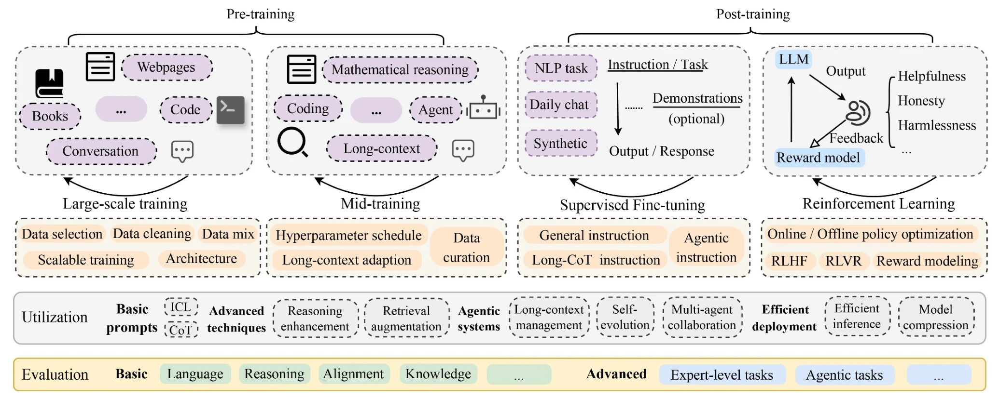
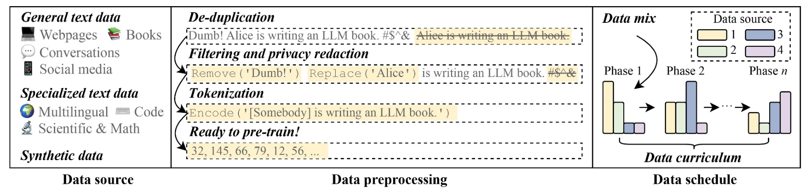
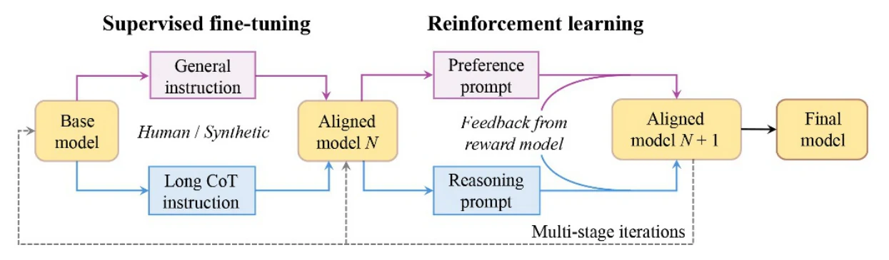
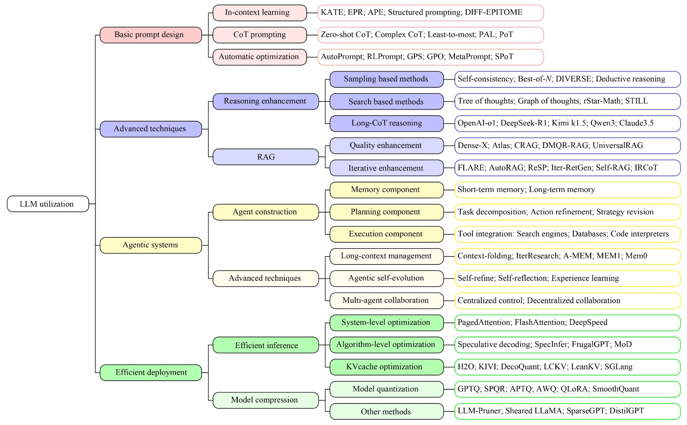

# 大语言模型综述：从训练、使用到 Agent 的知识地图

大语言模型为什么既能翻译、写代码，又能回答数学题？为什么同一个模型，换一种提示、给几条示范，表现就会改变？而模型已经会回答问题之后，为什么还要做监督微调、偏好优化，甚至接上搜索和执行器？这些问题分属不同的研究层次，却经常挤在同一篇论文里。只记住 Transformer、SFT、RLHF、CoT 和 RAG 的名字，很容易把“模型学会了什么”和“这次给模型提供了什么”混在一起。

Wayne Xin Zhao、Kun Zhou、Junyi Li 等作者的《A Survey of Large Language Models》，试图把这些技术重新接回一条完整的开发与使用过程。它按预训练、后训练、使用、评测四个维度组织文献：预训练建立基础能力，后训练调整回答行为，使用方法安排当前输入和求解过程，评测检查这些安排究竟带来了什么。本文固定采用 **2026 年《Frontiers of Computer Science》的正式期刊 PDF，共 40 页**。这是作者对早期 arXiv 综述的更新精炼版，正文到第 26 页结束，之后主要是参考文献和作者介绍；它与 arXiv 长版本的组织和篇幅有明显差别。[摘要、§1 与版本说明，PDF 第1–3页](https://link.springer.com/content/pdf/10.1007/s11704-026-60308-3.pdf)

这篇综述的贡献是组织研究，提供横跨开发与使用阶段的文献框架。它最有用的地方，是让读者拿到一项新方法时，能够说明它改变了哪一部分，以及为什么这个改变可能有效。导读的核心也放在这里：沿原文章节顺序，先建立语言模型和规模的基本认识，再拆开预训练的数据与架构、后训练的示范与反馈、使用时的提示与交互，最后回到评价。四张原图分别给出全貌、数据过程、后训练流程和使用方法树；后文会逐块解释，而不要求先记熟右侧所有方法名。

## 从语言模型的来路看四维地图

作者为什么要用一整篇综述讲开发过程，而不只列出模型？原因是，语言模型研究经历的不只是参数增多，还有“怎样把一个模型用于任务”的变化。原文先回顾四个阶段，再用图 2 把现代系统的复杂性展开。[§1–2，PDF 第1–4页](https://link.springer.com/content/pdf/10.1007/s11704-026-60308-3.pdf#page=2)

早期统计语言模型根据前面几个词，估计下一个词出现的概率。它很直观：一种词序列在训练文本里出现得多，模型就认为这种接法更可能。问题是，一旦组合很长、词汇很多，大量组合根本没有出现过，频数估计就变得稀疏。神经语言模型把词放进连续的向量空间，使相似词可以共享统计信息，而不必每一种组合都单独数一遍。

预训练语言模型又改变了任务适配方式。模型先从大规模文本学习表示，再为分类、问答等任务继续训练，形成“预训练加微调”的范式。BERT 是其中的重要代表：同一个词在不同句子里得到不同的表示，之后的任务不再从零学习语言。到 GPT-3 这样的模型，另一种用法得到充分展示：把任务说明和几条输入—答案示范直接放进当前文本，不更新参数，也能完成不少任务。作者据此解释了研究为何从逐任务模型转向通用基础模型。

图 2 可以先按上、下两层来读。上半部四个大框都涉及训练。最左边从网页、书籍、代码、对话出发，经过大规模学习得到基础模型。第二框是中训练（mid-training）：进一步用数学、代码、长上下文和交互材料强化目标能力。右边两框属于后训练，先用指令—回答示范做监督微调，再依据偏好或正确性反馈改善生成策略。图下方的橙色小框列的是各阶段的设计问题，例如数据配比、训练调度、奖励建模。[图2与§2，PDF 第3页](https://link.springer.com/content/pdf/10.1007/s11704-026-60308-3.pdf#page=3)

下半部不再沿训练时间排列，而是列出如何使用和检验模型。灰色长条从基本提示延伸到推理增强、检索、Agent 和高效部署；最底部黄色长条是评测，既包含语言、推理、对齐，也包含专家级任务和交互任务。评测放在底下，是因为每一层设计都需要持续的检验。

四个维度之间有依赖，但不构成每个系统都必须完整走一遍的固定生产线。使用者可以直接采用已有模型，研究提示或检索；训练者也会根据评测结果回头调整数据。图中的中训练是可选阶段，SFT 与强化学习在工业流程里还可能多轮交替。把图理解成“研究选择发生在哪里”，比理解成“一次通过的工厂流水线”更贴近作者的意思。

这也给出了全文反复使用的区分：训练改变跨调用共享的参数；上下文改变本次可见的信息；工具和环境改变可以采取的行动及其反馈。一个系统可能同时改变三者，研究时就需要把这几笔账分别记清楚。

## 下一词元预测怎样连接任务与规模

四维地图有一个共同起点：模型究竟在学什么。综述 §2 把自回归语言建模作为主流训练范式，即利用已有前文预测下一个词元。词元是分词器划出的基本单位，可能是一个词、一段子词或一个字符；分词器先把文字转换成编号序列，再交给模型计算。[§2，PDF 第3–4页](https://link.springer.com/content/pdf/10.1007/s11704-026-60308-3.pdf#page=3)

用导读的通用记号，可以把它写成：

$$
p_\theta(x_{1:T})=\prod_{t=1}^{T}p_\theta(x_t\mid x_{<t}),\qquad
\mathcal L_{\rm LM}=-\sum_{t=1}^{T}\log p_\theta(x_t\mid x_{<t}).
$$

$x_t$ 是第 $t$ 个词元，$x_{<t}$ 是此前的文本，$\theta$ 是模型参数。左式把整段文本的概率拆成逐步条件概率；右式是训练损失，希望真实后续词元得到较高概率。这是导读用标准概率记号对原文训练范式作的教学表达。训练时真实文本已知，各位置的预测可以并行计算；生成时未知的后续必须逐步产生，二者的计算安排不同。

为什么这样一个目标会关联到许多任务？因为训练文本不只包含闲聊，也包含解释、翻译、程序和推导。要准确补完“问题之后的解答”，模型就需要利用其中的语言和问题结构。同样，使用时可以把任务包装成待补完的文本：前面写题目、约束或示范，后面继续生成答案。这解释了一个共同接口如何承载许多任务，也解释了数据工程为什么成为能力形成的核心。

后面会少量使用一个**导读自编的教学例子**：一个完全虚构的“文件汇总器”，读取给定表格，计算每个类别的数值总和，并在缺少单位时报告缺口。这个例子只用于说明机制。训练材料可以包含许多表格解释和程序；SFT 示范可以规定输出格式；使用时可以给一条示范、实际文件或计算工具。任务看起来相同，改变的位置却不同。我们只在需要辨别这些位置时使用它。

**规模规律回答的则是资源怎样分。** 综述用幂律形式概括经验关系：

$$
L(X)=C_X X^{-\alpha_X},\qquad X\in\{N,D,C\}.
$$

$L$ 是以自然对数计的交叉熵损失，$N$ 是模型规模，$D$ 是训练数据规模，$C$ 是训练计算量，$C_X$ 和 $\alpha_X$ 是相应拟合系数。这个写法是在受控条件下概括损失随某项资源变化的趋势，拟合系数及其使用范围都依赖相应实验设置。[§2 Scaling law，PDF 第4页](https://link.springer.com/content/pdf/10.1007/s11704-026-60308-3.pdf#page=4)

早期 Kaplan 等人的研究较偏向在固定预算下使用更大的模型，即使没有把它训练到收敛；Hoffmann 等人的计算最优研究随后指出，大模型常常训练不足，应更平衡地扩大参数和数据。他们通过不同规模的实验拟合分配方式，再训练 Chinchilla 检验预测。这两项工作的相邻关系是：都研究预算分配，后者把“钱应该主要花在哪里”的判断，从偏重参数转向参数与数据的平衡。[Kaplan 等原论文摘要](https://arxiv.org/abs/2001.08361) · [Hoffmann 等原论文摘要](https://arxiv.org/abs/2203.15556)

综述还专门调整了“涌现能力”的措辞。早期研究把小模型看不到、大模型出现的能力称为涌现，但后来的研究指出，指标和测量范围也可能造成突然跃升的观感。比如只有整题全对才得分，逐步改善的局部预测也可能在总分上表现得很突兀。因此作者更愿意说“代表性能力”：上下文学习、思维链、指令跟随等能力，应结合数据和测量方式研究它们随规模怎样变化。[§2 Representative abilities，PDF 第4页](https://link.springer.com/content/pdf/10.1007/s11704-026-60308-3.pdf#page=4)

这一节建立的认识是：下一词元预测提供共同学习接口，规模规律帮助分配资源，而具体能力来自数据、结构、优化及任务测量的共同作用。下面的预训练章节就逐项展开这些条件。

## 预训练之一：数据从来源走到训练课程

原文第三章把数据安排在网络之前。这一顺序很重要：模型能从什么分布里学习，决定了后面的架构和算力究竟在加工什么。图 3 把数据准备拆成来源、预处理、调度三列，三者分别回答“有什么”“留下什么”“什么时候看什么”。[§3.1与图3，PDF 第4–6页](https://link.springer.com/content/pdf/10.1007/s11704-026-60308-3.pdf#page=4)

**左列是来源。** 网页、书籍和对话提供广泛的语言与事实分布；代码、科学与数学文本提供任务相关结构；合成数据则由已有模型生成文档、问答或推理轨迹。书籍的连续性有利于学习长距离关系，代码和数学材料包含更明确的结构约束。合成数据还可以改造原材料，例如给程序补解释，而不只是从零编出另一篇文本。

三类来源的作用不同。代码材料提供程序结构，合成回答则能扩充示范，但也可能重复教师的错误。综述在这里关心的是，怎样持续得到新颖、有质量、分布足够丰富的训练信息，让新增文本确实提供学习价值。

**中列是预处理。** 去重可以在网址、文档或句子层面进行，避免重复内容在训练中获得不成比例的权重。过滤去掉垃圾、噪声和有害内容，并处理可识别的私人信息。图中用重复句的删除、噪声符号的移除和姓名占位替换，演示这几种不同操作。它们处理完以后，分词器才把文字转成编号序列。

常见的 BPE 分词从较小单位出发，反复合并常见相邻序列。对模型来说，同一个术语可能占一个词元，也可能被切成多个；分词方式因此会影响序列长度和计算负担。综述还指出，某些领域会采用专门设计，例如数学中的逐数字处理。因此，比较文本长度和计算预算时，需要采用模型实际使用的分词器来计数。[§3.1.2，PDF 第5页](https://link.springer.com/content/pdf/10.1007/s11704-026-60308-3.pdf#page=5)

**右列是调度，它有两个层次。** 数据混合（data mix）决定总体上各来源占多少；数据课程（data curriculum）决定不同训练阶段怎样改变这些比例。图里的四种颜色表示四个来源，各阶段的柱高变化说明：同一份总预算可以按不同顺序使用，而不必从头到尾保持同一比例。

这种区分可以用很小的教学预算说明。假设总共只有 100 个训练批次，60 批一般文本、40 批代码。全程按六比四混合，与先偏重一般文本、后逐渐增加代码，最终比例可能相同，学习轨迹却不同。这些数值是导读指定的；原文强调实际阶段之间的分布应逐渐变化，避免突然换数据导致训练不稳定。后期用高质量数据配合下降的学习率，也是一种常见的收尾安排。[§3.1.3，PDF 第5–6页](https://link.springer.com/content/pdf/10.1007/s11704-026-60308-3.pdf#page=5)

长上下文课程是另一种调度。模型先处理较短序列，再逐步增长；每一阶段都要有相应长度的数据，还要调整位置编码。把随机短文拼成长串，虽然增加了序列长度，却未必产生真正需要跨段利用的依赖。综述因此讨论自然长文的上采样，以及根据长程依赖特征筛选数据。长度是容器，相关信息之间的关系才是学习内容。

数据章节最后转向质量与责任：低质量数据会损害能力，偏见、隐私和版权也需要在采集处理时考虑。作者把数据短缺视为继续扩展的瓶颈，并讨论合成数据反复蒸馏可能带来的信息停滞。这条推理自然引向后文的交互环境：如果环境能产生可验证的新任务和反馈，它就可能成为静态文本以外的数据来源。[§3.1.4，PDF 第6页](https://link.springer.com/content/pdf/10.1007/s11704-026-60308-3.pdf#page=6)

## 预训练之二：架构改的是哪一种资源负担

数据准备好以后，需要一个可以处理它的计算结构。综述 §3.2 以 Transformer 为基础，围绕注意力、位置编码、混合专家和其他结构展开。读这一节最容易把所有“高效”方法混成一类；实际上，它们分别在减少可读位置、压缩缓存、分配激活参数，或者改变历史信息的表示方式。[§3.2与表1，PDF 第6–9页](https://link.springer.com/content/pdf/10.1007/s11704-026-60308-3.pdf#page=6)

**先看注意力在做什么。** 每个位置的查询与其他位置的键比较，再按权重汇总值，形成新的表示。通常的完整注意力要处理许多位置对，所以长序列的计算负担按长度平方增长。生成时还要保存之前位置的键和值，称为键值缓存（KV cache），以免每产生一个新词都重算全部前文。计算位置对和保存缓存，是相互关联而又不同的负担。

稀疏注意力减少“读哪些位置”。位置型方案可以只保留最近窗口和少数指定位置；内容型方案则按当前查询选择相关文本块。前者规则简单，但远处重要信息可能不在保留位置；后者试图保留相关长程信息，却需要选择机制及相应实现。综述还讨论线性注意力：不再逐条保存全部历史供直接查询，而是维护随输入更新的固定大小状态。它可以降低长序列成本，代价是有限状态如何保留丰富历史的问题。作者因此强调表达能力与记忆容量之间的取舍，以及线性层与完整注意力混合的做法。[§3.2.1，PDF 第6–7页](https://link.springer.com/content/pdf/10.1007/s11704-026-60308-3.pdf#page=6)

**MQA、GQA 与 MLA 主要压缩缓存的组织方式。** 普通多头注意力中，各头都有自己的查询、键和值。多查询注意力 MQA 让多个查询头共享一套键和值，减少增量生成时反复读写的缓存；GQA 则把查询头分组，每组共享一套键和值，是多头与完全共享之间的折中。GQA 的原论文把质量下降作为 MQA 的问题之一，提出用中间数量的键值头兼顾质量与速度，并讨论如何从已有多头检查点继续训练得到这种结构。[MQA原论文摘要](https://arxiv.org/abs/1911.02150) · [GQA原论文摘要](https://arxiv.org/abs/2305.13245)

一个缓存形状表能把区别说清楚。以下是导读自编的形状例子：只看一层、一个序列，长度 $T$，每头宽度 $d$，有 8 个查询头；不计批次、其他缓存和位置编码相关部分。

| 方式 | 查询头数 | 键值头数 | 键和值合计需要保存的标量数 |
| --- | ---: | ---: | ---: |
| 普通多头 | 8 | 8 | $2T\times8d$ |
| 分成两组的 GQA | 8 | 2 | $2T\times2d$ |
| MQA | 8 | 1 | $2T\times d$ |

在这个例子里，GQA 的键值标量数是普通多头的四分之一，但查询仍有八个头，各自可以形成不同的读取权重。键和值共享以后，八种查询仍各自保留。原文表 1 里 GQA 和 MQA 的下标变化，正对应这件事。[表1，PDF 第7页](https://link.springer.com/content/pdf/10.1007/s11704-026-60308-3.pdf#page=7)

多头潜在注意力 MLA 走的是另一条路。DeepSeek-V2 用低维潜在表示压缩键和值，减少每个位置必须存储的缓存，再通过相应投影参与注意力计算。GQA 更像共享若干套原有的键值表示，MLA 更像学习一个紧凑的共同表示。它与同一模型中的 MoE 分别针对注意力缓存和稀疏计算，整体效率来自这些组件及训练配方的共同作用。[§3.2.1，PDF 第6页](https://link.springer.com/content/pdf/10.1007/s11704-026-60308-3.pdf#page=6) · [DeepSeek-V2原论文摘要](https://arxiv.org/abs/2405.04434)

**位置编码让注意力感知顺序。** RoPE 给查询和键施加与位置相关的旋转，使两者的匹配能表达相对位置关系。ALiBi 则把随距离增加的惩罚加到注意力分数上，偏向近处信息。两者都让位置进入注意力，但一个作用于旋转后的表示，一个作用于分数偏置。综述还讨论了如何调整 RoPE 以支持更长上下文，并指出偏向局部的长度外推方法仍可能难以利用远处信息。[§3.2.2，PDF 第8页](https://link.springer.com/content/pdf/10.1007/s11704-026-60308-3.pdf#page=8) · [RoPE原论文摘要](https://arxiv.org/abs/2104.09864) · [ALiBi原论文摘要](https://arxiv.org/abs/2108.12409)

**混合专家 MoE 改的是每个词元调用多少计算模块。** 在普通前馈网络的位置放入多个专家，由路由器依据当前表示挑选少数专家，组合它们的输出。这样总容量可以增长，而每个词元只激活部分参数。Mixtral 8×7B 是直观例子：每层有八个前馈专家，每个词元选择两个；下一词元可以选择另一组。综述 §3.2.3 对 Mixtral 激活数的措辞容易与总专家数混淆，这里按 Mixtral 原论文摘要区分“八个可选”和“两个被选”。[§3.2.3，PDF 第8页](https://link.springer.com/content/pdf/10.1007/s11704-026-60308-3.pdf#page=8) · [Mixtral原论文摘要](https://arxiv.org/abs/2401.04088)

路由也带来新问题。某些专家一直被选择、另一些几乎不用，会导致训练和设备负载失衡。综述因此继续讨论共享专家、细粒度专家和负载平衡策略。MoE 与 GQA 的区别就很清楚了：前者稀疏选择前馈模块，后者共享注意力键值；它们可以同时存在。

原文还概述残差连接的新设计、参数化记忆、循环复用层权重，以及扩散语言模型。它们说明 Transformer 并非只有一种可放大的结构。理解这些分支时，最稳定的坐标仍是：保留什么信息、用什么结构计算、每一步激活多少，以及最终受到哪一种资源约束。

## 预训练之三：让训练装得下、跑得稳

模型和数据规模扩大后，问题不再只是公式是否正确，还包括参数是否装得下、训练是否稳定，以及设备有多少时间真正用于计算。原文 §3.3 把优化配置与可扩展训练分开：前者关心更新能否持续有效，后者关心这些更新怎样在设备上执行。[§3.3，PDF 第9–11页](https://link.springer.com/content/pdf/10.1007/s11704-026-60308-3.pdf#page=9)

训练时占用显存的不只是模型权重。还要保存梯度、优化器状态，以及反向传播需要的中间激活。数据并行让每台设备处理不同样本，再合并更新；张量并行把大矩阵拆开；流水线并行把连续层分给不同设备；上下文并行分担长序列；专家并行分布 MoE 模块。它们针对的切分对象不同，往往组合使用。

ZeRO 针对数据并行中反复保存相同状态的浪费。它逐级划分优化器状态、梯度和参数，让每台设备保存其中一部分，需要时再从其他设备获取。与“把不同层分到不同卡”相比，它的核心是消除状态冗余；节省的显存伴随着通信组织的要求。综述按 ZeRO-1、2、3 区分这些层次，原论文也把内存与通信量放在一起分析。[§3.3.2，PDF 第10页](https://link.springer.com/content/pdf/10.1007/s11704-026-60308-3.pdf#page=10) · [ZeRO原论文摘要](https://arxiv.org/abs/1910.02054)

FlashAttention 解决另一个瓶颈：注意力计算时，在 GPU 不同层次的存储之间来回搬运大矩阵。它用分块计算和在线归一化，避免把整张注意力中间矩阵写回慢速存储，减少读写量。它与稀疏注意力的关键差别是，标准 FlashAttention 保留精确的完整注意力，利用更好的存储访问安排加速计算。综述第 11 页把时间和内存复杂度一并简写为降低平方负担，容易误导；这里依据原论文区分存储访问优化和完整注意力仍需的成对算术运算。[§3.3.2，PDF 第11页](https://link.springer.com/content/pdf/10.1007/s11704-026-60308-3.pdf#page=11) · [FlashAttention原论文摘要](https://arxiv.org/abs/2205.14135) · [原论文§3.1、定理1，PDF第5页](https://arxiv.org/pdf/2205.14135v2#page=5)

下表摘录原文表 2 的两行，从几个不同维度展示预训练规模。B 表示十亿，T 表示万亿；训练词元量是整个训练过程见到的数量，上下文长度是单次序列的长度。表中的稠密模型让每个词元经过同一套主体计算模块，区别于按词元选择专家的 MoE。

| 模型 | 架构 | 参数量 | 训练词元量 | 上下文长度 |
| --- | --- | ---: | ---: | ---: |
| GPT-3 | 稠密模型 | 175B | 300B | 2K |
| LLaMA-3.1（表中405B版本） | 稠密模型 | 405B | 15T | 128K |

[表2，PDF 第10页](https://link.springer.com/content/pdf/10.1007/s11704-026-60308-3.pdf#page=10)

从这个表能读出的，是参数、数据和上下文分别扩展了；它没有控制年代、训练配方和数据质量。模型名字后面的参数量，只是其中一列。看见新的训练报告时，这样分列比用“更大”概括全部变化更有信息。

训练稳定性则依赖初始化、学习率热身与衰减、梯度裁剪和数值精度等选择。混合精度让适合的运算使用较低精度，在敏感部分保留更高精度；通信和计算重叠则减少设备等待。作者把这些问题纳入预训练，正是因为同一学习目标，只有在可持续、稳定的执行过程中才真正成为模型能力。

## 中训练：在通用基础上强化目标能力

原文 §3.4 单独讨论中训练，是因为今天的开发过程常常需要在通用预训练与指令后训练之间，安排更有目标的数据和训练策略。它也被称为持续预训练，但这里突出的是阶段作用：让模型更充分接触数学、代码、长上下文及 Agent 任务需要的结构。[§3.4，PDF 第11–12页](https://link.springer.com/content/pdf/10.1007/s11704-026-60308-3.pdf#page=11)

回到虚构的文件汇总器。若基础模型很少见过表格、分组计算和程序调试，就需要先加强这些基础结构的学习。中训练可以增加相关文本、程序和推导轨迹的占比，让这些结构成为参数里更充分学习的内容。它与使用时附上一份实际表格的区别，是前者改变以后许多任务共享的模型，后者提供当前问题的具体信息。

综述把中训练和后训练理解为相互衔接的能力培养：中训练扩充基础和策略材料，后训练进一步鼓励有效行为。长推理轨迹可以在两个阶段出现，但配比、目标和数据组织方式不同。训练阶段的名称要和实际更新过程一起读。

中训练的数据通常更集中于目标领域，序列也可能更长，因此需要相应调整学习率和数据分布。原文讨论降低学习率、重新安排热身或分阶段课程等做法。要让模型逐渐适应新分布，又保留已有能力，数据切换和更新强度需要一起设计。

长上下文适配尤其能说明这个问题。扩大位置范围需要位置编码配合，训练中还要真正出现长序列；如果完整注意力太贵，也可能在这个阶段改用稀疏机制。于是“支持更长上下文”至少包含三项变化：位置表示、训练数据、计算结构。原文将它们放在同一节，避免把窗口长度当成单独一个开关。[§3.4.2，PDF 第12页](https://link.springer.com/content/pdf/10.1007/s11704-026-60308-3.pdf#page=12)

中训练在全文中的位置因而很明确：它承接预训练的参数学习，又为后训练准备更合适的能力底座。后面再看到“只用少量示范就学会了复杂任务”的说法，就可以继续追问它依赖怎样的基础模型。

## 后训练之一：SFT 怎样把续写变成任务行为

完成基础训练后，模型已经能预测许多形式的文本，但输入一句请求时，它未必总按任务要求作答。第四章从监督微调 SFT 开始：把任务描述、可选输入和期望输出组织成示范，让模型学习“这种请求之后，应当出现怎样的回答”。[§4.1，PDF 第12–13页](https://link.springer.com/content/pdf/10.1007/s11704-026-60308-3.pdf#page=12)

这张图从左到右读。黄色的 Base model 是起点；紫色上路是一般指令，蓝色下路是长思维链指令。两路都通向 Aligned model N，说明一般指令和长推理可以共同训练同一个模型。接下来模型分别面对偏好类任务和推理类任务，由奖励反馈推动更新。底部虚线回到前面，表示示范学习与反馈优化可以多轮迭代。[图4与§4，PDF 第12页](https://link.springer.com/content/pdf/10.1007/s11704-026-60308-3.pdf#page=12)

SFT 的训练仍然使用条件生成损失。用导读的记号写，若 $q$ 是请求、$a$ 是示范回答：

$$
\mathcal L_{\rm SFT}=-\sum_t\log p_\theta(a_t\mid q,a_{<t}).
$$

每个 $a_t$ 是回答中的一个词元，$a_{<t}$ 是此前的回答内容。它与语言模型损失很相似，关键差别在于数据被整理成了什么条件和什么目标。对文件汇总器，示范可以写成“按类别输出总和；若缺少单位，应说明未知”，目标回答就展示这套行为。这些示范通过参数更新影响模型以后处理同类请求的方式。

**示范从哪里来？** 早期做法把已有任务改写成自然语言指令，或者收集人写的真实请求和回答。这样能明确目标，但构造多样、高质量的数据很费力。Self-Instruct 针对这一成本，用少量人工种子引导模型生成新指令、输入和输出，再过滤无效或过于相似的样本，最后用留下的数据微调模型。与直接从真实任务收集示范相比，它把扩充工作交给模型；筛选则成为避免低质量和重复被放大的关键。[§4.1.1，PDF 第12页](https://link.springer.com/content/pdf/10.1007/s11704-026-60308-3.pdf#page=12) · [Self-Instruct原论文摘要](https://arxiv.org/abs/2212.10560)

综述把合成数据继续分成一般指令、长推理指令和 Agent 指令。一般指令强调任务和表达多样性；长推理指令包含较完整的解题、自检和修正过程；Agent 指令还必须描述环境、工具规范，以及思考、调用、观察如何交错。后者尤其不同：一条“我已运行程序”的句子，并没有真实执行反馈，训练材料需要说明观察究竟来自哪里。[§4.1.1，PDF 第12–13页](https://link.springer.com/content/pdf/10.1007/s11704-026-60308-3.pdf#page=13)

**收集完还要选择和混合。** 短得异常、难以理解或质量差的样本可以先过滤，再用模型评分、语义聚类或任务相关性方法细选。数学、代码、一般对话和安全数据之间也需要平衡。原文列出工业经验比例，但这些是不同报告的配方归纳，本导读不把它们变成通用处方。对一个只做窄任务的模型，所需示范量与通用助手不同；基础模型越强，少量高质量数据越可能有效。[§4.1.2，PDF 第13页](https://link.springer.com/content/pdf/10.1007/s11704-026-60308-3.pdf#page=13)

LoRA 将关注点转向“怎样更省地微调”。它冻结已有权重，只训练注入的低秩更新矩阵，降低可训练参数和优化状态负担。与全参数 SFT 相比，它限制了更新的参数化方式；与 ICL 相比，它仍然进行训练更新。原文把它作为资源受限时适配领域任务的手段，数据质量和任务覆盖的问题仍由训练材料承担。[§4.1.3，PDF 第13页](https://link.springer.com/content/pdf/10.1007/s11704-026-60308-3.pdf#page=13) · [LoRA原论文摘要](https://arxiv.org/abs/2106.09685)

SFT 的核心是模仿示范。它能建立格式、任务理解和初步推理行为，也为后续强化学习提供起点。接下来的问题是：如果多个回答都合法，而我们更喜欢其中一种，或者只知道最终答案对不对，怎样把这些信息用于训练？

## 后训练之二：把偏好和正确性变成奖励

原文 §4.2 先分奖励来源，再讲优化算法。这个顺序值得保留：算法决定怎样更新，奖励决定朝哪里更新。只比较优化器名字，而不检查评分信号，就像比较两种爬坡方法却没有说明爬的是哪一座山。[§4.2.1–4.2.2，PDF 第14–15页](https://link.springer.com/content/pdf/10.1007/s11704-026-60308-3.pdf#page=14)

**偏好奖励适合难以写出唯一答案的任务。** 同一个问题，两个回答都可能事实正确，但一个更贴题、一个更含糊；或者一个有帮助，另一个存在安全风险。经典 RLHF 先让标注者比较候选，再训练奖励模型预测这种比较，最后用奖励调整生成模型。人的少量判断由奖励模型扩展到更多生成样本。

InstructGPT 是这条路线的代表。它先收集示范做 SFT，再收集输出排序，训练奖励并优化策略。原论文摘要报告，在其提示分布的人类评价中，1.3B 参数的 InstructGPT 输出比 175B 的基础 GPT-3 更受偏好。这个数字说明行为训练能改变人的选择，并非只靠扩大参数；这一比较的评价对象是特定请求上的输出偏好。它与 Self-Instruct 的区别也很清楚：前者进一步利用相对偏好反馈，后者主要扩充可模仿的示范。[§4.2.3，PDF 第15页](https://link.springer.com/content/pdf/10.1007/s11704-026-60308-3.pdf#page=15) · [InstructGPT原论文摘要](https://arxiv.org/abs/2203.02155)

**可验证奖励适合结果有检查办法的任务。** 数学题可以匹配或检查答案，程序可以执行测试，交互任务可以检查环境目标是否达到。可验证奖励强化学习 RLVR 就利用这类信号，减少对人逐条写推理或偏好排序的依赖。与偏好模型相比，它对所定义的正确性目标通常更直接；覆盖范围则由验证器决定。文件汇总器可以检查总和与格式，却还需要额外判据，才能检查有没有遗漏类别、擅自填补缺失单位。

综述还区分规则式奖励与模型式奖励。前者依据明确定义的规则或检验程序，后者学习评分函数；在实际系统中，两者会混合使用。开放回答可能由模型评判有用性，程序结果则由执行测试评判。这里的“规则”也有不同强度：可执行的形式检查依靠检验程序，自然语言量表打分则还依赖评判模型。[§4.2.2，PDF 第14–15页](https://link.springer.com/content/pdf/10.1007/s11704-026-60308-3.pdf#page=14)

奖励还可以在不同粒度上提供。结果奖励等整份回答或整条任务轨迹结束后才评分，容易自动化，但早期哪一步出了问题不容易判断；过程奖励评价中间句子或步骤，信号更细，却需要能可靠判断这些部分的评估者。对长任务，这就是信用分配问题：最终失败，到底应当归到哪一个早期行动？

奖励被用作优化目标以后，还会出现“奖励投机”。模型可能学会让回答更长、使用评委喜欢的措辞，或者利用检查程序的漏洞，而没有真正改善目标行为。综述因此把奖励设计、训练监控与独立评测连在一起。奖励模型是依据某种数据和规则学出的代理，任务正确性则要通过另一层证据检验。[§4.2.3 Training issues，PDF 第16页](https://link.springer.com/content/pdf/10.1007/s11704-026-60308-3.pdf#page=16)

这一节的结论是，RLHF 与 RLVR 主要告诉我们反馈从哪里来，结果奖励与过程奖励告诉我们反馈在什么粒度上给出。下一节的 PPO、GRPO、DPO 等方法，则回答如何把这些信号转成参数更新。

## 后训练之三：PPO、GRPO、DPO 与筛选微调

有了奖励或偏好数据，还需要选择学习方式。原文按在线和离线组织算法，再在表 3 比较数据来源与学习策略。这里的“在线”是训练期间继续从当前或近期模型生成新样本，“离线”是使用固定数据；与是否联网无关。[§4.2.3与表3，PDF 第15–17页](https://link.springer.com/content/pdf/10.1007/s11704-026-60308-3.pdf#page=15)

**PPO：边生成，边根据反馈调整。** 在语言模型后训练里，生成模型是策略：给定请求和前文，决定下一个词元的概率。模型生成回答，奖励评估回答，再通过策略更新，让较好的行为更容易出现。经典 PPO 还学习价值函数估计预期回报，并用裁剪机制限制一次更新过大；RLHF 流程通常另用相对于参考策略的 KL 散度约束，衡量新旧输出分布的差异，避免模型为了奖励过度偏移。这是相邻但不同的两种控制手段。[PPO原论文摘要](https://arxiv.org/abs/1707.06347) · [§4.2.3，PDF 第15页](https://link.springer.com/content/pdf/10.1007/s11704-026-60308-3.pdf#page=15)

PPO 的优势是能用模型当前产生的回答继续学习，代价是生成、奖励、价值估计和策略更新都要协调。综述把额外价值模型和训练稳定性列为其负担。它与 SFT 的直接区别，是不再只模仿一份指定回答，而要利用反馈判断相对于预期哪些生成行为更好。

**GRPO：用同题的一组回答作相对比较。** DeepSeekMath 提出这一 PPO 变体，省去单独的价值模型，针对同一个提示采样多个回答，用组内奖励比较构造优势。直观上，它用“这份回答比同题的其他回答好多少”来建立基线。节省价值估计的负担，同时也使组采样、奖励分布和归一化成为重要选择。[GRPO原论文摘要：DeepSeekMath](https://arxiv.org/abs/2402.03300) · [§4.2.3，PDF 第15页](https://link.springer.com/content/pdf/10.1007/s11704-026-60308-3.pdf#page=15)

一个可以手算的导读例子是：对同一问题采样四份回答，验证奖励为 $[1,1,0,0]$。组均值是 $0.5$，按总体标准差计算也是 $0.5$，于是简化的标准化相对奖励为 $[1,1,-1,-1]$。用导读记号表示就是：

$$
A_i=\frac{r_i-\bar r}{\sigma_r}.
$$

$r_i$ 是第 $i$ 份回答的奖励，$\bar r$ 和 $\sigma_r$ 是这组的均值和标准差。这里仅演示组内相对信号，不是完整 GRPO 目标；实际还涉及概率比、裁剪、约束和数值处理。如果四份回答全错，这种只看二元正确性的组就没有优劣差异。这也说明，生成足够多样的候选和设计有效反馈，是学习发生的前提。

**RFT：把采样后验证通过的回答留下来再学。** 拒绝采样微调不需要把每个回答的相对优势都带入策略梯度；它先生成多个候选，再筛出合格的推理路径，作为监督训练材料。其原论文在数学推理中发现，增加不同的正确推理路径能改善效果。它与普通 SFT 的区别是，训练示范的一部分由模型自己生成并被筛选；与 GRPO 的区别是，留下后的更新仍按监督学习进行。[RFT原论文摘要](https://arxiv.org/abs/2308.01825)

RFT 可以用固定的已筛样本，也可以随训练反复生成和筛选，成为在线 RFT。筛选若只保留模型已经擅长的路径，探索范围就受限；综述据此把固定数据的稳定性与适应当前能力的灵活性放在一起比较。

**DPO：直接从偏好对学习。** 对同一个请求，数据中给出偏好回答和不偏好回答。DPO 把带 KL 正则的奖励优化问题改写成分类式的偏好损失，不需要先单独拟合显式奖励模型，再运行一套在线强化学习循环。与 RFT 只保留较好的回答不同，DPO 同时利用哪一个更好、哪一个较差的关系；与 PPO 式 RLHF 相比，它大幅简化了训练组件。[DPO原论文摘要](https://arxiv.org/abs/2305.18290)

DPO 与奖励优化的理论联系依赖其建模假设和推导；具体执行方式则适合从表 3 比较：固定偏好对、对比式目标，与在线采样、奖励及策略更新，是两种不同的执行安排。偏好数据与新任务相差多远，也决定了离线学习能适应多少变化。

**在线策略蒸馏 OPD：在学生实际走到的位置教它。** 普通离线蒸馏容易让学生只见到教师产生的序列，推理时学生却可能走到别的前文。OPD 让学生生成自己的序列，再从教师在这些前文上的概率分布获取反馈。它与在线 RFT 都使用学生样本，但前者提供密集的词元级教师信号，后者主要靠筛选保留回答。在线生成和教师评估也要计入训练成本。[OPD原论文摘要](https://arxiv.org/abs/2306.13649)

下面按原文表 3 重写这组关系，表格是数据与更新方式的对照，不是效果排名。[§4.3.1与表3，PDF 第16–17页](https://link.springer.com/content/pdf/10.1007/s11704-026-60308-3.pdf#page=16)

| 方法 | 主要材料怎样产生 | 更新怎样利用材料 |
| --- | --- | --- |
| SFT | 人写或合成示范 | 提高示范回答的条件概率 |
| 离线 RFT | 固定的已筛选回答 | 对留下的回答做监督学习 |
| DPO | 固定的偏好与非偏好回答对 | 对比两者的相对概率关系 |
| OPD | 当前学生生成序列，教师提供反馈 | 模仿教师的词元级分布 |
| 在线 RFT | 随训练生成并筛选回答 | 继续监督学习新保留的回答 |
| PPO | 当前或近期策略生成回答并获奖励 | 用优势估计和受控策略更新优化 |
| GRPO | 同一提示采样一组回答并获奖励 | 用组内相对反馈构造优势 |

表 3 最值得学会的是两个分开的提问：样本会不会随训练更新？拿到样本后使用什么目标？把它们分开，便能理解为什么“在线”不只包含强化学习，“后训练”也不只等于 PPO。

## 多阶段后训练怎样把这些部件组合起来

第四章最后返回工业流程，因为实际模型通常不会只选上一节的一种方法。一般指令能力、复杂推理和工具任务需要不同材料与反馈，训练因此是逐步组合、反复评价的过程。[§4.3.2，PDF 第17–18页](https://link.springer.com/content/pdf/10.1007/s11704-026-60308-3.pdf#page=17)

DeepSeek-R1 是综述重点使用的推理训练例子。R1-Zero 探索了不先进行 SFT、直接从基础模型开展大规模强化学习的路线，出现了自检和反思等推理行为，但原论文也报告可读性差、语言混合等问题。R1 则在强化学习前引入冷启动数据，采用多阶段安排。这种调整让训练同时照顾推理能力和回答的可用性。[DeepSeek-R1原始报告摘要，v1](https://arxiv.org/abs/2501.12948v1)

综述将 R1 的流程归纳成四步：长推理冷启动 SFT、面向长推理的强化学习、混合数据 SFT、混合奖励强化学习。前半段重点培养推理，后半段把一般任务和推理任务结合起来。于是图 4 的紫色、蓝色两条路就有了具体含义：复杂推理的提高，还需要与可读回答、一般请求和安全行为共同适配，而不只是不断延长推理文本。[§4.3.2 Reasoning-oriented training，PDF 第17页](https://link.springer.com/content/pdf/10.1007/s11704-026-60308-3.pdf#page=17)

Agent 训练还要增加环境这层条件。模型需要生成包含推理、工具调用和观察的完整轨迹；训练要能启动环境、执行工具、获得结果，再评价任务完成和约束遵守。轨迹越长、环境越慢，生成和评价的成本越高。综述因此讨论异步生成、部分轨迹训练和分布式资源协调。

文件汇总器如果只是输出代码，可以用代码示范训练；如果要求它发现文件、读取表格、执行程序、根据错误修正结果，就需要完整交互材料及可执行环境。任务说明相似，训练实例却从一对文本扩展成多步过程。这个变化把第四章和后面的 Agent 使用自然接在一起：能力可以通过训练强化，但运行时仍需要一个把行动送入环境的系统。

后训练这一章给出了一种按目标组合技术的思路。先明确希望出现的行为，再设计示范或奖励，最后安排适合的数据更新与优化方式，整个过程由评价结果反复校正。

## 使用之一：提示、上下文学习与思维链

第五章换了观察位置：模型已经训练好，当前任务怎样交给它？基本提示、额外推理、检索、Agent 和部署优化都放在“使用”下，但操作对象各不相同。图 5 是这一章的分类树，也是全文第二张重要方法地图。[§5与图5，PDF 第18页](https://link.springer.com/content/pdf/10.1007/s11704-026-60308-3.pdf#page=18)

读图先看左边的四种颜色，不必从右侧名称开始。粉色问怎样组织输入；紫色问怎样增加求解计算和外部知识；黄色问怎样形成持续交互的系统；绿色问怎样降低执行成本。一个检索 Agent 可以同时占据几根分支，各分支提供不同的研究切面，可以组合使用。右端名称是作者的代表性索引，本文只展开与主线有关的方法。

**基本提示由任务描述、输入和上下文组成。** 任务描述说明要做什么，输入是待处理对象，上下文则提供相关资料或示范。清楚的格式、分隔符和约束，可以减少模型误解任务的机会。文件汇总器的提示若只写“分析这个”，目标不明确；写清“按类别计算总和，保留原单位，列出缺失项”，就指定了更具体的输出行为。这里改变的是当前条件文本。

**ICL 把示范放进这次输入。** GPT-3 用任务说明和少量示范，在不做梯度更新的情况下完成不同任务。这与 SFT 都可能出现输入—答案对，区别在于示范究竟作为训练样本进入参数更新，还是作为当前前文供注意力读取。ICL 的适应效果依赖模型原有能力，也依赖示范选择、格式和顺序。[§5.1.2，PDF 第18–19页](https://link.springer.com/content/pdf/10.1007/s11704-026-60308-3.pdf#page=18) · [GPT-3原论文摘要](https://arxiv.org/abs/2005.14165)

继续使用教学例子。提示中先展示“类别甲有 2 和 3，输出甲合计 5”，再给待测表格，属于上下文示范。把许多这样的实例拿去训练，则是 SFT。两种方式都可能提高当前题表现，但保存的位置不同：当前提示移除后，ICL 所提供的信息就不再自动存在于下一次调用里。

原文还从任务识别与任务学习两个角度解释 ICL。模型可能通过示范识别“这是已经会做的一种任务”，也可能从示范中归纳本次特有的映射。研究者还尝试用内部表示中的学习式过程解释它。这些是不同理论视角，导读采用最稳固的操作性定义：本次前向计算利用示范，模型权重保持不变。[§5.1.2 Underlying mechanism，PDF 第19页](https://link.springer.com/content/pdf/10.1007/s11704-026-60308-3.pdf#page=19)

**CoT 把中间步骤也纳入生成。** 原始思维链提示在示范中展示逐步解答，模型据此生成中间推理再输出答案；零样本形式则使用逐步思考等指令。与只有最终答案的示范相比，先前生成的中间结果成为后续可利用的上下文。它主要解决复杂推理中一步跳到答案较脆弱的问题，而不是凭空补上缺失事实。[§5.1.3，PDF 第19页](https://link.springer.com/content/pdf/10.1007/s11704-026-60308-3.pdf#page=19) · [CoT原论文摘要](https://arxiv.org/abs/2201.11903)

综述还指出，后来很多模型已经在训练中见过推理轨迹，甚至专门训练过长推理，因此“是否写一句逐步思考”不再能完整描述推理能力。要分清提示引出的 CoT、训练中学到的推理行为，以及后面多候选搜索的预算。中间步骤会帮助组织计算，也可能包含错误或事后合理化，评价仍需落到解题结果和有效过程上。

自动提示优化则把“改提示”本身变成搜索任务：根据任务表现生成或修改提示，反复比较。它与对模型做梯度训练的关系取决于具体方法，但目标始终是找到更有效的输入。综述列出梯度式、强化学习式和直接编辑式路径，也指出大型或黑箱模型会限制某些优化方式。到这里，粉色分支的共同点就清楚了：主要安排模型当前读到的任务表达。

## 使用之二：额外计算怎样变成推理改进

基本提示只规定一次生成怎样开始。面对较难的问题，研究还会在推理阶段投入更多计算：多采样、比较候选、搜索中间状态，或者让模型生成更长的内部求解过程。原文把这些称为推理时扩展，也就是 test-time scaling。[§5.2.1，PDF 第19–20页](https://link.springer.com/content/pdf/10.1007/s11704-026-60308-3.pdf#page=19)

**自一致性把多条推理汇总到答案。** 一条贪心生成很容易被早期错误带偏；Self-Consistency 采样多种推理路径，再根据最终答案的一致性选出结果。与让同一条推理写得更长相比，它扩大的是候选数量；与单次 CoT 相比，它多了汇总规则。[Self-Consistency原论文摘要](https://arxiv.org/abs/2203.11171)

一个很小的导读手算例子是，五条路径最后给出 $[5,5,6,5,6]$，多数答案是 5。即使这次选中了正确答案，三条路径也可能共享同一个错误前提，所以多数投票的作用是缓解单路径脆弱性，而不是提供外部真值。更一般的 Best-of-N 会用验证器或奖励模型为候选排序，不必采用多数票；代价是生成 N 份候选和评价它们。

**思维树 ToT 在中间步骤就分支、评价和回退。** 与先独立生成完整答案再投票不同，它把“想法”当作搜索状态，由模型产生若干后续，评价哪些值得继续，再进行前瞻或回溯。它适合早期选择会影响后面可行性的任务。原论文用 24 点、创意写作和迷你填字等问题检验这种搜索组织方式，说明它关注的是决策过程，而不只是换一句提示。[ToT原论文摘要](https://arxiv.org/abs/2305.10601)

综述进一步讨论蒙特卡洛树搜索等经典算法与模型价值判断结合。搜索的收益依赖分支质量、评价准确性和预算安排：如果每个中间状态都由同一个不可靠评判器筛掉正确路径，增加搜索也救不回来。这里作者关心的核心，是怎样把额外计算转成有效探索，并据此安排调用预算。

长 CoT 则更多地把自检、修正和探索写进一条延长的生成过程。它与外部程序显式维护的树结构不同，但可以承载某些类似搜索的行为。训练部分解释了这种行为怎样被培养，使用部分解释了它怎样花费推理预算；两者是同一模型的两个观察切面。[§5.2.1 Long-CoT reasoning，PDF 第20页](https://link.springer.com/content/pdf/10.1007/s11704-026-60308-3.pdf#page=20)

作者同时列出过度思考、幻觉和成本问题。比较两种“推理更强”的方案时，实际比较对象应包含模型、采样数、生成长度和选择器。这样才能看清改进来自更好的单次策略，还是更大规模的尝试与筛选。

## 使用之三：RAG 让答案接触外部知识

额外推理能重新组合已有信息，但不能可靠推导出一份从未见过的最新文件。综述因此把检索增强生成 RAG 作为高级使用方法的另一支：通过外部来源补充当前任务需要的材料。[§5.2.2，PDF 第20页](https://link.springer.com/content/pdf/10.1007/s11704-026-60308-3.pdf#page=20)

原文把流程拆成三步。先检索相关上下文，可以依靠关键词匹配，也可以依靠向量的语义相似；再构造提示，将问题、任务说明和筛过的材料放在一起；最后由语言模型生成回答。第二步并非简单粘贴，因为上下文有长度限制，材料还可能冗余、矛盾或与问题只有表面相关，所以需要重排、摘要或信息提取。

文件汇总器若要读取一份具体表格，表格内容就应来自输入或检索，而不是让模型凭已有知识补齐。若每个类别的记录分散在多页，初检、整理、生成三个环节都可能丢失信息。由此可以区分三种失败：需要的页面没找到；页面找到了却没进入最终提示；完整材料已经给出，模型仍把类别或单位读错。它们分别需要改检索、整理和使用证据的方式。

综述将改进分成质量增强和迭代增强。质量增强改切块粒度、查询和候选整理，让一次检索更有用；迭代增强用已经读到的线索决定下一轮怎样查。IRCoT 是后一类的清楚例子：多步问题中，下一步该找什么取决于前一步已经推出什么，于是它把检索与逐句思维链交织起来，让推理指导检索，检索再支持下一步推理。与只用原问题检索一次相比，变化在于后续查询依赖中间结果。[§5.2.2 Improvement strategies，PDF 第20页](https://link.springer.com/content/pdf/10.1007/s11704-026-60308-3.pdf#page=20) · [IRCoT原论文摘要](https://arxiv.org/abs/2212.10509)

这篇总综述没有细讲所有 RAG 部件。它在全景图中要完成的，是区分“改参数以存入能力”和“在这次作答中补入知识”。外部资料可以更新，而生成模型不必每次跟着重训；同时，检索器和生成器本身也可能通过训练适配，训练适配和使用时补入知识可以结合。

这条分支的收获是沿信息来源检查回答：当前事实从哪里来，经过哪次选择进入模型，输出中的陈述由哪部分材料支持。若希望进一步理解查询改写、压缩与自适应检索，可以转向固定修订的 [RAG 综述](/read/rag-survey/5#u02)；若要看检索文档怎样进入概率模型，可以读 [RAG 原始论文](/read/rag/2#u02)。

## 使用之四：Agent 把记忆、规划和执行接成闭环

RAG 主要说明模型怎样得到额外材料，Agent 则把问题进一步扩展为“下一步要做什么”。原文 §5.3 从记忆、规划和执行三个功能讲起，再介绍长上下文管理、自演化、多智能体及应用。它们在图 5 中共用黄色分支。[§5.3，PDF 第20–22页](https://link.springer.com/content/pdf/10.1007/s11704-026-60308-3.pdf#page=20)

**记忆提供当前决策所需的信息。** 短期记忆通常对应当前上下文，包含最近观察和中间结果；长期记忆保存在外部，可跨交互取回过去经验或知识。**规划**利用这些信息形成下一步或子任务，环境变化后再修改。**执行**把行动交给工具或环境，获得真正返回的结果。这三个功能可以由同一模型和辅助程序协同实现。

文件汇总器若变成一个小型 Agent，它可能先查找文件，再读取表头，发现单位缺失后报告问题或寻求补充，随后执行计算并检查输出。下面是导读自编的过程表，只演示功能关系，没有实际运行。

| 阶段 | 系统拿到什么 | 接下来改变什么 |
| --- | --- | --- |
| 观察与记忆 | 文件列表、当前任务及之前记录 | 确认待处理对象和已有约束 |
| 规划 | 已知文件格式与目标 | 选择读取表头，而不是先猜总和 |
| 执行 | 结构化的读取请求 | 执行器返回实际列名和单位信息 |
| 更新决策 | 发现某列单位未知 | 调整后续行动，保留缺口而不擅自补齐 |

关键不在于模型写出了多少计划，而是上一轮真实反馈有没有改变下一轮行动。模型可以生成调用请求，但执行器负责运行，工具结果再成为新的观察。把“读取失败”伪装成已读到的数据，会让整个闭环失去依据。

ReAct 用交替的思考、行动和观察把这种关系具体化。推理帮助拆解目标和追踪进展，行动从外部获取信息，观察又修正下一步。与只写推理相比，它接入环境；与只输出动作相比，它保留任务组织。原论文也报告问答中的幻觉与错误传播问题，这正是外部观察被引入的动机。这里讲的是交互格式，具体模型和任务成绩可到本库的 [ReAct 导读](/read/react/2#cycle)细读。[ReAct原论文摘要](https://arxiv.org/abs/2210.03629)

长期任务首先遇到上下文增长。综述分两路：一路在当前上下文里摘要、折叠和重建历史；另一路把内容存到外部，再按需检索。摘要节省长度，但需要决定哪些条件保留；外部记忆保留更多原件，但要解决索引和取回问题。两者可以组合，共同承担长任务中的记忆管理。[§5.3.2 Long-context management，PDF 第21页](https://link.springer.com/content/pdf/10.1007/s11704-026-60308-3.pdf#page=21)

自演化讨论怎样利用经验改善后续行为。Reflexion 是一个有代表性的边界例子：根据失败或其他反馈生成反思文本，保存在情节记忆中，在下一次尝试时读取，不更新模型权重。它与第四章的策略梯度训练不同，虽然名字里也有强化学习。可用反馈的质量、反思能否被正确利用，决定了这类经验积累的效果。[§5.3.1与§5.3.2，PDF 第21页](https://link.springer.com/content/pdf/10.1007/s11704-026-60308-3.pdf#page=21) · [Reflexion原论文摘要](https://arxiv.org/abs/2303.11366)

多智能体则增加控制与通信结构。集中式由协调者安排任务，去中心式由参与者交流并作局部决策；并行探索可以拓宽路径，也带来共享状态和汇总负担。综述随后区分深度搜索、研究综合和代码 Agent：前者重在多步寻找信息，研究综合更强调证据整合与报告一致性，代码任务则反复使用执行和调试反馈。它们共同把语言模型的单次输入输出，扩展成有状态、可回看的交互过程。

## 使用之五：部署优化为什么也在方法地图里

能完成任务之后，还要付得起代价。原文 §5.4 把内存和延迟列为部署的两个主要问题，并按系统、算法、缓存和模型压缩区分优化方式。它们分别解决输入处理、生成和存储中的瓶颈。[§5.4，PDF 第22–23页](https://link.springer.com/content/pdf/10.1007/s11704-026-60308-3.pdf#page=22)

生成通常先预填充（prefill），处理整段输入并建立键值缓存，再进入逐词元解码（decode）。前者面对大段输入的计算，后者每步只写少量新词，却反复访问权重和缓存。在常见服务条件下，后者容易受到存储带宽限制。因此相同参数量的模型，在不同批次、上下文和生成长度下，实际延迟也会不同。

PagedAttention 针对动态增长的 KV 缓存管理。不同请求长度不同，若提前分配连续的大块空间，会留下碎片或重复保存。它借鉴操作系统分页，把逻辑上的连续缓存映射到可管理的物理块，并支持适当共享，帮助系统容纳更多并行请求。与 GQA 的区别是，PagedAttention 主要改怎么分配和访问已有缓存，GQA 改每个位置产生多少套键值表示。[§5.4.2，PDF 第22页](https://link.springer.com/content/pdf/10.1007/s11704-026-60308-3.pdf#page=22) · [PagedAttention原论文摘要](https://arxiv.org/abs/2309.06180)

推测解码则减少大模型串行启动的负担。小草稿模型先提出几个后续词元，再让目标模型并行验证，并通过相应接受与修正过程产生输出。它与 Best-of-N 的目的不同：后者多花计算挑更好的答案，推测解码争取以更少等待实现目标模型的生成。原始方法在正确的采样修正规则下保持目标分布；实际收益依赖草稿成本、接受情况和执行系统。[推测解码原论文摘要](https://arxiv.org/abs/2211.17192)

量化又是另一个层次。用更少位数近似权重或激活，可以降低存储和部分计算成本，但数值误差需要控制；异常大值和敏感权重会使某些部分更难压缩。蒸馏训练较小学生模仿教师，剪枝则移除部分权重或结构，改变的对象与量化不同。综述还提到无损权重存储，目标是减少文件表示的浪费而保持精确行为。[§5.4.3，PDF 第22–23页](https://link.springer.com/content/pdf/10.1007/s11704-026-60308-3.pdf#page=23)

这几种方法在图 5 的绿色分支相邻，是因为都服务部署，但收益需要分别测量。端到端响应时间、吞吐量、峰值显存、答案质量和交互调用成本，是几种不同的观测。将它们分开，才能判断“更高效”究竟让谁少等、让哪部分资源少用。

## 评测：能力、任务、评分者与条件

前面的每个改进最终都要经过评测。第六章没有给出一次覆盖全领域的统一竞赛，而是先整理能力维度，再比较评测方式，最后讨论公平性、实际效用和基准饱和。这一顺序提醒我们：先决定想测什么，再决定怎样打分。[§6，PDF 第23–25页](https://link.springer.com/content/pdf/10.1007/s11704-026-60308-3.pdf#page=23)

**基本能力包括语言、推理和对齐。** 语言任务关心理解与生成，例如翻译、摘要和问答；推理包括常识、数学和代码；对齐则包括遵循指令、有用、诚实和无害等表现。它们相互关联，却需要不同样本和判据。模型能写出通顺程序解释，代码是否执行正确还要另测。

**高级能力强调更难的专家问题和交互任务。** 竞赛数学、复杂学科题检验知识与多步推理，Agent 基准则要求模型选工具、执行任务并处理反馈。困难程度只是其中一项区别：一道静态难题与一次长程环境任务，测量对象的结构也不同。

下表选取几个原文提到的代表，把问题和评分方式对齐。表中是基准机制，不是模型成绩排名。

| 代表 | 要解决什么测量问题 | 怎样测，与相邻测量有何不同 |
| --- | --- | --- |
| MMLU | 单一任务难反映知识广度 | 用57个学科任务测多任务准确率，比单科题更广，但仍是固定学术任务集合 |
| HumanEval | 生成代码看起来合理却可能不能用 | 从函数说明生成程序，用执行测试判断功能正确性，而不只比对文字 |
| τ-bench | 静态问答缺少用户、工具与规则交互 | 让模拟用户和具备API的Agent动态对话，按目标数据库状态等检查结果，并考察重复可靠性 |
| Chatbot Arena | 开放回答难写出唯一标准答案 | 对匿名候选做众包偏好比较，测人更愿意选择哪份回答，而非固定答案匹配 |
| HELM | 单一指标掩盖能力与风险取舍 | 将场景、适配和多个指标放在同一评价框架，报告覆盖及其缺口 |

[§6.1–6.2，PDF 第23–24页](https://link.springer.com/content/pdf/10.1007/s11704-026-60308-3.pdf#page=23) · [MMLU原论文摘要](https://arxiv.org/abs/2009.03300) · [HumanEval原论文摘要](https://arxiv.org/abs/2107.03374) · [τ-bench原论文摘要](https://arxiv.org/abs/2406.12045) · [Chatbot Arena原论文摘要](https://arxiv.org/abs/2403.04132) · [HELM原论文摘要](https://arxiv.org/abs/2211.09110)

这张表显示，同样的“模型表现”可以对应几种不同观测。执行测试的覆盖范围限制 HumanEval 的正确性判断；模拟用户限制了交互任务与真实使用的对应；偏好票则混合了内容和表达感受。HELM 的价值正在于把这些差异连同适配方式保留下来。

**评分者也有三种。** 基准自动评分适合封闭问题，成本较低且容易重复；人工评价能处理开放质量，但需要合格评审和明确标准；模型裁判降低了大规模人工成本，可以比较候选或分项打分，但会带入长度、位置和风格偏好。换成 Agent 裁判并允许它规划、查工具，是进一步扩展评估过程，仍要验证评分是否可靠。[§6.2，PDF 第24页](https://link.springer.com/content/pdf/10.1007/s11704-026-60308-3.pdf#page=24)

文件汇总器很适合演示为什么需要多种判断。自动检查总和与类别覆盖，能发现计算和遗漏；人工或模型评判报告是否清楚，能发现表达问题；实际工具轨迹则能检查它是否读取了正确文件。一个答案写得漂亮，不会自动修复选错输入文件的过程。反过来，执行步骤合法也可能产生错误总和。

原文 §6.3 归纳了三组挑战。第一是公平性，包括测试污染和评判偏差。训练时已经见过题目或近似答案，会让高分更难解释；候选顺序、回答长度或文风，也可能改变裁判选择。第二是实际效用：固定题面上稳定的分数，未必覆盖输入变化、交互需求和环境异常。第三是基准饱和：老题逐渐失去区分力，需要更有挑战、又能可靠判定的新任务。[§6.3，PDF 第24–25页](https://link.springer.com/content/pdf/10.1007/s11704-026-60308-3.pdf#page=24)

图 6 用历史雷达图显示多个基准的进步趋势，本导读不把曲线读数转成新的排行榜。对研究更有用的习惯，是保存完整测量条件：模型版本、任务划分、提示、示范、是否检索、采样次数、工具、验证器和成本。这样才知道一个分数在检验模型本身，还是一套增加了资源与选择机制的系统。

## 挑战：为什么四个维度需要一起改进

第七章回到整张地图，讨论理论、架构、规模、数据、训练、对齐、评价、Agent 和责任。它们是正式版作者的研究判断，适合作为继续查阅文献和检验问题的起点。[§7，PDF 第25–26页](https://link.springer.com/content/pdf/10.1007/s11704-026-60308-3.pdf#page=25)

第一组问题是能力形成的解释。下一词元预测怎样形成通用能力，内部表示怎样被组合，提示怎样引导行为，现有研究仍多是局部分析。作者希望从昂贵的试错，走向能预测设计后果的理论。这也关联到架构创新：新的结构不仅要在小实验中有效，还要能逐级扩大，并与实际硬件相配合。

第二组是资源与数据。继续扩大参数、训练数据和推理预算，都面临成本。作者提出两条互补方向：提高已有数据的利用效率，以及发展可验证、可程序化的数据生成环境。执行沙箱和有确定答案的任务，不只提供更多文本，还能提供质量检查；与此同时，训练算法和硬件实现需要降低每轮实验的负担。

第三组是安全和测量。针对幻觉、不一致、隐私泄露和有害行为，作者主张从数据、训练目标、运行系统到评测持续处理。对齐方法使用的代理奖励和实际需要之间，也要持续检验。第六章的污染、偏差和效用问题在这里再次出现，是因为测量不准会反过来引导错误的训练选择。

最后是 Agent 的系统性。长任务中的短视规划、错误恢复、记忆和状态管理，需要基础模型、推理方法与基础设施共同改进。某个模型在静态题上的提升，只有经过合适接口、权限和执行验证，才有机会变成环境中的可靠行动。作者把能耗、环境影响、开放获取和治理也纳入讨论，说明“发展更强模型”的评价标准不只包括准确率和速度。[§7 Agentic AI及Sustainability，PDF 第26页](https://link.springer.com/content/pdf/10.1007/s11704-026-60308-3.pdf#page=26)

整章最连贯的认识是，四维地图并非四个独立货架。数据影响能力，能力影响能产生的训练轨迹，使用系统影响可见反馈，评价再决定下一轮改什么。研究需要找到可以验证的一处变化，同时保留它依赖的其他条件。

## 把方法放回地图：从一篇新论文找到下一步阅读

读完这篇综述，最有用的成果是一套定位方法，可以把新遇到的技术接回已有认识。下表把正文重点方法按改变对象重新排列，作为回查索引。它是导读依据原文组织的教学地图，用于比较作用位置。

| 改变对象 | 代表方法或技术 | 核心改变 | 与相邻方法的分界 |
| --- | --- | --- | --- |
| 训练资源分配 | 规模规律、Chinchilla | 拟合损失与资源关系，决定参数和数据预算 | 不直接规定任务提示或保证可靠性 |
| 注意力缓存 | MQA、GQA、MLA | 共享键值，或压缩为潜在表示 | 与删去可读位置的稀疏注意力不同 |
| 位置表示 | RoPE、ALiBi | 用旋转或分数偏置引入位置信息 | 不提供新的外部事实 |
| 逐词元计算容量 | MoE、Mixtral | 路由到少数专家 | 总参数与每步激活参数要分开 |
| 训练执行 | ZeRO、FlashAttention | 减少状态冗余或存储读写 | 核心在执行方式，区别于指令数据设计 |
| 指令数据与更新范围 | Self-Instruct、LoRA | 扩充示范，或以低秩参数进行适配 | 前者管材料，后者管参数化 |
| 后训练反馈 | RLHF、RLVR | 人的偏好或可验证正确性成为奖励 | 反馈来源与更新算法是两条轴 |
| 后训练优化 | PPO、GRPO、DPO、RFT、OPD | 用优势、偏好、筛选或教师分布更新模型 | 需分别检查在线采样和学习目标 |
| 当前任务表达 | ICL、CoT提示 | 提供示范或中间推理格式 | 主要改变当前上下文，不更新权重 |
| 当前求解预算 | 自一致性、ToT、长CoT | 多候选、搜索或延长求解过程 | 花费的采样和评价成本不同 |
| 当前外部信息 | RAG、IRCoT | 检索材料，或交织检索与推理 | 证据来自外部原件而非草稿本身 |
| 交互与经验 | ReAct、Reflexion | 行动—观察闭环，或保存反思供下次取用 | 文本经验与梯度训练分开 |
| 服务执行 | PagedAttention、推测解码 | 管理缓存，或草稿后并行验证 | 与提高答案质量的候选筛选目的不同 |

如果从失败现象反查，定位还可以更具体。格式经常不稳定，先看任务表达和指令数据；缺少一份最新资料，先看输入与检索；资料齐全却算错，查看推理和执行验证；长任务后半段忘记约束，查看上下文与记忆；答案正确却很慢，查看生成预算及服务瓶颈。这里得到的是待检验的诊断方向，下一步仍需要固定其他条件的对照。

例如，一篇论文同时换基础模型、加入检索和多次采样，即使总分明显提高，也只能先评价这套组合。若要说明检索本身有帮助，需要在相同模型和近似预算下比较有无检索；若要说明新奖励有效，需要控制训练材料、采样和优化过程。综述帮助找到可能原因，方法论文的实验才负责区分原因。

**接下来的阅读可以按缺口选择。** 对图 2 左上角的计算结构还不熟悉，可以读 [Transformer](/read/transformer/5#architecture)；想把 ICL 和训练彻底分清，读 [GPT-3](/read/gpt3/2#prompt-flow)；想沿真实示范、偏好和策略更新走完一遍，读 [InstructGPT](/read/instructgpt/2#u01)。想扩展外部知识与交互，则读 [RAG综述](/read/rag-survey/5#u02)、[Agent综述](/read/agent-survey/2#u01)和 [ReAct](/read/react/2#cycle)；关心测量，可读 [HELM](/read/helm/2#u01)和 [τ-bench](/read/tau-bench/1#u01)。这些是编辑学习建议，各入口固定到已保留修订，不是作者规定的先修顺序。

## 原文入口与本次覆盖

最值得回原文慢读的是四张图和两张表。图 2（PDF 第3页）把全貌连起来，图 3（第4页）区分数据来源、处理和调度；图 4（第12页）说明后训练迭代，表 3（第16页）比较数据与学习策略；图 5（第18页）是使用方法的查阅树。表 1（第7页）适合已经熟悉注意力后，核对共享、稀疏和位置编码究竟修改哪一项。本文所有页码均从正式 PDF 第一页起算。[固定原文PDF](https://link.springer.com/content/pdf/10.1007/s11704-026-60308-3.pdf) · [正式发表记录](https://link.springer.com/article/10.1007/s11704-026-60308-3)

本导读通读正式版正文 §1–8（PDF 第1–26页），覆盖预训练、后训练、使用、评测及开放问题的主线，范围为 mainline。图 2–5 截取自同一 PDF，经 AI 查看裁切结果，署名归原作者，按论文 CC BY 4.0 许可引用；仅裁切图注、转码，未改图内内容。正文表格为文字摘录或教学整理。代表方法对照了原论文摘要，涉及原文疑点时另作说明，没有逐篇精读全部被引论文。

文件汇总器、100批次课程、八头缓存形状、四回答奖励和五路径投票，都是导读自编的教学例子，不是作者实验。本文没有复现训练、运行工具或测量部署性能；没有推导全部注意力、位置编码、优化器与分布式通信算法，也没有展开图 5 右端每个方法及所有应用。图 6 仅用于理解历史趋势，没有逐点核验其来源成绩。正式版与 arXiv 长版本未作全面差异审计，二者的作者、页码和覆盖范围不能混用。阅读导读或打开原文，都不会自动改变导读已读、原文已读或任何个人记录。
