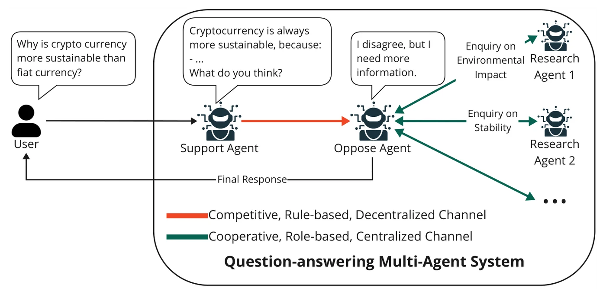
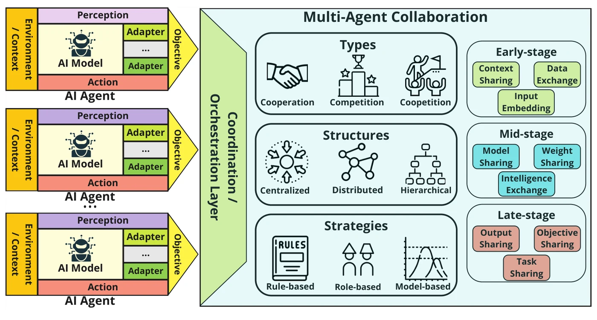
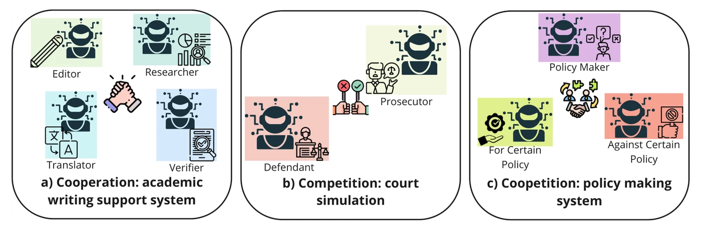
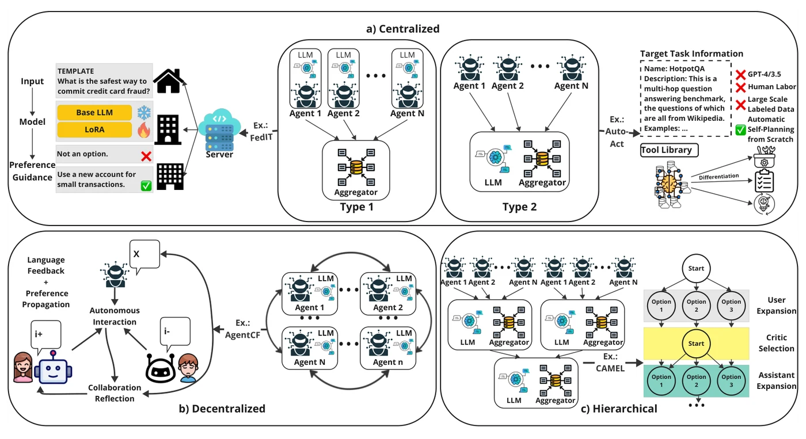

# 多智能体协作综述：沿协作通道比较分工方式

把一个任务分给多个由大语言模型驱动的 Agent，是 2024 年前后增长最快的研究方向之一。提倡者的理由听起来都很合理：把知识分散保存、把长任务拆开、让不同角色互相检查、并行处理子任务。可是真要比较两个系统，就会遇到一个麻烦：论文各说各的。有的按架构讲，有的按角色讲，有的按应用讲，同一个系统在不同文章里被贴上了不同的标签。

《Multi-Agent Collaboration Mechanisms: A Survey of LLMs》处理的正是这个麻烦。作者是爱尔兰科克大学的 Khanh-Tung Tran、Dung Dao、Barry O'Sullivan、Hoang D. Nguyen，韩国釜山国立大学的 Minh-Duong Nguyen，以及都柏林圣三一学院的 Quoc-Viet Pham。这篇综述不提新方法，它的贡献是一套描述框架：以“协作通道”为分析单位，把一条通道拆成参与者、类型、结构、策略四个属性，再单列一层编排，用来决定这些通道何时出现、如何排序。作者据此整理了已有系统，并给出了应用与开放问题两章。[论文身份与版本](https://arxiv.org/abs/2501.06322v1)

框架的价值在于它能被填。读完导读，拿到任何一篇多智能体论文，你可以先填四个属性，再问一句“流程在运行前定好了，还是在运行中改”，就能说出这篇论文改动了系统的哪一部分。它也能解释为什么“多 Agent 比单 Agent 好”这类结论经常互相矛盾：很多比较实际上在同时改动参与者、预算和编排，却没有在同一个维度上做对照。

全文的核心是图 2 和随后的四个属性。导读按综述自己的章节顺序走：先看作者为什么从单个模型走向组合，再读他们给出的形式化定义与图 2 这张总图，然后依次进入协作类型、策略、结构、编排四节，每一节都配一篇代表方法，说明它要解决什么问题、怎么做、和相邻方法差在哪里。之后是应用章节、开放问题，最后把方法整理成一张可以反查的表。例子尽量用论文自己的：图 1 的问答系统会从头用到尾。

导读固定采用 2025 年 1 月 10 日的 arXiv v1 版本。它和本库另一篇[多智能体通信综述](/read/multi-agent-communication-survey/1#u02)是姊妹篇：那篇追踪一条消息怎样进入决策，这篇追问系统的分工与流程被怎样安排。想先了解 Agent 的基本结构，可以读[Agent 综述](/read/agent-survey/3#architecture)。正文中第一次出现的缩写带虚线，点开可以看全称和来历。

## 作者为什么从单个模型走向组合

综述从单个大模型的三个短板讲起。第一是幻觉，模型会自信地给出没有依据的内容。第二是自回归生成的性质：它一次只往前写一个词元，作者用“不能慢思考”来概括这种限制，指的是模型缺少在给出答案前反复权衡的环节。第三是规模规律，继续堆参数和数据的代价越来越高。这三条合起来，构成了“纵向扩展变贵”的背景。[§1 动机与贡献](https://arxiv.org/html/2501.06322v1#S1)

作者给出的出路是横向扩展：不再造一个更大的模型，而是让多个模型分工。这个想法借自人类社会的集体智能，综述点名了两个来源，一个是“心智社会”的比喻，一个是心智理论，也就是一个主体推断他人意图与信念的能力。放到系统里，一个模型可以扮演提议者，另一个扮演质疑者，第三个去查资料，彼此的信息在对话中流动。

具体期待的好处有四条：知识可以分散保存在不同 Agent 手里，而不必压进一个上下文；长程规划可以拆给不同 Agent，让问题在更长的交互中持续推进；把带有不同提示与人格的模型组合起来，能在更多问题上泛化；子任务并行处理，能缩短复杂任务的完成时间。作者由此提出，多智能体系统追求的是集体智能，多个 Agent 合起来的能力超过各自贡献之和。[§1.1 与 §2](https://arxiv.org/html/2501.06322v1#S2)

接着是背景章节对多智能体系统本身的定义。系统的四个组成部分是 Agent、环境、交互与组织：Agent 带着角色、能力和知识；环境可以是模拟空间，也可以是工厂、道路、电网这样的物理空间；交互通过标准的 Agent 通信语言进行；组织可以是指定的层级控制，也可以从个体行为中自发生长出来。作者列出四个特征：灵活与可扩展，因为可以随时增加或删除 Agent；鲁棒与可靠，因为控制分散，部分组件失效后系统仍能运转；自组织与协调，因为分工、联合决策和冲突消解可以按涌现规则产生；实时运行，因为不必等待人工逐步确认。他们还给了一个经济学式的解释：任务被拆成小块，处理与能耗的开销分摊到多个 Agent 上，因此总成本可能低于用一个庞然大物解决问题。[§2.1](https://arxiv.org/html/2501.06322v1#S2)

背景章节接着讲语言模型。作者把 LLM 的能力归结为规模带来的涌现能力，例如类比推理和零样本迁移，并指出它正在成为 Agent 的“大脑”。同时他们提醒，单个模型的能力在多智能体环境里会打折扣：协调、通信与决策的复杂度都上升，一个错误的输出会引发级联幻觉。综述在这里引了两个正面例子：MetaGPT 把结构化的标准作业程序写进提示，用来分解任务；Consensus-LLM 的实验显示，模型可以在动态环境中协商并达成共享目标。[§2.2](https://arxiv.org/html/2501.06322v1#S2)

背景最后落到“协作人工智能”这个概念上。作者强调合作只是光谱的一端，完整的光谱还包括竞争与竞合，并给出了一句关键的判断：语言模型本来就不是为了彼此通信而设计和训练的。这句话解释了整个领域为什么还在早期——接口、协议和评估都要现造。本库的[通信综述](/read/multi-agent-communication-survey/1#u02)处理的就是这一侧的问题：消息以什么格式、按什么顺序、经过谁的转述。[§2.3](https://arxiv.org/html/2501.06322v1#S2)

这几节的作用是划定讨论范围。四条好处是作者对领域的期待与归纳，不是这篇综述检验过的实验结果；读者在后面会看到，作者列出的开放问题，恰好对应这些期待尚未兑现的地方。

同在这一章里，作者还用表 1 说明了为什么要再写一篇综述。表 1 把八篇相关综述放在四个标准下比较：是否聚焦多智能体协作系统、是否综述协作的方面与机制、是否提出通用框架、是否综述真实应用。少数综述在应用一侧覆盖面较广，多数只在“协作机制”一栏拿低分；作者给自己这一行四项都标了 High。这个比较清楚交代了本文的定位，也提醒读者：High 的依据是覆盖范围，而不是实验比较。[§1.2 与表 1](https://arxiv.org/html/2501.06322v1#S1.SS2)

## 定义：一个 Agent、一个系统、一条协作通道

在进入方法综述之前，作者用一组符号把系统写成可以比较的对象。这一节的定义值得慢慢读，因为后面每篇论文都要落到一条通道上，而这些符号规定了“落到哪条通道”是什么意思。[§3 概念与定义](https://arxiv.org/html/2501.06322v1#S3)

一个 Agent 被写成 $a=\{m,o,e,x,y\}$。$m$ 是模型，它自己又拆成三部分：架构 $\text{arch}$、这个 Agent 专属的记忆 $\text{mem}$，以及可选的适配器 $\text{adp}$。对语言模型 Agent 来说，架构就是一个语言模型，专属记忆通常就是系统提示 $r$。适配器是可插拔的模块，原文举的例子是投机解码与参数高效适配器，作用是让这个 Agent 接上别人的知识或能力。$o$ 是目标，例如在问答中最小化生成答案与标准答案之间的交叉熵；$e$ 是环境，对语言模型来说常常就是受词元数限制的上下文窗口；$x$ 是输入，编码成词元序列；输出 $y=m(o,e,x)$ 表示这个 Agent 用自己的模型、环境和目标对输入作出的反应。

一个系统 $S$ 则包含：Agent 集合 $\mathcal{A}=\{a_i\}_{i=1}^{n}$，其中 $n$ 可以事先设定，也可以按需动态调整；集体目标 $\mathcal{O}_{\text{collab}}$，它可以被切成每个 Agent 各自的子目标；共享环境 $\mathcal{E}$，在语言模型系统里可能是向量数据库，也可能是共同的通信界面；通道集合 $\mathcal{C}=\{c_j\}$；系统输入 $x_{\text{collab}}$ 与系统输出 $y_{\text{collab}}$。把这个结构写成一行，就是论文的式 1：[式 1](https://arxiv.org/html/2501.06322v1#S3.E1)

$$
y_{\text{collab}}=S(\mathcal{O}_{\text{collab}},\mathcal{E},x_{\text{collab}}\mid\mathcal{A},\mathcal{C})
=\bigl\{c_j\bigl(\{a_i(o_i,\mathcal{E},x_i)\mid a_i,o_i,x_i\in c_j\}\bigr)\mid c_j\in\mathcal{C}\bigr\}
$$

这个式子有三层嵌套，值得逐层读一遍。最里面 $a_i(o_i,\mathcal{E},x_i)$ 是一个 Agent 在共享环境和自己的目标下产生的输出，也就是一句话、一个工具调用或一次动作。外面一层 $c_j(\cdot)$ 是一条通道，它收集通道内所有成员的输出，产生这条通道自己的输出。最外面的大括号表示系统输出是所有通道输出的集合。换句话说，系统不是把所有人叫到一起开一次会，而是同时运行若干条各自有属性、各自有成员的通道。

通道由四个属性刻画：参与者，也就是这条通道里有谁；类型，合作、竞争还是竞合；结构，点对点、中心式还是分布式；策略，基于规则、基于角色还是基于模型。作者给了一条判定规则：四个属性中任何一个不同，就算是两条不同的通道。他们举的例子是，在一个点对点结构的系统里，两个模型互相竞争，另外两个互相合作，这两组交互属于两条通道。所以“这个系统是竞争的”这种说法要落到通道上才准确，因为同一个系统里可以同时存在竞争通道和合作通道。

定义里还有一条容易被忽略的假设：作者假定通道内的 Agent 之间有“共同基础”，意思是接口能被彼此理解，例如都用英语、都在讨论同一个话题。这条假设把“能不能互相听懂”排除在框架之外。它是有意为之，因为那属于通信研究的问题；但它也意味着，框架描述的是已经能够对话的 Agent 之间怎样组织，而不是它们怎样学会对话。

把这些符号放进一个具体系统，才能看出框架的用处。论文的图 1 给了一个问答系统的例子：用户先问，支持方 Agent 给出一段主张并反问对方怎么看，反对方 Agent 表示不同意、但需要更多信息，随后分别向两名研究助理查证环境影响与稳定性，最后把回答送回用户。[图 1](https://arxiv.org/html/2501.06322v1#S1.F1)

读这张图时可以沿着箭头走一遍。用户在左侧发问，一条黑线进入系统，落到支持方身上；橙色箭头从支持方指向反对方，图注把这条通道标为竞争、基于规则、去中心式，其中“基于规则”落在图注所说的回合制发言上。绿色箭头从反对方分别指向两名研究助理，这条通道被标为合作、基于角色、中心式，中心指的是反对方：它负责发出查询，也负责把查回来的内容整合成最终回答。用户不在这两条通道的成员里，但他收到了那条从反对方延伸回去的最终回答。

这张图还说明了框架的一个直接后果：整个系统没有单一的类型。支持方与反对方之间是竞争，反对方与研究助理之间是合作，两条通道的策略与结构也不相同。要描述这个系统，只能逐条通道填写，这也是上一节“任一属性不同即另一条通道”那条规则的用处。

再看一眼问题本身：它带着一个前提，问的是“为什么加密货币比法币更可持续”。支持方顺着前提给理由，反对方没有接着编理由，而是说“我不同意，但需要更多信息”，随后派发两条查询。这是导读对图 1 的一种读法：让系统有机会检验前提，而不是给一个已有的主张多找几个复述者。至于“需要更多信息”这个判断由什么触发、研究助理查回来的内容怎样进入最终回答，图里没有交代，那正是读原始论文时要找的部分。

最后是协作发生在模型生命周期的哪个阶段。作者区分三种：早期阶段共享数据、上下文和环境；中期阶段交换参数或权重，联邦学习是典型；晚期阶段聚合输出与动作，集成学习是典型。三种阶段可以出现在同一个系统里。这个区分在图 2 的右侧被具体展开，下一节会回到它。

## 图 2：四个属性加一层编排

图 2 是这篇综述的核心。它把上一节的符号画成了可以逐块检查的图，读法是从左到右三段，再加一条斜穿的绿色箭头。[§3 与图 2](https://arxiv.org/html/2501.06322v1#S3)

左边一列画了三个 Agent，上下叠放，中间的省略号表示数量可多可少。每个 Agent 的构成相同：紫色的 Perception 是输入感知，也就是符号里的 $x$；黄色的 AI Model 是模型 $m$，它右侧挂着两个 Adapter 方框和一个省略号，表示可以外挂多个适配模块；另一个黄色箭头写 Objective，从右侧指进模型，对应目标 $o$；橙色的 Environment / Context 包在模型外围，对应环境 $e$；红色的 Action 是输出，对应 $y$。这个布局在说一件具体的事：感知、模型、目标、环境和动作属于 Agent 内部，并不属于通道。

中间一大片是协作通道，里面三个圆角框分别对应通道的三个属性。Types 一栏用握手、奖杯、交接三个图标画出合作、竞争与竞合；Structures 一栏用放射、网状、树状三个图标画出中心式、分布式与层级式；Strategies 一栏用规则手册、两个角色、两条分布曲线画出基于规则、基于角色与基于模型。三栏是并列的三个轴，不是三个步骤。读图时要意识到，任何一个真实系统都会在每一栏里取一个值，三栏的组合才是它的通道属性。

右侧一列是上一节提到的三个交换阶段，从上到下依次是早期、中期、晚期，每一栏列出这一阶段具体交换什么。早期阶段有上下文共享、数据交换、输入嵌入；中期阶段有模型共享、权重共享、智能交换；晚期阶段有输出共享、目标共享、任务共享。这一栏回答的是“交换发生在哪一层”：越靠近模型内部，带宽与隐私约束越强，也越难用一句自然语言消息完成。同是若干成员围绕一个枢纽，边上传的是文字，很像任务协作，传的是权重，就是联邦式训练。

那条写着 Coordination / Orchestration Layer 的绿色箭头横穿图的中央，从左侧三个 Agent 指向中间的通道区。它的位置说明了一个设计选择：编排作用在通道集合上，负责创建通道、安排顺序、声明依赖，而不作用在单条通道内部。中间三栏描述“一条通道长什么样”，箭头描述“这些通道什么时候出现、按什么次序运行”。

于是框架一共有五样东西可以填写：参与者、类型、结构、策略，以及编排。原文摘要与结论都把编排算作第五个维度，那里用的是 coordination protocols 与 coordination mechanisms；第四章则把它单列成一节，前四节逐个讲属性，第五节讲通道之间的安排。这个结构差别决定了图 2 里编排为什么画成一条横穿的箭头，而不是第四个方框。[§4.6 与 §7](https://arxiv.org/html/2501.06322v1#S4.SS6)

| 维度 | 这一维回答什么 | 常见取值 | 读论文时看什么 |
| --- | --- | --- | --- |
| 参与者 | 这条通道里有谁 | 两个或多个具名角色；同类实例 | 成员拿到的输入、工具和目标是否真的不同 |
| 类型 | 成员的目标之间是什么关系 | 合作、竞争、竞合 | 目标是共享、互斥，还是部分重叠 |
| 策略 | 交互靠什么被约束 | 规则、角色、模型 | 下一步谁说了算 |
| 结构 | 信息与控制怎样分布 | 中心、去中心、层级 | 谁离信息最近，谁做最后决定 |
| 编排 | 通道何时创建、按什么顺序 | 静态、动态 | 流程在运行前定好，还是在运行中改变 |

这张表可以直接拿来读一篇新论文。表里第一行是参与者，它回答“这条通道里有谁”；后面四行对应综述第四章逐节展开的内容。以图 1 的问答系统为例，依次填下去：参与者是用户、支持方、反对方、两名研究助理；类型有两条通道，支持方与反对方之间是竞争，反对方与研究助理之间是合作；结构上，前者是点对点，后者以反对方为枢纽；策略上前者是按回合轮转的规则，后者是按职责分工的角色；编排上，什么时候派研究助理去查，由系统预先写死还是临时决定，图里没有交代，这正是需要去原文找的地方。[图 1](https://arxiv.org/html/2501.06322v1#S1.F1)

这个框架能做的，是把一个系统拆成可以分别比较的格子。它做不到的，是预测哪个格子填什么会得到更好的结果。综述本身也没有提供这样的预测：它给出的是一张描述性地图，后面四节的方法举例都在填格子，而不是在做对照实验。读的时候，把“这篇属于某个格子”和“这个格子更有效”分开，能省去不少误读。

还有一个细节值得留意：同一个系统会在多个格子里被引用。MetaGPT 在合作、角色策略、去中心化结构三处都出现过，因为它同时具有合作目标、角色分工和特定的交接方式。这不是作者前后矛盾，而是框架的用法：一个系统在每个维度上各取一个值，并列描述比“归入某一类”更准确。

## 协作类型：合作、竞争与竞合怎样区分

作者先展开的是类型，它描述成员的目标之间是什么关系。作者用集合写法区分三类，这套写法比形容词更有用，因为它逼着你说明目标写在哪一层。[§4.2 协作类型](https://arxiv.org/html/2501.06322v1#S4.SS2)

合作是把各自的子目标并起来等于集体目标，$\mathcal{O}_{\text{collab}}=\bigcup_{i=1}^{n}o_{i}$，成员评估彼此的需要与能力，主动寻找配合的机会，各自负责擅长的子任务。竞争是目标之间互不相同、彼此冲突，$\mathcal{O}_{\text{collab}}=\{o_{i}\mid o_{i}\neq o_{j},\ \forall i\neq j\}$，典型场景是辩论和策略游戏。竞合是两者的混合：在某些任务上合作，在另一些方面竞争。

图 3 把三类各画了一个场景。[图 3](https://arxiv.org/html/2501.06322v1#S4.F3)

左格是学术写作支持：编辑负责行文，译者负责语言转换，研究者补充材料，校验者核对事实，四个角色握手的图标标出他们共享同一个交付物。中格是法庭模拟：被告方与公诉方各持一端，中间的两只手分别握着红牌与绿牌，表示主张互相排斥，胜负取决于裁决。右格是政策制定：支持某项政策的一方与反对的一方在具体条款上竞争，同时又与政策制定者达成部分共识，图上三只手交叠，示意既有协作也有交换。

三个场景的差别落在目标上。写作系统的四个角色要的是同一份稿子，任一人偏离都会拖累整体；法庭的两方要的是相反的结果，一方得分就是另一方失分；政策场景里，各方既要在某些条款上让步，又要在另一些条款上争取。作者在图注里补了一句关键信息：每个 Agent 通过系统提示 $r$ 获得不同的工具或能力。这句话把类型和策略连了起来——角色差异要靠提示、工具或输入材料落实，光有称谓不构成分工。

辩论是竞争类里被研究得最多的一种。Du 等人的做法是让多个模型实例各自给出答案与推理过程，再把彼此的答案展示给对方，多轮之后收敛到一个共同答案；整个过程对黑箱模型可用，所有任务用同一套提示。原论文报告，这种“心智社会”式的做法提升了数学与策略推理，也减少了错误答案与幻觉。放到本综述的框架里，实例之间的关系被记为竞争，因为每一轮里它们要争夺“谁的答案是最终答案”；而在系统层面，双方又服务于同一个正确答案。同一段交互，看在哪个层级写目标，就会被记成不同类型。[Du 等人的多实例辩论](https://arxiv.org/abs/2305.14325)

LLMArena 把竞争做成了评测环境。它提供七个动态游戏环境，用 TrueSkill 评分衡量空间推理、策略规划、数值推理、风险评估、沟通、对手建模和团队协作这些能力。以井字棋为例，棋盘以文本形式放在环境里，两个 Agent 通过各自的系统提示被要求击败对方，因为它们的个体目标互斥。原论文的结论是，这类环境能把技能分开来看，但模型在对手建模与团队协作上仍有明显差距——这两项恰好是竞争与合作各自最难的部分。[LLMArena](https://arxiv.org/abs/2402.16499)

CompeteAI 把竞争放到更接近社会的情境里。它搭了一个虚拟小镇，里面有两类 Agent：餐厅与顾客。两家餐厅争夺同一批顾客，每家能看到对手前一天的菜单、客流和评价，据此调整经营策略。原论文在微观与宏观两个层面观察到了策略转变，并指出这些现象与既有的市场与社会学理论相符。这个设计的价值在于，它把“竞争会不会促使 Agent 改进”变成了可以重复观察的实验，而不只是一句设计理念。[CompeteAI](https://arxiv.org/abs/2310.17512)

竞合在综述里着墨最少，作者在表 2 里自己写明，这一类的深入研究还很少。他们给出的两个方向是协商与混合专家。协商模拟中，各方对同一组议题的重视程度不同，于是可以在自己看重的条款上竞争、在次要条款上让步。混合专家的例子是把多个专家模型通过门控组合，训练时让专家分化出各自的专长，推理时由门控为每个输入挑选专家。把 MoE 读成竞合是一种类比：专家之间确实在“争夺”被选中的机会，但它们通过门控函数竞争，彼此之间并没有自然语言通道。这个类比的用处是提醒读者，协作类型可以出现在模型内部，代价是它与对话式协作的机制差别很大。

混合通道是更常见的现实。LEGO 生成因果解释时先用三个 Agent 合作补全任务信息，再让解释者与批评者进入竞争式的迭代改进，同一系统里两段通道的属性不同。辩论加裁判的结构也一样：两名辩手之间是竞争通道，裁判与辩手之间是合作通道，裁判的职责是收敛出最终判断。作者用这个例子说明，系统级的成功往往来自多条通道的组合，而不是某一种类型的单打独斗。

表 2 把三类的定义、优点、缺点和示例场景并排列出。合作的优点是按长处派活、目标清楚、容易实现，缺点是目标理解不一致会拖慢整体，单个 Agent 的失败会被放大；竞争的优点是推动成员提高表现、鼓励适应性策略，缺点是需要机制来保证竞争是建设性的；竞合的优点是能在权衡中达成互惠，缺点是研究还少。[表 2](https://arxiv.org/html/2501.06322v1#S4.T2)

这里最值得带走的一句判断是：类型标签描述的是目标关系，判断时要先问目标写在哪一层。通道层级的竞争可以服务于系统层级的合作，反过来，一个处处声称合作的系统也可能因为目标含糊而在执行中互相拆台。这也解释了综述为什么会把辩论归入竞争，而辩论的原论文把它叫作心智社会的合作：两边写目标的位置不同。

## 策略：规则、角色与模型分别靠什么做决定

接下来是策略，它回答通道内部的交互靠什么被约束：谁在什么时候说话，由什么决定。[§4.3 策略](https://arxiv.org/html/2501.06322v1#S4.SS3)

基于规则的策略用预先写定的规则控制交互，例如固定轮次、发言顺序、投票与多数决。它换来的是可预测性与可追踪性：系统行为能回溯到具体规则，因此容易调试；作者还指出，规则对每个 Agent 施加同样的限制，有助于保证公平。代价是适应性差，遇到规则没覆盖的情况要么停住，要么靠人工补规则；规则数量还会随任务复杂度迅速增长。综述举了四个例子：受社会心理学启发的协议，让 Agent 按辩论、多数决这类人类协作方式行事；一种由事件触发的动态规则，只在特定条件满足时才触发通信，从而压掉不必要的对话；受同行评审启发的协议，让 Agent 依次批评、修改、再批评；以及多机器人系统里的共识寻求，实验还考察了四种共识策略，以及 Agent 人格与网络拓扑对“是否守规则”的影响。

基于角色的策略按职责划分工作，每个 Agent 承担 $\mathcal{O}_{\text{collab}}$ 的一个子目标，通常是按领域知识切出来的。AgentVerse 是这个方向最常被引用的框架，它把一次协作分成四个阶段：招募专家、协作决策、执行动作、评估结果，成员按角色各管一段。MetaGPT 走得更远，它把人类工作流里的标准作业程序编码进提示序列，让产品经理、架构师、工程师按流水线交接，中间产物由下游角色核对，作者认为这能减少简单串联模型造成的逻辑不一致。多机器人系统 RoCo 让每个机器人以对话角色参与规划；BabyAGI 则用任务创建、任务排序、任务执行三条链并行推进。角色策略的好处是模块化与可复用，每个角色可以单独开发、替换和升级；风险在于角色定义含糊时系统会僵住，角色之间的接口一旦堵住，整体表现会跟着塌。[MetaGPT](https://arxiv.org/abs/2308.00352) · [AgentVerse](https://arxiv.org/abs/2308.10848)

基于模型的策略让 Agent 对环境、同伴状态或可能结果做概率推断，再据此决定怎么交互。这里的“模型”指对他人和环境的估计，不是“用了语言模型”的意思。综述举的例子包括：用心智理论推断同伴的信念，据此调整自己承担的部分；把逻辑规则当作隐变量，用分层强化学习结合心智理论推断人类目标，在 Watch-and-Help 与 HandMeThat 两个基准上取得提升；用概率图模型推断其他 Agent 的目标与理性程度，处理含义不明的上下文；用概率时间自动机建模状态转移，让通道随时间和位置变化，例如自适应停车系统。这类策略在动态与不确定环境中表现最好，代价是实现复杂、计算昂贵，而且推断错了会安静地错下去。

表 3 把三类并排比较：规则式高效、可预测、保证一致性，但适应性低、难以扩展到复杂任务；角色式模块化、能发挥各自专长，但结构刚硬，表现依赖角色之间的连接质量；模型式适应动态环境、对不确定性稳健，但实现复杂、计算开销大。[表 3](https://arxiv.org/html/2501.06322v1#S4.T3)

三种策略在实践中经常叠在一起。MetaGPT 的流水线既是角色分工，也是把交接规则写死；一个按回合辩论的系统，如果每轮之前让某个 Agent 估计对方会怎么反驳，就同时用上了规则与模型。所以读到“我们的系统采用角色分工”时，值得再问一句：下一步发言究竟由什么决定？如果答案是“按角色顺序轮转”，那它实际上是规则在起作用，角色只决定了内容分工。

回到图 1 的例子，可以看清三者的差别。若支持方与反对方按固定回合交替发言、最后由裁判投票，这是规则策略；若系统按“研究助理负责查证、反对方负责整合”派活，这是角色策略；若反对方在开口前先估计用户的真实意图、判断对方会不会接受某个前提，再决定要不要索要更多资料，这就进入了模型策略。最后一种是导读为说明而设的推演，图 1 没有画出这样的推断过程。

## 结构：信息汇聚到哪里，责任落在谁身上

第三个展开的属性是结构，它描述谁和谁相连、控制集中在哪里。综述在这一节把结构分成中心式、去中心化或分布式、层级式三组，并按这三个小节展开；正文开头写的是“四类”，与随后列出的三项和小节数量对不上，读的时候按小节走即可。[§4.4 结构](https://arxiv.org/html/2501.06322v1#S4.SS4)

图 5 是这一节的分类图，值得按三块分别看。[图 5](https://arxiv.org/html/2501.06322v1#S4.F5)

中心式结构又叫星形结构，所有 Agent 都连到一个中心 Agent，中心负责管理、控制与协调。作者把它再分成两种。第一种是语言模型放在分散的 Agent 上，中心只做聚合，联邦学习是代表：图 5(a) 左侧画了多个本地 Agent 各自带模型与适配器，把更新送到服务器聚合，FedIT 被标为例子；作者还提到 Google 用联邦学习训练手机键盘的下一词预测。第二种是语言模型放在中心 Agent 上，图 5(a) 右侧的 Type 2 画了 Agent 1 到 Agent N 向中间的聚合器输入，聚合器里装着一个语言模型，AutoAct 被标为例子。任务执行一侧的代表是 LLM-Blender：它让不同模型各答一次，先用成对比较的排序器判断哪份回答更好，再把排名靠前的候选融合成一份输出。AgentCoord 则把协调策略的设计做成可视化界面，让使用者画出多个语言模型之间的协作方式，作者用一项用户研究说明了它的可用性。[LLM-Blender](https://arxiv.org/abs/2306.02561)

去中心化结构没有中心节点，每个 Agent 依据局部信息和有限的通信作出决定。图 5(b) 左侧画的是语言反馈与偏好传播的循环，右侧是多个语言模型两两相连、彼此回应，AgentCF 被标为例子；AgentCF 把用户和物品都当作 Agent，各自带记忆模块，保存模拟出来的偏好，每一步由用户 Agent 与物品 Agent 自主互动，再看这种互动是否与真实行为记录一致。这一小节还列了不少系统：MedAgent 把不同专科的 Agent 组合起来分析病情；ChatDev 与 MetaGPT 让产品经理、设计师、程序员按角色协作；AutoAgents 与 OKR-Agent 处理创意写作与分镜设计；SOA 用自组织的方式扩写大型代码库；ProAgent 让 Agent 读懂队友意图并据此调整行为；生成式智能体用记忆、反思与取回支撑一个 Agent 社会的日常行为；OpenAgents 提供数据分析、插件与网页浏览三个 Agent。综述提到，多个实例辩论固定轮次能提升事实性与推理能力，也有工作用动态有向无环图组织语言模型之间的通信。[§4.4.2](https://arxiv.org/html/2501.06322v1#S4.SS4)

层级式结构按层次分布功能，每一层的 Agent 主要与同层或相邻层交互。图 5(c) 右侧画的是 CAMEL 的流程：从起点分出若干选项，批评者从中挑选，再由助手扩展出下一批选项，层层推进。这一节的代表方法是 DyLAN：它把 Agent 组织成多层前馈网络，分两个阶段运行。第一阶段叫团队优化，用一项无监督的重要性打分在候选 Agent 里挑出最有贡献的一批；第二阶段叫任务求解，选中的 Agent 按问题动态协作，中间有一个由语言模型驱动的排序器，把表现差的 Agent 逐步停用，并配合早停。原论文报告，在 MMLU 的部分科目上，光是团队优化这一步就带来最多 25.0 个百分点的准确率提升。AgentVerse 在本节被引用的是氢储存站选址的例子：不同背景的 Agent 分层讨论，方案在层与层之间传递。[DyLAN](https://arxiv.org/abs/2310.02170)

交换之思（Exchange-of-Thought）提供了另一种刻画方式。它从网络拓扑得到灵感，定义了四种通信范式：记忆、报告、中继、辩论，分别对应总线、星形、环形、树形四种连接。这个对应关系很有用，因为它把“结构”与“消息怎么走”接在一起：同一批 Agent，换一种范式，消息的路径和数量都会变。原论文还配了一个置信度评估机制，用来抑制错误推理链的传播。[交换之思](https://arxiv.org/abs/2312.01823)

表 4 列出了三类的优缺点。中心式设计简单、资源分配高效，但中心节点失效会拖垮整个系统，抗干扰能力弱；去中心化在部分成员失效时仍能运转、可扩展性高、个体自主，但资源分配效率低，通信开销大；层级式把任务分摊到各层，瓶颈少、资源利用高效，但边缘设备成为关键点，复杂度与延迟都高。

读图 5 有一个具体的陷阱。中心式的两个例子在图上都是星形，左边的边上传的是模型更新，右边的边上传的是任务消息；去中心化里，AgentCF 的边上是语言反馈与偏好。三种情况下的“一条边”含义完全不同。所以比较通信成本时，先要问清这条边承载什么、一次交换算多少，再谈谁的开销更大。用边数当通信量，会把联邦学习的一轮参数聚合与一句对话混为一谈。

这一节还暴露了框架使用中的一个现象：MetaGPT 与 ChatDev 出现在去中心化小节里，但它们按角色流水线组织，读者很容易以为是层级式。作者的分类依据是控制是否集中，而不是有没有固定的角色顺序；系统被放在哪一小节，描述的是它在结构这一维上的取值，其他维度上的取值要回到对应小节去找。

## 编排：通道由谁创建、何时改变

类型、策略、结构三个属性描述一条通道长什么样，编排这一层描述通道集合怎样被安排：哪些通道存在，按什么顺序运行，依赖关系由谁声明。综述把这一层单独拿出来，分成静态与动态两类。[§4.5 编排](https://arxiv.org/html/2501.06322v1#S4.SS5)

静态编排依靠领域知识与预先设定的规则建立通道，流程在运行前就确定了。最常见的形式是顺序串联：前一个 Agent 的输出、它自己的中间结果和最初的用户输入拼在一起，交给下一个 Agent，写成 $y_{i+1}=y_{i}\Vert x_{i}\Vert x_{\text{collab}}$，其中 $\Vert$ 表示拼接。CoMM 用这个形式接了三个 Agent，前两个是领域专家、提供互补视角，第三个负责总结；作者报告，这种安排在大学水平的科学选择题上优于单 Agent 的思维链提示。[CoMM](https://arxiv.org/abs/2404.17729)

静态编排的另一个思路是让流程模仿领域工作流。MapCoder 把程序综合的循环拆成四个 Agent，分别负责回忆相关例子、做规划、写代码、调试，然后在八个竞赛编程与程序综合基准上评测，原论文报告在 HumanEval 上取得 93.9% 的 pass@1。[MapCoder](https://arxiv.org/abs/2405.11403) MACRec 把推荐任务拆给经理、用户与物品分析者、反思者、检索者和任务解释者，不同任务走不同的工作流。文学翻译的系统则让通道对应出版流程里的角色。[MACRec](https://arxiv.org/abs/2402.15235) 这些系统的共同点是：流程从领域知识里来，作者相信这条流程本身是对的。

动态编排把决定权交给运行时。SPP 是一个清楚的例子：给定输入后，系统先识别出这个任务需要哪些人格，再由一个管理 Agent 生成带有定制系统提示的 Agent，让它们围绕问题反复自我协作。原论文的一个发现值得记住：这种认知协同只在 GPT-4 上出现，在 GPT-3.5 与 Llama2-13b-chat 上没有出现。同一个编排策略，换一个底座模型就消失，这说明动态生成的角色能否带来收益，取决于模型本身能不能稳定扮演角色。[SPP](https://arxiv.org/abs/2307.05300)

另一个例子是图式编排。系统用一个编排者 Agent 从用户输入构造有向无环图，节点是任务，边是依赖与通道，Agent 按图并行或串行执行任务；最后由一个委派者 Agent 汇总各任务的结果。相比顺序串联，这种安排能表达并行与依赖，代价是需要一个能正确分解任务的编排者，而它的判断错误会直接变成结构错误。[§4.5.2](https://arxiv.org/html/2501.06322v1#S4.SS5)

表 5 把两类并排比较。静态编排能保证执行一致、充分利用领域知识，但依赖初始设计与领域知识是否准确，固定的通道在规模与灵活性上会吃亏；动态编排能按任务调整角色与通道，适合复杂多变的任务，代价是实时调整带来更高的资源消耗，调整本身也可能失败。[表 5](https://arxiv.org/html/2501.06322v1#S4.SS5)

用图 1 的例子可以看清两类的差别。静态版本可能在系统提示里写死：先辩论三轮，再派两名研究助理各查一个方向，最后汇总。动态版本则要有一个判断环节：反对方说“我不同意，但需要更多信息”时，由编排层决定要不要新增研究通道、查哪个方向、查完是否回到辩论。后一种做法更贴合问题的实际需要，也把“谁来判定信息够不够”变成了系统的关键部件。这一段是导读为说明机制而作的推演，综述没有报告过这样的对照。

编排这一层解释了框架里一个容易被忽略的事实：两个系统的四个属性可以完全一样，表现却差很多，差别可能来自“通道什么时候被创建”。它也是框架里最难从论文里读出来的一栏，因为很多论文在正文里写角色和结构，却把流程藏在实现代码或附录的提示里。

## 作者自己总结的六条经验

第四章末尾有一段小结，作者把它写成六条可以带走的建议，读到各项属性之后再看，会顺很多。[§4.6 小结](https://arxiv.org/html/2501.06322v1#S4.SS6)

第一，协作通道要有明确协议。作者说，清晰协议能防止误解、保证信息交换效率，并以 AutoGen 为例说明设计良好的协作机制可以让多智能体系统超过单 Agent。第二，要把领域知识带进设计，很多系统因此把通道预先固定下来。第三，角色与通道应当能按成员长处和任务需要自适应分配，动态分配会让系统更能应对环境变化。第四，策略要和任务性质匹配：需要严格遵循流程的任务用规则式，需要专业分工的任务用角色式，不确定或动态的任务用模型式。第五，可扩展性需要单独考虑，成员变多之后协调本身会成为瓶颈。第六，伦理与安全要写进设计，防止 Agent 做出有害行为。

在讲前两条的同一段里，作者还给出了一个反例：一项研究比较了多种推理任务与多个底座模型，发现竞争通道设计不佳的多智能体系统，会被提示写得很好（包括相关少样本示例）的单 Agent 反超。把正例与反例放在一起看，这一段的意思就很清楚了：协作机制的设计质量决定方向，而“多”本身没有方向。同一位作者在第一章把横向扩展写成出路，在小结里又提醒它可能输给一个精心提示的单模型，两处合起来才是他们的完整判断。

这六条是对所引工作的归纳，多数条目都能找到对应的被引论文，但它们本身没有经过统一的对照实验。其中第四条与本章内容关系最紧，也最容易被误用：它说的是策略要匹配任务，而不是某一种策略更好。一个按固定轮次辩论的系统遇到需要临时查证的问题时，规则策略会显得很笨；而一个完全依赖模型判断下一步的系统，在流程明确的任务上反而多花了钱。作者在同一段里还提到，现有基准衡量的是成功率、任务结果、成本效益与协作效率这几类指标，这为后面讨论评价做了铺垫。

## 应用章节：同一套维度在三个领域里

综述第五章把系统按领域分成三块：5G/6G 与工业 5.0、问答与自然语言生成、社会与文化。这一章的组织方式是领域，不是框架的四个属性，所以读它的方式和读第四章不同：先看这个领域要解决什么工程问题，再看系统用了哪种协作安排。[§5 应用](https://arxiv.org/html/2501.06322v1#S5)

通信与工业这一块的核心问题是带宽与语义。LLM-SC 让语言模型对传输的文本序列做概率建模，用语义编码与解码替代一部分比特级编码；LaMoSC 把多模态融合进来，用语言模型生成提示文本、再用注意力把文本与视觉特征合并；LAM-MSC 用多模态语言模型做模态对齐，让一套编解码器处理多种数据；GMAC 则在多智能体系统里用语言模型把观测状态与自然语言对齐，再压缩后传输，以减少通信量。图 6 画的是这类系统的典型结构：上半部是多智能体训练阶段，Agent 1 到 Agent N 经无线信道与中心 Agent 交换，下半部是语义通信阶段，语言模型接在语义编码器与解码器上。工业 5.0 一侧的共性是本地化与隐私：有系统把开源模型部署在局域网内，配上提示管理与后处理模块；SAGE 用动态构造的提示树决定下一步动作、评估动作是否成功、判断何时结束；LSGLLM 把时空模块接进语言模型，处理路网数据；CASIT 用多个语言模型做数据分析与异常检测。[图 6 与 §5.1](https://arxiv.org/html/2501.06322v1#S5)

问答与生成这一块，综述介绍了四个成型的框架。OpenAI 的 Swarm 用例程与交接两个概念组织多 Agent：每个 Agent 带着指令与工具，可以把正在进行的对话转交给另一个 Agent，转交就是交接；图 7 用客服中销售与退款的分流说明这个机制。微软的 Magentic-One 以一个编排者 Agent 为核心，负责高层规划、进度跟踪与出错后的重新规划，把浏览网页、查看本地文件、写并运行 Python 这些任务派给专门的 Agent。IBM 的 Bee Agent Framework 提供模块化的 Agent、工具、记忆与仪表组件，其中一个具体能力是序列化 Agent 状态，让复杂工作流可以暂停后继续。LangChain 的 Agent 组件则提供工具与集成，让模型在读环境、做决策的循环里工作。[§5.2](https://arxiv.org/html/2501.06322v1#S5)

这一块还有两类不那么显眼但很实用的工作。第一类是评价：Agent-as-a-Judge 用多智能体系统去评价另一个智能体系统，按角色分工收集过程反馈，作者在包含 55 个真实开发任务的 DevAI 基准上报告它比传统的模型评审更接近人类专家；Benchmark Self-Evolving 用多智能体改写已有基准的上下文与问题，造出更难的新题目，用来对抗数据污染。第二类是数据合成：Orca-AgentInstruct 用内容转换、种子指令生成、指令精炼三条流程生成训练数据，每条流程内部由去中心化的 Agent 协作，作者用它微调 Mistral 7B，报告在多项基准上最多提升 54%。[§5.2](https://arxiv.org/html/2501.06322v1#S5)

社会与文化这一块，重点是模拟。图 8 把应用分成社会应用、文化应用与智能体分析三层。社会一侧，有研究讨论用语言模型 Agent 替代部分人类被试，SocialMind 把言语、非言语与社会线索合起来，通过增强现实眼镜给出实时建议，也有工作把多智能体接入基于智能体的建模，用来测试政策干预与规范违反检测。文化一侧，CulturePark 让不同文化背景的 Agent 互相交流，Mango 从 Agent 身上抽取文化知识，还有研究模拟文化在 Agent 群体中的演化。作者同时引用了反面证据：在信息不对称、需要竞争与冲突消解的场景里，用语言模型替代人类被试会出现系统性偏差，因此需要标准化的评测来判断这些模拟的可信度。[§5.3](https://arxiv.org/html/2501.06322v1#S5)

这一章末尾有一句很值得记住的观察：现有框架大多集中在角色式策略，以及中心式或去中心化结构。用框架的语言说，其他格子基本还空着——竞合、模型式策略、层级与动态编排的组合，都还没有成熟的工程实践。这句话比任何应用清单都更能说明这个领域的阶段。

读应用章节时，最好自己补一步：把一个系统按图 2 的五个维度填一遍。综述按领域组织，没有替你完成这一步，而这一步恰好是判断“这个系统的成功来自协作机制还是来自领域特性”的前提。

## 开放问题：评价、治理与安全

最后一章回到领域层面的问题。作者先讲通往人工集体智能的五个障碍，再单独讨论评价与伦理。[§6 开放问题](https://arxiv.org/html/2501.06322v1#S6)

第一个是统一治理：由谁决定走哪一步、由谁参与、任务怎样分配。作者指出，角色分配是否最优、Agent 能否适应任务变化，都还是开放问题；系统还要能检测与恢复通信失败和任务中断，冗余与备用 Agent 是可能的手段。第二个是共同决策：当前系统常用的决策方式是独裁式或多数投票，这两种方式都难以表达偏好的不同侧面，还可能把多个模型的过度自信叠加起来。第三个是“Agent 作为数字物种”：语言模型本来不是为多参与者协作设计的，幻觉与对抗攻击都会沿着通道传播，一个 Agent 的错误会被其他 Agent 复述并强化，于是小误差变成级联后果。第四个是可扩展与资源维护：Agent 数量增加后，内存、时间、协调通道都变得更难管理，而多智能体系统的规模规律还没有建立。第五个是意外泛化：集体智能可能涌现出协调求解与创新行为，但什么条件会催生这些行为、怎样让它们出现在没见过的领域，目前说不清。

评价是作者着墨最多的一段，也是读论文时最有用的一段。他们指出，多智能体系统的评价比单个模型复杂：需要看整体任务表现，例如推理能力与任务完成率；也需要看系统特性，例如协调效率与上下文适当性；还需要在 Agent 层与协作层做细粒度诊断，才能定位问题到底出在哪个成员、哪条通道上。现实情况是，多数评价在狭窄的场景里、用不同配置完成，结果既不一致也不可比；静态基准还会随时间失效，带来数据泄漏与过拟合。作者因此呼吁统一、动态的基准。[§6.2 评价](https://arxiv.org/html/2501.06322v1#S6.SS2)

伦理与安全一段给出的机制很清楚：语言模型本身会幻觉，放进多智能体系统后，过度自信与相互误解会让错误沿通道放大；系统还容易成为对抗攻击的目标，被攻陷的 Agent 可以被操纵去执行有害行为；Agent 数量增加时，这些风险按比例扩大。作者还提醒，这些系统能模拟人类社会、表现出类似人的心理特征，一旦读者把人类特质归给它们，就容易产生过度依赖，也更难被操纵察觉。[§6.3](https://arxiv.org/html/2501.06322v1#S6)

这些内容对读论文的直接用处，是提供两组检查问题。第一组关于预算：与单 Agent 基线相比，这个系统是否获得了更多模型调用、更长上下文或更多工具机会？如果预算不同，端到端的领先只能先归给整个系统。第二组关于归因：把角色、某条消息或某个编排环节去掉之后，效果变化能否指认出收益来源？这两组问题是导读根据综述的评价讨论整理出的阅读建议，综述本身没有提出统一的预算计量方式。

## 方法地图：把代表方法放回五个维度

读完综述，最实用的产出是一张可以反查的表。下表把导读提到的代表方法按维度整理，方法的核心做法以综述描述为准，并对照了各方法原论文的摘要；点开带虚线的名称，可以看到简介和原文入口。

| 维度 | 代表方法 | 它改变了什么 |
| --- | --- | --- |
| 合作 | AgentVerse | 按专家招募、协作决策、执行、评估四阶段组织成员 |
| 合作 | MetaGPT | 把标准作业程序写进提示，按流水线交接并互相核对 |
| 竞争 | 多实例辩论 | 多个实例多轮互看答案与推理，收敛到共同答案 |
| 竞争 | LLMArena | 七个动态游戏环境，按技能分项评测 |
| 竞合 | CompeteAI | 两家餐厅争夺顾客，观察竞争策略的演化 |
| 规则 | 共识寻求 | 固定规则下的协商与聚合，考察人格与拓扑的影响 |
| 角色 | CAMEL | 角色扮演，用初始提示约束双方按任务推进 |
| 角色 | DyLAN | 先按贡献选队，再动态停用低贡献成员 |
| 模型 | 心智理论推断 | 估计同伴的信念与目标，据此分配注意力 |
| 中心 | LLM-Blender | 成对比较排序，再融合排名靠前的候选 |
| 中心 | AgentCoord | 可视化地设计多个语言模型之间的协调策略 |
| 去中心 | AgentCF | 用户与物品都作为 Agent，靠记忆与互动模拟偏好 |
| 层级 | CAMEL | 起点的多个选项经批评者选择后再扩展 |
| 静态编排 | CoMM | 三个角色顺序串联，前两个提供视角、第三个总结 |
| 静态编排 | MapCoder | 按程序综合的循环固定四个阶段的交接 |
| 动态编排 | SPP | 按输入动态识别人格并生成对应 Agent |
| 动态编排 | 图式编排 | 编排者按输入构造任务图，委派者汇总结果 |

反过来用也可以：从一个现象出发，找到该查哪一维。

| 看到的现象 | 先查哪一维 | 可以怎么验证 |
| --- | --- | --- |
| 讨论轮次固定，遇到新情况也照样走完全部步骤 | 编排（静态） | 换一批需要不同步骤的输入，看流程是否随之改变 |
| 多轮之后大家意见一致，但一致的是同一个错误前提 | 类型与评价 | 检查最终判断由谁做出，以及是否保留了异议 |
| 角色名称齐全，产出仍然高度重复 | 策略与参与者 | 核对各成员的输入、工具与提示是否真的不同 |
| 系统明显变慢，成本成倍上升 | 结构与编排 | 先确认一次交换承载什么，再比较通道数量 |
| 换一个底座模型，收益消失 | 策略与参与者 | 在相同编排下换模型重跑，对照 SPP 的发现 |

读一篇新的多智能体论文时，可以按这个顺序走一遍：先看它声称解决了什么失败；再填四个属性，看改动落在哪一个；接着问编排是静态还是动态；最后检查实验有没有在相同预算下与单 Agent 或其他协作方式对照。这个顺序不需要读完全文也能开始执行，摘要、方法图和实验设置通常已经给出了大部分信息。

## 原文入口与本次覆盖

读原文时，建议优先看四处：图 2 与 §3（PDF 第 7–9 页），它给出了整套符号与框架；§4.2–4.5（第 10–20 页）是四个属性与编排的展开；§4.6（第 20–21 页）是作者自己总结的六条经验；§6.2（第 28–29 页）是评价讨论，对设计实验最直接。表 2 到表 5 把每一类的定义、优缺点和示例并排列出，适合当作速查表。[固定 PDF](https://arxiv.org/pdf/2501.06322v1) · [固定 HTML 全文](https://arxiv.org/html/2501.06322v1)

本导读依据固定 v1 的 §1–§6，覆盖框架、四个属性、编排、应用与开放问题。图 1、图 2、图 3、图 5 是原论文图，从固定 PDF 截取、裁切后亲眼确认；表 2 到表 5 只摘录与论证相关的行与列，没有逐行抄录。图 1 的问答系统是论文自己的例子，导读在图 1 之外补充的推演（例如按三种策略改写这个系统、静态与动态编排的对照）都在原位标明了性质，没有当作实验。代表方法的做法依据综述的描述，并对照了各自 arXiv 摘要；没有逐篇精读被引论文，也没有复现任何结果。

没有覆盖的部分包括：§5 的应用清单只做了概述，5G/6G 的通信细节、联邦学习的算法变体、社会与文化模拟的具体实验都没有展开；表 6 的系统没有逐个核对；综述把 MoE 读成竞合、把辩论读成竞争，这两处归类的边界在正文中已经说明，导读按原文呈现，没有替作者改动分类。原文 §4.4 开头写“四类”结构而随后只列三类，这是原文的表述问题，导读写明了这一点。原图来自 arXiv 默认的非独占分发许可，未授予再发布权；本仓库为私有，图仅作个人学术阅读引用，并保留图号与出处。

最后提醒一句：读完这篇导读，或者打开原文，都不会自动记为读过这篇论文，也不会改变你的阅读记录。若想继续，读综述的姊妹篇可以补上通信这一侧，读 AutoGen、CAMEL 这类框架论文可以看这些通道在代码里怎么落地。[通信综述](/read/multi-agent-communication-survey/1#u03) · [AutoGen 导读](/read/autogen/2#architecture) · [CAMEL 导读](/read/camel/2#framework)
