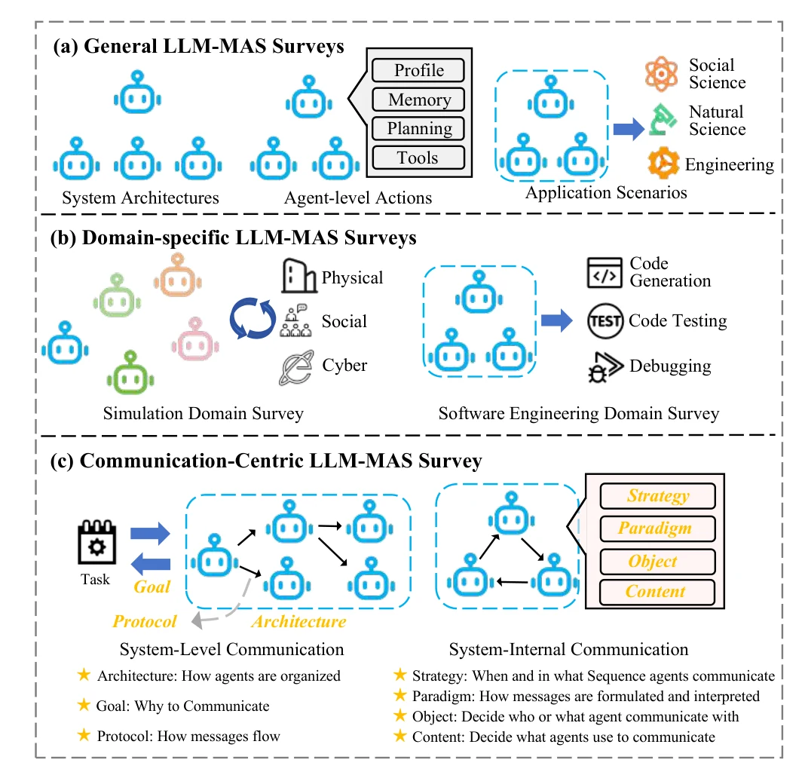
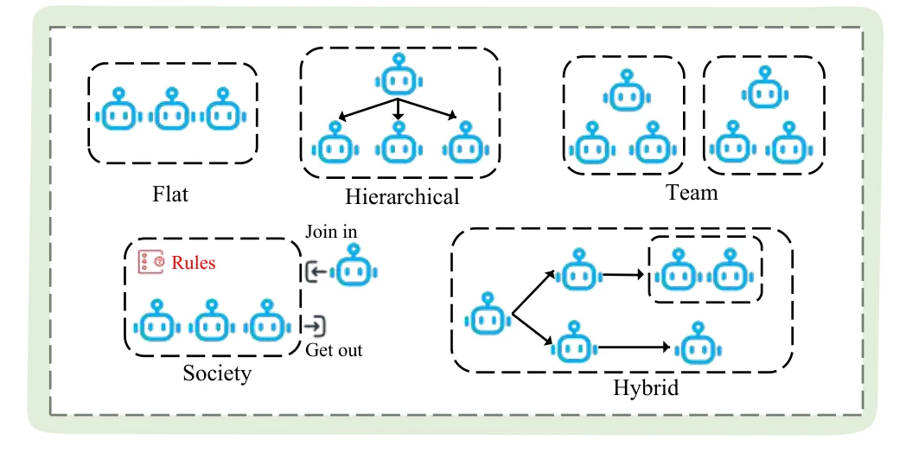
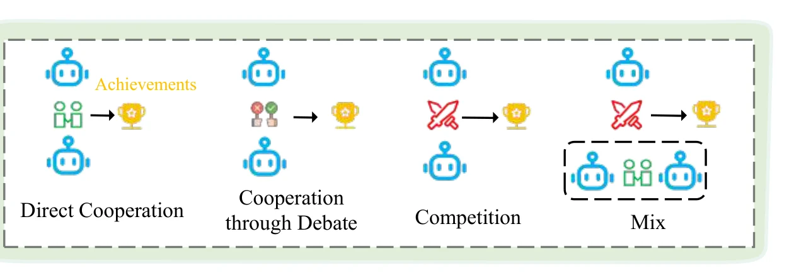
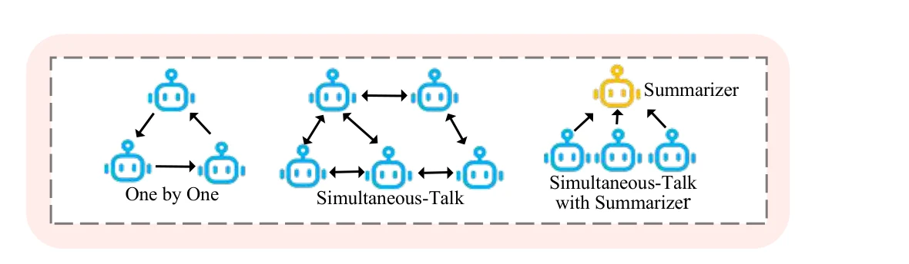
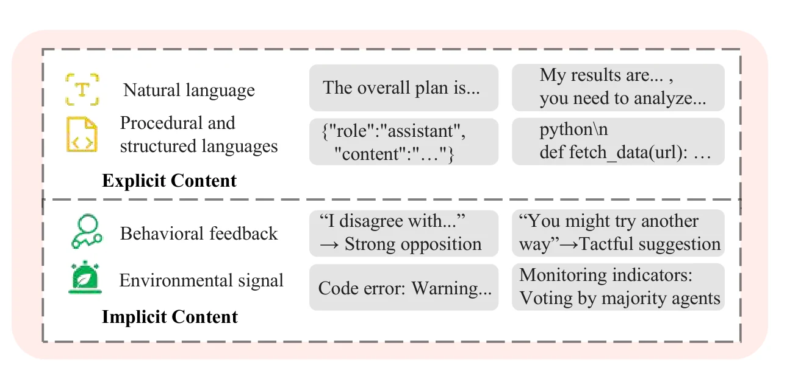

# A Survey of Multi-Agent Communication: Who Sends What to Whom, and When

Wiring several large language models (LLMs) together so that they talk to one another is no longer hard as engineering. What is hard is telling why the conversation helps. When a task succeeds, the gain may come from a larger reasoning budget, from a finer division of roles, or from one message that happened to steer a downstream agent in the right direction. Looking only at the final score, these three sources are mixed together and cannot be separated.

*Beyond Self-Talk: A Communication-Centric Survey of LLM-Based Multi-Agent Systems* approaches the problem from the side of communication. Its authors, Yan and colleagues at Beihang University and other institutions, note on the arXiv page that the article has been accepted by Frontiers of Computer Science. The survey's claim is this: existing multi-agent surveys are organized either by system architecture and agent modules or by application domain (social simulation, software engineering), and communication is usually mentioned only in passing. Yet in an LLM multi-agent system it is communication that decides whether one agent's judgment can become another agent's evidence. The survey therefore takes communication itself as the axis of classification and proposes a two-level framework: the system level looks at architecture, goals and protocols, and the within-system level looks at strategy, paradigm, objects and content, seven dimensions in all. [§1 Introduction](https://arxiv.org/html/2502.14321v3#S1) · [Paper identity and version](https://arxiv.org/abs/2502.14321v3)

The seven dimensions correspond to seven questions that can each be answered on their own: who can connect with whom, why they speak, and by what rules messages travel; when they speak, in what form, to whom, and with what content. Together they describe the information pathways of one collaboration, so they can all be applied to the same system at once without excluding one another. [Figure 1, PDF p. 2](https://arxiv.org/html/2502.14321v3#S1.F1)

This guide follows the survey's own chapter order: it first fills in the background, then takes the seven dimensions level by level, then turns to the authors' views on evaluation and challenges, and finally collects the dimensions into a checklist for reading new papers. To give the abstract dimensions something concrete to hold on to, the guide runs one invented three-role bug-fixing workflow through the whole text, called D-102 below. The roles, patch numbers, test results and timings are teaching settings made up for the guide; they are not experiments from the survey. The five original figures each appear in the section that discusses them. For each representative method the survey mentions, the guide explains what problem it addresses, how it works, how it differs from neighboring methods and what costs the authors or the original paper point out; descriptions of methods follow the survey, checked against each method's arXiv abstract.

The guide is pinned to arXiv v3 (26 May 2026). The numbers in the text have two kinds of source: some are the survey's counts of works, and others are counts the guide made directly from an original figure or table, which are marked as such. Abbreviations are underlined with a dotted line on first use; clicking one shows its full name and origin.

## Background: From one agent to communicating systems

Questions about communication only become concrete once it is clear who is speaking. The survey's second chapter lays this groundwork: it first looks at what a single LLM agent is made of, then at how traditional multi-agent systems communicated before large models, and finally at what LLM multi-agent systems inherit and what they change. [§2 Background](https://arxiv.org/html/2502.14321v3#S2)

In the survey, a single LLM agent has three parts: a brain, perception and action. The brain is an LLM with short-term and long-term memory; the former caches the current conversation, and the latter holds structured material accumulated across sessions. Methods such as retrieval-augmented generation (RAG) serve here to make memory more usable. Perception turns text, images, audio or environment state vectors into prompts the model can read. Action includes text replies, and also calls to external tools, APIs or real actuators. [§2.1 Single-agent structure](https://arxiv.org/html/2502.14321v3#S2.SS1)

Traditional multi-agent systems offered two toolkits. The symbolic line describes agents in terms of beliefs, desires and intentions, and uses agent communication languages to specify messages: machine-interpretable speech acts such as inform, request and propose, combined with protocol templates such as the contract net and auction-style negotiation. Its advantage is that commitments, goals and obligations can be reasoned about transparently. The cost lies in the vocabulary and the parser: they were designed for closed tasks and become rigid in open-domain conversation. The learning line replaces hand-written rules with optimization. Centralized training with decentralized execution (CTDE) uses a global critic to stabilize gradients, while at test time each agent acts independently. Independent Q-learning, policy gradients, value decomposition, counterfactual baselines and influence-based credit assignment all deal with the same problem: assigning credit and blame to the right agent when no one knows how the others will move. Graph-neural agents go further, passing compact latent-vector messages over a dynamic communication graph, which lets them scale to hundreds of cooperating robots. The shared cost of this line is that message formats are often custom-built for the task, sample requirements are large, and the messages are hard to interpret. [§2.2 Traditional multi-agent systems](https://arxiv.org/html/2502.14321v3#S2.SS2)

LLM multi-agent systems join these two lines: agents speak natural language to each other, and natural language is what humans already use to collaborate, so the boundary between "conversation" and "communication protocol" disappears. Agents can cooperate, compete or negotiate, depending on the system's goals and architectural choices. From this the survey gives a definition: an LLM multi-agent system is an automated system constrained by communication protocols, driven by communication goals and operating within a given communication architecture; its agents use various communication strategies and paradigms and exchange different content with different communication objects to complete tasks together. [§2.3 LLM-MAS](https://arxiv.org/html/2502.14321v3#S2.SS3)

The definition is worth a pause, because it sets the place of every later section. "Constrained by protocols" corresponds to the section on protocols, "driven by goals" to the section on goals, "a given architecture" to the section on architecture, and "strategies, paradigms, objects and content" are the four within-system dimensions. In other words, communication in this survey is a constituent condition of the system, not an implementation detail of one module; this also explains why the survey does not classify by application domain.

## Two levels and seven dimensions: The survey's map

The definition in the previous section listed seven components. This section looks at how they are organized into one picture and why the picture has two levels. Figure 1 is the skeleton of the whole survey and the page most worth looking at first. [§1 Introduction and Figure 1](https://arxiv.org/html/2502.14321v3#S1.F1)

The figure can be read from top to bottom. The top panel shows what "general surveys" care about: on the left a row of agents stands for system architecture, in the middle one agent carries four labels, Profile, Memory, Planning and Tools, for agent-level actions, and on the right are application scenarios (social science, natural science, engineering). The middle panel shows "domain surveys": on the left the simulation domains (physical, social, network), and on the right the software-engineering domain (code generation, testing, debugging). What the two panels share is that they treat the agent as the basic unit, with communication buried inside "architecture" or "workflow".

The bottom panel is where this survey sits. It is divided into two dashed boxes. The left one is labeled "system-level communication" and contains four elements, task, goal, protocol and architecture; the right one is labeled "within-system communication" and contains four labels, strategy, paradigm, object and content, pointing from a group of agents to a box. The seven lines of small print under the figure are the definitions of the seven dimensions, three on the left and four on the right.

Two details in the figure are easy to miss. First, the arrow between task and goal runs both ways, and the goal is connected through protocol and architecture to the group of agents on the right. When the task changes, the goal and the protocol change with it; no fixed workflow suits every task. Second, there is no arrow of precedence between the left and right boxes: the system level and the within-system level are two scales of observation. The same system can first be described at the former scale, "who can reach whom", and then at the latter, "how one interaction takes place". [Figure 1 and §1](https://arxiv.org/html/2502.14321v3#S1.F1)

The seven dimensions can be arranged into a table of questions:

| Level | Dimension | Question it answers | Location in the paper |
| --- | --- | --- | --- |
| System | Architecture | Who can connect with whom, and what organization the connections form | §3.1 |
| System | Goal | Why communicate: cooperation, competition or a mix | §3.2 |
| System | Protocol | In what format and by what rules messages flow | §3.3 |
| Within system | Strategy | When to speak, and in what order | §4.1 |
| Within system | Paradigm | What form a message takes and how it is understood | §4.2 |
| Within system | Object | Whom to address: oneself, other agents, the environment or humans | §4.3 |
| Within system | Content | What is conveyed: explicit statements or implicit signals | §4.4 |

After the second chapter, the paper's sections correspond one to one with this table: Chapter 3 covers 3.1 architecture, 3.2 goals and 3.3 protocols in turn; Chapter 4 covers 4.1 strategy, 4.2 paradigm, 4.3 objects and 4.4 content; and Chapter 5 covers challenges and opportunities. Figure 2 is a tree version of this structure, with a branch on the left for the Chapter 2 background, and it can serve as a table of contents when reading the original. [§2 Background](https://arxiv.org/html/2502.14321v3#S2)

The seven dimensions are descriptions that hold simultaneously, not seven alternatives. D-102 is a bug ticket in an invented repository: a date-parsing function accepts strings with an out-of-range month, such as 2024-13-01, as valid dates. A triager reads the ticket and locates the fault, a fixer changes the code, and a reviewer runs the tests; the three share one records board, and the test scripts and continuous-integration environment count as the environment outside the system. This setup can carry all seven labels at once. The three roles each write their status to the shared record, forming flat collaboration with a shared space; if a coordinator is added to hand out the work, the same messages become a hierarchy. The goal is cooperative, because all three are responsible for the same ticket. On protocol, the reviewer passes test results to the build script in agreed fields, and the script returns an exit code. On strategy, the reviewer's tests and the fixer's edits happen almost at the same time. On paradigm, there are both direct messages (the fixer sends the reviewer a note on the patch) and a blackboard (the shared record). Objects include other agents as well as the test environment and the colleague who reported the bug. Content includes written explanations and JSON status, and also the act of rerunning a test. All seven labels land on the same system without conflict.

This is both the use and the limit of the framework. It provides a common language, giving a stable way to answer "what did this system change"; it does not rank anything, and it does not promise that a system covering more dimensions is better. In the paper's Table 3, 12 works are tagged with two communication strategies at once, which shows that real systems often mix them; the job of a classification is to describe clearly what was mixed. [§4 Within-system communication](https://arxiv.org/html/2502.14321v3#S4)

## Architecture: Permitted connections

The first system-level dimension is architecture, which determines along which relations information can flow. The survey defines architecture as the structural organization of agents in the system. It constrains message flow and affects both macro-level system behavior and micro-level interaction quality: scalability, flexibility and running efficiency all depend on it. Task complexity, the degree of agent autonomy and the desired style of interaction usually decide together which architecture to choose. [§3.1 Communication architecture](https://arxiv.org/html/2502.14321v3#S3.SS1)

Figure 3 draws five kinds of architecture, each shown as a dashed box. [Figure 3, PDF p. 4](https://arxiv.org/html/2502.14321v3#S3.F3)

When reading the figure, first look at where the dashed boxes are drawn. Flat, hierarchical and society architectures each have a single box, which shows that they describe connections within one level of organization; team and hybrid architectures have several boxes, which shows that they are assembled from sub-units. The hierarchy and the team look alike, both "one on top, two or three below"; the difference is that a team treats a whole group as one unit, with a further layer of relations between groups. The Rules, join in and get out that appear in the society architecture mean that members can join or leave according to rules, an action absent from the other four diagrams.

A **flat architecture** has no levels and no central supervision; agents talk point to point. The survey's examples include using several agents to polish synthetic dialogue repeatedly, and having agents criticize each other's reasoning for fact-checking. The latter writes "you find my mistakes" into the workflow, so the criticism itself is the message. The cost appears with scale: the more agents there are, the more messages must be passed and filtered, and coordination becomes less efficient. [§3.1.1 Flat structure](https://arxiv.org/html/2502.14321v3#S3.SS1.SSS1)

A **hierarchical architecture** divides agents into layers or levels: upper levels handle strategy and supervision, and lower levels handle concrete execution. ChatDev is the survey's typical example. Designers, programmers and testers work under a top-level manager and complete software development through a structured workflow; ChatDev uses a "chat chain" to specify what to say and "communicative dehallucination" to specify how to say it, and it finds that natural language helps system design while programming language helps debugging. CausalGPT places high-level evaluators on the reasoning chain and uses them to guide the reasoning of lower-level agents, improving the consistency of outputs. The cost is that upper levels are easily overloaded, and communication delays between levels accumulate. [§3.1.2 Hierarchical structure](https://arxiv.org/html/2502.14321v3#S3.SS1.SSS2) · [ChatDev abstract](https://arxiv.org/abs/2307.07924)

A **team architecture** assigns agents to specialized groups, each responsible for one part of the task or one domain. MAGIS handles issues in GitHub repositories: a manager, a repository custodian, developers and a quality-assurance engineer divide the work, and it reports resolving 13.94% of issues on SWE-bench. POLCA uses specialized teams to simulate coalition negotiations between political parties and to predict whether coalitions will form. A team structure makes specialization concrete, and the cost moves to the boundaries between groups: cross-team messages need extra mechanisms for coordination, or the total overhead cancels out the benefit of dividing the work. [§3.1.3 Team structure](https://arxiv.org/html/2502.14321v3#S3.SS1.SSS3) · [MAGIS abstract](https://arxiv.org/abs/2403.17927)

A **society architecture** places interaction in an environment with shared norms or rules, in which many agents with different roles and motives act. Generative Agents lets 25 characters in a sandbox town form friendships, organize events and adjust their behavior based on past experience; EconAgent builds economic decisions such as consumption, investment and employment into agent behavior, simulating macro phenomena from micro actions. What the two works share is emergence: global patterns grow out of local interactions. The cost is that such systems are hard to manage, and the authors point out that the complexity and unpredictability of agent behavior in them is itself a design problem. [§3.1.4 Society structure](https://arxiv.org/html/2502.14321v3#S3.SS1.SSS4) · [Generative Agents abstract](https://arxiv.org/abs/2304.03442)

A **hybrid architecture** combines several structures. FixAgent handles debugging with a three-level structure that combines strategic supervision with decentralized execution; ChatSim, in an autonomous-driving setting, uses top-down control for scene rendering and peer-to-peer collaboration for asset integration; Tulip Agent lets agents discover tools dynamically as they work. The motivation for hybrids is straightforward: a pure hierarchy is too slow when parallel exploration is needed, and a pure flat structure is too chaotic when unified decisions are needed, so the division of labor is cut along the task. The cost is design complexity, and coordination overhead has to be deliberately kept down. [§3.1.5 Hybrid structure](https://arxiv.org/html/2502.14321v3#S3.SS1.SSS5) · [FixAgent abstract](https://arxiv.org/abs/2404.17153) · [ChatSim abstract](https://arxiv.org/abs/2402.05746)

The difference between architectures can be felt through an example that involves only counting. Suppose there are 6 agents, and in each round every pair of nodes that is "allowed to connect" exchanges one message in each direction. A flat structure allows any two to message each other, which gives 6×5=30 messages. A two-level structure, with 3 agents per group, a star within each group and the two leaders connected, gives 2×4=8 within groups plus 2 between the leaders, 10 in total. The numbers count permitted connections, not messages actually sent. The intuition they give is that message volume in a flat structure grows with the square of the number of agents, while a hierarchy compresses it to linear growth. This is exactly where the survey says flat structures scale poorly and hierarchies easily become bottlenecks: the saved messages have not disappeared; they are concentrated on the few edges at the top and across levels.

| Structure (6 agents) | Permitted connections | If each pair of neighbors sends one message each way |
| --- | --- | --- |
| Flat | Any two agents | 30 messages |
| Two-level (2 groups × 3, star within each group, leaders connected) | Within groups and between leaders | 10 messages |

Put this count back into D-102. If all three roles report directly to the other two, the reviewer's test results reach the fixer and the triager at the same time. If the triager relays everything, the test results the fixer receives carry one round of the triager's interpretation. The former costs two more messages; the latter adds one layer of retelling.

The paper's Table 1 lists 68 representative works by "architecture × goal". The guide counted the table row by row, and the distribution is as follows:

| Architecture | Cooperation | Competition | Mixed | Total | Examples in the table |
| --- | --- | --- | --- | --- | --- |
| Flat | 4 | 1 | 2 | 7 | Du et al.'s multi-agent debate, GAMA-Bench, GameChat |
| Hierarchical | 18 | 1 | 2 | 21 | ChatDev, CausalGPT, Chain-of-Agents |
| Team | 13 | 0 | 2 | 15 | MetaGPT, MAGIS, POLCA |
| Society | 4 | 0 | 4 | 8 | Generative Agents, EconAgent, EcoLANG |
| Hybrid | 10 | 2 | 5 | 17 | FixAgent, ChatSim, Agent4Debate |
| Total | 49 | 4 | 15 | 68 | — |

Two things can be read from the table. First, hierarchical and hybrid architectures account for 38 works, more than half, which shows that "someone coordinates and others execute" is currently the most common form of organization, and that purely flat structures are a minority in real tasks. Second, there are only 4 competitive works, and the team and society columns have no competitive entries. This does not mean research on competition is scarce (§3.2 discusses it separately); it shows that among the works this table collects, cooperative and mixed goals are more common. [Table 1, PDF p. 4](https://arxiv.org/html/2502.14321v3#S2.T1)

What the architecture level finally leaves us with is one insight: it specifies pathways, not content. The same sentence, "the test failed", is broadcast to everyone in a flat structure, goes first to the leader and is then passed down in a hierarchy, and may circulate only within one group in a team structure. To judge a system's communication, first separate the connections the diagram makes available from the edges actually used in one run.

## Goals: Why communicate?

After architecture comes the goal, which answers "why does each party send messages". The survey divides goals into cooperation, competition and mixed, and further divides cooperation into direct cooperation and cooperation reached through debate. [§3.2 Communication goals](https://arxiv.org/html/2502.14321v3#S3.SS2)

The four panels are laid out from left to right. Each has one agent above and one below, an icon and an arrow in the middle, and the same trophy at the end; the first panel is labeled "Achievements", indicating that the four panels describe four paths toward the task's result. The difference lies in the middle icon: direct cooperation is a handshake, cooperation through debate is two medals marked with a red cross and a green tick, competition is crossed swords, and the mixed panel adds a handshake inside a dashed box, showing that alliances form along the way. The order of the figure takes no position; placing the mixed panel last does not make it more advanced.

**Direct cooperation** is the most straightforward kind: agents openly share information and resources, complete the task together and aim to reach agreement quickly. The survey's examples show it used to strengthen LLM reasoning, for collaborative code generation and inside scientific experiment workflows. [§3.2.1 Cooperation](https://arxiv.org/html/2502.14321v3#S3.SS2.SSS1)

**Cooperation through debate** institutionalizes criticism: agents actively question each other's assumptions, reasoning and conclusions, and converge on a sturdier answer after several rounds of exchange. Du et al.'s multi-agent debate is representative. Several model instances first each give an answer and reasoning, then over several rounds read and revise each other's answers, and finally settle on a common answer. The original paper reports improvements on mathematical and strategic reasoning tasks, as well as better factuality, and stresses that the method can be applied directly to black-box models, using the same procedure and prompts for every task. What sets it apart from direct cooperation is default skepticism: direct cooperation takes the other party's message as input, while debate-style cooperation takes it as a claim to be tested. The survey lists factual reasoning and fact-checking as typical uses of this kind. [§3.2.1 Cooperation](https://arxiv.org/html/2502.14321v3#S3.SS2.SSS1) · [Multi-agent debate abstract](https://arxiv.org/abs/2305.14325)

The cost of debate-style cooperation lies in its mechanism too. Each round regenerates complete answers, so more rounds mean more calls; and if all instances share the same wrong premise, mutual confirmation can converge on the same wrong answer. The latter point is the guide's inference: several rounds of discussion raise the chance that an error is caught; they do not guarantee that it will be.

**Competition** arises when goals conflict, resources are limited or places in a ranking are limited. The survey uses GAMA-Bench to illustrate the game-playing ability of such systems: it covers eight classic game scenarios, uses dynamic scoring to adapt to different game parameters, and evaluates LLM decision-making in multi-party settings. Agent4Debate builds a framework for competing against human debaters, with four roles responsible for searching, analysis, writing and reviewing; its authors compare models and human debaters on 66 Chinese debate motions over 200 debates. One consequence of competition is that language changes: the survey mentions work that studies language evolution in adversarial simulations, and work in poetry generation where agents vie to write more creative text. The cost is stability and safety: adversarial or deceptive statements open up vulnerabilities, so competitive incentives need to be designed together with cooperative constraints. [§3.2.2 Competition](https://arxiv.org/html/2502.14321v3#S3.SS2.SSS2) · [GAMA-Bench abstract](https://arxiv.org/abs/2403.11807) · [Agent4Debate abstract](https://arxiv.org/abs/2408.04472)

**Mixed goals** let cooperation and competition coexist: parties form alliances at any time, contend for scarce resources and then cooperate again as the situation demands. The survey regards this as the form closest to real interaction, and its examples are concentrated in social simulation and negotiation, such as multi-agent simulation of political coalition negotiations, or agents that both trade and compete in an economic environment. The difficulty of mixed goals lies in mechanism design rather than modeling: what counts as fair, how protocols are standardized and who handles deception when it occurs all require coordination and monitoring. [§3.2.3 Mixed goals](https://arxiv.org/html/2502.14321v3#S3.SS2.SSS3) · [POLCA abstract](https://arxiv.org/abs/2402.11712)

The relation among the three kinds of goal can be summed up in one sentence: the goal decides "what counts as success" and also "whether to guard against the other party". The same form of statement can serve different goals. In D-102, when the reviewer raises a counterexample, the purpose is to get the whole system to the right fix, which makes it debate within cooperation. If the scenario were changed so that two teams competed for the same fix slot, the same counterexample might be read as an attempt to undercut the other team, and the meaning of the message would change with it. To judge the relation among goals, look at what each party is asked to optimize, not at the tone of the conversation.

## Protocols: How messages flow

Architecture decides who can connect and goals decide why to speak; protocols then decide how messages actually travel. In the survey's words, architecture governs "who can talk to whom", goals govern "why to talk", and protocols govern "how messages flow between agents and external systems". Standardized protocols make deployments portable and auditable and make it easier to add safety measures, so this section moves from workflows in papers to engineering interfaces. [§3.3 Communication protocols](https://arxiv.org/html/2502.14321v3#S3.SS3)

**MCP (Model Context Protocol)** addresses "how an agent uses external resources". It uses a JSON-RPC client–server structure and splits one call into four roles, host, client, server and resource: the host issues context requests based on the user's request, the client manages the connections to host and server and provides descriptions of resources, and the server deals with the resources directly. The benefit of this layering is that the fragmentation among different agents and different tool providers converges onto one interface. A further benefit is security: decoupling sensitive tool calls from the model's generated answers reduces the risk of data exposure. [§3.3.1 MCP](https://arxiv.org/html/2502.14321v3#S3.SS3.SSS1)

**A2A (Agent-to-Agent Protocol)** addresses "how agents delegate to each other". It uses an "agent card" to describe what an agent can do, and the card is distributed over HTTP and server-sent events. Agents communicate directly point to point, with no centralized relay in between, so latency is low. Asynchronous messaging lets capability discovery and task outsourcing run at enterprise scale. The design centers on capability matching: first learn what the other party can do, then decide which part of the task to hand over. [§3.3.2 A2A](https://arxiv.org/html/2502.14321v3#S3.SS3.SSS2)

**ANP (Agent Network Protocol)** addresses "how to find and trust unfamiliar agents in an open network". It is built on decentralized identifiers (DIDs) and JSON-LD graphs: agents use DIDs to discover each other and verify identity, organize messages in JSON-LD for semantic clarity, and protect integrity with encrypted channels. Its target is cross-organization collaboration, so it puts identity and encryption at the core of the protocol. [§3.3.3 ANP](https://arxiv.org/html/2502.14321v3#S3.SS3.SSS3)

Figure 5 draws the three protocols side by side. The upper half is MCP's call chain: an agent accesses two MCP servers through an MCP client, and the servers in turn reach data sources or APIs. The lower left is A2A's conversation and tasks: agent cards, task states, push notifications and artifacts. The lower right is ANP's three-layer structure, which from bottom to top is the identity and encrypted-communication layer (identity, E2E, W3C DID), the meta-protocol layer (protocol negotiation, debugging, testing) and the application-protocol layer (standard, consensus and personalized protocols, along with agent descriptions and the APP protocol specification). The figure's lesson for readers is that the three protocols sit at different levels: MCP mainly handles access to resources, A2A mainly handles task delegation, and ANP mainly handles identity and open discovery. [Figure 5, PDF p. 6](https://arxiv.org/html/2502.14321v3#S3.F5)

The paper's Table 2 compares the protocols on seven aspects: topology, discovery, format, security, strengths, limitations and use cases. The guide excerpts the first four rows and the strengths row, because these are technical differences that can be checked:

| Aspect | MCP | A2A | ANP |
| --- | --- | --- | --- |
| Topology | JSON-RPC client–server channel | Peer-to-peer client ↔ remote agent | Decentralized P2P agent network |
| Discovery | Static endpoints or manual registration | Signed agent cards retrieved over HTTP | Search-index crawling plus DID document exchange |
| Format | Typed JSON-RPC 2.0 messages | Task and artifact packages | JSON-LD and meta-protocol negotiation |
| Security | Bearer tokens, optional DID claims, RBAC | OAuth 2 / enterprise IAM, mutual TLS | DID handshake, end-to-end encryption |
| Strengths | Smooth tool calls, low start-up cost | Rich task delegation, vendor ecosystem | Identity without a center, no single point of control |

The "limitations" row is left out of the table because its printed contents are inconsistent. The MCP column describes dependence on centralized services and security risks, but the A2A and ANP columns describe usage scenarios such as cross-team workflows and decentralized logistics, which repeat the use-case row below. This is an editorial problem in the original table. The guide treats only the MCP column as a limitation; the costs of the other two can be inferred from their designs. A2A hands authentication to enterprise identity systems, so cross-organization collaboration requires separate negotiation; ANP builds identity and encryption into the protocol, which adds work on discovery and governance. [Table 2, PDF p. 7](https://arxiv.org/html/2502.14321v3#S3.T2)

Besides these three, the survey notes that protocols such as ACP, AITP and AConP are also emerging, and points out that their coexistence itself causes problems: overlapping functions, lack of interoperability and rising management costs. [§5.3 Unified protocols](https://arxiv.org/html/2502.14321v3#S5.SS3)

The easiest mistake in reading this section is to take "the message conforms to the format" for "the collaboration is correct". A protocol guarantees that fields can be parsed, identities verified and encryption applied; whether the claims inside a message are true, or apply to the current version, lies outside its reach. Back in D-102: the reviewer hands the fixer a signed artifact package through A2A, and both format and identity check out. Yet if the test record in the package comes from an old version, the fixer still receives outdated evidence. Interface interoperability and semantic correctness have to be checked separately.

## Strategy: Who speaks when?

The first within-system dimension is strategy, which governs timing: when agents speak and in what order. The survey groups common practice into three kinds: one at a time, simultaneously, and simultaneously with a summarizer. [§4.1 Communication strategy](https://arxiv.org/html/2502.14321v3#S4.SS1)

The three panels of Figure 6 can be read by the direction of their arrows. In the left panel the arrows run head to tail around a loop, meaning that speaking follows a fixed rotation and later speakers can see everything earlier speakers said. The middle panel has no rotation: four agents are connected pairwise with a two-headed arrow on every edge, meaning that anyone can read and write at any time. The right panel adds a yellow node labeled Summarizer, to which each of three blue agents hands its message; after the concurrent round, the results are gathered first and then passed downstream.

**One at a time** has each agent read all earlier messages in full before speaking. The survey's example is Chain-of-Agents. Faced with long texts that exceed the context length, it has several worker agents process segments in turn, with each summarizing the previous contributions before submitting its own conclusion, and a manager agent combining everything at the end. The original paper starts precisely from the fact that both common remedies for long contexts have weaknesses: retrieval augmentation may miss key passages, and extending the window easily loses focus in large amounts of material. Letting each agent see only a small segment allows "reading everything" and "reading accurately" to be handled separately. [§4.1.1 One at a time](https://arxiv.org/html/2502.14321v3#S4.SS1.SSS1) · [Chain-of-Agents abstract](https://arxiv.org/abs/2406.02818)

The survey is direct about the two costs of sequential speaking. Waiting time grows linearly with the number of turns, because each agent has to wait for all earlier ones to finish; and errors introduced by earlier agents are amplified along the chain, producing semantic drift. The second point is easy to reproduce in D-102. If the triager wrongly decides that "the problem is a month offset", the fixer will make changes on that assumption, and the patch the reviewer receives already carries the error. The longer the chain, the less chance anyone in the middle has to go back to the original log.

**Simultaneous speaking** allows concurrency, with no waiting for turns. The survey cites AutoAgents and EconAgent: the former produces ideas or solution paths concurrently to lay out possibilities quickly, and the latter has large numbers of agents take part in a macro simulation at the same time. The gains are speed and diversity, and there are two costs. One is stale state: without fine-grained synchronization, an agent may reason from someone else's statement that is already out of date. The other is unresolved conflict: parallel proposals often overlap or contradict each other and need an extra layer of arbitration. The survey therefore stresses the role of timestamps and lightweight consensus mechanisms in this strategy. [§4.1.2 Simultaneous speaking](https://arxiv.org/html/2502.14321v3#S4.SS1.SSS2) · [AutoAgents abstract](https://arxiv.org/abs/2309.17288)

**Simultaneous speaking with a summarizer** adds a summarizing node after the concurrent round: it periodically combines the inputs of several agents into one concise, unified message and passes it to later stages. The survey cites CausalGPT and AgentCoord as hierarchical or team settings that use a summarizer. This design eases the synchronization problem but brings back part of the sequential dependence, because the downstream still has to wait for the summary. A further risk lies in the summarizer itself: it must understand and condense accurately, or misreadings and hallucinations spread through the summary to the whole system. [§4.1.3 With a summarizer](https://arxiv.org/html/2502.14321v3#S4.SS1.SSS3) · [CausalGPT abstract](https://arxiv.org/abs/2308.11914) · [AgentCoord abstract](https://arxiv.org/abs/2404.11943)

The differences between the three strategies can be worked through on the D-102 timeline. Suppose each of the three roles needs 40 seconds to produce one round of reply, and the summarizer needs another 30 seconds. One at a time takes 40×3=120 seconds, and by the start of the second round everyone has seen all of the first round. Simultaneous speaking takes only 40 seconds for the first round, but the fixer may start changing code before the reviewer's test results have been written to the shared record. The version with a summarizer takes 40+30=70 seconds; the cost is that everyone downstream waits during those 30 seconds, and the summarizer decides which content is kept.

| Strategy | First-round time | Evidence the fixer sees | Main risk |
| --- | --- | --- | --- |
| One at a time | 120 seconds | The triager's diagnosis and the reviewer's previous conclusion | An error in an earlier step is amplified along the chain |
| Simultaneous | 40 seconds | Possibly only the triager's diagnosis | Reading an old version; conflicting proposals |
| Simultaneous + summarizer | 70 seconds | The summarized record | The summary drops dissent, or states a guess as a conclusion |

The timings in the table are teaching settings meant to show where the waiting comes from. The causal relation to take away is this: concurrency saves waiting time at the price that "each agent may see a different version of the world"; summarizing saves downstream reading at the price that "one agent decides what counts as important".

The survey's Table 3 gives the actual distribution along this dimension. Counting its 68 rows, the guide finds 28 works tagged one at a time, 22 simultaneous and 30 with a summarizer; 17, 13 and 26 of them, respectively, carry only that one strategy, and the remaining 12 carry two. With a summarizer is the most common single strategy, which agrees with Table 1, where hierarchical and hybrid structures are the majority: once a system has a coordinating role, summarizing appears naturally. [Table 3, PDF p. 8](https://arxiv.org/html/2502.14321v3#S4.T3)

## Paradigm: What form does a message take?

Once strategy has set the order in time, one question remains: what is a single utterance inside the system? The survey divides the answer into three paradigms: message passing, speech acts and the blackboard. [§4.2 Communication paradigm](https://arxiv.org/html/2502.14321v3#S4.SS2)

**Message passing** is the most intuitive: content is explicitly sent to one recipient or a group of recipients, and the message usually carries context and traces of reasoning along with information. The survey's examples include using a network of agents to simulate opinion dynamics, where agents keep updating each other's views through direct messages and quickly reach consensus, and GameChat, where several LLM agents negotiate navigation through dialogue in a constrained environment. GameChat's reported results give a figure: in simulated doorway and intersection scenarios, even in the worst case, the total time for all agents to reach their goals falls by more than 35%. The mechanism is that the parties resolve, in natural language, the deadlocks caused by spatial symmetry. The cost lies in message handling: mechanisms are needed to cope with message volume and ensure consistency. [§4.2.1 Message passing](https://arxiv.org/html/2502.14321v3#S4.SS2.SSS1) · [GameChat abstract](https://arxiv.org/abs/2503.12333)

**Speech acts** come from an older observation: speaking is also doing. An utterance can be an instruction, a commitment or a declaration, and the receiver changes its state accordingly. The survey places diplomatic negotiation, debate-style reasoning and collaborative software engineering in this category, because their messages embed directive, commissive or persuasive elements through which agents negotiate task allocation, align beliefs and coordinate commitments over time. The cost is that "illocutionary force" can be mislabeled. If it is unclear whether a sentence is a request or an order, or if the receiver understands the preconditions differently from the sender, the result is what the survey calls an illocutionary misfire: the other party performs an action no one asked for, or acts when the preconditions do not hold, leading to deadlocks and cascading errors. [§4.2.2 Speech acts](https://arxiv.org/html/2502.14321v3#S4.SS2.SSS2)

A **blackboard** replaces point-to-point sending with a centralized shared space: agents post to it, read from it and update it, and the space serves as a common workspace. MetaGPT is the survey's typical example. It writes standard operating procedures into a sequence of prompts and has agents in different roles post status, code and issue resolutions in one communication repository. MDTeamGPT uses a shared information space in medical consultations, so that the medical team continuously sees the same patient information, diagnostic suggestions and treatment plans. The cost is concentrated at the shared point: it can become a bottleneck, it needs permission management, and it must be protected against wrong or malicious content contaminating the record everyone sees. [§4.2.3 Blackboard](https://arxiv.org/html/2502.14321v3#S4.SS2.SSS3) · [MetaGPT abstract](https://arxiv.org/abs/2308.00352) · [MDTeamGPT abstract](https://arxiv.org/abs/2503.13856)

The three paradigms can be contrasted this way: message passing cares about "whom it is sent to", speech acts care about "what this sentence asks the other party to do", and a blackboard cares about "who can see what in the public record". The same matter is written differently under each. In D-102, when the reviewer finds a new failing case, they can send it privately to the fixer (message passing), send the sentence "please rerun, fix it, then resubmit" (a request, as a speech act), or simply append a line to the shared record, "D-102 retest failed, case 2024-13-01" (blackboard). The three versions demand different things of the receiver: the first requires the other party to be online, the second requires them to understand the scope of the request correctly, and the third requires them to come back and read.

## Objects: Whom do agents communicate with?

After paradigm comes the object, that is, the receiver of the message. The survey distinguishes four kinds: oneself, other agents, the environment and humans. [§4.3 Communication objects](https://arxiv.org/html/2502.14321v3#S4.SS3)

**Oneself** refers to an agent's inner monologue and reflection: weighing first, then deciding. The survey cites AgentCoord, in which agents repeatedly evaluate and adjust their collaboration strategy through introspection, and FixAgent, which evaluates its strategy before acting during debugging and thereby saves resources. This kind of "communication" looks like talking to oneself; its value is that it externalizes the reasoning process so the next step can use it. The cost is that it needs a stable enough cognitive framework, or self-evaluation turns into self-confirmation. [§4.3.1 Oneself](https://arxiv.org/html/2502.14321v3#S4.SS3.SSS1)

**Other agents** is the most common kind, covering information exchange, task coordination and negotiation. The survey cites MAGIS, in which developers, testers and administrators frequently exchange task messages during software development, and AgentFM, in which several agents collaborate in a structured way on database fault management. Nearly every LLM-MAS has this layer, so the real differences come from protocols, synchronization and conflict handling; not merely whether agents talk to each other at all. [§4.3.2 Other agents](https://arxiv.org/html/2502.14321v3#S4.SS3.SSS2)

**The environment** refers to an agent perceiving external stimuli and adjusting its behavior accordingly. It differs from the first two kinds: the input is a raw sensor stream, images, audio, proprioception or simulator state, and it has to be turned into usable knowledge. The survey cites EmbodiedGPT, which uses multimodal perception to handle visual and auditory input and acts in dynamic environments, and ChatSim, which brings environmental feedback into agent interaction in autonomous-driving simulation so that behavior is corrected as conditions change in real time. The cost lies in the perception pipeline: it needs low-latency sensor fusion, it has to keep language reasoning grounded in non-linguistic data, and it must guard against the risks of perception errors and out-of-distribution input. [§4.3.3 Environment](https://arxiv.org/html/2502.14321v3#S4.SS3.SSS3) · [EmbodiedGPT abstract](https://arxiv.org/abs/2305.15021)

**Humans** refers to agents interacting directly with human users or participants. The survey cites PeerGPT, in which agents act as moderators or peers in children's collaborative learning and have to understand both the children's language and their actions, and MedAgents, in which several agents work with medical professionals to support diagnosis, treatment planning and care coordination. This kind has to handle three things: linguistic differences across groups of people, the emotional and social signals needed to sustain a relationship, and strict requirements on privacy, bias and accountability. [§4.3.4 Humans](https://arxiv.org/html/2502.14321v3#S4.SS3.SSS4) · [PeerGPT abstract](https://arxiv.org/abs/2403.14227) · [MedAgents abstract](https://arxiv.org/abs/2311.10537)

The object dimension decides "where information comes from and who is responsible for verifying it". In D-102, the fixer reads their own reflection (oneself), the triager's diagnosis (another agent), the test script's output (the environment) and a colleague's added note on the ticket (a human). These four sources differ in reliability and in how often they update: the test script gives a new result on every run, the colleague's note may arrive once a day, and introspection produces no new evidence at all. A system that takes only the first two kinds as input will miss the signals from the environment and from people.

## Content: What is conveyed?

The last within-system dimension is content, which asks what a message actually contains. The survey divides content into two broad classes, explicit and implicit, each with two forms. [§4.4 Communication content](https://arxiv.org/html/2502.14321v3#S4.SS4)

**Explicit content** has a clear literal meaning and can be read directly. Natural language is the most flexible branch: the characters in Generative Agents negotiate, plan and resolve conflicts in language, and AgentCoord uses language to explain strategic decisions. Code and structured data are the more precise branch: MAGIS exchanges structured code and data among software agents to track issues and code changes, and AutoData uses structured data to collect data from the open web. The cost of explicit content is parsing: natural language requires the receiver to handle ambiguity, and structured data requires both sides to follow the same format strictly. [§4.4.1 Explicit content](https://arxiv.org/html/2502.14321v3#S4.SS4.SSS1) · [AutoData abstract](https://arxiv.org/abs/2505.15859)

**Implicit content** is not written out and has to be inferred. Behavioral feedback reads intent from actions: in a diplomacy simulation such as Richelieu, an agent's negotiating position is conveyed indirectly through behavior; in research on the spread of manipulated knowledge, agents adjust their strategies as their peers' behavior changes, in effect telling the others "I have changed" through what they do. Environmental signals read state from the situation: ChatSim treats real-time traffic and weather as implicit input to guide navigation, and EcoLANG has agents adjust consumption and investment based on economic indicators and environmental changes. The cost of implicit content is interpretation: misreading behavior leads to misjudging intent, and over-reading turns noise into signal. [§4.4.2 Implicit content](https://arxiv.org/html/2502.14321v3#S4.SS4.SSS2) · [Flooding abstract](https://arxiv.org/abs/2407.07791) · [EcoLANG abstract](https://arxiv.org/abs/2505.06904)

The differences among the four forms on one matter can be seen through the D-102 failing case:

| Form | What it looks like in D-102 | What the receiver must do | Common failure |
| --- | --- | --- | --- |
| Natural language | "Case 2024-13-01 still fails; the problem is in the month check." | Understand and adopt it | Vague wording, taken as a suggestion rather than a conclusion |
| Code and structured data | `{"case": "2024-13-01", "passed": false}` | Parse the agreed fields | Correct fields with wrong values, or an outdated version |
| Behavioral feedback | Instead of saying they disagree, the reviewer reruns the tests and submits a new patch | Infer the attitude from the action | Reading "started a new version" as "agreed" |
| Environmental signal | Timestamps and failure counts in the continuous-integration log | Monitor and interpret | Taking an old log for the current state |

The content level leaves one final judgment. The distinction between explicit and implicit content is not about reliability but about who does the interpreting. A written sentence requires the receiver to understand its meaning, and an unwritten signal requires the receiver to infer intent; both can be misread, and the misreading simply happens in a different place. The survey mentions these risks in the corresponding subsections, and the guide gathers them here once.

## Evaluation: What lies beyond scores?

With the seven dimensions covered, what remains is how to judge whether a communication design is good. In §5.6 the survey criticizes current evaluation practice directly, and this section reads that criticism together with the statistics in Table 3. [§5.6 Benchmarks and evaluation](https://arxiv.org/html/2502.14321v3#S5.SS6)

The year column of Table 3 shows how fast the field is moving: of the 68 works, 11 are from 2023, 33 from 2024 and 24 from the first five months of 2025. From this the survey argues that the building of evaluation suites lags behind the spread of systems. It names two existing resources. MultiAgentBench covers several interactive scenarios, measures task completion and collaboration quality with milestone-based key indicators, and compares coordination protocols such as star, chain, tree and graph. RealWorldBench covers real-world planning and scheduling tasks. One point needs checking here: the survey writes RealWorldBench, but the work it cites as [102] is titled Realm-Bench. It contains 14 planning and scheduling problems that can be scaled along three directions: the number of parallel planning threads, dependency complexity and the frequency of unexpected disruptions. [Table 3, PDF p. 8](https://arxiv.org/html/2502.14321v3#S4.T3) · [MultiAgentBench abstract](https://arxiv.org/abs/2503.01935) · [Realm-Bench abstract](https://arxiv.org/abs/2502.18836)

The survey's criticism of existing leaderboards centers on their being "agent-centric": they usually report each agent's task accuracy or reward and rarely report system-level properties, such as coordination efficiency, communication bandwidth and latency, robustness to stale or deceptive messages, and fairness and safety at the level of the group. Without these dimensions, evaluation cannot tell apart two kinds of system: one that merely bolts several strong single agents together, and one that genuinely produces abilities only collaboration can produce. The authors therefore argue that the next generation of benchmarks should cover cooperative, competitive and mixed motives, with a multi-granularity set of metrics running from individual ability to collective utility. [§5.6 Benchmarks and evaluation](https://arxiv.org/html/2502.14321v3#S5.SS6)

This argument can be applied directly to D-102. Imagine two versions of the system that both fix the bug: version A uses 3 calls, 12 messages and 40 seconds, and version B uses 9 calls, 40 messages and 150 seconds. Looking only at success rate, the two are identical, and this is exactly where the quality of the communication design shows. Telling them apart takes at least three kinds of record: outcome (whether the bug was fixed and the regression tests pass), cost (number of calls, number of messages, total time) and process (which message changed which decision, and whether the failing case, once passed from reviewer to fixer, triggered the right change). The third kind is the easiest to overlook and the most telling about whether communication did any work.

To be clear, these three kinds of record are the guide's own arrangement. The survey proposes only the direction "from individual ability to collective utility" and gives no specific metrics, and the call and message counts above are also teaching settings with no corresponding experiment. Turning the direction into metrics is still an open problem in its own right, which is why the survey lists it among the challenges.

The evaluation section leaves a plain insight. A multi-agent system "performing well" can be bought with more budget, earned with better division of labor, or produced by one key message. To tell which, record outcome, cost and process together; of the three, only process requires actually reading the messages.

## Five challenges and open questions

Chapter 5 of the survey lists six directions. Evaluation was discussed in the previous section; this section looks at the other five. All of them are the authors' judgments in the pinned version and are best used as starting points for searching, not as proof that the problems remain unsolved today. [§5 Challenges and opportunities](https://arxiv.org/html/2502.14321v3#S5)

**Optimizing system design.** The authors consider architecture the foundation: as tasks grow more complex, traditional architectures will fall short, and hybrid architectures will become the focus. Three related problems follow. With more agents, communication paradigms need to be both efficient and scalable; computing power needs to be reallocated; and as the volume of information inside the system rises, agents still have to understand it correctly, with fewer hallucinations and misunderstandings. [§5.1 System design](https://arxiv.org/html/2502.14321v3#S5.SS1)

**Advancing research on competition.** Competition can draw out more sophisticated strategies, and game theory offers ready-made tools; the difficulty is balance, since excessive competition leads to inefficiency and instability. The directions the authors propose are finding the best point between competition and cooperation, designing scalable competitive strategies, and studying how to bring competition safely into real applications. [§5.2 Research on competition](https://arxiv.org/html/2502.14321v3#S5.SS2)

**Unified protocols.** MCP, A2A, ANP, ACP, AITP and AConP have appeared at the same time, raising two problems: overlapping functions create complexity and waste, and the protocols do not interoperate, so two groups of agents using different protocols cannot collaborate. Drawing an analogy with the early internet, the authors argue that a consensus standard like HTTPS will eventually be needed. The analogy shows both the direction and the difficulty: a standard forms through negotiation; it is not the natural outcome of technical merit. [§5.3 Unified protocols](https://arxiv.org/html/2502.14321v3#S5.SS3)

**Multimodal communication.** The authors expect communication between agents to expand from text to images, audio and video. The questions are how to organize different modalities in a way all agents can understand, and how to let agents both process and relay these modalities. The direction is the fusion of multimodal data and the strengthening of the corresponding components. [§5.4 Multimodality](https://arxiv.org/html/2502.14321v3#S5.SS4)

**Communication security.** Research cited by the survey shows that man-in-the-middle, data-tampering and impersonation attacks can all be carried out between agents, and that the damage cascades quickly through the system. The authors argue for bringing defenses originally aimed at single models into the communication layer, and, for dynamic topologies where members can join and leave at any time, for combining end-to-end encryption, fine-grained authentication, adaptive key management and provenance tracking. These needs are especially urgent in cooperative driving and clinical decision support, where a brief corruption of a message can have real-world consequences. [§5.5 Communication security](https://arxiv.org/html/2502.14321v3#S5.SS5)

Set against the seven dimensions, the five directions fall on different levels: system design, competition and multimodality mainly involve architecture, goals and content; unified protocols and security mainly involve protocols; and evaluation spans them all. This also explains why the authors put these issues at the end instead of folding each into one section: what they share is that no accepted solution exists yet, not that they belong to one particular dimension.

## Placing a new paper in the framework

Having read through the seven dimensions, the most useful thing to do is to use them to locate new papers. This section turns the dimensions into a table of questions, adds a table for working backward from symptoms, and finally demonstrates three placements using the survey's own labels.

| Dimension | First question to ask of a paper | Where in the paper it usually appears |
| --- | --- | --- |
| Architecture | Who can communicate with whom, and is there a coordinating layer? | System diagram, role table, example trajectories |
| Goal | What is each party asked to optimize, and do they share the result? | Task definition, reward or evaluation method |
| Protocol | In what format and through what interface do messages flow? | Interface description, tool definitions, implementation details |
| Strategy | Do agents speak in turn, concurrently, or through a summary first? | Timing diagrams, pseudocode, turn settings |
| Paradigm | Is a message sent to a recipient, treated as an action, or placed in a shared space? | Message structure, how state is updated |
| Object | Does input come from oneself, peers, the environment or humans? | Input list, sensor or interface description |
| Content | Are written statements conveyed, or behavior and environmental signals? | Message examples, logs, observation items |

If what you have in hand is a system that is misbehaving, you can also work backward from the symptom to the dimension:

| Symptom | Dimension to check first | What to look for |
| --- | --- | --- |
| The task gets done, but the cost is out of all proportion | Architecture, strategy | Whether messages grow with the square of the number of agents; whether some sequential steps could run in parallel |
| Two agents repeatedly confirm the same thing to each other | Goal, strategy | Whether debate has become the default workflow; whether there is a stopping condition |
| The conclusion is right, but the reasoning came from a different, wrong path | Content, object | Whether the key judgment rests on an explicit statement or on inferred behavior; whether anyone went back to the original record |
| Swapping in another model or adding a tool breaks the whole system | Protocol, content | Whether the interface depends on an implicit format; whether structured fields are tied to one particular run |
| The summary report is clean, but the problem is not solved | Strategy | Which original evidence the summarizer dropped; whether the downstream can get back to the original messages |

The three placements can be practiced directly with the labels in the survey's Table 3. ChatDev is tagged one at a time, message passing plus speech acts, with other agents as objects and both explicit and implicit content. MetaGPT is tagged with a summarizer, blackboard, objects including the environment, and explicit content. GameChat is tagged with a summarizer, speech acts, objects that are itself and other agents, and explicit content. Of the three systems, the first two do software development and the third does navigation, yet their communication structures differ greatly: ChatDev advances through stages by ordered dialogue, MetaGPT maintains consistency through a shared repository, and GameChat reaches agreement at the point of conflict through speech acts. With the labels in mind, attention falls on the right places when reading the method sections. [Table 3, PDF p. 8](https://arxiv.org/html/2502.14321v3#S4.T3)

**Where next.** To build up the picture of what a single agent is made of first, read the library's [agent survey guide](/read/agent-survey/3#architecture), which uses four modules to explain role, memory, planning and action. To go further into collaboration mechanisms, read the [multi-agent collaboration survey guide](/read/multi-agent-collaboration-survey/1#u05), which discusses rules, roles and orchestration together. The strength of the present guide is the detail on the communication side; those two guides fill in, respectively, the composition of a single agent and the mechanisms of collaboration. The order is an editorial suggestion, not a prerequisite established by the authors.

## Original source and coverage

When reading the original, start with the overall framework in Figure 1 (PDF p. 2), the five architectures in Figure 3 (p. 4) and the four goal relations in Figure 4 (p. 5), then the three strategies in Figure 6 (p. 7) and the content classification in Figure 9 (p. 11). Table 1 (p. 4) lists 68 works by architecture and goal, and Table 3 (p. 8) tags each work with the four within-system dimensions and its date. Table 2 (p. 7) is worth consulting when protocols need to be compared. Page numbers count from the first page of the PDF. [Pinned PDF](https://arxiv.org/pdf/2502.14321v3) · [Page with Figure 1](https://arxiv.org/pdf/2502.14321v3#page=2) · [Page with Figure 3 and Table 1](https://arxiv.org/pdf/2502.14321v3#page=4) · [Page with Figure 6 and Table 2](https://arxiv.org/pdf/2502.14321v3#page=7) · [Page with Table 3](https://arxiv.org/pdf/2502.14321v3#page=8) · [Page with Figure 9](https://arxiv.org/pdf/2502.14321v3#page=11)

This guide is based on a full reading of the main text, §1–§6, of the pinned arXiv v3 (26 May 2026), with the reference pages used to check citation numbers. Figures 1, 3, 4, 6 and 9 were cropped from the pinned PDF and inspected by eye; for Tables 1, 2 and 3, only the rows and columns relevant to the argument are excerpted, and counts such as "68 works" and "28/22/30" were obtained by counting the original tables row by row. Descriptions of representative methods follow the survey, checked against each method's arXiv abstract; the guide did not read each cited paper closely, reproduced no experiments and did not verify any protocol implementation.

A few points in the original deserve the reader's attention. The Limitations row of Table 2 is inconsistent: the MCP column is a genuine limitation, while the A2A and ANP columns print usage scenarios that repeat the Use Cases row. The RealWorldBench mentioned in §5.6 corresponds to reference [102], whose original title is Realm-Bench. The work the survey calls FixAgent has the arXiv title UniDebugger. One paradigm entry in Table 3 reads "MP. SA", which from context should be understood as using both paradigms at once. These points are all recorded in the review notes, and the main text mentions them only where necessary.

The coverage is the communication storyline, not an audit of the whole survey. The 100-plus cited works are cited only by the survey's own classification; application domains (social simulation, software engineering, medicine and others) appear only as examples; and multimodality and security are treated only as summarized by the authors in §5. The roles, patches, test results, timings and message counts in D-102 are teaching settings invented for the guide to illustrate information dependence, with no corresponding experiment. MAGIS's 13.94% and GameChat's 35% come from the abstracts of their own papers, not from experiments in the survey. The original figures are distributed under arXiv's default non-exclusive license, which grants no right of redistribution; they are cited only for personal academic reading in a private repository. Reading this guide does not automatically mark the original as read.
