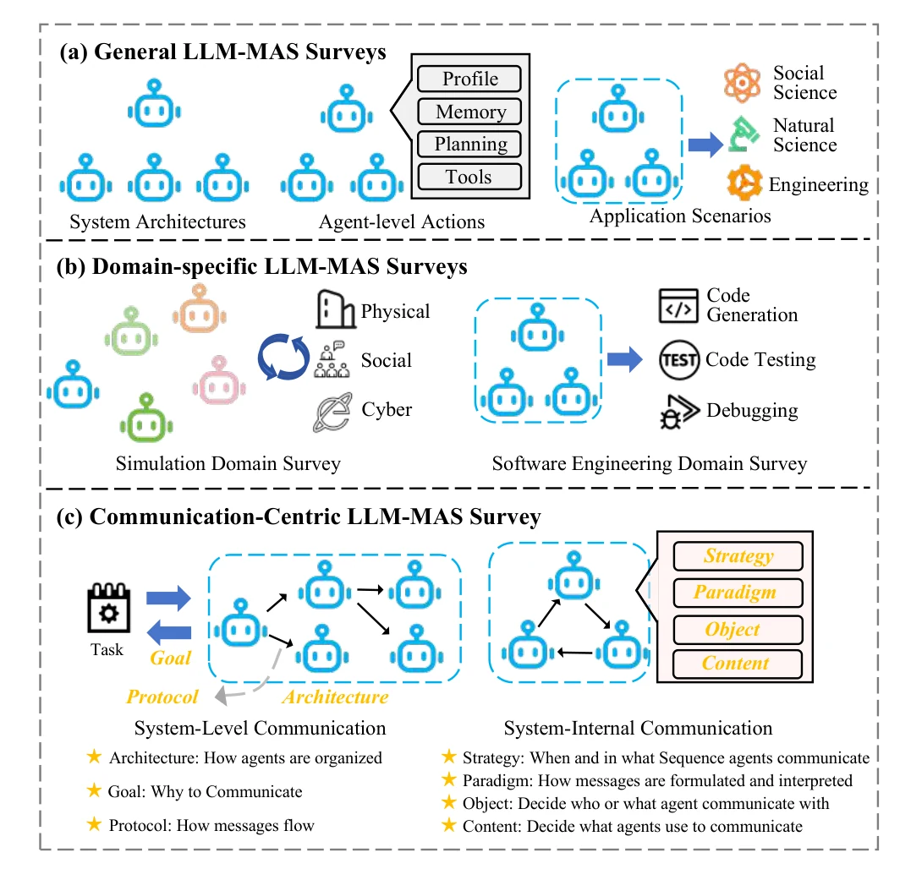
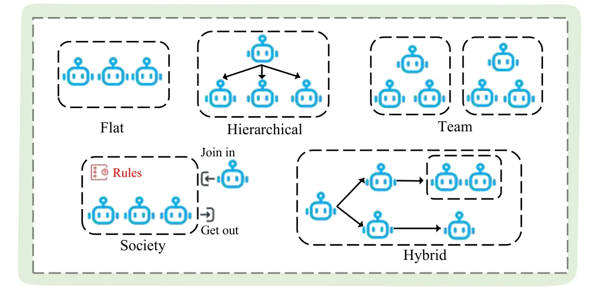
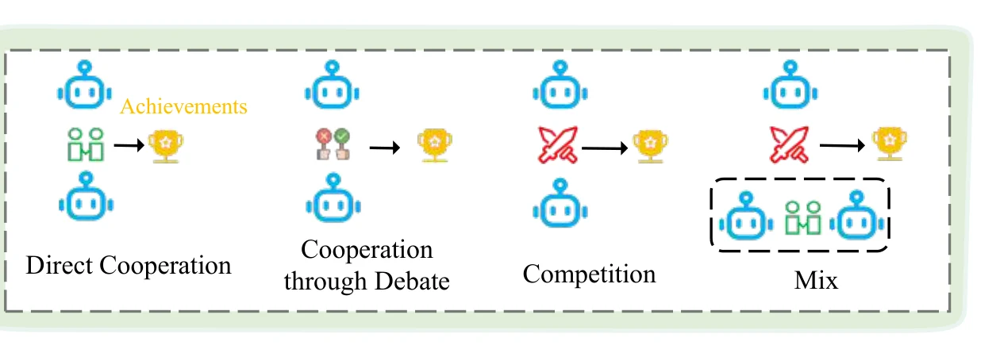
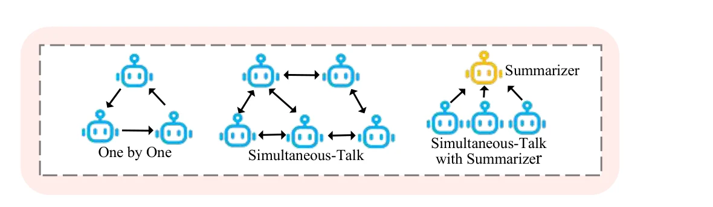
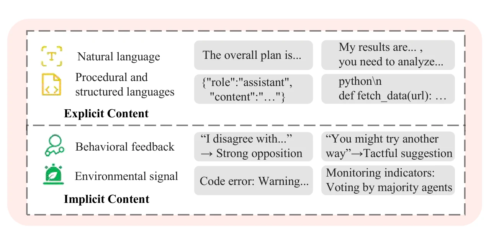

# 多智能体通信综述：谁在何时把什么交给谁

把几个大语言模型（LLM）接在一起互相说话，工程上已经不难。难的是判断这些对话为什么有用。一次任务成功，收益可能来自更多的推理预算、更细的角色分工，也可能来自某个消息恰好让下游改对了方向；只看最终分数，这三种来源混在一起，无法分开。

《Beyond Self-Talk: A Communication-Centric Survey of LLM-Based Multi-Agent Systems》选择从通信这一侧切开这个问题。作者是北京航空航天大学等机构的 Yan 等，arXiv 页面注明文章已被 Frontiers of Computer Science 接受。综述的主张是：已有的多智能体综述要么按系统架构和 Agent 模块组织，要么按应用领域（社会模拟、软件工程）组织，通信通常只是附带一提；而在一套 LLM 多智能体系统里，恰恰是通信决定了一个 Agent 的判断能否变成另一个 Agent 的依据。于是它把通信本身当作分类的主轴，提出一个两层框架：系统层看架构、目标与协议，系统内部看策略、范式、对象与内容，一共七个维度。[§1 引言](https://arxiv.org/html/2502.14321v3#S1) · [论文身份与版本](https://arxiv.org/abs/2502.14321v3)

这七个维度对应七个可以分别回答的问题：谁能和谁连、为什么要说、消息按什么规矩走；什么时候说、以什么形式说、对谁说、用什么内容说。它们合起来描述一次协作的信息通路，因此可以同时贴在同一套系统上，而不必互相排斥。[图 1，PDF 第2页](https://arxiv.org/html/2502.14321v3#S1.F1)

本导读按综述自己的章节顺序展开：先补背景，再逐层讲这七个维度，然后是作者对评价与挑战的判断，最后把维度整理成读新论文时的检查表。为了让抽象的维度有具体落点，导读会用一个虚构的三角色修缺陷流程贯穿全文，下文简称 D-102；角色、补丁编号、测试结果和秒数都是导读编的教学设定，不是综述里的实验。五张原图分别放在讲它们的章节。综述点到的代表方法，导读会说明它针对什么问题、怎么做、与相邻方法差在哪里、作者或原论文指出了什么代价；方法做法以综述描述为准，并对照了各方法的 arXiv 摘要。

本导读固定采用 arXiv v3（2026 年 5 月 26 日）。文中的数字有两类来源：一类是综述统计工作数量，另一类是导读按原图或原表直接清点的数目，后者会写明。正文中第一次出现的缩写带虚线，点开可以看全称和来历。

## 背景：从单个 Agent 到会互相说话的系统

通信的问题只有在“谁在说话”这件事清楚之后才具体。综述用第二章交代这个底子：先看单个 LLM Agent 由什么组成，再看没有大模型之前的传统多智能体系统怎样通信，最后说明 LLM 多智能体系统继承了什么、又改变了什么。[§2 背景](https://arxiv.org/html/2502.14321v3#S2)

单个 LLM Agent 在综述里由三部分组成：大脑、感知和行动。大脑是一个 LLM，带短期记忆和长期记忆，前者缓存当前对话，后者存放跨会话积累下来的结构化材料；检索增强生成（RAG）这类方法在这里的作用是让记忆更好用。感知把文本、图像、音频或环境状态向量转换成模型能读的提示。行动则包含文本回复，也包含调用外部工具、API 或真实执行器。[§2.1 单 Agent 结构](https://arxiv.org/html/2502.14321v3#S2.SS1)

传统多智能体系统提供了两套工具。符号路线用信念、愿望、意图描述 Agent，并用 Agent 通信语言规定消息：inform、request、propose 这类机器可解释的言语行为，配合合同网、拍卖式协商这样的协议模板，好处是承诺、目标和义务可以被透明地推理。代价在词表和解析器上：它们为封闭任务设计，遇到开放域对话就显得僵硬。学习路线把手工规则换成优化：集中训练、分散执行（CTDE）用全局评论家稳定梯度，测试时各 Agent 独立行动；独立 Q 学习、策略梯度、值分解、反事实基线、影响力信用分配都在处理同一件事——在谁也不知道别人会怎么动的情况下，把功劳和过失分给正确的人。图神经 Agent 更进一步，在动态通信图上传递紧凑的隐向量消息，可以扩展到数百个协作机器人。这条路线的共同代价是消息格式往往为任务定制，样本需求大，且不容易解释。[§2.2 传统多智能体系统](https://arxiv.org/html/2502.14321v3#S2.SS2)

LLM 多智能体系统把这两条线接上了：Agent 之间说的就是自然语言，而自然语言本来是人用来协作的，于是“对话”和“通信协议”之间的边界被抹平。Agent 可以合作、竞争或谈判，取决于系统目标和架构选择。综述由此给出一个定义：LLM 多智能体系统是受通信协议约束、由通信目标驱动、在既定通信架构中运行的自动化系统；其中的 Agent 采用多种通信策略与范式，和不同的通信对象交换不同内容，共同完成任务。[§2.3 LLM-MAS](https://arxiv.org/html/2502.14321v3#S2.SS3)

这个定义值得停一下，因为它把后面每一节的位置都安排好了。“受协议约束”对应协议一节，“由目标驱动”对应目标一节，“既定架构”对应架构一节，而“策略、范式、对象、内容”就是系统内部的四个维度。换句话说，通信在这篇综述里是系统的构成条件，并非某个模块的实现细节；这也解释了它为什么不按应用领域分类。

## 两层七个维度：综述的地图

上一节的定义列出了七个成分，这一节看它们怎样被组织成一张图，以及这张图为什么分成两层。图 1 是全文的骨架，也是读这篇综述时最值得先看的一页。[§1 引言与图 1](https://arxiv.org/html/2502.14321v3#S1.F1)

读这张图可以从上往下。上栏画的是“综合型综述”关心什么：左边一排 Agent 表示系统架构，中间一个 Agent 挂着 Profile、Memory、Planning、Tools 四个标签表示 Agent 级动作，右边是应用场景（社会科学、自然科学、工程）。中栏画的是“领域型综述”：左边是模拟域（物理、社会、网络），右边是软件工程域（代码生成、测试、调试）。这两栏的共同点是把 Agent 当作基本单位，通信被埋在“架构”或“流程”里。

下栏才是本文的位置。它分成左右两个虚线框：左边标着“系统层通信”，里面有任务、目标、协议、架构四个元素；右边标着“系统内部通信”，里面有策略、范式、对象、内容四个标签，从一个 Agent 群指向一个方框。图下七行小字就是七个维度的定义，左三行右四行。

图里有两处容易被略过的细节。第一，任务与目标之间是双向箭头，目标又通过协议和架构连到右边的 Agent 群，这说明任务改变时，目标和协议会一起变，并不存在一套固定流程适用于所有任务。第二，左右两个框之间并没有先后箭头，系统层与内部层是两个观察尺度，同一套系统可以先用前者描述“谁能连到谁”，再用后者描述“一次交互怎样发生”。[图 1 与 §1](https://arxiv.org/html/2502.14321v3#S1.F1)

七个维度可以整理成一张提问表：

| 层面 | 维度 | 它回答的问题 | 原文位置 |
| --- | --- | --- | --- |
| 系统层 | 架构 | 谁和谁能连，连接形成什么组织 | §3.1 |
| 系统层 | 目标 | 为什么通信：合作、竞争还是混合 | §3.2 |
| 系统层 | 协议 | 消息按什么格式和规矩流动 | §3.3 |
| 内部层 | 策略 | 什么时候说，按什么顺序说 | §4.1 |
| 内部层 | 范式 | 消息以什么形式出现、怎样被理解 | §4.2 |
| 内部层 | 对象 | 说给谁：自己、其他 Agent、环境还是人 | §4.3 |
| 内部层 | 内容 | 传递什么：显式的语句还是隐式的信号 | §4.4 |

原文第二章之后的章节安排与这张表一一对应：第三章依次是 3.1 架构、3.2 目标、3.3 协议，第四章依次是 4.1 策略、4.2 范式、4.3 对象、4.4 内容，第五章是挑战与机会。图 2 是这张结构的树状版，左侧还有第二章的背景分支，读原文时它可以当目录用。[§2 背景](https://arxiv.org/html/2502.14321v3#S2)

七个维度是同时成立的描述，并非七个选项。D-102 是一张写在虚构仓库里的缺陷单：日期解析函数把 2024-13-01 这种月份越界的字符串也当成了合法日期。分诊者读单并定位，修复者改代码，复核者跑测试；三人共用一块 records 记录板，测试脚本与持续集成环境算作系统之外的环境。这套设定可以同时贴七个标签：三个角色各自向共享记录写状态，组成了带共享空间的扁平协作；如果加一个协调者统一派活，同一批消息就变成层级结构；目标是合作，因为三个人都为同一张缺陷单负责；协议上，复核者按约定字段把测试结果交给构建脚本，脚本返回退出码；策略上，复核者的测试和修复者的修改几乎同时发生；范式上既有私信（修复者把补丁说明发给复核者）也有黑板（共享记录）；对象既包括其他 Agent，也包括测试环境和报缺陷的同事；内容既有中文说明和 JSON 状态，也有一次重跑测试的行为。七个标签全部落在同一个系统上，没有冲突。

这也是这份框架的用处与边界。它提供了共同语言，让“这个系统改了什么”有一个稳定的答法；它本身不排序，也不承诺维度越全系统越好。原文表 3 里有 12 篇工作同时标注了两种通信策略，说明真实系统经常混用，而分类的任务是描述清楚混用了什么。[§4 系统内部通信](https://arxiv.org/html/2502.14321v3#S4)

## 架构：允许的连接关系

系统层的第一个维度是架构，它决定信息能沿哪些关系流动。综述把架构定义为 Agent 在系统中的结构性组织，它约束消息流，并且同时影响宏观的系统行为和微观的交互质量：可扩展性、灵活性、运行效率都与它相关。任务复杂度、Agent 自主程度和期望的交互方式，通常一起决定选哪种架构。[§3.1 通信架构](https://arxiv.org/html/2502.14321v3#S3.SS1)

图 3 画了五类架构，每一类用一个虚线框表示。[图 3，PDF 第4页](https://arxiv.org/html/2502.14321v3#S3.F3)

读图时先看虚线框画在哪里。扁平、层级、社会三种只画了一个框，说明它们描述的是同一层组织内部的连接方式；团队和混合画了多个框，说明它们由若干子单元拼成。层级和团队的样子很像，都是“上面一个、下面两个或三个”，差别在于团队把一个组整体当作一个单元，组与组之间还有一层关系。社会架构里多出来的 Rules、join in、get out，表示成员可以按规则加入或退出，这是其他四类图中没有的动作。

**扁平架构**没有层级和中心监督，Agent 之间点对点对话。综述举的例子包括用多个 Agent 反复打磨合成对话，以及让 Agent 互相批评推理来做事实核查：后者把“你来挑我的错”写进了流程，批评本身就是消息。代价随规模出现：Agent 越多，需要传递和筛选的消息越多，协调效率反而下降。[§3.1.1 扁平结构](https://arxiv.org/html/2502.14321v3#S3.SS1.SSS1)

**层级架构**把 Agent 分成层或级，上层负责策略与监督，下层负责具体执行。ChatDev 是综述给的典型例子：设计师、程序员、测试员在高层管理者之下，按结构化流程完成软件开发；它用“聊天链”规定该说什么，用“沟通式去幻觉”规定怎么说，并且发现自然语言有利于系统设计、编程语言有利于调试。CausalGPT 则在推理链上放高层评估者，用它们引导低层 Agent 的推理，以提高输出的一致性。代价是上层容易过载，层与层之间的通信延迟也会累积。[§3.1.2 层级结构](https://arxiv.org/html/2502.14321v3#S3.SS1.SSS2) · [ChatDev 摘要](https://arxiv.org/abs/2307.07924)

**团队架构**把 Agent 分到专门的小组，每组负责一块任务或领域。MAGIS 处理 GitHub 仓库里的问题：经理、仓库管理员、开发者和质量保证工程师分工协作，在 SWE-bench 上报告解决 13.94% 的问题。POLCA 用专门的团队模拟政党之间的联盟谈判，并预测联盟能否形成。团队结构把专业分工做实了，代价转移到组与组之间：跨团队的消息需要额外机制来协调，否则总开销会把分工的好处抵消掉。[§3.1.3 团队结构](https://arxiv.org/html/2502.14321v3#S3.SS1.SSS3) · [MAGIS 摘要](https://arxiv.org/abs/2403.17927)

**社会架构**把交互放进一个有共同规范或规则的环境，让角色、动机各异的大量 Agent 在其中活动。Generative Agents 在沙盒小镇里让 25 个角色形成友谊、安排活动、依据过去经历调整行为；EconAgent 把消费、投资、就业这些经济决策放进 Agent 行为，用微观行动模拟宏观现象。这两项工作的共同点是涌现：全局模式由局部互动长出来。代价是难以管理，作者也指出这类系统里 Agent 行为的复杂与不可预测本身就是设计问题。[§3.1.4 社会结构](https://arxiv.org/html/2502.14321v3#S3.SS1.SSS4) · [Generative Agents 摘要](https://arxiv.org/abs/2304.03442)

**混合架构**把几种结构拼在一起。FixAgent 处理调试，用三级结构把战略监督和分散执行结合起来；ChatSim 在自动驾驶场景里用自上而下的控制做场景渲染，用点对点协作做资产整合；Tulip Agent 让 Agent 在使用中动态发现工具。混合的动机很直接：纯粹层级在需要并行探索时太慢，纯粹扁平在需要统一决策时太乱，于是分工按任务切开。代价是设计复杂度，协调开销需要专门压住。[§3.1.5 混合结构](https://arxiv.org/html/2502.14321v3#S3.SS1.SSS5) · [FixAgent 摘要](https://arxiv.org/abs/2404.17153) · [ChatSim 摘要](https://arxiv.org/abs/2402.05746)

架构之间的差别，可以用一个只涉及计数的例子体会。假设有 6 个 Agent，每轮里每一对“允许相连”的节点各发一条消息。扁平结构允许任意两者互发，条数是 6×5=30。两级结构每级 3 人、组内星形、两位组长互连，条数是组内 2×4=8 加上组长之间 2，共 10。数字只说明允许的连接有多少，不代表实际发送了多少消息；它给出的直觉是，扁平结构的消息量随人数平方增长，层级结构把它压成线性。这也正是综述说扁平难扩展、层级易瓶颈的地方：省下的消息并没有消失，而是集中到了上层和跨层那几条边上。

| 结构（6 个 Agent） | 允许的连接 | 若每对相邻节点各发一条 |
| --- | --- | --- |
| 扁平 | 任意两者 | 30 条 |
| 两级（2 组 × 3 人，组内星形，组长互连） | 组内与组长之间 | 10 条 |

把这个计数放回 D-102：三个角色如果都直接向另外两人汇报，复核者的测试结果会同时到达修复者和分诊者；如果由分诊者统一转达，修复者收到的测试结果就带上了分诊者的一次解读。前者多两条消息，后者多一层转述。

原文表 1 按“架构 × 目标”列出了 68 项代表工作。导读按表的行清点了一遍，分布如下：

| 架构 | 合作 | 竞争 | 混合 | 合计 | 表中代表 |
| --- | --- | --- | --- | --- | --- |
| 扁平 | 4 | 1 | 2 | 7 | Du 等多智能体辩论、GAMA-Bench、GameChat |
| 层级 | 18 | 1 | 2 | 21 | ChatDev、CausalGPT、Chain-of-Agents |
| 团队 | 13 | 0 | 2 | 15 | MetaGPT、MAGIS、POLCA |
| 社会 | 4 | 0 | 4 | 8 | Generative Agents、EconAgent、EcoLANG |
| 混合 | 10 | 2 | 5 | 17 | FixAgent、ChatSim、Agent4Debate |
| 合计 | 49 | 4 | 15 | 68 | — |

表里读得出两件事。第一，层级和混合占了 38 项，超过一半，说明“有人统筹 + 有人执行”是当前最常见的组织方式，也说明纯粹扁平在真实任务里并不占多数。第二，竞争类只有 4 项，且团队与社会两栏没有竞争条目；这并不表示竞争研究少（综述 §3.2 单独讨论了竞争），而是说明被这张表收录的工作里，合作与混合目标更常见。[表 1，PDF 第4页](https://arxiv.org/html/2502.14321v3#S2.T1)

架构这一层最后留下的是一个认识：它规定的是通路，并非内容。同一句“测试没通过”，在扁平结构里是广播给所有人，在层级结构里是先到组长再下发，在团队结构里可能只在组内流动。判断一套系统的通信，先要分清图上画出的可用连接和一次运行里真正用到的那些边。

## 目标：为什么说话

架构之后是目标，它回答“各方为什么发消息”。综述按合作、竞争、混合三类划分，合作下面再分直接合作与通过辩论达成的合作。[§3.2 通信目标](https://arxiv.org/html/2502.14321v3#S3.SS2)

四栏从左到右排开，上下各有一个 Agent，中间一个图标加一支箭头，终点都是同一枚奖杯，第一栏旁边写着“Achievements”，说明四栏描述的是四种走向任务结果的路径。区别就在中间那个图标上：直接合作是握手，通过辩论的合作是两个被红叉和绿勾标记过的奖章，竞争是交叉的剑，混合则在虚线框里多了一次握手，表示联盟会在过程中形成。图的顺序本身没有立场，混合一栏放在最后并不代表它更高级。

**直接合作**是最直白的一种：Agent 公开共享信息与资源，共同完成任务，追求快速达成一致。综述举例说，有的工作用它增强 LLM 推理，有的用它做协同代码生成，有的把它放进科学实验流程。[§3.2.1 合作](https://arxiv.org/html/2502.14321v3#S3.SS2.SSS1)

**通过辩论的合作**把批评制度化了：Agent 主动质疑彼此的假设、推理和结论，经过几轮交锋收敛到更稳的答案。Du 等的多智能体辩论是代表：多个模型实例先各自给出答案和推理，再在若干轮里互相阅读并修正，最后取共同答案；原论文在数学与策略推理任务上报告了提升，也报告了事实性改善，并强调方法可以直接套在黑箱模型上，各任务用同一套流程和提示。它和直接合作的区别在于默认怀疑：直接合作把对方的消息当输入，辩论式合作把对方的消息当待检验的主张。综述把事实推理和事实核查列为此类的典型场景。[§3.2.1 合作](https://arxiv.org/html/2502.14321v3#S3.SS2.SSS1) · [多智能体辩论摘要](https://arxiv.org/abs/2305.14325)

辩论式合作的代价也在机制里：每一轮都要重新生成完整回答，轮数越多调用越多；如果所有实例共享同一个错误前提，互相确认也可能收敛到同一个错误答案。后一点是导读的推论：多轮讨论提高的是“有机会被发现”，并不保证“一定被发现”。

**竞争**出现在目标冲突、资源有限或名次有限的情形。综述用 GAMA-Bench 说明这类系统的博弈能力：它覆盖八种经典博弈场景，用动态打分适应不同博弈参数，用来评估 LLM 在多方环境里的决策。Agent4Debate 则搭了一个和人类辩手对抗的框架，四个角色分别负责检索、分析、写作和审阅，作者用 66 个中文辩题、200 场辩论比较模型与人类辩手的表现。竞争的一个后果是语言会变：综述提到有工作在对抗模拟里研究语言演化，也有工作在诗歌生成任务里让 Agent 争相写出更有创意的文本。代价是稳定性与安全：对抗或欺骗性的发言会带来漏洞，因此需要把竞争激励和合作约束放在一起设计。[§3.2.2 竞争](https://arxiv.org/html/2502.14321v3#S3.SS2.SSS2) · [GAMA-Bench 摘要](https://arxiv.org/abs/2403.11807) · [Agent4Debate 摘要](https://arxiv.org/abs/2408.04472)

**混合目标**让合作与竞争同时存在：各方会随时结盟、争夺稀缺资源、再按情境重新合作。综述把它视为贴近真实互动的形态，举的例子集中在社会模拟和谈判，例如用多智能体模拟政治联盟谈判，或者让 Agent 在经济环境里既交易又竞争。混合目标的麻烦不在建模，而在机制设计：什么算公平、协议怎样标准化、出现欺骗时谁来处理，都需要协调与监控。[§3.2.3 混合目标](https://arxiv.org/html/2502.14321v3#S3.SS2.SSS3) · [POLCA 摘要](https://arxiv.org/abs/2402.11712)

三类目标的关系可以用一句话概括：目标决定“什么算成功”，也决定“要不要防着对方”。同一种发言形式可以服务于不同目标。D-102 里复核者提出反例，是为了让整个系统改对，属于合作中的辩论；如果把场景改成两个团队竞争同一个修复名额，同样的反例就可能被读成打压，消息的意思随之改变。判断目标关系，要看各方被要求优化什么，而不是看对话的语气。

## 协议：消息怎样真正流动

架构决定谁能连、目标决定为什么说，协议接着决定消息实际怎么走。综述的措辞是：架构管“谁和谁能说”，目标管“为什么说”，协议管“消息如何在 Agent 与外部系统之间流动”。标准化协议让部署可移植、可审计、更容易加安全措施，因此这一节讲的已经不是论文里的流程，而是工程接口。[§3.3 通信协议](https://arxiv.org/html/2502.14321v3#S3.SS3)

**MCP（Model Context Protocol）**面向“Agent 如何使用外部资源”。它用 JSON-RPC 的客户端—服务器结构，把一次调用拆成主机、客户端、服务器和资源四个角色：主机根据用户请求发起上下文请求，客户端管理与主机和服务器的连接并提供资源描述，服务器直接和资源打交道。这样分层的好处是把不同 Agent 和不同工具提供方之间的碎片化收敛到一套接口上；另一个好处是安全，把敏感的工具调用和模型生成的回答解耦，可以减少数据外露的风险。[§3.3.1 MCP](https://arxiv.org/html/2502.14321v3#S3.SS3.SSS1)

**A2A（Agent-to-Agent Protocol）**面向“Agent 之间怎样互相委托”。它用“Agent 卡”描述一个 Agent 能做什么，卡片经 HTTP 与服务器发送事件分发；Agent 之间直接点对点通信，中间不设集中的中转，因而延迟较低。异步消息让能力发现和任务外包可以在企业规模上运行。它的设计重心是能力匹配：先知道对方会什么，再决定把哪一段任务交出去。[§3.3.2 A2A](https://arxiv.org/html/2502.14321v3#S3.SS3.SSS2)

**ANP（Agent Network Protocol）**面向“开放网络里怎样找到并信任陌生 Agent”。它建立在去中心化标识符（DID）和 JSON-LD 图上：Agent 用 DID 互相发现与验证身份，用 JSON-LD 组织消息以获得语义清晰度，并用加密通道保护完整性。它的目标场景是跨组织协作，因此把身份和加密放在协议的核心位置。[§3.3.3 ANP](https://arxiv.org/html/2502.14321v3#S3.SS3.SSS3)

图 5 把三个协议并排画在同一张图上：上半是 MCP 的调用链（Agent 经 MCP 客户端访问两个 MCP 服务器，服务器再落到数据源或 API），左下是 A2A 的对话与任务（Agent 卡、任务状态、推送与产物），右下是 ANP 的三层结构，自下而上是身份与加密通信层（身份、E2E、W3C DID）、元协议层（协议协商、调试、测试）和应用协议层（标准、共识、个性化协议，以及 Agent 描述与 APP 协议规范）。这张图的用处是提示读者：三个协议在层次上并不平级，MCP 主要解决资源接入，A2A 主要解决任务委托，ANP 主要解决身份与开放发现。[图 5，PDF 第6页](https://arxiv.org/html/2502.14321v3#S3.F5)

原文表 2 从拓扑、发现、格式、安全、优势、局限和用例七个方面做了对照。导读摘录了前四行和优势一行，因为它们是可以核对的技术差异：

| 方面 | MCP | A2A | ANP |
| --- | --- | --- | --- |
| 拓扑 | JSON-RPC 的客户端—服务器通道 | 点对点的客户端 ↔ 远端 Agent | 去中心化的 P2P Agent 网 |
| 发现 | 静态端点或手工登记 | 经 HTTP 取回带签名的 Agent 卡 | 搜索索引抓取 + DID 文档交换 |
| 格式 | 带类型的 JSON-RPC 2.0 消息 | 任务与产物包 | JSON-LD 与元协议协商 |
| 安全 | Bearer 令牌、可选 DID 声明、RBAC | OAuth 2 / 企业 IAM、双向 TLS | DID 握手、端到端加密 |
| 优势 | 工具调用顺滑、启动成本低 | 任务委托丰富、有厂商生态 | 身份无需中心、没有单点控制 |

表里没有列出“局限”整行，因为印出来的那一行内容不统一：MCP 一列写的是对集中服务的依赖与安全风险，A2A 和 ANP 两列写的却是跨团队流程、去中心化物流这类使用场景，与最后的用例行重复。这是原表的一处编辑问题。导读只把 MCP 那一列当作局限；其余两列的代价可以从各自的设计推出来——A2A 把认证交给企业身份体系，跨组织协作时要另行协商；ANP 把身份与加密放进协议，相应多出发现与治理的工作。[表 2，PDF 第7页](https://arxiv.org/html/2502.14321v3#S3.T2)

除这三个之外，综述还提到 ACP、AITP、AConP 等协议也在出现，并指出这种并存的局面本身带来问题：功能重叠、彼此不互通、管理成本上升。[§5.3 统一协议](https://arxiv.org/html/2502.14321v3#S5.SS3)

读协议这一节最容易犯的错，是把“消息符合格式”当成“协作正确”。协议保证的是字段能解析、身份能验证、加密能生效；消息里的断言是否为真、是否适用于当前版本，协议管不到。放回 D-102：复核者通过 A2A 把一份带签名的产物包交给修复者，格式和身份都没有问题，但如果包里的测试记录来自旧版本，修复者拿到的仍是过时的证据。接口互通与语义正确需要分别检查。

## 策略：谁在什么时候说

系统内部的第一个维度是策略，它管时序：Agent 什么时候发言、按什么顺序发言。综述把常见做法归成三类：逐个发言、同时发言、带汇总者的同时发言。[§4.1 通信策略](https://arxiv.org/html/2502.14321v3#S4.SS1)

图 6 的三格可以用箭头方向来读。左格的箭头首尾相接地绕一圈，表示发言有固定轮转，后说的能看见先说的全部内容。中格没有轮转，四个 Agent 两两相连、每条边都是双箭头，表示谁都可以在任何时候读和写。右格多了一个黄色节点，标注为 Summarizer，三个蓝色 Agent 各自把消息交给它，意思是并发之后先把结果收拢，再向下游传递。

**逐个发言**让每个 Agent 完整读过前面所有消息再发言。综述举的例子是 Chain-of-Agents：面对超出上下文长度的长文本，它让多个工作 Agent 依次处理分段，每人在提交自己的结论前先概括前面的贡献，最后由一个管理 Agent 汇总。原论文的出发点正是长上下文的两种常见对策各有短板——检索增强可能漏掉关键片段，扩窗口又容易在大段材料里失焦；让每个 Agent 只看一小段，可以把“读得全”和“读得准”分开处理。[§4.1.1 逐个发言](https://arxiv.org/html/2502.14321v3#S4.SS1.SSS1) · [Chain-of-Agents 摘要](https://arxiv.org/abs/2406.02818)

串行的代价有两个，综述写得很直接：等待时间随轮数线性增长，因为每个 Agent 都要等前面全部完成；前面 Agent 引入的错误会沿着链条放大，形成语义漂移。后一点在 D-102 里很好还原：分诊者如果误判“问题在月份偏移”，修复者会照着这个假设改，复核者拿到的补丁已经带着这个错误；链条越长，中间没人有机会回到原始日志。

**同时发言**允许并发，没有轮次等待。综述举 AutoAgents 与 EconAgent：前者并发地产生想法或方案路径，用来快速铺开可能性；后者让大规模 Agent 同时参与宏观模拟。它的收益是速度和多样性，代价有两个：状态陈旧，即没有细粒度同步时，某个 Agent 可能基于别人已经过时的发言推理；冲突未决，即并行的提案经常重叠或相互矛盾，需要额外的仲裁层。综述因此强调时间戳和轻量共识机制在这类策略里的作用。[§4.1.2 同时发言](https://arxiv.org/html/2502.14321v3#S4.SS1.SSS2) · [AutoAgents 摘要](https://arxiv.org/abs/2309.17288)

**带汇总者的同时发言**在并发之后加一个汇总节点：它周期性地把多个 Agent 的输入综合成简洁统一的消息，再传给后续环节。综述举 CausalGPT 与 AgentCoord 作为使用汇总者的层级或团队场景。这个设计缓解了同步问题，但同时把串行依赖又带回来一部分，因为下游仍要等汇总完成；另外一个风险在汇总者本身，它必须准确理解和概括，否则误读或幻觉会随汇总扩散到全系统。[§4.1.3 带汇总者](https://arxiv.org/html/2502.14321v3#S4.SS1.SSS3) · [CausalGPT 摘要](https://arxiv.org/abs/2308.11914) · [AgentCoord 摘要](https://arxiv.org/abs/2404.11943)

三种策略的差别可以用 D-102 的时间线算一遍。假设三个角色各需要 40 秒生成一轮回复，汇总者再需要 30 秒。逐个发言要 40×3=120 秒，第二轮开始时所有人已经看见第一轮全部内容。同时发言第一轮只要 40 秒，但修复者可能在复核者的测试结果写进共享记录之前就开始改代码。带汇总者的版本是 40+30=70 秒，代价是这 30 秒里所有下游都要等，而且汇总者决定了哪些内容被保留。

| 策略 | 第一轮耗时 | 修复者看到的依据 | 主要风险 |
| --- | --- | --- | --- |
| 逐个发言 | 120 秒 | 分诊者的定位与复核者的上一条结论 | 前面一步的错误沿链条放大 |
| 同时发言 | 40 秒 | 可能只有分诊者的定位 | 读到旧版本，提案互相冲突 |
| 同时发言 + 汇总者 | 70 秒 | 汇总后的记录 | 汇总遗漏异议，或把推测写成结论 |

表中的秒数是教学设定，用来显示等待从哪来。真正要看的因果关系是：并发省下的是等待时间，付出的是“每个人看到的世界版本可能不同”；汇总省下的是下游的阅读量，付出的是“由一个人决定什么算重要”。

综述表 3 给出了这一维度的实际分布。导读按表的 68 行清点：标注逐个发言的有 28 篇，同时发言 22 篇，带汇总者 30 篇；只标一种策略的分别是 17、13、26 篇，其余 12 篇同时标了两种。带汇总者是单用最多的一类，与表 1 里层级和混合结构占多数相互印证：一旦系统有了统筹角色，汇总就会自然出现。[表 3，PDF 第8页](https://arxiv.org/html/2502.14321v3#S4.T3)

## 范式：消息以什么形式出现

策略排出时间顺序之后，还剩一个问题：一次发言在系统里是什么东西。综述把回答分成三种范式：消息传递、言语行为和黑板。[§4.2 通信范式](https://arxiv.org/html/2502.14321v3#S4.SS2)

**消息传递**是最接近直觉的一种：内容被明确地发给某个对象或一群对象，消息里既有信息，也常带上下文与推理痕迹。综述举的例子包括用 Agent 网络模拟观点动力学，让 Agent 用直接消息不断更新彼此的看法、快速形成共识；以及 GameChat，让多个 LLM Agent 在受限环境里通过对话协商导航。GameChat 报告的结果给出一个量：在模拟的门洞和路口场景里，即使最坏情况，所有 Agent 到达目标的总时间也减少了 35% 以上，机制是让各方自己用自然语言解决空间对称造成的僵局。代价在消息处理上：要有机制扛住消息量、保证一致性。[§4.2.1 消息传递](https://arxiv.org/html/2502.14321v3#S4.SS2.SSS1) · [GameChat 摘要](https://arxiv.org/abs/2503.12333)

**言语行为**来自一个更老的观察：说话本身也是做事。一次发言可以是指令、承诺或宣告，接收者据此改变状态。综述把外交谈判、辩论式推理和软件协同工程都归到这一类，因为它们的消息里嵌着指令性、承诺性或说服性成分，Agent 借此协商任务分配、对齐信念、协调时间上的承诺。代价是“言外之力”可能标错：如果一句话到底是请求还是命令不清楚，或者接收者对前提的理解与发送者不同，就会出现综述所说的 illocutionary misfire——对方执行了没被要求的动作，或者在不满足前提时行动，导致死锁和连锁错误。[§4.2.2 言语行为](https://arxiv.org/html/2502.14321v3#S4.SS2.SSS2)

**黑板**用一个集中的共享空间代替点对点发送：Agent 往里发布、读取、更新，共享空间充当共同的工作区。MetaGPT 是综述给的典型例子，它把标准作业流程写进提示序列，让不同角色的 Agent 在同一个通信仓库里贴状态、贴代码、贴问题处理结果。MDTeamGPT 在会诊场景里用共享信息空间，让医疗团队持续看到同一份病人信息、诊断建议和治疗方案。代价集中在共享点：它可能成为瓶颈，需要权限管理，也需要防止错误或恶意内容污染所有人看到的那份记录。[§4.2.3 黑板](https://arxiv.org/html/2502.14321v3#S4.SS2.SSS3) · [MetaGPT 摘要](https://arxiv.org/abs/2308.00352) · [MDTeamGPT 摘要](https://arxiv.org/abs/2503.13856)

三种范式的差别可以这样对照：消息传递关心“发给谁”，言语行为关心“这句话要对方做什么”，黑板关心“谁能在公共记录里看到什么”。同一件事在三种范式下的写法不同。D-102 里复核者发现新失败样例，可以选择私下发给修复者（消息传递），可以发一句“请重跑并修好再提交”（言语行为中的请求），也可以只在共享记录里追加一行“D-102 复测失败，样例 2024-13-01”（黑板）。三种写法对下游的要求不一样：第一种要求对方在线，第二种要求对方正确理解请求的边界，第三种要求对方主动回来读。

## 对象：和谁说话

范式之后是对象，也就是消息的接收方。综述区分四类：与自身、与其他 Agent、与环境、与人。[§4.3 通信对象](https://arxiv.org/html/2502.14321v3#S4.SS3)

**与自身**指 Agent 内部的独白与反思：先盘算、再决定。综述举 AgentCoord，让 Agent 通过自省反复评估和调整协作策略；举 FixAgent，在调试中先自评策略再动手，从而更省资源。这类“通信”看起来像自问自答，价值在于把推理过程外化，便于下一步使用；代价是需要一个足够稳的认知框架，否则自评会变成自我确认。[§4.3.1 与自身](https://arxiv.org/html/2502.14321v3#S4.SS3.SSS1)

**与其他 Agent**是最常见的一类，包含信息交换、任务协调与谈判。综述举 MAGIS 在软件开发中让开发者、测试者、管理员频繁交换任务消息，举 AgentFM 让多个 Agent 在数据库故障管理中结构化地协作。几乎所有 LLM-MAS 都有这一层，因此真正决定差异的是协议、同步和冲突处理，而不只是“有没有 Agent 间对话”。[§4.3.2 与其他 Agent](https://arxiv.org/html/2502.14321v3#S4.SS3.SSS2)

**与环境**指 Agent 感知外部刺激并据此调整行为。它和前两类不同：输入是原始传感器流——图像、音频、本体感觉、模拟器状态——需要被转换成可用的知识。综述举 EmbodiedGPT 用多模态感知处理视觉与听觉输入并在动态环境中行动，举 ChatSim 在自动驾驶模拟中把环境反馈带进 Agent 交互，让行为随实时变化修正。代价在感知链路上：需要低延迟的传感器融合、需要把语言推理持续落在非语言数据上，也需要防止感知错误和分布外输入带来的风险。[§4.3.3 与环境](https://arxiv.org/html/2502.14321v3#S4.SS3.SSS3) · [EmbodiedGPT 摘要](https://arxiv.org/abs/2305.15021)

**与人**指 Agent 与人类用户或参与者直接交互。综述举 PeerGPT，让 Agent 在儿童协作学习中充当主持人或同伴，既要理解孩子的语言，也要理解他们的动作；举 MedAgents，让多个 Agent 与医疗专业人员配合，支持诊断、治疗规划与照护协调。这一类要处理三件事：不同人群的语言差异、维持关系所需的情感与社会信号，以及隐私、偏见和责任归属上的严格要求。[§4.3.4 与人](https://arxiv.org/html/2502.14321v3#S4.SS3.SSS4) · [PeerGPT 摘要](https://arxiv.org/abs/2403.14227) · [MedAgents 摘要](https://arxiv.org/abs/2311.10537)

对象这一维度决定的是“信息从哪里来、由谁负责核实”。D-102 里，修复者读自己的反思（与自身）、读分诊者的定位（与其他 Agent）、读测试脚本的输出（与环境）、读同事在缺陷单上的补充说明（与人）。这四条来源的可信度和更新速度都不同：测试脚本每次运行都会给出新结果，同事的补充说明可能一天才来一次，自省则完全不产生新证据。一个系统如果只把前两类当作输入，就会漏掉环境和人的信号。

## 内容：传递什么

最后一个内部维度是内容，它问的是消息里究竟装了什么。综述把内容分成显式和隐式两大类，各含两种形式。[§4.4 通信内容](https://arxiv.org/html/2502.14321v3#S4.SS4)

**显式内容**有明确的字面意思，可以直接读。自然语言这一支最灵活：Generative Agents 里的角色用语言谈判、计划和解决冲突，AgentCoord 用语言说明策略决定。代码与结构化数据这一支更精确：MAGIS 在软件 Agent 之间交换结构化代码与数据，用来跟踪问题和代码变更；AutoData 用结构化数据完成开放网络上的数据采集。显式的代价是解析：自然语言要求接收者处理歧义，结构化数据要求双方严格遵守同一套格式。[§4.4.1 显式内容](https://arxiv.org/html/2502.14321v3#S4.SS4.SSS1) · [AutoData 摘要](https://arxiv.org/abs/2505.15859)

**隐式内容**没有写出来，靠推断。行为反馈这一支从动作里读意图：在 Richelieu 这样的外交模拟里，Agent 的谈判立场通过行为间接传达；在受操纵知识扩散的研究里，Agent 的策略随同伴行为的变化而调整，等于用行为告诉对方“我改了”。环境信号这一支从情境里读状态：ChatSim 把实时交通与天气当作隐式输入引导导航，EcoLANG 让 Agent 从经济指标和环境变化中调整消费与投资。隐式的代价是解释：读错行为会误判意图，过度解读会把噪声当信号。[§4.4.2 隐式内容](https://arxiv.org/html/2502.14321v3#S4.SS4.SSS2) · [Flooding 摘要](https://arxiv.org/abs/2407.07791) · [EcoLANG 摘要](https://arxiv.org/abs/2505.06904)

四种形式在同一件事上的差别，用 D-102 的失败样例可以看清：

| 形式 | 在 D-102 里的样子 | 接收者要做什么 | 常见失效 |
| --- | --- | --- | --- |
| 自然语言 | “样例 2024-13-01 还是失败了，问题在月份判断。” | 理解并采纳 | 措辞含糊，被当成建议而非结论 |
| 代码与结构化数据 | `{"case": "2024-13-01", "passed": false}` | 按约定字段解析 | 字段正确而取值错误，或版本过期 |
| 行为反馈 | 复核者不说不同意，而是直接重跑测试并提交新补丁 | 从动作推断态度 | 把“另起一版”读成“同意” |
| 环境信号 | 持续集成日志的时间戳与失败计数 | 监测并解释 | 把旧日志当成当前状态 |

内容这一层最后留下一个判断：显式与隐式的区分不在于可信度，而在于由谁完成解释。写出来的句子需要接收者理解语义，没写出来的信号需要接收者推断意图；两者都可能被误读，只是误读发生的位置不同。综述在对应小节都提过这些风险，导读把它们合在这里说一次。

## 评价：分数之外还要看什么

七个维度讲完，剩下的是怎样判断一套通信设计好不好。综述在 §5.6 专门批评了当前的评价方式，这一节把它的批评与表 3 的统计放在一起看。[§5.6 基准与评价](https://arxiv.org/html/2502.14321v3#S5.SS6)

表 3 的时间列显示了领域的移动速度：68 项工作里，2023 年 11 项，2024 年 33 项，2025 年前五个月 24 项。综述据此认为，评测套件的建设落后于系统的扩散。它点名两类现有资源：MultiAgentBench 覆盖若干交互场景，用里程碑式的关键指标衡量任务完成与协作质量，并比较星形、链式、树形、图状等协调协议；RealWorldBench 覆盖真实世界的规划与调度任务。这里有一处需要核对：综述写作 RealWorldBench，而其引用的文献 [102] 原题是 Realm-Bench，包含 14 个规划与调度问题，可以沿并行规划线程数、依赖复杂度和意外中断频率三个方向扩展。[表 3，PDF 第8页](https://arxiv.org/html/2502.14321v3#S4.T3) · [MultiAgentBench 摘要](https://arxiv.org/abs/2503.01935) · [Realm-Bench 摘要](https://arxiv.org/abs/2502.18836)

综述对现有榜单的批评集中在“以 Agent 为中心”：榜单通常报告每个 Agent 的任务准确率或奖励，很少报告系统层面的性质，例如协调效率、通信带宽与时延、对陈旧或欺骗性消息的鲁棒性、群体层面的公平与安全。少了这些维度，评价无法区分两种系统：一种只是把几个强单体拼在一起，另一种真的产生了协作才有的能力。作者因此主张下一代的基准应当覆盖合作、竞争与混合动机，并给出一套从个体能力到集体效用的多粒度指标。[§5.6 基准与评价](https://arxiv.org/html/2502.14321v3#S5.SS6)

这套主张可以直接落到 D-102 上。设想两版系统都修好了缺陷，A 版用 3 次调用、12 条消息、40 秒，B 版用 9 次调用、40 条消息、150 秒；只看成功率，两者没有差别，而通信设计的好坏恰恰在这里。要分开它们，至少需要三类记录：结果（缺陷是否修好，回归测试是否通过）、代价（调用次数、消息条数、总时长）、过程（哪条消息改变了哪个决定，失败样例从复核者传到修复者后是否触发了正确修改）。第三类最容易被忽略，也最能说明通信是否起作用。

需要说明，这三类记录是导读的整理，综述只提出了“从个体能力到集体效用”的方向，没有给出具体指标；上面的调用次数和消息条数也是教学设定，没有对应的实验。把方向变成指标，本身仍是一个开放问题，这也是综述把它列进挑战的原因。

评价这一节最后留下的认识比较朴素：一套多智能体系统“表现好”，可以由更多预算换来，也可以由更好的分工换来，还可以由某条关键消息换来。想分清是哪一种，就要同时记录结果、代价和过程，而这三类记录里，只有过程那一类需要真正去读消息。

## 五个挑战与开放问题

综述第五章列了六个方向，其中评价已经在上节展开，这里看其余五个。它们都是作者在固定版本里的判断，适合当作检索入口，而不宜当作“至今仍未解决”的证明。[§5 挑战与机会](https://arxiv.org/html/2502.14321v3#S5)

**系统设计的优化。** 作者认为架构是基础，任务变复杂之后传统架构会不够用，混合架构会是重点；随之而来的是三个连带问题：Agent 变多后需要既高效又可扩展的通信范式，算力需要重新分配，系统内部的信息量上升后还要保证 Agent 正确理解、少出幻觉与误解。[§5.1 系统设计](https://arxiv.org/html/2502.14321v3#S5.SS1)

**竞争研究的推进。** 竞争能逼出更复杂的策略，博弈论提供了现成工具，难点在平衡：过度竞争会导致低效和不稳定。作者提出的方向是寻找竞争与合作之间的最优点、设计可扩展的竞争策略、并研究怎样把竞争安全地放进真实应用。[§5.2 竞争研究](https://arxiv.org/html/2502.14321v3#S5.SS2)

**统一协议。** MCP、A2A、ANP、ACP、AITP、AConP 同时出现，带来两个问题：功能重叠造成复杂与浪费；彼此不互通，用不同协议的两组 Agent 无法协作。作者用早期互联网作类比，认为最终需要一个类似 HTTPS 的共识标准。这个类比说明了方向，也说明了难度：标准的形成是协商过程，不是技术优劣的自然结果。[§5.3 统一协议](https://arxiv.org/html/2502.14321v3#S5.SS3)

**多模态通信。** 作者认为 Agent 之间的通信会从文本扩展到图像、音频、视频，问题在于怎样把不同模态以所有 Agent 都能理解的方式组织起来，以及怎样让 Agent 既能处理、又能转述这些模态。方向是多模态数据的融合与相应组件的加强。[§5.4 多模态](https://arxiv.org/html/2502.14321v3#S5.SS4)

**通信安全。** 综述引用的研究显示，中间人、数据篡改和冒充攻击都能在 Agent 之间实施，而且损害会沿系统快速级联。作者的主张是把原本针对单个模型的防御手段放进通信层，并针对成员可随时加入退出的动态拓扑，组合端到端加密、细粒度认证、自适应密钥管理和来源追踪。这类需求在协同驾驶和临床决策支持里尤其紧迫，因为一次短暂的消息损坏就可能造成现实后果。[§5.5 通信安全](https://arxiv.org/html/2502.14321v3#S5.SS5)

把五个方向和七个维度对照，会发现它们落在不同的层：系统设计、竞争、多模态主要涉及架构、目标与内容；统一协议与安全主要涉及协议；评价横跨全部。这也说明为什么作者把它放在最后而不是塞进某一节：这些问题的共同点是还没有公认的解法，而不是属于某个特定维度。

## 把一篇新论文放回框架

读完七个维度，最有用的做法是拿它去定位新论文。这一节把维度整理成提问表，再补一张从现象反查的表，最后用综述自己的标签示范三次定位。

| 维度 | 拿到一篇论文时先问 | 论文里通常在哪里能看到 |
| --- | --- | --- |
| 架构 | 谁和谁能通信，有没有统筹层 | 系统图、角色表、示例轨迹 |
| 目标 | 各方被要求优化什么，是否共享结果 | 任务定义、奖励或评价方式 |
| 协议 | 消息按什么格式与接口流动 | 接口说明、工具定义、实现细节 |
| 策略 | 发言是排队、并发还是先汇总 | 时序图、伪代码、轮次设置 |
| 范式 | 消息是发给对象、当作行动，还是放进共享空间 | 消息结构、状态更新方式 |
| 对象 | 输入来自自身、同伴、环境还是人 | 输入清单、传感器或界面描述 |
| 内容 | 传的是写出来的语句还是行为与环境信号 | 消息示例、日志、观测项 |

如果手上是一个出问题的系统，也可以反过来从现象回查维度：

| 看到的现象 | 先查哪个维度 | 具体要找什么 |
| --- | --- | --- |
| 任务做完了，但耗时代价高得不成比例 | 架构、策略 | 消息是否随人数平方增长；是否存在可以并行的串行环节 |
| 两个 Agent 反复互相确认同一件事 | 目标、策略 | 是否把辩论当成了默认流程；有没有结束条件 |
| 结论正确，但理由来自另一条错误路径 | 内容、对象 | 关键判断依据的是显式陈述还是行为推断；有没有回到原始记录核对 |
| 换一个模型或加一个工具，整体就不工作 | 协议、内容 | 接口是否依赖隐含格式；结构化字段是否绑定了某次运行 |
| 汇总报告很干净，问题却没解决 | 策略 | 汇总者丢了哪些原始依据；下游能否回到原消息 |

三次定位可以直接用综述表 3 的标注来练习。ChatDev 的标签是逐个发言、消息传递加言语行为、对象是其他 Agent、内容显式加隐式；MetaGPT 是带汇总者、黑板、对象含环境、内容显式；GameChat 是带汇总者、言语行为、对象是自己与其他 Agent、内容显式。三个系统里，前两个做软件开发，第三个做导航，但它们的通信结构差别很大：ChatDev 靠有顺序的对话推进阶段，MetaGPT 靠共享仓库维持一致，GameChat 靠言语行为在冲突现场达成协议。知道标签之后再读方法部分，注意力会落在对的地方。[表 3，PDF 第8页](https://arxiv.org/html/2502.14321v3#S4.T3)

**接下来读什么。** 想先建立单个 Agent 的组成概念，可以读本库的 [Agent 综述导读](/read/agent-survey/3#architecture)，它用四个模块讲清角色、记忆、规划和行动；想继续沿协作机制深入，可以读 [多智能体协作综述导读](/read/multi-agent-collaboration-survey/1#u05)，它把规则、角色与编排放在一起讨论。本导读的长处是通信这一侧的细节，那两篇分别补齐单体组成与协作机制。这个顺序是编辑建议，不是作者证明的先修关系。

## 原文入口与本次覆盖

读原文时，建议先看图 1（PDF 第 2 页）的全景框架、图 3（第 4 页）的五类架构、图 4（第 5 页）的四种目标关系，再看图 6（第 7 页）的三种策略与图 9（第 11 页）的内容分类；表 1（第 4 页）按架构与目标列出 68 项工作，表 3（第 8 页）给每项工作标了四个内部维度和时间。表 2（第 7 页）适合在需要比较协议时查。页码都从 PDF 第一页算起。[固定 PDF](https://arxiv.org/pdf/2502.14321v3) · [图 1 所在页](https://arxiv.org/pdf/2502.14321v3#page=2) · [图 3 与表 1 所在页](https://arxiv.org/pdf/2502.14321v3#page=4) · [图 6 与表 2 所在页](https://arxiv.org/pdf/2502.14321v3#page=7) · [表 3 所在页](https://arxiv.org/pdf/2502.14321v3#page=8) · [图 9 所在页](https://arxiv.org/pdf/2502.14321v3#page=11)

本导读依据固定的 arXiv v3（2026 年 5 月 26 日）通读 §1–§6 正文，参考文献页用于核对被引编号；图 1、3、4、6、9 已从固定 PDF 裁切并亲眼查看，表 1、2、3 只摘录与论证相关的行与列，文中“68 项”“28/22/30”等计数是按原表逐行清点得到的。代表方法的做法以综述描述为准，并对照了各方法 arXiv 摘要；导读没有逐篇精读被引论文，没有复现任何实验，也没有对协议实现做验证。

原文有几处需要读者留意的地方。表 2 的 Limitations 行不统一：MCP 一列是真正的局限，A2A 与 ANP 两列印的是使用场景，与 Use Cases 行重复。§5.6 提到的 RealWorldBench 对应文献 [102] 的原名是 Realm-Bench。综述称 FixAgent 的工作，其 arXiv 标题为 UniDebugger。表 3 中有一条范式记为“MP. SA”，按上下文应理解为同时使用两种范式。这些都写在核对记录里，正文只在必要时说明。

覆盖范围是通信主线，不是全综述审计：被引的 100 余项工作只按综述的归类引用，应用领域（社会模拟、软件工程、医疗等）只在举例时出现，多模态与安全只按作者 §5 的概述处理。D-102 的角色、补丁、测试结果、秒数和消息条数都是导读自编的教学设定，用于说明信息依赖，没有对应的实验；MAGIS 的 13.94% 与 GameChat 的 35% 来自各自原论文摘要，不是综述的实验结果。原图来自 arXiv 默认的非独占分发许可，未授予再发布权，仅在私有仓库中作个人学术阅读引用。阅读本导读不会自动记为已读原文。
