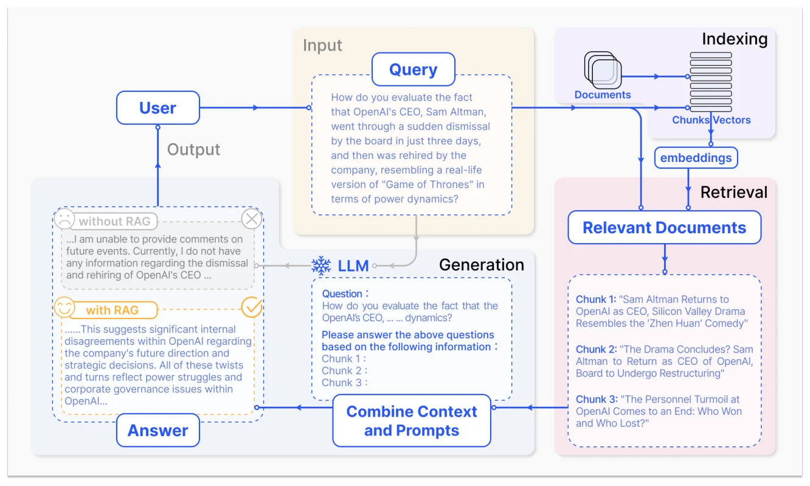
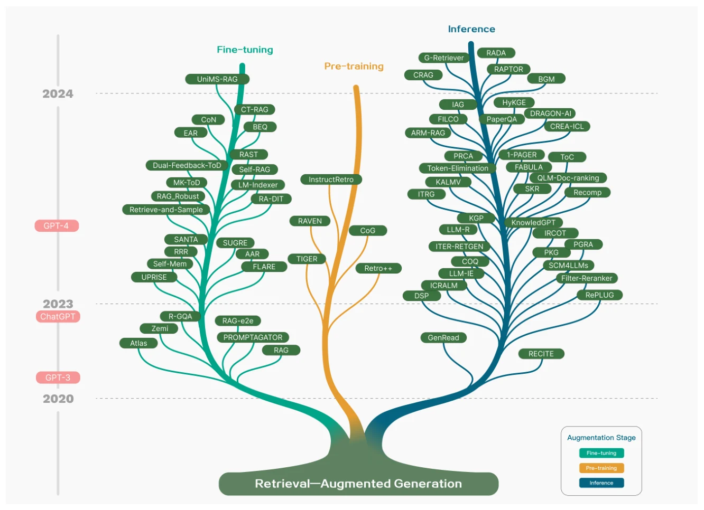
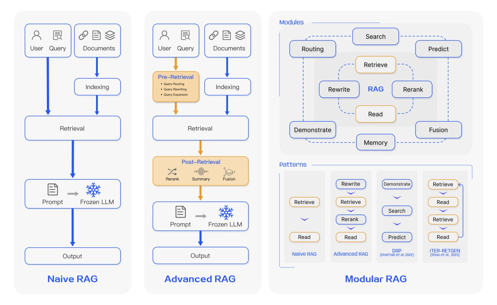
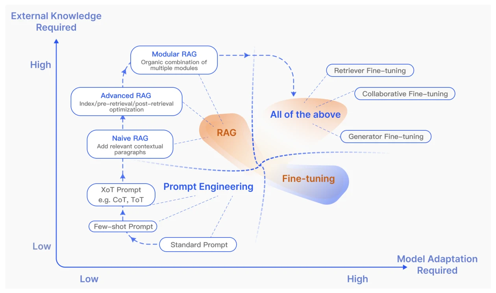
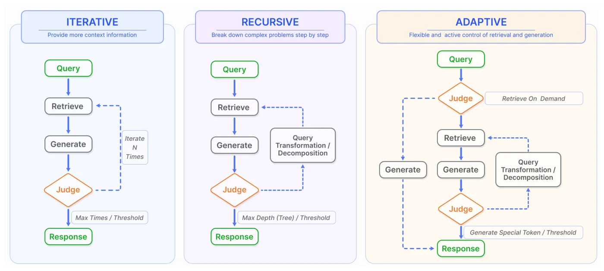

# RAG 综述：检索增强生成的方法地图

大语言模型（LLM）很会说话，但有三个老问题：会一本正经地编造事实（常被称为“幻觉”），知识停留在训练数据截止的那一天，回答时说不清依据从哪里来。检索增强生成（RAG）的思路很朴素：回答之前，先去外部资料库里找相关内容，把找到的材料和问题一起交给模型，让它“看着资料作答”。[摘要与 §I](https://arxiv.org/html/2312.10997v5#S1)

这篇由同济大学和复旦大学团队撰写的综述，梳理了 100 多项 RAG 研究，是入门这一领域最常被推荐的材料之一。它的主要贡献可以概括为三张“地图”：

- **一张演进图：** 把 RAG 研究归纳为 Naive、Advanced、Modular 三种范式；
- **一张部件图：** 按“检索—生成—增强”三个环节，整理每个环节里的代表方法；
- **一张评价图：** 汇总 26 类下游任务、近 50 个数据集，以及评价目标、指标和工具。

读这篇综述最大的困难，是满篇的方法名和缩写：HyDE、Self-RAG、FLARE、IRCoT、RA-DIT……综述往往一句话带过。这份导读会把主要方法放回它们所属的位置，说明每个方法改变了哪个环节、在什么基础上做了改进。正文中第一次出现的缩写带有虚线，点开可以看全称、所属领域和来历。

本导读固定采用 2024 年 3 月 27 日发布的 arXiv v5。综述覆盖到 2024 年初，不是今天 RAG 技术与产品的完整清单。[论文身份与版本](https://arxiv.org/abs/2312.10997v5)

## 从一个例子看 RAG 怎样工作

综述用图 2 中的例子开场。用户问 ChatGPT：“OpenAI 的 CEO 被董事会突然解雇、三天后又被请回来，这件事怎么评价？”这是训练数据之后才发生的新闻。没有 RAG 时，模型只能回答“我无法评论未来事件，目前没有相关信息”。有了 RAG，系统先找到几篇相关报道，把它们和问题一起放进提示里，模型就能据此给出有内容的回答。[§II 与图 2](https://arxiv.org/html/2312.10997v5#S2)

图 2 把整个过程拆成三步，这也是最基础的 RAG 流程：[Naive RAG 的三个步骤](https://arxiv.org/html/2312.10997v5#S2.SS1)

1. **索引（Indexing）。** 把 PDF、HTML、Word、Markdown 等各种格式的原始资料清洗成纯文本，切成小块（chunk），再用嵌入模型把每块文本变成向量，存进向量数据库。切块是因为模型一次能读的长度有限。
2. **检索（Retrieval）。** 用户提问后，用同一个嵌入模型把问题也变成向量，计算它和每个文本块的相似度，取最相似的前 K 块。
3. **生成（Generation）。** 把问题和取回的文本块拼成一个提示，交给大模型生成回答。多轮对话时，还可以把之前的对话历史一起放进去。

这里有一个容易忽略的要点：整个过程中，大模型本身的参数没有任何变化。图中的雪花图标表示模型是“冻结”的。知识的更新发生在资料库这一侧：想让模型知道新消息，只需把新文档加进索引，而不必重新训练模型。这正是 RAG 吸引人的地方。

但这条最朴素的流程有不少毛病，综述把它们分成三类：

- **检索的问题：** 精确率和召回率都不够，可能取回不相关的块，也可能漏掉关键信息；
- **生成的问题：** 模型仍可能编造材料里没有的内容，也可能输出不相关、有害或带偏见的回答；
- **衔接的问题：** 多个来源的信息重复、互相矛盾，或者模型只是照搬检索结果，而不是真正综合。复杂问题只靠一次检索，往往拿不到足够的信息。

后面介绍的各种方法，几乎都可以看作在修补这三类问题中的某一处。读一篇新的 RAG 论文时，可以先问一句：它在修哪里？

## RAG 的来路：技术树与三个阶段

图 1 是综述的技术树，纵轴是时间，三根枝干代表“在哪个阶段引入检索”：预训练（橙色，中间）、微调（绿色，左侧）、推理（深蓝，右侧）。时间轴上标出了 GPT-3、ChatGPT、GPT-4 三个节点，可以看到枝叶在 ChatGPT 之后明显变密。[§I 与图 1](https://arxiv.org/html/2312.10997v5#S1)

综述据此把 RAG 的发展分成三个阶段：

**第一阶段：和 Transformer 一起起步。** 早期工作主要在预训练阶段引入外部知识，增强预训练模型（PTM）。2020 年 Lewis 等人提出的 RAG 模型也出现在这一时期（图 1 把它画在微调枝干的根部），本库有[专门的导读](/read/rag/2#u01)。DeepMind 的 RETRO 则在预训练时就让语言模型从万亿级词元的数据库中检索。

**第二阶段：ChatGPT 之后转向推理阶段。** 大模型展现出很强的上下文学习（ICL）能力：不改参数，只在提示里给例子和材料，就能完成新任务。研究重心于是转向“推理时怎样给模型更好的信息”，图 1 右侧的枝干因此最为茂密。这一阶段的大部分方法都不训练大模型本身。

**第三阶段：与微调结合。** 研究不再局限于推理阶段，开始和大模型微调结合起来，比如同时训练检索器和生成器，让两者互相适应。图 1 左侧枝干上的 Self-RAG、RA-DIT 都属于这一类。

这个分期是综述作者的归纳。三条枝干并不互相排斥，一个系统完全可以在多个阶段都用上检索。

## 三种范式：从流水线到可组合的模块

综述最核心的框架是图 3 的三种范式。要注意，作者说的是“范式”，指组织 RAG 系统的思路，不是三个互不相干的算法。后一种包含了前一种。[§II 与图 3](https://arxiv.org/html/2312.10997v5#S2)

**Naive RAG（朴素 RAG）** 就是上一节说的“索引—检索—生成”三步，也被称为 Retrieve-Read（先检索、再阅读）框架。它在 ChatGPT 普及后迅速流行，图 3 左侧画的就是这条直线。

**Advanced RAG（进阶 RAG）** 仍是一条直线，但在检索前后各加了一道工序（图 3 中间的两个橙色框）：[Advanced RAG](https://arxiv.org/html/2312.10997v5#S2.SS2)

- **检索前（Pre-Retrieval）：** 优化索引和问题。索引方面，可以用滑动窗口、更细的切分、附加元数据；问题方面，可以改写、扩展或转换用户的提问，让它更适合检索。
- **检索后（Post-Retrieval）：** 处理取回的材料。一是重排（rerank），把最相关的内容放到提示的开头或结尾；二是压缩上下文，只留下关键信息，避免大量无关内容淹没重点。LlamaIndex、LangChain 等工程框架都实现了这些功能。

**Modular RAG（模块化 RAG）** 不再是固定的直线，而是一组可以替换、增加、重新排列的模块。综述从两方面描述它：[Modular RAG](https://arxiv.org/html/2312.10997v5#S2.SS3)

第一是**新模块**。图 3 右上方列出了一圈：

- **Search：** 直接搜索引擎、数据库、知识图谱，由大模型生成查询代码；
- **RAG-Fusion：** 把一个问题扩展成多个角度的查询，并行检索后再重排；
- **Memory：** 利用模型自己的输出构建记忆池来引导检索；
- **Routing：** 根据问题选择走哪个数据源或处理流程；
- **Predict：** 让大模型直接生成上下文，减少冗余和噪声；
- **Task Adapter：** 让 RAG 适配不同的下游任务。

[新模块](https://arxiv.org/html/2312.10997v5#S2.SS3.SSS1)

第二是**新模式**，也就是模块怎样组合。图 3 右下方给了几个例子：[新模式](https://arxiv.org/html/2312.10997v5#S2.SS3.SSS2)

- **Rewrite-Retrieve-Read（RRR）** 在检索之前加一个改写步骤。它用一个可训练的小模型改写查询，并用大模型的反馈通过强化学习来训练这个改写器。
- **Generate-Read（GenRead）** 更激进：干脆不检索，让大模型先自己“写”出相关文档，再据此作答。
- **Recite-Read（RECITE）** 类似：让模型先从自己的记忆（参数）中“背诵”相关段落，再回答。
- **DSP（Demonstrate-Search-Predict）** 把“给示范—检索—预测”写成可以编排的程序，在大模型和检索器之间来回传递文本。
- **ITER-RETGEN** 是 Retrieve-Read-Retrieve-Read 的循环：用上一轮生成的内容去检索，再用检索结果改进下一轮生成。
- **FLARE 和 Self-RAG** 让模型自己判断什么时候需要检索，后文“增强过程”一节会详细介绍。

GenRead 和 RECITE 很有意思：它们说明“检索”的来源不一定是外部资料库，也可以是模型自己。这也提醒我们，“外部材料”和“模型记忆”之间的边界，比初看时模糊。

从 Naive 到 Modular，综述描述的是一种演进关系。但“模块更多”并不自动等于“效果更好”：改写可能歪曲原意，重排可能丢掉关键反例，路由也可能选错数据源。比较两种方案时，仍要在同一任务、同一资料和相近成本下检验。

## RAG、微调与提示工程怎样选

想让大模型在某个领域表现更好，常见的办法有三种：提示工程、RAG、微调（FT）。综述用图 4 的象限图来比较它们：横轴是“需要改动模型多少”，纵轴是“需要多少外部知识”。[§II-D 与图 4](https://arxiv.org/html/2312.10997v5#S2.SS4)

- **提示工程**在左下角：既不改模型，也不需要太多外部知识，只是更好地利用模型已有的能力。从普通提示、少样本提示，到 CoT 这类引导推理的提示，都属于这一类。
- **RAG**在左上方：不怎么改模型，但需要大量外部知识。综述的比喻是“给模型一本量身定做的教科书”，适合需要精确查找信息的任务。
- **微调**在右下方：要进一步训练模型，好比学生把知识“内化”进脑子里，适合需要复制特定结构、风格或格式的场景。

两者各有长短。RAG 的知识可以实时更新，可解释性强，能指出答案来自哪份材料；但检索会增加延迟，数据来源也涉及伦理问题。微调更“静态”，知识更新要重新训练，需要较多计算资源准备数据和训练，但能深度定制模型的行为和风格。

综述引用了一项比较研究：在多个知识密集型任务上，无监督微调只带来有限的提升，RAG 则始终更好，无论是训练时见过的知识还是全新的知识；而且大模型很难通过无监督微调学会新的事实。[Ovadia 等的比较研究](https://arxiv.org/abs/2312.05934)

不过综述也强调，两者并不互斥。图 4 右上角的 “All of the above” 表示 Modular RAG 正在和检索器微调、生成器微调、协同微调结合。选择哪种方式，取决于数据变化有多快、需要多深的定制，以及有多少计算资源。

## 检索之一：从哪里找、切多细、怎样建索引

综述第三章是全文最长的部分，讨论 RAG 中“检索”这一环的各种选择。这一节先看资料本身，下一节再看问题和检索器。[§III 检索](https://arxiv.org/html/2312.10997v5#S3)

**检索来源有四类。**[数据结构](https://arxiv.org/html/2312.10997v5#S3.SS1.SSS1)

- **非结构化数据**，主要是文本，用得最广。开放域问答（ODQA）常用维基百科的固定版本，比如 HotpotQA（2017 年 10 月 1 日）和 DPR（2018 年 12 月 20 日）对应的版本。
- **半结构化数据**，指 PDF 这类图文表混排的资料。难点有二：切块时可能把表格切断，表格也让相似度计算变复杂。一种做法是让大模型写 SQL 查询表格（如 TableGPT），另一种是把表格转成文字。综述认为两者都不理想，这里还有很大的研究空间。
- **结构化数据**，比如知识图谱（KG），通常经过验证，信息更精确。KnowledGPT 让模型生成知识库查询；G-Retriever 把图神经网络（GNN）、大模型和 RAG 结合起来，用于理解图结构的问答。代价是构建和维护结构化数据库需要额外工作。
- **大模型自己生成的内容。** SKR 先判断问题是模型“已知”还是“未知”，只对未知的问题检索；GenRead 用模型生成代替检索；Selfmem 用模型的输出迭代构建一个记忆池。

**检索粒度：一次取多大的一块。** 粒度从细到粗依次是词元、短语、句子、命题、块、整篇文档。块太大，信息多但噪声也多；块太小，噪声少但可能不完整，检索负担也更重。DenseX 提出用“命题”作为检索单位：每个命题是文中一个最小的、自成一体的事实陈述。知识图谱上的粒度则是实体、三元组和子图。[检索粒度](https://arxiv.org/html/2312.10997v5#S3.SS1.SSS2)

举个例子体会粒度的影响：实验表格里的一个数字“83.2”单独切出来，几乎没有意义，它离不开列名、数据集、实验设置和脚注。切得太碎，检索即使精准命中也恢复不了含义；整篇文章一块，模型又要在大量无关内容中找答案。

**索引优化：怎样把资料存好。**[索引优化](https://arxiv.org/html/2312.10997v5#S3.SS2)

- **切块策略。** 最常见的是按固定词元数切，比如 100、256 或 512 个。为了避免把句子从中间切断，有递归切分和滑动窗口等方法。Small2Big 则用句子作为检索单位（小），找到后再把前后句一起交给模型（大），兼顾检索精度和上下文完整。
- **附加元数据。** 给每块加上页码、文件名、作者、类别、时间戳等信息，检索时可以按元数据筛选。按时间加权，就能做到“时间感知”，优先用新的资料。元数据也可以人为构造：给段落生成摘要，或者让大模型为每段生成“这段能回答什么问题”。后者被称为 Reverse HyDE：检索时比较用户问题和这些假设问题，缩小问题与答案之间的语义差距。
- **结构化索引。** 一种是层级索引，把文档按父子关系组织，每个节点存摘要，先定位大的部分再找具体的块。另一种是知识图谱索引，比如 KGP 在多篇文档之间建一张图：节点是段落或页面、表格，边表示段落间的相似度或文档内部的结构关系，用来做多文档问答。

## 检索之二：问题怎样问、检索器怎样配

资料准备好了，下一个问题是：用户的提问往往不适合直接拿去检索。问题可能表述不清、结构复杂，还可能含有歧义缩写。综述举了一个例子：法律场景中的“LLM”，指的可能是大语言模型，也可能是法学硕士（Master of Laws）。[查询优化](https://arxiv.org/html/2312.10997v5#S3.SS3)

**查询扩展：把一个问题变成多个。**

- **Multi-Query：** 用提示让大模型把问题扩展成多个查询，并行检索。
- **Sub-Query：** 把复杂问题拆成一系列简单的子问题，比如用 least-to-most 提示法从易到难地分解。
- **CoVe（Chain-of-Verification，验证链）：** 原本是一种减少幻觉的方法：模型先起草回答，再列出核实问题，独立回答后修正初稿。综述把这种“生成并验证扩展查询”的思路也归入这里。

**查询转换：不用原问题，换一个更好检索的说法。**

- **查询改写。** RRR 用一个小模型专门改写查询；淘宝的 BEQUE 把查询改写用于电商搜索，提升了长尾查询的召回。
- **HyDE（假设文档嵌入）。** 一个很巧妙的想法：问题和答案往往长得不像，直接拿问题去找答案效果有限。HyDE 先让大模型针对问题写一段“假设的答案文档”，这段文字可能包含错误细节，但它“长得像”真正的答案。再用它的向量去找资料库里相似的真实文档。综述说，这相当于从“问题找答案”改成了“答案找答案”。
- **Step-back 提示：** 先把具体问题抽象成一个更上位的问题。比如把关于某个具体物理情境的问题，先退一步变成“这里涉及什么物理原理”，用原问题和上位问题一起检索。

**查询路由：** 不同问题走不同的流程。元数据路由先从问题中提取关键词或实体，再按块的元数据筛选范围；语义路由则根据问题的语义选择路径。两者也可以结合。

**嵌入模型：检索器的核心。**[嵌入](https://arxiv.org/html/2312.10997v5#S3.SS4)检索靠计算问题和文本块向量之间的相似度，比如余弦相似度。嵌入方法分两类：一是稀疏检索，以 BM25 为代表，本质上是看关键词重合；二是稠密检索，用 BERT 这类预训练模型把文本编码成向量，看语义相近。DPR 是稠密检索的经典工作。综述提到的新一代嵌入模型有 AngIE、Voyage、BGE 等。MTEB 排行榜在 8 类任务、58 个数据集上评估嵌入模型，C-MTEB 针对中文，覆盖 6 类任务、35 个数据集。综述的态度很务实：没有放之四海而皆准的嵌入模型，要看具体场景。

- **混合检索：** 稀疏和稠密各有所长，可以互补。比如稀疏检索擅长处理包含生僻实体的查询，能提升稠密检索的鲁棒性。
- **微调嵌入模型：** 医疗、法律等专业领域的用语和预训练语料差别很大，需要用领域数据微调。另一个目的是让检索器和生成器“对齐”，即用大模型的反馈来训练检索器。PROMPTAGATOR 用大模型生成少量查询来训练特定任务的检索器；LLM-Embedder 同时使用数据集标签和大模型给的奖励信号；REPLUG 计算检索器和大模型对文档的两个概率分布，用 KL 散度让检索器向大模型靠拢。还有借鉴 RLHF 思路，用强化学习训练检索器的做法。

**适配器：不改大模型也能对齐。**[适配器](https://arxiv.org/html/2312.10997v5#S3.SS5)很多时候大模型只能通过 API 调用，或者本地算力不够，无法微调。这时可以在中间加一个小的“适配器”：

- **UPRISE** 训练一个轻量的提示检索器，从提示池里为零样本任务自动挑选合适的提示；
- **AAR** 提供一个可以适配多种下游任务的通用检索适配器；
- **PRCA** 加了一个可插拔、由奖励驱动的上下文适配器；
- **BGM** 保持检索器和大模型都不动，在两者之间训练一个“桥接”模型，把检索结果转换成大模型更好用的形式。

## 生成：材料怎样整理，模型怎样调整

检索到材料之后，把所有结果一股脑儿塞给模型并不是好做法。综述第四章从两个方向讨论怎样改进：调整检索到的内容，以及调整大模型本身。[§IV 生成](https://arxiv.org/html/2312.10997v5#S4)

**上下文整理：为什么不能塞得越多越好。**[上下文整理](https://arxiv.org/html/2312.10997v5#S4.SS1)冗余信息会干扰生成，过长的上下文还会让模型遇到“迷失在中间”（Lost in the Middle）的问题：和人类似，模型更关注长文本的开头和结尾，容易忽略中间部分。这个现象来自 Liu 等人 2023 年的研究，他们发现关键信息放在中间位置时，模型表现会明显下降。

- **重排（Reranking）。** 重新排列文档块，把最相关的放在前面。它同时起到增强和过滤的作用。重排可以基于规则，比如多样性、相关性、MRR 等指标；也可以基于模型，比如 SpanBERT 这类 BERT 系列模型、Cohere rerank、bge-reranker 这类专门的重排模型，或者直接用 GPT 这样的大模型。
- **上下文压缩。** 综述指出一个常见误解：检索越多相关文档、拼成越长的提示越好。实际上过多的上下文会引入噪声。LLMLingua 用 GPT-2 Small、LLaMA-7B 这样的小模型找出并删掉不重要的词元，压缩后的文本人读起来困难，但大模型能理解。RECOMP 用对比学习训练一个信息压缩器，每条训练数据含 1 个正样本和 5 个负样本。PRCA 则训练一个信息提取器。
- **减少文档数量。** Filter-Reranker 让小模型做初筛、大模型对困难样本重排，在信息抽取（IE）任务上有明显提升。还有一种直接的做法是让大模型在回答前先评估检索内容，过滤掉相关性差的文档，比如法律模型 Chatlaw 会让模型对引用的法条做自我评估。

**微调大模型。**[大模型微调](https://arxiv.org/html/2312.10997v5#S4.SS2)如果能部署本地模型，针对场景微调可以带来更好的效果：一是补充领域知识，二是调整输入输出格式和风格。SANTA 针对结构化数据检索，设计了三阶段训练，先用对比学习优化查询和文档的嵌入。还可以用强化学习让模型的输出对齐人类偏好或检索器偏好；拿不到强大模型时，可以用 GPT-4 这类模型的输出做蒸馏。

最值得注意的是**检索器和生成器协同微调**。代表方法 RA-DIT 分两步：先微调大模型，让它更会利用检索到的信息；再微调检索器，让它返回大模型更“喜欢”的结果，两者的打分函数用 KL 散度对齐。这正是图 4 中 Modular RAG 和微调结合的例子。

## 增强过程：一次检索不够时怎么办

标准的 RAG 只检索一次。对于需要多步推理的复杂问题，一次检索提供的信息往往不够。综述第五章把改进方法归纳为图 5 的三种流程，每种都在图中用一个菱形的“Judge”（判断）节点控制循环。[§V 增强过程与图 5](https://arxiv.org/html/2312.10997v5#S5)

**迭代检索（Iterative）：多检索几轮，补充更多上下文。** 流程是“检索—生成—判断”，不满意就再来一轮，直到达到最大次数或阈值。它的风险是语义可能不连贯，不相关的信息也会越积越多。代表方法 ITER-RETGEN 把“检索增强生成”和“生成增强检索”结合起来：模型当前的输出显示了完成任务还需要什么，用它做查询能找到更相关的知识，进而在下一轮生成更好的回答。[迭代检索](https://arxiv.org/html/2312.10997v5#S5.SS1)

**递归检索（Recursive）：逐步拆解复杂问题。** 和迭代检索的区别在于，每轮之后会改写或分解问题（图 5 中间的 “Query Transformation / Decomposition”），逐步逼近真正需要的信息。[递归检索](https://arxiv.org/html/2312.10997v5#S5.SS2)

- **IRCoT** 把检索和思维链（CoT）交织在一起：推理每走一步，就用这一步的内容去检索，检索结果又帮助下一步推理。它的出发点是，多步问题中“要检索什么”取决于“已经推出了什么”。
- **ToC（澄清树）** 针对有歧义的问题，递归地构建一棵“澄清树”，列出问题的各种可能理解，分别检索后再综合回答。
- 递归检索也常和层级索引配合，先检索文档摘要，再在选中的文档内部做二次检索。多跳检索则沿图结构数据深入，提取相互关联的信息。

**自适应检索（Adaptive）：让模型自己决定何时检索、何时停止。**[自适应检索](https://arxiv.org/html/2312.10997v5#S5.SS3)图 5 右侧第一个判断节点就是“要不要检索”（Retrieve On Demand）：不需要就直接生成。综述把它和 Agent 的趋势联系起来：像 AutoGPT、Toolformer 这样的系统，让大模型主动决定何时使用工具，检索也可以看作一种工具。本库有 [Toolformer 的导读](/read/toolformer/1#u01)可以对照。

- **WebGPT** 用强化学习训练 GPT-3 自主使用搜索引擎，通过特殊词元执行搜索、浏览结果、引用参考资料等动作。
- **FLARE** 监控生成过程中的置信度：当某个生成词的概率低于阈值，说明模型“没把握”，就触发检索。具体做法是先预测下一句，把它当作查询去检索，再重新生成这句。
- **Self-RAG** 训练模型生成特殊的“反思词元”，分为 retrieve 和 critic 两类：前者决定是否检索，后者评价检索结果和自己的输出质量。由于这些判断由模型自己产生，不需要额外的分类器或自然语言推理（NLI）模型。

从迭代到自适应，控制权逐渐从固定的规则转移到模型自身。多轮检索最需要提防的是错误自我强化：如果第一轮生成的猜测被直接用来做下一轮检索，可能反复找到支持这个猜测的材料。每一轮都应该说清新增了哪条外部证据，解决了哪个缺口。这是导读给出的检查思路，不是综述验证过的结论。

## 怎样评价一个 RAG 系统

综述第六章汇总了 RAG 的评价方法。作者指出，过去对 RAG 的评价大多只看它在下游任务上的成绩，专门评价 RAG 自身特点的研究还很少。[§VI 任务与评价](https://arxiv.org/html/2312.10997v5#S6)

**下游任务。** RAG 的核心任务仍是问答（QA），包括单跳问答（如 NQ、TriviaQA）、多跳问答（如 HotpotQA、2WikiMultiHopQA、MuSiQue）、长答案问答、领域问答和多选题等；此外还扩展到信息抽取、对话生成、代码搜索、事实核查等。表 II 列出了 26 类任务和对应的数据集。传统指标因任务而异：问答常用精确匹配（EM）和 F1，事实核查用准确率，生成质量常用 BLEU 和 ROUGE。[下游任务](https://arxiv.org/html/2312.10997v5#S6.SS1)

**两个评价目标。**[评价目标](https://arxiv.org/html/2312.10997v5#S6.SS2)

- **检索质量：** 检索器找来的上下文好不好。借用搜索引擎和推荐系统的指标，如命中率（Hit Rate）、MRR、NDCG。
- **生成质量：** 生成器能否基于检索内容给出连贯、相关的回答。没有标准答案时，看忠实性、相关性和无害性；有标准答案时，看准确性。

**三个质量分数与四种能力。** 这是综述评价部分的核心框架。[评价维度](https://arxiv.org/html/2312.10997v5#S6.SS3)

三个质量分数：

- **上下文相关性：** 检索到的内容是否精确、切题；
- **答案忠实性：** 回答是否忠于检索到的内容，不自相矛盾；
- **答案相关性：** 回答是否切中用户的问题。

四种能力：

- **噪声鲁棒性：** 面对和问题相关、但没有实质信息的文档，能否不受干扰；
- **拒答能力：** 检索结果中没有答案时，能否拒绝回答而不是硬编；
- **信息整合：** 能否综合多篇文档回答复杂问题；
- **反事实鲁棒性：** 文档中有已知错误时，能否识别并忽略。

把这几个维度分开看很有必要，因为它们可能互相矛盾。一个系统可以找到了正确材料却读错了；也可以忠实复述了错误材料；还可以凭模型自己的知识答对，却拿不出支持它的材料。只看最终答对率，这些情况会混在一起。

表 III 列出了每个维度可用的指标。综述特别提醒：这些指标大多借用自相关领域，还不是成熟、统一的 RAG 评价标准。

**评价基准与工具。**[基准与工具](https://arxiv.org/html/2312.10997v5#S6.SS4)

| 名称 | 类型 | 评价什么 |
| --- | --- | --- |
| RGB | 基准 | 噪声鲁棒性、拒答、信息整合、反事实鲁棒性四种能力，中英文 |
| RECALL | 基准 | 反事实鲁棒性 |
| CRUD | 基准 | 中文场景下的创作、问答、纠错、摘要 |
| RAGAS | 工具 | 用大模型评估上下文相关性、忠实性、答案相关性，不依赖人工标注 |
| ARES | 工具 | 同样三个维度，训练轻量的评判模型，并用少量人工标注校准 |
| TruLens | 工具 | 同样三个维度 |

这些工具多用大模型当评委。大模型评分流畅好用，但它本身也会出错，关键样本仍需要人回看。

## 挑战与未来方向

综述第七章列出了作者认为 RAG 尚待解决的问题。这些是 2024 年初的判断，读的时候要考虑之后的发展，不能直接当作今天的研究空白。[§VII 讨论与展望](https://arxiv.org/html/2312.10997v5#S7)

**RAG 与长上下文。** 当时大模型已能处理超过 20 万词元的上下文，过去需要 RAG 的长文档问答，现在可以把整篇文档直接放进提示。那还需要 RAG 吗？作者的回答是需要，理由有二：一次性输入大量上下文会显著降低推理速度，分块检索、按需输入效率更高；RAG 能定位原始出处，让用户核实答案，整个过程可观察，而只靠长上下文生成是个黑箱。反过来，更长的上下文也让 RAG 能处理需要读大量材料的综合性问题。[RAG 与长上下文](https://arxiv.org/html/2312.10997v5#S7.SS1)

**鲁棒性。** 检索到噪声或矛盾的信息会损害输出，所谓“错误的信息可能比没有信息更糟”。综述引用了一个反直觉的发现：在提示中加入不相关的文档，准确率反而可能提高 30% 以上。原论文摘要给出的数字是“随机文档最多提高 35%”，同时发现与问题相关、但不含答案的高分文档会降低效果。这说明检索和生成的配合方式还需要专门研究。[鲁棒性](https://arxiv.org/html/2312.10997v5#S7.SS2) · [Cuconasu 等原文摘要](https://arxiv.org/abs/2401.14887)

**混合方法。** RAG 与微调怎样结合，是顺序、交替，还是端到端联合训练，仍在探索。另一个趋势是在 RAG 里引入有特定功能的小模型。例如 CRAG（纠正式 RAG）训练一个轻量的检索评估器，判断检索结果的整体质量，根据置信度触发不同的动作，比如改用网络搜索。[混合方法](https://arxiv.org/html/2312.10997v5#S7.SS3)

**RAG 的规模规律。** 大模型的规模规律（scaling laws）已经比较清楚，但它是否适用于 RAG 还不确定。RETRO++ 等工作开始探索，不过 RAG 模型的参数量仍远小于大模型。作者还提到“逆规模规律”，即小模型反而表现更好的可能性，值得研究。[规模规律](https://arxiv.org/html/2312.10997v5#S7.SS4)

**走向生产。** 工程上的挑战包括检索效率、大规模知识库中的召回率，以及数据安全，比如防止模型无意中泄露文档来源或元数据。工具生态方面，LangChain、LlamaIndex 提供了丰富的 RAG 接口，Flowise AI 等低代码工具降低了门槛，云厂商也推出了企业搜索类服务。作者认为发展方向会分化为定制化、简化和专业化。[生产落地](https://arxiv.org/html/2312.10997v5#S7.SS5)

**多模态 RAG。** RAG 已经扩展到图像、音频、视频和代码，比如 RA-CM3 能同时检索和生成文本与图像，RBPS 通过检索相似代码示例辅助程序修复。[多模态](https://arxiv.org/html/2312.10997v5#S7.SS6)

## 把方法放回地图：一张速查表

读完综述，最有用的收获可能是一个分析框架：拿到任何一篇 RAG 论文，先判断它改变的是哪一环，再看实验是否单独验证了这个改变。下表把本导读提到的主要方法按环节整理一遍。方法的核心做法依据综述描述，并对照了各方法原文摘要；点开方法名可以看简介和原文入口。

| 环节 | 方法 | 改变了什么 | 改进自 |
| --- | --- | --- | --- |
| 资料粒度 | DenseX | 用“命题”作检索单位 | 按段落或固定长度切块 |
| 索引结构 | KGP | 在多篇文档之间建知识图谱 | 平铺的块索引 |
| 查询改写 | RRR | 训练小模型改写查询 | 直接用原问题检索 |
| 查询转换 | HyDE | 先生成假设答案，再用它检索 | 用问题直接匹配答案 |
| 查询转换 | Step-back | 先抽象出上位问题 | 只用具体问题检索 |
| 检索来源 | GenRead | 用模型生成代替检索 | 从外部资料库检索 |
| 检索器训练 | REPLUG | 用大模型的反馈训练检索器 | 检索器和生成器各自训练 |
| 协同微调 | RA-DIT | 先后微调生成器和检索器 | 只训练其中一方 |
| 上下文压缩 | LLMLingua | 用小模型删去不重要的词元 | 原样拼接全部检索结果 |
| 上下文压缩 | RECOMP | 训练压缩器生成摘要 | 原样拼接全部检索结果 |
| 迭代检索 | ITER-RETGEN | 用生成结果再检索，循环改进 | 一次检索 |
| 递归检索 | IRCoT | 检索与思维链逐步交织 | 一次检索后再推理 |
| 自适应检索 | FLARE | 低置信度时触发检索 | 固定时机检索 |
| 自适应检索 | Self-RAG | 用反思词元决定检索并自评 | 不加判断地检索固定数量 |
| 纠错 | CRAG | 评估检索质量后决定后续动作 | 默认相信检索结果 |
| 评价 | RAGAS、ARES | 分维度、自动化地评价 RAG | 只看下游任务成绩 |

一个实用的提醒：如果一篇论文同时改了好几个环节，比如既改写查询又换了重排模型，那么端到端的提升只能先归功于整个系统，不能直接说是某一个模块的功劳。

**接下来读什么。** 想具体理解检索结果怎样进入生成概率，可以读本库的 [RAG 原始论文导读](/read/rag/2#u02)；想看检索怎样变成模型可以主动调用的行动，可以读 [ReAct](/read/react/1#u01)，对照“检索—生成循环”和更一般的“行动—观察循环”。这是编辑建议的顺序，不是作者证明的先修关系。

## 原文入口与本次覆盖

推荐读原文时先看三张图：图 3 的三种范式（PDF 第 4 页）、图 5 的三种增强流程（第 11 页）和表 III 的评价指标（第 14 页）。然后根据你关心的问题，选读第三、四章中相关的小节。表 I（第 6 页）列出了 70 多种方法的检索来源、粒度、阶段和流程，适合当作索引来查。这里的页码都从 PDF 第一页算起。[固定 HTML 全文](https://arxiv.org/html/2312.10997v5) · [固定 PDF](https://arxiv.org/pdf/2312.10997v5) · [表 I 方法汇总](https://arxiv.org/html/2312.10997v5#S2.T1)

本导读依据 arXiv v5 全文，覆盖第二至第七章的主线：三种范式、RAG 与微调的比较、检索、生成、增强过程、评价体系和未来方向。图 1–5 为原论文图，截取自固定 PDF 并经 AI 查看；表格为导读整理的摘录。方法的核心做法依据综述描述，并对照了各方法的 arXiv 摘要，但没有逐篇精读被引论文，也没有复现任何性能结果。综述参考文献 [100] 的条目与正文所说的 LLMLingua 不符，本导读的 LLMLingua 介绍依据其 arXiv 原文摘要。[LLMLingua 原文摘要](https://arxiv.org/abs/2310.05736) 第七章生态与多模态部分只做了概述。原图来自 arXiv 默认的非独占分发许可，仅在私有仓库中作个人学术阅读引用。阅读本导读不会自动记为已读原文。
