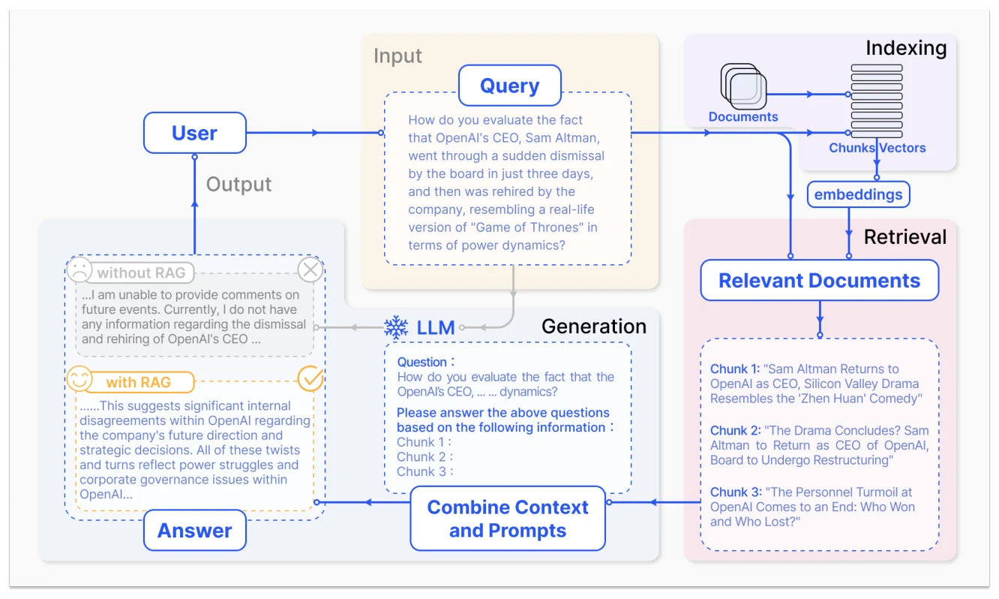
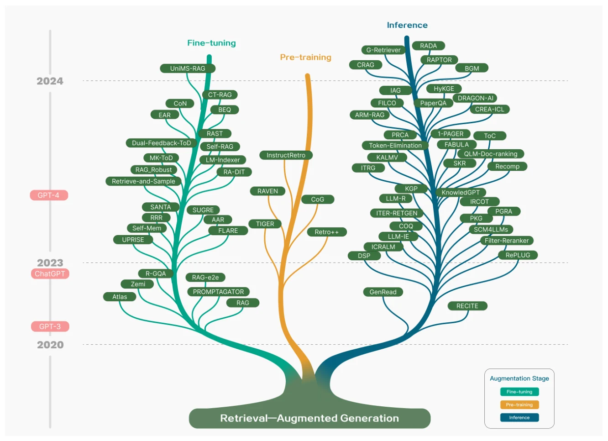
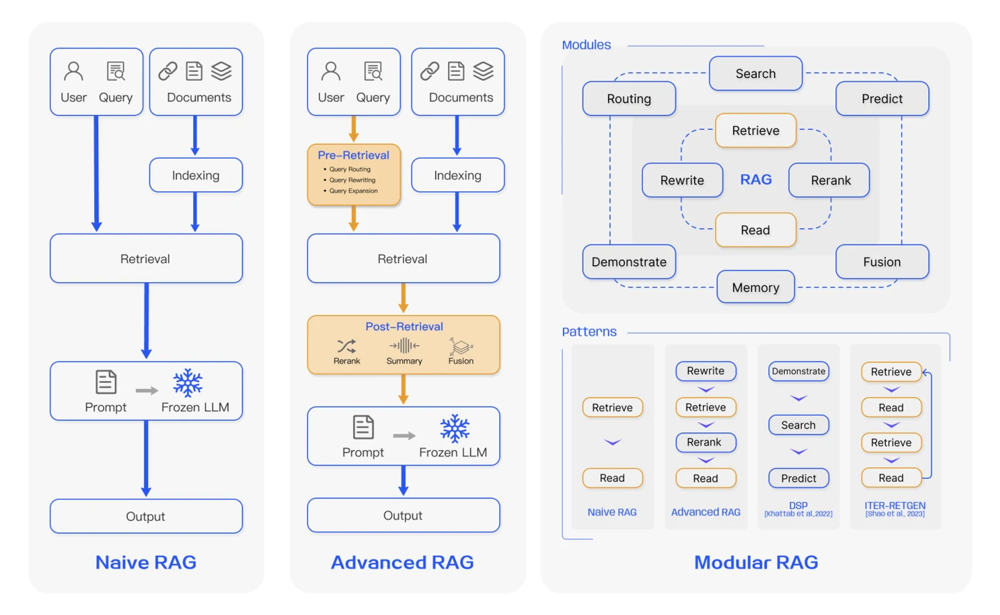
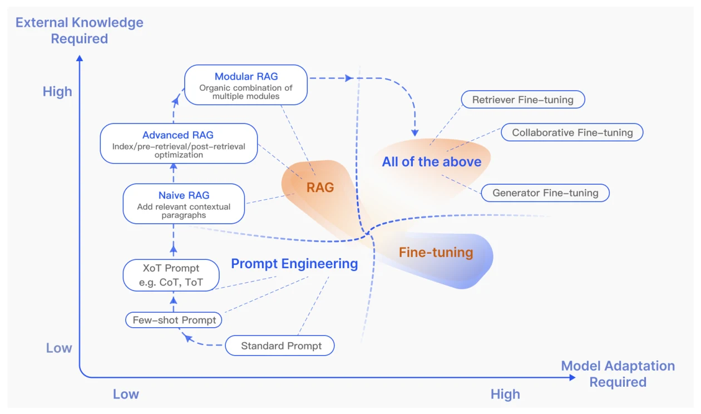
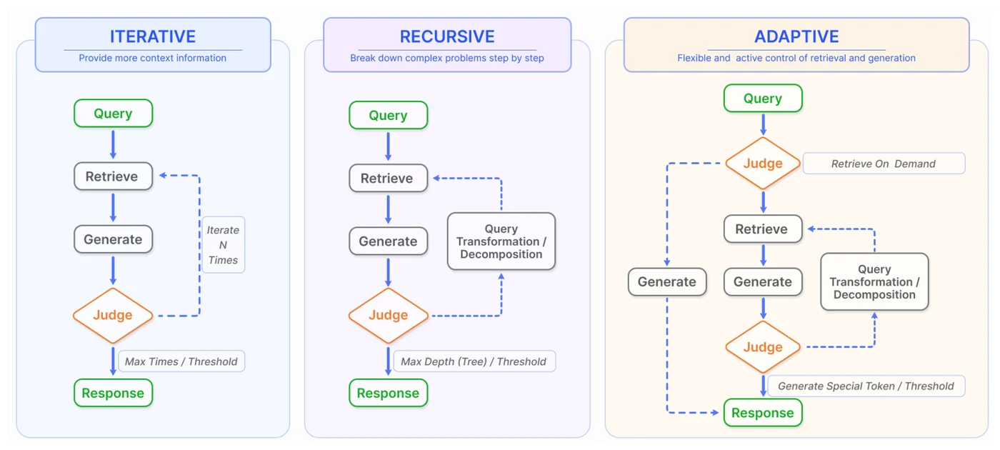

# RAG 综述：检索增强生成的方法地图

大语言模型（LLM）很会说话，但有三个老问题：会一本正经地编造事实（常被称为“幻觉”），单靠模型参数很难给出训练后才出现的事实，回答时说不清依据从哪里来。检索增强生成（RAG）的思路很朴素：回答之前，先去外部资料库里找相关内容，把找到的材料和问题一起交给模型，让它“看着资料作答”。[摘要与 §I](https://arxiv.org/html/2312.10997v5#S1)

Gao 等人在这篇综述中梳理了百余项研究。读者可以沿三条线往下走：图 3 解释一次问答有哪些组织方式；检索、生成和增强流程各章解释哪些环节会让证据丢失或得到补充；评价一章则讨论怎样发现这些变化。贯穿本文的虚构档案例子让同一条回答可以反复拆开检查。

读这篇综述最大的困难，是满篇的方法名和缩写：HyDE、Self-RAG、FLARE、IRCoT、RA-DIT……综述往往一句话带过。这份导读会把主要方法放回它们所属的位置，说明每个方法改变了哪个环节、在什么基础上做了改进。正文中第一次出现的缩写带有虚线，点开可以看全称、所属领域和来历。

本导读固定采用 2024 年 3 月 27 日发布的 arXiv v5。综述覆盖到 2024 年初，不是今天 RAG 技术与产品的完整清单。[论文身份与版本](https://arxiv.org/abs/2312.10997v5)

## 从一个例子看 RAG 怎样工作

综述用图 2 中的例子开场。用户问 ChatGPT：“OpenAI 的 CEO 被董事会突然解雇、三天后又被请回来，这件事怎么评价？”这是训练数据之后才发生的新闻。没有 RAG 时，模型只能回答“我无法评论未来事件，目前没有相关信息”。有了 RAG，系统先找到几篇相关报道，把它们和问题一起放进提示里，模型就能据此给出有内容的回答。[§II 与图 2](https://arxiv.org/html/2312.10997v5#S2)

图 2 把整个过程拆成三步，这也是最基础的 RAG 流程：[Naive RAG 的三个步骤](https://arxiv.org/html/2312.10997v5#S2.SS1)

1. **索引（Indexing）。** 把 PDF、HTML、Word、Markdown 等各种格式的原始资料清洗成纯文本，切成小块（chunk），再用嵌入模型把每块文本变成向量，存进向量数据库。切块是因为模型一次能读的长度有限。
2. **检索（Retrieval）。** 用户提问后，用同一个嵌入模型把问题也变成向量，计算它和每个文本块的相似度，取最相似的前 K 块。
3. **生成（Generation）。** 把问题和取回的文本块拼成一个提示，交给大模型生成回答。多轮对话时，还可以把之前的对话历史一起放进去。

这里有一个容易忽略的要点：整个过程中，大模型本身的参数没有任何变化。图中的雪花图标表示模型是“冻结”的。知识的更新发生在资料库这一侧：想让模型知道新消息，可以把新文档加进索引供检索器查找，而不必重新训练模型。这正是 RAG 吸引人的地方。

但这条最朴素的流程有不少毛病，综述把它们分成三类：

- **检索的问题：** 精确率和召回率都不够，可能取回不相关的块，也可能漏掉关键信息；
- **生成的问题：** 模型仍可能编造材料里没有的内容，也可能输出不相关、有害或带偏见的回答；
- **衔接的问题：** 多个来源的信息重复、互相矛盾，或者模型只是照搬检索结果，而不是真正综合。复杂问题只靠一次检索，往往拿不到足够的信息。

**贯穿全文的教学例子。** 假设档案库只有下列四份材料，问题是“青榆站投运时采用哪一版校准规程？当时每隔多少天复核一次？”站名、材料和数值均为本导读虚构，后面可以据此自己检验每个判断。

| 代号 | 材料中可以核对的内容 |
| --- | --- |
| A，投运验收单 | 青榆站投运的设备均为常规传感器，验收采用《传感器校准规程》B 版。 |
| B，规程 B 版 | 常规传感器每 14 天复核一次。 |
| C，规程 C 版 | 后来发布的修订版改为每 7 天复核一次。 |
| D，站点报道 | 青榆站开展了校准培训，未提规程版本和复核周期。 |

A 里有站名却没有天数，B 里有天数却没有站名。只读 A，能回答前半问；把 A 和 B 接起来，才能回答“B 版，常规传感器每 14 天复核一次”。C 也是真实档案（在这个例子里），只是它回答的是后来的规定。先记住这个时间差：后面几种看起来很相似的错误，会落在完全不同的环节。

## RAG 的来路：技术树与三个阶段

图 1 是综述的技术树，纵轴是时间，三根枝干代表“在哪个阶段引入检索”：预训练（橙色，中间）、微调（绿色，左侧）、推理（深蓝，右侧）。时间轴上标出了 GPT-3、ChatGPT、GPT-4 三个节点，可以看到枝叶在 ChatGPT 之后明显变密。[§I 与图 1](https://arxiv.org/html/2312.10997v5#S1)

综述据此把 RAG 的发展分成三个阶段：

**第一阶段：在预训练语言模型中引入检索。** 早期工作主要在预训练阶段引入外部知识，增强预训练模型（PTM）。2020 年 Lewis 等人提出的 RAG 模型也出现在这一时期（图 1 把它画在微调枝干的根部），本库有[专门的导读](/read/rag/2#u01)。DeepMind 的 RETRO 则在预训练时就让语言模型从万亿级词元的数据库中检索。

**第二阶段：ChatGPT 之后转向推理阶段。** 大模型展现出很强的上下文学习（ICL）能力：不改参数，只在提示里给例子和材料，就能完成新任务。研究重心于是转向“推理时怎样给模型更好的信息”，图 1 右侧的枝干因此最为茂密。这一阶段的大部分方法都不训练大模型本身。

**第三阶段：与微调结合。** 研究不再局限于推理阶段，开始和大模型微调结合起来，例如在微调中让模型学会利用检索结果。图 1 的微调枝干包括 Self-RAG、RA-DIT；RA-DIT 还专门调整检索器，使其更容易返回生成器用得上的材料。

这个分期是综述作者的归纳。三条枝干并不互相排斥，一个系统完全可以在多个阶段都用上检索。

## 三种范式：从流水线到可组合的模块

图 3 可以从左到右追踪同一个问题。从左侧的一次检索，到中间对资料和查询做加工，再到右侧把不同操作接成可调整的流程，改变的是系统可以在哪里干预一次回答。图中没有性能坐标，无法凭框的多少给系统排高低。[§II 与图 3](https://arxiv.org/html/2312.10997v5#S2)

**Naive RAG 的优势是容易定位第一处断点。** 图左的 Retrieve-Read 把整个问题交给检索器，拿前 K 个片段，让模型据此答题。假设青榆站的查询取两条，返回 A 和 C。A 支持“B 版”，C 支持“后来每 7 天”，它们合在一起仍然缺少 B 版本身的周期。如果模型写出“B 版每 7 天”，先看返回列表就知道有两处问题：检索器漏了 B，生成器又把 C 的规定安到了 B 版头上。换更强的生成器或许能让它指出缺口，无法替这两份材料补出 14 天。

**Advanced RAG 保留这条流水线，在检索前后分别动手。** 图中央上游处理“能找到什么”。若规程正文的切块没有版本标题，可以在建索引时给每块附上版本，再用保留“投运时”的查询去找。下游处理“找到之后给模型看什么”。若 A、C、B 都进了候选，但提示只容两块，可以按是否支撑同一时期的回答重新排序，再选 A、B。两处优化不会互相替代：候选没有 B 时怎样重排都找不回 B；候选有 B，删掉版本再拼接也会让正确材料失去用处。对照同一题，分别保留候选列表和最终提示，就能区分这两种情况。[Advanced RAG](https://arxiv.org/html/2312.10997v5#S2.SS2)

**Modular RAG 把决定“下一步去哪找”也放进流程。** 图右侧的 Routing 可选择数据源，Search 负责查询指定来源，Memory 可保存中间信息。青榆站题可以先去站务档案找投运文件，从 A 读出规程全名和 B 版，再带着这两个字段转向规程目录。第二次请求用到了第一步刚找到的事实。这样的组合也引入了新的失败点：假如第一步把“现行版本”当成“投运版本”，后面的检索器即使准确执行了指令，整条证据链还是会指向 C。这是教学例子里的诊断。[Modular RAG](https://arxiv.org/html/2312.10997v5#S2.SS3) · [新模块](https://arxiv.org/html/2312.10997v5#S2.SS3.SSS1)

**几种组合都多了一步，中间产物却各有用途。** 图 3 右下列出 Naive、Advanced、DSP 和 ITER-RETGEN。沿 DSP 的示范、搜索、预测几个环节可以看到文本怎样在模块间传递。§II-C.2 的正文还介绍了 RRR、GenRead、RECITE 等组合。 Rewrite-Retrieve-Read（RRR）把提问改写成适合搜索的查询，最终读的是搜到的外部文本。GenRead 让模型生成一份可能有用的背景再阅读；RECITE 让模型先从参数记忆中生成相关段落。后两者可以给模型提供解题线索，但生成的“验收单”不能用来证明一座站实际采用了什么规程。另一个模式 ITER-RETGEN 让上一次生成的草稿引出第二轮外部检索。读箭头时，追问“交出去的是检索指令、猜测还是带出处的原文？”比记住模块名更能说明这条线路怎样支撑答案。[新模式](https://arxiv.org/html/2312.10997v5#S2.SS3.SSS2)

综述把三种范式整理在同一条演进线上。一套模块化系统同样可以只跑一次 Retrieve-Read，也可以在子流程里添加重排。若论文声称模块化带来收益，可以先还原它实际比较的两条线路，并核对语料、生成器、候选数、额外检索次数和输入长度。两条线路同时换了资料库和路由器，最终得分就难以单独说明路由的作用。

## RAG、微调与提示工程怎样选

想让大模型在某个领域表现更好，常见的办法有三种：提示工程、RAG、微调（FT）。综述用图 4 的象限图来比较它们：横轴是“需要改动模型多少”，纵轴是“需要多少外部知识”。[§II-D 与图 4](https://arxiv.org/html/2312.10997v5#S2.SS4)

- **提示工程**在左下角：既不改模型，也不需要太多外部知识，只是更好地利用模型已有的能力。从普通提示、少样本提示，到 CoT 这类引导推理的提示，都属于这一类。
- **RAG**在左上方：不怎么改模型，但需要大量外部知识。综述的比喻是“给模型一本量身定做的教科书”，适合需要精确查找信息的任务。
- **微调**在右下方：要进一步训练模型，好比学生把知识“内化”进脑子里，适合需要复制特定结构、风格或格式的场景。

两者各有长短。RAG 可以通过更新索引来纳入新资料；若保留出处，读者就能核查答案用了哪份材料；但检索会增加延迟，数据来源也涉及伦理问题。微调更“静态”，知识更新要重新训练，需要较多计算资源准备数据和训练，但能深度定制模型的行为和风格。

综述引用了一项比较研究：在多个知识密集型任务上，无监督微调只带来有限的提升，该研究所测的 RAG 在训练时见过的知识和新知识上都表现更好；而且大模型很难通过无监督微调学会新的事实。[Ovadia 等的比较研究](https://arxiv.org/abs/2312.05934)

不过综述也强调，两者并不互斥。图 4 右上角的 “All of the above” 表示 Modular RAG 正在和检索器微调、生成器微调、协同微调结合。选择哪种方式，取决于数据变化有多快、需要多深的定制，以及有多少计算资源。

## 检索之一：从哪里找、切多细、怎样建索引

综述第三章是全文最长的部分，讨论 RAG 中“检索”这一环的各种选择。这一节先看资料本身，下一节再看问题和检索器。[§III 检索](https://arxiv.org/html/2312.10997v5#S3)

**检索来源有四类。**[数据结构](https://arxiv.org/html/2312.10997v5#S3.SS1.SSS1)

- **非结构化数据**，主要是文本，用得最广。开放域问答（ODQA）常用维基百科的固定版本，比如 HotpotQA（2017 年 10 月 1 日）和 DPR（2018 年 12 月 20 日）对应的版本。
- **半结构化数据**，指 PDF 这类图文表混排的资料。难点有二：切块时可能把表格切断，表格也让相似度计算变复杂。一种做法是让大模型写 SQL 查询表格（如 TableGPT），另一种是把表格转成文字。综述认为两者都不理想，这里还有很大的研究空间。
- **结构化数据**，比如知识图谱（KG），以显式的实体和关系组织记录，可以沿关系查找，但每条关系是否可靠仍取决于来源。KnowledGPT 让模型生成知识库查询；G-Retriever 把图神经网络（GNN）、大模型和 RAG 结合起来，用于理解图结构的问答。代价是构建和维护结构化数据库需要额外工作。
- **大模型自己生成的内容。** SKR 先判断问题是模型“已知”还是“未知”，只对未知的问题检索；GenRead 用模型生成代替检索；Selfmem 用模型的输出迭代构建一个记忆池。

**检索粒度：一次取多大的一块。** 粒度从细到粗依次是词元、短语、句子、命题、块、整篇文档。块太大，信息多但噪声也多；块太小，噪声少但可能不完整，检索负担也更重。DenseX 提出用“命题”作为检索单位：每个命题是文中一个最小的、自成一体的事实陈述。知识图谱上的粒度则是实体、三元组和子图。[检索粒度](https://arxiv.org/html/2312.10997v5#S3.SS1.SSS2)

举个例子体会粒度的影响：实验表格里的一个数字“83.2”单独切出来，几乎没有意义，它离不开列名、数据集、实验设置和脚注。切得太碎，检索即使精准命中也恢复不了含义；整篇文章一块，模型又要在大量无关内容中找答案。

**索引优化：怎样把资料存好。**[索引优化](https://arxiv.org/html/2312.10997v5#S3.SS2)

- **切块策略。** 最常见的是按固定词元数切，比如 100、256 或 512 个。为了避免把句子从中间切断，有递归切分和滑动窗口等方法。Small2Big 则用句子作为检索单位（小），找到后再把前后句一起交给模型（大），兼顾检索精度和上下文完整。
- **附加元数据。** 给每块加上页码、文件名、作者、类别、时间戳等信息，检索时可以按元数据筛选。按时间加权，就能做到“时间感知”，优先用新的资料。元数据也可以人为构造：给段落生成摘要，或者让大模型为每段生成“这段能回答什么问题”。后者被称为 Reverse HyDE：检索时比较用户问题和这些假设问题，缩小问题与答案之间的语义差距。
- **结构化索引。** 一种是层级索引，把文档按父子关系组织，每个节点存摘要，先定位大的部分再找具体的块。另一种是知识图谱索引，比如 KGP 在多篇文档之间建一张图：节点是段落或页面、表格，边表示段落间的相似度或文档内部的结构关系，用来做多文档问答。

## 检索之二：问题怎样问、检索器怎样配

一个提问常同时承担两项工作：对人说明想知道什么，让机器定位载有答案的文字。两者的措辞未必相同。综述举例，法律语境的“LLM”还可能指法学硕士（Master of Laws）。如果连实体都认错，检索器仍可能很有把握地找出一串谈大语言模型的文档。§III-C 把查询侧的方法分为扩展、转换和路由。[查询优化](https://arxiv.org/html/2312.10997v5#S3.SS3)

**扩展查询，先区分多种说法和多个证据缺口。** 对青榆站题，Multi-Query 可以并行尝试“投入运行采用的校准规程”“启用验收时执行的校准标准”，再合并候选。它针对同一事实换词，适合材料使用不同术语的情形。Sub-Query 则会提出两个不同的问题：“验收单指定了哪版？”“该版本规定多长的复核周期？”前者查清之前，后者连版本号都填不上。盲目并行可能让 C 的现行周期先进入答案。综述还借用 CoVe 的验证思路：给初稿中的可疑主张分别设计核查问题，例如单独追问“文档真的写了 B 版吗？”查到同一转载的多个副本仍然只有一个来源。

**RRR 改写检索指令。** 如果读者问“站里刚开的时候多久查一次”，资料用的却是“投运验收”“复核周期”，搜索引擎可能匹配不到。RRR 先生成适合检索的措辞，搜回外部材料，再由阅读模型作答；论文的可训练方案用阅读模型的反馈，通过强化学习更新小型改写器，保持下游阅读器冻结。它与并行提多种说法解决的同是表述差异，训练重点却落在“哪种改写有利于最后答题”。论文在开放域和选择题问答上做比较。在这道档案例题里，即使改写成“青榆站现行复核周期”能找到一条明确规定，也已经丢掉了“投运时”。可对照改写前后的时间、实体和单位检查这个风险。[Ma 等，RRR](https://arxiv.org/abs/2305.14283v3)

**HyDE 改变用来匹配文档的向量。** 即使问题表述精确，问句与规程正文也可能很不像。HyDE 先让模型写一段可能作为答案的假想文档，再用对比学习得到的编码器将它编码为向量，到真实语料中找邻近文档。假想文字即使猜了“周期为 7 天”，仍可能因包含“规程”“复核周期”等表达而帮助找到 B；也可能把搜索引向 C。与 RRR 的改写不同，HyDE 借用的是文档式表述，假想文档里猜出的数值没有证据效力。其作者明确把可能含有虚假细节列为假想文档的性质，研究目标是没有相关性标注时的零样本稠密检索。[Gao 等，HyDE](https://arxiv.org/abs/2212.10496v1)

**Step-back 与路由分别改变抽象程度和搜索范围。** 在要解释具体物理现象时，Step-back 会先问“这取决于哪条一般原理”，再结合一般知识和具体问题回答；放到青榆站，一般性的“规程如何确定复核周期”可以帮助理解条款，仍要回到原版本查天数。查询路由则根据实体、元数据或语义选择应该查询的库。限定在站务库有利于找 A，但 B 在规程库。需要跨来源的问题，一次只选一个库有可能从开始就排除了后一半证据。[查询转换与 Step-back](https://arxiv.org/html/2312.10997v5#S3.SS3.SSS2) · [查询路由](https://arxiv.org/html/2312.10997v5#S3.SS3.SSS3)

**嵌入模型：检索器的核心。**[嵌入](https://arxiv.org/html/2312.10997v5#S3.SS4)检索靠计算问题和文本块向量之间的相似度，比如余弦相似度。嵌入方法分两类：一是稀疏检索，以 BM25 为代表，本质上是看关键词重合；二是稠密检索，用 BERT 这类预训练模型把文本编码成向量，看语义相近。DPR 是稠密检索的经典工作。综述提到的新一代嵌入模型有 AngIE、Voyage、BGE 等。MTEB 排行榜在 8 类任务、58 个数据集上评估嵌入模型，C-MTEB 针对中文，覆盖 6 类任务、35 个数据集。综述的态度很务实：没有放之四海而皆准的嵌入模型，要看具体场景。

- **混合检索：** 稀疏和稠密各有所长，可以互补。比如稀疏检索擅长处理包含生僻实体的查询，能提升稠密检索的鲁棒性。
- **微调嵌入模型：** 医疗、法律等专业领域的用语和预训练语料差别很大，需要用领域数据微调。另一个目的是让检索器和生成器“对齐”，即用大模型的反馈来训练检索器。Promptagator 给大模型少量示例，引导它为语料生成训练查询，再据此训练面向特定任务的检索器。REPLUG 的 LSR 变体则用冻结语言模型给出的信号调整文档打分，让检索器更偏向有助于生成正确后续内容的文档。两者的监督来源不同。[Dai 等，Promptagator](https://arxiv.org/abs/2209.11755) · [Shi 等，REPLUG](https://arxiv.org/abs/2301.12652)

**适配器：不改大模型也能对齐。**[适配器](https://arxiv.org/html/2312.10997v5#S3.SS5)很多时候大模型只能通过 API 调用，或者本地算力不够，无法微调。这时可以在中间加一个小的“适配器”：

- **UPRISE** 训练一个轻量的提示检索器，从提示池里为零样本任务自动挑选合适的提示；
- **AAR** 提供一个可以适配多种下游任务的通用检索适配器；
- **PRCA** 加了一个可插拔、由奖励驱动的上下文适配器；
- **BGM** 保持检索器和大模型都不动，在两者之间训练一个“桥接”模型，把检索结果转换成大模型更好用的形式。

## 生成：材料怎样整理，模型怎样调整

给模型的提示往往容不下全部候选。把上下文整理想成一次交接：上游交来若干原文块，下游需要足够回答问题的几条证据，还需要知道它们的来源与适用条件。§IV 把整理上下文放在生成这一章，并另列微调生成模型的路线。[§IV 生成](https://arxiv.org/html/2312.10997v5#S4) · [上下文整理](https://arxiv.org/html/2312.10997v5#S4.SS1)

**先看位置。** Liu 等人在多文档问答和键值检索实验中改变关键信息所在的位置。在其所测的若干模型与设置中，同一信息放在长输入中间时，比放在开头或结尾更难被利用。这个实验把“文档不在提示里”和“文档在提示里但模型没用上”拆开了。若青榆站的 B 版条款已经进了提示，可以固定文档集合、问题和生成器，只换 B 的位置，看回答是否变化。看到一次位置敏感，还不能推出任何模型都按两端优先的方式读取。[Liu 等，Lost in the Middle](https://arxiv.org/abs/2307.03172)

**重排改的是排位，截取改的是能读到哪些材料。** 假设初检返回 A、C、D、B。重排器重新判断每个候选与问题的关系；若能借助 A 中的版本信息，把 B 提到第二位，那么截取前两条后的提示中就有了完整证据。若仅按文字相似度给各条独立打分，D 有站名和“校准”，C 有明确的周期，它们仍可能排在 B 前面。单块切题和两块合起来足以作答，是两个目标。原综述列出基于规则和基于模型的重排方案；无论选哪一种，先留一份重排前的候选，才能检查所需文档到底被漏检了，还是在截取时落选。[§IV-A.1 重排](https://arxiv.org/html/2312.10997v5#S4.SS1.SSS1)

**压缩改的是文字本身。** LLMLingua 针对输入过长带来的推理成本，用较小模型分配压缩预算，再逐步删减词元。重排一段长规程，段内的每个词仍然在；词元压缩则能把它缩短。对这道题，删掉反复出现的文书套话问题不大，删掉“常规”“B 版”或“天”却会失去适用对象、版本或单位。压缩后的输入即使还能让模型猜对数字，也需要检查它是否保留了支撑整句回答的原文。LLMLingua 原作者在四组场景做了实验，效果受任务与压缩预算约束。[Jiang 等，LLMLingua](https://aclanthology.org/2023.emnlp-main.825/)

**RECOMP 选择哪些句子值得花预算。** 这一方法的抽取式压缩器从候选中选原句，生成式压缩器则能跨文档写出简短摘要；若材料无关或没有提供额外信息，压缩器还可以输出空串。两种压缩器训练时都以摘要交给下游语言模型后的任务表现为目标。它与 LLMLingua 都能缩短输入，操作单位却不同。在青榆站题里，抽取 A 的版本句与 B 的周期句，读者可以逐句回查；跨文档写成“青榆站每 14 天复核”更简练，却把“投运时”和“常规传感器”省掉了。空串表示这一轮没有采用所给资料，不能据此断言档案库里没有答案。RECOMP 的验证任务是语言建模与开放域问答，档案例题用于说明取舍。[Xu 等，RECOMP](https://arxiv.org/abs/2310.04408v1) · [§IV-A.2 选择与压缩](https://arxiv.org/html/2312.10997v5#S4.SS1.SSS2)

要区分整理错误与阅读错误，可以给同一道题做两次对照：第一次直接给 A、B 原句，第二次只给整理后的版本。原句能答对、整理后却答错时，首先比对版本和限定词有没有保留；原句齐全仍答错时，才有理由进一步检查提示或生成器怎样利用证据。两次都对也不能证明压缩总能保留关键信息，还需更换样本。

**微调作用于下一次阅读材料的方式。** 每次回答前重排或压缩，修改的是本次输入；用样例微调模型，则可能改变它今后怎样利用检索结果。例如可以训练模型在给定段落时按指定格式作答，名单、日期或规程本身仍由可更新的资料库提供。§IV-B 还提及偏好训练和蒸馏；在比较论文时应先分清参数更新发生在检索侧还是生成侧。[大模型微调](https://arxiv.org/html/2312.10997v5#S4.SS2)

**RA-DIT** 分别调整这两端。一项训练让生成模型在上下文中利用取回的信息，另一项根据语言模型给出的信号更新检索器，使它更常返回有助于作答的材料。与只改查询的 RRR 相比，RA-DIT 要求能更新相应模型的参数；它提供了图 4 中 RAG 与微调结合的例子。[Lin 等，RA-DIT](https://arxiv.org/abs/2310.01352)

## 增强过程：一次检索不够时怎么办

普通的一次检索要求第一句话就包含所有搜索线索。青榆站的版本恰好要读了 A 才知道，第一次就把 K 调大，可能只会检出更多带站名的报道。图 5 把多步增强分成三类。读图时，先看箭头回到哪里，再看是什么信号让系统继续。[§V 增强过程与图 5](https://arxiv.org/html/2312.10997v5#S5)

**迭代检索把上一次作答生成的文字带回检索器。** ITER-RETGEN 的目标是改进整份回答。第一轮按原问题检索并尝试完整作答；第二轮把上轮产物和原问题一起用于检索，再读新材料重新作答。例题中第一稿可能是“验收单指定 B 版，复核间隔尚缺”。这句话里多出来的“B 版”让第二轮有机会找到规程 B。和一开始就换三个同义问法相比，后续查询使用了刚发现的信息。代价也在这一步：第一稿若猜成 C 版，下一轮可能收集到越来越多 C 的规定。综述在 §V-A 提到反复检索会积累无关信息、出现语义脱节。可记录每一轮新增的文档及它纠正了哪条主张，判断新一轮究竟补了什么。[迭代检索](https://arxiv.org/html/2312.10997v5#S5.SS1) · [Shao 等，ITER-RETGEN](https://arxiv.org/abs/2305.15294)

**递归检索让刚解决的子问题决定下一步要查什么。** IRCoT 面向多步问答，把检索与一步一步形成的中间推理交替进行。先读 A，形成可以核对的中间句“投运时采用 B 版”；再沿这个中间句找 B 版规程，从中读到 14 天。与 ITER-RETGEN 用上一轮的整体输出再试一次不同，IRCoT 的检索和推理在形成一份答案的过程中交错进行。这样适合第二跳依赖第一跳的题，也意味着中间句如果读错了实体，就会把后面的请求引向错误分支。综述把逐步澄清歧义的 ToC 也放在这一类：若“青榆站”指向两个实体，澄清树可保留不同解释，分别找证据。分支越多，检查哪个解释满足原问题越重要。[递归检索](https://arxiv.org/html/2312.10997v5#S5.SS2) · [Trivedi 等，IRCoT](https://arxiv.org/abs/2212.10509)

**自适应检索先决定此刻是否值得查。** FLARE 面向长答案：先预写下一句，检查生成这句时是否出现低置信度词元；需要补资料时，用预测内容构造查询，取回资料后重新生成这句。若模型准备从版本过渡到复核天数，预测“每隔……天”时缺乏把握，这一局部信号就能触发补检。它与每轮都检索的做法不同，决定发生在写作过程中。反过来，模型也可能把错误的“7 天”写得非常有把握。低置信度是检索触发信号，置信度高本身没有为事实提供出处。[自适应检索](https://arxiv.org/html/2312.10997v5#S5.SS3) · [Jiang 等，FLARE](https://arxiv.org/abs/2305.06983v2)

Self-RAG 同样能按需检索，却需要训练模型使用反思词元。它可以发出检索信号，并对取回段落的相关性、生成内容是否得到段落支持、输出是否有用作出评价。在例题里，“C 版每 7 天”可能被一份真实文档支持，但它对“投运时”这项条件仍然无用。FLARE 的切入点是“哪一句需要补资料”，Self-RAG 还试图把“资料及据此写成的回答是否好用”纳入选择。这些判断由训练得到，能否发现版本冲突仍要拿独立样例检验。原作者报告的是特定模型及任务上的结果。[Asai 等，Self-RAG](https://arxiv.org/abs/2310.11511)

三类流程在实作中可能重叠。要比较两篇论文，可沿图 5 分别写下：下一轮拿到的是整份草稿，还是一条中间推理？每个问题都查，还是按某种信号触发？在相同语料和调用预算内，新增了哪条第一轮没有的证据？这样即使两篇都写“多轮检索”，也能区分它们改进的是哪一步。

## 怎样评价一个 RAG 系统

一个系统答出了“14 天”。它可能读到了 B，也可能碰巧猜对。要知道下一次该改什么，先分开看检索器交了哪些材料，生成器又用这些材料写了什么。综述第六章的表 II 汇总 26 类下游任务及数据集，包含单跳和多跳问答、事实核查及其他生成任务。短问答的精确匹配（EM）、F1 和生成任务常用的 ROUGE 等能说明答案与参照的接近程度，无法单独区分这两条路径。[§VI 任务与评价](https://arxiv.org/html/2312.10997v5#S6) · [下游任务](https://arxiv.org/html/2312.10997v5#S6.SS1)

**先把检索指标算一遍。** 在贯穿例子中，预先标出回答全题需要 A 和 B 两份文档，C、D 对这个时间点不算相关。假设结果依次是 A、C、B，系统只交出前两份。Precision@2 是取出的两份里有几份相关，等于 1/2；Recall@2 是两份所需文档中找回了几份，也等于 1/2。这两个 1/2 的分母碰巧一样。若放宽到前三份，Precision@3 变成 2/3，Recall@3 升到 2/2。再看倒数排名，第一份相关文档在第 1 位，这道题的倒数排名就是 1。MRR 是多道题倒数排名的平均值，它奖励尽早找到第一份相关结果，不能告诉我们第二跳的 B 有没有进提示。这些数字是手算教学例子，与表 III 所列研究的得分无关。[评价目标](https://arxiv.org/html/2312.10997v5#S6.SS2)

**再把三项质量逐一问出来。** 上下文相关性问“交给模型的材料对这道题有多少用？”A、B 足以支撑，而一篇很像的 D 只提培训。答案忠实性问“回答中的陈述能从实际给它的材料推出吗？”只有 A、C 时，即使模型写对“B 版每 14 天”，14 天也缺依据。答案相关性问“它答到了读者要知道的事吗？”只答“青榆站投运时使用 B 版”可以忠于 A，却漏了周期。还要另外核对事实正确性：如果人为把 B 原句的 14 改为 41，逐字照抄是忠于被篡改的材料，仍然不是正确答案。表 III 的候选指标来自不同评测传统，不能把三项压成一个含义固定的总分。[评价维度](https://arxiv.org/html/2312.10997v5#S6.SS3)

**能力测试可以只换一份材料，看系统在哪一步失手。** RGB 以中英文样本考察四种能力。下面是借用其维度自行构造的小实验，并非 RGB 的题目或原始提示。把“已知答案与依据”留在评测者手里，逐组给生成器不同输入：[Chen 等，RGB](https://arxiv.org/abs/2309.01431)

| 想测的能力 | 给模型什么 | 怎样看输出 |
| --- | --- | --- |
| 噪声鲁棒性 | A、B 加上数篇像 D 的培训报道 | 是否仍能从支持材料里找到 B 版与 14 天，还是把重复出现的培训安排当成复核规定？ |
| 拒答能力 | 只给 A 和 D | 可以回答版本，并明确周期缺少依据。硬猜天数和回避整个问题都能被看出来。 |
| 信息整合 | A 和 B，分别只含一半证据 | 是否能把 A 的版本与 B 的适用对象、天数连接起来，并分别指出来源？ |
| 反事实鲁棒性 | 保留 A、可信的 B，同时加入标错天数的伪造条款，并给出区分正式版本与伪件的出处信息 | 是否辨出冲突、使用可核对的依据？若撤掉一切区分真假的线索，承认无法判别比猜一个数字更有根据。 |

C 的 7 天是这套虚构档案里另一个时期的真规定；伪造的“B 版每 41 天”才是对事实的篡改。前者主要考是否读懂了适用范围，后者考如何应对错误材料。若把两种错题混成一类，就很难判断系统需要更好的版本筛选还是冲突处理。

**基准提供题目，工具帮助重复评分。** 需要横向比较抗噪、拒答等能力时，可看 RGB；需要给自己的问答流水线找出较弱的环节时，RAGAS 提供免参考答案的评估办法，分别评价上下文、忠实性和回答的切题程度。ARES 也拆开这三个维度，用合成数据训练轻量评判模型，并用少量人工标注作统计校正。前者适合探索缺少标准答案的材料，后者引入了人工样本约束评判误差，两者都不能仅凭裁判给的分数证明档案中确有某条规定。若更换模型后分数上涨，可抽查证据不全、不同版本冲突等样例，看看上涨发生在哪一类题。综述表 IV 还列有 RECALL、CRUD 与 TruLens 等入口。[基准与工具](https://arxiv.org/html/2312.10997v5#S6.SS4) · [Es 等，RAGAS](https://arxiv.org/abs/2309.15217v1) · [Saad-Falcon 等，ARES](https://arxiv.org/abs/2311.09476)

## 挑战与未来方向

综述第七章列出了作者认为 RAG 尚待解决的问题。这些是 2024 年初的判断，读的时候要考虑之后的发展，不能直接当作今天的研究空白。[§VII 讨论与展望](https://arxiv.org/html/2312.10997v5#S7)

**RAG 与长上下文。** 当时大模型已能处理超过 20 万词元的上下文，过去需要 RAG 的长文档问答，现在可以把整篇文档直接放进提示。那还需要 RAG 吗？作者的回答是需要，理由有二：一次性输入大量上下文会显著降低推理速度，分块检索、按需输入效率更高；RAG 能定位原始出处，为用户核实答案提供入口。如果长上下文输入没有保留文档边界和出处，定位依据会更困难；检索流程留下了记录，也仍需检查引用是否真能支持回答。反过来，更长的上下文也让 RAG 能处理需要读大量材料的综合性问题。[RAG 与长上下文](https://arxiv.org/html/2312.10997v5#S7.SS1)

**鲁棒性。** 综述提到，加入不相关文档有时能让准确率提高 30% 以上。回到 Cuconasu 等人的实验：在 NQ-open 测试集上先检索 4 份文档，再用随机文档填充 Llama2 的上下文，准确率绝对增加约 0.07，即约 7 个百分点；相对于原准确率，作者报告的增幅为 35%。同一研究还发现，高分却不含答案的干扰文档可能降低效果。随机填充与引入貌似能回答问题的干扰材料是两种不同的操作，这组结果不能当作普遍适用的加长提示策略。[鲁棒性](https://arxiv.org/html/2312.10997v5#S7.SS2) · [Cuconasu 等原文摘要](https://arxiv.org/abs/2401.14887) · [实验条件与表 3](https://arxiv.org/html/2401.14887v4#S5.SS4)

**混合方法。** RAG 与微调怎样结合，是顺序、交替，还是端到端联合训练，仍在探索。另一个趋势是在 RAG 里引入有特定功能的小模型。例如 CRAG（纠正式 RAG）训练一个轻量的检索评估器，判断检索结果的整体质量，根据置信度触发不同的动作，比如改用网络搜索。[混合方法](https://arxiv.org/html/2312.10997v5#S7.SS3)

**RAG 的规模规律。** 大模型的规模规律（scaling laws）已经比较清楚，但它是否适用于 RAG 还不确定。RETRO++ 等工作开始探索，不过 RAG 模型的参数量仍远小于大模型。作者还提到“逆规模规律”，即小模型反而表现更好的可能性，值得研究。[规模规律](https://arxiv.org/html/2312.10997v5#S7.SS4)

**走向生产。** 工程上的挑战包括检索效率、大规模知识库中的召回率，以及数据安全，比如防止模型无意中泄露文档来源或元数据。工具生态方面，LangChain、LlamaIndex 提供了丰富的 RAG 接口，Flowise AI 等低代码工具降低了门槛，云厂商也推出了企业搜索类服务。作者认为发展方向会分化为定制化、简化和专业化。[生产落地](https://arxiv.org/html/2312.10997v5#S7.SS5)

**多模态 RAG。** RAG 已经扩展到图像、音频、视频和代码，比如 RA-CM3 能同时检索和生成文本与图像，RBPS 通过检索相似代码示例辅助程序修复。[多模态](https://arxiv.org/html/2312.10997v5#S7.SS6)

## 把方法放回地图：一张速查表

读完综述，最有用的收获可能是一个分析框架：拿到任何一篇 RAG 论文，先判断它改变的是哪一环，再看实验是否单独验证了这个改变。下表把本导读提到的主要方法按环节整理一遍。方法的核心做法依据综述描述，并对照了各方法原文摘要；点开方法名可以看简介和原文入口。

| 环节 | 方法 | 改变了什么 | 改进自 |
| --- | --- | --- | --- |
| 资料粒度 | DenseX | 用“命题”作检索单位 | 按段落或固定长度切块 |
| 索引结构 | KGP | 在多篇文档之间建知识图谱 | 平铺的块索引 |
| 查询改写 | RRR | 训练小模型改写查询 | 直接用原问题检索 |
| 查询转换 | HyDE | 先生成假设答案，再用它检索 | 用问题直接匹配答案 |
| 查询转换 | Step-back | 先抽象出上位问题 | 只用具体问题检索 |
| 检索来源 | GenRead | 用模型生成代替检索 | 从外部资料库检索 |
| 检索器训练 | REPLUG LSR | 用大模型的反馈训练检索器 | 检索器和生成器各自训练 |
| 协同微调 | RA-DIT | 先后微调生成器和检索器 | 只训练其中一方 |
| 上下文压缩 | LLMLingua | 用小模型删去不重要的词元 | 原样拼接全部检索结果 |
| 上下文压缩 | RECOMP | 抽取句子或生成摘要，可返回空串 | 原样拼接全部检索结果 |
| 迭代检索 | ITER-RETGEN | 用生成结果再检索，循环改进 | 一次检索 |
| 递归检索 | IRCoT | 检索与思维链逐步交织 | 一次检索后再推理 |
| 自适应检索 | FLARE | 低置信度时触发检索 | 固定时机检索 |
| 自适应检索 | Self-RAG | 用反思词元决定检索并自评 | 不加判断地检索固定数量 |
| 纠错 | CRAG | 评估检索质量后决定后续动作 | 默认相信检索结果 |
| 评价 | RAGAS、ARES | 分维度、自动化地评价 RAG | 只看下游任务成绩 |

一个实用的提醒：如果一篇论文同时改了好几个环节，比如既改写查询又换了重排模型，那么端到端的提升只能先归功于整个系统，不能直接说是某一个模块的功劳。

**接下来读什么。** 想具体理解检索结果怎样进入生成概率，可以读本库的 [RAG 原始论文导读](/read/rag/2#u02)；想看检索怎样变成模型可以主动调用的行动，可以读 [ReAct](/read/react/1#u01)，对照“检索—生成循环”和更一般的“行动—观察循环”。这是编辑建议的顺序，不是作者证明的先修关系。

## 原文入口与本次覆盖

推荐读原文时先看两幅图和一张表：图 3 的三种范式（PDF 第 4 页）、图 5 的三种增强流程（第 11 页）和表 III 的评价指标（第 14 页）。然后根据你关心的问题，选读第三、四章中相关的小节。表 I（第 6 页）列出了 70 多种方法的检索来源、粒度、阶段和流程，适合当作索引来查。这里的页码都从 PDF 第一页算起。[固定 HTML 全文](https://arxiv.org/html/2312.10997v5) · [固定 PDF](https://arxiv.org/pdf/2312.10997v5) · [表 I 方法汇总](https://arxiv.org/html/2312.10997v5#S2.T1)

本导读依据 arXiv v5 全文，覆盖第二至第七章的主线：三种范式、RAG 与微调的比较、检索、生成、增强过程、评价体系和未来方向。图 1–5 沿用前一版从固定 PDF 截取并核看的原图；速查表为导读整理，教学例子的表格则用于对照推理。三种范式、查询、上下文整理、多轮流程与评价的代表方法另给出一手论文入口。青榆站档案、排名和故障分析均为导读的教学例子。方法比较限于综述及相应作者描述，没有逐篇复现性能结果。综述参考文献 [100] 的条目与正文所说的 LLMLingua 不符，本导读的 LLMLingua 介绍另核对了 Jiang 等人的原文。[LLMLingua 原文摘要](https://arxiv.org/abs/2310.05736) 第七章生态与多模态部分只做了概述。原图来自 arXiv 默认的非独占分发许可，仅在私有仓库中作个人学术阅读引用。阅读本导读不会自动记为已读原文。
