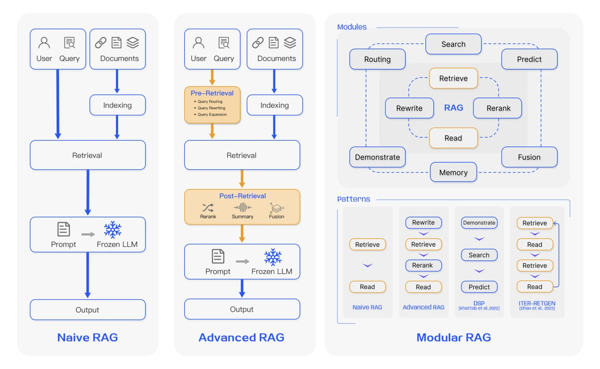
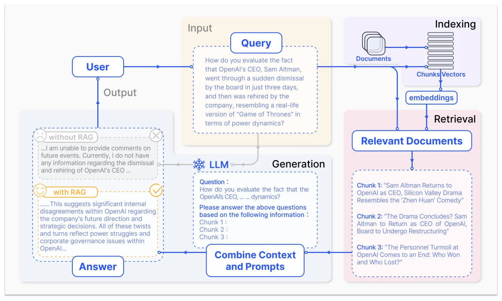
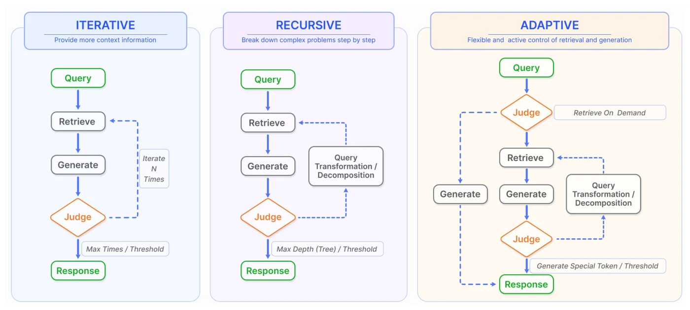
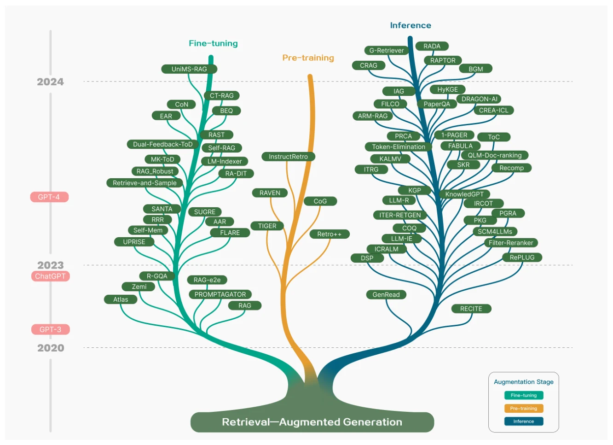
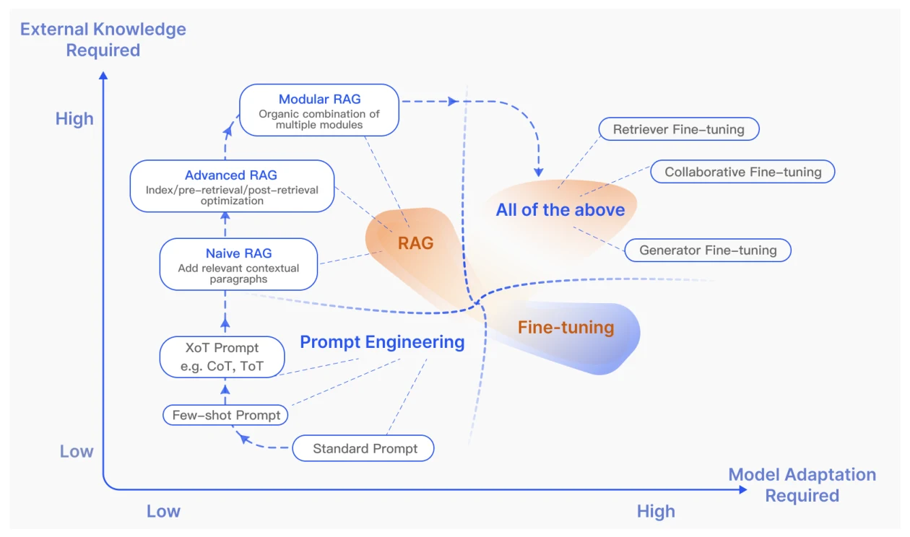

# RAG 综述：检索增强生成的方法地图

检索增强生成（RAG）给语言模型补上一条接触外部资料的途径。Gao 等人的综述关心一个随之而来的问题：从资料库到最终回答，中间有哪些设计会改变模型能使用的证据？可以先看作者用来组织整篇综述的图 3。[摘要与 §I](https://arxiv.org/html/2312.10997v5#S1)

从图左下的 Output 倒着找。回答由冻结的语言模型写成，它看得到的是提示里那几段文字；提示中的材料来自上方的 Retrieval；而检索器只能在已经建立索引的 Documents 中查找。沿着这条线，能分开问三件事：资料是否进了索引，承载答案的段落是否进了提示，模型是否忠实使用了这些段落。中、右两栏画的是研究者可以在哪一步改变这条线路。[§II 与图 3](https://arxiv.org/html/2312.10997v5#S2)

## 怎样读图 3：三种范式各能改变什么

**先顺着左列看一次交接。** 在作者称为 Naive RAG 的流程里，系统事先把文档切成段落并建索引。提问时，检索器只凭当前问题取回排名靠前的几段，再把它们连同问题交给模型。图下方的雪花表示生成模型保持冻结，换入更新的档案并不要求重新训练它。这个最简单的流程也留下了一个难处：用户用日常措辞提问，依据却藏在专业条款里；一次搜索若遗漏条款，下游模型能读到的材料就不完整。[Naive RAG 的三个步骤](https://arxiv.org/html/2312.10997v5#S2.SS1)

**中列的两个橙框处理不同的失败。** Pre-Retrieval 位于检索之前。文档用“复核周期”，用户却问“多久检查一次”，此时改写查询有机会找回原本没进候选的条款。Post-Retrieval 位于检索之后。假如条款已被找到，却排在数篇相关新闻后面，提示又只容得下前两段，重新排序就可能让模型看到它。后一个动作只在已经取回的材料里选择，所以想知道重排是否值得做，要先翻看截取之前的候选列表。两种操作都属于 Advanced RAG，改善的却是不同的一次交接。[Advanced RAG](https://arxiv.org/html/2312.10997v5#S2.SS2)

**右列允许上一条证据决定下一次查询。** 假设用户问某站投运时采用了哪一版规程，以及该版本的复核周期。站务档案给出版本号，规程目录才有具体条款。路由模块先去档案库，拿到版本号后再向规程库发起搜索，原来不能准确提出的第二个问题现在可以问清了。图右下的 ITER-RETGEN 连线体现了反复检索和阅读的可能，旁边的 DSP 则把示范、搜索、预测接在一起。图中还保留了简单的 Retrieve-Read 路线，说明模块化描述的是组合方式。它能换来一条新证据，也会多出一次搜索等待，并让错误的中间结论传进下一轮。[Modular RAG](https://arxiv.org/html/2312.10997v5#S2.SS3) · [新模块](https://arxiv.org/html/2312.10997v5#S2.SS3.SSS1) · [新模式](https://arxiv.org/html/2312.10997v5#S2.SS3.SSS2)

图 3 能帮你定位一篇论文改了哪段流程。它没有给三列标分数。要比较哪种改法更合适，最好让它们处理同一份语料、同一道问题，再看增加的查询或模型调用究竟换回了什么。[回看图 3](#orientation)

## 一道题的三种错法：追踪材料怎样变成答案

原文图 2 展示一位用户请模型评论一则刚发生的新闻。图上方画出报道怎样从文档库进入提示，下方对照了模型有无这些材料时的示例回答。读这幅图时请留意，新闻报道是在作答时交给模型的，模型参数并未随新闻一起更新。这是机制示意；要测检索究竟带来多少提升，还需要成组的题目和相同条件下的对照。[§II 与图 2](https://arxiv.org/html/2312.10997v5#S2)

换一道可以从头核对的题。下面的站名、档案与数值均为导读虚构。用户问：“青榆站投运时执行哪一版校准规程？当时常规传感器每隔多少天复核一次？”

| 代号 | 材料中可以核对的内容 |
| --- | --- |
| A，投运验收单 | 青榆站投运的设备均为常规传感器，验收采用《传感器校准规程》B 版。 |
| B，规程 B 版 | 常规传感器每 14 天复核一次。 |
| C，规程 C 版 | 后来发布的修订版改为每 7 天复核一次。 |
| D，站点报道 | 青榆站开展了校准培训，未提规程版本和复核周期。 |

读 A 得到“B 版”，沿版本号去读 B 才得到“每 14 天”。这里有两个事实，各有一份原件可以核对。现在假设屏幕上出现的回答是“B 版，每 7 天”。看上去是同一个数字答错，打开中间记录却可能发现三种情况。

| 检索器实际找到的候选 | 最终交给模型的提示 | 最先值得检查的地方 |
| --- | --- | --- |
| 只有 A、C | A、C | 规程 B 有没有入库、切块后还带不带版号？若原文可检，再查查询为何错过了它。 |
| A、C、B | 只保留了 A、C | 初检已经命中，查 B 在重排、截取或压缩的哪一步消失。 |
| A、B、C | 三份都在，版本、日期和条款完整 | 查模型是否把新版周期套到了旧版上。逐句指出“投运版本”和“该版周期”的依据，再核对回答。 |

第一种情况里，继续换重排器救不回根本没有出现的 B。第三种情况里，简单增加候选反而可能带来更多不同年份的周期。只要先保留改写后的查询、截取前的候选和最终提示，下面几章讲的每项改进就有了可以检验的着力点。

## 检索之前：库里究竟有什么能被找到

图 3 把索引画在提问之前。建库时究竟把什么当作一条记录，会限制检索器后来能回答什么。§III 把来源、检索单位和索引结构分开讨论。同一份材料，按不同方式存入库，可以成为完全不同的证据。[§III 检索](https://arxiv.org/html/2312.10997v5#S3)

**先确定原件的形态。** 对一段新闻可以直接索引正文，对一张表则要保留数字与表头、脚注的对应关系。作者列出的来源包括文本、带表格等结构的文档、知识图谱，以及模型生成的内容。后者可以给检索器补搜索线索，但一段由模型写出的规程不能用来证明现实中真的发布过它。语料中若根本没有规程 B，就应先补原件或承认缺少依据；索引算法能调整现有材料的可见性。[数据结构](https://arxiv.org/html/2312.10997v5#S3.SS1.SSS1)

**检索粒度决定数字能不能连着条件一起回来。** 设一张规程表的表头写“B 版”，行名写“常规传感器”，单元格写“14”，单位“天”只出现在列名。若只给检索器一串数字，命中 14 也无法说明它是哪个版本、哪类设备的周期。若整本规程算作一条，版本没有丢，阅读模型却要在整本书中再找那一行。一个折中的办法是索引可以独立定位的小段，交给模型时取回父段落或相邻表头；综述用 Small2Big 描述这种小处命中、向外补上下文的策略。以命题为单位的方案则尝试让一条事实本身足够完整，两种方法对“补齐条件”的处理位置不同。[检索粒度](https://arxiv.org/html/2312.10997v5#S3.SS1.SSS2) · [索引优化](https://arxiv.org/html/2312.10997v5#S3.SS2)

还能把文档标识、版本、页码、日期附在每个块上。用户问“投运时”与问“现行”可能需要不同版本。一味提高新文档的权重，会让 C 更容易覆盖 B；若先从 A 确认指定版本，再按版本筛选，过滤条件才有了来源。在这两种切法或过滤法之间做实验时，保持问题与语料相同，同时检查检回的块是否自带版本和条款，以及为还原这些条件多花了多少提示长度。

## 有原文却没命中：查询该怎样改

一个提问常同时承担两项工作：对人说明想知道什么，让机器定位载有答案的文字。两者的措辞未必相同。综述举例，法律语境的“LLM”还可能指法学硕士（Master of Laws）。如果连实体都认错，检索器仍可能很有把握地找出一串谈大语言模型的文档。§III-C 把查询侧的方法分为扩展、转换和路由。[查询优化](https://arxiv.org/html/2312.10997v5#S3.SS3)

**扩展查询，先区分多种说法和多个证据缺口。** 对青榆站题，Multi-Query 可以并行尝试“投入运行采用的校准规程”“启用验收时执行的校准标准”，再合并候选。它针对同一事实换词，适合材料使用不同术语的情形。Sub-Query 则会提出两个不同的问题：“验收单指定了哪版？”“该版本规定多长的复核周期？”前者查清之前，后者连版本号都填不上。盲目并行可能让 C 的现行周期先进入答案。多种问法查到同一份转载，只说明扩大了检索入口；两跳问题仍然需要能相互补足的来源。

**RRR 改写检索指令。** 如果读者问“站里刚开的时候多久查一次”，资料用的却是“投运验收”“复核周期”，搜索引擎可能匹配不到。RRR 先生成适合检索的措辞，搜回外部材料，再由阅读模型作答；论文的可训练方案用阅读模型的反馈，通过强化学习更新小型改写器，保持下游阅读器冻结。它与并行提多种说法解决的同是表述差异，训练重点却落在“哪种改写有利于最后答题”。论文在开放域和选择题问答上做比较。在这道档案例题里，即使改写成“青榆站现行复核周期”能找到一条明确规定，也已经丢掉了“投运时”。可对照改写前后的时间、实体和单位检查这个风险。[Ma 等，RRR](https://arxiv.org/abs/2305.14283v3)

**HyDE 改变用来匹配文档的向量。** 即使问题表述精确，问句与规程正文也可能很不像。HyDE 先让模型写一段可能作为答案的假想文档，再用对比学习得到的编码器将它编码为向量，到真实语料中找邻近文档。假想文字即使猜了“周期为 7 天”，仍可能因包含“规程”“复核周期”等表达而帮助找到 B；也可能把搜索引向 C。与 RRR 的改写不同，HyDE 借用的是文档式表述，假想文档里猜出的数值没有证据效力。其作者明确把可能含有虚假细节列为假想文档的性质，研究目标是没有相关性标注时的零样本稠密检索。[Gao 等，HyDE](https://arxiv.org/abs/2212.10496v1)

**Step-back 与路由分别改变抽象程度和搜索范围。** 在要解释具体物理现象时，Step-back 会先问“这取决于哪条一般原理”，再结合一般知识和具体问题回答；放到青榆站，一般性的“规程如何确定复核周期”可以帮助理解条款，仍要回到原版本查天数。查询路由则根据实体、元数据或语义选择应该查询的库。限定在站务库有利于找 A，但 B 在规程库。需要跨来源的问题，一次只选一个库有可能从开始就排除了后一半证据。[查询转换与 Step-back](https://arxiv.org/html/2312.10997v5#S3.SS3.SSS2) · [查询路由](https://arxiv.org/html/2312.10997v5#S3.SS3.SSS3)

**改完词仍找不到，回头看怎样匹配。** 像规程编号这样罕见而准确的字符串，基于词项匹配的稀疏检索可以直接利用；“多久检查一次”和“复核周期”字面差别大，稠密检索则把查询与片段编码成向量，尝试按语义相似度匹配。两路都查、合并候选，是混合检索的一种做法。相同的问题上可以分别保留两路返回列表，看看新增的究竟是此前漏掉的规程，还是意思相近的培训新闻。扩大候选会增加后续重排和阅读的成本。[嵌入](https://arxiv.org/html/2312.10997v5#S3.SS4)

当问题集中在某个领域，也可以用少量示例引导模型生成任务查询来训练检索器（Promptagator），或用冻结语言模型的反馈训练检索器偏好能帮助作答的片段（REPLUG LSR）。这两种办法需要改变训练或数据准备；若症结只是版本标题在切块时被去掉了，修复索引更直接。§III-E 另列了可插入检索器与模型之间的适配器，可按需回到原文查阅。[Dai 等，Promptagator](https://arxiv.org/abs/2209.11755) · [Shi 等，REPLUG](https://arxiv.org/abs/2301.12652) · [适配器](https://arxiv.org/html/2312.10997v5#S3.SS5)

## 已经命中：模型最后读到的是哪些文字

给模型的提示往往容不下全部候选。把上下文整理想成一次交接：上游交来若干原文块，下游需要足够回答问题的几条证据，还需要知道它们的来源与适用条件。§IV 把整理上下文放在生成这一章，并另列微调生成模型的路线。[§IV 生成](https://arxiv.org/html/2312.10997v5#S4) · [上下文整理](https://arxiv.org/html/2312.10997v5#S4.SS1)

**先看位置。** Liu 等人在多文档问答和键值检索实验中改变关键信息所在的位置。在其所测的若干模型与设置中，同一信息放在长输入中间时，比放在开头或结尾更难被利用。这个实验把“文档不在提示里”和“文档在提示里但模型没用上”拆开了。若青榆站的 B 版条款已经进了提示，可以固定文档集合、问题和生成器，只换 B 的位置，看回答是否变化。看到一次位置敏感，还不能推出任何模型都按两端优先的方式读取。[Liu 等，Lost in the Middle](https://arxiv.org/abs/2307.03172)

**重排改的是排位，截取改的是能读到哪些材料。** 假设初检返回 A、C、D、B。重排器重新判断每个候选与问题的关系；若能借助 A 中的版本信息，把 B 提到第二位，那么截取前两条后的提示中就有了完整证据。若仅按文字相似度给各条独立打分，D 有站名和“校准”，C 有明确的周期，它们仍可能排在 B 前面。单块切题和两块合起来足以作答，是两个目标。原综述列出基于规则和基于模型的重排方案；无论选哪一种，先留一份重排前的候选，才能检查所需文档到底被漏检了，还是在截取时落选。[§IV-A.1 重排](https://arxiv.org/html/2312.10997v5#S4.SS1.SSS1)

**压缩改的是文字本身。** LLMLingua 针对输入过长带来的推理成本，用较小模型分配压缩预算，再逐步删减词元。重排一段长规程，段内的每个词仍然在；词元压缩则能把它缩短。对这道题，删掉反复出现的文书套话问题不大，删掉“常规”“B 版”或“天”却会失去适用对象、版本或单位。压缩后的输入即使还能让模型猜对数字，也需要检查它是否保留了支撑整句回答的原文。LLMLingua 原作者在四组场景做了实验，效果受任务与压缩预算约束。[Jiang 等，LLMLingua](https://aclanthology.org/2023.emnlp-main.825/)

**RECOMP 选择哪些句子值得花预算。** 这一方法的抽取式压缩器从候选中选原句，生成式压缩器则能跨文档写出简短摘要；若材料无关或没有提供额外信息，压缩器还可以输出空串。两种压缩器训练时都以摘要交给下游语言模型后的任务表现为目标。它与 LLMLingua 都能缩短输入，操作单位却不同。在青榆站题里，抽取 A 的版本句与 B 的周期句，读者可以逐句回查；跨文档写成“青榆站每 14 天复核”更简练，却把“投运时”和“常规传感器”省掉了。空串表示这一轮没有采用所给资料，不能据此断言档案库里没有答案。RECOMP 的验证任务是语言建模与开放域问答，档案例题用于说明取舍。[Xu 等，RECOMP](https://arxiv.org/abs/2310.04408v1) · [§IV-A.2 选择与压缩](https://arxiv.org/html/2312.10997v5#S4.SS1.SSS2)

要区分整理错误与阅读错误，可以给同一道题做两次对照：第一次直接给 A、B 原句，第二次只给整理后的版本。原句能答对、整理后却答错时，首先比对版本和限定词有没有保留；原句齐全仍答错时，才有理由进一步检查提示或生成器怎样利用证据。两次都对也不能证明压缩总能保留关键信息，还需更换样本。

**微调作用于下一次阅读材料的方式。** 每次回答前重排或压缩，修改的是本次输入；用样例微调模型，则可能改变它今后怎样利用检索结果。例如可以训练模型在给定段落时按指定格式作答，名单、日期或规程本身仍由可更新的资料库提供。§IV-B 还提及偏好训练和蒸馏；在比较论文时应先分清参数更新发生在检索侧还是生成侧。[大模型微调](https://arxiv.org/html/2312.10997v5#S4.SS2)

**RA-DIT** 分别调整这两端。一项训练让生成模型在上下文中利用取回的信息，另一项根据语言模型给出的信号更新检索器，使它更常返回有助于作答的材料。与只改查询的 RRR 相比，RA-DIT 要求能更新相应模型的参数；它提供了图 4 中 RAG 与微调结合的例子。[Lin 等，RA-DIT](https://arxiv.org/abs/2310.01352)

## 第二跳怎么找：三种继续检索的理由

普通的一次检索要求第一句话就包含所有搜索线索。青榆站的版本恰好要读了 A 才知道，第一次就把 K 调大，可能只会检出更多带站名的报道。图 5 把多步增强分成三类。读图时，先看箭头回到哪里，再看是什么信号让系统继续。[§V 增强过程与图 5](https://arxiv.org/html/2312.10997v5#S5)

**迭代检索把上一次作答生成的文字带回检索器。** ITER-RETGEN 的目标是改进整份回答。第一轮按原问题检索并尝试完整作答；第二轮把上轮产物和原问题一起用于检索，再读新材料重新作答。例题中第一稿可能是“验收单指定 B 版，复核间隔尚缺”。这句话里多出来的“B 版”让第二轮有机会找到规程 B。和一开始就换三个同义问法相比，后续查询使用了刚发现的信息。代价也在这一步：第一稿若猜成 C 版，下一轮可能收集到越来越多 C 的规定。综述在 §V-A 提到反复检索会积累无关信息、出现语义脱节。可记录每一轮新增的文档及它纠正了哪条主张，判断新一轮究竟补了什么。[迭代检索](https://arxiv.org/html/2312.10997v5#S5.SS1) · [Shao 等，ITER-RETGEN](https://arxiv.org/abs/2305.15294)

**递归检索让刚解决的子问题决定下一步要查什么。** IRCoT 面向多步问答，把检索与一步一步形成的中间推理交替进行。先读 A，形成可以核对的中间句“投运时采用 B 版”；再沿这个中间句找 B 版规程，从中读到 14 天。与 ITER-RETGEN 用上一轮的整体输出再试一次不同，IRCoT 的检索和推理在形成一份答案的过程中交错进行。这样适合第二跳依赖第一跳的题，也意味着中间句如果读错了实体，就会把后面的请求引向错误分支。综述把逐步澄清歧义的 ToC 也放在这一类：若“青榆站”指向两个实体，澄清树可保留不同解释，分别找证据。分支越多，检查哪个解释满足原问题越重要。[递归检索](https://arxiv.org/html/2312.10997v5#S5.SS2) · [Trivedi 等，IRCoT](https://arxiv.org/abs/2212.10509)

**自适应检索先决定此刻是否值得查。** FLARE 面向长答案：先预写下一句，检查生成这句时是否出现低置信度词元；需要补资料时，用预测内容构造查询，取回资料后重新生成这句。若模型准备从版本过渡到复核天数，预测“每隔……天”时缺乏把握，这一局部信号就能触发补检。它与每轮都检索的做法不同，决定发生在写作过程中。反过来，模型也可能把错误的“7 天”写得非常有把握。低置信度是检索触发信号，置信度高本身没有为事实提供出处。[自适应检索](https://arxiv.org/html/2312.10997v5#S5.SS3) · [Jiang 等，FLARE](https://arxiv.org/abs/2305.06983v2)

Self-RAG 同样能按需检索，却需要训练模型使用反思词元。它可以发出检索信号，并对取回段落的相关性、生成内容是否得到段落支持、输出是否有用作出评价。在例题里，“C 版每 7 天”可能被一份真实文档支持，但它对“投运时”这项条件仍然无用。FLARE 的切入点是“哪一句需要补资料”，Self-RAG 还试图把“资料及据此写成的回答是否好用”纳入选择。这些判断由训练得到，能否发现版本冲突仍要拿独立样例检验。原作者报告的是特定模型及任务上的结果。[Asai 等，Self-RAG](https://arxiv.org/abs/2310.11511)

三类流程在实作中可能重叠。要比较两篇论文，可沿图 5 分别写下：下一轮拿到的是整份草稿，还是一条中间推理？每个问题都查，还是按某种信号触发？在相同语料和调用预算内，新增了哪条第一轮没有的证据？这样即使两篇都写“多轮检索”，也能区分它们改进的是哪一步。

## 怎样评测：答对、找全和忠于材料

一个系统答出了“14 天”。它可能读到了 B，也可能碰巧猜对。要知道下一次该改什么，先分开看检索器交了哪些材料，生成器又用这些材料写了什么。综述第六章的表 II 汇总 26 类下游任务及数据集，包含单跳和多跳问答、事实核查及其他生成任务。短问答的精确匹配（EM）、F1 和生成任务常用的 ROUGE 等能说明答案与参照的接近程度，无法单独区分这两条路径。[§VI 任务与评价](https://arxiv.org/html/2312.10997v5#S6) · [下游任务](https://arxiv.org/html/2312.10997v5#S6.SS1)

**先把检索指标算一遍。** 在贯穿例子中，预先标出回答全题需要 A 和 B 两份文档，C、D 对这个时间点不算相关。假设结果依次是 A、C、B，系统只交出前两份。Precision@2 是取出的两份里有几份相关，等于 1/2；Recall@2 是两份所需文档中找回了几份，也等于 1/2。这两个 1/2 的分母碰巧一样。若放宽到前三份，Precision@3 变成 2/3，Recall@3 升到 2/2。再看倒数排名，第一份相关文档在第 1 位，这道题的倒数排名就是 1。MRR 是多道题倒数排名的平均值，它奖励尽早找到第一份相关结果，不能告诉我们第二跳的 B 有没有进提示。这些数字是手算教学例子，与表 III 所列研究的得分无关。[评价目标](https://arxiv.org/html/2312.10997v5#S6.SS2)

**再把三项质量逐一问出来。** 上下文相关性问“交给模型的材料对这道题有多少用？”A、B 足以支撑，而一篇很像的 D 只提培训。答案忠实性问“回答中的陈述能从实际给它的材料推出吗？”只有 A、C 时，即使模型写对“B 版每 14 天”，14 天也缺依据。答案相关性问“它答到了读者要知道的事吗？”只答“青榆站投运时使用 B 版”可以忠于 A，却漏了周期。还要另外核对事实正确性：如果人为把 B 原句的 14 改为 41，逐字照抄是忠于被篡改的材料，仍然不是正确答案。表 III 的候选指标来自不同评测传统，不能把三项压成一个含义固定的总分。[评价维度](https://arxiv.org/html/2312.10997v5#S6.SS3)

**能力测试可以只换一份材料，看系统在哪一步失手。** RGB 以中英文样本考察四种能力。下面是借用其维度自行构造的小实验，并非 RGB 的题目或原始提示。把“已知答案与依据”留在评测者手里，逐组给生成器不同输入：[Chen 等，RGB](https://arxiv.org/abs/2309.01431)

| 想测的能力 | 给模型什么 | 怎样看输出 |
| --- | --- | --- |
| 噪声鲁棒性 | A、B 加上数篇像 D 的培训报道 | 是否仍能从支持材料里找到 B 版与 14 天，还是把重复出现的培训安排当成复核规定？ |
| 拒答能力 | 只给 A 和 D | 可以回答版本，并明确周期缺少依据。硬猜天数和回避整个问题都能被看出来。 |
| 信息整合 | A 和 B，分别只含一半证据 | 是否能把 A 的版本与 B 的适用对象、天数连接起来，并分别指出来源？ |
| 反事实鲁棒性 | 保留 A、可信的 B，同时加入标错天数的伪造条款，并给出区分正式版本与伪件的出处信息 | 是否辨出冲突、使用可核对的依据？若撤掉一切区分真假的线索，承认无法判别比猜一个数字更有根据。 |

C 的 7 天是这套虚构档案里另一个时期的真规定；伪造的“B 版每 41 天”才是对事实的篡改。前者主要考是否读懂了适用范围，后者考如何应对错误材料。若把两种错题混成一类，就很难判断系统需要更好的版本筛选还是冲突处理。

**基准提供题目，工具帮助重复评分。** 需要横向比较抗噪、拒答等能力时，可看 RGB；需要给自己的问答流水线找出较弱的环节时，RAGAS 提供免参考答案的评估办法，分别评价上下文、忠实性和回答的切题程度。ARES 也拆开这三个维度，用合成数据训练轻量评判模型，并用少量人工标注作统计校正。前者适合探索缺少标准答案的材料，后者引入了人工样本约束评判误差，两者都不能仅凭裁判给的分数证明档案中确有某条规定。若更换模型后分数上涨，可抽查证据不全、不同版本冲突等样例，看看上涨发生在哪一类题。综述表 IV 还列有 RECALL、CRUD 与 TruLens 等入口。[基准与工具](https://arxiv.org/html/2312.10997v5#S6.SS4) · [Es 等，RAGAS](https://arxiv.org/abs/2309.15217v1) · [Saad-Falcon 等，ARES](https://arxiv.org/abs/2311.09476)

## 对着一篇新论文，怎样判断它解决了哪种失败

图 3 里的橙框都可能让最终回答更准确，却作用在不同的位置。以青榆站的错答为例，如果作者说“改写查询能提高正确率”，可以把同样的问题各跑一遍。固定索引、生成模型、候选数和提示预算，只改变送给检索器的问法，一边查原问，一边查改写后的问句。两组最后交给生成器的用户问题保持原样，只有取回的材料可以不同。只有在改写后 B 确实进了候选，又确实被模型读到时，这个例子才能展示“补回缺失证据”这样一条可能的因果路径。如果两边都没找到 B，模型在第二次碰巧答对，就要另找解释。

换成评估压缩器，应该固定初检候选，让两条线路都从同一组 A、B、C 出发。给一组与直接截取等长的压缩后材料，再加一组完整原句作参照，比较周期、版本、设备类型各自有没有保住，同时记录省下的输入长度。如果只有更短这一项得到验证，论文已经说明它节省了输入成本，却还缺少“更会保留证据”的证据。

多轮方法还涉及调用预算。若两轮搜索胜过一轮，可以再比较“同样做两次、但第二次仍用原问”与“根据第一次得到的版号发问”。若后者能更稳定地找到 B，才更能支持“上一跳指导下一跳”的解释。表 I 帮助定位待比较的方法，但这些对照是导读提出的阅读方式。实际论文若同时更换语料、模型、查询次数，能归因的范围就会变小。[表 I 方法汇总](https://arxiv.org/html/2312.10997v5#S2.T1)

按手头遇到的问题，可以回到相应章节对照方法。

| 看到了什么 | 可以回查哪种方法 | 怎样辨别作用 |
| --- | --- | --- |
| 资料确实在库里，但问句与原文用语相差很大 | [RRR 改写查询，HyDE 编码假想文档](#query) | 对照两种问法检回的真实段落，核对时间和实体是否保留。 |
| 关键条款已在候选里，最终提示却缺少版本或条件 | [重排调整文档次序，RECOMP 抽取句子或压缩摘要](#u04) | 固定候选与提示预算，看必要原句是否进入提示，版本限定能否回查。 |
| 下一次要搜的实体，必须先从第一份材料中读出来 | [IRCoT 将每一步推理与检索交织，ITER-RETGEN 则用上轮整体输出再检索](#u05) | 在相同调用次数下，检查后一轮有没有得到此前缺失的另一份依据。 |
| 简单题也被迫搜索，长答案却有局部无据的陈述 | [FLARE 按下一句的不确定性补查，Self-RAG 学习在需要时发出检索信号](#u05) | 同时检查漏查、无效检索与事实依据，统计每题增加了几次调用。 |

如果接下来想理解检索结果怎样进入生成概率，可以读本库的 [RAG 原始论文导读](/read/rag/2#u02)；想看检索作为行动嵌入更长的决策过程，再看 [ReAct](/read/react/1#u01)。下面的历史和路线比较，则说明作者怎样看待这个领域在 2024 年初的位置。

## 回看技术树：检索是在训练时还是作答时引入

读完方法主线，再看图 1 会遇到另一种分法。图 3 的横向三列比较一次系统运行如何组织，图 1 的三根枝干却把检索放到不同模型阶段上：中间橙色枝干是预训练，左侧绿色是微调，右侧深蓝色是推理。一个系统可以占据多根枝干。看到两个名称分属不同枝干，先问各自什么时候访问外部语料。[§I 与图 1](https://arxiv.org/html/2312.10997v5#S1)

例如 RETRO 在预训练时就利用检索到的材料；冻结语言模型后再把相关文档放进提示，则把这项工作移到每次回答的时候。预训练时引入检索，训练过程本身就要考虑外部语料与检索机制；仅在作答时加入材料的系统，每遇到一个问题要承担搜索与读取的开销。这些阶段可以共存，使用过检索来预训练的系统在推理时仍然可以查库。2020 年 Lewis 等人的 RAG 出现在图的微调枝干，可以结合本库的[原始论文导读](/read/rag/2#u01)理解检索与生成如何结合。

综述还标出了 ChatGPT 出现后推理阶段方案的增长，以及后来研究者重新把检索与微调结合起来的路线。这个分期描述的是图中工作所处的研究背景。要在手头的系统里决定是调一次检索，还是投入参数训练，还要看知识更新速度与可用计算资源。

## 回到选型：RAG、微调与提示工程

想让大模型在某个领域表现更好，常见的办法有三种：提示工程、RAG、微调（FT）。综述用图 4 的象限图来比较它们：横轴是“需要改动模型多少”，纵轴是“需要多少外部知识”。[§II-D 与图 4](https://arxiv.org/html/2312.10997v5#S2.SS4)

- **提示工程**在左下角：既不改模型，也不需要太多外部知识，只是更好地利用模型已有的能力。从普通提示、少样本提示，到 CoT 这类引导推理的提示，都属于这一类。
- **RAG**在左上方：不怎么改模型，但需要大量外部知识。综述的比喻是“给模型一本量身定做的教科书”，适合需要精确查找信息的任务。
- **微调**在右下方：要进一步训练模型，好比学生把知识“内化”进脑子里，适合需要复制特定结构、风格或格式的场景。

两者各有长短。RAG 可以通过更新索引来纳入新资料；若保留出处，读者就能核查答案用了哪份材料；但检索会增加延迟，数据来源也涉及伦理问题。微调更“静态”，知识更新要重新训练，需要较多计算资源准备数据和训练，但能深度定制模型的行为和风格。

综述引用了一项比较研究：在多个知识密集型任务上，无监督微调只带来有限的提升，该研究所测的 RAG 在训练时见过的知识和新知识上都表现更好；而且大模型很难通过无监督微调学会新的事实。[Ovadia 等的比较研究](https://arxiv.org/abs/2312.05934)

不过综述也强调，两者并不互斥。图 4 右上角的 “All of the above” 表示 Modular RAG 正在和检索器微调、生成器微调、协同微调结合。选择哪种方式，取决于数据变化有多快、需要多深的定制，以及有多少计算资源。

## 哪些问题在综述写作时仍未解决

综述第七章列出了作者认为 RAG 尚待解决的问题。这些是 2024 年初的判断，读的时候要考虑之后的发展，不能直接当作今天的研究空白。[§VII 讨论与展望](https://arxiv.org/html/2312.10997v5#S7)

**RAG 与长上下文。** 当时大模型已能处理超过 20 万词元的上下文，过去需要 RAG 的长文档问答，现在可以把整篇文档直接放进提示。那还需要 RAG 吗？作者的回答是需要，理由有二：一次性输入大量上下文会显著降低推理速度，分块检索、按需输入效率更高；RAG 能定位原始出处，为用户核实答案提供入口。如果长上下文输入没有保留文档边界和出处，定位依据会更困难；检索流程留下了记录，也仍需检查引用是否真能支持回答。反过来，更长的上下文也让 RAG 能处理需要读大量材料的综合性问题。[RAG 与长上下文](https://arxiv.org/html/2312.10997v5#S7.SS1)

**鲁棒性。** 综述提到，加入不相关文档有时能让准确率提高 30% 以上。回到 Cuconasu 等人的实验：在 NQ-open 测试集上先检索 4 份文档，再用随机文档填充 Llama2 的上下文，准确率绝对增加约 0.07，即约 7 个百分点；相对于原准确率，作者报告的增幅为 35%。同一研究还发现，高分却不含答案的干扰文档可能降低效果。随机填充与引入貌似能回答问题的干扰材料是两种不同的操作，这组结果不能当作普遍适用的加长提示策略。[鲁棒性](https://arxiv.org/html/2312.10997v5#S7.SS2) · [Cuconasu 等原文摘要](https://arxiv.org/abs/2401.14887) · [实验条件与表 3](https://arxiv.org/html/2401.14887v4#S5.SS4)

**混合方法。** RAG 与微调怎样结合，是顺序、交替，还是端到端联合训练，仍在探索。另一个趋势是在 RAG 里引入有特定功能的小模型。例如 CRAG（纠正式 RAG）训练一个轻量的检索评估器，判断检索结果的整体质量，根据置信度触发不同的动作，比如改用网络搜索。[混合方法](https://arxiv.org/html/2312.10997v5#S7.SS3)

§VII 还讨论了几个方向：怎样随规模扩大保持可用的检索效率、怎样保护文档来源和元数据，以及怎样把方法迁移到图像、音频、代码等其他资料。作者把这些问题放在当时的技术条件下讨论。若以此寻找新的研究课题，需要再查 2024 年之后的实证工作。[规模规律](https://arxiv.org/html/2312.10997v5#S7.SS4) · [生产落地](https://arxiv.org/html/2312.10997v5#S7.SS5) · [多模态](https://arxiv.org/html/2312.10997v5#S7.SS6)

## 原文入口与本次覆盖

推荐读原文时先看两幅图和一张表：图 3 的三种范式（PDF 第 4 页）、图 5 的三种增强流程（第 11 页）和表 III 的评价指标（第 14 页）。然后根据你关心的问题，选读第三、四章中相关的小节。表 I（第 6 页）列出了 70 多种方法的检索来源、粒度、阶段和流程，适合当作索引来查。这里的页码都从 PDF 第一页算起。本文采用的版本发布于 2024 年 3 月 27 日。[论文身份与版本](https://arxiv.org/abs/2312.10997v5) · [固定 HTML 全文](https://arxiv.org/html/2312.10997v5) · [固定 PDF](https://arxiv.org/pdf/2312.10997v5) · [表 I 方法汇总](https://arxiv.org/html/2312.10997v5#S2.T1)

本导读依据 arXiv v5 全文，覆盖第二至第七章的主线：三种范式、RAG 与微调的比较、检索、生成、增强过程、评价体系和未来方向。图 1–5 沿用从固定 PDF 截取并核看的原图。三种范式、查询、上下文整理、多轮流程与评价的代表方法另给出一手论文入口。青榆站档案、排名和故障分析均为导读的教学例子。方法比较限于综述及相应作者描述，没有逐篇复现性能结果。综述参考文献 [100] 的条目与正文所说的 LLMLingua 不符，本导读的 LLMLingua 介绍另核对了 Jiang 等人的原文。[LLMLingua 原文摘要](https://arxiv.org/abs/2310.05736) 第七章生态与多模态部分只做了概述。原图来自 arXiv 默认的非独占分发许可，仅在私有仓库中作个人学术阅读引用。阅读本导读不会自动记为已读原文。
