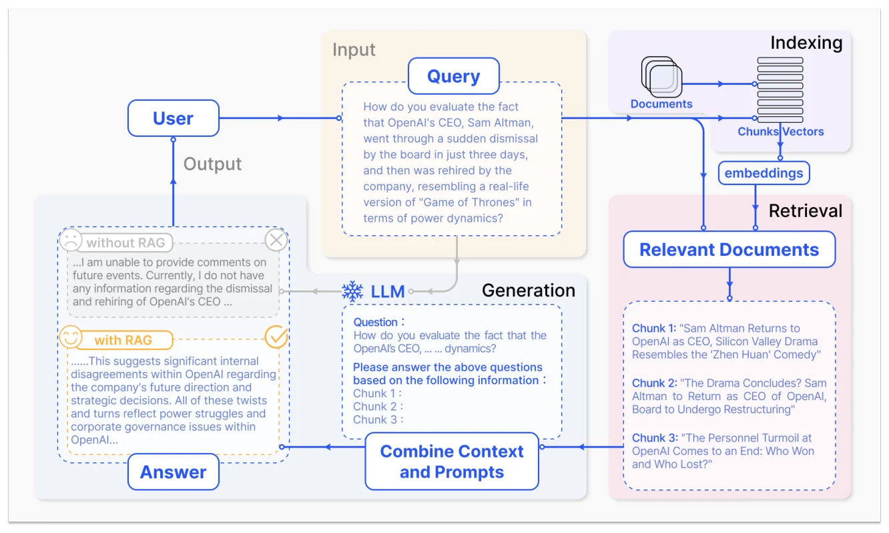
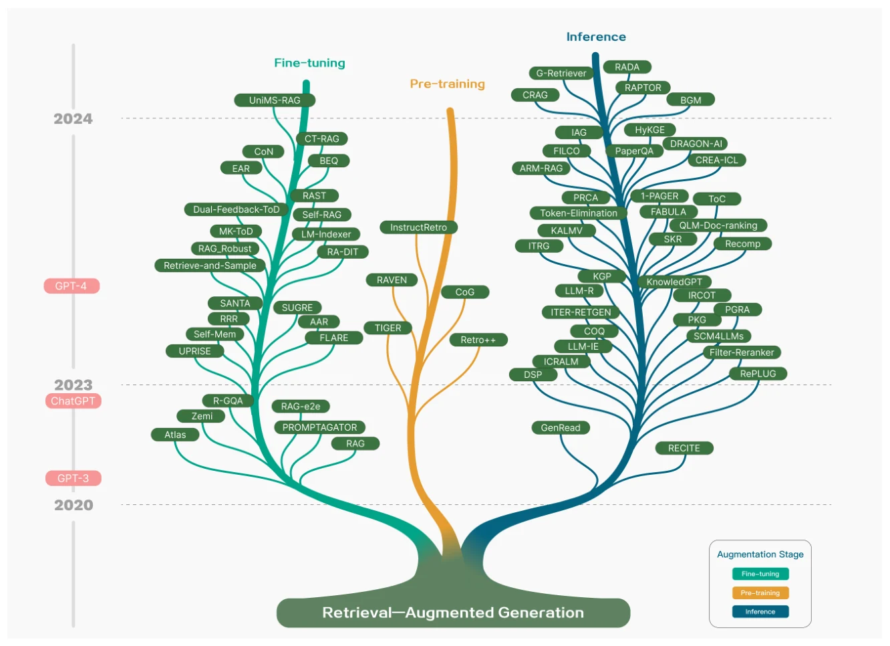
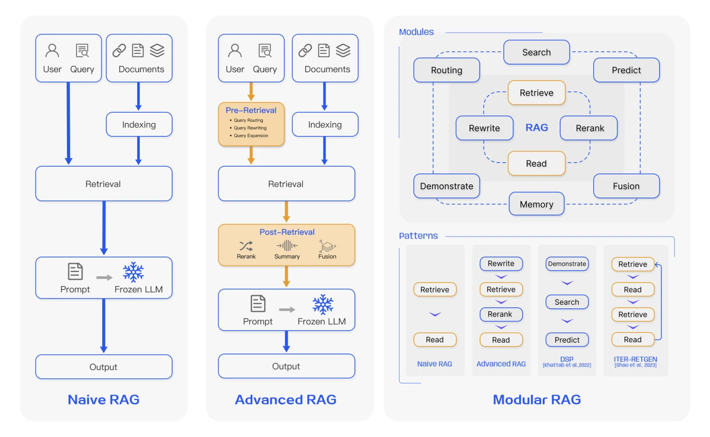
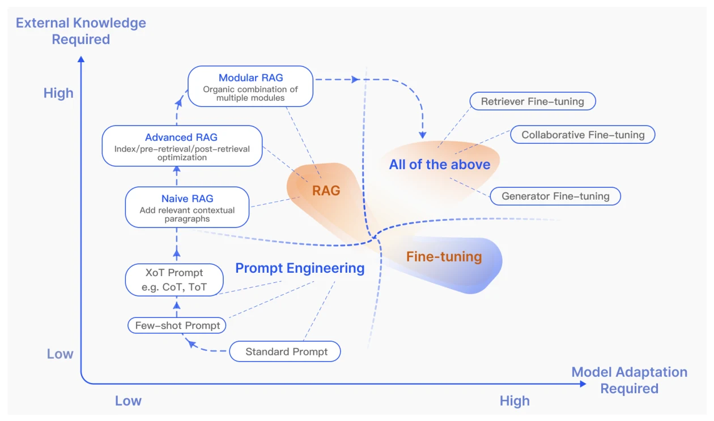
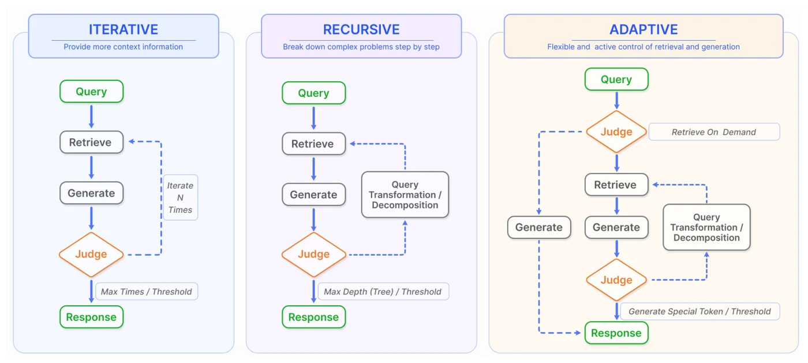

# The RAG Survey: A Map of Retrieval-Augmented Generation

Large language models (LLMs) are fluent, but they have three familiar problems. They can confidently invent facts, a phenomenon often called hallucination. Their knowledge is limited by their training data and its cutoff. And they may not make the basis of an answer clear enough for a user to verify it. Retrieval-augmented generation (RAG) offers a simple idea: before answering, find relevant material in an external collection and give it to the model alongside the question, so that the model can answer with the material in view. [Abstract and §I](https://arxiv.org/html/2312.10997v5#S1)

That idea leaves many opportunities for failure: how should documents be stored, queries formulated, retrieved material selected, and the model encouraged to use it? Around 2023, a proliferation of studies addressed individual parts of this process. This survey, by a team from Tongji University and Fudan University, organizes more than 100 studies into a common framework. It is a frequently recommended introduction to the field.

Its main contributions can be thought of as three maps:

- **A map of evolution:** three ways to organize a RAG system, called Naive, Advanced, and Modular RAG.
- **A map of components:** representative methods organized around retrieval, generation, and augmentation.
- **A map of evaluation:** 26 categories of downstream tasks, nearly 50 datasets, and the goals, metrics, and tools used to evaluate RAG.

The difficulty is the sheer number of methods and acronyms—HyDE, Self-RAG, FLARE, IRCoT, RA-DIT—often mentioned only briefly. This guide follows the survey's section order so that you can read the two together. For representative methods, it explains the problem, the approach, the difference from neighboring methods, and limitations noted by the survey or the original paper. A fictional archive question runs through the guide to show what each class of methods changes. Acronyms are marked with a dotted underline on first appearance; select one to see its expansion and background.

The guide is pinned to arXiv v5, released on March 27, 2024. The survey covers work through early 2024; it is not a complete inventory of RAG technology or products today. [Paper identity and version](https://arxiv.org/abs/2312.10997v5)

## An Example: How RAG Works

The survey opens with the example in Figure 2. A user asks ChatGPT what to make of OpenAI's CEO being abruptly dismissed by the board and invited back three days later. The news occurred after the model's training data. Without RAG, the model can only say that it cannot comment on a future event and has no relevant information. With RAG, the system first finds relevant reports, puts them in the prompt with the question, and the model can give a substantive answer based on them. [§II and Figure 2](https://arxiv.org/html/2312.10997v5#S2)

Figure 2 divides the process into three steps, the basic Naive RAG pipeline: [Three steps of Naive RAG](https://arxiv.org/html/2312.10997v5#S2.SS1)

1. **Indexing.** Clean raw PDF, HTML, Word, Markdown, and other files into text, split it into chunks, and use an embedding model to turn each chunk into a vector stored in a vector database. Chunking accommodates the limited amount of text a model can read at once.
2. **Retrieval.** When a question arrives, encode it with the same embedding model, calculate its similarity to the chunks, and select the top K.
3. **Generation.** Combine the question and retrieved chunks into a prompt for the LLM. In a multi-turn conversation, previous dialogue can also be included.

One point matters here: in this basic pipeline, none of this changes the LLM's parameters. The snowflake in the figure denotes a frozen generator. Knowledge is updated on the collection side: add new documents to the index rather than retraining the model. This is a major attraction of Naive RAG; later systems may also train retrieval or generation components.

The survey identifies three classes of trouble in this simplest pipeline:

- **Imprecise retrieval:** precision and recall may both be inadequate, bringing back irrelevant chunks or missing crucial information.
- **Unreliable generation:** the model may still invent content absent from the material, or produce irrelevant, harmful, or biased answers.
- **Poor integration:** sources may repeat or contradict one another; the model may copy rather than synthesize them; and one retrieval pass may not supply enough information for a complex question.

To distinguish these failures, consider a fictional example used throughout this guide. The station, records, and numbers below are invented. A user asks: “Which edition of the calibration procedure applied when Qingyu Station was commissioned, and how many days separated routine sensor checks at the time?” The collection contains four relevant records:

| Code | Record |
| --- | --- |
| A, commissioning acceptance record | Acceptance at Qingyu Station used edition B of the Sensor Calibration Procedure. |
| B, procedure edition B | Routine sensors are checked every 14 days. |
| C, procedure edition C | A later revision changes the interval to seven days. |
| D, station report | Qingyu Station held calibration training; the report mentions neither the edition nor the interval. |

The correct answer takes two steps: read “edition B” from A, then “14 days” from B. Suppose the system answers “edition B, every seven days.” The same visible error might arise in three very different ways:

| Candidates found by the retriever | Material ultimately given to the model | Where the failure occurred |
| --- | --- | --- |
| A and C only | A and C | Retrieval: B was missed, perhaps because it was not indexed or the query failed to match it. |
| A, C, and B | Only A and C retained | Curation: B was found but lost during ranking, truncation, or compression. |
| A, B, and C | All three | Generation: the model applied the interval from the later edition C to the earlier edition. |

Each calls for a different repair. A better reranker cannot recover B if it was never retrieved; in the third case, retrieving still more documents may introduce more rules from different years. When diagnosing RAG, preserve the actual retrieval query, the returned candidates, and the final prompt. Most methods in the following chapters can be understood as repairs to one of these stages. When reading a new RAG paper, ask first: what is it trying to fix?

## Where RAG Came From: The Technology Tree and Three Stages

Figure 1 is the survey's technology tree. Time runs vertically; its three branches indicate the stage at which retrieval is introduced: pre-training in orange at the center, fine-tuning in green on the left, and inference in dark blue on the right. GPT-3, ChatGPT, and GPT-4 mark points on the timeline; the branches become noticeably denser after ChatGPT. [§I and Figure 1](https://arxiv.org/html/2312.10997v5#S1)

The survey groups RAG's development into three stages.

**First: beginnings alongside Transformers.** Early work mainly introduced external knowledge during pre-training to enhance pre-trained models (PTMs). DeepMind's RETRO, for example, let a language model retrieve chunks from a database on the scale of a trillion tokens during pre-training. Lewis and colleagues' 2020 RAG model also belongs to this period. Figure 1 places it at the root of the fine-tuning branch: it fine-tunes a retriever and generator together. This library has a [dedicated guide](/read/rag/2#u01).

**Second: a shift toward inference after ChatGPT.** LLMs showed strong in-context learning (ICL): examples and material in a prompt can enable a new task without changing parameters. Research increasingly asked how to supply better information at inference, and the right-hand branch became the most crowded. Most methods in this stage improve retrieval and prompting without training the LLM itself.

**Third: combination with fine-tuning.** Research moved beyond inference alone to combine retrieval with LLM fine-tuning—for example, training retriever and generator to adapt to each other. Self-RAG and RA-DIT on the left branch are examples.

The stage at which retrieval is introduced also changes the cost. Retrieval during pre-training requires the training process to handle an external corpus and retrieval mechanism, but the model learns to use results from the outset. Retrieval only at answer time leaves the model unchanged but incurs search and reading costs for each question. The branches are not mutually exclusive: a retrieval-pre-trained model can still search a collection at inference. This periodization is the survey authors' way of making shifts in research emphasis easier to understand.

## Three Paradigms: From Pipelines to Composable Modules

The survey's central framework is the three paradigms in Figure 3. A paradigm is a way of organizing a RAG system, not an unrelated algorithm; the later forms build on the earlier ones. Read the figure backward from Output at lower left. In the depicted basic pipeline, a frozen model writes the answer using the retrieved text in its prompt; it may still draw on parametric knowledge, and later variants can train the retriever or generator. The material comes from Retrieval; the retriever can search only the indexed Documents. The paradigms differ in where researchers can intervene along this route. [§II and Figure 3](https://arxiv.org/html/2312.10997v5#S2)

**Naive RAG** is the indexing–retrieval–generation sequence above, also called Retrieve-Read. It became popular after ChatGPT; the left column of Figure 3 depicts its straight line. Its limitation is direct: the retriever searches using the user's original question, and the results are passed to the model as retrieved.

**Advanced RAG** retains the linear pipeline but adds work before and after retrieval, the two orange boxes in the middle column: [Advanced RAG](https://arxiv.org/html/2312.10997v5#S2.SS2)

- **Pre-retrieval:** Improve the index and the query. Indexing options include sliding windows, finer segmentation, and metadata; query options include rewriting, expansion, and transformation. If a document says “review interval” while the user asks “how often is it checked?”, a rewritten query might find a provision otherwise missed.
- **Post-retrieval:** Process the returned material. Reranking places the most relevant items at the beginning or end of the prompt; context compression retains key information so that irrelevant material does not overwhelm it. If B was found but ranked behind news reports and the prompt holds only two passages, reranking may make it visible to the model. Engineering frameworks such as LlamaIndex and LangChain implement these functions.

These stages address different failures. Pre-retrieval changes may recover material that never entered the candidate set. Post-retrieval processing can select only from material already found; it cannot recover what retrieval missed entirely.

**Modular RAG** is no longer a fixed line but a set of modules that can be replaced, added, or rearranged. The survey describes it from two perspectives. [Modular RAG](https://arxiv.org/html/2312.10997v5#S2.SS3)

First are **new modules**, the circle at the upper right of Figure 3. [New modules](https://arxiv.org/html/2312.10997v5#S2.SS3.SSS1)

- **Search:** Search sources such as search engines, databases, and knowledge graphs directly, with an LLM generating queries or code.
- **RAG-Fusion:** Expand a question into queries from several angles, retrieve in parallel, and merge and rerank the results to find information a single query may miss.
- **Memory:** Build a memory pool from the model's own outputs to guide subsequent retrieval.
- **Routing:** Choose a data source or workflow based on the question—for example, summarization, a particular database, or a combination of sources.
- **Predict:** Have the LLM generate context directly to reduce redundancy and noise in retrieved results.
- **Task Adapter:** Adapt RAG to downstream tasks, for example by automatically selecting prompts for zero-shot tasks.

Second are **new patterns**, or ways to combine modules. The lower right of Figure 3 gives examples, and the text describes more: [New patterns](https://arxiv.org/html/2312.10997v5#S2.SS3.SSS2)

- **Rewrite-Retrieve-Read (RRR)** adds rewriting before retrieval to address a mismatch between the user's wording and the source. A trainable small model rewrites the query; reinforcement learning uses the LLM's answer quality as feedback.
- **Generate-Read (GenRead)** goes further: instead of retrieving, the LLM first writes background documents in response to the question and then answers from them. The original paper found that generated background documents were often better suited to the question than retrieved results.
- **Recite-Read (RECITE)** takes a related approach, first having the model “recite” relevant passages from its parametric memory and then answer.
- **DSP (Demonstrate-Search-Predict)** expresses demonstration construction, search, and prediction as an orchestrated program, passing text between an LLM and retriever repeatedly to break a complex question into smaller steps.
- **ITER-RETGEN** cycles through Retrieve-Read-Retrieve-Read: use one round's answer to retrieve, then use the new results to improve the next answer.
- **FLARE and Self-RAG** let the model determine when retrieval is needed; the section on augmentation processes returns to them.

Modularity allows the result of one step to determine how the next search is conducted. For Qingyu Station, a routing module might first search station records for the edition number, B, then use that number to search the procedure collection for the interval. The second query cannot be formulated accurately before the first step. Each added module, however, brings another call and wait, and errors can propagate.

GenRead and RECITE also show that the source of “retrieval” need not be an external collection: it can be the model itself. Model-written “material” can help organize an answer, but it is not evidence that a fact has been independently confirmed.

The survey describes an evolution from Naive to Modular, not a performance ranking in Figure 3. More modules do not automatically improve results: rewriting can distort intent, reranking can discard a key counterexample, and routing can select the wrong source. Compare alternatives on the same questions and collection, at similar call costs.

## Choosing Among RAG, Fine-Tuning, and Prompt Engineering

Three common ways to improve an LLM in a domain are prompt engineering, RAG, and fine-tuning (FT). Figure 4 compares them along two axes: the need to modify the model and the need for external knowledge. [§II-D and Figure 4](https://arxiv.org/html/2312.10997v5#S2.SS4)

- **Prompt engineering** sits at lower left: it changes neither the model nor much external knowledge, but makes better use of existing capabilities. Ordinary prompts, few-shot prompts, and reasoning-oriented prompts such as CoT belong here.
- **RAG** sits at upper left: little model modification, but substantial external knowledge. The survey likens it to giving the model a tailored textbook; it suits tasks requiring precise information lookup.
- **Fine-tuning** sits at lower right: further training is like a student internalizing knowledge and suits settings that require a particular structure, style, or format.

Each has advantages and costs. RAG knowledge can be updated by adding documents; if provenance is retained, readers can check which material supported an answer. Retrieval adds latency, however, and obtaining and using material raises ethical concerns. Fine-tuning is more static: updating knowledge requires retraining, and data preparation and training consume resources, but behavior and style can be customized deeply.

The survey cites a comparison in which unsupervised fine-tuning brought limited gains on several knowledge-intensive tasks, while RAG performed better on both knowledge seen in training and entirely new knowledge. The study also found it difficult for LLMs to learn new facts through unsupervised fine-tuning. This comparison concerns unsupervised fine-tuning, not every fine-tuning method. [Ovadia et al.'s comparison](https://arxiv.org/abs/2312.05934)

The two are not mutually exclusive. “All of the above” in the upper right of Figure 4 represents Modular RAG combined with retriever, generator, or joint fine-tuning. The choice depends on how quickly data changes, the depth of customization needed, and available compute.

## Retrieval I: Sources, Granularity, and Indexing

Chapter III is the survey's longest section. It examines choices within retrieval. Here we start with the material itself: what kind of collection can a retriever search? The next section considers how to formulate questions and configure the retriever. What counts as one record in the index determines what can later be found. [§III Retrieval](https://arxiv.org/html/2312.10997v5#S3)

**Four types of retrieval source.** [Data structure](https://arxiv.org/html/2312.10997v5#S3.SS1.SSS1)

- **Unstructured data**, chiefly text, is the most widely used. Open-domain question answering (ODQA) often uses fixed Wikipedia snapshots, such as those associated with HotpotQA (October 1, 2017) and DPR (December 20, 2018). Other sources include multilingual text and specialized medical or legal corpora.
- **Semi-structured data** includes PDFs mixing figures, prose, and tables. Chunking can split a table, and table contents complicate similarity calculations. One approach has an LLM write SQL to query database tables, as in TableGPT; another converts tables to text and uses text-processing methods. The survey regards both as imperfect and sees considerable room for research.
- **Structured data** includes knowledge graphs (KGs), whose curated and verified information can be precise. KnowledGPT has a model generate knowledge-base queries and store knowledge in a personalized knowledge base; G-Retriever combines graph neural networks (GNNs), LLMs, and RAG for question answering over graphs. Building, validating, and maintaining structured databases costs additional work.
- **LLM-generated content** aims to exploit knowledge already inside the model. SKR first determines whether a question is known or unknown to the model and retrieves only for unknown questions. GenRead substitutes generation for retrieval. Selfmem repeatedly generates with a retrieval-augmented generator to expand a memory pool, then selects good outputs for the next round.

**Retrieval granularity: how much to retrieve at once.** From fine to coarse, units include tokens, phrases, sentences, propositions, chunks, and whole documents. Large chunks contain more information but also more noise, distracting retriever and model. Small chunks reduce noise but can lack complete meaning and increase retrieval burden. The survey regards selecting granularity for the task as a simple, effective improvement. [Retrieval granularity](https://arxiv.org/html/2312.10997v5#S3.SS1.SSS2)

Imagine edition B as a table: the heading says “edition B,” the row says “routine sensors,” the cell says “14,” and the unit “days” appears only in the column heading. A chunk containing only “14” can be retrieved perfectly yet reveal neither edition, equipment type, nor unit. Treat the whole procedure as one chunk, however, and the model must find the row in an entire book.

The survey presents two responses. DenseX uses **propositions**: short, self-contained statements of one fact, such as “Edition B requires routine sensors to be checked every 14 days.” Its original experiments found proposition-level indexing better than paragraph-level retrieval. Small2Big, discussed below, locates with a small unit and restores surrounding context for the model. The first makes each indexed record self-contained; the second restores conditions on retrieval. In a knowledge graph, units include entities, triples, and subgraphs; in recommendation and other tasks, they can also be item IDs or sentence pairs.

**Index optimization: storing material well.** [Index optimization](https://arxiv.org/html/2312.10997v5#S3.SS2)

- **Chunking strategies.** Fixed token counts such as 100, 256, or 512 are common. Larger chunks carry more context but more noise and processing cost; smaller ones can be incomplete. Recursive splitting and sliding windows help avoid cutting sentences in half. Small2Big retrieves using a sentence as the small unit, then supplies neighboring sentences as the larger context.
- **Metadata.** Attach page number, filename, author, category, timestamp, and similar fields to each chunk, then filter during retrieval. Time weighting can favor recent material for time-aware RAG. But the question matters: Qingyu asks about commissioning, so blindly preferring newer documents could let C displace B. Read the edition from A first, then filter by that edition.
- **Artificial metadata.** Metadata can be written by a person or generated by a model rather than drawn directly from the source: a paragraph summary, for example, or hypothetical questions that the paragraph can answer. The latter is called Reverse HyDE: compare the user's question with these hypothetical questions to narrow the wording gap between questions and answers.
- **Structured indexes.** A hierarchical index organizes documents in parent–child relationships, with a summary at each node; search first locates a broad section, then a specific chunk. A knowledge-graph index such as KGP builds a graph across documents, with nodes for passages, pages, tables, and other structures, and edges for semantic or lexical similarity and internal document relationships. An LLM follows the graph to collect passages for a multi-document question.

All these methods share a prerequisite: the required original must be in the collection. If edition B is missing altogether, no chunking or indexing strategy can find it. First supply the missing material, or have the system acknowledge the lack of evidence.

## Retrieval II: Queries and Retriever Configuration

Even with a prepared collection, a user's question may not be suited to retrieval. It must both tell a person what is wanted and give a machine clues about where to look; the best wording for these purposes may differ. Questions may be unclear, complex, or ambiguous. The survey notes that in a legal setting “LLM” might mean a large language model or a Master of Laws. Misidentify the entity and a retriever may confidently return documents about language models. Chapter III groups query-side methods into expansion, transformation, and routing. [Query optimization](https://arxiv.org/html/2312.10997v5#S3.SS3)

**Query expansion: turn one question into several.**

- **Multi-Query:** Prompt an LLM to produce several queries, retrieve in parallel, and merge results. This helps when the same thing has several descriptions, such as “calibration procedure used at commissioning” and “calibration standard applied at acceptance.”
- **Sub-Query:** Decompose a complex question into simpler ones, perhaps using least-to-most prompting. Qingyu's question becomes “Which edition did the acceptance record specify?” and “What interval does that edition prescribe?” The second depends on the first: until the edition is known, the system does not know which one to consult. Unlike Multi-Query's alternative phrasings, the sub-questions supply complementary pieces.
- **CoVe (Chain-of-Verification):** Originally a hallucination-reduction method, it drafts an answer, lists questions to verify the draft, answers them independently, and revises the answer. The survey includes this generate-and-verify pattern under query expansion.

**Query transformation: find a more searchable formulation.**

- **Query rewriting.** An LLM can rewrite a question not suited to search. RRR uses a specialized small rewriter: it generates a search query, retrieves with a search engine, and passes results to a frozen LLM. Reinforcement learning trains the rewriter using final answer quality. Only the rewriter is trained; the downstream LLM remains fixed, and the objective is a rewrite that helps the final answer. The original paper evaluated open-domain and multiple-choice question answering. Taobao's BEQUE applies rewriting to e-commerce search and improves recall for long-tail queries. Rewriting has risks: changing “interval at commissioning” to “current interval at Qingyu Station” loses the crucial time condition. Check whether time, entities, negation, and units survive.
- **HyDE (Hypothetical Document Embeddings).** Questions and answers often look different: a question is interrogative, while a source answer is declarative, so their vectors may not be close. HyDE asks an LLM to write a hypothetical answer document, embeds it, and searches the real corpus for similar documents. Its details may be wrong—it might guess seven days—but its answer-like form can make similar real documents easier to find than the original question. As the survey puts it, this changes “finding an answer with a question” into “finding an answer with an answer.” The original target was zero-shot dense retrieval without relevance labels. RRR rewrites a query; HyDE generates a document-like passage. The hypothetical document is a retrieval lure, not evidence: the answer must still come from real retrieved documents.
- **Step-back prompting.** Abstract a specific question into a more general one, such as asking which principle underlies a phenomenon, and use that principle to guide reasoning. In RAG, both original and abstract questions are retrieved and their results used together. For Qingyu, the general question might be how calibration procedures normally specify review intervals. It can clarify the provision, but the actual number of days must come from the applicable edition.

**Query routing: different questions take different paths.** Metadata routing extracts keywords or entities and filters chunks by metadata; semantic routing chooses a path based on meaning; the two can be combined. The risk is selecting the wrong collection. Routing the Qingyu question only to station archives may find A but miss B in the procedures collection. A cross-source question can lose half its evidence from the outset if only one collection is searched.

**Embedding models: the retriever's core.** [Embedding](https://arxiv.org/html/2312.10997v5#S3.SS4) Retrieval compares question and chunk vectors, for example using cosine similarity. There are two broad approaches:

- **Sparse retrieval**, represented by BM25, essentially relies on keyword overlap: a query term that occurs frequently in a document but rarely across the corpus signals relevance. It does not understand synonyms, but is reliable for rare, exact strings such as procedure numbers or names.
- **Dense retrieval** uses a pre-trained model such as BERT to encode text as vectors and match semantic proximity, linking “how often is it checked?” with “review interval.” DPR is a classic dense-retrieval method. Newer embedding models mentioned by the survey include AngIE, Voyage, and BGE, many instruction-tuned on multiple tasks.

MTEB is a common embedding benchmark, covering eight task types and 58 datasets; C-MTEB targets Chinese, with six task types and 35 datasets. The survey's practical view is that no embedding model is universally best; the choice depends on the setting.

- **Hybrid retrieval:** Sparse and dense approaches capture complementary notions of relevance. Sparse results can provide initial data for training a dense retriever and help it handle rare entities, improving zero-shot retrieval and robustness. Combining results increases the candidate set, but also the cost of subsequent ranking and reading.
- **Fine-tuning embedding models:** In terminology-intensive domains such as medicine and law, domain data can adapt an embedding model to material unlike its pre-training corpus. Another goal is retriever–generator alignment using LLM feedback, called LM-supervised Retriever (LSR). PROMPTAGATOR uses an LLM to generate many queries from a few examples, then trains a task-specific retriever on the synthetic data to alleviate a shortage of domain labels. LLM-Embedder trains using both dataset labels and LLM reward signals. REPLUG treats the LLM as a black box and prepends retrieved documents to its input. It calculates retriever and LLM probability distributions over candidates and uses KL divergence to bring retriever scores toward the LLM's preferences, without modifying the LLM architecture as earlier methods did. Other approaches borrow from RLHF and use reinforcement learning to train retrievers.

**Adapters: alignment without modifying the LLM.** [Adapters](https://arxiv.org/html/2312.10997v5#S3.SS5) An LLM may be available only through an API, or local compute may be insufficient for fine-tuning. A small adapter can sit between retriever and LLM:

- **UPRISE** trains a lightweight prompt retriever to select prompts from a prepared pool for zero-shot inputs.
- **AAR** provides a general retrieval adapter for multiple downstream tasks.
- **PRCA** inserts a pluggable context adapter between retriever and black-box LLM, extracts useful information, and trains with answer quality as a reward.
- **BGM** leaves retriever and LLM unchanged while training a sequence-to-sequence bridge between them to rerank, filter, and transform results into a more useful form.

Before choosing among these methods, locate the failure. If chunking merely removed an edition heading, repairing the index is more direct than training a retriever.

## Generation: Curating Material and Adapting the Model

Once material is retrieved, dumping every result into the model is not necessarily wise. Chapter IV considers two routes: change the content given to the model, or change the model itself. [§IV Generation](https://arxiv.org/html/2312.10997v5#S4)

**Context curation: why more is not always better.** [Context curation](https://arxiv.org/html/2312.10997v5#S4.SS1) Redundancy can interfere with generation, and long contexts can cause the “Lost in the Middle” problem. In a 2023 study, Liu and colleagues systematically moved key information within inputs for multi-document QA and key–value retrieval. Performance was best when it appeared near the beginning or end and fell substantially in the middle, even for dedicated long-context models. The experiment separates two failures: the key document is absent from the prompt, versus present but not used. The survey compares this to people attending more readily to the beginning and end of a long text.

There are three main curation techniques.

- **Reranking.** Reorder candidates to put the most relevant first and filter irrelevant ones. It is both an enhancer and a filter. Reranking can be rule-based, using diversity, relevance, or metrics such as MRR; or model-based, using a BERT-family model such as SpanBERT, specialized models such as Cohere rerank and bge-reranker, or an LLM such as GPT. Reranking changes order and thus what survives truncation. Suppose initial results are A, C, D, B and the prompt holds two records. If a reranker uses A's edition information to move B into second place, the model receives complete evidence. But a reranker judging each document only by its individual similarity to the question might still prefer D, which mentions the station and calibration, or C, which states an interval. “Each document is on topic” and “the documents together suffice to answer” are different objectives.
- **Context compression.** The survey challenges the assumption that retrieving more relevant documents and creating a longer prompt is always better: excess context introduces noise and can obscure the important information. LLMLingua uses small models such as GPT-2 Small and LLaMA-7B to identify and remove unimportant tokens, with budget control to preserve key meaning. The compressed text can be difficult for people to read, while a model may still be able to use it for the task; the original paper reports compression of up to about 20 times with little performance loss. RECOMP trains extractive compressors to select useful source sentences or abstractive compressors to synthesize a summary across documents. If material is irrelevant, a compressor can output an empty string, using no retrieval result for that round. The survey says RECOMP uses contrastive learning with one positive and five negatives per training instance. PRCA trains an information extractor. Unlike reranking, which leaves document text unchanged, compression rewrites or removes text. For Qingyu, deleting repeated boilerplate is harmless; deleting “routine,” “edition B,” or “days” loses the applicable population, edition, or unit. “Qingyu Station checks every 14 days” is concise but omits “at commissioning” and “routine sensors.”
- **Reducing document count.** Ma and colleagues' Filter-Reranker combines small and large models: the small model filters first, and the LLM reranks difficult cases on which the small model is uncertain, improving several information extraction (IE) tasks. Another approach asks the LLM to assess and filter retrieved material before answering. The legal LLM Chatlaw, for example, self-assesses the relevance of cited legal provisions.

To distinguish curation from generation failure, give the same question to the model with the original material and with the curated material. If it answers correctly with the original but not the curated version, curation is a likely culprit. If the complete originals are present and it still fails, examine how the model uses evidence.

**Fine-tuning the LLM.** [LLM fine-tuning](https://arxiv.org/html/2312.10997v5#S4.SS2) Curation changes one input; fine-tuning changes how the model can use retrieved results in the future. A locally deployable model can be tuned to a setting and its data, an important advantage of local models. Two main uses are adding domain knowledge and adapting input/output behavior to specific formats or styles. For structured-data retrieval, SANTA uses three-stage training, beginning with contrastive learning on query and document embeddings to capture structure and semantics.

Reinforcement learning can align output with human or retriever preferences. If a powerful closed model or larger open model is unavailable, distilling outputs from a strong model such as GPT-4 is a simple, effective option.

Especially notable is **joint fine-tuning of retriever and generator**. RA-DIT proceeds in two steps: fine-tune the LLM to use retrieved information better, then fine-tune the retriever to return what the LLM needs. Each step helps, and together they help more. The survey says RA-DIT uses KL divergence to align retriever and generator scoring functions. Unlike RRR, which changes only the query, RA-DIT requires updating both models' parameters; it exemplifies the combination of RAG and fine-tuning in Figure 4.

## Augmentation: What If One Retrieval Is Not Enough?

Standard RAG retrieves once. Complex multi-step questions often need more. At Qingyu, the edition to search for is known only after reading A; increasing K in the first search may simply retrieve more station reports. Chapter V organizes improvements into the three processes in Figure 5. Follow the arrows back, then ask what signal triggers further retrieval; each flow contains a diamond-shaped Judge node controlling the loop. [§V Augmentation Process and Figure 5](https://arxiv.org/html/2312.10997v5#S5)

**Iterative retrieval: retrieve in several rounds to add context.** The flow is retrieval–generation–judgment, repeated until a maximum count or threshold is reached. The survey says multiple rounds can supply more references and improve robustness; risks include semantic discontinuity and accumulating irrelevant information. [Iterative retrieval](https://arxiv.org/html/2312.10997v5#S5.SS1)

ITER-RETGEN combines retrieval-augmented generation with generation-augmented retrieval. Its premise is that the model's current answer reflects what the task needs; using it as a query can find more relevant knowledge for a better next answer. The first round retrieves from the original question and attempts a complete answer. The next uses that answer together with the original question to retrieve and answer again. A Qingyu draft might say “the acceptance record specifies edition B; evidence for the interval is still missing.” The newly learned “edition B” can help find procedure B. Unlike trying several phrasings at the outset, later queries use newly read information. The original paper also emphasizes using retrieved results as a whole in each round rather than frequently inserting retrieval during generation. The cost is that an initial mistaken guess of C may lead later rounds to collect more and more material about C.

**Recursive retrieval: progressively decompose a complex question.** Unlike iterative retrieval, each round rewrites or decomposes the question—the “Query Transformation / Decomposition” box in the middle of Figure 5—to approach the needed information. [Recursive retrieval](https://arxiv.org/html/2312.10997v5#S5.SS2)

- **IRCoT** interleaves retrieval and chain-of-thought (CoT) reasoning for multi-step QA. A one-off retrieve-then-reason approach is insufficient because what to retrieve depends on what has already been inferred, which may itself depend on prior retrieval. After each reasoning step, IRCoT uses that step to retrieve; the results help the next step. For Qingyu, read A, write the intermediate statement “edition B applied at commissioning,” then find procedure B and read 14 days. ITER-RETGEN retrieves from a previous complete answer; IRCoT interleaves reasoning and retrieval within an answer. It suits dependent steps, but a mistaken intermediate statement can send later retrieval in the wrong direction.
- **ToC (Tree of Clarifications)** addresses ambiguity. It recursively lists possible interpretations as a clarification tree, retrieves for each, and synthesizes a long answer covering them. If “Qingyu Station” referred to two stations, the tree would preserve both interpretations and seek evidence separately.
- Recursive retrieval also works with hierarchical indexes: retrieve a document or long PDF's summary first, then search within the selected document. Multi-hop retrieval follows graph-structured data to extract related information.

**Adaptive retrieval: let the model decide when to retrieve and stop.** [Adaptive retrieval](https://arxiv.org/html/2312.10997v5#S5.SS3) The first judgment node on the right of Figure 5 asks whether retrieval is needed at all; if not, the model generates directly. The survey connects this class to agents such as AutoGPT and Toolformer, where an LLM decides when to use tools. Retrieval can be one such tool. See this library's [Toolformer guide](/read/toolformer/1#u01).

- **WebGPT** uses reinforcement learning to train GPT-3 to use a search engine. Special tokens perform actions such as searching, browsing, and citing references; the model first imitates human demonstrations and is then optimized with human feedback.
- **FLARE** targets long-form generation. A single search at the beginning may not support a long answer, so material is gathered as writing proceeds. FLARE predicts the next sentence and checks for low-probability words, signaling uncertainty. If found, it retrieves using the predicted sentence and regenerates it with the results. Uncertainty about the number in “checked every … days” could trigger another search. The converse does not hold: a model may be very confident in an incorrect “seven days.” Low confidence can signal a need to check; high confidence does not establish evidential support.
- **Self-RAG** trains a model to produce special reflection tokens during generation. Retrieve tokens decide whether to retrieve; critic tokens assess passage relevance, whether the passage supports the generated text, and overall usefulness. The survey describes segment-level beam search across passages, selecting the most coherent result; scoring weights can be adjusted at inference to change behavior. The model makes the judgments itself, without an extra classifier or natural language inference (NLI) model. FLARE asks which sentence needs more material; Self-RAG also evaluates the material and the resulting answer. It requires specialized training and cannot simply be applied to an existing black-box model. At Qingyu, “edition C, every seven days” is supported by real document C but does not satisfy “at commissioning.” Whether Self-RAG detects such a version conflict requires testing on concrete cases.

These processes often overlap in practice. When comparing two papers that both claim multi-round retrieval, ask: does the next search use a full draft or an intermediate reasoning step? Is every question retrieved, or is retrieval triggered by a signal? At the same number of calls, what evidence did the additional search find that the first missed?

## Evaluating a RAG System

Chapter VI surveys evaluation. The authors note that prior RAG evaluation mostly measured downstream task performance, with relatively little work devoted to RAG-specific characteristics. [§VI Tasks and Evaluation](https://arxiv.org/html/2312.10997v5#S6)

**Downstream tasks.** Question answering (QA) remains central: single-hop QA such as NQ and TriviaQA; multi-hop QA such as HotpotQA, 2WikiMultiHopQA, and MuSiQue; long-form, domain-specific, and multiple-choice QA. RAG also extends to information extraction, dialogue generation, code search, and fact verification. Table II lists tasks and datasets. Traditional metrics vary: exact match (EM) and F1 for QA, accuracy for fact verification, and BLEU and ROUGE for generation. They measure proximity to a reference answer, but cannot distinguish an answer grounded in material from a lucky guess. [Downstream tasks](https://arxiv.org/html/2312.10997v5#S6.SS1)

**Two evaluation targets.** [Evaluation targets](https://arxiv.org/html/2312.10997v5#S6.SS2)

- **Retrieval quality:** how good is the context the retriever finds? Metrics borrowed from search, recommendation, and information retrieval include Hit Rate, MRR, and NDCG.
- **Generation quality:** can the generator produce a coherent, relevant answer based on retrieved content? Without a reference answer, assess faithfulness, relevance, and harmlessness; with one, assess factual accuracy. Both can be evaluated by people or automatically.

A hand calculation makes retrieval metrics concrete. Qingyu's answer needs A and B; C and D are not relevant. Suppose ranking is A, C, B, D:

- **Precision@2** is the fraction of the first two results that are relevant: only A, so 1/2.
- **Recall@2** is the fraction of required documents found in the first two: only A of A and B, also 1/2. At three results, Precision@3 is 2/3 and Recall@3 is 2/2.
- **Reciprocal rank:** the first relevant result, A, ranks first, so its reciprocal rank is 1. MRR averages reciprocal ranks across questions.

MRR rewards finding the first relevant result early but does not say whether B, needed for the second hop, was found. These numbers are the guide's teaching calculation, not results from studies cited in the survey's Table III.

**Three quality scores and four abilities.** This is the core of the survey's evaluation framework. [Evaluation aspects](https://arxiv.org/html/2312.10997v5#S6.SS3)

The scores ask three questions:

- **Context relevance:** How useful is the material given to the model for this question? A and B suffice; D may look similar but discusses only training.
- **Answer faithfulness:** Do the answer's claims follow from the supplied material? If the model sees only A and C, even a correct “edition B, every 14 days” lacks support for the 14 days and is not faithful.
- **Answer relevance:** Does the answer address the user's question? “Qingyu used edition B at commissioning” can be entirely faithful to A but omit the interval.

Check factual correctness separately. If someone alters B's “14” to “41” and the model copies it, the answer is faithful to the material but incorrect. Faithfulness and correctness are different.

The four abilities test difficult conditions:

| Ability | Material given to the model | What to look for |
| --- | --- | --- |
| Noise robustness | Useful documents plus documents related to the question but without substantive information | Can it ignore distractions and find the answer in useful material? |
| Negative rejection | Documents that do not contain the answer | Can it acknowledge insufficient material instead of inventing an answer? |
| Information integration | Several documents, each containing part of the answer | Can it synthesize dispersed information to answer a complex question? |
| Counterfactual robustness | Documents containing known falsehoods | Can it recognize and disregard false information? |

For Qingyu, add training reports like D to A and B to test noise robustness. Give only A and D to see whether the model supplies the edition while admitting the interval lacks evidence: negative rejection. A and B each supply half the answer, testing information integration. A forged provision with an incorrect interval tests counterfactual robustness. C is not false material: it is a real rule for a different period. Misusing C shows failure to read scope, which differs from being misled by a forgery. The survey associates context relevance and noise robustness mainly with retrieval quality, and the other five aspects mainly with generation quality.

Table III lists metrics for each dimension. The survey cautions that most are borrowed from related fields, not yet mature, unified RAG standards.

**Benchmarks and tools.** [Benchmarks and tools](https://arxiv.org/html/2312.10997v5#S6.SS4)

| Name | Type | What it evaluates |
| --- | --- | --- |
| RGB | Benchmark | Noise robustness, negative rejection, information integration, and counterfactual robustness in English and Chinese; its original paper found LLMs still had substantial difficulty with the latter three |
| RECALL | Benchmark | Robustness to counterfactual knowledge in material |
| CRUD | Benchmark | Creation, knowledge QA, correction, and summarization in Chinese settings |
| RAGAS | Tool | LLM-based context relevance, faithfulness, and answer relevance without human-annotated reference answers |
| ARES | Tool | The same three dimensions; automatically generates training data, fine-tunes lightweight judges, and uses a small human-labeled sample for statistical calibration |
| TruLens | Tool | The same three dimensions |

Use a benchmark such as RGB to compare models on noise resistance and rejection; tools such as RAGAS or ARES can help locate weak points in a system. Many use LLM judges. Scores are convenient, but judges can err; when a score rises, inspect cases with incomplete evidence or conflicting editions to see what actually improved.

## Challenges and Future Directions

Chapter VII lists problems the authors saw as unresolved. These are judgments from early 2024, not a direct inventory of today's research gaps. [§VII Discussion and Prospects](https://arxiv.org/html/2312.10997v5#S7)

**RAG and long context.** Models could then handle contexts of more than 200,000 tokens, allowing whole-document prompts for questions that previously needed RAG. Is RAG still needed? The authors say yes for two reasons. Processing large contexts at once substantially slows inference, while retrieving chunks on demand is more efficient. RAG can also locate original sources for verification and make retrieval and reasoning observable, whereas generation using long context alone is a black box. Conversely, longer contexts open possibilities for RAG on synthesis questions requiring substantial reading. The authors see new RAG methods for very long contexts as a future direction. [RAG and long context](https://arxiv.org/html/2312.10997v5#S7.SS1)

**Robustness.** Noisy or contradictory retrieved information can harm output; the survey quotes the observation that wrong information may be worse than none. Resisting such input is an important research direction. It also cites a counterintuitive finding by Cuconasu and colleagues: adding irrelevant documents to a prompt can improve accuracy by more than 30%. The original experiment's conditions matter: on NQ-open, they retrieved four documents and filled Llama2's context with random documents, raising accuracy by about 0.07 in absolute terms, or 35% relative. The same study found that highly ranked documents that do not contain the answer can hurt performance. Random padding and plausible-looking distractors are different interventions. This does not simply mean longer prompts are better; it shows that the interaction between retrieval and generation needs investigation. [Robustness](https://arxiv.org/html/2312.10997v5#S7.SS2) · [Cuconasu et al. abstract](https://arxiv.org/abs/2401.14887) · [Experimental conditions and Table 3](https://arxiv.org/html/2401.14887v4#S5.SS4)

**Hybrid approaches.** How to combine RAG and fine-tuning—sequentially, alternately, or jointly end to end—remains under investigation, as does how to exploit parametric and external knowledge together. Another trend adds small models with specific functions. CRAG (Corrective RAG), for example, trains a lightweight retrieval evaluator to judge overall retrieval quality and, depending on confidence, use the results, switch to web search, or combine both. [Hybrid approaches](https://arxiv.org/html/2312.10997v5#S7.SS3)

**Scaling laws for RAG.** Scaling laws for LLMs were better understood than whether they apply to RAG. Work such as RETRO++ had begun to investigate, but RAG model parameter counts remained far below those of mainstream LLMs. The authors also mention the possibility of inverse scaling, in which smaller models perform better, as worthy of further study. [Scaling laws](https://arxiv.org/html/2312.10997v5#S7.SS4)

**Production.** Engineering challenges include retrieval efficiency, recall in large knowledge bases, and data security, such as preventing inadvertent disclosure of document sources or metadata. LangChain and LlamaIndex provide extensive RAG interfaces, low-code tools such as Flowise AI lower the barrier, and cloud providers offer enterprise search services. The authors anticipate three directions: customization, simplification, and specialization. [Production deployment](https://arxiv.org/html/2312.10997v5#S7.SS5)

**Multimodal RAG.** RAG has extended beyond text. RA-CM3 retrieves and generates both text and images. For audio and video, some methods retrieve audio clips to aid speech translation, while others use timestamps to predict video events. For code, RBPS retrieves examples similar to a developer's goal to generate test assertions and repair programs. [Multimodal RAG](https://arxiv.org/html/2312.10997v5#S7.SS6)

## Returning Methods to the Map: Reading a New RAG Paper

The most useful result of reading the survey may be an analytical framework: identify which stage a paper changes, then ask whether its experiments isolate that change. The table groups major methods from this guide by stage. Their core approaches follow the survey and were compared with the original papers' abstracts; select a method name for an introduction and original-source entry.

| Stage | Method | What changes | Compared with |
| --- | --- | --- | --- |
| Retrieval granularity | DenseX | Uses propositions as retrieval units | Paragraph or fixed-length chunks |
| Index structure | KGP | Builds a cross-document graph that an LLM follows to collect passages | A flat chunk index |
| Query rewriting | RRR | Trains a small query rewriter using LLM feedback | Retrieving with the original question |
| Query transformation | HyDE | Generates a hypothetical answer and retrieves with it | Matching the original question directly against candidate documents |
| Query transformation | Step-back | Abstracts a higher-level question and retrieves with it as well | Retrieving only with the specific question |
| Retrieval source | GenRead | Substitutes model generation for retrieval | Retrieval from an external collection |
| Retriever training | REPLUG | Trains the retriever using LLM preferences | Training retriever and generator separately |
| Joint fine-tuning | RA-DIT | Fine-tunes generator and retriever in sequence | Training only one side |
| Context compression | LLMLingua | Uses a small model to remove unimportant tokens | Concatenating all results unchanged |
| Context compression | RECOMP | Trains a compressor to select sentences or generate a summary | Concatenating all results unchanged |
| Iterative retrieval | ITER-RETGEN | Retrieves again using the previous answer, improving iteratively | One retrieval |
| Recursive retrieval | IRCoT | Interleaves retrieval with chain-of-thought steps | Retrieve once, then reason |
| Adaptive retrieval | FLARE | Triggers retrieval on low confidence during generation | Retrieve only at the beginning |
| Adaptive retrieval | Self-RAG | Uses reflection tokens to decide whether to retrieve and to self-evaluate | Retrieve a fixed number of passages without judgment |
| Correction | CRAG | Evaluates retrieval quality before deciding what to do | Trust retrieval results by default |
| Evaluation | RAGAS, ARES | Automates evaluation by dimension | Looking only at downstream task performance |

For a failing RAG system, work backward from the symptom:

| Symptom | Methods to revisit | How to test whether they help |
| --- | --- | --- |
| Material is in the collection, but the question differs greatly from the source wording | [RRR query rewriting and HyDE hypothetical documents](#query) | Compare real documents retrieved by the formulations; check that time and entities survive |
| A key provision is among candidates but absent from material given to the model | [Reranking and RECOMP compression](#u04) | Hold candidates and prompt length fixed; check whether necessary original sentences reach the prompt |
| The next search depends on information first read from another record | [IRCoT interleaving and ITER-RETGEN retrieval from the previous answer](#u05) | At the same number of calls, check whether a later round finds previously missing evidence |
| Simple questions trigger retrieval, yet parts of long answers remain unsupported | [FLARE uncertainty-triggered retrieval and Self-RAG learned retrieval on demand](#u05) | Count missed and ineffective retrievals, unsupported claims, and extra calls per question |

Finally, if a paper changes several stages at once—rewriting the query, changing the reranker, and changing the corpus—an end-to-end improvement initially belongs to the whole system, not automatically to any one module. Attribution to a particular change requires a controlled comparison holding other conditions fixed.

**What to read next.** To see how retrieved results enter the probability calculation for generation, read the library's [guide to the original RAG paper](/read/rag/2#u02). To see retrieval as an action a model can actively invoke, read [ReAct](/read/react/1#u01), comparing the retrieval–generation loop with the more general action–observation loop. This is an editorial reading suggestion, not a prerequisite relationship established by the authors.

## Original Sources and Coverage

Start with two figures and a table in the original: Figure 3's three paradigms (PDF page 4), Figure 5's augmentation processes (page 11), and Table III's evaluation metrics (page 14). Then select relevant parts of Chapters III and IV for your own question. Table I (page 6) indexes retrieval source, granularity, stage, and process for more than 70 methods. Page numbers count from the first page of the PDF. [Fixed HTML full text](https://arxiv.org/html/2312.10997v5) · [Fixed PDF](https://arxiv.org/pdf/2312.10997v5) · [Table I method summary](https://arxiv.org/html/2312.10997v5#S2.T1)

This guide follows the full text of arXiv v5 and covers the main thread of Chapters II–VII: the three paradigms, RAG versus fine-tuning, retrieval, generation, augmentation, evaluation, and future directions. Figures 1–5 are original figures cropped from the fixed PDF and examined by AI; tables are excerpts organized by the guide. Core method descriptions follow the survey and were compared with the original papers' abstracts, but the cited papers were not each read in full and no performance results were reproduced. The Qingyu records, retrieval rankings, and failure cases are fictional teaching examples. Reference [100] in the survey does not match the LLMLingua discussed in its text; this guide's LLMLingua description follows its original abstract. [LLMLingua original abstract](https://arxiv.org/abs/2310.05736) Chapter VII's ecosystem and multimodal material is covered only in overview. The original figures carry arXiv's default non-exclusive distribution license and are quoted only for personal academic reading in a private repository. Reading this guide does not automatically mark the original paper as read.
