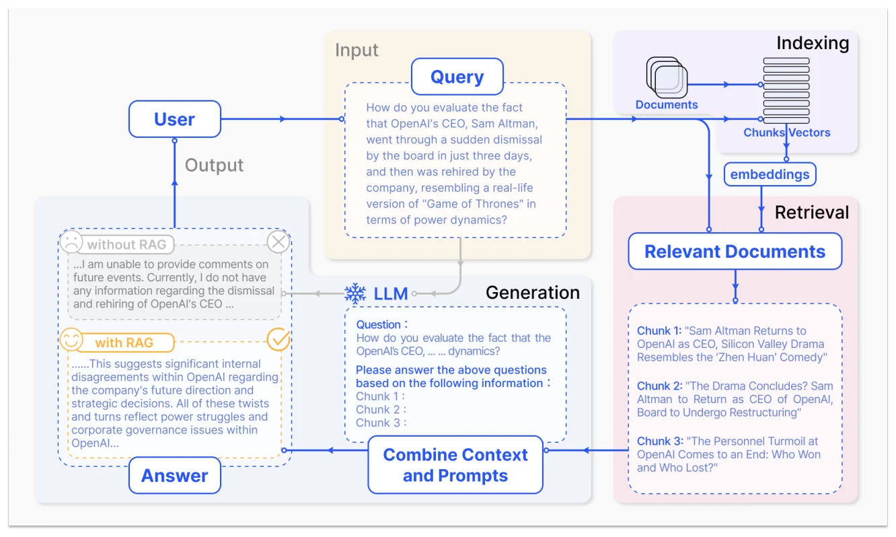
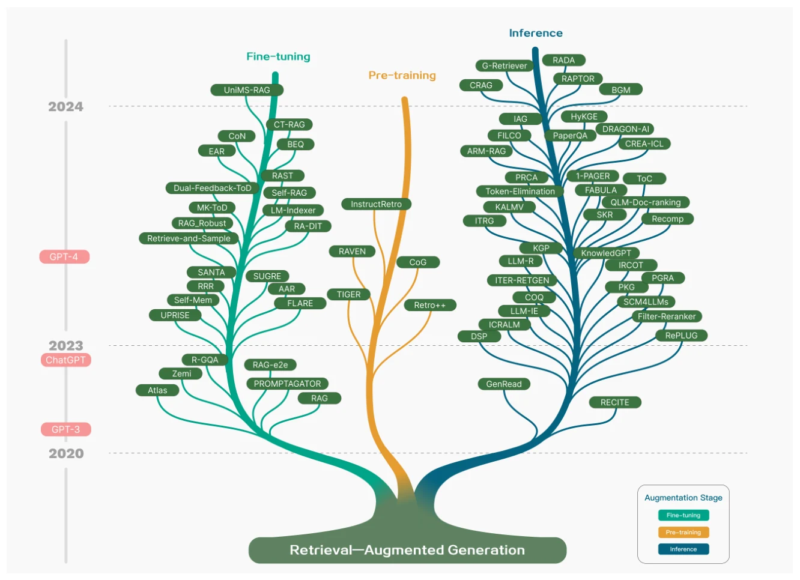
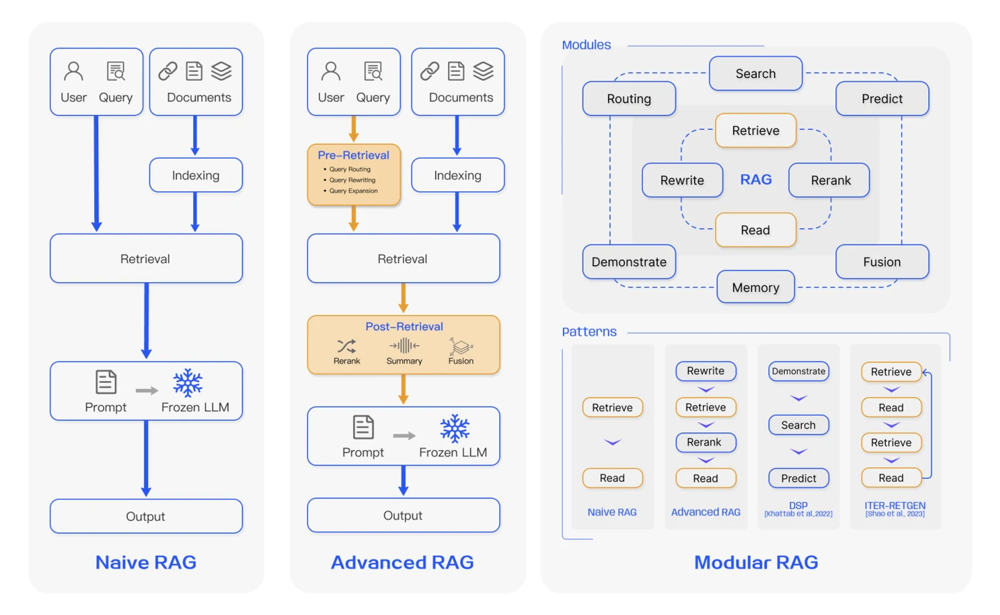
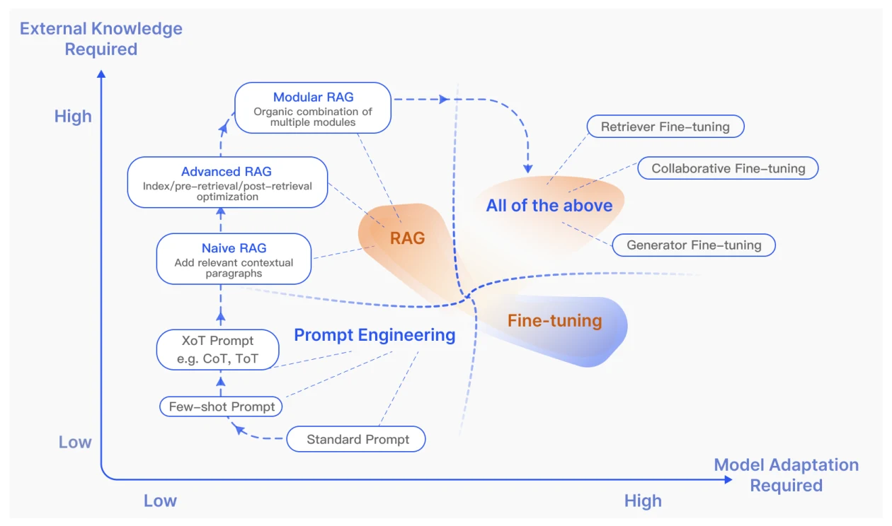
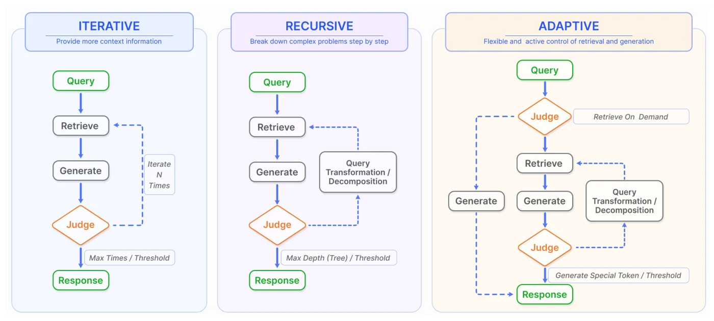

# RAG 综述：检索增强生成的方法地图

大语言模型（LLM）很会说话，但有三个老问题。第一，它会一本正经地编造事实，这常被称为“幻觉”。第二，它的知识停在训练数据截止的那一天，之后发生的事一概不知。第三，它说不清答案的依据从哪里来，用户很难核实。检索增强生成（RAG）的思路很朴素：回答之前，先去外部资料库里找相关内容，把找到的材料和问题一起交给模型，让它“看着资料作答”。[摘要与 §I](https://arxiv.org/html/2312.10997v5#S1)

这个思路听起来简单，做起来却有很多环节可能出错：资料怎么存、问题怎么问、找回来的材料怎么挑、模型有没有真正用上这些材料。2023 年前后，大量研究分别改进其中某一个环节，名目繁多。同济大学和复旦大学团队撰写的这篇综述，梳理了 100 多项研究，把它们放进同一个框架里。它是入门这一领域最常被推荐的材料之一。

综述的主要贡献可以概括为三张“地图”：

- **一张演进图：** 把 RAG 系统的组织方式归纳为 Naive、Advanced、Modular 三种范式；
- **一张部件图：** 按“检索—生成—增强”三个环节，整理每个环节里的代表方法；
- **一张评价图：** 汇总 26 类下游任务、近 50 个数据集，以及评价目标、指标和工具。

读这篇综述最大的困难，是满篇的方法名和缩写：HyDE、Self-RAG、FLARE、IRCoT、RA-DIT……综述往往一句话带过。这份导读按综述自己的章节顺序展开，方便你对照原文；遇到代表方法时，会说明它要解决什么问题、具体怎么做、和相邻方法有什么不同、作者或原论文指出了什么局限。导读还用一个虚构的档案问答例子串起几个关键环节，帮助你看清每类方法到底改变了什么。正文中第一次出现的缩写带有虚线，点开可以看全称和来历。

本导读固定采用 2024 年 3 月 27 日发布的 arXiv v5。综述覆盖到 2024 年初，不是今天 RAG 技术与产品的完整清单。[论文身份与版本](https://arxiv.org/abs/2312.10997v5)

## 从一个例子看 RAG 怎样工作

综述用图 2 的例子开场。用户问 ChatGPT：“OpenAI 的 CEO 被董事会突然解雇、三天后又被请回来，这件事怎么评价？”这是训练数据之后才发生的新闻。没有 RAG 时，模型只能回答“我无法评论未来事件，目前没有相关信息”。有了 RAG，系统先找到几篇相关报道，把它们和问题一起放进提示里，模型就能据此给出有内容的回答。[§II 与图 2](https://arxiv.org/html/2312.10997v5#S2)

图 2 把整个过程拆成三步，这也是最基础的 RAG 流程：[Naive RAG 的三个步骤](https://arxiv.org/html/2312.10997v5#S2.SS1)

1. **索引。** 把 PDF、HTML、Word、Markdown 等各种格式的原始资料清洗成纯文本，切成小块（chunk），再用嵌入模型把每块文本变成向量，存进向量数据库。切块是因为模型一次能读的长度有限。
2. **检索。** 用户提问后，用同一个嵌入模型把问题也变成向量，计算它和每个文本块的相似度，取最相似的前 K 块。
3. **生成。** 把问题和取回的文本块拼成一个提示，交给大模型生成回答。多轮对话时，还可以把之前的对话历史一起放进去。

这里有一个要点：整个过程中，大模型本身的参数没有任何变化，图中的雪花图标表示模型是“冻结”的。知识的更新发生在资料库这一侧：想让模型知道新消息，把新文档加进索引就行，不必重新训练模型。这正是 RAG 吸引人的地方。

综述也指出，这条最朴素的流程有三类毛病：

- **检索不准：** 精确率和召回率都不够，可能取回不相关的块，也可能漏掉关键信息；
- **生成不可靠：** 模型仍可能编造材料里没有的内容，也可能输出不相关、有害或带偏见的回答；
- **衔接不顺：** 多个来源的信息重复或互相矛盾；模型可能照搬检索结果，而不是真正综合；复杂问题只靠一次检索，往往拿不到足够的信息。

为了看清这三类毛病分别出在哪里，导读准备了一个虚构的例子，后面几节会反复用到。下面的站名、档案和数值都是导读编的。用户问：“青榆站投运时执行哪一版校准规程？当时常规传感器每隔多少天复核一次？”资料库里有四份相关材料：

| 代号 | 材料内容 |
| --- | --- |
| A，投运验收单 | 青榆站投运时，验收采用《传感器校准规程》B 版。 |
| B，规程 B 版 | 常规传感器每 14 天复核一次。 |
| C，规程 C 版 | 后来发布的修订版，改为每 7 天复核一次。 |
| D，站点报道 | 青榆站开展了校准培训，没有提到规程版本和复核周期。 |

正确答案需要两步：先从 A 读出“B 版”，再从 B 读出“14 天”。假设系统回答“B 版，每 7 天”。表面上是同一个错误，打开中间记录，却可能是三种完全不同的情况：

| 检索器找到的候选 | 最终交给模型的材料 | 问题出在哪里 |
| --- | --- | --- |
| 只有 A、C | A、C | 检索环节：B 没找到。可能是 B 没入库，或者问题的措辞没能匹配上它。 |
| A、C、B | 只保留了 A、C | 整理环节：B 找到了，却在排序、截取或压缩时被丢掉。 |
| A、B、C | 三份都在 | 生成环节：模型把新版 C 的周期错套到了旧版上。 |

三种情况需要完全不同的修法。第一种，换一个更好的排序器也救不回根本没找到的 B；第三种，再多检索几份文档反而可能带来更多不同年份的规定。所以排查 RAG 系统时，最好保留三份记录：实际用来检索的查询、检索返回的候选、最终交给模型的提示。综述后面几章介绍的方法，大多可以看作在修补其中某一个环节。读一篇新的 RAG 论文时，可以先问一句：它在修哪里？

## RAG 的来路：技术树与三个阶段

图 1 是综述的技术树。纵轴是时间，三根枝干代表“在模型的哪个阶段引入检索”：中间橙色是预训练，左侧绿色是微调，右侧深蓝色是推理。时间轴上标出了 GPT-3、ChatGPT、GPT-4 三个节点，可以看到枝叶在 ChatGPT 之后明显变密。[§I 与图 1](https://arxiv.org/html/2312.10997v5#S1)

综述据此把 RAG 的发展分成三个阶段。

**第一阶段：和 Transformer 一起起步。** 早期工作主要在预训练层面引入外部知识，以增强预训练模型（PTM）。例如 DeepMind 的 RETRO 在预训练时就让语言模型从万亿词元规模的数据库中检索文本块。2020 年 Lewis 等人提出的 RAG 模型也出现在这一时期，图 1 把它画在微调枝干的根部：它把一个检索器和一个生成器连在一起微调。本库有这篇论文的[专门导读](/read/rag/2#u01)。

**第二阶段：ChatGPT 之后转向推理阶段。** 大模型展现出很强的上下文学习（ICL）能力：不改参数，只在提示里给出例子和材料，就能完成新任务。研究重心于是转向“推理时怎样给模型提供更好的信息”，图 1 右侧的枝干因此最为茂密。这一阶段的大部分方法都不训练大模型本身，只改进检索和提示。

**第三阶段：与微调结合。** 研究不再局限于推理阶段，开始和大模型微调结合起来，比如同时训练检索器和生成器，让两者互相适应。左侧枝干上的 Self-RAG、RA-DIT 都属于这一类。

在模型的哪个阶段引入检索，代价也不同。在预训练时引入，训练过程本身就要处理外部语料和检索机制，成本高，但模型从一开始就学会使用检索结果；只在作答时引入，模型不用改动，但每遇到一个问题都要承担搜索和阅读的开销。这三根枝干并不互斥，一个用检索预训练过的模型，推理时仍然可以再查资料库。分期是综述作者的归纳，用来帮助理解研究重心的转移。

## 三种范式：从流水线到可组合的模块

综述最核心的框架是图 3 的三种范式。作者说的“范式”指组织 RAG 系统的思路，不是三个互不相干的算法，后一种包含了前一种。读这张图的一个好办法是从左下的 Output 倒着往回找：回答由冻结的模型写成，它能看到的只有提示里的文字；提示里的材料来自 Retrieval；检索器只能在已经建好索引的 Documents 里找。三种范式的区别，就在于研究者能在这条线路的哪些位置动手。[§II 与图 3](https://arxiv.org/html/2312.10997v5#S2)

**Naive RAG（朴素 RAG）** 就是上一节的“索引—检索—生成”三步，也被称为 Retrieve-Read（先检索、再阅读）。它在 ChatGPT 普及后迅速流行，图 3 左列画的就是这条直线。它的局限也很直接：检索器只凭用户原始的提问去找，找回来的东西原样交给模型。

**Advanced RAG（进阶 RAG）** 仍是一条直线，但在检索前后各加了一道工序，即图 3 中列的两个橙色框：[Advanced RAG](https://arxiv.org/html/2312.10997v5#S2.SS2)

- **检索前（Pre-Retrieval）：** 改进索引和问题。索引方面，可以用滑动窗口、更细的切分、附加元数据；问题方面，可以改写、扩展或转换用户的提问，让它更适合检索。比如资料里写的是“复核周期”，用户问的却是“多久检查一次”，改写查询就可能把原本漏掉的条款找回来。
- **检索后（Post-Retrieval）：** 处理找回的材料。一是重排，把最相关的内容放到提示的开头或结尾；二是压缩上下文，只保留关键信息，避免大量无关内容淹没重点。比如条款 B 已经找到了，却排在几篇新闻后面，而提示只容得下前两段，重排就可能让模型看到它。LlamaIndex、LangChain 等工程框架都实现了这些功能。

这两道工序处理的是不同的失败。检索前的改进可能找回原本没进候选的材料；检索后的处理只能在已经找回的材料里挑选，救不回根本没找到的东西。

**Modular RAG（模块化 RAG）** 不再是固定的直线，而是一组可以替换、增加、重新排列的模块。综述从两方面描述它。[Modular RAG](https://arxiv.org/html/2312.10997v5#S2.SS3)

第一是**新模块**，即图 3 右上方的一圈。[新模块](https://arxiv.org/html/2312.10997v5#S2.SS3.SSS1)

- **Search：** 直接搜索搜索引擎、数据库、知识图谱等不同来源，由大模型生成查询语句或代码；
- **RAG-Fusion：** 把一个问题扩展成多个不同角度的查询，并行检索，再把结果合并重排，以找到单一查询容易漏掉的信息；
- **Memory：** 利用模型自身的输出构建记忆池，用来引导后续检索；
- **Routing：** 根据问题选择走哪个数据源或处理流程，比如是做摘要、查特定数据库，还是合并多路信息；
- **Predict：** 让大模型直接生成上下文，以减少检索结果中的冗余和噪声；
- **Task Adapter：** 让 RAG 适配不同的下游任务，例如为零样本任务自动挑选提示。

第二是**新模式**，也就是模块怎样组合。图 3 右下方给了几个例子，综述正文还介绍了更多：[新模式](https://arxiv.org/html/2312.10997v5#S2.SS3.SSS2)

- **Rewrite-Retrieve-Read（RRR）** 在检索之前加一步改写，专门解决“用户的问法和资料的写法对不上”的问题。它用一个可训练的小模型改写查询，再用大模型回答的好坏作为反馈，通过强化学习训练这个改写器。
- **Generate-Read（GenRead）** 走得更远：干脆不检索，让大模型根据问题先“写”出几段背景文档，再据此作答。原论文发现，模型生成的背景文档往往比检索结果更贴合问题。
- **Recite-Read（RECITE）** 思路相近：让模型先从自己的参数记忆中“背诵”出相关段落，再回答。
- **DSP（Demonstrate-Search-Predict）** 把“构造示范—检索—预测”写成可以编排的程序，在大模型和检索器之间多次传递文本，把复杂问题拆成多个小步骤。
- **ITER-RETGEN** 是 Retrieve-Read-Retrieve-Read 的循环：用上一轮生成的回答去检索，再用新的检索结果改进下一轮回答。
- **FLARE 和 Self-RAG** 让模型自己判断什么时候需要检索，后文“增强过程”一节会详细介绍。

模块化的价值在于，前一步的结果可以决定下一步怎么查。回到青榆站的例子：要回答“投运时用哪版规程、周期多少天”，系统可以先用路由模块去查站务档案，拿到“B 版”这个版本号，再带着版本号去规程库里查周期。第二个问题在第一步之前是问不准的。代价是每多一个模块，就多一次调用和等待，前一步的错误也可能传进下一步。

GenRead 和 RECITE 还说明了一件有意思的事：“检索”的来源不一定是外部资料库，也可以是模型自己。不过，由模型写出的“资料”只能帮助组织思路，不能作为事实已被外部来源证实的证据。

从 Naive 到 Modular，综述描述的是一种演进关系，图 3 本身没有给三种范式排名次。模块更多并不自动意味着效果更好：改写可能歪曲原意，重排可能丢掉关键的反例，路由也可能选错数据源。比较两种方案时，要在同一批问题、同一份资料和相近的调用成本下检验。

## RAG、微调与提示工程怎样选

想让大模型在某个领域表现更好，常见的办法有三种：提示工程、RAG 和微调（FT）。综述用图 4 的象限图比较它们：横轴是“需要改动模型多少”，纵轴是“需要多少外部知识”。[§II-D 与图 4](https://arxiv.org/html/2312.10997v5#S2.SS4)

- **提示工程**在左下角：既不改模型，也不需要太多外部知识，只是更好地利用模型已有的能力。从普通提示、少样本提示，到 CoT 这类引导推理的提示，都属于这一类。
- **RAG** 在左上方：不怎么改模型，但需要大量外部知识。综述的比喻是“给模型一本量身定做的教科书”，适合需要精确查找信息的任务。
- **微调**在右下方：要进一步训练模型，好比学生把知识“内化”进脑子里，适合需要复制特定结构、风格或格式的场景。

两者各有长短。RAG 的知识可以随时更新：往资料库里加入新文档即可；如果保留了出处，读者还能核查答案用了哪份材料。代价是检索会增加延迟，资料的获取和使用也涉及伦理问题。微调更“静态”，知识更新要重新训练，准备数据和训练都需要较多计算资源，但能深度定制模型的行为和风格。

综述引用了一项比较研究：在多个知识密集型任务上，无监督微调只带来有限的提升，RAG 则在训练时见过的知识和全新的知识上都表现更好；研究还发现，大模型很难通过无监督微调学会新的事实。需要注意，这项研究比较的是无监督微调，不代表所有微调方式。[Ovadia 等的比较研究](https://arxiv.org/abs/2312.05934)

综述也强调，两者并不互斥。图 4 右上角的 “All of the above” 表示 Modular RAG 正在与检索器微调、生成器微调、协同微调结合。选哪种方式，取决于数据变化有多快、需要多深的定制，以及有多少计算资源。

## 检索之一：从哪里找、切多细、怎样建索引

综述第三章是全文最长的部分，讨论“检索”这一环的各种选择。这一节先看资料本身，也就是检索器能在什么样的库里找；下一节再看问题怎样问、检索器怎样配。建库时把什么当作一条记录，会从源头上决定检索器后来能找到什么。[§III 检索](https://arxiv.org/html/2312.10997v5#S3)

**检索来源有四类。**[数据结构](https://arxiv.org/html/2312.10997v5#S3.SS1.SSS1)

- **非结构化数据**，主要是文本，用得最广。开放域问答（ODQA）常用维基百科的固定版本，比如 HotpotQA（2017 年 10 月 1 日）和 DPR（2018 年 12 月 20 日）对应的版本。此外还有跨语言文本，以及医疗、法律等领域的专门语料。
- **半结构化数据**，指 PDF 这类图、文、表混排的资料。难点有二：切块时可能把表格从中间切断，表格内容也让相似度计算变得复杂。一种做法是让大模型写 SQL 语句去查数据库里的表格（如 TableGPT）；另一种是先把表格转成文字，再用处理文本的方法。综述认为两者都不理想，这里还有很大的研究空间。
- **结构化数据**，比如知识图谱（KG）。它的信息通常经过整理和验证，比较精确。KnowledGPT 让模型生成知识库查询，并把知识存进个性化的知识库；G-Retriever 把图神经网络（GNN）、大模型和 RAG 结合起来，用于理解图结构数据的问答。代价是构建、验证和维护结构化数据库需要额外的工作。
- **大模型自己生成的内容。** 这类方法试图利用模型内部已有的知识。SKR 先判断一个问题是模型“已知”的还是“未知”的，只对未知的问题调用检索；GenRead 用模型生成代替检索；Selfmem 用检索增强的生成器反复生成，构成一个不断扩充的记忆池，再从中挑出好的输出用于下一轮。

**检索粒度：一次取多大的一块。** 粒度从细到粗依次是词元、短语、句子、命题、块、整篇文档。块太大，信息多，但噪声也多，会分散检索器和模型的注意；块太小，噪声少，但可能语义不完整，检索的负担也更重。综述认为，按任务选择合适的粒度是一个简单有效的改进办法。[检索粒度](https://arxiv.org/html/2312.10997v5#S3.SS1.SSS2)

粒度的影响可以用一个例子体会。设想规程 B 是一张表：表头写“B 版”，行名写“常规传感器”，单元格写“14”，单位“天”只出现在列名里。如果切块时只留下“14”这个数字，检索即使精准命中，也说不清它是哪个版本、哪类设备、什么单位；如果把整本规程当作一块，信息倒是完整，模型却要在一整本书里找那一行。

针对这个矛盾，综述介绍了两类思路。一类是 DenseX 提出的“命题”：每个命题是一句自成一体、只陈述一个事实的短句，例如“B 版规程规定常规传感器每 14 天复核一次”。原论文的实验显示，按命题建索引的检索效果好于按段落。另一类是下面要讲的 Small2Big：检索时用小单位定位，交给模型时再把上下文补回来。前者在建库时就让每一条记录自带完整条件，后者在取回时补齐条件。知识图谱上的粒度则是实体、三元组和子图；在推荐等任务中，检索单位还可以是物品编号或句子对。

**索引优化：怎样把资料存好。**[索引优化](https://arxiv.org/html/2312.10997v5#S3.SS2)

- **切块策略。** 最常见的是按固定词元数切，比如 100、256 或 512 个。块大能装更多上下文，但噪声更多、处理更慢；块小噪声少，但可能不完整。为了避免把句子从中间切断，有递归切分和滑动窗口等改进。Small2Big 则用句子作为检索单位（小），找到后再把前后几句一起交给模型（大），兼顾检索精度和上下文完整。
- **附加元数据。** 给每块加上页码、文件名、作者、类别、时间戳等信息，检索时可以按元数据筛选，缩小范围。按时间加权，可以优先使用新资料，实现“时间感知”的 RAG。但时间加权要看问题本身：青榆站的问题问的是“投运时”，一味偏向新文档反而会让 C 版压过 B 版。先从 A 读出版本号，再按版本号筛选，筛选条件才有了依据。
- **人为构造的元数据。** 元数据不一定来自原文，也可以人工或用模型生成，比如给段落写摘要，或者让模型为每段生成“这段能回答什么问题”。后者被称为 Reverse HyDE：检索时比较用户问题和这些假设问题的相似度，以缩小问题和答案之间的表述差距。
- **结构化索引。** 一种是层级索引：把文档按父子关系组织，每个节点存一份摘要，检索时先定位大的部分，再找具体的块。另一种是知识图谱索引，比如 KGP 在多篇文档之间建一张图：节点是段落或页面、表格等结构，边表示段落之间的语义或词面相似，以及文档内部的结构关系。回答多文档问题时，再由大模型沿着图收集所需的段落。

这一节的方法有一个共同前提：答案所需的原件必须在库里。如果资料库里根本没有规程 B，再好的切块和索引也找不到它，应当先补全资料，或者让系统承认缺少依据。

## 检索之二：问题怎样问、检索器怎样配

资料准备好了，下一个难题是用户的提问往往不适合直接拿去检索。一个提问同时承担两项工作：对人说明“我想知道什么”，对机器提供“去哪里找”的线索，而这两者的措辞未必一致。问题可能表述不清、结构复杂，还可能有歧义。综述举了一个例子：在法律场景中，“LLM”可能指大语言模型，也可能指法学硕士（Master of Laws）。连实体都认错的话，检索器会很有把握地找回一堆谈大语言模型的文档。综述第三章把查询这一侧的方法分为扩展、转换和路由三类。[查询优化](https://arxiv.org/html/2312.10997v5#S3.SS3)

**查询扩展：把一个问题变成多个。**

- **Multi-Query（多查询）：** 用提示让大模型把问题扩展成多个查询，并行检索后合并结果。它适合“同一件事有多种说法”的情况，比如同时查“投运时采用的校准规程”和“启用验收时执行的校准标准”。
- **Sub-Query（子查询）：** 把复杂问题拆成一系列简单的子问题，比如用 least-to-most 提示法从易到难地分解。青榆站的问题就可以拆成“验收单指定了哪一版”和“该版规定的复核周期是多少”。注意第二个子问题依赖第一个的答案，查清版本之前，连该查哪一版都不知道。这和多查询不同：多查询是同一个问题换几种说法，子查询是几个需要互相补足的问题。
- **CoVe（Chain-of-Verification，验证链）：** 它原本是一种减少幻觉的方法：模型先起草回答，再针对草稿列出需要核实的问题，独立回答这些问题，最后据此修正回答。综述把这种“生成问题、再逐个验证”的思路也归入查询扩展。

**查询转换：换一个更好检索的说法。**

- **查询改写。** 原始问题未必适合检索，可以让大模型改写。RRR 用一个专门的小模型来改写：先生成适合搜索的查询，用搜索引擎找回材料，再交给冻结的大模型作答；改写器则根据大模型最终回答的好坏，用强化学习来训练。它的特点是只训练改写器，下游的大模型保持不动，训练目标是“哪种改写最有利于最后答对”。原论文在开放域问答和选择题问答上做了验证。淘宝的 BEQUE 把查询改写用于电商搜索，提升了长尾查询的召回。改写也有风险：如果把“投运时的复核周期”改写成“青榆站现行复核周期”，就丢掉了“投运时”这个关键条件。检查改写结果时，要特别留意时间、实体、否定和单位有没有保留。
- **HyDE（假设文档嵌入）。** 这是一个很巧妙的想法。它要解决的问题是：问题和答案往往长得不像。用户的提问是疑问句，资料里的答案是陈述句，两者的向量未必接近。HyDE 先让大模型针对问题写一段“假设的答案文档”，再把这段文字编码成向量，到真实语料里找和它相近的文档。假设文档里的细节可能是错的，比如它可能猜“周期为 7 天”，但它的写法“像”真正的答案，比原来的问句更容易找到相似的真实文档。综述说，这相当于把“用问题找答案”改成了“用答案找答案”。原论文的目标场景是没有相关性标注数据时的零样本稠密检索。和 RRR 的区别在于，RRR 改写的是一句查询，HyDE 生成的是一整段文档式的文字。需要记住，假设文档本身没有证据效力，它只是检索用的“诱饵”，答案仍要从找回的真实文档里读。
- **Step-back 提示（退一步提示）。** 先把具体问题抽象成一个更上位的问题，比如先问“这个现象背后是哪条原理”，再用原理引导推理。在 RAG 中，原问题和上位问题都拿去检索，两份结果一起作为作答依据。对青榆站的问题，上位问题可能是“校准规程一般怎样规定复核周期”。它能帮助理解条款，但具体的天数仍要回到对应版本的原文里查。

**查询路由：不同问题走不同的流程。** 元数据路由先从问题中提取关键词或实体，再按块的元数据筛选范围；语义路由则根据问题的含义选择路径；两者也可以结合。路由的风险在于选错库：把青榆站的问题只路由到站务档案库，能找到 A，却会错过放在规程库里的 B。需要跨来源回答的问题，一次只查一个库，可能从一开始就漏掉了一半证据。

**嵌入模型：检索器的核心。**[嵌入](https://arxiv.org/html/2312.10997v5#S3.SS4)检索靠计算问题向量和文本块向量之间的相似度，比如余弦相似度。嵌入方法分两大类：

- **稀疏检索**，以 BM25 为代表，本质上看的是关键词重合：查询词在文档里出现得多、在整个语料里又比较少见，就认为相关。它不理解同义词，但对规程编号、人名这类罕见而精确的字符串很可靠。
- **稠密检索**，用 BERT 这类预训练模型把文本编码成向量，按语义相近程度匹配，能把“多久检查一次”和“复核周期”联系起来。DPR 是稠密检索的经典工作。综述提到的新一代嵌入模型有 AngIE、Voyage、BGE 等，它们大多经过多任务的指令微调。

评价嵌入模型的常用榜单是 MTEB，它覆盖 8 类任务、58 个数据集；C-MTEB 针对中文，覆盖 6 类任务、35 个数据集。综述的态度很务实：没有放之四海而皆准的嵌入模型，要看具体场景。

- **混合检索：** 稀疏和稠密捕捉的是不同的相关性，可以互补。比如可以用稀疏检索的结果为训练稠密检索器提供初始数据；稀疏检索还能帮助稠密检索器处理含有罕见实体的查询，提升零样本检索能力和鲁棒性。合并两路结果会增加候选数量，也会增加后续排序和阅读的成本。
- **微调嵌入模型：** 在医疗、法律等术语密集的领域，资料和预训练语料差别很大，需要用领域数据微调嵌入模型。另一个目的是让检索器和生成器“对齐”，即用大模型的反馈训练检索器，这类做法被称为 LSR（LM-supervised Retriever）。PROMPTAGATOR 用大模型根据少量示例生成大量查询，再用这些合成数据训练特定任务的检索器，以缓解专业领域缺少标注数据的问题。LLM-Embedder 同时使用数据集的标准标签和大模型给出的奖励信号来训练。REPLUG 把大模型当作黑箱，只在输入前拼接检索文档；它分别计算检索器和大模型对候选文档的概率分布，用 KL 散度让检索器的打分向大模型的偏好靠拢，因此不需要像早期方法那样修改大模型的结构。还有借鉴 RLHF 思路、用强化学习训练检索器的做法。

**适配器：不改大模型也能对齐。**[适配器](https://arxiv.org/html/2312.10997v5#S3.SS5)很多时候大模型只能通过 API 调用，或者本地算力不够，无法微调。这时可以在检索器和大模型之间加一个小的“适配器”：

- **UPRISE** 训练一个轻量的提示检索器，从预先构建的提示池里为零样本任务的输入自动挑选合适的提示；
- **AAR** 提供一个可以适配多种下游任务的通用检索适配器；
- **PRCA** 在检索器和黑箱大模型之间加一个可插拔的上下文适配器，从检索结果中提取有用信息，并以大模型回答的好坏作为奖励来训练；
- **BGM** 保持检索器和大模型都不变，在两者之间训练一个序列到序列的“桥接”模型，把检索结果重排、筛选，转换成大模型更好用的形式。

选择这些方法之前，最好先确认问题出在哪里。如果症结只是切块时把版本标题切掉了，修复索引比训练一个检索器直接得多。

## 生成：材料怎样整理，模型怎样调整

检索到材料之后，把所有结果一股脑儿塞给模型并不是好做法。综述第四章从两个方向讨论改进：调整交给模型的内容，以及调整模型本身。[§IV 生成](https://arxiv.org/html/2312.10997v5#S4)

**上下文整理：为什么不能塞得越多越好。**[上下文整理](https://arxiv.org/html/2312.10997v5#S4.SS1)冗余信息会干扰生成，过长的上下文还会让模型遇到“迷失在中间”（Lost in the Middle）的问题。这个现象来自 Liu 等人 2023 年的研究：他们在多文档问答和键值检索任务中，系统地改变关键信息在输入中的位置，发现关键信息放在开头或结尾时模型表现最好，放在中间时表现明显下降，连专门的长上下文模型也是如此。这个实验的价值在于把两种失败分开了：一种是关键文档根本不在提示里，另一种是文档在提示里，但模型没有用上。综述打了个比方：像人一样，模型更容易注意长文的开头和结尾，而忽略中间。

整理上下文主要有三种手段。

- **重排（Reranking）。** 对找回的候选重新排序，把最相关的放到前面，同时过滤掉不相关的。它既是增强器，也是过滤器。重排可以基于规则，比如按多样性、相关性、MRR 等指标；也可以基于模型，比如 SpanBERT 这类 BERT 系列模型、Cohere rerank 和 bge-reranker 这样的专门重排模型，或者直接用 GPT 这样的大模型。重排改变的是顺序，以及截取时哪些材料能留下来。假设初次检索返回 A、C、D、B，提示只能放两份。如果重排器能借助 A 中的版本信息把 B 提到第二位，模型就拿到了完整证据。但如果重排器只是逐份判断“这份文档和问题有多像”，D 有站名和“校准”，C 有明确的周期，它们仍可能排在 B 前面。“单份文档切题”和“几份文档合起来足以回答”是两个不同的目标。
- **上下文压缩。** 综述指出一个常见误解：检索越多相关文档、拼成越长的提示越好。实际上，过多的上下文会引入噪声，削弱模型对关键信息的感知。LLMLingua 用 GPT-2 Small、LLaMA-7B 这样的小模型判断哪些词元不重要并删掉，配合预算控制保留关键语义。压缩后的文本人读起来困难，但大模型能理解，原论文报告最高可压缩约 20 倍而性能损失很小。RECOMP 训练压缩器把检索文档压成简短摘要，分为两种：抽取式压缩器从文档中挑选有用的原句，生成式压缩器综合多篇文档写出摘要；如果材料无关，压缩器还可以输出空字符串，即这一轮不使用检索结果。综述提到，RECOMP 用对比学习训练，每条训练数据包含 1 个正样本和 5 个负样本。PRCA 则训练一个信息提取器。压缩和重排的区别在于：重排不改动文档内容，压缩会改写或删减文字本身。对青榆站的问题，删掉重复的套话无伤大雅，删掉“常规”“B 版”或“天”就丢失了适用对象、版本或单位。生成式摘要写成“青榆站每 14 天复核”很简洁，却把“投运时”和“常规传感器”省掉了。
- **减少文档数量。** Ma 等人提出 Filter-Reranker 范式，结合小模型和大模型的长处：小模型做初筛，大模型对小模型拿不准的困难样本重新排序，在多项信息抽取（IE）任务上有明显提升。还有一种直接的做法是让大模型在回答前先评估检索内容，过滤掉相关性差的文档。例如法律大模型 Chatlaw 会让模型对引用的法条做自我评估，判断它们是否相关。

要判断错误出在整理环节还是生成环节，可以做一个简单的对照：把同一个问题分别配上原始材料和整理后的材料交给模型。原始材料能答对、整理后答错，问题多半在整理；原始材料齐全却仍答错，才需要检查模型怎样使用证据。

**微调大模型。**[大模型微调](https://arxiv.org/html/2312.10997v5#S4.SS2)上面的整理只影响本次输入；微调则改变模型以后怎样使用检索结果。如果能部署本地模型，针对场景和数据微调可以带来更好的效果，这也是使用本地模型的一大优势。微调有两个主要用途：一是在模型缺少某领域知识时补充知识；二是调整输入输出，让模型适应特定的数据格式和回答风格。对于检索结构化数据的任务，SANTA 设计了三阶段训练，先用对比学习优化查询和文档的嵌入，以同时把握结构信息和语义信息。

还可以用强化学习，让模型的输出对齐人类偏好，或者对齐检索器的偏好。如果拿不到强大的闭源模型或更大的开源模型，一个简单有效的办法是用 GPT-4 这类强模型的输出做蒸馏。

最值得注意的是**检索器和生成器的协同微调**。代表方法 RA-DIT 分两步：先微调大模型，让它更会利用检索到的信息；再微调检索器，让它返回大模型更“需要”的内容。两步各自都有提升，合用效果更好。综述说，RA-DIT 用 KL 散度对齐检索器和生成器的打分函数。和只改查询的 RRR 相比，RA-DIT 需要能更新两边模型的参数，它正是图 4 中 RAG 与微调结合的一个例子。

## 增强过程：一次检索不够时怎么办

标准的 RAG 只检索一次。对于需要多步推理的复杂问题，一次检索提供的信息往往不够。青榆站的问题就是如此：要查的规程版本，只有读了 A 才知道。第一次检索时把 K 调大，可能只会找回更多带站名的报道。综述第五章把改进方法归纳为图 5 的三种流程。读图时可以先看箭头回到哪里，再看是什么信号让系统继续检索；每种流程都有一个菱形的“Judge”（判断）节点控制循环。[§V 增强过程与图 5](https://arxiv.org/html/2312.10997v5#S5)

**迭代检索（Iterative）：多检索几轮，补充更多上下文。** 流程是“检索—生成—判断”，不满意就再来一轮，直到达到最大次数或阈值。综述指出，它能通过多轮检索提供更多参考，提升回答的鲁棒性；风险是语义可能不连贯，不相关的信息也会越积越多。[迭代检索](https://arxiv.org/html/2312.10997v5#S5.SS1)

代表方法 ITER-RETGEN 把“检索增强生成”和“生成增强检索”结合起来。它的出发点是：模型当前写出的回答，反映了完成任务还需要什么，用它作查询，往往能找到更相关的知识，进而在下一轮写出更好的回答。具体来说，第一轮按原问题检索并尝试完整作答；第二轮把上一轮的回答和原问题一起用于检索，再读新材料重新作答。在青榆站的例子里，第一稿可能是“验收单指定 B 版，复核周期尚缺依据”，其中的“B 版”就让第二轮有机会找到规程 B。这和一开始就换几种问法不同：后续的查询用上了刚刚读到的新信息。原论文还强调，它每一轮把检索结果作为一个整体使用，不在生成过程中频繁插入检索。代价也在这里：如果第一稿猜错成 C 版，下一轮可能收集到越来越多关于 C 版的材料。

**递归检索（Recursive）：逐步拆解复杂问题。** 和迭代检索的区别在于，每一轮之后会改写或分解问题，即图 5 中间的 “Query Transformation / Decomposition”，逐步逼近真正需要的信息。[递归检索](https://arxiv.org/html/2312.10997v5#S5.SS2)

- **IRCoT** 把检索和思维链（CoT）交织在一起。它针对多步问答提出：一次性的“先检索、再推理”不够用，因为“该检索什么”取决于“已经推出了什么”，而后者又可能取决于“之前检索到了什么”。所以 IRCoT 每推出一步推理，就用这一步去检索，检索结果再帮助下一步推理。在青榆站的例子里，先读 A，写出中间句“投运时采用 B 版”，再根据这句去找 B 版规程，从中读到 14 天。和 ITER-RETGEN 用上一轮的完整回答重新检索不同，IRCoT 的检索和推理在一次作答的过程中逐步交错。它适合第二步依赖第一步的问题；风险是中间句一旦读错，后面的检索就会被引向错误的方向。
- **ToC（澄清树）** 针对有歧义的问题。它递归地列出问题的各种可能理解，形成一棵澄清树，分别检索后，再综合成一个覆盖各种理解的长答案。比如“青榆站”如果指两个不同的站，澄清树会保留两种解释，分别找证据。
- 递归检索也常和层级索引配合：先检索文档或长 PDF 的摘要，选中后再在文档内部做第二次检索。多跳检索则沿图结构数据深入，提取相互关联的信息。

**自适应检索（Adaptive）：让模型自己决定何时检索、何时停止。**[自适应检索](https://arxiv.org/html/2312.10997v5#S5.SS3)图 5 右侧的第一个判断节点就是“要不要检索”：不需要，就直接生成。综述把这一类方法和 Agent 的发展联系起来：AutoGPT、Toolformer 等系统让大模型主动决定何时使用工具，检索也可以看作一种工具。本库有 [Toolformer 的导读](/read/toolformer/1#u01)可以对照。

- **WebGPT** 用强化学习训练 GPT-3 自主使用搜索引擎。它通过特殊词元执行搜索、浏览结果、引用参考资料等动作，先模仿人类的操作示范，再用人类反馈优化。
- **FLARE** 面向长答案的生成。它的出发点是：只在开头检索一次，不够支撑一篇长回答，写作过程中需要随时补充资料。FLARE 的做法是先试着写出下一句，检查其中有没有概率很低、也就是模型没把握的词；如果有，就用这句预测作为查询去检索，取回资料后重新生成这句。假如模型写到“每隔……天复核”时对数字没把握，这个信号就会触发一次补充检索。需要注意的是，反过来不成立：模型也可能对一个错误的“7 天”非常有把握。低置信度可以作为“该去查一查”的信号，但高置信度不能证明内容有依据。
- **Self-RAG** 训练模型在生成过程中输出特殊的“反思词元”，分为 retrieve 和 critic 两类：前者决定此刻是否需要检索，后者评价检索到的段落是否相关、自己写出的内容是否得到段落支持、整体输出是否有用。综述说，生成时模型会在多个段落上做片段级的束搜索，选出最连贯的结果；这些评分的权重可以在推理时调整，以改变模型的行为。由于判断由模型自己做出，不需要额外的分类器或自然语言推理（NLI）模型。和 FLARE 相比，FLARE 关心“哪一句需要补资料”，Self-RAG 还要评价“补来的资料和据此写成的回答好不好用”。代价是它需要专门训练模型，不能直接套在现成的黑箱模型上。在青榆站的例子里，“C 版每 7 天”确实能得到真实文档 C 的支持，但它不满足“投运时”这个条件。Self-RAG 能否识别这类版本冲突，要用具体的样例去检验。

三类流程在实际系统中常常重叠。比较两篇都说自己“多轮检索”的论文时，可以对照图 5 问三个问题：下一轮检索用的是整份草稿，还是一条中间推理？每个问题都检索，还是由某种信号触发？在相同的调用次数下，新增的检索带回了哪条第一轮没有的证据？

## 怎样评价一个 RAG 系统

综述第六章汇总了 RAG 的评价方法。作者指出，过去对 RAG 的评价大多只看它在下游任务上的成绩，专门针对 RAG 自身特点的评价研究还很少。[§VI 任务与评价](https://arxiv.org/html/2312.10997v5#S6)

**下游任务。** RAG 的核心任务仍是问答（QA），包括单跳问答（如 NQ、TriviaQA）、多跳问答（如 HotpotQA、2WikiMultiHopQA、MuSiQue）、长答案问答、领域问答和多选题等；此外还扩展到信息抽取、对话生成、代码搜索、事实核查等任务。表 II 列出了这些任务及对应的数据集。传统指标因任务而异：问答常用精确匹配（EM）和 F1，事实核查常用准确率，生成质量常用 BLEU 和 ROUGE。这些指标衡量的是最终答案和参考答案有多接近，但区分不了答案是从材料里读出来的，还是模型碰巧猜对的。[下游任务](https://arxiv.org/html/2312.10997v5#S6.SS1)

**两个评价目标。**[评价目标](https://arxiv.org/html/2312.10997v5#S6.SS2)

- **检索质量：** 检索器找来的上下文好不好。这一部分借用搜索引擎、推荐系统和信息检索领域的指标，如命中率（Hit Rate）、MRR、NDCG。
- **生成质量：** 生成器能否基于检索内容给出连贯、相关的回答。没有标准答案时，看忠实性、相关性和无害性；有标准答案时，看信息是否准确。两者都可以人工评价，也可以自动评价。

用青榆站的例子手算一遍检索指标，会更容易理解它们在衡量什么。回答这道题需要 A 和 B 两份文档，C 和 D 不算相关。假设检索结果的顺序是 A、C、B、D：

- **Precision@2**（前 2 个结果中相关的比例）：前两个是 A、C，只有 A 相关，等于 1/2。
- **Recall@2**（所需文档中被前 2 个结果找回的比例）：A、B 中只找回了 A，也等于 1/2。放宽到前 3 个，Precision@3 是 2/3，Recall@3 是 2/2。
- **倒数排名：** 第一个相关结果 A 排在第 1 位，这道题的倒数排名是 1。MRR 是多道题倒数排名的平均值。

MRR 奖励尽早找到第一个相关结果，却说明不了第二跳需要的 B 有没有被找回。这些数字是导读手算的教学例子，与综述表 III 引用的研究结果无关。

**三个质量分数与四种能力。** 这是综述评价部分的核心框架。[评价维度](https://arxiv.org/html/2312.10997v5#S6.SS3)

三个质量分数分别问三个问题：

- **上下文相关性：** 交给模型的材料对这道题有多少用？A、B 足以支撑回答，而一篇看起来很像的 D 只谈培训，帮不上忙。
- **答案忠实性：** 回答中的陈述能从交给它的材料里推出来吗？如果交给模型的只有 A 和 C，即使它写对了“B 版每 14 天”，“14 天”也缺少依据，不算忠实。
- **答案相关性：** 回答切中用户的问题了吗？只答“青榆站投运时使用 B 版”可以完全忠实于 A，却漏答了周期。

还要另外核对事实是否正确。如果有人把 B 中的“14”篡改成“41”，模型逐字照抄，回答完全忠实于材料，却不是正确答案。忠实性和正确性是两回事。

四种能力考察系统在困难条件下的表现：

| 能力 | 测试时给模型什么 | 看什么 |
| --- | --- | --- |
| 噪声鲁棒性 | 有用的文档，加上和问题相关、但没有实质信息的文档 | 能否不受干扰，仍从有用材料中找到答案 |
| 拒答能力 | 不包含答案的文档 | 能否承认材料不足，而不是硬编一个答案 |
| 信息整合 | 各含一部分答案的多份文档 | 能否把分散的信息综合起来，回答复杂问题 |
| 反事实鲁棒性 | 含有已知错误的文档 | 能否识别并忽略错误信息 |

把青榆站的材料套进这个框架：在 A、B 之外加几篇像 D 一样的培训报道，测的是噪声鲁棒性；只给 A 和 D，看模型能否答出版本、同时说明周期缺少依据，测的是拒答能力；A、B 分别给出一半信息，测的是信息整合；混入一份把周期写错的伪造条款，测的是反事实鲁棒性。注意 C 并不是错误材料，它是另一个时期的真实规定；用错 C 说明模型没读懂适用范围，和被伪造材料误导是两种不同的错误。综述认为，上下文相关性和噪声鲁棒性主要反映检索质量，其余五项主要反映生成质量。

表 III 列出了每个维度可用的指标。综述特别说明，这些指标大多借用自相关领域，还不是成熟、统一的 RAG 评价标准。

**评价基准与工具。**[基准与工具](https://arxiv.org/html/2312.10997v5#S6.SS4)

| 名称 | 类型 | 评价什么 |
| --- | --- | --- |
| RGB | 基准 | 噪声鲁棒性、拒答、信息整合、反事实鲁棒性四种能力，中英文；原论文发现大模型在后三项上仍有明显困难 |
| RECALL | 基准 | 面对材料中的反事实知识是否稳健 |
| CRUD | 基准 | 中文场景下的创作、知识问答、纠错、摘要 |
| RAGAS | 工具 | 用大模型评估上下文相关性、忠实性、答案相关性，不依赖人工标注的标准答案 |
| ARES | 工具 | 同样三个维度；自动生成训练数据，微调轻量的评判模型，再用少量人工标注做统计校准 |
| TruLens | 工具 | 同样三个维度 |

需要横向比较模型在抗噪、拒答等方面的能力时，可以用 RGB 这样的基准；需要给自己的系统找出薄弱环节时，可以用 RAGAS 或 ARES 这样的工具。这些工具大多让大模型当评委。大模型评分方便，但它本身也会出错；分数上涨时，最好抽查一些证据不全、版本冲突之类的样例，看看上涨发生在哪类问题上。

## 挑战与未来方向

综述第七章列出了作者认为 RAG 尚待解决的问题。这些是 2024 年初的判断，读的时候要结合之后的发展，不能直接当作今天的研究空白。[§VII 讨论与展望](https://arxiv.org/html/2312.10997v5#S7)

**RAG 与长上下文。** 当时大模型已能处理超过 20 万词元的上下文，过去需要 RAG 的长文档问答，现在可以把整篇文档直接放进提示。那还需要 RAG 吗？作者的回答是需要，理由有二。第一，一次性输入大量上下文会显著降低推理速度，分块检索、按需输入效率高得多。第二，RAG 能定位答案的原始出处，方便用户核实，整个检索和推理过程可以观察；而只靠长上下文生成，过程是个黑箱。反过来，更长的上下文也给 RAG 带来新的可能，让它能处理需要阅读大量材料才能回答的综合性问题。作者认为，在超长上下文条件下发展新的 RAG 方法，是未来的趋势之一。[RAG 与长上下文](https://arxiv.org/html/2312.10997v5#S7.SS1)

**鲁棒性。** 检索到噪声或矛盾的信息会损害输出，综述引用了一句话：“错误的信息可能比没有信息更糟”。提高 RAG 抵抗这类输入的能力，已成为重要的研究方向。综述还引用了 Cuconasu 等人一个反直觉的发现：在提示中加入不相关的文档，准确率反而可能提高 30% 以上。回到原论文看实验条件：他们在 NQ-open 测试集上，先检索 4 份文档，再用随机文档把 Llama2 的上下文填满，准确率的绝对值提高约 0.07，相对提高 35%。同一研究还发现，检索器打分很高、但不含答案的文档会损害效果。用随机文档填充和混入“看起来像答案”的干扰文档是两种不同的操作，这个结果不能直接理解为“把提示加长就会更好”，它说明的是检索和生成怎样配合还需要专门研究。[鲁棒性](https://arxiv.org/html/2312.10997v5#S7.SS2) · [Cuconasu 等原文摘要](https://arxiv.org/abs/2401.14887) · [实验条件与表 3](https://arxiv.org/html/2401.14887v4#S5.SS4)

**混合方法。** RAG 与微调怎样结合，是先后进行、交替进行，还是端到端联合训练，仍在探索；怎样同时发挥参数化知识和外部知识的优势，也是值得研究的问题。另一个趋势是在 RAG 里引入有特定功能的小模型。例如 CRAG（纠正式 RAG）训练一个轻量的检索评估器，判断检索结果的整体质量，再根据置信度决定直接使用、改用网络搜索，还是两者结合。[混合方法](https://arxiv.org/html/2312.10997v5#S7.SS3)

**RAG 的规模规律。** 大模型的规模规律已经比较清楚，但它是否适用于 RAG 还不确定。RETRO++ 等工作开始探索，不过 RAG 模型的参数量仍远小于主流大模型。作者还提到“逆规模规律”，即小模型反而表现更好的可能性，值得进一步研究。[规模规律](https://arxiv.org/html/2312.10997v5#S7.SS4)

**走向生产。** 工程上的挑战包括检索效率、在大规模知识库中的召回率，以及数据安全，比如防止模型无意中泄露文档来源或元数据。工具生态方面，LangChain、LlamaIndex 提供了丰富的 RAG 接口，Flowise AI 等低代码工具降低了使用门槛，云服务商也推出了企业搜索类服务。作者认为，RAG 技术的发展会分化为三个方向：定制化、简化和专业化。[生产落地](https://arxiv.org/html/2312.10997v5#S7.SS5)

**多模态 RAG。** RAG 已经扩展到文本以外。图像方面，RA-CM3 能同时检索和生成文本与图像；音频和视频方面，有方法检索音频片段辅助语音翻译，有方法引入时间标记来预测视频中的事件；代码方面，RBPS 检索与开发者目标相似的代码示例，用于生成测试断言和修复程序。[多模态](https://arxiv.org/html/2312.10997v5#S7.SS6)

## 把方法放回地图：怎样读一篇新的 RAG 论文

读完综述，最有用的收获可能是一个分析框架：拿到任何一篇 RAG 论文，先判断它改变的是哪一个环节，再看实验有没有单独验证这个改变。下表把本导读提到的主要方法按环节整理了一遍。方法的核心做法依据综述的描述，并对照了各方法原论文的摘要；点开方法名，可以看简介和原文入口。

| 环节 | 方法 | 改变了什么 | 改进自 |
| --- | --- | --- | --- |
| 检索粒度 | DenseX | 用“命题”作检索单位 | 按段落或固定长度切块 |
| 索引结构 | KGP | 在多篇文档之间建图，由大模型沿图收集段落 | 平铺的块索引 |
| 查询改写 | RRR | 训练小模型改写查询，用大模型的反馈训练 | 直接用原问题检索 |
| 查询转换 | HyDE | 先生成假设答案，再用它检索 | 用问题直接匹配答案 |
| 查询转换 | Step-back | 先抽象出上位问题，一起检索 | 只用具体问题检索 |
| 检索来源 | GenRead | 用模型生成代替检索 | 从外部资料库检索 |
| 检索器训练 | REPLUG | 用大模型的偏好训练检索器 | 检索器和生成器各自训练 |
| 协同微调 | RA-DIT | 先后微调生成器和检索器 | 只训练其中一方 |
| 上下文压缩 | LLMLingua | 用小模型删去不重要的词元 | 原样拼接全部检索结果 |
| 上下文压缩 | RECOMP | 训练压缩器挑选原句或生成摘要 | 原样拼接全部检索结果 |
| 迭代检索 | ITER-RETGEN | 用上一轮的回答再检索，循环改进 | 一次检索 |
| 递归检索 | IRCoT | 检索与思维链逐步交织 | 先检索一次，再推理 |
| 自适应检索 | FLARE | 生成中遇到低置信度时触发检索 | 只在开头检索一次 |
| 自适应检索 | Self-RAG | 用反思词元决定是否检索并自我评价 | 不加判断地检索固定数量的段落 |
| 纠错 | CRAG | 评估检索质量后决定后续动作 | 默认相信检索结果 |
| 评价 | RAGAS、ARES | 分维度、自动化地评价 RAG | 只看下游任务成绩 |

如果你手头有一个出错的 RAG 系统，也可以反过来，从看到的现象出发找方法：

| 看到的现象 | 可以回查的方法 | 怎样验证它是否起作用 |
| --- | --- | --- |
| 资料确实在库里，但问法和原文用语差别很大 | [RRR 改写查询，HyDE 生成假设文档](#query) | 对比两种问法找回的真实文档，检查时间、实体有没有保留 |
| 关键条款已在候选里，交给模型的材料里却没有它 | [重排、RECOMP 压缩](#u04) | 固定候选和提示长度，看必要的原句是否进入了提示 |
| 下一步要查的内容，必须先从第一份材料里读出来 | [IRCoT 交织推理与检索，ITER-RETGEN 用上一轮回答再检索](#u05) | 在相同调用次数下，看后一轮有没有找到之前缺失的证据 |
| 简单问题也在检索，长回答里却有局部无据的内容 | [FLARE 按不确定性补查，Self-RAG 学习按需检索](#u05) | 同时统计漏查、无效检索和无据陈述，以及每题多出的调用次数 |

最后一个实用的提醒：如果一篇论文同时改了好几个环节，比如既改写查询、又换了重排模型、还换了语料，那么端到端的提升只能先归功于整个系统，不能直接说是某一个模块的功劳。要把功劳归给某个改动，需要固定其他条件、只改这一处的对照实验。

**接下来读什么。** 想具体理解检索结果怎样进入生成的概率计算，可以读本库的 [RAG 原始论文导读](/read/rag/2#u02)；想看检索怎样变成模型可以主动调用的行动，可以读 [ReAct](/read/react/1#u01)，对照“检索—生成循环”和更一般的“行动—观察循环”。这是编辑建议的顺序，不是作者证明的先修关系。

## 原文入口与本次覆盖

读原文时，建议先看两张图和一张表：图 3 的三种范式（PDF 第 4 页）、图 5 的三种增强流程（第 11 页）和表 III 的评价指标（第 14 页），然后根据你关心的问题，选读第三、四章中的相关小节。表 I（第 6 页）列出了 70 多种方法的检索来源、粒度、阶段和流程，适合当作索引来查。这里的页码都从 PDF 第一页算起。[固定 HTML 全文](https://arxiv.org/html/2312.10997v5) · [固定 PDF](https://arxiv.org/pdf/2312.10997v5) · [表 I 方法汇总](https://arxiv.org/html/2312.10997v5#S2.T1)

本导读依据 arXiv v5 全文，覆盖第二至第七章的主线：三种范式、RAG 与微调的比较、检索、生成、增强过程、评价体系和未来方向。图 1–5 为原论文图，截取自固定 PDF 并经 AI 查看；表格为导读整理的摘录。方法的核心做法依据综述描述，并对照了各方法原论文的摘要，但没有逐篇精读被引论文，也没有复现任何性能结果。青榆站的档案、检索排名和错误情形都是导读虚构的教学例子。综述参考文献 [100] 的条目与正文所说的 LLMLingua 不符，本导读的 LLMLingua 介绍依据其原论文摘要。[LLMLingua 原文摘要](https://arxiv.org/abs/2310.05736) 第七章的生态与多模态部分只做了概述。原图来自 arXiv 默认的非独占分发许可，仅在私有仓库中作个人学术阅读引用。阅读本导读不会自动记为已读原文。
