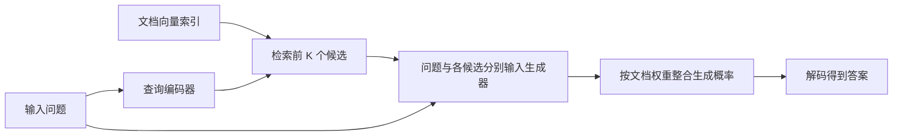

# RAG：让生成模型通过检索使用外部知识

语言模型的参数能够承载大量知识，但一次训练之后，怎样更新事实、找到具体依据，以及避免凭印象作答，都不是自动解决的。RAG 论文把一个预训练检索器和一个预训练生成器组合起来：检索得到候选文本，生成器分别利用这些文本，并在概率上整合候选文档的贡献。[主文 §1–2，PDF 第1–3页](https://proceedings.neurips.cc/paper/2020/file/6b493230205f780e1bc26945df7481e5-Paper.pdf)

这里阅读的是 NeurIPS 2020 的具体 RAG 方法。今天很多系统把“检索后把资料放进提示”也称为 RAG，但原论文研究的对象更明确：DPR 检索器、BART 生成器、潜在文档的边缘化，以及任务监督下的联合微调。先理解这一机制，再比较后来系统，会比只记住“检索加生成”更有用。

## 参数中的知识与可替换的外部材料

参数记忆指模型训练后保存在权重中的能力和信息；非参数记忆在本文中指可以索引、检索的文档集合。后者不是没有算法或参数，而是知识内容不必都压缩进生成模型的权重里。你可以修改索引中的文档，而不必因为每条事实变化都重新训练整个生成器。[主文 §1、§2.2–2.3，PDF 第1–3页](https://proceedings.neurips.cc/paper/2020/file/6b493230205f780e1bc26945df7481e5-Paper.pdf#page=3)

两类记忆承担不同工作。检索器把输入问题映射到可能有关的段落，生成器则把问题、段落和已有输出结合成答案。文档不必逐字包含最终答案，生成器可以改写或组合信息；这比只能摘出连续文本的抽取式问答灵活。但灵活也意味着输出可能超出材料支持的范围。拿到正确文档不等于必然生成正确答案，给出一个检索结果也不等于完成逐条引用核验。

本文的主要知识源是 2018 年12月 Wikipedia 快照，拆成不重叠的约100词片段，共约2100万个检索单元。它是固定知识集合，不是推理时在线搜索整个互联网。这个边界决定了哪些问题可能检索到答案，也影响“知识更新”的实际含义。[主文 §3，PDF 第4页](https://proceedings.neurips.cc/paper/2020/file/6b493230205f780e1bc26945df7481e5-Paper.pdf#page=4)

## 检索和生成怎样接到同一个概率模型里

设输入为 $x$，候选段落为 $z$。DPR 使用查询编码器得到向量 $q(x)$，使用文档编码器得到向量 $d(z)$，通过向量内积衡量匹配程度：

$$
p_\eta(z\mid x)\propto\exp\bigl(d(z)^\top q(x)\bigr).
$$

这里 $\eta$ 表示检索部分的可学习参数。指数及归一化把匹配分数转成文档权重。大规模索引不需要对所有文本逐篇运行一个复杂问答模型；系统以最大内积搜索近似找到分数最高的有限个段落，再把计算集中在这些候选上。[主文 §2.2，PDF 第3页](https://proceedings.neurips.cc/paper/2020/file/6b493230205f780e1bc26945df7481e5-Paper.pdf#page=3)

生成器使用 BART-large，论文记为400M参数的编码器—解码器模型。对于每个候选段落，把问题和该段落拼接为输入，再根据前面已生成的词元预测下一个词元。因此，同一个候选答案在不同段落条件下，可以得到不同的生成概率。检索分数回答“哪个段落可能有用”，生成概率回答“在这个段落条件下，这个输出有多可能”；两者不能互相替代。

这是原创教学示意，概括论文图1及方法。各候选分别参与生成计算，不能把它误读成先把所有文档简单拼成一个长提示。概率整合也不同于让多个答案投票：它利用检索权重与条件生成概率，而不是统计哪句文字出现次数最多。

## RAG-Sequence 与 RAG-Token 的区别在求和位置

最关键的设计问题是：整段回答是否由同一个潜在文档支持，还是每个输出词元可以由不同候选文档贡献？设前 $K$ 个检索结果组成集合 $Z_K(x)$，输出为 $y_1,\ldots,y_N$。RAG-Sequence 先为每篇文档计算完整回答的概率，再对文档求和：

$$
p_{\mathrm{seq}}(y\mid x)\approx
\sum_{z\in Z_K(x)}p_\eta(z\mid x)
\prod_{i=1}^{N}p_\theta(y_i\mid x,z,y_{<i}).
$$

乘积表示同一篇文档贯穿整段输出的生成条件；外层求和则表示系统并不必预先决定唯一正确文档，而是让多个候选贡献概率。它不是把每个候选段落各生成的答案直接接在一起。[主文 §2.1，PDF 第3页](https://proceedings.neurips.cc/paper/2020/file/6b493230205f780e1bc26945df7481e5-Paper.pdf#page=3)

用一个纯教学数值例子看求和：若两篇候选的检索权重分别为0.7和0.3，而某个候选输出在两篇条件下的概率为0.4和0.8，那么混合贡献为 $0.7\times0.4+0.3\times0.8=0.52$。检索得分较低的材料，仍可能因更能解释该输出而提供重要贡献。这个例子只说明加权边缘化，不是论文实验数值。前 $K$ 篇之外的段落没有进入本次近似计算，所以这种整合也不能凭空修复所有检索遗漏。

RAG-Token 把文档求和放到每个词元的生成位置：

$$
p_{\mathrm{tok}}(y\mid x)\approx
\prod_{i=1}^{N}
\sum_{z\in Z_K(x)}p_\eta(z\mid x)
p_\theta(y_i\mid x,z,y_{<i}).
$$

不同位置因此可以更多依赖不同段落。例如一个教学情境中，答案前半句介绍某项工作的提出时间，后半句解释其应用；两份材料可能各自更支持其中一部分。Token 形式允许这种贡献在输出过程中变化，但候选集合仍是根据原始输入检索得到的集合。它不意味着每生成一个词就重新向外部数据库发起一次查询。

注意，检索先验 $p_\eta(z\mid x)$ 由问题决定；在看到具体生成词元后，各文档对该词元的相对解释力还会受到生成概率影响。论文图2展示了这种文档后验随词元改变的例子。两种形式没有“越灵活必然越好”的统一结论：任务结构、训练和解码近似都会影响结果。[主文 §4.3、图2，PDF 第6–7页](https://proceedings.neurips.cc/paper/2020/file/6b493230205f780e1bc26945df7481e5-Paper.pdf#page=7)

## 训练信号来自答案，但检索器并非从零开始

训练数据提供问题与目标输出对，优化目标是提高正确输出经过文档边缘化后的概率。可以把负对数似然理解为：若某些段落更能帮助生成目标答案，训练就有机会提高它们的检索权重，并调整生成器利用材料的方式。它不要求为每个微调样本另外标注哪篇文档必须被检索。[主文 §2.4，PDF 第3–4页](https://proceedings.neurips.cc/paper/2020/file/6b493230205f780e1bc26945df7481e5-Paper.pdf#page=4)

但“不额外提供微调检索标签”不等于“没有使用过检索监督”。DPR 初始化此前已经利用 Natural Questions 和 TriviaQA 的相关监督训练过。论文又为了避免不断重建大索引，固定了文档编码器及索引，只微调查询编码器和 BART 生成器。因此，“端到端”应理解为答案损失联合影响这些参与更新的组件，不能理解为所有参数和离散搜索步骤都在每一步完整更新。[主文 §2.2、§2.4、§4.1，PDF 第3–5页](https://proceedings.neurips.cc/paper/2020/file/6b493230205f780e1bc26945df7481e5-Paper.pdf#page=5)

解码同样重要。Token 形式能在每一步混合候选文档的词元概率，再用常规 beam search。Sequence 形式则先在各文档条件下产生候选完整输出，再汇总它们的文档边缘概率；论文提供较彻底和较快速的近似方式。不能因为两者共用检索器和生成器，就认为推理代价完全相同。[主文 §2.5，PDF 第4页](https://proceedings.neurips.cc/paper/2020/file/6b493230205f780e1bc26945df7481e5-Paper.pdf#page=4)

## 结果需要连同指标与对照一起阅读

以下选取开放域问答测试集的 Exact Match，单位为百分比。EM 比较标准化后的最终答案是否匹配参考答案，不等同于长回答质量，也不衡量每个引用是否支持生成文本。DPR 是带检索、重排及抽取阅读器的对照系统；它与 RAG 的差别不只是一项开关。

| 方法 | Natural Questions | WebQuestions | CuratedTrec |
|---|---:|---:|---:|
| DPR | 41.5 | 41.1 | 50.6 |
| RAG-Token | 44.1 | 45.5 | 50.0 |
| RAG-Sequence | 44.5 | 45.2 | 52.2 |

这些数字来自主文表1。WebQuestions 与 CuratedTrec 数据较小，相关 RAG 模型先由 Natural Questions 的 RAG 模型初始化；知识源仍是上述 Wikipedia 快照。本文没有把 TriviaQA 的两个不同测试划分混成一列。[主文 §3.1、表1，PDF 第4、6页](https://proceedings.neurips.cc/paper/2020/file/6b493230205f780e1bc26945df7481e5-Paper.pdf#page=6)

对照显示，允许生成而非只抽取答案，在这些设定下有实际价值，但 Token 形式并非处处胜过 DPR，也并非处处优于 Sequence。不同任务选择不同边缘化形式，应以任务证据决定。生成任务还使用 BLEU、ROUGE 等指标，以及部分人工比较；它们回答的问题不同，不能把一个问答 EM 分数当作总体事实可靠性。

检索消融提供另一层信息。冻结查询检索器通常会降低表现；然而在 FEVER 分类开发集上，词面匹配的 BM25 对照反而优于学习到的稠密检索结果。作者提出，声明可能高度依赖实体词面，因而受益于词汇重合。这说明“向量检索更先进”不是充分的选择理由，需看查询类型、语料和任务监督。[主文 §4.5、表6，PDF 第7–8页](https://proceedings.neurips.cc/paper/2020/file/6b493230205f780e1bc26945df7481e5-Paper.pdf#page=8)

## 可更新知识，不等于自动获得可靠知识

论文用2016年与2018年的 Wikipedia 索引，以及82个在两时点发生变化的领导职位问题，演示替换索引能够改变回答：与对应年份匹配时正确率分别约70%和68%，错配索引时明显下降。这支持“外部记忆可在不重训生成器的情况下影响所用事实”，同时也清楚表明，换索引没有让所有问题自动答对。[主文 §4.5，PDF 第7–8页](https://proceedings.neurips.cc/paper/2020/file/6b493230205f780e1bc26945df7481e5-Paper.pdf#page=8)

外部知识还可能过时、冲突、有偏或被错误切分。检索遗漏关键证据时，生成器可能仍依赖参数中的记忆给出答案；这有时救回一个问答样本，有时造成无法由检索材料支持的断言。由机制可以推得，工程上应分别检查文档是否找到、材料是否支持答案、答案是否忠实使用材料，而不是只检查有没有显示来源链接。这是从方法引出的检查思路，不是原论文已经完成的一套逐句事实认证系统。

增加检索数量也不是免费保险。论文图3中，RAG-Token 的 NQ 表现约在10篇候选附近达到峰值，继续增加候选未持续改善；运行时间和不同生成指标也会变化。因此，检索范围、噪声和生成计算必须共同考虑。[主文 §4.5、图3，PDF 第8页](https://proceedings.neurips.cc/paper/2020/file/6b493230205f780e1bc26945df7481e5-Paper.pdf#page=8)

## 从知识增强走向 Agent，以及原文阅读入口

RAG 给 LLM 系统增加了可查询的外部知识通道，但本论文的固定检索—生成流程并不等于自主 Agent。进一步的系统可以决定何时检索、如何改写问题、是否需要第二次搜索，以及何时用其他工具核验。这些决策才把一次知识补充扩展为反复行动和观察。与本库 ReAct、Toolformer 对照时，可以分别追踪“谁选择调用”“谁提供结果”“谁利用结果”，避免把所有外接组件统称为同一个技术。

原文优先阅读顺序是：图1与 §2.1，确认候选文档和求和位置；§2.4–2.5，确认实际更新的参数及解码代价；表1和表6，区分测试集结果与开发集消融；图3及索引替换实验，检查检索数量和知识更新的条件。[方法与图1入口，PDF 第2页](https://proceedings.neurips.cc/paper/2020/file/6b493230205f780e1bc26945df7481e5-Paper.pdf#page=2)

本文覆盖原方法主线、主要问答证据和必要局限，不是当代全部 RAG 技术的综述。没有复现实验，也没有逐条审计完整语料、实现与全部生成案例。原文检索材料是可观察证据入口，却不能单凭这一点保证模型解释、输出或引用都正确。带着这个区别继续阅读 Agent 的工具选择与反馈机制，会更容易定位每项技术究竟补上了什么能力。
