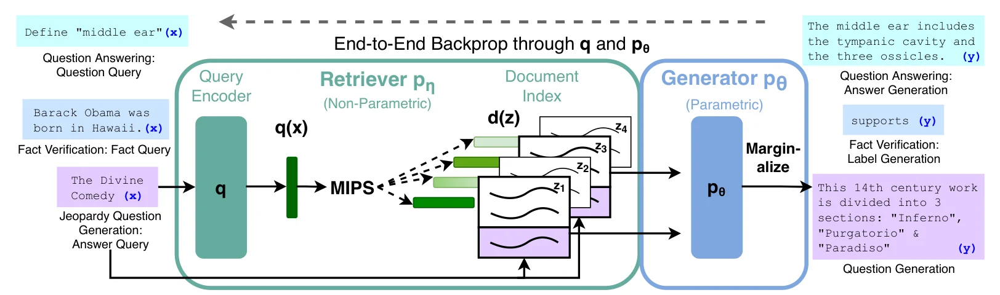
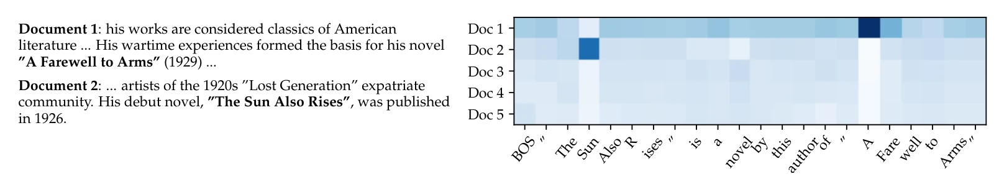
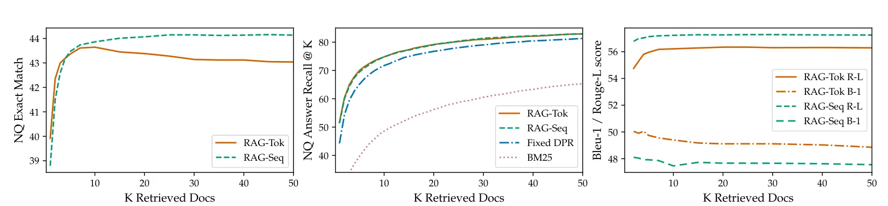

# RAG: Giving Generative Models Access to External Knowledge

A model can describe a novel fluently and still get the title or the author wrong. Where does such an error come from? Perhaps the model saw the relevant fact during training but failed to retrieve it accurately from its parameters; perhaps the fact has since changed; or perhaps the model never saw it at all and simply continued the context with a sentence that sounds true. In 2020, Patrick Lewis, Ethan Perez and ten coauthors proposed, in *Retrieval-Augmented Generation for Knowledge-Intensive NLP Tasks*, to connect a pretrained generative model to a collection of retrievable documents. The model keeps its own language and knowledge abilities, and it can also consult material while answering. This is retrieval-augmented generation, or RAG. [Abstract and §1, PDF pp. 1–2](https://proceedings.neurips.cc/paper/2020/file/6b493230205f780e1bc26945df7481e5-Paper.pdf)

The paper's contribution is more specific than "search first, then answer". It combines a DPR retriever and a BART generator into a single probabilistic model: different candidate documents each take part in generation, and their contributions to the output are then combined. Training supplies only inputs and target outputs, and the loss on the final answer adjusts both the query encoder and the generator. The authors also compare two ways of organizing the computation: RAG-Sequence, in which the whole output shares one latent document, and RAG-Token, in which each output token can draw probability from a different document.

The experiments cover short-answer question answering, full-sentence question answering, generating quiz clues from an entity, and fact-verification classification. On the open-domain Natural Questions test set, RAG-Sequence reaches 44.5% exact match, against 41.5% for the DPR question-answering system. Swapping in a document index from a different year also changes the facts the model answers with, without retraining the model. The first result tests task performance; the second tests whether the external memory can really be replaced. They are two different kinds of evidence. [Table 1 and index replacement, PDF pp. 6, 8](https://proceedings.neurips.cc/paper/2020/file/6b493230205f780e1bc26945df7481e5-Paper.pdf#page=6)

Today "RAG" names a whole family of techniques, but this guide focuses on the original NeurIPS 2020 method. Its core is one question: **how can several candidate passages, none of them guaranteed to be reliable, jointly determine the probability of an answer, and how can the answer in turn provide training feedback?** We first set out the background and follow the data flow through Figure 1. We then take apart retrieval, the two marginalizations, training and decoding. After that, the Hemingway example in Figure 2 shows how parametric memory and documents work together, and the final sections read the experiments and the knowledge-update test. Every sum and product in the formulas comes with a small worked example; the aim is to understand what the computation is doing.

## Why connect parametric knowledge to external memory?

The authors start from an observation: pretrained models already store a good deal of knowledge, but that knowledge is hard to access, revise or verify. "Stored in the parameters" means that training changed the model's weights so that, in certain contexts, it writes related facts. There is no author–work table that can be opened, and no switch that corresponds to a particular fact. A model being able to use a piece of knowledge, and a person being able to find where that knowledge is stored, are two different things. [§1, PDF pp. 1–2](https://proceedings.neurips.cc/paper/2020/file/6b493230205f780e1bc26945df7481e5-Paper.pdf#page=2)

Suppose a position changes hands. A purely parametric model usually needs further training before its answers change. Even when it answers correctly, it is hard to say which passage of text the answer rests on. This makes knowledge-intensive tasks especially difficult: answering requires many specific facts, and those facts can rarely be inferred from the question alone. The paper's intuitive definition of such tasks is that a person doing them would also expect to need an external source of knowledge.

One existing route is "retrieve, then extract". The system sends the question to a search module, finds relevant passages, and selects a contiguous span of text from them as the answer. If someone asks who wrote a book and a document states the author's name directly, an extractive reader can pick it out. The output of such a system is anchored to the documents and easy to locate. But when the material only offers clues, when the answer needs rewording, or when the task asks for a whole sentence, extraction becomes cramped.

The other route is "closed-book" question answering: the pretrained model generates the answer from its parameters alone. It can phrase text freely, and it can cast question answering, summarization and classification as the same text-in, text-out task, but it has no channel for consulting outside material while it answers. RAG aims to combine the strengths of both: it keeps the flexible output of a generative model and gives the model an external memory that can be read, checked and replaced.

The paper calls the external document index *non-parametric memory*. The name describes how the knowledge is held, as separate records; the system itself still has parameters. The query encoder and the document encoder are still neural networks. The difference is that a passage about Hemingway can remain in the index, where the model can retrieve it and a person can read it directly. Updating these records and updating the generator's weights become two separate operations.

At this point a new problem appears. The retriever usually returns several passages, some useful and some not, and the training data may not say which one is the true evidence. If the system simply takes the top-ranked passage, an early retrieval error locks in everything generated afterwards; if it treats every passage as correct support, noise enters the answer. The authors chose to keep the uncertainty: "which passage helped generate the answer" becomes a latent variable, and the model combines the possibilities in probability.

There is also a practical choice here. Rather than training a large memory system from scratch, the authors used DPR and BART, which were already trained. DPR already knew how to find passages likely to contain answers, and BART already knew how to understand and generate text. Downstream training therefore focuses on teaching the two to cooperate on a given task. The paper aims to offer a general fine-tuning recipe, not a pipeline built for one kind of question answering. [§1, §5, PDF pp. 2, 8–9](https://proceedings.neurips.cc/paper/2020/file/6b493230205f780e1bc26945df7481e5-Paper.pdf#page=9)

## The task: input, candidate documents and output

Before adding an external memory, we need to be clear about what the model receives and what it must predict. The paper writes the input text as $x$ and the target output as $y=(y_1,\ldots,y_N)$, where $y_i$ is the $i$-th token and $N$ is the output length. A token is a small unit of text for the model; it can be a whole word or part of one. A document is written $z$, and in this paper it usually means a short retrievable passage, not a whole book or encyclopedia article. [§2, PDF pp. 2–3](https://proceedings.neurips.cc/paper/2020/file/6b493230205f780e1bc26945df7481e5-Paper.pdf#page=3)

The same notation covers several tasks. In question answering, $x$ is the question and $y$ the answer. In quiz-clue generation, $x$ is the answer entity and $y$ is the clue that should let someone guess it. In classification, $x$ is the statement to be judged and $y$ can stand for its class. Figure 1 places the inputs and outputs of these different tasks side by side precisely to show that the retrieval-and-generation architecture in the middle can be reused.

This guide follows the example from Figure 2 of the paper. The input entity is Hemingway, and the model must write a quiz clue. The paper's generated clue mentions *The Sun Also Rises* and *A Farewell to Arms* and asks the reader to name "this author". It is a Jeopardy-style clue: although such clues are usually phrased as statements, the task is still called *question generation*.

The example is well suited to explaining RAG. To write a specific, discriminating clue, the model needs the relation between the titles and the author; to join those facts into a fluent sentence, it also needs language ability. The external documents can supply clues about the two works, and the generator organizes them into one sentence. The final clue need not appear word for word in any passage.

Training and testing see different information. During training, both $x$ and the reference output $y$ are available, so we can compute how much probability the model assigns to the correct output. When answering, only $x$ is available, and the model must search for a suitable $y$ itself. In training, the reference prefix is used to predict the next token, which is called *teacher forcing*: to score the third word of the reference sentence, the model is given the first two reference words. At test time the prefix is the text the model has already generated, which is autoregressive generation.

The candidate documents sit between input and output. The training data says "given this input, write this target", but usually does not say "you must use document number such-and-such". That is why $z$ is called a *latent variable*: it takes part in the computation, but it is not a label supplied with every training example. What the paper later calls *marginalization* is summing over the possibilities for these documents so that we end up with only the probability we care about, $p(y\mid x)$.

This also explains why the paper reports generation and classification experiments alongside question-answering scores. The authors want to test whether one and the same structure, "retrieve, generate conditionally, marginalize over documents", can handle different output forms once it is fine-tuned on each task. Generality here means a reusable architecture and training method, with each task still fine-tuned separately.

## Figure 1: how an input travels through the system

The previous section defined three objects; now we put them back into the figure. Read Figure 1 from left to right. The small colored boxes on the left are inputs for different tasks, the large green box performs retrieval, the large blue box performs generation, and the far right holds the task outputs. The dashed arrow along the top points left: it represents training feedback, running opposite to the rightward flow of answering.

Inside the green box, the Query Encoder turns the input $x$ into a query vector $q(x)$. A vector is a list of numbers, used here to compare the input with documents in the same representation space. MIPS in the figure is maximum inner product search: among the stored document vectors $d(z)$, it finds those with the largest inner product with the query vector. The figure stacks four documents to suggest multiple candidates; the actual number of candidates, $K$, is an experimental setting. [Figure 1 and §2, PDF p. 2](https://proceedings.neurips.cc/paper/2020/file/6b493230205f780e1bc26945df7481e5-Paper.pdf#page=2)

Two things come back from retrieval: each document's score and the document's text. The scores are normalized into retrieval weights for the documents; the text is concatenated with the original input and passed to BART. The black connection along the bottom of the figure matters: the input does not disappear once it has been turned into a query vector, and the generator still sees what was originally asked. Otherwise, even after reading a passage about Hemingway, the model would not know whether it was supposed to answer a question or write a clue.

Each candidate is paired with the same input. If five passages are retrieved, the generator faces five conditions: "input plus passage 1", "input plus passage 2", and so on up to "input plus passage 5". All five use the same BART parameters; these are not five separately trained models. Because the material differs, the same candidate output receives a different probability under each of the five conditions.

Marginalize, to the right of the blue box, is the key to the whole paper. It combines these conditional probabilities with the retrieval weights to produce one overall probability for an output. What is combined are probabilities: the five answers are not pasted into one passage, and they are not counted in a vote. Whether the combination happens after a whole sentence has been scored, or at every step on the distribution of the next token, is the difference between the Sequence and Token forms.

The Hemingway example summarizes the route. The query encoder sees *Hemingway*; the index returns several passages about him, one mentioning *A Farewell to Arms* and another *The Sun Also Rises*. BART reads "entity name plus this passage" separately for each one, giving the same clue different generation probabilities. Combining the probabilities lets several candidates contribute to the final output. Figure 2 in the paper shows how those contributions change across output positions.

Compressing the whole pipeline into a table makes it easier to see which steps handle text and which handle numbers:

| Stage | Input | Output | Main purpose |
| --- | --- | --- | --- |
| Build the index offline | Document passages and the document encoder | Document vectors and the matching text | Prepare in advance for large-scale retrieval |
| Encode the query | Current input $x$ | Query vector $q(x)$ | Look for candidates in the index |
| Search and normalize | Query vector, document vectors | $K$ passages and their weights | Narrow the scope of the generation computation |
| Conditional generation | $x$, one passage $z$, the output prefix | A vocabulary distribution for the next token | Decide how to continue given that material |
| Marginalize and decode | Document weights and conditional generation probabilities | Final output $y$ | Combine the candidates' contributions and choose text |

The top of Figure 1 states explicitly that backpropagation passes through the query encoder $q$ and the generator $p_\theta$. The document index is fixed during fine-tuning in this paper. That choice lets the authors use a very large external memory without re-encoding the whole encyclopedia every time the model is updated. We first unpack the rightward computation and then come back to this training arrow.

## Retriever and generator: two different probabilities

Both components of RAG output probabilities, but they answer different questions. The retriever asks: "Given this input, which passage might be useful?" The generator asks: "Given this input, this passage and the prefix written so far, what is the next token?" Keeping the two apart makes the later formulas much easier to read.

**The retriever uses a bi-encoder to search a large collection.** DPR's query encoder and document encoder are both based on BERT-base, and they turn inputs and passages into dense vectors of the same dimension. "Bi-encoder" means that the two texts are encoded separately and then compared with a simple vector operation. Document vectors can be computed in advance, so each new question does not require running a neural network over every document again. [§2.2, PDF p. 3](https://proceedings.neurips.cc/paper/2020/file/6b493230205f780e1bc26945df7481e5-Paper.pdf#page=3)

The paper gives the retrieval probability as:

$$
p_\eta(z\mid x)\propto\exp\bigl(d(z)^\top q(x)\bigr).
$$

Here $\eta$ denotes the retriever's parameters, $q(x)$ the query vector and $d(z)$ the document vector; the superscript $\top$ is transposition, so $d(z)^\top q(x)$ is the inner product of the two vectors. The inner product gives a real-valued score, the exponential turns it into a positive number, and only after normalization can it serve as a probability weight. Using the inner product here does not require the vectors to be length-normalized into cosine similarity first.

The full encyclopedia contains about 21 million passages, and the generator cannot read all of them for every input. The authors use approximate maximum inner product search to take the top $K$ candidates, restricting the expensive generation computation to this small set. The paper builds the index with FAISS and uses HNSW approximate search. One can picture it as a structure in vector space that can be navigated quickly, so that the search does not have to compare against every item. [§3, PDF p. 4](https://proceedings.neurips.cc/paper/2020/file/6b493230205f780e1bc26945df7481e5-Paper.pdf#page=4)

For hand calculation later on, write $Z_K(x)$ for the retrieved candidate set and $w_z$ for the weights normalized over that set. This shorthand is the guide's own:

$$
w_z=\frac{\exp(s_z)}{\sum_{z'\in Z_K(x)}\exp(s_{z'})},\qquad s_z=d(z)^\top q(x).
$$

For example, if two candidates score $\ln 3$ and 0, exponentiating gives 3 and 1, and normalizing gives $3/4$ and $1/4$. These are teaching values chosen by the guide, not retrieval results from the paper. The weights sum to 1, which only says how probability is divided among the current candidates; a weight of 0.75 does not mean "this passage is true with probability 75%". Documents outside the candidate set are not read at all in this approximate computation.

**The generator uses an encoder–decoder to read locally and continue.** BART-large is a pretrained sequence-to-sequence model, which the paper lists at roughly 400 million parameters. It was pretrained to restore original text from corrupted text, and so it learned to understand context and to generate complete text. In RAG, the question and one retrieved passage are concatenated as the encoder's input, and the decoder predicts the next token from that encoding and the output so far. [§2.3, PDF p. 3](https://proceedings.neurips.cc/paper/2020/file/6b493230205f780e1bc26945df7481e5-Paper.pdf#page=3)

The generation probability is written $p_\theta(y_i\mid x,z,y_{<i})$, where $\theta$ is BART's parameters and $y_{<i}$ the output already given. In the Hemingway example, if a passage mentions *The Sun Also Rises*, the model may give *Sun* a high probability after the prefix *The*; another passage mostly about his war experience may help less with that continuation. The generator also has its own parametric knowledge, so it may complete the correct title even if the passage does not spell out the next word.

If the vocabulary has size $V$, one generation step can be pictured as a $K\times V$ probability table: each row corresponds to a document and each column to a candidate token. The retriever separately supplies a weight vector of length $K$. The Token model weights the table column by column and merges it into one vocabulary distribution; the Sequence model keeps each document's probability for the whole output and weights them only at the sentence level. This mixing of probabilities is a different operation from the attention inside BART: the former decides how documents contribute, while the latter lets the network read token information in its input.

## Two marginalizations: sum outside or inside the product?

With a weight for each document and a generation probability for each, the next decision is how documents are shared across output positions. This is the part of the original method that most rewards slow reading. We first explain the two formulas and then work through both using exactly the same two documents and two output positions. [§2.1, model formulas, PDF p. 3](https://proceedings.neurips.cc/paper/2020/file/6b493230205f780e1bc26945df7481e5-Paper.pdf#page=3)

**RAG-Sequence: each document first explains the whole output.** For a fixed document $z$, autoregressive generation factors the probability of the whole output into a product of per-position conditional probabilities. That whole-sentence probability is multiplied by the retrieval weight, and finally the candidates are summed:

$$
p_{\mathrm{seq}}(y\mid x)\approx
\sum_{z\in Z_K(x)}p_\eta(z\mid x)
\prod_{i=1}^{N}p_\theta(y_i\mid x,z,y_{<i}).
$$

The inner product always uses the same $z$. Picture several parallel routes: route 1 evaluates the sentence entirely under document 1, route 2 entirely under document 2, and at the end the routes' probabilities are combined. The model never commits to a single document in advance; "one document throughout the sentence" describes the structure inside each latent route.

Suppose a sentence has probability 0.4 under the first document and 0.8 under the second, and the retrieval weights are 0.7 and 0.3. The mixed probability is $0.7\times0.4+0.3\times0.8=0.52$. The lower-ranked second document still contributes a great deal, because the generator finds it more helpful for writing this output. These are again teaching values, meant to show why keeping several passages is more flexible than trusting only the top retrieval result.

**RAG-Token: each position first merges a token distribution.** Every candidate predicts the current token separately; those probabilities are summed with the retrieval weights into a combined distribution for the next token, and the results are then multiplied along the output positions:

$$
p_{\mathrm{tok}}(y\mid x)\approx
\prod_{i=1}^{N}
\sum_{z\in Z_K(x)}p_\eta(z\mid x)
 p_\theta(y_i\mid x,z,y_{<i}).
$$

This time the sum sits inside the product. While the first title is being written, a passage that mentions that book may contribute more; when the second title comes, another passage may be more helpful. Different latent documents are allowed to take part at each position, instead of one route holding on to the same $z$ throughout.

In both formulas the retrieval weights depend only on the original input $x$. The Token form does not search the database again for every word it generates: the candidate set is retrieved at the start, and the later variation comes from the generation probabilities under each document. When the current position is evaluated, all candidate branches also see the same output prefix $y_{<i}$; they do not each keep their own unrelated sentence written so far.

**A two-position calculation.** The table below holds teaching probabilities invented by the guide. To focus on the sums and products, a fixed target sequence is reduced to two abstract tokens, A and B; they do not stand for an actual English tokenization. Both documents have weight 0.5, and the probability at the second position is always computed given the same prefix A.

| Document | Retrieval weight | Probability of the first target token A | Probability of the second target token B, given prefix A |
| --- | ---: | ---: | ---: |
| $z_1$ | 0.5 | 0.9 | 0.1 |
| $z_2$ | 0.5 | 0.1 | 0.9 |

Sequence first computes the complete output probability for each row. The first row gives $0.9\times0.1=0.09$ and the second $0.1\times0.9=0.09$; the weighted sum is $0.5\times0.09+0.5\times0.09=0.09$. Each document is good at only one of the two steps, so no fixed-document route is especially confident about the whole output.

Token first computes the mixed probability for each column. A gets $0.5\times0.9+0.5\times0.1=0.5$ and B also gets $0.5\times0.1+0.5\times0.9=0.5$; multiplying gives $0.25$. It can put the first document's help with A and the second document's help with B on the same output path.

Expanding the Token product shows this flexibility more precisely:

$$
(0.5\times0.9+0.5\times0.1)
(0.5\times0.1+0.5\times0.9)
=0.0225+0.2025+0.0025+0.0225.
$$

The four terms correspond to the four latent document paths $(z_1,z_1)$, $(z_1,z_2)$, $(z_2,z_1)$ and $(z_2,z_2)$. The largest, 0.2025, comes from "use $z_1$ for the first step and $z_2$ for the second". Sequence allows only same-document paths, and multiplies in the retrieval weight once per whole path. So the difference is more than "two extra cross terms": it is also whether the document prior re-enters the mixture at every position or enters only once per route.

The example shows a structural difference; whether Token gives the correct answer more probability depends on the material. If one document suits the entire output, Sequence's shared structure may well be the better fit, and the parameters of the two trained models also differ. The paper's later question-answering and clue-generation results in fact show each form doing better on different tasks.

Two edge cases help in reading the formulas. With only one candidate, $K=1$, both structures reduce to generating conditioned on that passage. With an output of a single token, the product has only one term and the two formulas coincide. The paper uses the latter to explain class prediction: when the class is a single output target, Sequence and Token marginalize over documents in the same way.

Finally, "the whole sentence shares one latent document" describes a factorization of probability; it does not require every fact in the output to appear verbatim in that document. BART can still draw on its own parametric knowledge. With that in mind, we can discuss separately "how documents take part in the probability computation" and "which passage actually supports a given fact".

## How answer loss trains retrieval

So far the model can compute a probability for a given output. But why would the retriever become better suited to the task over time? The key is that the training objective evaluates the final, marginalized output rather than generation under any single document. Whichever candidate better explains the correct answer can receive a larger learning signal. [§2.4, PDF pp. 3–4](https://proceedings.neurips.cc/paper/2020/file/6b493230205f780e1bc26945df7481e5-Paper.pdf#page=4)

For training examples $(x_j,y_j)$, the paper minimizes the negative marginal log-likelihood:

$$
\mathcal L= -\sum_j\log p(y_j\mid x_j).
$$

Here $j$ runs over training examples, and $p(y_j\mid x_j)$ uses the Sequence or Token formula from the previous section. The higher the probability assigned to the correct output, the lower the negative log loss. The logarithm also has a computational advantage: multiplying many small token probabilities easily produces extremely small numbers, and implementations usually compute stably in log space.

Take Sequence first for intuition about the feedback. Suppose two documents each have weight 0.5, and the correct answer has probability 0.8 under the first and 0.2 under the second. The answer's total probability is 0.5, of which the first document contributes 0.4 and the second 0.1. Once the target answer is known, the first document carries 80% of the contribution in this probabilistic explanation and the second 20%. This is the documents' *posterior responsibility*: before seeing the answer both were equally likely to help; after seeing it, the first explains the target better.

The derivation below is the guide's supplementary explanation of the training mechanism. It considers a single training example and writes its loss as $\ell=-\log p(y\mid x)$. Fix the current candidate set, write $a_z=p_\theta(y\mid x,z)$, and let the retrieval weights $w_z$ come from a softmax over the scores $s_z$. Then:

$$
r_z=\frac{w_z a_z}{\sum_{z'}w_{z'}a_{z'}},\qquad
\frac{\partial\ell}{\partial s_z}=w_z-r_z.
$$

$r_z$ is the posterior responsibility just described. For the first document the derivative is $0.5-0.8=-0.3$, so gradient descent tends to raise its retrieval score; for the second it is $0.5-0.2=0.3$, which tends to lower it. These hand-picked probabilities illustrate a key property: even without a "correct document number", the answer loss can push forward the candidates that help generate the target.

The same loss also updates BART, so that it gets better at using the input and the material to predict the target tokens. In the Token model, this allocation of responsibility happens at each output position, and the learning signals from all positions are pooled into the shared parameters. The query encoder and the generator therefore influence each other: the first changes what the second gets to read, and the second's ability to explain the answer changes what the first should prefer.

"Helpful" here is relative to the training objective. A passage that is only accidentally associated with the answer, or a case where the generator relies mainly on parametric memory, can still yield a good answer probability. A high posterior therefore does not make a passage verified factual evidence. What the paper provides is a way to learn to retrieve content that helps the task, not a constraint that forces sentence-by-sentence citation.

The scope of training also has clear limits. Before initialization, DPR had already been trained with retrieval supervision on Natural Questions and TriviaQA. RAG fine-tuning requires no document labels for each example, yet the system as a whole did benefit from retrieval supervision earlier. Pretraining gives the retriever the ability to find answer passages from the start, and the answer loss of each task then continues to adjust it. [§2.2, §4.1, PDF pp. 3, 5](https://proceedings.neurips.cc/paper/2020/file/6b493230205f780e1bc26945df7481e5-Paper.pdf#page=5)

The authors froze the document encoder and the document index, and updated only the query encoder and BART. The reason is practical. If the document encoder changed at every step, the roughly 21 million stored vectors would gradually stop matching the current encoding, and the index would have to be rebuilt periodically. With the document side fixed, query vectors can still learn to move toward more useful documents, and the work of re-encoding the whole knowledge base is avoided.

"End to end" here means that the final task loss trains both of these components together; the discrete top-$K$ search itself is not turned into a smooth, item-by-item differentiable operation. The derivative explanation holds over the candidates that have been retrieved; passages outside the candidate set receive no generation score in that step. Seen this way, the dashed line at the top of Figure 1 represents a feedback chain with a clearly bounded update scope, not every computation across the whole collection being trained at once.

## Decoding: turning probabilities into a sentence

During training, the target sentence is given, and the main job is to score it. At test time there is no target sentence, and the system has to find a high-probability output among a vast number of possibilities. This is *decoding*. The theoretical goal is $\arg\max_y p(y\mid x)$, but there are far too many combinations of lengths and tokens to enumerate, so the paper uses approximate search. [§2.5, PDF p. 4](https://proceedings.neurips.cc/paper/2020/file/6b493230205f780e1bc26945df7481e5-Paper.pdf#page=4)

**For Token, the computation directly provides a next-token distribution.** For the current prefix, each document gives one row of vocabulary probabilities, which are weighted by retrieval and merged into one next-step distribution. Greedy decoding picks the most probable token at this moment; beam search keeps several good prefixes and extends them together, which reduces the risk that one wrong step leaves no way back.

There is an order here that is easy to miss: first mix the probabilities, then choose a token from the mixed distribution. If each document picked its own word first and the words were then put to a vote, the probability information would be discarded, and the result would be a different algorithm. Suppose one document gives two words almost equal probability while another strongly prefers the second. Taking each document's top choice could produce a tie, while the weighted probabilities still keep the second document's clear preference.

**Sequence has to recombine at the sentence level.** An output that scores well on its first half under document 1 may not be the sentence with the highest probability once all documents are marginalized. The paper therefore runs a generation search separately for each document, collects the candidate complete outputs, takes their union $Y$, and then computes the document-marginal probability of each candidate.

Suppose the search under document 1 proposes sentences A and B, and the search under document 2 proposes B and C. Sentence A not appearing in document 2's results only means it did not enter that limited search; it does not mean its conditional probability there is zero. To compare the three sentences' overall probabilities properly, we should also compute A's score under document 2 and C's score under document 1.

The paper calls this fill-in scoring *Thorough Decoding*. For each candidate, it finds the document branches that have not yet scored it, runs the extra forward passes, then multiplies by the retrieval weights and sums. The candidates' scores are more complete this way, but the candidate set itself still comes from approximate search; it does not enumerate every possible sentence.

The faster *Fast Decoding* skips the extra computation: if a sentence did not appear in a document's search results, its conditional probability under that document is approximated as zero. It trades less computation for a rougher marginal score. The longer the outputs, the larger the union of candidates can become and the heavier the extra scoring gets, so this trade-off matters most for long generation.

| Model or decoding method | When probabilities are combined | Search and extra scoring needed |
| --- | --- | --- |
| RAG-Token | At every token position | Mix vocabulary probabilities, then run one generation search |
| Sequence, Thorough | At the level of complete candidate outputs | Generate candidates per document; score missing candidate–document pairs |
| Sequence, Fast | At the level of complete candidate outputs | Generate candidates per document; treat pairs not generated as zero |

The supplement of the same conference version gives the actual settings. For open-domain question answering, Token uses 15 documents at test time and Sequence uses 50 with Thorough Decoding; short answers are generated greedily because the authors observed no gain from beam search. For the two long-generation tasks, MS-MARCO and Jeopardy, both models use 10 documents and a beam width of 4, and Sequence uses Fast Decoding. [Supplement A, PDF p. 1 / printed p. 17](https://proceedings.neurips.cc/paper/2020/file/6b493230205f780e1bc26945df7481e5-Supplemental.pdf#page=1)

So the Sequence and Token scores in Table 1 below are overall results of their respective experimental configurations, which also differ in the number of candidates and the decoding method. The differences cannot all be credited to where the summation sign sits. The probability model determines how outputs are scored, and the decoding budget determines how many outputs can be searched and evaluated; together they make up the actual system.

## Figure 2: why document contributions change

The hand calculation shrank reality to two tokens. Now we return to the paper's own generation example. In Figure 2 the input is *Hemingway*, and retrieval returns five documents. The left side excerpts two of them; on the right, each row is one document and each column one generated token, and darker color means a higher document posterior at that position.

The generated clue says, roughly, "*The Sun Also Rises* is a novel by this author of *A Farewell to Arms*." Document 2 mentions Hemingway's first novel, *The Sun Also Rises*; document 1 describes how his war experience relates to *A Farewell to Arms*. When the first title appears, the second row is darker around *Sun*; when the second title begins, the first row darkens clearly around *A*. This gives an intuitive example of different positions being supported by different material. [§4.3 and Figure 2, PDF pp. 6–7](https://proceedings.neurips.cc/paper/2020/file/6b493230205f780e1bc26945df7481e5-Paper.pdf#page=7)

Why can the weights change? The retrieval prior stays fixed; what changes is "which document better explains this output token, now that we have seen it". To illustrate the difference, the guide writes the normalized contribution at a position as:

$$
r_i(z)=
\frac{p_\eta(z\mid x)\,p_\theta(y_i\mid x,z,y_{<i})}
{\sum_{z'}p_\eta(z'\mid x)\,p_\theta(y_i\mid x,z',y_{<i})}.
$$

This is teaching notation written for the Token model. The numerator is the document's probability contribution to the token now known, and the denominator adds up all candidates' contributions. If the retriever favors two passages equally but only one of them makes *Sun* easy to generate, then after *Sun* is seen, that passage's relative responsibility in this column is higher. This posterior and the ranking score at retrieval time answer different questions.

The figure holds a detail more interesting than "switching documents". Once a title begins, the colors at the following positions quickly flatten. The authors offer an explanation: the document steers the model toward a particular title, and the model's own parametric knowledge then completes the name. After seeing *The Sun*, for example, the generator may already know that the usual continuation is *Also Rises*, so its reliance on a specific document drops.

The authors also ran a small check: given part of the generated prefix, the plain BART baseline could indeed complete these titles. Yet BART's complete clue reused *The Sun Also Rises* twice, which shows a gap between "completing a familiar name" and "writing a suitable, specific clue for a given entity". The documents may serve to steer knowledge already in the parameters to the right place.

This is one mechanism observation with a supplementary check. Whether all generation follows the pattern "documents lead, parameters take over" remains open, and the heatmap is not a causal attribution test for each fact. What it really helps us understand is that the two kinds of memory can cooperate within one sentence: the external text provides concrete clues for the task at hand, and the generative model uses its language and knowledge to organize and continue.

From Figure 1 to Figure 2, the authors' argument therefore moves a step forward. Figure 1 defines which paths information is allowed to take; Figure 2 shows how the trained model distributes document contributions in an actual case. The first is about structure, the second is an observation; between them we still need large-scale task results to judge whether the design pays off in practice.

## Experimental design: four task families

The authors did not pick only one kind of question answering in which "the answer happens to be in the passage". They arranged tasks with different output forms, to test whether retrieval plus generation merely replaces an extractive reader or can support knowledge-intensive processing more broadly. Below we separate datasets and metrics first, then read the results. [§3.1–3.4, PDF pp. 4–5](https://proceedings.neurips.cc/paper/2020/file/6b493230205f780e1bc26945df7481e5-Paper.pdf#page=4)

All main experiments use the December 2018 Wikipedia snapshot as the external knowledge source. Articles are split into non-overlapping 100-word chunks, about 21 million passages in total. Training considers retrieving 5 or 10 candidates, and the number of test candidates is chosen on development data. A "word" here is a unit for chunking the corpus; it is not the same count as the subword tokens BART outputs.

**Open-domain question answering** uses Natural Questions (NQ), TriviaQA, WebQuestions and CuratedTrec. "Open-domain" means that the input comes without a gold evidence passage, so the system has to find information in a large corpus itself; outputs are usually entity names or short answers. Evaluation uses exact match (EM), which asks whether the normalized answer matches the reference; higher is better. WebQuestions and CuratedTrec are small, so the authors first initialize from the RAG model trained on Natural Questions and then adapt it to each task.

**Free-form generative question answering** uses MS-MARCO NLG v2.1. NLG stands for natural language generation; here the target is a fairly complete answer sentence. The original data supplies ten search passages for each question, but the authors deliberately do not use them. They train only on questions and answers and let RAG retrieve from the encyclopedia itself. This turns the task into open-domain generation and also introduces a mismatch in knowledge source: some reference answers depend on the original web pages, and the encyclopedia may not contain the corresponding information.

For a question about the weather in a particular place, for example, the location and the question alone are often not enough to recover the reference answer from when the data was collected. The paper therefore acknowledges that a method retrieving its own encyclopedia material faces different information conditions from one that reads the gold passages directly. Comparing RAG with a BART baseline in the same setting is the better guide to the benefit of adding retrieval; the best systems that have the gold context serve only as a reference under different conditions.

**Jeopardy clue generation** turns an entity input into a factual description that lets people guess the entity. It runs in the opposite direction to question answering: the input "The World Cup" yields a clue about Mexico having hosted the tournament twice. The authors use the SearchQA data splits, with about one hundred thousand training examples. Besides BLEU-1, they use Q-BLEU-1, which gives more weight to matching entities and so fits the clue task's need for "do the specific facts line up". [§3.3, PDF p. 5](https://proceedings.neurips.cc/paper/2020/file/6b493230205f780e1bc26945df7481e5-Paper.pdf#page=5)

**FEVER fact verification** takes a claim as input and outputs supports, refutes or not enough information; the paper also tests a two-way version that keeps only supports and refutes. The metric is class accuracy. The main text explains, through "a single class target", why the task fits into the same model. Supplement E adds that the implementation first regenerates the claim, then classifies from the final hidden state, and finally marginalizes over documents. So the single-token formula describes the structure of class marginalization, and the actual classification head adds that extra step. [§3.4, PDF p. 5](https://proceedings.neurips.cc/paper/2020/file/6b493230205f780e1bc26945df7481e5-Paper.pdf#page=5) · [Supplement E, PDF p. 2 / printed p. 18](https://proceedings.neurips.cc/paper/2020/file/6b493230205f780e1bc26945df7481e5-Supplemental.pdf#page=2)

| Task | Output to learn | Main metric in the paper | What the metric mainly answers |
| --- | --- | --- | --- |
| Open-domain QA | Short answer | EM | Does the final answer match the reference? |
| MS-MARCO | Full answer sentence | BLEU-1, ROUGE-L | How much of the generated text overlaps with the reference? |
| Jeopardy | A clue about an entity | Q-BLEU-1, human comparison | Is the clue specific, and are its facts better? |
| FEVER | Class of the claim | Class accuracy | Is the label correct? |

Training uses the Adam optimizer. The supplement explains that the experiments use mixed precision and distributed training on eight 32 GB V100 GPUs, with the document index held in CPU memory. This is a reminder that, beyond the generator's parameters, retrieval brings substantial storage and computation costs of its own. [Supplement C, PDF p. 1 / printed p. 17](https://proceedings.neurips.cc/paper/2020/file/6b493230205f780e1bc26945df7481e5-Supplemental.pdf#page=1)

What these tasks share is that all may benefit from specific knowledge; what separates them is how the output has to be organized. A short answer depends on finding and writing one fact correctly, a clue requires choosing discriminating information, and classification requires judging the relation between a claim and the material. Only by putting them together can the claim of "one architecture, many fine-tuned tasks" be tested.

## QA results: what generation adds to extraction

Table 1 first answers whether the original RAG reaches competitive results on standard open-domain question answering. Below are test-set EM scores for DPR and the two RAG variants, in percent, higher is better. TriviaQA has to be split into two test partitions, and a dash means the row does not report that value. [Table 1 and §4.1, PDF pp. 5–6](https://proceedings.neurips.cc/paper/2020/file/6b493230205f780e1bc26945df7481e5-Paper.pdf#page=6)

| Model | NQ | TriviaQA, common open-domain split | TriviaQA, Wiki test set | WebQuestions | CuratedTrec |
| --- | ---: | ---: | ---: | ---: | ---: |
| DPR QA system | 41.5 | 57.9 | — | 41.1 | 50.6 |
| RAG-Token | 44.1 | 55.2 | 66.1 | 45.5 | 50.0 |
| RAG-Sequence | 44.5 | 56.8 | 68.0 | 45.2 | 52.2 |

On NQ, Sequence is 3.0 percentage points above DPR; on WebQuestions, Token is 4.4 points above; on CuratedTrec, Sequence is 1.6 points above. Each shows an advantage for RAG on that task, but no single model takes every best result: on CuratedTrec Token is below DPR, and on the common open-domain TriviaQA split both RAG variants are below DPR.

TriviaQA is the easiest place to trip when reading this table. The original table puts two numbers in one cell: on the left the test split commonly used in open-domain question-answering work, and on the right the official Wiki test set, added for comparison with closed-book T5. Supplement D explains that the former actually uses the public Web development set for open-domain evaluation, and the authors attribute the higher Wiki-test scores to its questions being easier to answer from Wikipedia. 68.0 and 57.9 come from different splits; subtracting them and calling the difference RAG's improvement would be wrong. [Supplement D, PDF p. 2 / printed p. 18](https://proceedings.neurips.cc/paper/2020/file/6b493230205f780e1bc26945df7481e5-Supplemental.pdf#page=2)

Nor is DPR simply "RAG with generation switched off". Its question-answering system contains a retriever, a reranker that reassesses how well questions and documents match, and an extractive reader that selects the answer span. RAG generates freely with BART and combines the candidates' probabilities in its own way. Table 1 therefore compares complete systems. It supports generative retrieval models as a viable route; attributing the differences precisely to one component requires more controlled ablations.

Why did the authors think generation worth having? First, some passages provide clues without containing the final answer as a string. An extractive reader can only select a span of the original text, while a generator can turn clues into an answer. Second, different documents' support for the same answer can enter the probability mixture directly, without first designating one passage as the sole evidence.

The paper also reports an interesting subset result. On NQ, when none of the retrieved documents contains the correct answer, RAG still reaches 11.8% accuracy. A standard extractive model has no answer string to extract in that situation and would in principle score zero. This shows that the generator really can go beyond copying the source verbatim, perhaps using parametric knowledge or clues in the material. The statistic alone cannot tell which route each successful example took. [§4.1, PDF p. 6](https://proceedings.neurips.cc/paper/2020/file/6b493230205f780e1bc26945df7481e5-Paper.pdf#page=6)

The same ability explains RAG's double edge. Free generation can rescue questions whose answers were not directly in the retrieved text, and it also lets the output drift away from the retrieved material. EM rewards a correct final string. If the research question shifts to "is each sentence supported by a source", a corresponding evaluation has to be added. This is not a criticism of EM; it puts EM back where it belongs, as a measure of whether a short answer is correct.

## Full answers, clues and classification: further evidence

Getting short answers right is not enough, and the authors go on to test whether the model can write more specific full text. Table 2 puts MS-MARCO, Jeopardy and FEVER together, but the three use different metrics, so we read them separately. [Table 2 and §4.2–4.4, PDF p. 6](https://proceedings.neurips.cc/paper/2020/file/6b493230205f780e1bc26945df7481e5-Paper.pdf#page=6)

**Full answer sentences.** The table below shows MS-MARCO test results, comparing only BART and RAG, neither of which uses the dataset's gold passages. BLEU-1 mainly measures token-level overlap precision, and ROUGE-L measures overlap with the reference through the longest common subsequence; for both, higher is better here.

| Model | MS-MARCO BLEU-1 | MS-MARCO ROUGE-L |
| --- | ---: | ---: |
| BART | 41.6 | 38.2 |
| RAG-Token | 41.5 | 40.1 |
| RAG-Sequence | 44.2 | 40.8 |

Sequence is 2.6 points above BART on both metrics, while Token rises on ROUGE-L and is slightly lower on BLEU-1. This already shows that "better generation quality" is best broken down: different metrics reward different properties of the text. A model can cover more of the reference content without a matching gain in token precision.

Table 3 of the paper shows a more concrete difference with "define middle ear". BART outputs "The middle ear is the part of the ear between the middle ear and the nose", an obvious circular definition; RAG-Sequence writes "The middle ear includes the tympanic cavity and the three ossicles". This is also one of the task examples in Figure 1. The case shows what the errors look like, and the large-scale metrics help judge whether it is just one hand-picked good example. [Table 3, PDF p. 7](https://proceedings.neurips.cc/paper/2020/file/6b493230205f780e1bc26945df7481e5-Paper.pdf#page=7)

**Generating clues from an entity.** On the Jeopardy test, BART scores 15.1 BLEU-1 and 19.7 Q-BLEU-1, Token 17.3 and 22.2, and Sequence 14.7 and 21.4. Both RAG variants are better on Q-BLEU-1, but Token leads on this task. The authors suggest that clues often need to combine more than one fact, and that Token's per-position document mixing may suit such outputs. The Hemingway case in Figure 2 is consistent with this explanation, although the paper does not separately control "whether several documents must be fused" to test it causally.

Overlap with a reference clue still falls short, because the same entity can have many different good clues. The authors therefore had people compare 452 pairs of outputs from BART and RAG-Token, judging factuality and specificity separately. Factuality asks whether a statement can be corroborated by a trusted external source; specificity asks whether the clue is closely tied to the input entity rather than one that would fit many other entities. During annotation the two models' display positions were randomly swapped, annotators could check facts on the internet, and gold examples were used to monitor annotation quality. [§3.3, §4.3, PDF pp. 5–6](https://proceedings.neurips.cc/paper/2020/file/6b493230205f780e1bc26945df7481e5-Paper.pdf#page=5) · [Supplement B, PDF p. 1 / printed p. 17](https://proceedings.neurips.cc/paper/2020/file/6b493230205f780e1bc26945df7481e5-Supplemental.pdf#page=1)

In these pairwise comparisons, 42.7% judged RAG more factual and 7.1% judged BART more factual; for specificity, 37.4% preferred RAG and 16.8% preferred BART. The table also has cases where both were good, both were poor, or there was no majority, so 42.7% is the share of comparisons RAG won, not "only 42.7% of RAG's clues are correct". The fixed PDF's main text and Table 4 disagree on the proportion for "both factual", so only the uncontested comparison figures are used here. [Table 4, PDF p. 8](https://proceedings.neurips.cc/paper/2020/file/6b493230205f780e1bc26945df7481e5-Paper.pdf#page=8)

**Is the output more varied?** Table 5 also computes the share of distinct trigrams among all trigrams. On Jeopardy, BART reaches 32.4%, Token 46.8% and Sequence 53.8%; on MS-MARCO the figures are 70.7%, 77.8% and 83.5%. Both RAG variants repeat phrases less, and Sequence scores higher on this measure. Diversity measures how repetitive the wording is; it does not guarantee factual correctness and has to be read together with the quality evaluations above. [Table 5, PDF p. 8](https://proceedings.neurips.cc/paper/2020/file/6b493230205f780e1bc26945df7481e5-Paper.pdf#page=8)

**Fact-verification classification.** On three-way FEVER, BART reaches 64.0% and RAG 72.5%; on the two-way version, 81.1% and 89.5%. RAG does not use FEVER's evidence-document labels to train the retriever; it adapts using only claims and class supervision. The paper also checks how often retrieved article titles overlap with gold evidence article titles: the top document is a gold article 71% of the time, and a gold article appears in the top ten 90% of the time. This statistic works at the article level and does not yet test whether sentence-level evidence fully supports the prediction. [§4.4, PDF pp. 6–7](https://proceedings.neurips.cc/paper/2020/file/6b493230205f780e1bc26945df7481e5-Paper.pdf#page=7)

The supplement states clearly that the paper studies class prediction and does not complete FEVER's other task, extracting the evidence sentences that support the classification. With that in mind, the overall conclusion of the experiments is clear: retrieval augmentation helps both generation and classification and beats plain BART on several metrics, while evidence retrieval, factual support and the final output remain stages that can be measured separately.

## Ablations and Figure 3: training, changing and expanding retrieval

What we have seen so far are whole-system results. Now we ask more pointed questions. Does the retriever really need to be trained along with the task? What happens if it is replaced with search based on word overlap? Does retrieving more passages keep making things better? Section 4.5 of the paper answers these three questions with Table 6 and Figure 3. [§4.5, Table 6, PDF pp. 7–8](https://proceedings.neurips.cc/paper/2020/file/6b493230205f780e1bc26945df7481e5-Paper.pdf#page=8)

Start with the development-set ablations in Table 6. *Frozen* means the pretrained query retriever is frozen and only the generator is trained; *BM25* replaces DPR with a fixed retrieval system based on keyword overlap, using the BM25 scores as pre-normalization scores. The table below excerpts the NQ row for Sequence and the three-way FEVER column, where the two RAG variants are equivalent. All values are higher-is-better; they come from development sets and are not mixed with the earlier test results.

| Retrieval setting | NQ, RAG-Sequence EM | FEVER three-way accuracy |
| --- | ---: | ---: |
| Fixed BM25 | 31.8 | 75.1 |
| Frozen pretrained DPR | 41.2 | 72.9 |
| Query encoder trained with the task | 44.0 | 74.5 |

On NQ, scores rise step by step from BM25 to frozen DPR to task-trained DPR. The 2.8-point gap between the frozen retriever and joint training supports the idea that answer supervision can further improve how retrieval and generation work together; it also shows that the initial retrieval ability already accounts for a large part of the performance.

FEVER provides an important counterexample: the trained DPR beats the frozen version but still falls below BM25. The authors suggest that these claims revolve heavily around specific entities, where exact word matching may be particularly helpful. This explanation is a hypothesis proposed for the observation, not tested by separately manipulating entity wording. It suggests choosing the retrieval method by task, rather than treating dense retrieval as a universally superior upgrade.

Next comes the number of candidates, $K$. The three panels of Figure 3 share the horizontal axis "number of documents retrieved", but their vertical axes measure different things: on the left, NQ answer EM; in the middle, NQ answer recall; on the right, two generation metrics for MS-MARCO. Orange is Token and green is Sequence; the middle panel also adds fixed DPR in blue and BM25 in pink.

The middle panel is the most intuitive: the more candidates, the greater the chance that one contains the answer, and the trained RAG retriever also shows good answer recall across the range shown. But the left panel shows that this gain does not turn one for one into correct answers. Sequence rises overall and then levels off, while Token peaks at around 10 documents and then declines somewhat. Additional material may add information, but it also changes the probability mixture, so a gain at the retrieval layer still has to pass through the generation layer before it becomes a gain in answers.

The right panel goes further: even within one generation task there is no single "better". Token's ROUGE-L rises as candidates increase, but its BLEU-1 falls overall; Sequence changes less. The paper reports these differing directions without error bars for the points in the figure, so the figure is best read for the trends of this experiment rather than as establishing a universally optimal number of candidates.

The figure can also be compared with the decoding settings in the previous section. The Token candidate count used in the formal question-answering tests is 15, while the description of Figure 3 has the trend peaking around 10. The first is the configuration used for the reported results, the second an analysis of the number of candidates; they should not be collapsed into "the paper fixes $K=10$".

Taken together, the three questions give retrieval evaluation a set of layers: first, whether the candidates cover the answer; then, how the generator uses them; and finally, what the output task actually rewards. More candidates also mean more generation computation under more documents, and in particular more candidate search and extra scoring for Sequence. The number of retrieved documents is therefore both a performance parameter and a cost parameter.

## Replacing the index: what actually changed?

The paper opens with the claim that external memory can be modified directly, and closes with a clear intervention to test it: keep the trained model unchanged and replace only the document index. If the answers change along with the external memory, the model is really using this channel and is not just answering from its original parameters. [§4.5, index hot-swapping, PDF pp. 7–8](https://proceedings.neurips.cc/paper/2020/file/6b493230205f780e1bc26945df7481e5-Paper.pdf#page=8)

The authors built a second index from the December 2016 Wikipedia, to compare with the December 2018 index of the main experiments. They selected 82 leadership positions whose holders changed between the two dates, asked the NQ RAG model "who holds this position" using a template, and scored the answers against the 2016 and the 2018 holders separately. The question template itself does not ask the model to work out the current year; the index year carries the job of switching the knowledge.

Arranging the four combinations reported in the text into a table is clearer than reading "the update worked". Rows show which year's external index is used, and columns show which year's holder an answer is scored against:

| Index used | Scored against 2016 holders | Scored against 2018 holders |
| --- | ---: | ---: |
| 2016 index | 70% | 4% |
| 2018 index | 12% | 68% |

Accuracy is high when the index year matches and drops sharply when it does not. For this set of questions, replacing the index changed the facts the model used without retraining the generator. This is stronger evidence than "retrieval results appear next to the output", because the authors actually intervened on the external memory and observed how the answers changed.

The 82 questions about specific positions are still a limited scope, and roughly 70% accuracy on them falls well short of showing that knowledge updating is reliably solved in general. The experiment chose facts known to have changed between the two years; it did not test a single collection holding several versions at once, or users asking questions with complicated time conditions. It tests whether swapping the index can control one class of factual answers, not full temporal reasoning.

In terms of mechanism, replacing the index changes "which material can be retrieved this time, and its vectors"; BART's parametric knowledge is not erased or rewritten along with it. The old parameters and the new material may agree or conflict, and when the wrong material is retrieved or the model does not use it well, the answer can still be wrong. In the Broader Impact section the authors also stress that Wikipedia, or any external knowledge source, may contain errors and biases. [Broader Impact, PDF p. 10](https://proceedings.neurips.cc/paper/2020/file/6b493230205f780e1bc26945df7481e5-Paper.pdf#page=10)

The supplement adds two observations about failure. The authors tried adding empty-document candidates so that the model could signal "no useful material this time", but several implementations brought no improvement and were dropped. In preliminary story-generation experiments, retrieval also collapsed into returning similar documents whatever the input, after which the generator learned to ignore the material. The authors speculate that when the task's demand for facts is unclear or the target sequences are long, the retrieval gradient may not be informative enough. [Supplement F, H, PDF pp. 2–3 / printed pp. 18–19](https://proceedings.neurips.cc/paper/2020/file/6b493230205f780e1bc26945df7481e5-Supplemental.pdf#page=2)

These observations sharpen what the paper sets out to do. External memory provides an updatable interface to information, and task training can learn to use it; whether the system really relies on the right material still has to be tested through tasks and interventions. RAG's most valuable change is to take part of a problem that used to sit entirely inside the model's weights and turn it into objects that can be inspected and replaced directly.

## From the original method to later RAG: questions to carry forward

What follows is editorial background and suggestions for further reading. Common RAG applications today concatenate several passages into a prompt and hand them to a frozen language model. This paper, by contrast, feeds each document into the generation computation separately, combines them through explicit probabilistic marginalization, and fine-tunes the query encoder and generator with answer supervision. Both use external knowledge, but they differ in what is trained, where information is fused, and how the system runs.

The distinction has practical value. If a new paper changes query rewriting, it changes which material can enter the candidate set; if it changes reranking, it changes the order or the retained range of the candidates; if it changes how documents jointly enter the generator, it changes evidence fusion; if it lets the generated result trigger another round of retrieval, it changes the control flow. The original RAG formulas describe only generation probabilities over a fixed candidate set; they include no mechanism for deciding autonomously when to search again.

Looking back over the paper, the authors' line of research can be summarized as one continuous chain. They first point out that purely parametric knowledge is hard to revise and inspect. They then join an existing retriever and generator into a fine-tunable probabilistic model, and compare two assumptions about how documents are shared across output positions. They show with multi-task results that the route works, and then, by freezing the retriever, changing the retrieval method, increasing the number of candidates and swapping the index, they ask in turn where the gains come from.

This reading is more concrete than remembering that "RAG reduces hallucination". When judging later systems, we can separate four things: what was retrieved, what the generator actually read, what the final output is, and which evaluation connects these stages. A correct answer may come from external material or from parametric knowledge, and retrieving a related article is still some distance from having specific evidence for a given claim. The original paper provides a workable mechanism and an experimental starting point for studying these relations.

To see the later design space, continue with [the three paradigms in the RAG survey](/read/rag-survey/5#u02), which place the original method among pre- and post-retrieval optimization and modular pipelines. To understand how the generator reads its input internally, return to [the Transformer architecture](/read/transformer/5#architecture). To study how retrieval becomes an action the model can choose, read [ReAct](/read/react/2#u01). These are editorial connections, not a learning path the paper proves necessary.

## Return to the paper: key entry points and coverage

After reading, the parts most worth revisiting in the original are two definitions in the method and two kinds of comparison in the experiments. They move a reader from "knowing that RAG is retrieval plus generation" to "being able to explain how this model works".

- **Figure 1 and §2.1–2.4, PDF pp. 2–4.** Match the query, documents, generator, marginalization and backpropagation to their positions, and check whether each line carries text, vectors, probabilities or gradients; then read the two formulas with the two-token example. [Method entry point, PDF p. 2](https://proceedings.neurips.cc/paper/2020/file/6b493230205f780e1bc26945df7481e5-Paper.pdf#page=2)
- **§2.5 and Supplement A.** The first explains why Sequence needs a union of candidates and extra scoring; the second gives the actual numbers of candidates and decoding settings. Only together do they explain the distance between the formulas and the test scores. [Decoding, PDF p. 4](https://proceedings.neurips.cc/paper/2020/file/6b493230205f780e1bc26945df7481e5-Paper.pdf#page=4) · [Actual settings, supplement PDF p. 1](https://proceedings.neurips.cc/paper/2020/file/6b493230205f780e1bc26945df7481e5-Supplemental.pdf#page=1)
- **Figure 2 and §4.3, PDF pp. 6–7.** Separate the retrieval prior from the document posterior, then see how the authors propose an explanation for an observation and run a small check by continuing partial prefixes. [Document contribution case, PDF p. 7](https://proceedings.neurips.cc/paper/2020/file/6b493230205f780e1bc26945df7481e5-Paper.pdf#page=7)
- **Table 1, Table 6, Figure 3 and the index replacement experiment.** Table 1 shows whole systems, Table 6 development-set ablations, Figure 3 trends in quantity, and index replacement an intervention on external knowledge. They support conclusions at different levels. [Main results, PDF p. 6](https://proceedings.neurips.cc/paper/2020/file/6b493230205f780e1bc26945df7481e5-Paper.pdf#page=6) · [Ablations and knowledge update, PDF p. 8](https://proceedings.neurips.cc/paper/2020/file/6b493230205f780e1bc26945df7481e5-Paper.pdf#page=8)

This guide uses the NeurIPS 2020 camera-ready main paper. It covers §1–6 and the Broader Impact statement, with Appendices A–I from the same conference entry read as a supplement. The explanation covers the main method, the principal task results and the key ablations; it does not unpack every appendix detail or cited work. Figures 1–3 are taken from the fixed main PDF and were inspected by AI after cropping; the result tables are text tables excerpted or arranged by the guide as the argument requires. Main-paper page numbers count physical PDF pages; the supplement is a separate three-page file whose printed page numbers are 17–19.

The retrieval weights, the two-token probability table and the gradient-responsibility example are teaching material written for this guide, and the shorthand in the posterior and gradient formulas is a teaching derivation; the Hemingway, middle-ear and quiz examples come from the paper. No model was trained or reproduced, and the corpus, the generated facts and the cited works were not audited item by item. One conflict between Table 4 and the main text over a human-evaluation proportion was avoided, and the classification implementation is described following the supplement. The original figures keep the attribution to Lewis et al. and are used only for personal scholarly reading in a private repository, without permission for public redistribution. The comparison with later systems is editorial background. Reading this guide or opening the original does not automatically mark the original as read.
