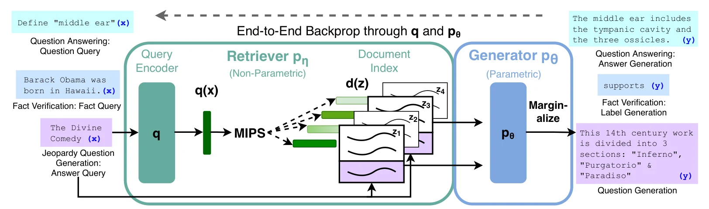
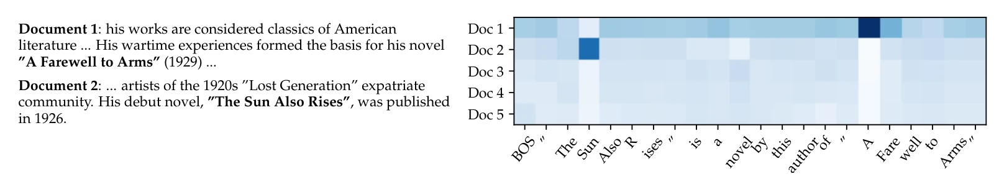
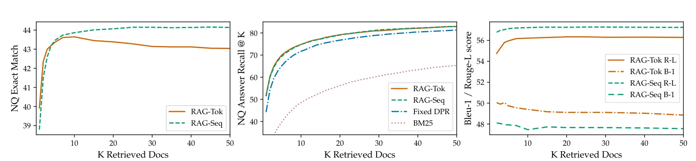

# RAG：让生成模型通过检索使用外部知识

一个模型能流畅地介绍一部小说，却把书名或作者弄错，问题可能出在哪里？它也许在训练时见过相关事实，却没有准确地从参数中取出来；也许那条事实已经变了；也许它根本没见过，只是接着上下文写出了一句像真的话。2020 年，Patrick Lewis、Ethan Perez 等十二位作者在《Retrieval-Augmented Generation for Knowledge-Intensive NLP Tasks》中提出，把预训练生成模型和可检索的外部文档接到一起：模型保留自己的语言与知识能力，也可以在作答时查阅材料。这就是本文的检索增强生成，简称 RAG。[摘要与 §1，PDF 第1–2页](https://proceedings.neurips.cc/paper/2020/file/6b493230205f780e1bc26945df7481e5-Paper.pdf)

这篇论文的贡献比“先搜索，再回答”更具体。它把一个 DPR 检索器和一个 BART 生成器组成概率模型，让不同候选文档分别参与生成，再汇总它们对输出的贡献。训练时只提供输入与目标输出，用最终答案的损失同时调整查询编码器和生成器。作者还比较了两种组织方式：整段输出共享一个潜在文档的 RAG-Sequence，以及每个输出词元都能由不同文档贡献概率的 RAG-Token。

实验覆盖短答案问答、完整句子问答、根据实体生成知识竞赛题，以及事实核查分类。在 Natural Questions 的开放域问答测试上，RAG-Sequence 得到 44.5% 的精确匹配率，DPR 问答系统为 41.5%；换用另一年份的文档索引，也能在不重训模型的情况下改变它回答的事实。前者检验任务效果，后者检验外部记忆是否真的可以替换，是两种不同的证据。[表1与索引替换实验，PDF 第6、8页](https://proceedings.neurips.cc/paper/2020/file/6b493230205f780e1bc26945df7481e5-Paper.pdf#page=6)

今天“RAG”已经成为一大类技术的名称，但这篇导读聚焦 NeurIPS 2020 的原始方法。全文核心是一个问题：**几篇不一定可靠的候选材料，怎样共同决定一个答案的概率，又怎样从答案中得到训练反馈？** 我们先建立问题背景，沿图 1 走一遍数据流，再拆开检索、两种边缘化、训练和解码；随后用图 2 的海明威例子理解参数记忆与文档的配合，最后读实验和知识更新。公式中的求和与乘积都有小例子，重点是读懂计算在做什么。

## 为什么要把参数知识与外部记忆接起来

作者面对的起点是：预训练模型已经储存了不少知识，却缺少方便的访问、修订和查证方式。“储存在参数中”指训练改变了模型权重，使它在遇到某些上下文时能写出相关事实。这里没有一张可以直接打开的“作者—作品”表，也没有一个明确对应某条事实的按钮。模型会用知识，和人能找到这条知识存在哪里，是两件事。[§1，PDF 第1–2页](https://proceedings.neurips.cc/paper/2020/file/6b493230205f780e1bc26945df7481e5-Paper.pdf#page=2)

假如某个职位换了任职者，纯参数模型通常要通过进一步训练改变回答行为。即使它答对了，也很难说明究竟依据哪一段文字。这使知识密集型任务格外困难：回答需要大量具体事实，而这些事实很难仅靠当前问题本身推出来。论文对这类任务的直觉定义是，人完成它们时也往往需要外部知识来源。

一条已有路线是“先检索，再抽取”。系统把问题送进搜索模块，找到相关段落，再从段落中摘出一段连续文字作为答案。例如问某本书的作者，只要文档里直接出现作者名，抽取式阅读器就可能把它选出来。这类系统的输出空间受文档约束，定位直接；但材料只提供线索、答案需要改写，或任务要求写一整句话时，抽取就显得局促。

另一条路线是“闭卷问答”：完全靠预训练模型的参数生成答案。它能自由组织文字，也能把问答、摘要或分类统一成文本输入输出，但作答时没有查阅外部材料的通道。RAG 想把两者的优势接起来：保留生成模型灵活的输出形式，同时给它一份可以读取、检查和替换的外部记忆。

论文把外部文档索引称为非参数记忆。这个名字说的是知识内容以独立记录的形式存在，而不是说系统没有参数。查询编码器和文档编码器仍是神经网络；区别在于，一篇介绍海明威的文字可以留在索引里，既能被模型检索，也能被人直接阅读。更新这些记录与更新生成器权重，成为两种可以分开的操作。

到这一步，新的问题出现了：检索器往往返回好几篇材料，其中有些有用、有些无关，训练数据又未必告诉我们哪篇是标准证据。如果直接选排名第一的材料，早期检索错误会把后续生成锁死；如果把所有内容都当成正确依据，噪声也会进入答案。作者的选择是保留不确定性，把“哪篇材料帮助生成了答案”作为潜变量，在概率上汇总多个可能性。

这里还包含一个实际取舍。作者没有从零训练一个庞大的记忆系统，而是使用已经训练好的 DPR 和 BART：前者已经会找可能含有答案的段落，后者已经会理解和生成文本。下游训练的重点因此变成“让两者协作完成这个任务”。论文希望提供的是一种通用微调配方，而不只是一套专门处理某种问答的管线。[§1、§5，PDF 第2、8–9页](https://proceedings.neurips.cc/paper/2020/file/6b493230205f780e1bc26945df7481e5-Paper.pdf#page=9)

## 先明确任务：输入、候选文档与输出

接入外部记忆之前，需要先分清模型拿到什么、最终要预测什么。论文统一用 $x$ 表示输入文本，用 $y=(y_1,\ldots,y_N)$ 表示目标输出；$y_i$ 是第 $i$ 个词元，$N$ 是输出长度。词元是模型处理文本的小单位，可以是完整单词，也可以是单词的一部分。文档记为 $z$，在本文中通常指一个可检索的短段落，而非整本书或整篇百科文章。[§2，PDF 第2–3页](https://proceedings.neurips.cc/paper/2020/file/6b493230205f780e1bc26945df7481e5-Paper.pdf#page=3)

同一套记号可以容纳几种任务。问答时，$x$ 是问题，$y$ 是答案；知识竞赛题生成时，$x$ 是答案实体，$y$ 反而是让别人猜出它的题干；分类时，$x$ 是待判断的陈述，$y$ 可以用类别表示。图 1 就在左右两边并排放了这些不同任务的输入输出，意在说明中间的检索与生成架构能够复用。

这篇导读会重点沿用论文图 2 的例子：输入实体是 Hemingway，即海明威，模型要写一句知识竞赛题。论文中的生成结果提到了《太阳照常升起》和《永别了，武器》，让读者猜“这位作者”是谁。它属于 Jeopardy 风格的题目，题干虽然通常写成陈述句，任务名称仍叫 question generation，即问题生成。

这个例子很适合解释 RAG。为了写出一条具体、有区分度的题干，模型需要书名与作者之间的关系；为了把事实接成流畅句子，还需要语言能力。外部文档可以提供两个作品的线索，生成器则负责把线索组织成一句话。最终题干也不必逐字出现在任何一篇材料中。

训练和测试拿到的信息不同。训练时既有 $x$，也有参考输出 $y$，可以计算模型为正确输出分配了多少概率；作答时只有 $x$，模型必须自己搜索一个合适的 $y$。训练时用参考前缀预测下一个词元，称为 teacher forcing：要评估参考句第三个词的概率，就把前两个参考词提供给模型。测试时前缀改为模型已经生成的文字，这就是自回归生成。

候选文档夹在输入与输出之间。训练数据告诉模型“给定这个输入，应当写出这个目标”，却通常不直接指定“必须使用第几篇文档”。所以 $z$ 被称为潜变量：它参与计算，但不是每个训练样本都有的监督标签。后面所谓边缘化，就是对这些不同文档的可能性求和，最终只得到我们关心的输出概率 $p(y\mid x)$。

这也解释了为什么论文既有问答分数，又有生成和分类实验。作者要检验的范围是：同一种“检索—条件生成—文档边缘化”结构，能否经过各任务的微调处理不同输出形式。这里的通用性指可复用的架构与训练方式，并非一个未经适配的模型同时完成所有任务。

## 对照图 1：一次输入怎样穿过整个系统

上一节定义了三个对象，现在把它们放回图中。图 1 从左往右读：左侧彩色小框是不同任务的输入，绿色大框负责检索，蓝色大框负责生成，最右侧是任务输出。最上方朝左的虚线箭头表示训练反馈，和向右的作答数据流方向相反。

绿色框中的 Query Encoder 把输入 $x$ 变成查询向量 $q(x)$。向量是一串数，用来在同一个表示空间中比较输入与文档。图中的 MIPS 是最大内积搜索：它在已有文档向量 $d(z)$ 中，找出与查询向量内积较大的若干项。图中画了四张叠在一起的文档来示意多个候选，实际候选数 $K$ 是可调整的实验设置。[图1与 §2，PDF 第2页](https://proceedings.neurips.cc/paper/2020/file/6b493230205f780e1bc26945df7481e5-Paper.pdf#page=2)

取回的东西分两种：文档的分数，以及文档本身的文字。前者经过归一化，成为各文档的检索权重；后者与原始输入拼接，交给 BART。图底部的黑色连线很重要：输入没有在变成查询向量后消失，生成器仍要看到最初问的是什么。否则模型即使读到海明威的文章，也不知道该回答一个问题，还是生成一道题。

每篇候选分别与同一个输入配对。假设取回五个段落，生成器就面对五种条件：“输入加段落 1”“输入加段落 2”，直到“输入加段落 5”。它们使用同一套 BART 参数，并非训练了五个独立模型。因为材料不同，同一个候选输出在五种条件下得到的概率也会不同。

蓝框右边的 Marginalize 是整篇论文的关键。它将这些条件概率与检索权重结合，得到一个输出的综合概率。合并的是概率，而不是把五个答案拼成一段，也不是按答案出现次数投票。至于是先算完整句子再合并，还是每一步先合并下一个词元的分布，就是 Sequence 与 Token 两种形式的区别。

用海明威例子概括这条路线：查询编码器看到 Hemingway，索引返回几段有关他的文字，其中一段提到《永别了，武器》，另一段提到《太阳照常升起》；BART 分别读“实体名加这一段材料”，为同一条题干提供不同的生成概率；概率整合让多个候选都可能对最后输出产生贡献。真实图 2 展示的就是这种贡献如何随输出位置变化。

把整条流程压成一张步骤表，更容易分清哪些是文字、哪些是数值：

| 阶段 | 输入 | 输出 | 主要用途 |
| --- | --- | --- | --- |
| 离线建索引 | 文档段落及文档编码器 | 文档向量与对应原文 | 为大规模检索预先准备 |
| 编码查询 | 当前输入 $x$ | 查询向量 $q(x)$ | 在索引中寻找候选 |
| 搜索与归一化 | 查询向量、文档向量 | $K$ 篇文字及其权重 | 缩小生成计算的范围 |
| 条件生成 | $x$、某篇 $z$、输出前缀 | 下一词元的词表分布 | 判断在该材料下怎么续写 |
| 边缘化与解码 | 文档权重及条件生成概率 | 最终输出 $y$ | 合并候选贡献并选择文本 |

图 1 顶部特意写明，反向传播经过查询编码器 $q$ 和生成器 $p_\theta$。文档索引在本论文微调中固定，这个选择使作者能利用很大的外部记忆，又不用每更新一次模型就重新编码全部百科。我们先展开向右的计算，再回到这条训练箭头。

## 检索器与生成器：两种概率各管什么

RAG 的两个部件都输出概率，但它们回答的问题不同。检索器问：“给定这个输入，哪篇材料可能有用？”生成器问：“给定这个输入、这篇材料和已经写出的前缀，下一个词元是什么？”把两者分开，后面的公式就容易读得多。

**检索器用双编码器完成大范围查找。** DPR 的查询编码器与文档编码器都以 BERT-base 为基础，分别把输入和段落变成相同维度的稠密向量。双编码器指两个文本各自编码，之后用简单的向量运算比较；文档向量可以预先算好，所以每次提问不必重新对全部文档运行神经网络。[§2.2，PDF 第3页](https://proceedings.neurips.cc/paper/2020/file/6b493230205f780e1bc26945df7481e5-Paper.pdf#page=3)

论文给出的检索概率形式是：

$$
p_\eta(z\mid x)\propto\exp\bigl(d(z)^\top q(x)\bigr).
$$

$\eta$ 表示检索器的参数，$q(x)$ 是查询向量，$d(z)$ 是文档向量，上标 $\top$ 表示转置，$d(z)^\top q(x)$ 就是两个向量的内积。内积先给出一个实数分数，指数把它变成正数，归一化后才能当作概率权重。这里使用内积，并没有要求先把向量长度归一化成余弦相似度。

完整百科有约 2100 万个段落，生成器无法为每个输入读完它们。作者用近似最大内积搜索取出前 $K$ 个候选，把昂贵的生成计算限制在这一小组材料上。论文使用 FAISS 构建索引，并采用 HNSW 近似搜索；可以把它理解为在向量空间里建立可快速导航的结构，避免逐项做完整搜索。[§3，PDF 第4页](https://proceedings.neurips.cc/paper/2020/file/6b493230205f780e1bc26945df7481e5-Paper.pdf#page=4)

后文为了手算，用 $Z_K(x)$ 表示取回的候选集合，用 $w_z$ 表示在这组候选上归一化的权重。这是导读的简写：

$$
w_z=\frac{\exp(s_z)}{\sum_{z'\in Z_K(x)}\exp(s_{z'})},\qquad s_z=d(z)^\top q(x).
$$

例如两篇候选的分数分别为 $\ln 3$ 和 0，取指数得到 3 与 1，归一化就是 $3/4$ 和 $1/4$。这组数是导读指定的教学数值，不是论文检索结果。权重之和为 1，只表示在当前候选间分配了多少概率；权重 0.75 不等于“这篇资料有 75% 的概率是真的”。候选之外的文档也没有被这次近似计算读到。

**生成器用编码器—解码器完成局部阅读与续写。** BART-large 是预训练的序列到序列模型，论文将其规模约记为 4 亿参数。它的预训练让模型从被扰动的文本恢复原文，因此学会了理解上下文和生成完整文字。在 RAG 中，问题与一篇检索段落被拼成编码器输入，解码器根据这份编码结果和已有输出预测下一个词元。[§2.3，PDF 第3页](https://proceedings.neurips.cc/paper/2020/file/6b493230205f780e1bc26945df7481e5-Paper.pdf#page=3)

生成概率写成 $p_\theta(y_i\mid x,z,y_{<i})$：$\theta$ 是 BART 参数，$y_{<i}$ 是前面已经给定的输出。在海明威例子中，某篇文档提到 *The Sun Also Rises*，模型在前缀 *The* 后给 *Sun* 的概率就可能较高；另一篇主要讲战争经历，对这个续写的帮助可能较小。生成器也有自己的参数知识，因此即使材料没逐字写出后续词，它仍可能接出正确书名。

如果词表大小为 $V$，一次生成步骤就可以想成一张 $K\times V$ 的概率表：每一行对应一篇文档，每一列对应一个候选词元。检索器另提供一个长度为 $K$ 的权重向量。Token 模型逐列加权，把这张表合成一个词表分布；Sequence 模型则保留每篇文档对整条输出的概率，等句子级别再加权。这一层的概率混合与 BART 内部的注意力是不同操作，前者选择文档贡献，后者让网络读取输入中的词元信息。

## 两种边缘化：求和放在句外还是词内

有了每篇文档的权重和生成概率，接下来要决定文档怎样跨输出位置共享。这是原方法最需要慢读的部分。下面先解释两种公式，再用完全相同的两篇文档、两个输出位置算一遍。[§2.1，两种模型公式，PDF 第3页](https://proceedings.neurips.cc/paper/2020/file/6b493230205f780e1bc26945df7481e5-Paper.pdf#page=3)

**RAG-Sequence：每篇文档先解释整条输出。** 对一篇固定文档 $z$，自回归生成把整条输出的概率拆成各位置条件概率的乘积。接着用检索权重乘上这个整句概率，最后对候选文档求和：

$$
p_{\mathrm{seq}}(y\mid x)\approx
\sum_{z\in Z_K(x)}p_\eta(z\mid x)
\prod_{i=1}^{N}p_\theta(y_i\mid x,z,y_{<i}).
$$

内层乘积始终使用同一个 $z$。可以把它想成几条平行路线：路线 1 一直在文档 1 的条件下评估这句话，路线 2 一直在文档 2 的条件下评估，最后把路线的概率合起来。模型没有提前硬选唯一一篇文档；“同一篇贯穿整句”描述的是每条潜在路线内部的结构。

如果某个句子在第一篇条件下概率为 0.4，在第二篇条件下概率为 0.8，而检索权重分别为 0.7 和 0.3，混合概率就是 $0.7\times0.4+0.3\times0.8=0.52$。排名较低的第二篇仍能做出很大贡献，因为生成器认为它更有利于写出这句输出。这里同样是教学数值，用来说明为什么保留多篇比只信检索第一名更灵活。

**RAG-Token：每个位置先合成词元分布。** 它先让所有候选分别预测当前词元，把这些概率按检索权重求和，形成一个综合的下一词元分布，再沿输出位置相乘：

$$
p_{\mathrm{tok}}(y\mid x)\approx
\prod_{i=1}^{N}
\sum_{z\in Z_K(x)}p_\eta(z\mid x)
 p_\theta(y_i\mid x,z,y_{<i}).
$$

这次求和在乘积里面。写到第一个书名时，提到该书的文档可能贡献更多；写到第二个书名时，另一篇文档又可能更有帮助。每个位置都允许不同潜在文档参与，而没有要求一条路线始终守着同一个 $z$。

两式里的检索权重都只依赖原始输入 $x$。Token 形式不是每生成一个词就重新搜索数据库：候选集合在开始时取回，后续变化来自各文档条件下的生成概率。所有候选分支在评估当前位置时，也都看到同一个输出前缀 $y_{<i}$；它们没有各自保留一条互不相干的已输出句子。

**两个位置的手算。** 下面是导读自编的教学概率表。为了只看求和与乘积，把一个固定目标序列压成两个抽象词元 A、B；它们不代表实际英文分词。两篇文档权重各为 0.5，第二个位置的概率始终是在已经给定同一个 A 的条件下计算。

| 文档 | 检索权重 | 第一个目标词元 A 的概率 | 前缀为 A 时，第二个目标词元 B 的概率 |
| --- | ---: | ---: | ---: |
| $z_1$ | 0.5 | 0.9 | 0.1 |
| $z_2$ | 0.5 | 0.1 | 0.9 |

Sequence 先算每一行的完整输出概率。第一行 $0.9\times0.1=0.09$，第二行 $0.1\times0.9=0.09$；加权得到 $0.5\times0.09+0.5\times0.09=0.09$。每篇文档都只擅长其中一步，所以没有一条固定文档路线对整个输出特别有把握。

Token 先算每一列的混合概率。A 是 $0.5\times0.9+0.5\times0.1=0.5$，B 也是 $0.5\times0.1+0.5\times0.9=0.5$；相乘得到 $0.25$。它能把第一篇对 A 的帮助和第二篇对 B 的帮助放进同一条输出路径。

把 Token 的乘积展开，可以更准确地看到这种灵活性：

$$
(0.5\times0.9+0.5\times0.1)
(0.5\times0.1+0.5\times0.9)
=0.0225+0.2025+0.0025+0.0225.
$$

四项分别对应 $(z_1,z_1)$、$(z_1,z_2)$、$(z_2,z_1)$ 和 $(z_2,z_2)$ 四条潜在文档路径。最大的 0.2025 来自“第一步用 $z_1$，第二步用 $z_2$”。而 Sequence 只允许同文档路径，且整条路径的检索权重只乘一次。区别因此不只是“多了两个交叉项”，还包括文档先验是在每个位置重新进入混合，还是只为整条路线进入一次。

这个例子展示的是结构差异，不证明 Token 总能给正确答案更高概率。假如某篇文档对整个输出都很合适，Sequence 的共享结构也可能更有利；实际训练出来的两个模型参数还会不同。论文后面的问答与题干生成结果，恰好显示两种形式各有表现较好的任务。

有两个边界有助于理解公式。当只剩一篇候选，即 $K=1$ 时，两种结构都退化为在这篇材料条件下生成；当输出只有一个词元时，乘积只有一项，两式也相同。论文借后一点解释类别预测：如果类别作为单个输出目标，Sequence 与 Token 的文档边缘化等价。

最后，“整句共享一篇潜在文档”描述的是概率分解，不是要求输出每个事实都逐字出现在那篇文档里。BART 仍能使用自身的参数知识。理解了这点，就能把“文档怎样参与概率计算”与“事实究竟能由哪段材料支持”分开讨论。

## 训练怎样把正确答案变成检索反馈

到目前为止，模型已经能为一个给定输出计算概率，但检索器为什么会越用越适合任务？关键在于，训练目标评估的是边缘化后的最终输出，而非只评估某篇文档下的生成。哪个候选更有利于解释正确答案，哪个候选就可能获得更大的学习信号。[§2.4，PDF 第3–4页](https://proceedings.neurips.cc/paper/2020/file/6b493230205f780e1bc26945df7481e5-Paper.pdf#page=4)

对于训练样本 $(x_j,y_j)$，论文最小化负边缘对数似然：

$$
\mathcal L= -\sum_j\log p(y_j\mid x_j).
$$

$j$ 遍历训练样本；$p(y_j\mid x_j)$ 使用上一节的 Sequence 或 Token 公式。正确输出得到的概率越高，负对数损失越低。对数还有一个计算上的便利：许多很小的词元概率相乘容易变得极小，实际实现通常在对数空间稳定计算。

先用 Sequence 看反馈的直觉。设两篇文档的权重都是 0.5，正确答案在它们条件下的概率分别为 0.8 与 0.2。答案的总概率是 0.5，其中第一篇贡献 0.4，第二篇贡献 0.1。已知目标答案后，在这次概率解释中第一篇承担 80% 的贡献，第二篇承担 20%。这叫文档的后验责任：在看到答案之前两篇同样可能有用，看到答案之后，第一篇更能解释这个目标。

下面的推导是导读对训练机制的补充解释，只考虑单个训练样本，并将它的损失记为 $\ell=-\log p(y\mid x)$。固定当前候选集合，记 $a_z=p_\theta(y\mid x,z)$，检索权重 $w_z$ 由分数 $s_z$ 的 softmax 得到，则：

$$
r_z=\frac{w_z a_z}{\sum_{z'}w_{z'}a_{z'}},\qquad
\frac{\partial\ell}{\partial s_z}=w_z-r_z.
$$

$r_z$ 是刚才的后验责任。第一篇的导数为 $0.5-0.8=-0.3$，梯度下降会倾向于提高它的检索分数；第二篇是 $0.5-0.2=0.3$，倾向于降低分数。这组人为指定的概率说明了一个关键性质：即使没有“正确文档编号”，答案损失也能把更有利于生成目标的候选往前推。

同一个损失还会更新 BART，让它更会利用输入和材料预测目标词元。对 Token 模型，这种责任分配发生在各个输出位置，再把不同位置的学习信号汇总到共享参数中。所以查询编码器与生成器互相影响：前者改变后者能读到什么，后者对答案的解释能力又改变前者应当偏向什么。

这个“有用”是相对于训练目标而言。若某篇段落只是与答案存在偶然关联，甚至生成器主要依赖参数记忆，也可能得到不错的答案概率。因此高后验不等于该文档已经成为经核实的事实证据。论文提供的是学习怎样取回有助于任务的内容，而非强制逐句引用的约束。

训练范围也有明确边界。DPR 初始化之前已经用 Natural Questions 和 TriviaQA 的检索监督训练过；RAG 微调没有额外要求每个样本的文档标签，并不意味着整个系统从来没有使用过检索监督。预训练让检索器从一开始就具备找答案段落的能力，再由各任务的答案损失继续调整。[§2.2、§4.1，PDF 第3、5页](https://proceedings.neurips.cc/paper/2020/file/6b493230205f780e1bc26945df7481e5-Paper.pdf#page=5)

作者冻结了文档编码器和文档索引，只更新查询编码器与 BART。原因很实际：如果文档编码器每步都变，约 2100 万个旧向量就会逐渐不再对应当前编码方式，索引需要周期性重建。固定文档侧后，查询向量仍能学习朝更有用的文档移动，同时省下重编码整个知识库的工作。

“端到端”在这里指最终任务损失能够共同训练上述两个部件；离散的 top-$K$ 搜索本身没有被变成一个平滑、逐项可微的操作。导数解释是在当前已取回候选上成立的，未进入候选的段落不会在这一步直接获得生成评分。由此再看图 1 顶部的虚线，它表达的是一条有明确更新范围的反馈链，而非全库所有计算都在同步训练。

## 解码：有了输出概率，怎样真正写出一句话

训练时给定目标句，主要工作是给它打分；测试时没有目标句，要从大量可能输出中找出概率高的一个。这叫解码。理论目标是 $\arg\max_y p(y\mid x)$，但所有长度、所有词元组合多得无法穷举，所以论文采用近似搜索。[§2.5，PDF 第4页](https://proceedings.neurips.cc/paper/2020/file/6b493230205f780e1bc26945df7481e5-Paper.pdf#page=4)

**Token 的计算直接提供下一词元分布。** 对当前前缀，每篇文档给出一行词表概率，再按检索权重加权，得到统一的下一步分布。贪心解码就选择此刻概率最大的词元；束搜索则保留若干个较好的前缀，同时向后扩展，减少一步选错就没有退路的问题。

这里有一个容易忽略的顺序：先混合概率，再从混合后的分布里选择词元。如果先让每篇文档各选出一个词，再投票，概率信息已经被丢掉，就换成了另一个算法。譬如一篇给甲、乙的概率很接近，另一篇强烈支持乙，先取各自第一名可能打成平票，而加权概率仍能保留第二篇的明确偏好。

**Sequence 需要在句子级重新汇总。** 某个输出在文档 1 下的前半句得分很高，不代表它在所有文档边缘化后的整句概率最高。论文因此先对每篇文档分别运行生成搜索，收集候选完整输出，取它们的并集 $Y$，再为候选计算文档边缘概率。

假设文档 1 的搜索提出了甲句与乙句，文档 2 提出了乙句与丙句。甲句没有出现在文档 2 的搜索结果里，只能说明它没有进入那次有限搜索的候选，不能说其条件概率就是零。要认真比较三个句子的综合概率，就应该补算甲句在文档 2 下的得分，以及丙句在文档 1 下的得分。

论文把这种补齐打分的方式叫 Thorough Decoding，即较完整的解码。对每个候选，找出哪些文档分支还没算过它，再做额外前向计算，最后乘检索权重并求和。这样得到的候选评分更完整，但候选集合本身仍由近似搜索产生；它没有枚举所有可能句子。

较快的 Fast Decoding 则省掉补算：某句没在某篇文档的搜索结果里出现，就近似把这项条件概率设为零。它用较少计算换取更粗略的边缘化评分。输出越长，候选并集可能越大，补算的负担也越明显，因此这种取舍对长生成尤其重要。

| 模型或解码方式 | 合并概率的时机 | 需要的搜索与补算 |
| --- | --- | --- |
| RAG-Token | 每个词元位置 | 混合词表概率后，运行统一的生成搜索 |
| Sequence，Thorough | 完整候选输出级别 | 各文档生成候选，对缺失的候选—文档组合补算 |
| Sequence，Fast | 完整候选输出级别 | 各文档生成候选，未生成的组合近似为零 |

同一会议版本的补充材料给出了实际配置：开放域问答中，Token 测试取 15 篇文档，Sequence 取 50 篇，后者采用 Thorough Decoding；短答案使用贪心生成，因为作者没有观察到束搜索带来提升。MS-MARCO 和 Jeopardy 两个长生成任务都取 10 篇文档，束宽为 4，Sequence 使用 Fast Decoding。[补充材料 A，PDF 第1页／印刷页17](https://proceedings.neurips.cc/paper/2020/file/6b493230205f780e1bc26945df7481e5-Supplemental.pdf#page=1)

所以，后文表 1 中 Sequence 与 Token 的分数是各自实验配置的整体结果，候选数量与解码方式也不同，不能把差值全部归功于一个求和符号的位置。概率模型决定怎样评分，解码预算决定能搜索和评估多少输出，两者共同构成实际系统。

## 图 2 的海明威例子：文档贡献为什么会变

前面的手算把现实缩成两个词元，现在回到论文自己的生成案例。图 2 的输入是 Hemingway，检索返回五篇文档。左侧摘出了其中两篇的内容，右侧每一行是一篇文档，每一列对应一个生成词元，颜色越深表示该位置的文档后验越高。

生成的题干大意是：“《太阳照常升起》是这位《永别了，武器》作者的一部小说。”文档 2 提到海明威的处女作 *The Sun Also Rises*，文档 1 提到他的战争经历与 *A Farewell to Arms* 的关系。第一本书出现时，第二行在 *Sun* 附近更深；进入第二本书名时，第一行在 *A* 附近明显加深。它给“不同位置可以由不同材料贡献”提供了直观例子。[§4.3 与图2，PDF 第6–7页](https://proceedings.neurips.cc/paper/2020/file/6b493230205f780e1bc26945df7481e5-Paper.pdf#page=7)

为什么权重能变？检索先验仍然固定，变化的是“看到这个输出词元后，哪篇文档更能解释它”。为说明这个区别，导读把某位置的归一化贡献记为：

$$
r_i(z)=
\frac{p_\eta(z\mid x)\,p_\theta(y_i\mid x,z,y_{<i})}
{\sum_{z'}p_\eta(z'\mid x)\,p_\theta(y_i\mid x,z',y_{<i})}.
$$

这是依照 Token 模型写出的教学记号。分子是该文档对当前已知词元的概率贡献，分母把所有候选贡献相加。假如检索器同样看好两篇材料，但只有其中一篇使 *Sun* 很容易被生成，那么看到 *Sun* 后，它在这一列的相对责任就更高。这个后验和检索时的排序分数，回答的是不同问题。

图中还有一个比“切换文档”更有意思的细节：书名开始之后，后续位置的颜色很快趋于平缓。作者据此提出一种解释：文档把模型引向某个书名，模型自己已有的参数知识接着把名字补完。比如看到 *The Sun* 后，生成器可能已知道常见续写是 *Also Rises*，于是对特定文档的依赖减弱。

作者还做了一个小检查：给纯 BART 基线提供部分生成前缀，它确实能补出这些书名。但 BART 的完整句子会重复使用《太阳照常升起》，显示“会补全一个熟悉的名字”和“能为指定实体写出合适、具体的题干”存在差别。文档的作用可能是把参数里的已有知识引到更合适的位置。

这是一例机制观察及其补充检查，并未证明所有生成都按“文档先引路、参数再接力”的方式运行；热图本身也不是对每条事实的因果归属测试。它真正帮助我们理解的是，两类记忆可以在同一句话里合作：外部文字提供当前任务的具体线索，生成模型利用语言与知识能力完成组织和续写。

从图 1 到图 2，作者的论证因此推进了一步。图 1 定义系统允许信息走哪些路，图 2 展示训练后的模型在一个实际案例里怎样分配文档贡献。前者讲结构，后者给观察；它们之间还需要大规模任务结果，来判断这种设计究竟是否有实际收益。

## 实验怎样安排：同一架构面对四类任务

作者没有只挑一种“答案恰好在段落里”的问答，而是安排了输出形式不同的任务。这样可以检验检索加生成究竟只是替代抽取阅读器，还是能够支持更广泛的知识密集型处理。下面先把数据与指标分开，再读成绩。[§3.1–3.4，PDF 第4–5页](https://proceedings.neurips.cc/paper/2020/file/6b493230205f780e1bc26945df7481e5-Paper.pdf#page=4)

所有主要实验都使用 2018 年 12 月 Wikipedia 快照作为外部知识源。百科文章被分成互不重叠的 100 词片段，总共约 2100 万段。训练时考虑取回 5 或 10 篇候选，测试候选数由开发数据选择。这里的“词”是语料切块单位，与 BART 输出的子词词元并非同一个计数概念。

**开放域问答**使用 Natural Questions（NQ）、TriviaQA、WebQuestions 和 CuratedTrec。开放域意味着输入没有附带标准证据段落，系统要自己从大语料中寻找信息；输出通常是实体名或短答案。评价用精确匹配 EM，衡量标准化后的答案是否匹配参考答案，分数越高越好。WebQuestions 与 CuratedTrec 较小，作者先从已在 Natural Questions 上训练的 RAG 模型初始化，再进行对应任务适配。

**自由生成问答**使用 MS-MARCO NLG v2.1。NLG 指自然语言生成，这里目标是一句较完整的回答。原数据为每个问题提供十篇搜索段落，作者主动不用这些段落，只用问题和答案训练，让 RAG 自己去百科中检索。这个改动使任务变成开放域生成，也带来知识源不匹配：某些问题的参考答案依赖原始网页，百科中可能没有相应信息。

例如某地天气这类问题，只有地点和问题往往不足以恢复数据采集当时的参考答案。论文因此承认，用自取百科材料的方法与直接读标准段落的方法，面对的信息条件不同。RAG 与同设定的 BART 基线比较，更能帮助我们判断加入检索后的收益；有标准上下文的最佳系统则只作为另一种条件的参照。

**Jeopardy 题干生成**把实体输入转换成供人猜实体的事实描述。它与问答方向相反：输入“世界杯”，输出一条有关墨西哥曾两次举办该赛事的线索。作者沿用 SearchQA 的数据划分，训练规模约十万条。除了 BLEU-1，还用 Q-BLEU-1：后者对实体匹配赋予更高权重，更贴近题干里“具体事实是否对得上”的需求。[§3.3，PDF 第5页](https://proceedings.neurips.cc/paper/2020/file/6b493230205f780e1bc26945df7481e5-Paper.pdf#page=5)

**FEVER 事实核查**输入一条声明，输出支持、反驳或信息不足；论文也测试只保留支持与反驳的二分类版本。指标是类别准确率。主文用“单个类别目标”解释它为何能纳入统一模型，补充材料 E 则说明实现上先重新生成声明，再用最后的隐状态做分类，最后对文档边缘化。因而，单词元公式说明的是类别边缘化结构，实际分类头的实现还有这一步。[§3.4，PDF 第5页](https://proceedings.neurips.cc/paper/2020/file/6b493230205f780e1bc26945df7481e5-Paper.pdf#page=5) · [补充材料 E，PDF 第2页／印刷页18](https://proceedings.neurips.cc/paper/2020/file/6b493230205f780e1bc26945df7481e5-Supplemental.pdf#page=2)

| 任务 | 要学会的输出 | 论文主要指标 | 指标主要回答什么 |
| --- | --- | --- | --- |
| 开放域问答 | 短答案 | EM | 最终答案是否匹配参考 |
| MS-MARCO | 完整回答句 | BLEU-1、ROUGE-L | 生成文字与参考有多少重合 |
| Jeopardy | 关于实体的题干 | Q-BLEU-1、人工比较 | 题干是否具体、事实是否更好 |
| FEVER | 声明类别 | 类别准确率 | 标签是否判对 |

训练使用 Adam 优化器。补充材料说明实验采用混合精度并在八块 32GB V100 GPU 上分布式训练，文档索引放在 CPU 内存中；这提醒我们，生成器参数之外还有显著的检索存储与计算成本。[补充材料 C，PDF 第1页／印刷页17](https://proceedings.neurips.cc/paper/2020/file/6b493230205f780e1bc26945df7481e5-Supplemental.pdf#page=1)

这些任务的共同点是都可能受益于具体知识，区别则在于需要怎样组织输出。短答案看重找到并写对一个事实，题干需要选择有区分度的信息，分类需要判断声明与材料的关系。把它们放在一起，才能检验“一个架构、多种微调任务”的主张。

## 问答结果：生成式答案比抽取多了什么

表 1 首先回答，原始 RAG 是否能在标准开放域问答上取得有竞争力的结果。下面摘录 DPR 与两种 RAG 的测试集 EM，单位为百分比，越高越好；TriviaQA 必须拆成两个测试划分，横线表示该行没有报告对应值。[表1与 §4.1，PDF 第5–6页](https://proceedings.neurips.cc/paper/2020/file/6b493230205f780e1bc26945df7481e5-Paper.pdf#page=6)

| 模型 | NQ | TriviaQA 开放域常用划分 | TriviaQA Wiki 测试集 | WebQuestions | CuratedTrec |
| --- | ---: | ---: | ---: | ---: | ---: |
| DPR 问答系统 | 41.5 | 57.9 | — | 41.1 | 50.6 |
| RAG-Token | 44.1 | 55.2 | 66.1 | 45.5 | 50.0 |
| RAG-Sequence | 44.5 | 56.8 | 68.0 | 45.2 | 52.2 |

NQ 上，Sequence 比 DPR 高 3.0 个百分点；WebQuestions 上，Token 高 4.4 个百分点；CuratedTrec 上，Sequence 高 1.6 个百分点。它们分别体现了 RAG 在这些任务上的优势，但没有一个模型包揽所有最好结果：CuratedTrec 的 Token 比 DPR 低，TriviaQA 开放域常用划分上，两种 RAG 都低于 DPR。

TriviaQA 是读这张表最容易踩坑的地方。原表一格里写两个数，左边是开放域问答工作常用的测试划分，右边是为了与闭卷 T5 工作比较而增加的官方 Wiki 测试集。补充材料 D 解释，前者实际采用公开 Web 开发集作为开放域评测集；作者把 Wiki 测试集上的更高成绩归因于其中的问题更容易从 Wikipedia 中找到答案。68.0 与 57.9 来自不同划分，不能直接相减后说成 RAG 的提升。[补充材料 D，PDF 第2页／印刷页18](https://proceedings.neurips.cc/paper/2020/file/6b493230205f780e1bc26945df7481e5-Supplemental.pdf#page=2)

DPR 也不只是一个“不开生成”的 RAG。它的问答系统包含检索器、重新评估问题与文档匹配程度的重排模块，以及选择答案片段的抽取阅读器。RAG 使用 BART 自由生成，并按不同方式整合候选概率。因此表 1 比较的是完整系统，支持生成式检索模型是一条有效路线；若要精确归因于某个模块，还要看更受控的消融。

作者为什么觉得生成有价值？第一，有些材料给出线索，但没有以最终答案的字符串形式出现。抽取阅读器只能选原文中的片段，生成器可以把线索转成答案。第二，不同文档对同一答案的支持程度可以直接进入概率混合，而不必先指定某一段为唯一证据。

论文还报告一个有意思的子集结果：在 NQ 中，当检索到的任何文档都不含正确答案时，RAG 仍有 11.8% 的准确率。标准抽取式模型在这种条件下没有可摘取的答案字符串，理论上得零分。这说明生成器确实能超出原文逐字复制的范围，可能利用参数知识或材料线索；仅凭这个统计，尚不能区分每个成功样本具体来自哪一种途径。[§4.1，PDF 第6页](https://proceedings.neurips.cc/paper/2020/file/6b493230205f780e1bc26945df7481e5-Paper.pdf#page=6)

这个能力也解释了 RAG 的两面性。自由生成有机会救回检索未直接包含答案的题目，同时让输出可以脱离取回材料。EM 奖励的是最终字符串正确，若研究问题转向“每句话是否有来源支持”，就需要另加对应评价。这不是否定 EM，而是把它放回它实际测量的对象：短答案是否答对。

## 完整句子、题干与分类：怎样读更多证据

短答案答对还不够，作者接着检验模型能否写出更具体的完整文本。表 2 把 MS-MARCO、Jeopardy 和 FEVER 放在一起，但三者的指标不同，我们分开阅读。[表2与 §4.2–4.4，PDF 第6页](https://proceedings.neurips.cc/paper/2020/file/6b493230205f780e1bc26945df7481e5-Paper.pdf#page=6)

**完整问答句。** 下表是 MS-MARCO 测试结果，只比较都不使用数据集标准段落的 BART 与 RAG。BLEU-1 主要看词元层面的重合精度，ROUGE-L 利用最长公共子序列衡量与参考的重合；两者在这里均以越高越好解释。

| 模型 | MS-MARCO BLEU-1 | MS-MARCO ROUGE-L |
| --- | ---: | ---: |
| BART | 41.6 | 38.2 |
| RAG-Token | 41.5 | 40.1 |
| RAG-Sequence | 44.2 | 40.8 |

Sequence 的两个指标都比 BART 高 2.6 分，而 Token 的 ROUGE-L 上升、BLEU-1 略低。这个结果已经说明“生成质量提高”最好拆开说：不同指标奖励的文字性质不同。一种模型可能覆盖更多参考内容，却在词元精度上没有同步改善。

原文表 3 用“定义中耳”展示了更具体的差别。BART 输出“中耳是中耳与鼻子之间的部分”，形成了明显循环定义；RAG-Sequence 写出“中耳包括鼓室和三块听小骨”。这也是图 1 的一个任务示例。案例让读者看到错误长什么样，大批量指标则帮助判断它是否只是一条挑出来的好例子。[表3，PDF 第7页](https://proceedings.neurips.cc/paper/2020/file/6b493230205f780e1bc26945df7481e5-Paper.pdf#page=7)

**根据实体生成题干。** Jeopardy 测试中，BART 的 BLEU-1／Q-BLEU-1 为 15.1／19.7，Token 为 17.3／22.2，Sequence 为 14.7／21.4。两种 RAG 的 Q-BLEU-1 都更好，但 Token 在这项任务上领先。作者提出，题干经常要结合不止一条事实，Token 的逐位置文档混合可能更适合这种输出。图 2 的海明威案例与这个解释一致，不过论文没有单独控制“是否必须融合多篇文档”来验证因果关系。

仅看与参考题干的重合仍有不足：同一个实体可以对应许多不同的好题。于是作者对 BART 与 RAG-Token 的 452 对生成结果做人工比较，分别评价事实性与具体性。事实性问陈述能否由可信外部来源佐证；具体性看题干与输入实体是否紧密相关，而不是换成很多别的实体也能成立。标注时随机交换两个模型的展示位置，允许查阅互联网核实，并利用标准样例检查标注质量。[§3.3、§4.3，PDF 第5–6页](https://proceedings.neurips.cc/paper/2020/file/6b493230205f780e1bc26945df7481e5-Paper.pdf#page=5) · [补充材料 B，PDF 第1页／印刷页17](https://proceedings.neurips.cc/paper/2020/file/6b493230205f780e1bc26945df7481e5-Supplemental.pdf#page=1)

在这些成对比较中，42.7% 判 RAG 的事实性更好，7.1% 判 BART 更好；具体性方面，37.4% 判 RAG 更好，16.8% 判 BART 更好。表中另有两者都好、两者都差和没有多数结论的情况，所以 42.7% 是比较胜出的比例，而非“RAG 只有 42.7% 的题干正确”。固定 PDF 的正文与表 4 对“事实性两者都好”的比例不一致，这里仅采用无争议的比较项。[表4，PDF 第8页](https://proceedings.neurips.cc/paper/2020/file/6b493230205f780e1bc26945df7481e5-Paper.pdf#page=8)

**输出是否更丰富。** 表 5 还计算不同三词片段占全部三词片段的比例。Jeopardy 中 BART 为 32.4%，Token 为 46.8%，Sequence 为 53.8%；MS-MARCO 中依次为 70.7%、77.8%、83.5%。两种 RAG 生成的词组更少重复，Sequence 在这个指标上更高。多样性衡量的是表达重复程度，本身不保证事实正确，必须和前面的质量评价一起理解。[表5，PDF 第8页](https://proceedings.neurips.cc/paper/2020/file/6b493230205f780e1bc26945df7481e5-Paper.pdf#page=8)

**事实核查分类。** FEVER 三分类中，BART 为 64.0%，RAG 为 72.5%；二分类中分别为 81.1% 与 89.5%。RAG 没有使用 FEVER 的证据文档标签来训练检索器，而是依靠声明与类别监督完成适配。论文还核对检索文章标题与标准证据文章标题的重合：第一篇命中标准文章的比例为 71%，前十篇中包含标准文章的比例为 90%。这个统计定位到文章层级，尚未检验句子级证据是否完整支持预测。[§4.4，PDF 第6–7页](https://proceedings.neurips.cc/paper/2020/file/6b493230205f780e1bc26945df7481e5-Paper.pdf#page=7)

补充材料明确说，论文研究的是类别预测，没有完成 FEVER 的另一项任务——抽取支持分类的证据句。这样再看实验的整体结论就很清楚：检索增强能帮助生成与分类，在多个指标上优于纯 BART；证据检索、事实支持和最终输出则仍是可以分别测量的环节。

## 消融与图 3：学检索、换检索、多检索分别怎样

前面看到的是整套系统成绩，现在要拆开问：检索器真的需要跟着任务训练吗？换成按词面匹配的搜索会怎样？多取几篇是不是就能持续变好？论文 §4.5 用表 6 与图 3 回答这三个问题。[§4.5、表6，PDF 第7–8页](https://proceedings.neurips.cc/paper/2020/file/6b493230205f780e1bc26945df7481e5-Paper.pdf#page=8)

先看表 6 的开发集消融。Frozen 指冻结已经预训练好的查询检索器，只训练生成器；BM25 则用基于关键词重合的固定检索系统替换 DPR，作者把 BM25 分数作为归一化前的打分。下表摘录 NQ 的 Sequence 行，以及两种 RAG 等价的 FEVER 三分类列。所有数值越高越好，它们属于开发集，不与前面的测试成绩混排。

| 检索设置 | NQ，RAG-Sequence EM | FEVER 三分类准确率 |
| --- | ---: | ---: |
| 固定 BM25 | 31.8 | 75.1 |
| 冻结预训练 DPR | 41.2 | 72.9 |
| 随任务训练查询编码器 | 44.0 | 74.5 |

NQ 上，从 BM25 到冻结 DPR，再到任务训练后的 DPR，分数逐步提高。冻结检索器到联合训练相差 2.8 个百分点，支持答案监督能够进一步改善检索与生成的配合；也说明初始化的检索能力已经贡献了很大一部分效果。

FEVER 则提供了重要反例：训练后的 DPR 比冻结版本好，却仍低于 BM25。作者推测，这类声明高度围绕具体实体，精确的词面匹配可能特别有利。这个解释是针对观察提出的假设，没有通过单独操纵实体词面来验证；它提示研究者按任务选择检索方式，而非把稠密检索视为普遍占优的升级。

接下来是候选数量 $K$。图 3 三个面板共用横轴“取回多少篇文档”，但纵轴测量不同：左边是 NQ 答案 EM，中间是 NQ 答案召回，右边是 MS-MARCO 的两种生成指标。橙色代表 Token，绿色代表 Sequence；中图还加入蓝色的固定 DPR 和粉色 BM25。

中图最直观：候选越多，包含答案的机会越大；训练后的 RAG 检索器在图示范围内也有较好的答案召回。但左图显示，这种改善没有一比一变成答对率。Sequence 总体上升后接近平台，Token 约在 10 篇附近达到峰值，之后有所下降。新增材料可能补充信息，也会改变概率混合，因此检索层的收益还要经过生成层才能成为答案收益。

右图进一步说明，甚至同一个生成任务也没有唯一的“更好”。Token 的 ROUGE-L 随候选增加而提高，但 BLEU-1 总体下降；Sequence 的变化较小。论文报告了这种方向差异，没有为图中每个点提供误差区间，因此适合读出图示实验的趋势，不宜据此认定普遍最优的候选数。

这张图也可以与上一节的解码配置对照。作者在正式问答测试中使用的 Token 候选数是 15，而图 3 的趋势描述说约 10 篇处达到峰值。前者是报告成绩所用配置，后者是一次候选数量分析；它们不应被压缩成“论文统一规定 $K=10$”。

把三个问题合起来，检索的评价就有了层次：先看候选能否覆盖答案，再看生成器怎样利用它们，最后看输出任务究竟奖励什么。增加候选意味着更多文档条件下的生成计算，尤其还会影响 Sequence 的候选搜索与补算规模。检索数因此既是效果参数，也是成本参数。

## 替换索引：知识更新实验到底更新了什么

论文开头说外部记忆可以直接修改，最后用一个相当清楚的干预来检验：保持已训练的模型不变，只替换文档索引。如果答案随外部记忆改变，就说明模型确实在利用这条通道，而不只是凭原有参数回答。[§4.5，索引热替换，PDF 第7–8页](https://proceedings.neurips.cc/paper/2020/file/6b493230205f780e1bc26945df7481e5-Paper.pdf#page=8)

作者另外用 2016 年 12 月 Wikipedia 建了一个索引，与主要实验的 2018 年 12 月索引对照。他们挑选两时点间任职者发生变化的 82 个领导职位，用“谁担任某职位”这样的模板询问 NQ RAG 模型，并分别按 2016 年和 2018 年的任职者评价。问题模板本身没有要求模型自动判断当前年份，索引年份承担了知识切换的作用。

把正文报告的四种组合整理成表，会比只读“更新成功”更清晰。行表示使用哪一年的外部索引，列表示按哪一年的人选判断答案正确：

| 使用的索引 | 对照 2016 年任职者 | 对照 2018 年任职者 |
| --- | ---: | ---: |
| 2016 年索引 | 70% | 4% |
| 2018 年索引 | 12% | 68% |

同年索引对应的正确率较高，错配年份时明显降低。对这一批问题而言，替换索引在不重训生成器的情况下改变了模型所使用的事实。这是比“输出旁边有检索结果”更有力的证据，因为作者实际干预了外部记忆，观察答案怎样变化。

82 个特定职位问题的范围仍然有限，不能把约七成正确率理解为所有知识更新都已经可靠解决。实验选择的是两个年份间已知发生变化的事实，也没有测试同一个库里同时混有多个版本、用户又带着复杂时间条件提问的情况。它检验的是换索引能否控制一类事实回答，而非完整的时间推理能力。

从机制看，替换索引改变的是“本次能检索到哪些材料以及它们的向量”，而 BART 的参数知识没有同步被擦除或重写。旧参数与新材料可能一致，也可能冲突；材料没取对或模型没用好时，仍然会回答错误。作者在 Broader Impact 中也强调，Wikipedia 或任何外部知识源都可能包含错误与偏见。[Broader Impact，PDF 第10页](https://proceedings.neurips.cc/paper/2020/file/6b493230205f780e1bc26945df7481e5-Paper.pdf#page=10)

补充材料还提供了两个与失败有关的观察。作者尝试增加空文档候选，让模型有机会表示“这次没有有用材料”，但几种实现没有带来改进，最终省略；在初步的故事生成实验中，检索还会塌缩成不论输入是什么都返回相似文档，生成器随后学会忽略材料。作者猜测，任务对事实的要求不够明确或目标序列较长，可能让检索梯度不够有信息量。[补充材料 F、H，PDF 第2–3页／印刷页18–19](https://proceedings.neurips.cc/paper/2020/file/6b493230205f780e1bc26945df7481e5-Supplemental.pdf#page=2)

这些观察把论文的目标收得更准确：外部记忆提供了可更新的信息接口，任务训练可以学着使用它；系统是否真正依赖正确材料，仍要通过任务与干预检验。RAG 最有价值的改变，是把原本全压在模型权重里的问题，拆出了一部分可以直接检查和替换的对象。

## 从原始方法到后来的 RAG：带走哪些分析问题

以下是编辑背景与继续阅读建议。今天常见的 RAG 应用把若干片段一起拼进提示，交给一个冻结的语言模型作答；而这篇论文让各文档分别进入生成计算，用显式概率边缘化整合，并用答案监督微调查询编码器和生成器。两者都属于利用外部知识的思路，但训练对象、信息融合位置和运行方式不同。

这种区别有实际用处。若一篇新论文改了查询重写，它改变的是哪些材料可能进入候选；若改了重排，它改变的是候选的顺序或保留范围；若改变文档如何共同进入生成器，它改的是证据融合；若让生成结果触发下一轮检索，它改的是控制流程。原始 RAG 的公式只描述固定候选上的生成概率，不包含一整套自主决定何时再次搜索的机制。

回顾全文，可以把作者的研究思路概括为一条连续链。先指出纯参数知识难以修订和检查；再把已有检索器与生成器接成可微调的概率模型；随后比较文档跨输出位置共享的两种假设；用多任务结果证明这条路线有效，再用冻结检索器、替换检索方式、增加候选数和换索引，逐个追问收益来自哪里。

这种读法比只记住“RAG 降低幻觉”更具体。判断后续系统时，可以区分四件事：它搜到了什么，生成器实际读到了什么，最终输出是什么，以及哪项评价把这些环节联系起来。答案正确可能来自外部材料，也可能来自参数知识；取回一篇有关文章，和拥有支持某条断言的具体证据，仍有距离。原论文为研究这些关系提供了可操作的机制与实验起点。

希望了解后续设计空间，可以接着读 [RAG 综述的三种范式](/read/rag-survey/5#u02)，把原始方法放到检索前后优化和模块化流程中；希望理解生成器内部怎样读取输入，可以回到 [Transformer 的整体架构](/read/transformer/5#architecture)；希望研究检索如何变成一次可选择的行动，可以读 [ReAct](/read/react/2#u01)。这些是编辑安排的衔接，并非论文证明的必经学习路线。

## 回到原文：重点入口与本次覆盖

读完后最值得亲自回看的，是方法中的两处定义与实验中的两类对照。它们能把“知道 RAG 是检索加生成”推进到“能解释这套模型怎样工作”。

- **图 1 与 §2.1–2.4，PDF 第2–4页。** 对照查询、文档、生成器、边缘化和反向传播五个位置，确认每条线传递的是文字、向量、概率还是梯度；再用两词元例子读两种公式。[方法入口，PDF 第2页](https://proceedings.neurips.cc/paper/2020/file/6b493230205f780e1bc26945df7481e5-Paper.pdf#page=2)
- **§2.5 与补充材料 A。** 前者解释 Sequence 为什么要候选并集与补算，后者给出实际的候选数和解码设置。二者结合，才能理解公式与测试成绩之间的距离。[解码，PDF 第4页](https://proceedings.neurips.cc/paper/2020/file/6b493230205f780e1bc26945df7481e5-Paper.pdf#page=4) · [实际配置，补充 PDF 第1页](https://proceedings.neurips.cc/paper/2020/file/6b493230205f780e1bc26945df7481e5-Supplemental.pdf#page=1)
- **图 2 与 §4.3，PDF 第6–7页。** 区分检索先验与文档后验，再看作者怎样从一个现象提出解释、用部分前缀续写做小检查。[文档贡献案例，PDF 第7页](https://proceedings.neurips.cc/paper/2020/file/6b493230205f780e1bc26945df7481e5-Paper.pdf#page=7)
- **表 1、表 6、图 3 和索引替换实验。** 表 1 看完整系统，表 6 看开发集消融，图 3 看数量趋势，换索引看对外部知识的干预。它们支持不同层级的结论。[主结果，PDF 第6页](https://proceedings.neurips.cc/paper/2020/file/6b493230205f780e1bc26945df7481e5-Paper.pdf#page=6) · [消融与知识更新，PDF 第8页](https://proceedings.neurips.cc/paper/2020/file/6b493230205f780e1bc26945df7481e5-Paper.pdf#page=8)

本导读固定采用 NeurIPS 2020 camera-ready 主文，已阅读 §1–6 及 Broader Impact，并补读同一会议条目下的附录 A–I；讲解覆盖方法主线、主要任务结果与关键消融，未逐项展开全部附录细节和引用工作。图 1–3 取自固定主文 PDF，裁切后经 AI 查看；结果表是导读按论证需要摘录或整理的文字表格。主文页码按 PDF 物理页计，补充文件另有三页，其印刷页码为17–19。

检索权重、两词元概率表和梯度责任例子为导读自编教学材料，后验与梯度公式中的简写是教学推导；海明威、中耳与知识竞赛案例来自论文。没有训练或复现模型，没有逐条审计语料、生成事实或被引文献。原文表 4 与正文的一处人工评价比例冲突已避开，分类实现按补充材料补充说明。原图保留 Lewis 等人的来源署名，仅用于私有仓库中的个人学术阅读引用，未取得公开再发布授权。后续系统的比较属于编辑背景；读完导读或打开原文都不会自动标记为已读原文。
