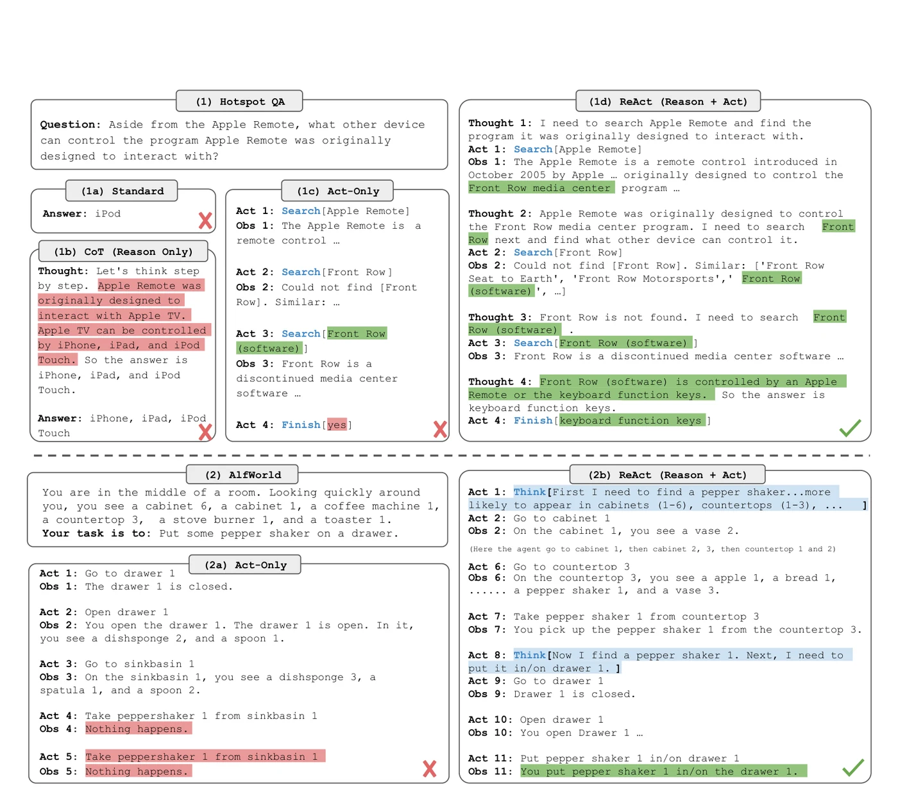
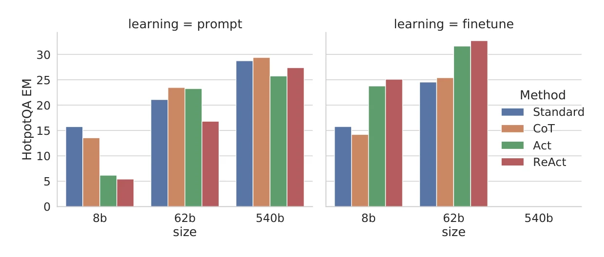

# ReAct：让推理、行动与环境反馈形成循环

2023 年发表于 ICLR 的《ReAct: Synergizing Reasoning and Acting in Language Models》，研究一个如今经常出现在 Agent 系统里的问题：语言模型不只有一个问题要回答，还需要在信息不完整时决定下一步做什么。它可能要查询百科、在模拟房间里寻找物品，或者在购物页面上比较商品。完成任务所需的一部分信息，要在行动过程中获取。

Shunyu Yao 等作者把两种原本常分开研究的能力接到一起。模型一方面写下当前的推理文字，例如“我还需要知道这个程序的名称”；另一方面输出环境能够执行的动作，例如搜索某个实体。执行后，环境把结果送回模型，成为下一次生成的上下文。作者把这种交错方式称为 ReAct，即 reasoning（推理）与 acting（行动）的结合。[摘要及 §1，PDF 第1–3页](https://arxiv.org/pdf/2210.03629v3)

这个循环的关键不是要求模型在每一步都写一段解释，而是让**推理帮助选择行动，行动带回的观察又改变推理**。如果搜索没有结果，模型能否根据返回的候选名称调整查询？如果已经拿到物品，能否意识到下一个子目标是打开抽屉？导读会先解释问题和接口，再沿论文图 1 的两条轨迹走一遍，最后分析问答、微调和交互任务的实验。

论文主要使用冻结的 PaLM-540B，通过少量人工编写的示范引导模型；也研究了用生成轨迹微调较小模型。实验显示 ReAct 在两项问答任务中优于只行动的对照，但在 HotpotQA 上低于只推理的 CoT；两个交互任务中，加入思考文字的提示取得更高成功率。这些结果对应论文指定的工具接口、示范和评价口径。[§2–4，PDF 第3–8页](https://arxiv.org/pdf/2210.03629v3#page=3)

## 背景：只推理和只行动各缺什么

论文的出发点，是两条已有研究路线各自留下的缺口。第一条是思维链（chain-of-thought，CoT）：给模型示范中间推理，使它在给出答案前写出若干步骤。对于需要多步组合的题目，这种方法可以把求解过程展开；但如果其中一步用到错误的事实，后续写得再连贯，也可能沿着错误前提走下去。模型单靠当前上下文续写，无法自动获得新近发生的事件或没有提供的页面内容。[§1，PDF 第1–2页](https://arxiv.org/pdf/2210.03629v3#page=2)

第二条是让模型生成行动。系统把模型输出解释成搜索、点击或移动等指令，执行后再返回结果。这样模型不必把所有事实都记在参数里，也能在行动时发现环境中有什么。但只让它输出动作，可能缺少一个用来整理长期目标的显式位置：在已经访问过多个地点之后，下一步究竟该寻找什么、哪些子目标已经完成？论文中的纯行动对照就会出现重复执行无效动作的情况。

两种缺口可以互补。一个行动可以是为了获得事实而搜索，所得事实支持下一步推理；一段推理也可以把复杂任务拆成几个可执行的子目标，再选择行动去完成它们。作者的设想是把搜索、观察、思考和行动放进同一条可以继续更新的轨迹。

可以先区分三个词。**任务**是最终目标，例如回答一个问题；**动作**是环境提供的操作，例如搜索一个实体；**观察**是执行后返回的页面片段或环境状态。模型写出的“我应该先搜索实体”属于思考；执行搜索后的返回内容才是外部观察。这种区分是后面阅读每一条轨迹的基础。

## 任务与接口：模型实际能做什么

论文先给出一个通用的交互描述：在时刻 $t$，智能体从环境获得观察 $o_t$，根据当前上下文 $c_t$ 选择动作 $a_t$。上下文包含此前的观察和动作，以及当前观察；策略 $\pi(a_t\mid c_t)$ 表示在这些信息下选择动作的方式。这里的策略只是描述决策的记号，论文的主要实验并没有用强化学习训练它。[§2，PDF 第3页](https://arxiv.org/pdf/2210.03629v3#page=3)

ReAct 将可选动作空间从环境动作 $\mathcal A$ 扩展为：

$$
\hat{\mathcal A}=\mathcal A\cup\mathcal L
$$

其中 $\mathcal L$ 是自然语言文字的空间。选中一个思考动作时，模型把文字加进上下文，却不改变外部环境，也不会因此收到新的环境观察；选中环境动作时，执行器把它交给环境，再把返回结果加入上下文。这样，模型下一次生成所依赖的历史既包括它自己的思考，也包括外部返回的信息。

问答实验的工具接口很小，只有以下三种动作：[§3.1，PDF 第4页](https://arxiv.org/pdf/2210.03629v3#page=4)

| 动作 | 做什么 | 返回或后果 |
| --- | --- | --- |
| `search[entity]` | 搜索实体对应的维基百科页面 | 页面存在时返回开头五句；找不到时返回最多五个相近实体 |
| `lookup[string]` | 在当前页面查找包含字符串的下一句 | 返回匹配句，类似页面内查找 |
| `finish[answer]` | 提交最终答案 | 结束本次任务 |

这个专门设计的接口依赖实体名称，返回的也只是页面的一小部分。作者明确说这个接口比先进的词法或神经检索器弱；他们用它模拟人如何通过维基百科搜索，并考察模型能否用文字组织检索。一次搜索失败可能是因为实体名称不对，可以换一种名称再查。

## 全貌：沿图 1 看四种解题方式

图 1 上下是两个不同任务。上半部从左上角的问题出发，比较四种求解方式；右侧最大的框是 ReAct。下半部是在模拟房间寻找胡椒瓶，左侧只行动，右侧加入思考。图中红色强调错误或无效步骤，绿色强调关键内容，蓝色是交互任务里的思考。图注说明这里只展示一次任务轨迹，没有把提示中的示范一起画出。[图 1，PDF 第2页](https://arxiv.org/pdf/2210.03629v3#page=2)

先看上半部。问题问：除了 Apple Remote，还有什么设备能控制这个遥控器最初设计来操作的程序？解答需要先找出程序，再查控制该程序的另一种设备。左侧 Standard 直接回答 iPod；CoT 写出一串推理，却把最初的程序说成 Apple TV，沿错误事实给出答案。中间的 Act 已经找到了程序相关页面，却在最后提交 `yes`，没有把轨迹中的事实整合成所问的设备。

右侧 ReAct 先写“需要搜索 Apple Remote，找出最初的程序”，执行 `Search[Apple Remote]`，观察中出现 Front Row。它接着写“下一步搜索 Front Row”，但这次搜索失败，返回若干相似名称，其中有 `Front Row (software)`。第三次思考利用这个反馈补上消歧名称，再搜索该页面；最后综合得到键盘功能键，并通过 `Finish` 提交。真正改变搜索词的是第二次观察中的候选名称。

下半部的目标是把胡椒瓶放到抽屉里。左侧 Act 看过水槽的内容后，仍两次尝试从水槽拿取观察中没有出现的胡椒瓶，环境两次返回“什么也没发生”。右侧 ReAct 先说明要寻找胡椒瓶，并列举可能出现的柜子和台面；找到后记录“现在已找到，接下来放到抽屉”，再前往抽屉、打开并放置。这里思考的作用是为多个动作维护目标和进度。

这两组例子说明作者希望结合的两个方向：**为了推理而行动**，以及**为了行动而推理**。图中的成功和失败是用来解释机制的个案；接下来还要靠多题实验判断这种做法在多大程度上有帮助。

## 核心循环：一次观察怎样改变下一步

图 1 已经展示轨迹长什么样，下面把它拆成一次系统运行的几个阶段。模型生成一个可执行动作之后，系统暂停生成，将动作交给环境，收到返回值后再把新内容接入上下文。

| 阶段 | 谁提供内容 | 在问答例子里的作用 |
| --- | --- | --- |
| 任务与示范 | 任务输入、人工示范 | 指定问题，并展示思考和动作的格式 |
| 思考 | 语言模型生成 | 指出需要查什么或从已有观察中提取什么 |
| 动作 | 语言模型生成，执行器解释 | 向搜索接口提交实体名称 |
| 观察 | 外部接口返回 | 提供页面片段、失败信息或相似实体 |
| 更新 | 将以上内容附入上下文 | 让后续生成能使用刚得到的信息 |
| 结束 | 模型输出 `finish` | 提交答案，终止该任务 |

例如，模型看到“没有找到 Front Row”之后，仍然可以选择忽略这个观察、重复搜索、挑错相似名称，或者正确地尝试软件页面。ReAct 给模型提供了把观察用于调整的机会，具体能否利用观察仍取决于模型和示范。失败的搜索也是有价值的观察：它改变了“原查询是否足够明确”的判断。

论文中的思考不只承担一种功能。它可以拆解问题、从返回文本提取重要部分、作常识或算术推断、重新表述搜索词，也可以汇总最终答案。一个观察中包含很多文字时，思考可以把与当前目标有关的线索写进后续轨迹；但写进思考中的内容仍是模型的提取，需要能够对照观察检查。[§2 与 §3.2，PDF 第3–5页](https://arxiv.org/pdf/2210.03629v3#page=3)

问答任务采用较密集的格式：通常每个动作前都有思考，形成多组 Thought、Action、Observation。长交互任务可能需要几十次操作，如果每一步都展开推理，轨迹会迅速变长；作者因此让模型在适当位置稀疏地插入思考，例如开始时分解目标、完成一个子目标后调整计划。论文图 1 的胡椒瓶例子里，多次移动之间没有每次都插入一段思考。[§2，PDF 第3–4页](https://arxiv.org/pdf/2210.03629v3#page=3)

这种结构也让诊断更具体。回答错误可能来自模型的初始拆解，也可能来自执行的查询、搜索返回的材料，或者得到正确材料之后的综合。只看最终答案无法区分它们；保留每次输入和返回，才能定位是哪一步出了问题。需要注意，轨迹里写出的思考是模型生成的文字，它帮助人检查行为，却不一定如实反映模型内部的计算。

## 示范与对照：怎样把循环教给模型

主要实验没有为每一种动作单独训练一个新模型，而是使用少样本提示（few-shot prompting）：先给模型几条完整的任务求解示范，再附上一个新的任务，让它延续相同格式。作者使用冻结的 PaLM-540B；示范由人工从训练实例中编写，包含思考、动作和环境观察。[§2、§3.2，PDF 第3–5页](https://arxiv.org/pdf/2210.03629v3#page=3)

HotpotQA 是多跳问答，需要综合两个或更多维基百科段落。FEVER 是事实核验，要求判断陈述得到支持、被反驳还是信息不足。论文采用只提供问题或陈述的设定，不直接把支持段落交给模型；需要外部资料时，模型必须通过前述接口取得。HotpotQA 用六个示范，FEVER 用三个，示范都是从各自训练集抽取后人工写成的完整轨迹。

为了比较轨迹中的哪些内容有用，作者从 ReAct 示范出发构造对照。Standard 去掉思考、动作和观察，直接答题；CoT 保留思考但去掉动作与观察；Act 保留动作和观察但去掉思考。这样设计让读者能明确看到每个对照少了哪部分。

另一个对照是自一致性（self-consistency，CoT-SC）：对同一问题采样多条 CoT 推理轨迹，再用出现次数最多的答案作为结果。论文表 1 的 CoT-SC 采样 21 条，采样温度为 0.7。它增加了求解机会，与一次轨迹的 CoT 或 ReAct 不拥有相同的采样预算。下文讨论混合方法时，这个差别尤其重要。[§3.2，PDF 第5页](https://arxiv.org/pdf/2210.03629v3#page=5)

这些示范也解释了 ReAct 的实际依赖：模型不仅要懂任务，还要学会何时输出合法动作、怎样把返回文本放回推理，以及何时结束。动作空间越复杂，要示范的格式和例外可能越多，提示长度也随之增长。

## 问答结果：检索有帮助，也会带来新失败

论文表 1 比较 PaLM-540B 在两项任务上的提示方式。HotpotQA 使用精确匹配（EM）：答案与标准答案匹配的比例，越高越好；FEVER 使用分类准确率（Acc），也是越高越好。下表为百分比；两个数据集各自的指标分别衡量问答和分类表现。[§3.2–3.3、表 1，PDF 第5–6页](https://arxiv.org/pdf/2210.03629v3#page=5)

| 提示方式 | HotpotQA EM | FEVER Acc |
| --- | ---: | ---: |
| Standard | 28.7 | 57.1 |
| CoT | 29.4 | 56.3 |
| Act | 25.7 | 58.9 |
| ReAct | 27.4 | 60.9 |
| CoT-SC，21 条 | 33.4 | 60.4 |
| CoT-SC → ReAct | 34.2 | 64.6 |
| ReAct → CoT-SC | 35.1 | 62.0 |

先看受控对照。ReAct 比 Act 在 HotpotQA 高 1.7 个百分点，在 FEVER 高 2.0 个百分点，符合作者关于思考帮助组织行动的假设。但与 CoT 比较时，ReAct 在 FEVER 高 4.6 个百分点，在 HotpotQA 低 2.0 个百分点。外部观察能提供事实，同时也会带来查询和综合信息的挑战。

作者为了理解这个差异，分别从 ReAct 和 CoT 的 HotpotQA 结果中，各随机抽取 50 条答案正确轨迹和 50 条答案错误轨迹，合计 200 条，由人标注成功与失败类型。正确答案的轨迹里，ReAct 有 94% 被标为推理与事实都正确，6% 存在幻觉；CoT 对应 86% 和 14%。这些百分比分别以各自的正确答案样本为分母，描述的是成功轨迹的构成。[§3.3、表 2，PDF 第6页](https://arxiv.org/pdf/2210.03629v3#page=6)

错误答案的轨迹里，ReAct 有 47% 被标为推理错误，23% 是搜索结果为空或没有有用信息，29% 属于预测正确但没有精确匹配标签；CoT 的对应主要类别是推理错误 16%、幻觉 56%、标签歧义 28%。表中 ReAct 幻觉为 0%，只能说这一抽样分析没有标出该类失败。作者还举出重复思考和动作、无法从搜索失败恢复的情况，并将重复循环归到推理错误。

表 2 的一个重要启发是：即使答案标签说错了，也要检查轨迹。有些答案与标签不精确一致，却可能指向正确对象；反过来，最终答案匹配，也可能碰巧由错误推理得到。作者还指出部分标签可能过时。每类样本各有 50 条，这些比例帮助作者理解不同的错误类型。

## 把 CoT 与 ReAct 接起来：收益和额外预算

既然纯推理与检索各有长处，作者尝试让两种方式互相补位。两种箭头方向不同，触发条件也不同；表 1 中较高的结果来自组合策略，包含切换后的多次求解。[§3.2–3.3，PDF 第5–6页](https://arxiv.org/pdf/2210.03629v3#page=5)

**ReAct → CoT-SC** 先运行 ReAct。如果在规定步骤内没有返回答案，就退回 CoT 自一致性。HotpotQA 的上限是 7 步，FEVER 是 5 步；作者说继续增加步数没有改善 ReAct 表现。这个方案让检索优先，并在轨迹迟迟无法完成时给另一种求解方式机会。

**CoT-SC → ReAct** 先采样多条 CoT。如果出现最多的答案仍少于总样本数的一半，就认为答案不够集中，转向 ReAct 查资料。例如导读自编的五条回答为 A、A、B、C、D，最多的 A 只有 2 票，少于 5 的一半，于是触发 ReAct；若为 A、A、A、B、C，A 有 3 票，就按规则保留多数答案。票数是否集中只是触发启发式：模型也可能对同一个错误答案高度一致。

表 1 中，HotpotQA 的最佳提示结果是 ReAct → CoT-SC 的 35.1，FEVER 的最佳结果是 CoT-SC → ReAct 的 64.6。图 2 进一步改变 CoT-SC 采样次数，作者报告混合策略在不同采样数下超过 CoT-SC，并用约 3–5 条采样达到 21 条 CoT-SC 的水平。混合策略还可能调用 ReAct 和搜索，因此比较总成本时要同时记录生成次数、搜索次数、步数上限和延迟。

## 微调：为什么较小模型的表现顺序变了

图 3 问的是另一个问题：同样的轨迹格式，模型规模和适配方式是否影响它能否学会？左右两幅图纵轴都是 HotpotQA 精确匹配率，横轴为 PaLM 的参数规模，四种颜色对应 Standard、CoT、Act 和 ReAct。左边只用提示，右边微调；右图报告了 8B 和 62B 的微调结果，540B 位置没有实验柱。[§3.3、图 3，PDF 第6–7页](https://arxiv.org/pdf/2210.03629v3#page=7)

作者用各方法生成的、最终答案正确的 3000 条轨迹，分别微调 PaLM-8B 和 PaLM-62B，使模型根据问题生成对应格式的轨迹。仅靠提示时，8B 和 62B 的 ReAct 柱子都低于另外三种方法；微调后，ReAct 成为两种规模中表现最好的方法。论文还报告，微调后的 8B ReAct 超过所有 62B 提示方法，微调后的 62B ReAct 超过所有 540B 提示方法。

可以这样理解作者的解释：在少量示范里同时学会自由文字、合法动作以及二者的切换，对较小模型有难度；更多正确轨迹提供了更直接的格式和任务训练。作者认为有行动的轨迹还教会模型如何访问百科，而不只是依赖记住事实。需要注意，微调数据是按最终答案是否正确筛选的，答案正确的轨迹中间也可能有错误的步骤。

这组实验说明，ReAct 既可以作为提示方法用于冻结的大模型，也可以把同样格式的轨迹用来微调较小的模型；评价一种交互格式时，模型规模和适配方式都会改变结论。

## ALFWorld：用稀疏思考管理长任务

问答的外部动作主要是查资料，ALFWorld 则要求模型改变模拟环境中的状态。它是文本形式的家庭环境，有六类任务，例如找到纸张并在台灯下查看。模型需要通过文本动作移动、取物、使用设备；一个实例可能有 50 多个地点，专家策略也可能需要超过 50 步。环境初始观察只显示局部内容，因此寻找目标本身就是任务的一部分。[§4，PDF 第7页](https://arxiv.org/pdf/2210.03629v3#page=7)

回到图 1 的胡椒瓶。任务目标可以拆为“找到胡椒瓶”和“放入抽屉”。找到之前，模型用常识决定优先查柜子和台面；拿起之后，模型需要把当前计划切换成前往抽屉。思考文字在这里相当于一份可继续更新的任务记录：它帮助模型为下一次实际动作选对目标。图中 Act 在没看见胡椒瓶的水槽连续尝试取物，说明收到观察和正确利用观察是两回事。

作者为每类任务从训练集标注三条轨迹，每次选两条按顺序组成示范，共得到六组提示；Act 使用同一批轨迹但移除思考。评估采用 134 个未见过的游戏。表 3 的总体列报告任务成功率，越高越好；下表只摘总体结果。[§4、表 3，PDF 第7–8页](https://arxiv.org/pdf/2210.03629v3#page=8)

| 方法 | 提示或模型选择 | 总体成功率 |
| --- | --- | ---: |
| Act | 六组中最好 | 45% |
| ReAct | 六组平均 | 57% |
| ReAct | 六组中最好 | 71% |
| ReAct-IM | 六组平均 | 48% |
| ReAct-IM | 六组中最好 | 53% |
| BUTLER | 八个结果中最好 | 37% |

最好一组与六组平均要分开读：71% 描述最佳提示，57% 描述六组平均。作者还报告六组受控对照中 ReAct 均优于对应 Act。BUTLER 是论文引用的模仿学习基线，使用专家轨迹训练；两种方法的训练资源和选择方式也不同。

ReAct-IM 是作者设计的另一种消融：采用类似 Inner Monologue 的密集外部反馈式思考，与 ReAct 灵活的目标分解和常识推理形成对照。最好结果为 53%，低于 ReAct 的 71%。作者观察到，ReAct-IM 较难判断子目标是否完成、下一步是什么，也较难推断物品可能在哪里。可见在长任务中，起作用的是思考的内容：分解目标、记录进度、推断物品位置，而不只是“多写几句话”。

## WebShop：属性分数和完整成功率

WebShop 把交互换成购物网站研究环境。系统需要根据一条自然语言指令搜索商品，阅读标题、描述和选项，再选出满足要求的商品。论文描述的数据包括约 118 万个真实商品和 1.2 万条人类指令；测试使用 500 条指令。实验环境中的购买动作不会真的付款或购买。[§4，PDF 第7–8页](https://arxiv.org/pdf/2210.03629v3#page=7)

指令可能同时要求颜色、尺寸和价格。环境文本既有结构化选项，也有嘈杂的商品标题和描述。模型要决定搜索词，还要在查看商品之后判断它符合了哪些要求，是否需要返回继续搜索。ReAct 提示在动作之外加入稀疏思考，帮助把指令条件与页面选项联系起来。

论文报告两个指标：Score 是每次选中商品满足所需属性的比例，再对任务取平均；成功率 SR 则要求选中商品满足全部条件。以下数字取自表 4，越高越好：[表 4，PDF 第8页](https://arxiv.org/pdf/2210.03629v3#page=8)

| 方法 | 平均属性分数 | 完整成功率 |
| --- | ---: | ---: |
| Act | 62.3 | 30.1 |
| ReAct | 66.6 | 40.0 |
| 模仿学习 IL | 59.9 | 29.1 |
| IL + 强化学习 | 62.4 | 28.7 |
| 专家人类 | 82.1 | 59.6 |

ReAct 比 Act 的平均属性分数高 4.3 点，完整成功率高 9.9 个百分点。两项指标的要求不同：如果一件商品符合颜色和尺寸，却超过预算，它仍可获得部分属性分数，完整成功率则只统计全部条件得到满足的任务。两项指标回答的问题不同。

作者观察到专家人类更常探索商品和改写查询，而这些行为对当时的提示方法仍有挑战。IL 使用 1012 条人工标注轨迹训练，IL+RL 还使用 10587 条训练指令；与它们比较时，训练数据和适配方式不同。这里的结果描述的是固定网站研究环境中的表现。

## 局限、风险与后续阅读

论文给出的循环能把查找事实和执行任务串起来，但每个环节都可能出错。查询词偏离问题时，外部检索可能带回无关材料；观察正确时，模型仍可能遗漏关键条件；长轨迹可能重复动作或耗尽上下文。更复杂的动作空间需要更多示范，而示范本身也占用有限输入长度。作者在结论中提出，更多高质量标注、多任务训练以及与强化学习结合，是可能的后续方向。[§6，PDF 第9–10页](https://arxiv.org/pdf/2210.03629v3#page=9)

论文还专门讨论行动权限的风险。让模型操作外部环境可能涉及不适当或私人信息，也可能产生有害动作；作者的实验把交互限制在特定网站和动作集合中，排除了编辑维基百科和在 WebShop 真正购买等操作。实际系统还需要根据环境设计权限、执行确认、可撤销性和日志。[伦理声明，PDF 第10页](https://arxiv.org/pdf/2210.03629v3#page=10)

把论文放回更大的阅读地图：思维链强调生成中间推理，ReAct 增加了推理过程中对外行动与观察；检索增强生成强调利用检索资料回答，ReAct 则进一步关注模型何时选择某个动作以及如何处理反馈。可接着读本库的 [RAG 综述](/read/rag-survey/5#u05) 和 [Toolformer](/read/toolformer/1#u01)，比较多轮检索与工具使用的不同设计。这个阅读顺序属于编辑建议。

## 回到原文：沿轨迹检查证据

原论文图 1 和 §2 适合先读：区分模型生成的 Thought、执行的 Act 与环境返回的 Obs，再找出第二次搜索失败怎样改变了第三次搜索。图中没有展示提示示范；完整提示和更多轨迹在附录 C、D。[图 1、§2，PDF 第2–4页](https://arxiv.org/pdf/2210.03629v3#page=2)

接着读表 1 和表 2，比较 ReAct、Act、CoT，再检查正确与错误样本分析各自的分母。图 2 与 §3.2 则提供混合策略及其采样预算。关心交互任务时，可以对照表 3、表 4，分别看提示平均与最好结果，以及属性分数与完整成功率。[表 1–4，PDF 第5–8页](https://arxiv.org/pdf/2210.03629v3#page=5)

本导读依据 arXiv v3 正文 §1–6，覆盖方法、主要实验、作者讨论的局限与伦理声明；图 1、图 3 截自固定 PDF，经 AI 查看，原文页面标示 CC BY 4.0。未逐项展开附录中的所有示范、轨迹和额外实验，也未复现实验。五条投票的例子是导读自编的教学例子。阅读导读或打开原文都不会自动记为已读原文。
