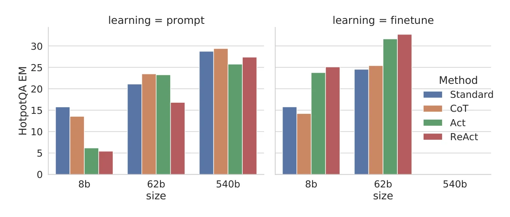

# ReAct：让推理、行动与环境反馈形成循环

一个模型接到问题后，可以直接写答案，也可以先写出推理步骤。但如果解题所需的事实不在题面里，它怎样知道自己想出来的中间事实是否正确？另一个模型可以使用搜索或操作网页，却还要决定搜什么、看过结果后做什么，以及什么时候已经完成任务。

Shunyu Yao 等人在 ICLR 2023 论文《ReAct: Synergizing Reasoning and Acting in Language Models》中把这两件事连在一起：语言模型写出当前思考，生成一个环境能够执行的动作，再把环境返回的观察放回上下文，继续思考或行动。作者称这种交错方式为 ReAct，即 reasoning（推理）与 acting（行动）的结合。[摘要与 §1，PDF 第1–3页](https://arxiv.org/pdf/2210.03629v3)

一条轨迹里的文字有不同来源。模型可以说“我需要查这个名字”，这是一项计划；真正搜索以后，接口返回什么，才是这次行动的观察。模型随后可以根据观察改写查询、转换子目标或提交答案。图 1 的两条任务轨迹把这件事展示得很具体：一个问题通过百科搜索消除歧义；另一个任务在模拟房间里先找到胡椒瓶，再把它放进抽屉。

论文用冻结的 PaLM-540B 和少量人工示范测试这一方法，也研究了用轨迹微调较小模型。问答实验中，ReAct 在两个数据集上胜过只行动的对照，却在 HotpotQA 上低于只推理的 CoT；家庭和购物任务中，加入思考的提示取得更高成功率。接下来先说明任务与接口，再拆开图 1 的两条轨迹和实际循环，最后看实验能支持什么。重点是追踪每次信息从哪里来，以及它怎样进入模型的下一次决定。[§2–4，PDF 第3–8页](https://arxiv.org/pdf/2210.03629v3#page=3)

## 背景：只推理和只行动各缺什么

作者的出发点是，两条看似各自有效的路线，遇到信息不完整的任务时会碰到不同障碍。

第一条路线是思维链（chain-of-thought，CoT）。给语言模型几条写出中间步骤的示范，它也可以在回答之前展开推理。这对需要多步组合的问题很有用：读者可以看到它先做了什么判断，再怎样得到结论。问题是，模型写下的某一步可能建立在错误的事实之上；如果没有取得新的外部信息，后面的推演再流畅也可能继承这个错误。图 1 的问答例子就从一个错误的程序名称开始，最终得到错误答案。[§1 与图 1，PDF 第2页](https://arxiv.org/pdf/2210.03629v3#page=2)

第二条路线让模型生成行动，例如给搜索接口发查询，或者在模拟房间里移动、取物。行动带来题目之外的信息，也可能改变环境。但长任务中，动作序列本身需要模型进一步整理目标：模型要从之前的反馈判断哪些物品找到了、哪些地方查过、当前应当完成哪个子任务。图 1 中只行动的模型甚至在水槽的观察里没有胡椒瓶时，仍重复尝试从那里取瓶子。

作者希望让两者互相补足：为了作出判断而行动，也为了选择行动而推理。搜索可以带回一个程序名称；思考则可以用这个名称生成下一次搜索。移动可以发现一个物品；思考则可以根据新状态更新计划。这一想法关注的是一条逐步展开的交互轨迹，而非一次性生成一整份固定计划。

## 任务与接口：模型实际能做什么

先把论文的形式化描述和实际接口对应起来。一个智能体在时刻 $t$ 收到观察 $o_t$，根据上下文 $c_t$ 选择动作 $a_t$；上下文包含之前的观察、动作和当前观察。策略 $\pi(a_t\mid c_t)$ 表示根据这份历史选择动作的方式。这里的策略是描述决策的记号，主要提示实验并未因此变成强化学习训练。[§2，PDF 第3页](https://arxiv.org/pdf/2210.03629v3#page=3)

作者把可选动作空间扩展为：

$$
\hat{\mathcal A}=\mathcal A\cup\mathcal L
$$

$\mathcal A$ 是环境接受的动作集合，$\mathcal L$ 是自然语言文字空间。模型选择一段思考文字时，它被加入上下文，供后面的生成使用；这一步本身不改变外部环境，因此没有新的环境观察。模型选择环境动作时，执行器把动作交给环境，环境的返回值再被接到轨迹后面。用同一个语言模型生成这两类内容，是作者设计的关键。

问答使用作者设计的简单维基百科接口，动作只有三类：[§3.1，PDF 第4页](https://arxiv.org/pdf/2210.03629v3#page=4)

| 动作 | 作用 | 接口返回或后果 |
| --- | --- | --- |
| `search[entity]` | 根据实体名称寻找页面 | 找到时返回页面前五句；找不到时建议最多五个相近实体 |
| `lookup[string]` | 在当前页面查找某个字符串 | 返回包含该字符串的下一句 |
| `finish[answer]` | 提交答案 | 结束当前任务 |

这套接口主要依赖页面名称，一次只返回页面的一小部分；作者说它比先进的词法或神经检索器弱。这个选择让搜索过程容易观察：模型要把问题拆成适合查找的实体名称，并判断结果是否足以继续。`lookup` 有当前页面这一前提，查找页面内的词与重新搜索另一个页面是不同操作。

接口还规定了模型与环境的分工。模型输出 `search[Front Row]` 是请求，不是页面内容；接口返回“未找到”及候选名称，才是观察。接下来选哪个候选又回到模型负责。一个错误既可能发生在请求之前，也可能发生在收到返回之后。

## 全貌：沿图 1 看四种解题方式

图 1 上半部是同一个多跳问答的四种做法，下半部是同一个家庭任务的两种做法。上方从问题开始向下读四列，右侧大框是 ReAct；下方左边是只行动，右边是 ReAct。绿色强调有用内容，红色标示错误或无效动作，蓝色标示家庭任务里的思考。图中展示的是单次轨迹，提示中提供的示范被省略了。[图 1，PDF 第2页](https://arxiv.org/pdf/2210.03629v3#page=2)

**先看问题的依赖关系。** 题目问：除了 Apple Remote，还有什么设备能控制它最初设计来操作的程序？先要知道“最初的程序”是什么，才能查控制该程序的另一种设备。第二次查找的对象依赖第一次取得的名称，因此这是一个多跳问题。只把题目里的 Apple Remote 搜出来，还不足以完成答案的另一半。

左边 Standard 直接答 iPod；CoT 写出中间步骤，却把最初的程序当成 Apple TV，再顺着这个前提列出 iPhone、iPad 和 iPod Touch。它的推理形式清楚，问题出在第一块事实材料。中间的 Act 能执行搜索，也先后找到了 Front Row 和消歧后的软件页面；但它最后输出 `Finish[yes]`，没有把找到的信息组织成题目要求的设备名称。找到材料与正确使用材料是两步。

右侧 ReAct 的轨迹可以分成四次模型判断：

| 思考与行动 | 外部观察 | 对下一步有什么影响 |
| --- | --- | --- |
| 先查 Apple Remote 最初控制的程序；搜索 Apple Remote | 页面片段给出 Front Row 媒体中心程序 | 将程序名作为下一次查询的目标 |
| 查 Front Row 的其他控制设备；搜索 Front Row | 没找到该名称，返回相似实体，包括 `Front Row (software)` | 从候选中选择带软件消歧的名称 |
| 改查 `Front Row (software)` | 返回软件页面片段 | 在页面信息中寻找控制方式 |
| 综合得到键盘功能键；提交 `Finish[keyboard function keys]` | 任务结束 | 把查到的事实转成题目所问的答案 |

这条轨迹里可以追踪两条不同的信息线。第一条是任务线：题目要求“另一种设备”，所以查询的终点是控制方式，程序名只是中间结果。第二条是实体线：Apple Remote 指向 Front Row，Front Row 又需要消歧到软件页面。模型的第二次思考同时保留了这两条线：既记住已经找到的程序，也记住还缺控制设备。若它只留下程序名，就可能停止得太早；若它只重复原问题，又可能忘记下一次该搜索什么。

第三次搜索后，模型仍需要把页面中的两个控制方式与问题的排除条件对照。Apple Remote 已在题目中被排除，因此要提交另一项键盘功能键。这个最后的综合解释了为什么 Act 虽然也到达软件页面，仍可能因为 `Finish[yes]` 而失败：接口返回材料，并不替模型完成从问题条件到答案形式的映射。

第二次返回尤其重要。失败信息并非空白：它提供了候选实体。模型先判断原查询没有命中，再从候选名称中挑出软件页面。这里“搜索失败”既暴露了接口依赖准确名称的弱点，也给下一步提供了可用线索。第三次观察在图中有省略号，图示呈现的是轨迹摘要；最终思考写明从软件页面综合出键盘功能键。

**再看下半部的家庭任务。** 初始观察列出房间中的一些设施，目标是把胡椒瓶放到抽屉处。左侧 Act 先打开抽屉，看见海绵和勺子；再去水槽，看见的是海绵、锅铲和另一把勺子。它接着两次尝试从水槽拿胡椒瓶，环境两次回答“什么也没发生”。观察已经指出那里有什么，但动作没有据此改变。

右侧 ReAct 先用一句思考把任务拆成“找瓶子”和“放置”，并根据常识把柜子、台面作为可能位置。它依次查找，图中省略了部分移动；到台面 3 时观察到胡椒瓶，于是执行取物。环境确认拿起后，模型写下新的思考：已经找到，下一步放到抽屉。它前往抽屉，观察到抽屉关闭，打开，再放入物品，最后由环境反馈确认放置。

两次思考承担不同工作：开始时根据常识提出搜索顺序，拿到瓶子后切换子目标；抽屉关闭的观察又要求插入开抽屉的动作。常识判断决定先查哪里，环境反馈则提供实际状态。图中省略了部分移动，这两条个案也没有给出完整的搜索成本比较；总体成功率要看后文 134 个游戏的评价。

## 核心循环：一次观察怎样改变下一步

把图中的轨迹还原成系统运行过程，就能看清每一步的输入和输出。假设新问题已经和示范一起送给模型：

| 阶段 | 内容由谁产生 | 在系统里发生什么 |
| --- | --- | --- |
| 思考 | 模型 | 根据问题和已有历史，写出目标、判断或计划 |
| 动作 | 模型 | 输出符合接口格式的搜索、查找或结束指令 |
| 执行 | 外部执行器与环境 | 执行指令，返回文本结果或状态变化 |
| 观察 | 环境 | 返回值被附到已有轨迹中，成为下一次输入的一部分 |
| 继续或结束 | 模型 | 利用更新后的上下文选择下一步，或提交最终答案 |

在 Apple Remote 例子中，第二次搜索后的上下文已经有原问题、第一次搜索及页面内容、第二次查询和失败候选。模型的第三次思考是基于这份增长后的历史生成的。若没有把失败结果接回去，它就没有这次接口提供的候选列表；若接回去了但模型忽视它，系统仍可能重复原查询。ReAct 给出了利用反馈的通路，能否走对还取决于模型的生成。

从执行器的角度看，一轮并不是模型独自不停续写一段长答案。它先输出一个可识别的动作，执行器接管，把动作送到相应接口，再等待结果。下一轮生成时，问题、示范和已有轨迹组成新的上下文。即便观察文本是“没有结果”或“什么也没发生”，它仍然是一条关于刚才动作后果的记录。关键在于后续生成是否利用了它。

思考可以改变的是后续上下文和决策，而环境动作可能改变的是可观察的外部状态。在百科问答里，搜索改变当前可用的资料；在家庭任务里，打开抽屉或拿起瓶子还改变房间状态。把“模型说已经拿到”和“环境确认拿到”分开，才能判断任务究竟进行到了哪一步。

论文列出的思考用途包括：分解问题、从观察中抽取重要部分、使用常识或算术、改写搜索、记录进度和综合答案。它们由模型生成的自由文字承担。图 1 中第二次思考把页面里的 Front Row 提取出来；第三次思考则处理搜索异常。两段文字长得相似，服务的决策却不同。[§2、§3.2，PDF 第3–5页](https://arxiv.org/pdf/2210.03629v3#page=3)

思考的密度也随任务改变。问答示范通常在每个行动前写一段思考，形成多组 Thought、Action、Observation；家庭任务可能有几十个动作，论文让模型在适当位置稀疏地插入思考。图 1 右下方多次移动之间并没有逐步写出理由，但找到瓶子后有一条明确的子目标切换。稀疏意味着思考出现在需要重新组织计划的位置，具体间隔由模型决定。[§2，PDF 第3–4页](https://arxiv.org/pdf/2210.03629v3#page=3)

可以把问答循环和家庭循环并排比较。问答里，第一次搜索提供的是下一次查询所需的实体；失败后候选列表帮助修正查询。家庭任务里，移动带来的是当前位置的物品列表，取物和开抽屉则带来状态变化。前者的关键产物是一份足以回答的证据，后者的关键产物是环境达到指定状态。两者共用“根据反馈选择下一步”的结构，却要用不同标准判断完成。

保留中间轨迹后，研究者能区分“从未查到正确页面”和“查到了却提交错误答案”，也能区分“没有找到瓶子”和“找到瓶子后未能放置”。这些区分对应调整查询、改善观察的使用或修改行动接口等不同改进方向。

另一个容易混淆的地方是思考和示范的关系。示范里的思考展示了一种做法，新任务里的思考则是模型依当前上下文新生成的。示范可以包含“搜索某实体再检查结果”，但真正查到什么取决于新任务发出的动作和接口返回。把示范中的观察当作新任务证据，会把两条不同轨迹混在一起。

因此，系统记录中的时间顺序很重要：先有一个待执行动作，再有执行该动作得到的观察，模型才能在下一轮使用这条观察。如果把模型自己的预测当作工具已经执行的结果，读者看到的将是一条自洽文字，而不是可检查的交互过程。论文通过明确标注 Act 和 Obs，使这条边界在例子中可见。

可读的思考仍是模型生成的文字，并不保证忠实揭示内部计算。把它与动作和环境记录放在一起，才能沿时间顺序检查模型怎样从已有信息走向下一步。

## 示范与对照：怎样把循环教给模型

模型怎样学会用这种格式？主要实验采用少样本提示：把人工编写的完整任务轨迹放进输入，再给一个新任务，让冻结的 PaLM-540B 按照示范续写。示范包含思考、动作和环境观察。HotpotQA 从训练集随机选六个例子，FEVER 选三个，由作者手工写成轨迹。[§2、§3.2，PDF 第3–5页](https://arxiv.org/pdf/2210.03629v3#page=3)

HotpotQA 是多跳问答，往往需要组合两个或更多维基百科段落；FEVER 是事实核验，要判断陈述得到支持、被反驳还是信息不足。本实验采用只给问题或陈述的设定，没有直接附上支持段落。ReAct 和 Act 可以调用百科接口；仅推理的方法则要依靠当前输入与模型已有知识。

少样本示范是输入中的例子，和微调的训练样本有本质区别。提示实验把例子连同新任务放进模型上下文，参数保持冻结；模型通过续写模仿格式。后面的微调实验则根据大量轨迹更新参数。两种方式都能使用相似的轨迹文字，但模型获得适配的方式不同，实验结果也需要分开看。

示范除了展示格式，还展示任务怎样走完：什么时候需要查另一个实体、结果不足时怎样继续、什么时候可以结束。作者在问答中人工编写这些推理和行动，环境观察则对应交互返回；实际新题的观察由接口提供。图 1 把示范省略，因此不能从图中估计整个提示占了多少篇幅。

作者从 ReAct 轨迹构造几种对照，以便分别研究思考和行动。Standard 去掉思考、动作和观察，直接答题；CoT 保留思考，去掉动作和观察；Act 保留动作与观察，去掉思考。示范内容的这种对应关系，使对比更容易指向轨迹格式的变化，但模型实际生成的后续轨迹仍可能走向不同页面和不同答案。

还有一个多次采样的对照：CoT 自一致性（self-consistency，CoT-SC）。它对同一题采样多条 CoT 轨迹，采用出现最多的答案。表 1 中采样 21 条，温度为 0.7；因此它与单条轨迹方法的生成预算不同。多条答案一致可以提供一个投票信号，也可能一起重复相同错误。[§3.2，PDF 第5页](https://arxiv.org/pdf/2210.03629v3#page=5)

## 问答结果：检索有帮助，也会带来新失败

表 1 要回答的是：相同基础模型下，思考和外部行动的组合有什么效果？HotpotQA 用答案精确匹配率（EM），FEVER 用分类准确率（Acc）；下表百分比越高越好。[表 1，PDF 第5页](https://arxiv.org/pdf/2210.03629v3#page=5)

| 提示方法 | HotpotQA EM | FEVER Acc |
| --- | ---: | ---: |
| Standard | 28.7 | 57.1 |
| CoT | 29.4 | 56.3 |
| Act | 25.7 | 58.9 |
| ReAct | 27.4 | 60.9 |
| CoT-SC，21 条 | 33.4 | 60.4 |
| CoT-SC → ReAct | 34.2 | 64.6 |
| ReAct → CoT-SC | 35.1 | 62.0 |

先比较 ReAct 与 Act：前者分别高 1.7 和 2.0 个百分点，符合思考可以帮助组织行动和综合答案的解释。再与 CoT 比较：ReAct 在 FEVER 高 4.6 点，在 HotpotQA 反而低 2.0 点。作者认为 FEVER 中支持与反驳的陈述可能只差少量细节，查到准确事实尤其有用；这是针对任务特性的解释，不是单独控制该因素的实验。

为了找出差异从哪里来，作者在人手分析中，分别从 ReAct 和 CoT 抽取答案正确的 50 条与错误的 50 条，共 200 条 HotpotQA 轨迹。每种方法、每种结果各有自己的 50 条分母。正确答案中，ReAct 的 94% 被标为推理和事实均正确，6% 属于假阳性；CoT 分别为 86% 和 14%。表 2 的假阳性包括幻觉性推理轨迹或幻觉性事实：最终答案正确，轨迹中的推理或事实仍可能出错。[§3.3、表 2，PDF 第6页](https://arxiv.org/pdf/2210.03629v3#page=6)

在错误答案中，ReAct 的 47% 属于推理错误，23% 是搜索为空或没有有用信息，29% 是预测正确但与标签没有精确匹配；CoT 的对应主要类别为推理错误 16%、幻觉 56%、标签歧义 28%。ReAct 的幻觉一栏为 0%，表示这 50 条错误样本中没有被标为该类的轨迹。比例经过取整，个别行相加不恰为 100%。

作者把重复思考、重复动作以及无法从中恢复归为推理错误，也指出有些标签可能过时。由于每个类别的样本只有 50 条，这些比例适合帮助理解失败类型，不宜当作各类错误的精确总体发生率。外部知识有机会减少凭空编造，但搜索也可能没有带回足以继续的材料；这正是作者接下来尝试混合方法的原因。

表 2 的分类与表 1 的分数回答两个不同问题。表 1 在各自任务上统计最终回答是否符合评价标准；表 2 则先按最终答案正确或错误分组，再检查抽取轨迹中的推理与事实。因而正确组中 6% 的分母是抽出的 50 条 ReAct 正确轨迹，而错误组中 23% 的分母是另抽的 50 条 ReAct 错误轨迹。这两个比例不能直接相加，也不能当作全部测试题中的发生比例。

这种分析还揭示了两种不同的“答案错”。一种是搜索缺少有用内容，模型拿不到所需材料；另一种是预测与标签未精确匹配，人工检查却认为预测正确。前者指向取证过程，后者指向评价标签或匹配方式。把两者分开，才能理解为什么研究者既要看最终分数，也要检查轨迹和标准答案。

人工标注还允许研究者发现精确匹配指标看不到的差别：两条答案都匹配标签，背后的推理可能有不同质量；两条答案都未匹配，失败的原因也可能截然不同。表 2 正是对这些轨迹作类型分析，而不是重新计算表 1 的整体准确率。

## 把 CoT 与 ReAct 接起来：收益和额外预算

两种方法各自遇到障碍时，能否让另一种方法接手？论文提出两个方向的组合，箭头表示先后顺序，不表示每道题都必然执行两套流程。[§3.2–3.3、图 2，PDF 第5–6页](https://arxiv.org/pdf/2210.03629v3#page=5)

**ReAct → CoT-SC：先交互，超时再投票。** 系统先运行 ReAct；如果规定步数内没有提交答案，就转向多条 CoT 的自一致性投票。HotpotQA 的上限是 7 步，FEVER 是 5 步，作者报告增加步数没有改善 ReAct 表现。这个触发条件针对的是“轨迹迟迟没有结束”；如果 ReAct 很快提交了一个错误答案，这条规则本身不会因为答案错误而触发。

**CoT-SC → ReAct：先投票，分歧大再查资料。** 系统先采样 $n$ 条 CoT，如果出现最多的答案少于 $n/2$ 次，就转向 ReAct。这里的阈值是严格小于一半：恰好一半时不满足论文写出的回退条件。导读自编一个五票例子：A、A、B、C、D 中最高票是 2，少于 2.5，于是转向 ReAct；A、A、A、B、C 中最高票是 3，保留 A。

两个回退条件针对不同故障。第一种监测的是过程有没有按时结束：一个不断重复搜索的 ReAct 轨迹到达上限后，才把任务交给投票方法。第二种监测的是多条答案是否集中：多条 CoT 可以全部正常结束，只是它们对答案的分歧触发搜索。两种方案在不同阶段付出额外开销，也没有逐条检查中间推理是否有据。

回退发生后，系统获得的是另一种求解机会：前者允许模型不再依赖当前检索轨迹，后者允许它从百科获得原先投票中没有引入的信息。切换条件本身只根据能否结束或票数分布判断；它的价值要通过整套组合在测试集上的表现来观察。

假设某道题的多条 CoT 都将 Apple Remote 最初控制的程序误认为 Apple TV，多数投票就可能保留错误；如果各条给出不同程序名，规则才会尝试 ReAct 的外部查找。这是根据图 1 问题构造的教学情形，论文没有报告该题实际的多次投票分布。它说明多数票测到的是一致程度，而外部观察提供的是另一类信息。

这个规则利用答案分歧作为需要外部信息的信号。它能在多个推理路径各执一词时提供另一次查找机会，但多数答案集中并不意味着事实正确。反过来，票数分散也可能来自答案表述不同，而不全是知识缺失。阈值决定何时切换，并没有自动验证最终答案。

表 1 中 HotpotQA 的最佳提示结果是先 ReAct 后回退的 35.1，FEVER 的最佳结果是先 CoT-SC 后回退的 64.6。图 2 横轴改变 CoT-SC 样本数；作者总体观察到两种组合在不同采样数量下有优势，并报告在这两项任务上用约 3–5 条 CoT 采样达到 21 条 CoT-SC 的水平。图中低采样处有曲线重合等例外，不能理解为每个采样点都严格领先。横轴只计 CoT 采样数，混合策略还可能运行 ReAct 和百科搜索；比较总成本还要记录搜索次数、生成长度和等待时间。

## 微调：为什么较小模型的表现顺序变了

前面的结果来自提示冻结模型。图 3 改问：如果训练模型生成同样的轨迹，规模较小的模型能否更好地使用这种格式？左右图都以 HotpotQA 精确匹配率为纵轴，颜色区分 Standard、CoT、Act、ReAct；左侧是提示，右侧是微调。右图只展示 8B 和 62B 微调结果，没有 540B 微调柱。[§3.2–3.3、图 3，PDF 第5–7页](https://arxiv.org/pdf/2210.03629v3#page=7)

作者对每种方法使用 3000 条最终答案正确的模型生成轨迹，分别微调 PaLM-8B 和 PaLM-62B。只用提示时，8B 和 62B 的 ReAct 低于图中另外三种方法；微调后，ReAct 在这两个规模中都排第一。论文还报告，微调的 8B ReAct 超过所有 62B 提示方法，微调的 62B ReAct 超过所有 540B 提示方法。

作者的解释是，小模型较难仅靠少量示范同时掌握思考、行动及其切换；更多轨迹提供了学习这种格式的机会。作者也认为，行动轨迹教模型访问百科，而直接答案轨迹更偏向记住事实。这是作者对结果的解释；按最终答案筛选轨迹，并不保证每个中间步骤都正确。图 3 把提示与微调作为不同适配条件，提醒我们比较模型规模时也要看它接受过什么训练。

## ALFWorld：用稀疏思考管理长任务

百科搜索主要带回信息，ALFWorld 则要求模型一步步改变模拟环境。它是文本家庭游戏，包含六类任务，例如拿到纸张并在台灯下查看。一个实例可能有 50 多个地点，专家策略也可能超过 50 步；模型只能根据局部观察和已经执行的动作维护当前状态。[§4，PDF 第7页](https://arxiv.org/pdf/2210.03629v3#page=7)

为什么选这类任务检验思考？首先，目标往往比单个动作高一层：完成“查看纸张”需要找到纸张、找到台灯和执行使用动作。其次，模型看到的只是当前地点的文字描述，必须记住过去探索和手里已有的物品。最后，即使知道目标，也可能因为容器关闭或物品不在当前位置而需要调整动作。这些都给目标分解和进度记录留下了发挥作用的位置。

图 1 中从查找转向放置的思考，正是这种进度管理的实例。对更长的任务，模型还要在多次移动和反馈后持续追踪当前子目标。

作者为六类任务各从训练集标注三条带稀疏思考的轨迹，每次按顺序选择两条作为示范，因此每类得到六组提示。Act 使用同一批轨迹并移除思考。评价使用 134 个未见过的游戏；下表是表 3 的总体成功率，越高越好。[§4、表 3，PDF 第7–8页](https://arxiv.org/pdf/2210.03629v3#page=8)

| 方法 | 提示或结果选择 | 成功率 |
| --- | --- | ---: |
| Act | 六组中最好 | 45% |
| ReAct | 六组平均 | 57% |
| ReAct | 六组中最好 | 71% |
| ReAct-IM | 六组平均 | 48% |
| ReAct-IM | 六组中最好 | 53% |
| BUTLER | 八个结果中最好 | 37% |

71% 是最好一组提示，57% 是六组平均；作者还报告六组对应的 ReAct 都优于 Act。最好 ReAct 的 71 与 BUTLER 的 37 相差 34 个百分点，不能把这个差值说成六组平均提升。BUTLER 使用专家轨迹进行模仿学习，资源与选择条件不同；表注还说明它使用束搜索，其他方法使用贪心解码。

训练示范与未见游戏的分工也很重要：模型面对新游戏时，需要根据新观察继续，而非照抄示范里的物品位置。少量示范是在模型已有预训练知识的基础上引导行为。

这组数据的比较可以沿三层读。第一层是对应提示的 Act 与 ReAct：使用同一批训练示范，主要改变是否保留思考，作者报告六组均有优势。第二层是 ReAct 自身六组的平均与最好值：示范的选择和顺序会改变结果，所以单报最好值会掩盖变化。第三层才是与 BUTLER 比较：它提供另一类既有方法作为参照，但专家轨迹训练和解码方式都不一样。

表 3 还按 Pick、Clean、Heat、Cool、Look、Pick 2 分列任务。ReAct 最好提示的总体成绩较高，并不意味着每类任务都超过表中每个基线：例如 BUTLER 的 Cool 一栏达到 100，而 ReAct 最好一组为 86。总体列告诉我们作者如何汇总，分类列则展示不同任务的表现差异。

ReAct-IM 是作者设计的另一项消融，思考采用类似 Inner Monologue 的密集外部反馈模式。其最好结果为 53%，ReAct 最好结果为 71%；作者观察到前者经常难以判断子目标何时完成、下一步是什么，也难以用常识推断物品位置。这个对照支持研究思考内容和组织方式，而非只统计轨迹里有多少文字。

## WebShop：属性分数和完整成功率

WebShop 把环境换成购物研究网站。模型收到自然语言需求，需要搜索商品、查看标题和描述、选择选项，再执行购买动作。论文描述约 118 万个真实商品和 1.2 万条人类指令；评价使用 500 条测试指令。研究环境的购买动作不会真的付款。[§4，PDF 第7–8页](https://arxiv.org/pdf/2210.03629v3#page=7)

这项任务的困难在于，要求和网页内容采用不同表述。论文给的例子要求带抽屉、镍色、低于 140 美元的床头柜。搜索词可以先抓住商品类型和抽屉，但搜索结果出现后，还要检查价格和具体可选颜色。模型读到商品标题，不能直接推定所有选项都满足要求；它需要把页面观察逐项与原始需求对应，再决定继续探索还是购买。

购物任务的动作也形成一个反馈回路：先把需求转成搜索词，观察搜索结果；再选一个候选商品，观察具体选项和描述；最后选择选项并购买，或者返回继续搜索。稀疏思考可以写下“这个候选似乎符合哪几项、还缺什么”，从而把分散在指令和页面里的条件接起来。与家庭任务不同，系统在这里主要比较商品属性，而不是在房间里移动和搬运物体。

这个区分也解释了为什么两项互动实验共同出现：ALFWorld 检验多步骤目标与局部环境状态，WebShop 则增加噪声文本以及商品、选项与需求之间的匹配。两者共用思考和行动的格式，却有各自的动作空间、提示、数据和评价指标。

论文用两个指标。Score 是所选商品满足需求属性的比例，再对任务求平均；成功率（SR）只统计全部要求都满足的任务。表 4 摘录如下，数字越高越好：[表 4，PDF 第8页](https://arxiv.org/pdf/2210.03629v3#page=8)

| 方法 | 平均属性分数 | 完整成功率 |
| --- | ---: | ---: |
| Act | 62.3 | 30.1 |
| ReAct | 66.6 | 40.0 |
| 模仿学习 IL | 59.9 | 29.1 |
| IL + 强化学习 | 62.4 | 28.7 |
| 专家人类 | 82.1 | 59.6 |

ReAct 相对 Act 的属性分数高 4.3 点，完整成功率高 9.9 个百分点。下面是导读自编的教学例子：假设某商品满足颜色与尺寸，却超过预算，它可能得到部分属性分数，却不会计入完整成功。两个指标因此分别呈现“满足了多少”和“是否全部满足”。

研究网站采用文本交互：页面将商品信息呈现给模型，模型再输出搜索或点击等动作。作者的轨迹观察关注模型能否从标题、描述与选项中抓住指令相关的信息。一个看似相关的候选，仍需要把不同选项和价格逐项核实，才能决定是否结束探索。

这也让结果有了两种不同的解释层次。属性分数的增长说明所选商品平均覆盖了更多条件；完整成功率的增长说明同时满足全部条件的任务比例提高。仅凭两项汇总数字，无法知道改进究竟来自更好的搜索词、更多的商品探索，还是最后选项判断。作者检查轨迹时提出页面内容与需求之间的推理是一种可能机制，表格本身提供的是整体比较。

作者检查轨迹后观察到，ReAct 更常用思考连接嘈杂页面与需求相关的商品选项；专家人类则更常探索商品、重新组织查询。这些是对示例行为的观察，不能作为每一次成功的因果证明。IL 使用 1012 条人工标注轨迹训练，IL+RL 额外使用 10587 条训练指令；与提示方法比较时，训练资源不同。表中人类专家的 59.6 也显示，在这套测试里完整满足所有条件仍有难度。

## 局限、风险与后续阅读

一条轨迹可能从多个位置偏离：查询实体有误、返回内容无用、模型忽略了有效观察，或者在长任务中重复执行动作。复杂动作空间可能需要更多示范，而示范和不断增长的轨迹都占输入长度。作者提出更多高质量标注、多任务训练和结合强化学习作为后续方向。[§6，PDF 第9–10页](https://arxiv.org/pdf/2210.03629v3#page=9)

行动权限还会带来安全问题。作者讨论了查询私人或不适当信息、在环境中执行有害动作的风险；他们限制了网站与动作集合，包括禁止编辑维基百科和在 WebShop 真正购买。实际系统的权限、确认与撤销机制要由具体环境设计。[伦理声明，PDF 第10页](https://arxiv.org/pdf/2210.03629v3#page=10)

从编辑阅读顺序看，CoT 侧重生成中间推理，ReAct 把行动和外部观察纳入轨迹；检索增强生成侧重用检索材料支持生成，ReAct 进一步关注何时行动及如何处理反馈。可以接着读本库的 [RAG 综述](/read/rag-survey/5#u05) 和 [Toolformer](/read/toolformer/1#u01)，比较多轮检索和工具调用。

## 回到原文：沿轨迹检查证据

图 1 与 §2 是方法入口：沿 Apple Remote 的失败搜索找到候选实体，再沿胡椒瓶轨迹辨认两次子目标判断。图中省略了提示示范，附录 C、D 给出更多示范和轨迹。[图 1、§2，PDF 第2–4页](https://arxiv.org/pdf/2210.03629v3#page=2)

表 1 和表 2 适合一起读：先比较最终指标，再留意人工错误分析中每种方法、正确与错误各自的分母。图 2 的横轴是 CoT-SC 采样数；图 3 则区分提示与微调。表 3、表 4 分别展示家庭游戏的提示选择和购物任务的两个指标。[图 2–3、表 1–4，PDF 第5–8页](https://arxiv.org/pdf/2210.03629v3#page=5)

本导读依据固定 arXiv v3 正文 §1–6 和伦理声明；图 1、图 3 取自固定 PDF，CC BY 4.0 许可记录沿用 r2，本次未联网独立核实。表格摘录主要对照，未展开附录全部示范及额外实验，也未复现实验。五票投票、基于 Apple Remote 的投票假设和商品属性计分情形均为导读自编教学例子；后续阅读顺序是编辑建议。阅读导读或打开原文不会自动记为已读原文。
