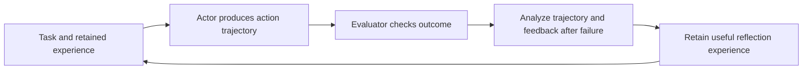

# Reflexion: Turning Failure Feedback into Experience for the Next Action

After an agent fails a task, sending the same request again may produce another, similar failed trajectory. *Reflexion: Language Agents with Verbal Reinforcement Learning* asks how the process and outcome of an attempt can be turned into reusable verbal experience, so that the next attempt starts with a concrete direction for correction. It organizes action, evaluation, and reflection into a loop while keeping the model weights fixed. [Camera-ready version, §1, PDF pp. 1–2](https://proceedings.neurips.cc/paper_files/paper/2023/file/1b44b878bb782e6954cd888628510e90-Paper-Conference.pdf)

This paper is a useful follow-up to an overview of agent systems: it turns “memory” and “feedback” from architectural labels into a process that can be examined. Using the NeurIPS 2023 camera-ready version, this guide explains the main mechanism, evidence from three kinds of task, and important failure conditions. It follows the research mainline with explicit coverage limits; its scope excludes rankings of current agent capabilities and experimental reproduction.

## What changes is the context for the next decision

Reflexion begins with a distinction between two kinds of learning. One turns experience into training data and updates model parameters through optimization. The other stores experience outside the model and puts it back into context on a later call. Reflexion takes the second route. “Reinforcement” here emphasizes that task feedback influences behavior; it does not mean running policy gradients or fine-tuning again after each failure. [§3, PDF pp. 3–5](https://proceedings.neurips.cc/paper_files/paper/2023/file/1b44b878bb782e6954cd888628510e90-Paper-Conference.pdf#page=3)

A teaching shorthand for this relationship is:

$$
a_t \sim \pi_{\theta}(\cdot\mid q,h_t,m_k)
$$

Here $q$ is the task request, $h_t$ is the sequence of actions and observations so far in the current attempt, and $m_k$ is the reflection experience retained when attempt $k$ begins. The fixed model weights are represented by $\theta$. This formula is the guide's teaching summary of the mechanism, rather than a formula copied from the paper. Two calls can use the same model yet propose different actions because their histories and retained experience differ. To judge improvement, therefore, look at the experience actually supplied as well as whether the parameters changed.

The distinction also shapes the conclusion. A successful retry shows that trying again with feedback can help; it does not by itself establish general mastery of similar tasks or retention of the benefit after memory is cleared. The paper mainly examines improvement across attempts at the same task. Transfer of that experience to entirely new tasks is a separate experimental question.

## How actor, evaluator, and self-reflection connect

The Actor produces an answer or action, using step-by-step reasoning or an action–observation trajectory such as ReAct. The Evaluator judges whether the output or trajectory meets the task conditions. It can use an environment signal, rules, answer matching, or a model-assisted assessment; the three roles need not correspond to three separately trained large models. Self-reflection then uses the trajectory, evaluation, and existing memory to produce experience for the next attempt. [§3 and Figure 2, PDF pp. 3–5](https://proceedings.neurips.cc/paper_files/paper/2023/file/1b44b878bb782e6954cd888628510e90-Paper-Conference.pdf#page=4)

Each role addresses a different question. “Failed” is an evaluation, but it leaves the actor without a particular step to change. Reflection tries to add that layer: which assumption might be wrong, which step failed to produce the expected observation, and what should be checked first next time. Its purpose is to turn a sparse outcome into an actionable direction, rather than merely restating a negative score.

Giving the actor the entire trajectory again is a different operation from giving it a reflection first. The full trajectory preserves more detail but leaves diagnosis and the retry to the actor at once. Reflection selects relationships judged important, reducing the work of finding the key error again while risking distortion in the summary. The HotpotQA ablation compares retaining the latest trajectory with adding reflection, so the presence of memory alone leaves open how its contents affect behavior. [§4.2 ablation discussion, PDF p. 7](https://proceedings.neurips.cc/paper_files/paper/2023/file/1b44b878bb782e6954cd888628510e90-Paper-Conference.pdf#page=7)

The following teaching diagram redraws the relationships between responsibilities; it is a teaching diagram rather than a figure from the paper:

The diagram shows only the branch that continues after failure. The process stops on success or at the predetermined attempt limit, rather than looping indefinitely. The current trajectory serves as short-term memory, and reflections retained across trials serve as longer-term experience. To control context length, the paper usually keeps only a few recent experiences: the latest three in ALFWorld and HotpotQA, and one in programming. [§3–4.1, PDF p. 5](https://proceedings.neurips.cc/paper_files/paper/2023/file/1b44b878bb782e6954cd888628510e90-Paper-Conference.pdf#page=5) [§4.3, PDF p. 7](https://proceedings.neurips.cc/paper_files/paper/2023/file/1b44b878bb782e6954cd888628510e90-Paper-Conference.pdf#page=7)

For a teaching example, imagine a task that requires obtaining a tool before handling an object. The system mistakes “I intend to get the tool” for “I have acquired the tool,” and subsequent operations may fail in succession. A useful reflection would identify the missing environmental confirmation and remind the next attempt to verify possession first. This teaching example illustrates the mechanism rather than reporting an additional experimental result. Verbal experience remains an interpretation, however concrete, and must be tested through subsequent action and observation.

## Different experiments provide different strengths of feedback

Evaluation conditions vary across Reflexion's tasks, so the results cannot be collapsed into “the model improved through introspection alone.” In ALFWorld, the environment can report task completion, and rules can identify repeated invalid actions and excessively long trajectories; after failure, the environment is reset for another attempt. In HotpotQA, between trials the system receives a success-or-failure signal from exact matching against the reference answer. It does not receive the reference answer text, but the judgment still depends on answers supplied by the benchmark and is unavailable by default in open-ended question answering. [§4.1–4.2, PDF pp. 5–6](https://proceedings.neurips.cc/paper_files/paper/2023/file/1b44b878bb782e6954cd888628510e90-Paper-Conference.pdf#page=6)

In the programming experiments, the model generates internal unit tests, runs the code to obtain feedback, and revises accordingly. A syntax check filters out tests that cannot be parsed, and each test set uses at most six tests. This provides more specific information than a single failure flag, although generated tests can be incorrect or insufficient. [§4.3, PDF p. 7](https://proceedings.neurips.cc/paper_files/paper/2023/file/1b44b878bb782e6954cd888628510e90-Paper-Conference.pdf#page=7)

The selected results below help clarify the conditions; they do not constitute a cross-task leaderboard:

| Experiment | Paper's setup and observation | How to read it |
|---|---|---|
| ALFWorld, §4.1, Figure 3 | GPT-3 as language model and a ReAct actor; 134 environments. Across 12 consecutive trials, the Reflexion combination with rule-based evaluation completed 130 tasks. | The figure shows the cumulative proportion of tasks solved over trials, not first-attempt success. |
| HotpotQA, §4.2, Figure 4 | 100 questions; retrieval-based ReAct, CoT, and CoT supplied with gold supporting context are compared, with answer-matching feedback between trials. | Retrieval, gold context, and feedback are distinct conditions; the differences cannot be attributed simply to “reflection.” |
| HumanEval Python, Table 1 | GPT-4 baseline 80.1%, Reflexion 91.0%; the paper reports pass@1. | Tests can be generated and run, and code revised repeatedly before final submission; this is not a single model call. |
| MBPP Python, Table 1 | GPT-4 baseline 80.1%, Reflexion 77.1%. | Adding a reflection process left some datasets without improvement. |

The results come from [Figures 3–4 and experiment descriptions, PDF pp. 5–7](https://proceedings.neurips.cc/paper_files/paper/2023/file/1b44b878bb782e6954cd888628510e90-Paper-Conference.pdf#page=6) and [Table 1, PDF p. 7](https://proceedings.neurips.cc/paper_files/paper/2023/file/1b44b878bb782e6954cd888628510e90-Paper-Conference.pdf#page=7). They describe the models, tasks, and procedures used in the paper, rather than current model performance.

The meaning of pass@1 deserves particular care. Internal tests improve a candidate program, after which the final program is judged by the benchmark's hidden tests. The paper thus reports the outcome of the final submission under this metric, after an internal revision process with feedback. Comparing methods also requires considering model calls, test execution, attempt limits, and token costs. The two percentages alone cannot establish an advantage at equal budget.

This distinction also separates a stopping condition from an evaluation criterion. Internal feedback decides whether the system invests in another attempt; the external benchmark decides whether the final submission is correct. If the two are identical, trial and error can directly exploit evaluation answers. If they differ, the system must contend with a possible mismatch between proxy feedback and the real goal. Marking these two positions when reading a reported improvement tells us more about its practical transfer than comparing percentages alone.

## When feedback is wrong, reflection can amplify the error

If internal tests pass an incorrect program, the system may stop too soon. If the tests themselves are wrong, they may fail a correct program and induce useless revisions. Table 2 analyzes such evaluation errors instead of treating the internal pass rate as actual correctness. The negative MBPP Python result shows why test quality and the ability to reflect must be considered together. [§4.3 and Table 2, PDF p. 8](https://proceedings.neurips.cc/paper_files/paper/2023/file/1b44b878bb782e6954cd888628510e90-Paper-Conference.pdf#page=8)

The authors also ran an ablation with GPT-4 on 50 difficult Rust problems converted from HumanEval: the baseline scored 60%; reflection without test generation scored 52%; tests without reflection scored 60%; and both together scored 68%. These figures apply to that subset and cannot be extrapolated as a fixed gain on all coding tasks. They support a more specific conclusion: in this setting, evaluation material and the process of turning it into a direction for revision need to work together. [Table 3 and ablation discussion, PDF p. 8](https://proceedings.neurips.cc/paper_files/paper/2023/file/1b44b878bb782e6954cd888628510e90-Paper-Conference.pdf#page=8)

Reflection text infers a cause of failure. One failure can have several causes, and a model may interpret a chance variation as a pattern. A readable reflection is easier to diagnose than a completely opaque intermediate process, but an intelligible explanation does not establish causation. Testing whether the experience works still requires action outcomes and suitable comparisons.

## The value and limits of experience memory

Compressing a long trajectory into a small amount of experience can make a key error easier to notice on the next attempt, at the cost of losing detail. Keeping only recent experience may also discard earlier constraints. The paper's sliding window is a particular implementation, not an indefinitely accumulating, reliably retrieved, general-purpose memory system for all tasks. [§3 and §5, PDF pp. 5 and 9](https://proceedings.neurips.cc/paper_files/paper/2023/file/1b44b878bb782e6954cd888628510e90-Paper-Conference.pdf#page=9)

A clearer failure appears in Appendix B.1. The authors tested two-example ReAct plus Reflexion on 100 WebShop tasks and stopped after four trials without observing signs of improvement. They suggest that when more diverse exploration is needed, reflection may remain trapped near the original solution. This is evidence of failure in one particular task and configuration, not proof that all web tasks are beyond its benefit. [Appendix B.1 and Figure 6, PDF p. 14](https://proceedings.neurips.cc/paper_files/paper/2023/file/1b44b878bb782e6954cd888628510e90-Paper-Conference.pdf#page=14)

Before adding Reflexion, it is useful to consider in order whether the failure signal is reliable, whether the system can identify behavior it can change, whether the environment permits retries, and whether a different plan can actually be executed next time. If the system can only produce differently worded explanations without better observations or action choices, the experience buffer may simply store repeated judgments.

To move from reading toward exploration, one could compare three conditions: retrying alone, replaying the full history, and retaining compressed reflections, while controlling the base model, total attempt budget, and evaluation signal. Observe whether errors decrease and whether success transfers to new tasks, then discuss the value of the memory mechanism. This is an editorial comparison suggested by the guide, not a validated new research gap; the [HELM evaluation guide](/read/helm/1) offers a way to continue examining the relationship between metrics and conditions.

## Where to return to the paper

Start with [Figure 2 and §3, PDF pp. 4–5](https://proceedings.neurips.cc/paper_files/paper/2023/file/1b44b878bb782e6954cd888628510e90-Paper-Conference.pdf#page=4), following trajectory, evaluation, reflection, and memory to identify the source of each kind of information. Distinguish who generates experience from who supplies the judgment, rather than remembering only the three component names.

Then read [Figures 3–4, PDF p. 6](https://proceedings.neurips.cc/paper_files/paper/2023/file/1b44b878bb782e6954cd888628510e90-Paper-Conference.pdf#page=6), attending first to trials on the horizontal axis and cumulative proportion on the vertical axis before comparing curves. For programming, focus on [Tables 1–3 and §4.3, PDF pp. 7–8](https://proceedings.neurips.cc/paper_files/paper/2023/file/1b44b878bb782e6954cd888628510e90-Paper-Conference.pdf#page=7), separating final correctness, internal test misjudgments, and ablation conditions.

Finally, [§5 and Appendix B.1, PDF pp. 9 and 14](https://proceedings.neurips.cc/paper_files/paper/2023/file/1b44b878bb782e6954cd888628510e90-Paper-Conference.pdf#page=14) use failure cases to refine an intuition about “self-improvement.” This guide does not cover every task trajectory, prompt template, language implementation, or code parameter, and the experiments have not been rerun. Reproduction or a strict budget comparison requires further examination of the authors' implementation. For a broader systems perspective, return to the [Agent survey](/read/agent-survey/1); this ordering is a reading suggestion, not an experimental causal claim.
