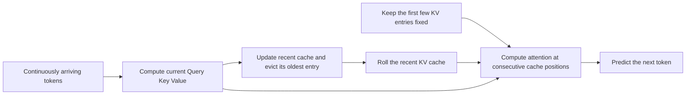

# StreamingLLM: How a Bounded Cache Supports Continuous Input

When text keeps arriving, a language model need not retain every token at once, but it must still function after old information is discarded. These are distinct requirements: bounding the cache controls resource use; reliable prediction after eviction is a question of model behavior. StreamingLLM identifies an easily overlooked cause of failure and makes a small cache adjustment that lets existing models keep processing long streams.

The paper by Guangxuan Xiao, Yuandong Tian, Beidi Chen, Song Han, and Mike Lewis appeared at ICLR 2024. This guide's technical source is arXiv v4, dated April 7, 2024; the conference page is used only to establish publication information. The central distinction is that an input stream can be very long while the context available at any moment remains limited. The paper does not establish infinite historical memory or study asynchronous observations and reasoning revisions during answer generation. [Paper v4, §§1–2 and Appendix A](https://arxiv.org/html/2309.17453v4#S1); [ICLR 2024 publication record](https://proceedings.iclr.cc/paper_files/paper/2024/hash/5e5fd18f863cbe6d8ae392a93fd271c9-Abstract-Conference.html)

## Continuous operation, context windows, and memory

An autoregressive language model predicts the next token from preceding tokens. During decoding, a Transformer usually caches the keys and values produced at each layer for earlier tokens: the KV cache. A new query can score the cached keys and use the resulting attention weights to combine values, avoiding recomputation of the entire history at every step. This cache is intermediate state for one inference process, rather than knowledge written into model parameters or an external memory that can be searched by meaning.

Keeping every KV entry makes the cache grow with the input and gives each current token more positions to attend to. Models are also trained on texts of finite length, so pushing positions and distances far beyond training does not guarantee the same behavior. The authors narrow the question: can a bounded cache let an existing model keep generating from recent context without breaking down as runtime grows? That differs from enlarging the context window available at once or improving use of every detail in a long document. [Paper v4, §§1–2](https://arxiv.org/html/2309.17453v4#S1)

A teaching example makes the distinction concrete. When device logs arrive continuously, still being able to interpret the latest entries is continuous operation; comparing a long stretch of logs at once calls for a larger effective context; recovering an old failure requires retaining and retrieving earlier evidence. StreamingLLM primarily addresses the first problem. This example illustrates the concepts; it is not an industrial application tested in the paper.

## Why retaining only recent text is insufficient

The most direct approach is a sliding window: once the cache is full, evict the oldest KV entry whenever a new token arrives. This keeps cache size stable, but the tested models show an anomaly: language-modeling perplexity jumps when the initial tokens leave. Perplexity can be understood as the model's uncertainty in predicting the actual continuation; lower is generally better under the same evaluation setup. The jump shows that the model also struggles to model the probability distribution of recent text, so forgetting distant facts alone cannot explain it. [Paper v4, §3.1 and Figure 3](https://arxiv.org/html/2309.17453v4#S3.F3)

The paper also considers a more expensive baseline: for each next-token prediction, recompute the entire KV cache from the latest window of raw text. It maintains better perplexity but repeatedly processes much of the window. An ordinary window cache reuses intermediate state, whereas per-step recomputation rebuilds the current window's computation each time. Figure 1 compares efficiency and quality using this distinction, rather than just the amount of retained text. [Paper v4, §1 and Figure 1](https://arxiv.org/html/2309.17453v4#S1.F1)

Locating the anomaly at the moment the initial KV entries leave the cache turns a broad long-text problem into a testable question: is the beginning important because of its meaning, or because the model has learned to depend on that position?

## An attention sink is an allocation phenomenon, not a history summary

In the authors' visualization of Llama-2-7B, the bottom two layers favor recent tokens, while deeper layers assign strong attention to initial positions. The authors call tokens that receive substantial attention attention sinks. Strong attention alone does not establish a fact's importance, let alone show that the first few tokens store all subsequent history. [Paper v4, §3.1 and Figure 2](https://arxiv.org/html/2309.17453v4#S1.F2)

The role can be understood through softmax normalization. Let $x_i$ be the attention score of a key for the current query. Its weight is:

$$
\alpha_i=\frac{e^{x_i}}{\sum_{j=1}^{N}e^{x_j}}.
$$

The weights sum to 1. If an initial position consistently takes a large share, removing it changes more than the available information: it changes the normalization denominator and redistributes the whole set of weights. The authors' explanation is that some attention heads must allocate a total weight of 1 even when they have no content to extract; initial tokens are visible to subsequent positions and can become recipients of that attention during training. Experiments support this mechanism as an explanation; softmax alone is not a theorem that every model must choose the first four tokens. [Paper v4, §3.1 and Equation 1](https://arxiv.org/html/2309.17453v4#S3.E1)

To separate meaning from position, the authors replace the first four tokens with newline characters. For Llama-2-13B on the first book of the PG19 test set, about 65K tokens long, with 1024 KV entries in total, a recent-only window yields perplexity 5158.07. Retaining the first 4 and most recent 1020 yields 5.40; replacing the first four with newlines yields 5.60. Recovery despite changed initial meaning supports the explanation that the sink function does not depend on the original opening content. This intervention does not establish the same result for arbitrary replacements or models. [Paper v4, Table 1](https://arxiv.org/html/2309.17453v4#S3.T1)

## Two cache segments also need position handling

StreamingLLM divides the cache into two parts: it permanently retains the KV entries for a few initial tokens and rolls a window over recent tokens, gradually evicting the expired middle. The paper writes $x+y$ for $x$ initial and $y$ recent tokens. Thus $4+1020$ is a total cache of 1024, not 1024 plus four. The first part stabilizes attention allocation; the second mainly supplies recent content for current language modeling. [Paper v4, §3.2 and Figure 4](https://arxiv.org/html/2309.17453v4#S3.F4)

Retaining the two segments alone is incomplete. Suppose original token positions run from 0 to 9, positions 0, 1, 2, 3, 6, 7, 8 are retained, and 9 is about to be processed. The paper uses consecutive cache positions 0, 1, 2, 3, 4, 5, 6, 7 for this attention computation instead of the original numbering with a gap. The relative distance between sinks and recent content therefore does not grow indefinitely with the stream. [Paper v4, §3.2](https://arxiv.org/html/2309.17453v4#S3.SS2)

Position handling depends on the model. For RoPE, the paper caches keys before the rotary position transformation and applies the transformation at each decoding step according to cache position. For ALiBi, it computes attention with consecutive distance biases, avoiding a distance jump across the evicted segment. Reassigning positions for attention does not retrieve discarded text. This compatibility discussion concerns the relative position mechanisms studied in the paper, rather than a universal plug-in requiring only a list change for any model.

The authors choose four initial tokens as a default based on ablations. Table 2 shows substantial model differences: one initial token nearly restores performance for some tested models, while Llama-2-7B does better with four than with one or two at the same total capacity; increasing to eight brings little further benefit. Four is thus an empirical choice in these experiments, to be understood alongside the model, cache capacity, and task. [Paper v4, §§3.2 and 4.4, Table 2](https://arxiv.org/html/2309.17453v4#S3.T2)

This teaching diagram is based on §3.2 and Figure 4, rather than reproduced from the paper. The two paths into attention represent fixed initial KV entries and the rolling recent cache. As input grows, evicted middle entries no longer participate in the current attention calculation. The diagram omits multiple layers, heads, and parallel implementation details; position reassignment recomputes relative positions on retained state rather than recovering discarded history from the sinks. [Cache mechanism and original Figure 4, fixed v4 HTML](https://arxiv.org/html/2309.17453v4#S3.F4)

## What four million tokens and the speedup measure

The language-modeling experiment concatenates 100 books from the PG19 test set into a long sequence. In §4.1, Llama-2 uses a cache of 2048, while Falcon, Pythia, and MPT use 1024; all retain four initial tokens by default. Figure 3 first compares perplexity over roughly 20K tokens. Figure 5 extends continuous evaluation beyond four million tokens and shows stable trends across model sizes. Transitions between books cause fluctuations, so stability does not mean a flat curve. [Paper v4, §4.1 and Figures 3 and 5](https://arxiv.org/html/2309.17453v4#S4.SS1)

This demonstrates sustained next-token prediction over a very long given text with a fixed cache, without the collapse seen with a simple sliding window. It does not establish factual consistency across four million freely generated tokens or retrieval of details from the first book at any point. The cumulative length processed and the cache directly available to a particular prediction are different quantities.

The efficiency experiment compares StreamingLLM with a sliding window recomputed at every step. Both use Hugging Face Transformers on a single NVIDIA A6000, testing Llama-2-7B and 13B. Figure 10 plots per-token decoding latency and GPU memory against cache capacity. The paper reports a maximum 22.2-fold per-token speedup: for Llama-2-13B with a cache of 4096, the plotted latencies are approximately 2355 ms and 106 ms, respectively; memory use is close to the recomputation baseline. This maximum relative gain belongs to the specified implementation, model, hardware, and cache setting, rather than being a fixed speedup over all inference systems. [Paper v4, §4.5 and Figure 10](https://arxiv.org/html/2309.17453v4#S4.F10)

Figure 1's attention-computation estimates help explain the trend. With $T$ cumulative tokens and a finite window of size $L$, full attention takes approximately $O(T^2)$ cumulative work; a rolling window takes $O(TL)$; and recomputing the window at every step takes $O(TL^2)$. These compare the attention component, leaving costs such as feed-forward layers and data movement outside the formulas. A fixed cache therefore does not make actual end-to-end latency completely constant. [Paper v4, Figure 1 and §4.5](https://arxiv.org/html/2309.17453v4#S1.F1)

## Question answering and the limits of effective recent context

The paper supplements perplexity with two question-answering settings. The first feeds ARC questions and answers continuously, checking model output at each answer position. With a total cache of 1024, StreamingLLM approaches the baseline that processes each question separately, while the ordinary window drops markedly. This shows that an existing instruction model can maintain question-answering ability in a continuous stream; because each question mainly depends on the current item, it does not establish retention of all preceding questions. [Paper v4, §4.3 and Table 5](https://arxiv.org/html/2309.17453v4#S4.T5)

The second setting is the synthetic StreamEval dataset. Information lines arrive continuously, with a question after every 10 lines; the answer lies within the preceding 20 lines. Figure 8 shows an example, and Figure 9 compares accuracy as cumulative input length grows, averaged over 100 samples. The requested information stays relatively recent, combining sustained processing with access to recent information. This deliberately differs from asking a single question at the end of a long document that spans its entire history. [Paper v4, §4.3 and Figures 8–9](https://arxiv.org/html/2309.17453v4#S4.F8)

Appendix C increases the distance between question and answer. For Llama-2-7B-32K-Instruct with a $4+2044$ cache, accuracy is 85.80% at 20 lines, or 460 tokens, and 0 at 100 lines, or 2300 tokens. The table uses 100 samples with 100 questions per sample. The results show both that evidence beyond the cache is lost and that a larger cache does not automatically yield higher accuracy. Fitting evidence in the cache, finding it, and using it correctly remain different requirements. [Paper v4, Appendix C and Table 7](https://arxiv.org/html/2309.17453v4#A3.T7)

## Training a dedicated sink token is a separate experiment

The main method above operates on existing models without fine-tuning. The paper also proposes a training-stage change: add a learnable dedicated sink token at the start of each training sample, letting it serve as the sink and reducing dependence on several ordinary initial tokens. The authors also compare Zero Sink, which changes the softmax denominator to $1+\sum_j e^{x_j}$. This can be viewed as adding an attention position whose key and value are zero, so weights assigned to actual content tokens need not sum to 1. [Paper v4, §3.3, Equation 2 and Table 3](https://arxiv.org/html/2309.17453v4#S3.SS3)

These pretraining tests use 160M-parameter models. In §4.2, the ordinary model and dedicated-sink model follow the Pythia-160M training scheme: deduplicated Pile data, batch size 256, and 143000 training steps. The paper reports similar convergence trends and performance on seven NLP benchmarks. In streaming operation, the dedicated-token model achieves relatively stable perplexity while retaining only that token, whereas Zero Sink does not fully remove dependence on other initial tokens. [Paper v4, §§3.3 and 4.2, Tables 3–4 and Figures 6–7](https://arxiv.org/html/2309.17453v4#S3.SS3)

The results strengthen the explanation that reserving a place for attention allocation helps, within a defined scale and training setup. They do not establish the same benefit for every large model; training a dedicated token is also different from temporarily prepending a special word to an existing chat prompt.

## Connecting the paper to continuous understanding

StreamingLLM offers a basic insight: continuous input processing requires suitable computational state, and discarding old state can change the current computation. Decisions about eviction therefore involve more than the age of text. The paper also sets a boundary: it neither expands the context window nor improves long-term memory; long-document question answering and summarization requiring extensive distant evidence are outside its main application. [Paper v4, Appendices A and C–D](https://arxiv.org/html/2309.17453v4#A1)

The LongBench comparison in Appendix D adds another distinction: keeping sinks does not guarantee retention of task instructions or textual evidence. For Llama-2-7B-Chat, $4+3496$ performs worse on several long-document tasks than a truncation baseline retaining 1750 tokens each from the beginning and end. Setting StreamingLLM to $1750+1750$ brings its results close to that baseline. The authors attribute the earlier drop to possible loss of key opening information. Positions needed for stable computation and content needed for task semantics can impose different retention requirements. [Paper v4, Appendix D and Table 8](https://arxiv.org/html/2309.17453v4#A4.T8)

This suggests a division of labor for further reading. Cache management explains how current computation continues; memory mechanisms address what old information to retain and how to retrieve it; online decision-making and reasoning revision concern when new observations change judgments and actions. This is the guide's proposed learning connection, not a three-layer system implemented by the authors. For the question of what happens when new evidence arrives while a model is thinking, the paper provides one foundation in continuous token processing, rather than a strategy for interruption, concurrent observation, or reversal of earlier decisions.

Three questions bring the distinctions together: why are four million cumulative input tokens different from a four-million-token context? Why are initial tokens with high attention different from historical memory with high semantic value? Why must a speed comparison first establish whether the baseline reuses a cache or recomputes every step? Explaining these through cache contents, position handling, and experimental setup gets closer to the contribution than memorizing “keep four tokens.”

## Reading the paper and coverage

A useful starting point is §3.1, Table 1 and Equation 1: follow the observation, replacement experiment, and explanation to see how the authors investigate a purely semantic account. Then read §3.2 alongside Figure 4 and work through the cache position numbering. Finally, read Figure 5 in §4.1, Figure 10 in §4.5, and Table 7 in Appendix C together to distinguish evidence about continuous length, computational efficiency, and dependence on history. [Paper reading entry: v4 §§3–4 and Appendix C](https://arxiv.org/html/2309.17453v4#S3)

This guide covers the main paper's mechanism, principal experiments and ablations, and selected Appendices A, C, and D. It is a mainline explanation rather than a complete review of every appendix, the code, or later implementations. The Chinese revision reports examining Figures 1–10 and Tables 1–8 in the fixed v4 PDF: Figures 1–4 on physical pages 2–5, Figures 5–7 on page 7, Figures 8–9 on page 8, Figure 10 on page 9, and Tables 7–8 on pages 16–17. Experiments were not reproduced, and applicability to contemporary models was not verified. Data and formulas retain the paper's conditions; the teaching example and learning route are editorial explanations. [Fixed v4 PDF; locate by the physical page numbers above](https://arxiv.org/pdf/2309.17453v4)

[Complete fixed v4 HTML](https://arxiv.org/html/2309.17453v4)
