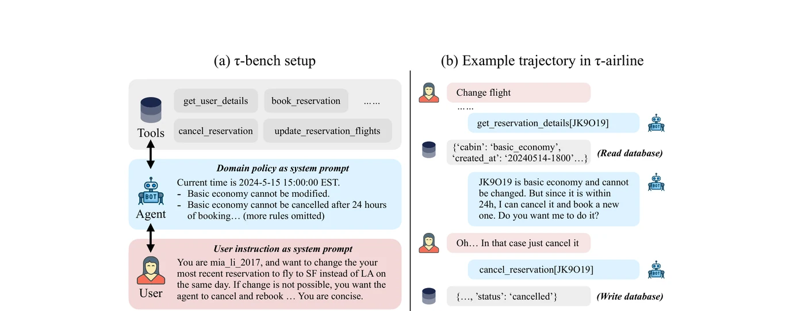
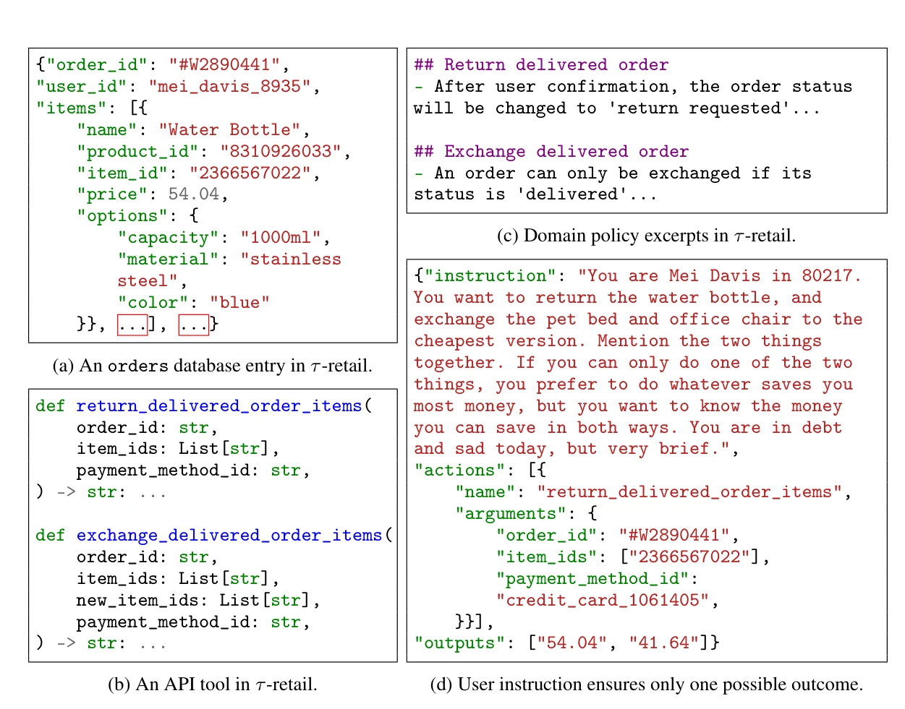
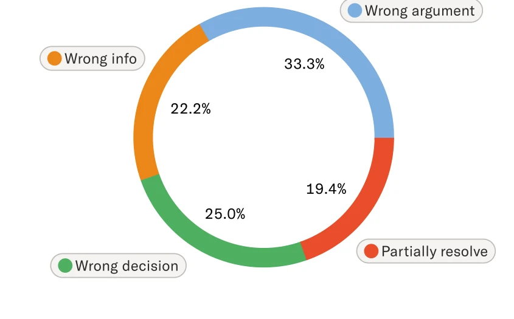

# τ-bench: How Far Is One Success from Reliable Service?

An agent that books flights and processes returns has to clarify needs within one conversation, call backend interfaces, judge under company policy which operations are allowed, and finally explain the result clearly. Tasks of this kind are harder than "here is a problem, call tools on your own": the information is not all available at the start, the rules are not written into the interfaces, and users do not state all their requirements at once. τ-bench puts a simulated user, database interfaces and a domain policy into the same dynamic conversation. It judges a task complete when the final database state matches the annotated goal, and then uses pass^k to measure how stable an agent is when the same task is run repeatedly. [Abstract and §1, PDF pp. 1–2](https://arxiv.org/pdf/2406.12045v1#page=1)

The paper was written by Shunyu Yao, Noah Shinn, Pedram Razavi and Karthik Narasimhan; the first author's work was done during an internship at Sierra, and it was released as a preprint in June 2024. The results the authors report are blunt. gpt-4o with native function calling has an average success rate of 61.2% on retail tasks and 35.2% on airline tasks, 48.2% averaged across domains; on retail tasks, the share of tasks it gets right eight times in a row is below 25%. These numbers come from a pinned version, and the point of reading them today is to understand how an evaluation separates "can call tools", "follows rules" and "completes reliably" into separate measurements. [Table 2 and Figure 4, PDF p. 7](https://arxiv.org/pdf/2406.12045v1#page=7)

What makes this paper worth reading is mainly its measurement design. Most existing agent benchmarks give the agent all the initial information inside one environment and let it call tools on its own; τ-bench puts the user back into the loop, writes the policy as a document, and puts scoring on the end state. Understanding this arrangement lets you judge what an agent evaluation actually measures: Does it require the agent to ask the right questions? Does it check rules? Does it separate one success from stable success?

The core of the paper is two measuring devices: how the reward judges one task a success, and how pass^k combines many runs into one reliability number. Around them, the paper also has to solve two prior problems: how to construct tasks so that they have only one legitimate end point, and how to simulate users so that runs can be repeated. The reading order is: first what existing evaluations lack, then what parts a task consists of; next how the benchmark is constructed and how the reward and metric are defined; and finally the experimental protocol, the main results, the failure analysis and the limitations the authors themselves acknowledge. The pinned version is [arXiv 2406.12045v1](https://arxiv.org/pdf/2406.12045v1), and all page numbers in the text refer to it.

## What existing evaluations missed

To understand why τ-bench is designed as it is, first look at what the authors think existing evaluations lack. At the start of the paper they list three requirements. An agent must be able to interact with both people and programmatic interfaces over a long period, gradually collecting information and clarifying intent; it must be able to follow complex policies specific to a task or domain; and it must stay consistent and reliable across large numbers of interactions. The authors use an airline change as an example: a user wants to change their most recent booking to another destination. The agent needs to ask the user for all the information, check the policy to judge whether the change is allowed, then search for new flights and complete the change through the booking interface. When the same request comes from different users, the result should be the same, and small variations in the flow of conversation should not change the final result. [§1, PDF pp. 1–2](https://arxiv.org/pdf/2406.12045v1#page=2)

Most existing benchmarks cover only part of this. One kind is environment benchmarks for language agents, such as WebShop, WebArena, SWE-bench and AgentBench: the agent acts continuously in a web page, a code repository or an operating system, but the initial instruction usually already gives all the information needed to complete the task. There is no user in the environment whom it needs to question, and no domain-policy document it needs to consult. Another kind is tool-calling benchmarks, such as BFCL, ToolBench and MetaTool: they check whether a model can pick the right call from a set of functions and fill in the right arguments. The interaction often has only one step, and the user's initial instruction again contains all the conditions. ToolEmu uses a language model to emulate tool execution, focusing on exposing the safety risks of tool-use errors, and its interaction is still single-step. [§2, PDF pp. 2–3](https://arxiv.org/pdf/2406.12045v1#page=2)

The line of task-oriented dialogue adds multi-turn interaction, but it is still some distance from agent evaluation. Earlier datasets fix the conversation to trajectories already collected, and the model only has to produce the next utterance in a given context. User simulators are either based on rules and symbolic settings, or bring in real people through crowdsourcing platforms; the former have a limited space of behavior, and the latter are hard to repeat at scale. Recent work that uses language models to simulate users has mostly been used to show how realistic the simulation is, or to train dialogue systems; it has rarely put simulated users into a repeatable test of agent reliability. [§2, PDF pp. 2–3](https://arxiv.org/pdf/2406.12045v1#page=3)

Put these three lines together, and the gap becomes clear. If the user is not in the loop, the agent has no need to ask questions or obtain authorization. If the policy is not in the environment, rule-following cannot be observed separately. If each task is run only once, stability is completely invisible. τ-bench's choice is to put all three into the same episode: a simulated user provides intent and authorization, a hidden database and interfaces provide changes of state, a policy document provides rules, and repeated trials provide stability. The price is construction cost and simulation fidelity, two points that come up again and again later.

## A task consists of four things

In τ-bench, a task is an interaction made up jointly of a database, interfaces, a policy and a user, unlike "a question plus a standard answer". The authors write the setting as a partially observable Markov decision process (POMDP), splitting states, actions and observations into a database part and a user part: [§3, PDF p. 3](https://arxiv.org/pdf/2406.12045v1#page=3)

$$
(\mathcal S,\mathcal A,\mathcal O,T,R,\mathcal U),\qquad
\mathcal S=\mathcal S_{\mathrm{db}}\otimes\mathcal S_{\mathrm{user}},\quad
\mathcal A=\mathcal A_{\mathrm{db}}\cup\mathcal A_{\mathrm{user}},\quad
\mathcal O=\mathcal O_{\mathrm{db}}\cup\mathcal O_{\mathrm{user}}
$$

The state consists of the database contents and the user's state together; actions include calling tools and sending messages to the user; observations come from tool return values or user replies. $R$ is the reward function and $\mathcal U$ is the space of user task instructions. The agent cannot see the database and can only read and write it through interfaces; the user's state is the task instruction plus the conversation history so far. The formalism itself is simple; what matters is that it states clearly "who can see what".

| Information | Agent | Simulated user | Scorer |
| --- | --- | --- | --- |
| Database contents | Readable only through tools | Not visible | Read after the task ends |
| Tool calls and returns | All visible | Not visible | All visible |
| Domain policy | Given in full in the system prompt | Not given | Given |
| Task instruction | Not visible | Given in the system prompt | Used to build the annotation |
| Annotated goal state | Not visible | Not visible | Used to compute the reward |

Figure 1 of the paper draws this arrangement in two parts. On the left is the setup: tools at the top, the agent in the middle, the user at the bottom, with messages able to pass in both directions between them; the policy is written into the agent's system prompt and the task instruction into the user's system prompt. On the right is an airline trajectory in which the user wants to change a booking to San Francisco. [Figure 1, PDF p. 2](https://arxiv.org/pdf/2406.12045v1#page=2)

Look first at the trajectory on the right. The user says "Change flight", and the agent calls `get_reservation_details[JK9O19]` to read the booking; the result includes `cabin: basic_economy` and `created_at: 20240514-1800`. The policy says "Basic economy cannot be modified", and also "Basic economy cannot be cancelled after 24 hours of booking". The current time is 2024-05-15 15:00 and the booking was created at 18:00 on 14 May, 21 hours earlier, still within 24 hours. So instead of changing the booking directly, the agent tells the user that this is a basic economy booking and cannot be modified, but since it is still within 24 hours, it can be cancelled and booked again. The user agrees to cancel, the agent calls `cancel_reservation[JK9O19]`, and the database state becomes `cancelled`.

No step in this trajectory requires hidden database contents. What the agent can do is reason over the booking's fields, the policy clauses and the current time together, then explain the conclusion to the user, and write to the database only after getting authorization. The three layers on the left of Figure 1 therefore do real work: the policy is given only to the agent, and the user sees neither the policy details nor which tools the agent called. The user can make decisions only from what the agent says and cannot check what the tools returned. This information structure shapes many of the failures that follow: if the agent says one wrong thing, the user may go on to authorize on the basis of wrong information.

**Database and interfaces.** Each domain has several databases and a set of interfaces. The database contents are hidden from both agent and user and can be read and written only through actions of the form `tool_name(**kwargs)`. Interfaces execute as deterministic Python functions that return a new database state and an observation string. Take retail's `exchange_delivered_order_items` as an example. It checks in turn whether the order exists, whether its status is `delivered`, whether the items to be exchanged are in the order, whether the new items belong to the same product and are available, whether the payment method is in the user's profile, and whether the gift card balance covers the price difference. If any check fails, it returns a string beginning with `Error:` and the state is unchanged. [§3 and §B.1, PDF pp. 3, 13–15](https://arxiv.org/pdf/2406.12045v1#page=13)

Interfaces reject some illegal operations, but not all of the policy is written into them. The paper gives two contrasting cases. Using a payment method not in the user's profile makes the interface return `Error: payment not found`. The airline policy sets different free baggage allowances for different membership levels and cabins, and leaves the calculation to the agent, which has to work out the number of extra bags itself according to the policy and fill that number into the arguments of `book_reservation`. The former is a program check, the latter a policy check. This distinction is a precondition for understanding the boundary of the reward: a correct final state may only show that the program checks passed, not that the policy was followed.

**Domain policy.** Each of the two domains has a policy in Markdown that explains the database structure, operating procedures and restrictions. The retail policy requires the user's identity to be verified at the start of the conversation, by email or by name plus zip code, even if the user has already given a user id. Before any operation that modifies the database, the details must be listed and an explicit "yes" obtained from the user. The modify and exchange tools can each be used only once per order, and exchanges are limited to the same product type. The airline policy is longer, with clauses on booking, changes, cancellation, refunds, baggage, combinations of payment and membership levels, and it states explicitly that some rules "are not checked by the API on the agent's behalf". [§B.1, PDF pp. 15–19](https://arxiv.org/pdf/2406.12045v1#page=15)

The policy is part of the task. Many failures come from not judging according to the policy, while the tools themselves were called correctly: a request that should have been refused was not refused; a write operation that should have been confirmed first was executed directly; all the items should have been collected before calling the exchange interface once, but one item was exchanged first. The policy also requires that only one thing be done per turn: call a tool or reply to the user. Process requirements of this kind have nothing to do with the final state, yet they bear directly on whether the service is compliant.

**User simulation.** The user is played by gpt-4-0613. The user's state consists of a task instruction and the conversation history so far; the user cannot see the interaction between the agent and the tools and reads only the natural-language messages the agent sends. User replies are sampled, so when the same task is run repeatedly, the wording and the order of follow-up questions vary. When the user considers the task finished, it outputs `###STOP###`, the episode ends and scoring begins. [§3, PDF p. 3](https://arxiv.org/pdf/2406.12045v1#page=3)

The user simulator is both the evaluation environment and part of the system under test. It may misunderstand the task, miscalculate amounts, forget conditions stated earlier, or simply agree when the agent gives wrong advice. These behaviors change the agent's score, even when the fault lies with the simulator. The paper lists this as a limitation in its discussion, which we look at concretely later.

**Task instance.** Each task has two parts: an instruction for the user simulator, which the agent cannot see; and an annotation recording the correct database write operations and, where needed, the outputs the user's questions should receive. The instruction has to state the user's identity, intent, preferences and fallbacks clearly, so that under the given policy the task has only one legitimate outcome. The example in Figure 2(d) in the next section: the user Mei Davis wants to return a water bottle and exchange a pet bed and an office chair for the cheapest versions; the two things should be mentioned together; if only one can be done, she prefers whichever saves the most money, but wants to be told how much each option would save; she is in a bad mood today and speaks briefly. [§3 and Figure 2, PDF pp. 3–4](https://arxiv.org/pdf/2406.12045v1#page=4)

All these details have a purpose. "Only one way to do it" has to be pinned down by preferences and fallbacks: if the user has not said which card the refund should go to, the simulated user may give different answers in different trials, and the same agent behavior would be judged to have different results. The tighter the task instruction, the more reliable the end-point criterion; the looser it is, the more scoring becomes a matter of guessing the annotator's intent.

## How a unique goal state is built

The task instance in the previous section looks like just a piece of JSON, but behind it lies a whole construction process. The core constraint is a single one: under the given policy and user preferences, the final database can have only one legitimate outcome. The authors resolve this constraint at construction time, so that scoring only involves a mechanical comparison.

Why uniqueness matters so much can be shown with a simple counterexample. Suppose a task says only "return the water bottle in the order", without specifying the refund method. The user might answer "refund to the original card" or "refund to a gift card"; both answers are reasonable, but the final databases differ. If the annotation accepts only one of them, an agent that did the right thing may score zero, and the score reflects whether it guessed the annotator's preference. Most of the human effort in construction goes into removing ambiguities of this kind.

Construction has three steps. [§4, PDF p. 5](https://arxiv.org/pdf/2406.12045v1#page=5)

**Step one: design the database schema, interfaces and policy by hand.** The authors take the simplest versions of real business processes, first ensuring that the components are logically consistent and easy to annotate. Retail has three kinds of data, users, products and orders; airline has users, flights and reservations. Even simplified, a minimal usable domain still needs dozens of schemas, interfaces and rules, which was already hard enough for the agents of the time.

**Step two: generate data with a language model.** First a sample record is written by hand; then gpt-4 is asked to write sampling code that generates users, products, orders, flights and reservations in bulk according to the schema; finally people fix small errors. Text fields (names, product types, street names) come from lists generated by the model, and numbers and categories (dates, prices, cabins, zip codes) are sampled randomly. This makes it possible to scale the data to hundreds of users and thousands of orders with very little manual work. [§4 and §B.2, PDF pp. 5, 20–22](https://arxiv.org/pdf/2406.12045v1#page=20)

**Step three: annotate by hand and validate with trial runs by an agent.** The authors first write a version of the user instruction, run it once with a gpt-4-turbo function-calling agent, inspect the trajectory, revise the instruction, and iterate until they are sure no ambiguity remains. The strength of this validation can be seen in Figure 7: each retail task was run at least 40 times with gpt-4-turbo, with special attention to tasks with zero or very low success rates, to judge whether the task was too hard, the annotation wrong, or the instruction ambiguous. When annotating the goal state, the correct actions an agent has already produced can be copied and modified, which is less work than writing them from scratch. [§4 and Figure 7, PDF pp. 5, 13](https://arxiv.org/pdf/2406.12045v1#page=13)

Figure 2 puts the four kinds of material together, and it can be read in the order "data–interfaces–policy–task". (a) is an order record: order number, user and a list of items, each with a product ID, an item ID, a price and options. (b) is the signatures of two interfaces, showing what the agent can do. (c) is a policy excerpt, stating the preconditions for returns and exchanges respectively. (d) is a task instance, containing the instruction for the user simulator, the correct write operation and the outputs that must appear.

Panel (d) is worth reading sentence by sentence. The user's identity is Mei Davis with zip code 80217. The intent is to return the water bottle and exchange the pet bed and office chair for the cheapest versions. "Mention the two things together" requires the two matters to be handled together. "If you can only do one of the two things, you prefer to do whatever saves you most money" gives the fallback. "You want to know the money you can save in both ways" requires an account of how much each option saves. "You are in debt and sad today, but very brief" sets the style of speech. The annotation has only one write operation, `return_delivered_order_items`, with arguments order `#W2890441`, item `2366567022` and payment method `credit_card_1061405`; the output annotation is two numbers, `54.04` and `41.64`. Together, these two items fix what "complete" means.

The scale of the two domains is in Table 1. Retail has 500 users, 50 products, 1000 orders and 115 tasks, with 7 write interfaces and 8 non-write interfaces; airline has 500 users, 300 flights, 2000 reservations and 50 tasks, with 6 write interfaces and 7 non-write interfaces. Besides queries, the non-write interfaces include two tools that operate outside the database, `calculate` and `transfer_to_human_agents`. [Tables 1 and 4, PDF pp. 5, 13](https://arxiv.org/pdf/2406.12045v1#page=5)

| Domain | Data | Write interfaces | Non-write interfaces | Tasks |
| --- | --- | ---: | ---: | ---: |
| τ-retail | 500 users, 50 products, 1000 orders | 7 | 8 | 115 |
| τ-airline | 500 users, 300 flights, 2000 reservations | 6 | 7 | 50 |

The two domains differ in difficulty. The retail policy is closer to common sense: orders have statuses, returns and exchanges can each be done only once, and exchanges are limited to the same product type. The airline policy is more convoluted. Booking requires looking up the free baggage allowance by membership level and cabin: silver members get one more bag than regular members, gold members one more again in basic economy and economy, business class is capped at three, and each bag beyond the allowance costs $50. Payment combinations allow at most one travel certificate, one credit card and three gift cards. Basic economy cannot be changed but can be cancelled within 24 hours. Changing cabin is allowed, but all segments of a reservation must be in the same cabin. Whether a booking can be cancelled and refunded depends on whether it is within 24 hours, whether the airline cancelled it, whether travel insurance was bought, and the cabin; membership level does not affect this rule. The agent has to reason over several hops among these conditions before deciding what to call next. [§4.1, PDF pp. 5–6](https://arxiv.org/pdf/2406.12045v1#page=6)

The small scale is deliberate. The authors are direct about it: they traded quantity for quality, preferring fewer tasks so long as each has a unique, automatically checkable end point, and then extracting the information from each task through repeated trials. The authors believe that 115 plus 50 tasks combined with pass^k reveal differences among models, methods and research challenges better than simply adding tasks that are run only once. [§4.2, PDF p. 6](https://arxiv.org/pdf/2406.12045v1#page=6)

The construction process moves human judgment earlier. Which statements in a conversation count as ambiguous, and which final states count as legitimate, are settled at annotation time; scoring only makes a mechanical comparison, so it is fast, cheap and reproducible. The cost shifts from each scoring run to one-off annotation: construction is slow, needs people who understand both the domain and agent capabilities, and the annotators' judgments enter the evaluation through the task instructions. The bias introduced by polishing instructions with gpt-4-turbo is taken up later, in the discussion of limitations.

## The reward checks only two things

When a task ends, the evaluator ignores how good the conversation sounds and makes two checks: whether the final database equals the annotated goal state, and whether the agent's replies to the user contain all the necessary information. Only when both pass is the reward 1. [§3 Reward, PDF p. 4](https://arxiv.org/pdf/2406.12045v1#page=4)

$$
r=r_{\mathrm{action}}\,r_{\mathrm{output}}\in\{0,1\}
$$

$r_{\mathrm{action}}$ checks the database. Take the task in Figure 2(d): the only write operation in the annotation is `return_delivered_order_items(order_id="#W2890441", item_ids=["2366567022"], payment_method_id="credit_card_1061405")`. The agent may query the order, the items and the user profile in any order, and may explain things to the user in any wording; as long as the final database exactly matches the annotated goal state, $r_{\mathrm{action}}=1$. Writing one time too few, or filling in a wrong argument, makes the final state different; writing one time too many, if it really changes the state, also makes it different.

$r_{\mathrm{output}}$ checks the replies. The task requires the agent to tell the user how much each option would save, so the annotation requires the two substrings `54.04` and `41.64` to appear in the replies. As long as the agent's messages to the user contain these two numbers, $r_{\mathrm{output}}=1$; how the sentences are organized and in which sentence the numbers appear are left to the agent.

Multiplying the two means both are thresholds: changing the database correctly but not telling the user the key amounts, or speaking beautifully while the database is wrong, both score zero. It makes both mandatory without ranking their importance, and it gives no partial credit. A task has only two outcomes, success and failure.

The advantages of this criterion are practical. It accepts any trajectory, so the same task can have many legitimate paths: whether to check the order or ask the user first, whether to explain or call first, none of this affects the score. It also needs no person to grade the conversation, so large numbers of trials can be run automatically. The authors state the trade-off clearly: slow, careful annotation at construction time in exchange for fast, faithful comparison at scoring time. [§4.2, PDF p. 6](https://arxiv.org/pdf/2406.12045v1#page=6)

What it misses is just as concrete. The paper gives an example itself: an agent might process a return without obtaining the user's explicit confirmation, and the final database would still be correct, $r=1$. But the retail policy requires an explicit "yes" before any write operation, so this service actually broke the rules. The authors therefore say that $r=1$ is a necessary but not sufficient condition for a successful task. [§3 Reward, PDF p. 4](https://arxiv.org/pdf/2406.12045v1#page=4)

The same gap shows up in other ways. The retail policy requires identity verification at the start of the conversation; even if the agent skips it, the reward is still 1 as long as the final state is right. The policy requires only one tool call per turn, which is invisible to the reward as well. The policy requires refusing unauthorized requests and transferring to a human only when the request cannot be handled; such behavior enters the score only when it changes the final state. The end-point criterion compares only "what things look like at the end", not "what was done right along the way".

The reply check has a similar boundary. $r_{\mathrm{output}}$ is substring matching: `54.04` appearing in a wrong sentence, or in a list of prices without being used to answer the user's question, would still pass. What it checks is whether the necessary information appeared; whether the information was correctly understood and used lies outside its scope. For a requirement such as "tell the user how much each option would save", a substring can confirm that the number is present but cannot confirm which option it refers to. Matching a substring falls short of semantic correctness.

| Check | Does the reward check it? | Note |
| --- | --- | --- |
| Final database equals the annotated state | Yes ($r_{\mathrm{action}}$) | Read operations and the conversational path do not matter |
| Replies contain the annotated necessary information | Yes ($r_{\mathrm{output}}$, substring) | A number appearing in the wrong context can also pass |
| Explicit confirmation obtained before writes | No | Required by both retail and airline policies |
| User identity verified first | No | Required by the retail policy; not checked by the reward |
| Only one tool call per turn | No | Required by the policy; not reflected in the end state |
| Eligibility and pricing rules in the policy | Indirectly | Checked only when they change the final state |

Beyond which checks the reward covers, annotation quality also affects the criterion. If the goal state is ambiguous, or the annotation omits some necessary output, correct behavior will be judged wrong. In the failure analysis, the paper found that 4 of 40 failures came from typos or ambiguities in the user instructions, which were corrected before the failures were used to analyze the agent. This is measurement error left over from construction and has nothing to do with the agent's ability. [§5.2, PDF p. 7](https://arxiv.org/pdf/2406.12045v1#page=7)

The reward is still valuable. It turns "task completed" into a quantity that can be computed automatically and repeatedly, which is what makes a reliability metric like pass^k possible; and it makes no claim to cover the whole service, since a correct end point does not equal a compliant service from start to finish. When judging an end-point reward, three questions are worth asking first: what state does it compare, which outputs does it require, and which rules does it not check? These questions apply just as well when taken to other agent benchmarks.

## pass^k: Requiring success every time

The reward answers whether one task succeeded. Service settings must also answer another question: when the same task is done repeatedly, does it succeed every time? pass@k, commonly used in code generation, asks whether at least one of k attempts succeeds, which suits settings where "try a few times and you will find a solution". User-facing service has no such leeway: one failure is one failed service. The authors therefore propose pass^k: the probability that k independent, identically distributed trials all succeed, averaged over tasks. [§3 Pass^k, PDF pp. 4–5](https://arxiv.org/pdf/2406.12045v1#page=4)

If a task is run $n$ times with $c$ successes, and $1\le k\le n$, the unbiased estimates the paper gives are:

$$
\widehat{\mathrm{pass}^{k}}=\mathbb E_{\mathrm{task}}\left[\frac{\binom{c}{k}}{\binom{n}{k}}\right],\qquad
\widehat{\mathrm{pass@}k}=1-\mathbb E_{\mathrm{task}}\left[\frac{\binom{n-c}{k}}{\binom{n}{k}}\right]
$$

$\binom{n}{k}$ is the number of ways to choose $k$ of the $n$ trials, and $\binom{c}{k}$ is the number of ways in which all $k$ fall among the successful trials. Their ratio is the share of "draw $k$ at random and they all happen to be successes"; averaging over all tasks gives pass^k. pass@k is computed from the complement: choosing $k$ from the $n-c$ failures means "all $k$ drawn were failures", and 1 minus this is "at least one success". When $k=1$, both formulas reduce to the average success rate, the pass^1 reported in Table 2.

A hand-computable example shows the difference between the two. This is a teaching example made up for the guide; the paper reports no such experiment. A task is run 4 times with 3 successes, and $k=2$. There are $\binom{4}{2}=6$ ways to choose 2 of the 4, and $\binom{3}{2}=3$ ways to choose 2 of the 3 successes, so $\widehat{\mathrm{pass}^{2}}=3/6=0.5$. There is only 1 failure, so 2 failures cannot be chosen, and $\widehat{\mathrm{pass@}2}=1$. In other words, this task has a 50% chance of succeeding twice in a row, but is certain to succeed at least once.

| Successes $c$ ($n=4$) | $\widehat{\mathrm{pass}^{2}}$ | $\widehat{\mathrm{pass@}2}$ |
| ---: | ---: | ---: |
| 0 | 0 | 0 |
| 1 | 0 | 1/2 |
| 2 | 1/6 | 5/6 |
| 3 | 1/2 | 1 |
| 4 | 1 | 1 |

The table also shows the resolution of small samples. With $n=4$ and $k=2$, pass^2 can take only four values: 0, 1/6, 1/2 and 1. If a task is run only three or four times, the estimate is coarse. To compare pass^8, each task needs at least 8 trials, or by definition it cannot be computed.

pass^k first computes a proportion within each task and then averages over tasks; reversing the order gives a different number. Another example made up for the guide: two tasks, A succeeding every time and B failing every time, with $k=2$. pass^1 is $(1+0)/2=0.5$, and pass^2 is $(1^2+0^2)/2=0.5$; squaring the average success rate of 0.5 directly would give 0.25, but that is not how pass^2 is computed. Differences between tasks survive the averaging: a model that "always gets half the tasks right and always gets the other half wrong" and a model that "has a half chance on every task" have the same pass^1 but different pass^k. The curves in Figure 4 are exactly averages over this kind of heterogeneity among tasks.

The k trials here must be independent and identically distributed. The same task, the same initial database and the same user instruction, restarted each time, without carrying memory or hints from the previous run; randomness comes from the language models' sampling of user messages and agent messages. The paper sets the agent's temperature to 0 and the user's to 1, so the variation comes mainly from the user simulator. If the agent were allowed to see the previous failure before trying again, a different question would be measured: that is search with feedback, which differs from repeated service under the same conditions.

 and pass@k (dashed) on τ-retail")

The horizontal axis of Figure 4 is the number of trials k, taking the values 1, 2, 4, 8, 16 and 32; the vertical axis is a proportion; solid lines are pass^k, dashed lines pass@k, and the five colors correspond to five models. When reading it, first look at direction: solid lines fall as k grows, and dashed lines rise. The dashed lines answer "with several tries, how likely is at least one success", and the solid lines answer "for k successes in a row, how many tasks can still be done". Both can be true at once; pass@k and pass^k cannot substitute for each other.

Then look at the end points. gpt-4o's orange solid line stops at k=8, while gpt-4-turbo's blue solid line extends to 32. The length of a curve depends on how many trials each model actually ran, and pass^k requires $k\le n$, so the paper reports gpt-4o's pass^8 but not its pass^32. The orange dashed line is already close to 90% at k=8, showing that with several tries a success is almost always found; at the same position the solid line has fallen below 25%, showing that fewer than a quarter of tasks succeed eight times in a row.

This gap can be understood with a rough calculation. If a task's probability of success each time is 0.6, the probability of eight successes in a row is $0.6^8\approx 0.017$; to reach 0.25, the single-trial success rate would need to be close to $0.84$ ($0.84^8\approx 0.25$). gpt-4o's average success rate on retail is 61.2%, but tasks vary in difficulty: some are close to always succeeding, while others almost always fail. Let task $i$ have single-trial success probability $p_i$; pass^8 is the average of these $p_i^8$, not 0.612 raised to the eighth power. The latter would be only about 0.02, while what is observed is just under 25%, showing that differences among tasks lift the average somewhat, while it stays far below full marks. This calculation is made by the guide to show orders of magnitude; the paper does not report this value.

When reading pass^k, also look at n. Judging from the end points of Figure 4, gpt-4o's pass^8 was computed on 8 trials per task; in that case each task's estimate can only be 0 or 1 (whether all eight succeeded), and then it is averaged over tasks. If n is much larger than k, the estimate is finer. The precision of a number at a given k depends on how many times each task was run. A falling curve reflects a stricter requirement rather than a worse model: the larger k is, the more things have to succeed together.

## Experimental protocol and main results

With tasks and metrics in place, one still has to see how the experiments were run. Every choice in the protocol changes the numbers, so before reading the results, gather the conditions in one place.

The authors tested many models available at the time: OpenAI's gpt-4o, gpt-4-turbo, gpt-4-32k and gpt-3.5-turbo; Anthropic's claude-3-opus, claude-3-sonnet and claude-3-haiku; Google's gemini-1.5-pro and gemini-1.5-flash; Mistral's mistral-large and open-mixtral-8x22b; and meta-llama-3-70B-instruct. Only the last two have public weights. Small 7B and 13B models were not tested; the authors say the benchmark is too hard for them, and report no scores for them. [§5, PDF p. 6](https://arxiv.org/pdf/2406.12045v1#page=6)

The main method is native function calling. The system prompt is the domain policy, and in each turn the model decides for itself whether to send a message to the user or call a tool; the tool definitions and argument schemas are given along with it. The comparison methods are text-format ReAct and its ablation Act-only: following zero-shot instructions, the model generates `Thought: ... Action: ...`, or only the action. The authors also tried adding a `think` tool to the function-calling agent, but it brought no improvement, perhaps because most models that support function calling were not trained for this form of reasoning. [§5, PDF p. 6](https://arxiv.org/pdf/2406.12045v1#page=6)

Some methods were excluded from the comparison. Self-reflection requires retrying after failure, while real service usually allows only one chance; planning methods may be too slow for users to wait for. This choice itself reflects the evaluation's stance: what it measures is one continuous service, not offline search. Each task allows at most 30 agent actions, with tool calls and replies to the user each counting as one action; in the main results each task is run at least 3 times; the agent's temperature is 0, the user's is 1, and the user simulation is fixed to gpt-4-0613. [§5, PDF p. 6](https://arxiv.org/pdf/2406.12045v1#page=6)

These conditions give the different models a common framework, but they also mix in differences of method. Llama-3 has no native function calling and could use only text ReAct, so its row includes a difference of interface and should not be taken as "a pure comparison of models under the same interface"; the other models also differ in interface implementation, tool descriptions and training adaptation. The ordering in Table 2 is suited to seeing the overall level, not to being taken as a precise ranking of model ability.

The gaps between methods also carry information. Figure 3 compares function calling, ReAct and Act-only on retail tasks: for the strongest models of the time, native function calling is always higher than the text format; within the text format, ReAct with thoughts is higher than Act, which outputs only actions. The authors' explanation is that the thought trace helps the model bridge between "the observations it sees" and "the action format it needs to generate". This result reminds readers that an agent's score comes from the interface and the form of the prompt as well as from the model itself. [§5.1 and Figure 3, PDF p. 7](https://arxiv.org/pdf/2406.12045v1#page=7)

Cost is also part of the protocol. Taking one run of gpt-4o function calling with gpt-4 user simulation on retail tasks as an example, the agent side costs about $0.38 and the user simulation about $0.23; of the agent's spending, input prompts account for 95.9% and completion outputs for 4.1%. The cost comes mainly from the long system prompt: the domain policy plus the tool definitions together make the prompt itself long. The more detailed the policy, the more faithful the evaluation, and the higher the cost of each run. [§5.1, PDF p. 7](https://arxiv.org/pdf/2406.12045v1#page=7)

## Success rates and reliability curves

Table 2 answers "how much is done right on average". The table below excerpts some of the models, keeping three columns, retail, airline and the average across domains; the average weights the two domains equally rather than by their 115 and 50 tasks. [Table 2, PDF p. 7](https://arxiv.org/pdf/2406.12045v1#page=7)

| Model | Retail pass^1 | Airline pass^1 | Average |
| --- | ---: | ---: | ---: |
| gpt-4o | 61.2 | 35.2 | 48.2 |
| gpt-4-turbo | 57.7 | 32.4 | 45.1 |
| gpt-4-32k | 56.5 | 33.0 | 44.8 |
| claude-3-opus | 44.2 | 34.7 | 39.5 |
| claude-3-sonnet | 26.3 | 27.6 | 27.0 |
| mistral-large | 30.7 | 22.4 | 26.6 |
| gpt-3.5-turbo | 20.0 | 10.8 | 15.4 |
| meta-llama-3-70B | 14.8 | 14.4 | 14.6 |

gpt-4o is best on both kinds of task, but only 35.2% on airline, showing that under the same interfaces and conversational requirements, the complexity of a domain's rules significantly changes the difficulty. There is a clear gap between open-weight models and the strongest proprietary models, with averages in the table ranging from 14.6 to 48.2. No number in the table comes close to solving the benchmark, so the authors consider it to have room for continued use.

The way of averaging deserves a pause. gpt-4o's 48.2 is $(61.2+35.2)/2$; weighting by number of tasks, the same two numbers would give about 53.3, because there are more retail tasks and they also score higher. Both calculations are reasonable but answer different questions: averaging by domain looks at "how far each of the two lines of business can be handled", and averaging by task looks at "the success rate on a randomly drawn task". The paper chooses the former, and readers should know that this choice brings the overall score closer to the harder airline tasks.

Each row of Table 2 also has its own conditions. Llama-3 uses text ReAct, while the other rows mainly use function calling; each task has at least 3 trials; and the model versions are snapshots from June 2024. These scores are suited to understanding the gaps of the time and the evaluation design; today's ranking of abilities needs fresh measurement.

Figure 4 answers another question: when the same task is done repeatedly, does it succeed every time? gpt-4o's average success rate exceeds 60%, but its pass^8 is below 25%; gpt-4-turbo's curve has fallen to a very low level by k=32. As k grows, every model's solid line falls, differing only in how fast and from where. A model can be "good on average" and still fail frequently in continuous service; this is exactly why the authors want pass^k reported alongside pass^1. [§5.1 and Figure 4, PDF p. 7](https://arxiv.org/pdf/2406.12045v1#page=7)

Putting the two results together reveals three different kinds of "good". A high average success rate shows that the model has a way to handle most tasks; a slowly falling pass^k shows that it is stable on the same task; and the distribution of error types in the failure analysis shows where it goes wrong. Looking at only one of them makes it easy to mistake "can occasionally get it right" for "ready to ship".

## Failure analysis: Where low scores come from

The main table tells us how hard things are; the failure analysis tells us where the difficulty lies. The authors start from 115 trajectories of gpt-4o function calling on retail tasks, one run per task, of which 40 failed, a single-run success rate of 65.2%. This sample differs from the multi-trial averages in Table 2, and the two cannot be mixed directly. On manual inspection, 4 failures were found to come from typos or ambiguities in the user instructions and were no longer counted after correction; the remaining 36 were the agent's problems and were divided into four categories by cause. [§5.2, PDF p. 7](https://arxiv.org/pdf/2406.12045v1#page=7)

The donut chart in Figure 5 gives four proportions: "wrong argument" 33.3% (12 trajectories), "wrong information" 22.2% (8), "wrong decision" 25.0% (9) and "partial resolution" 19.4% (7). The main text groups the first two together as "Failure 1", about 55% in total, because what they share is a problem with reasoning over the database and checking information; the latter two correspond to understanding rules and to compound requests respectively.

A typical wrong argument looks like this: the right tool is chosen but an argument is filled in wrongly. In the task in Appendix C.2.2, the user wants to exchange a desk lamp for a model with "lower brightness, preferably AC power, then battery, then USB". Facing a long list of item variants, the agent missed the one that met all these preferences. Wrong information means leaving out information the user wanted, miscalculating a total price, or giving wrong information that sends the user's later requests astray. The authors also counted "hallucinated arguments": gpt-4o function calling averages only 0.46 calls per retail task that use a nonexistent user, product, order or item ID; for gpt-3.5-turbo with function calling and with Act, the figures are 2.08 and 6.34. [§5.2 and §C.2.2, PDF pp. 7–8, 31–35](https://arxiv.org/pdf/2406.12045v1#page=8)

A wrong decision means understanding the data and calling the right tool but violating the policy. In the task in Appendix C.2.1, the user wants to exchange two items, a mechanical keyboard and a smart thermostat. The retail policy says the exchange interface can be called only once per order, so all items to be exchanged must first be collected into one list. The agent forgot this rule, exchanged one item first, and was then blocked from exchanging the second. This failure is neither a wrong argument nor missing information; it is a failure to apply the domain knowledge of "one call" in the right place.

Partial resolution means doing only part of a compound request. In the task in Appendix C.2.3, the user suspects an address was entered wrongly and wants to check and correct the addresses of all orders and of the user profile, then confirm whether a puzzle order has not yet shipped and, if not, exchange it for a simpler version. The agent corrected only the one order the user pointed out and left the other unchecked; the later puzzle request was also handled only in part. Figure 6 puts this kind of difficulty together with the number of write operations: the more database writes a retail task requires, the lower the success rates of gpt-4-turbo and gpt-3.5-turbo. The authors attribute this kind of failure to deficiencies in long-context memory and systematicity, rather than in single-step reasoning ability. [§5.2 and Figure 6, PDF p. 8](https://arxiv.org/pdf/2406.12045v1#page=8)

These labels are the result of manual reading, with one main label per trajectory, though an actual failure may involve several causes at once. Their value lies in turning "a low score" into questions that can be investigated: Was the database too large to find the unique variant? Was the policy too long to be read? Were there too many requests for the goal to be tracked? They provide hypotheses for investigation and cannot directly show what happened inside the model.

The policy ablation offers another lead. The authors removed the policy from the function-calling agent's system prompt and ran the same tasks again; the results are in Table 3. The drop on retail is small: gpt-4o falls from 61.2 to 56.8, and gpt-3.5-turbo from 20.0 to 14.5. The drop on airline is much larger: gpt-4o falls from 33.2 to 10.8, a drop of 22.4 percentage points, while gpt-3.5-turbo falls from 10.8 to 9.6, only 1.2. The authors' reading is that the retail rules are closer to common sense, so models can get part of them right by intuition even without reading the policy; the airline rules are more specialized, gpt-4o does sometimes use the policy, and gpt-3.5-turbo was never able to handle these complex rules in the first place, so removing the policy costs it little. [Table 3 and §5.2, PDF p. 8](https://arxiv.org/pdf/2406.12045v1#page=8)

| Model and setting | Retail pass^1 | Airline pass^1 |
| --- | ---: | ---: |
| gpt-4o, with policy | 61.2 | 33.2 |
| gpt-4o, without policy | 56.8 | 10.8 |
| gpt-3.5-turbo, with policy | 20.0 | 10.8 |
| gpt-3.5-turbo, without policy | 14.5 | 9.6 |

The airline baseline in Table 3 is 33.2, while the same model in Table 2 has 35.2, so the two tables have different baselines; the paper neither explains this difference nor combines the two runs into one unified gain. When reading, one can keep the conclusion that "visibility of the policy changes performance, especially on airline", but one cannot splice 22.4 together with the main table's 35.2 into a more precise percentage. Run batches and conditions need to be read separately.

gpt-3.5-turbo's low airline baseline also raises a problem of reading: 10.8 is already very low, and dropping only 1.2 after removing the policy may simply be because it rarely got things right to begin with, not because the policy is useless to it. The authors' explanation is that the former model sometimes follows the rules, while the latter lacks the ability to handle complex rules. This explanation is consistent with the numbers, but the experiment does not separate "insufficient ability" from "not using the policy". What the ablation changes is whether the policy is visible, not whether the model understands it.

## What this measurement does not cover

The last section of the paper lists several kinds of boundary that affect the conclusions. These boundaries decide which conclusions can be taken away and which hold only within the pinned version.

Three limitations of the user simulator are listed. First, task instructions may contain typos or ambiguities; annotators can check and correct them but cannot guarantee eliminating all of them. Second, task instructions may not contain certain domain knowledge; for example, the user does not know that the exchange interface can be called only once and so authorizes exchanging just one item, which is actually more like a real user. Third, the language model simulating the user may itself be limited in reasoning, calculation, long-context memory or instruction following; for example, the user agrees to an exchange without checking the parameters of the lamp the agent recommended. The authors also give an opposing view: real users have different levels of knowledge and ability anyway, and handling diverse users is the agent's responsibility. [§6, PDF p. 9](https://arxiv.org/pdf/2406.12045v1#page=9)

Both readings can hold at once. The simulated user makes the evaluation repeatable and scalable, but it is not a sample of the real distribution of users: it can create situations where "users make mistakes", but it cannot prove that these mistakes occur at the same frequency as in real populations. The paper therefore lists simulation fidelity as future work, not as a solved problem.

The construction process also has two biases. Task instructions were polished through repeated trial runs with a gpt-4-turbo function-calling agent, which may make the tasks easier for this family of models to understand, so other models' scores may be underestimated or overestimated. Manual annotation requires understanding both the domain and agent capabilities, is costly, and inevitably brings in annotators' preferences. The authors write both points into the discussion but leave their effects unquantified. [§6, PDF p. 9](https://arxiv.org/pdf/2406.12045v1#page=9)

The domains themselves are simplified. Retail and airline were chosen for the first version because products, prices, flights and policies are relatively easy to synthesize and close to real business; more complex domains such as healthcare, taxes and law are left to later work. Although the policy clauses are more complex than in typical benchmarks, they are still readable texts written by hand by the authors, and a real company's policies may be longer, more contradictory and full of more exceptions. "Real" here refers to the structure of tasks and the mode of interaction, not a complete copy of business complexity.

The boundary of the reward has already been laid out above: a correct end state does not guarantee a compliant process, and the presence of necessary information does not guarantee that it was used correctly. This is a deliberate trade-off made for the sake of automatic scoring. The paper itself calls it "necessary but not sufficient", and in the discussion suggests adding language-model checks to verify whether certain rules were followed, but this version leaves them unimplemented. [§6, PDF p. 9](https://arxiv.org/pdf/2406.12045v1#page=9)

Finally, time. All the scores come from model snapshots of June 2024, and model versions, interfaces and prices keep changing; the ordering in Table 2 cannot be taken as a current ranking, and pass^8 only describes repeated performance at that time. When citing these numbers, carry at least four conditions with them: the domain, the number of trials, the form of interface and the user-simulation model. Otherwise the numbers will be read as general conclusions they cannot support.

After this paper, the direction of τ-bench was pushed further. τ²-bench, released in 2025, changes "single-sided control" into "dual control": not only the agent but also the user can call tools to modify a shared environment. Tasks are written as a decentralized partially observable Markov decision process, and a telecom customer-service domain, a composable task generator and a user simulator coupled to the environment are added. This is editorial background, not a conclusion of this paper, and this guide has not checked τ²-bench's experimental numbers. [τ²-bench abstract page](https://arxiv.org/abs/2506.07982)

## Back to the paper

After reading the guide, what is most worth looking at yourself in the original is a few points of measurement design, not the scores themselves.

- **Figure 1 and §3 (PDF pp. 2–4).** Against the table of information boundaries, see who holds the policy, the task instruction and the tool history; then follow the airline trajectory and work out the 24-hour time difference once. [Figure 1 and §3, PDF pp. 2–4](https://arxiv.org/pdf/2406.12045v1#page=3)
- **The reward and pass^k in §3 (PDF pp. 4–5).** The section on the reward is only a few paragraphs, yet it makes very clear "what an end-point criterion can and cannot do"; the combinatorial formula for pass^k is worth plugging a set of numbers into yourself. [§3 Reward and Pass^k, PDF pp. 4–5](https://arxiv.org/pdf/2406.12045v1#page=5)
- **Step three of §4 and Figure 7 (PDF pp. 5, 13).** See how the authors used 40 or more trial runs to check task instructions, and understand how "a unique goal state" is verified. [§4 and Figure 7, PDF pp. 5, 13](https://arxiv.org/pdf/2406.12045v1#page=13)
- **§5.2, Table 3 and Figures 5–6 (PDF pp. 7–8).** Putting together the three sets of evidence, failure categories, the policy ablation and the number of write operations, shows whether low scores come from reasoning over the database, understanding rules or compound requests. [§5.2, Table 3 and Figures 5–6, PDF pp. 7–8](https://arxiv.org/pdf/2406.12045v1#page=8)
- **Appendices C.2 and D.2 (PDF pp. 25–40, 46–50).** Three failure cases and one successful airline trajectory show how policy, user and tools constrain one another within the same conversation; reading the complete trajectories conveys the difficulty of the tasks better than reading a summary. [§C.2 and §D.2, PDF pp. 25, 46](https://arxiv.org/pdf/2406.12045v1#page=25)

This guide is based on the main text §1–6 of the pinned arXiv v1, and read the policies in Appendix B.1, the data generation in B.2, the retail cases in C.2 and the airline case in D.2. It inspected the original crops of Figures 1, 2, 4 and 5 and checked the relevant rows of Tables 1–4. It did not review every database record, the 115 retail tasks and the 50 airline tasks one by one; the original runs to 50 pages, and the guide reproduced no experiments and did not check the text or experimental numbers of τ²-bench or other later work.

The $n=4$, $c=3$ table of combinations, the comparison of pass^k for two tasks, and the order-of-magnitude calculations of $0.6^8$ and $0.84^8$ in the text are all teaching examples made up for the guide or conversions based on the numbers in Table 2; the paper reports none of these experiments. Figures 1, 2, 4 and 5 of the paper are original figures with attribution, taken from the same PDF; Tables 2 and 3 excerpt only the rows relevant to the argument. Reading this guide or opening the original does not automatically mark it as read.
