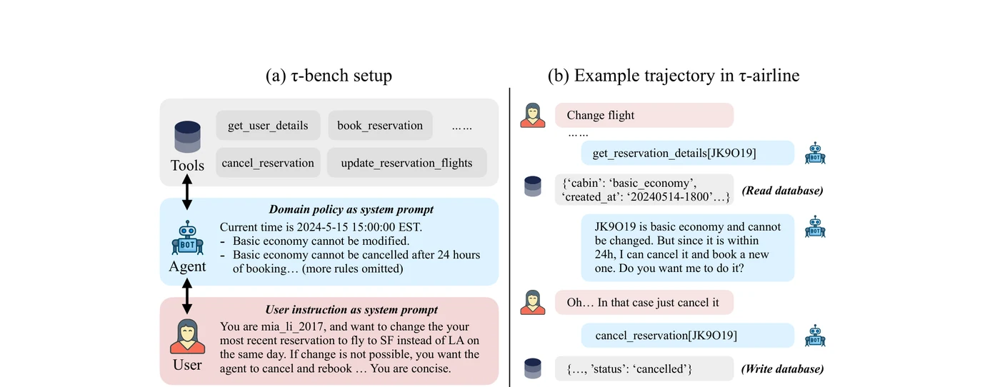
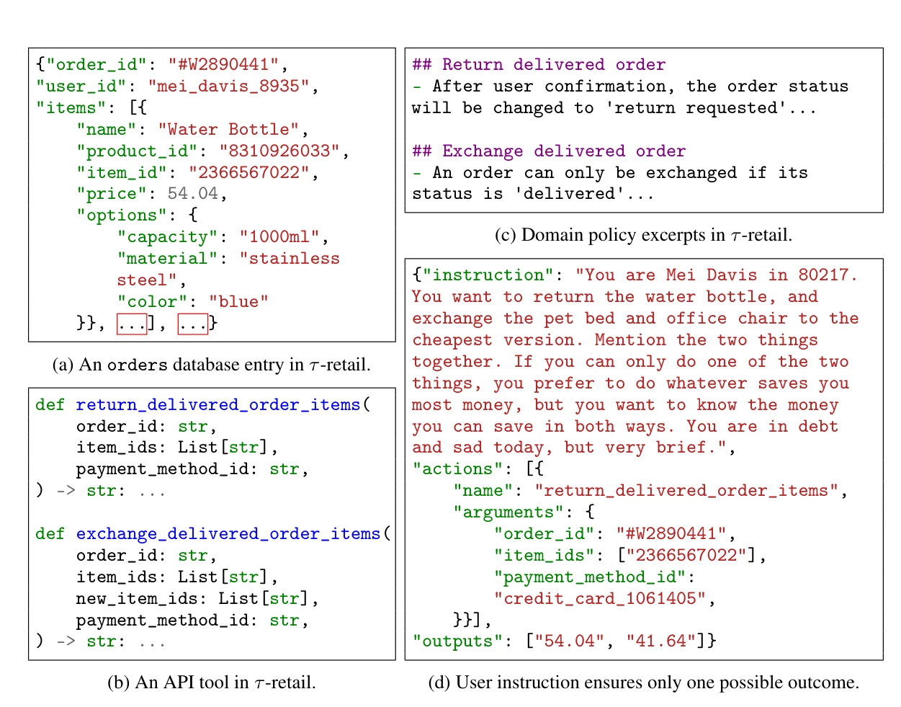
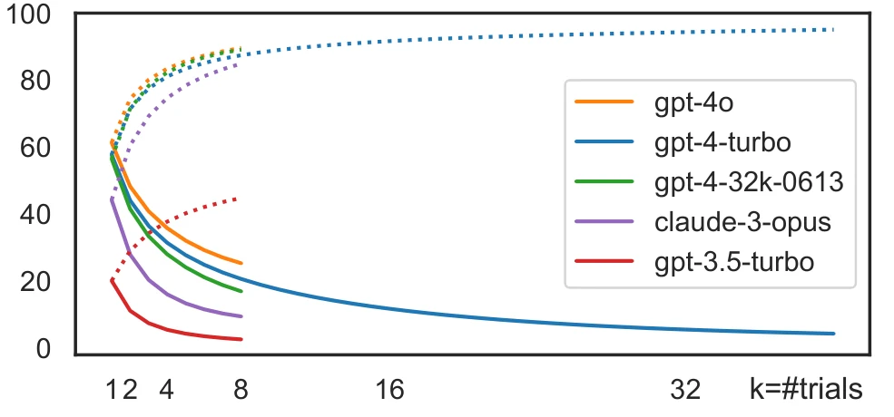
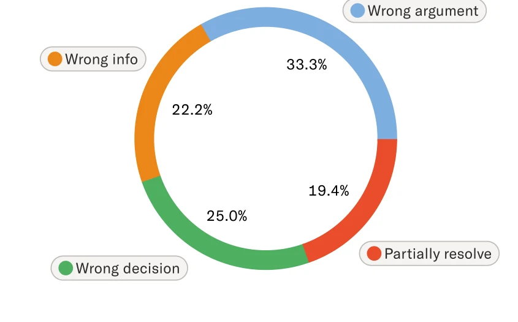

# τ-bench：做对一次，离可靠服务还有多远

一个能订机票、退商品的 Agent，要在同一段对话里问清需求、调用后台接口、按公司政策判断哪些操作允许，最后把结果说清楚。这类任务比“给一道题、模型自己调工具”难：信息不全在开头，规则不写在接口里，用户也不会一次说清所有要求。τ-bench 把模拟用户、数据库接口和领域政策放进同一段动态对话，用最终数据库状态与标注目标是否一致判定任务完成，再用 pass^k 测量同一任务重复运行时的稳定性。[原文摘要与 §1，PDF 第1–2页](https://arxiv.org/pdf/2406.12045v1#page=1)

论文由 Shunyu Yao、Noah Shinn、Pedram Razavi 和 Karthik Narasimhan 完成，第一作者的工作在 Sierra 实习期间完成，2024 年 6 月以预印本发布。作者报告的结果很直接：使用原生 function calling（函数调用）的 gpt-4o 在零售任务上平均成功率 61.2%，航空任务 35.2%，按领域平均 48.2%；在零售任务上，同一任务连续八次都成功的比例不到 25%。这些数字来自固定版本，今天读它们的重点在理解一个评测怎样把“会调工具”“守规则”“稳定完成”分开测量。[表2与图4，PDF 第7页](https://arxiv.org/pdf/2406.12045v1#page=7)

这篇论文值得读的地方主要在测量设计。已有 Agent 基准大多在一个环境里给 Agent 全部初始信息，让它自己调工具；τ-bench 把用户放回循环里，把政策写成文档，把评分放在终点状态上。读懂这套安排，就能判断一个 Agent 评测究竟测到了什么：它要求 Agent 问对问题吗？它检查规则吗？它把一次成功和稳定成功分开吗？

全文的核心是两个测量装置：奖励怎样判定一次任务成功，pass^k 怎样把多次运行合成一个可靠性数字。围绕它们，论文还要解决两个前置问题：任务怎样构造到只有一个合法终点，用户怎样模拟到可以重复运行。阅读顺序是：先看已有评测缺什么，再看一个任务由哪些部分组成；然后看基准怎样构造、奖励和指标怎样定义；最后核对实验协议、主结果、失败分析和作者自己承认的局限。固定版本是 [arXiv 2406.12045v1](https://arxiv.org/pdf/2406.12045v1)，正文页码都指这一版。

## 已有评测漏掉了什么

要理解 τ-bench 为什么这样设计，先看作者认为已有评测缺了什么。论文开头列出三类要求：Agent 要能在较长时间里同时与人和程序接口交互，逐步收集信息、弄清意图；要能遵守任务或领域特有的复杂政策；还要在大量交互中保持一致和可靠。作者用航空改签举例：用户想把最近一次预订改到另一个目的地，Agent 需要向用户问齐信息，查政策判断是否允许修改，再搜索新航班并用预订接口完成改签；同一个请求来自不同用户时，结果应当一致，对话流程的小变化也不应改变最终结果。[§1，PDF 第1–2页](https://arxiv.org/pdf/2406.12045v1#page=2)

已有基准大多只覆盖其中一部分。一类是语言 Agent 的环境基准，例如 WebShop、WebArena、SWE-bench 和 AgentBench：Agent 在网页、代码仓库或操作系统里连续行动，但初始指令通常已经给出完成任务所需的全部信息，环境里没有需要它主动询问的用户，也没有需要它查阅的领域政策文档。另一类是工具调用基准，例如 BFCL、ToolBench 和 MetaTool：它们检查模型能否从一组函数里选出正确的调用并填对参数，交互往往只有一步，用户的初始指令同样包含全部条件。ToolEmu 用语言模型模拟工具执行，重点在暴露工具使用错误带来的安全风险，交互仍是单步的。[§2，PDF 第2–3页](https://arxiv.org/pdf/2406.12045v1#page=2)

任务型对话这条线补上了多轮交互，但和 Agent 评测仍有距离。较早的数据集把对话固定在已经收集好的轨迹上，模型只需在给定上下文里生成下一句；用户模拟器要么基于规则和符号设定，要么通过众包平台请真人参与，前者的行为空间有限，后者难以大规模重复。近两年用语言模型模拟用户的工作，多用于展示模拟本身有多逼真，或者用来训练对话系统，很少把模拟用户放进一个可重复的 Agent 可靠性测试里。[§2，PDF 第2–3页](https://arxiv.org/pdf/2406.12045v1#page=3)

把这三条线放在一起，缺口就清楚了。用户不在循环里，Agent 并不需要主动提问和取得授权；政策不在环境里，遵守规则就无法被单独观察；每个任务只跑一次，稳定性就完全看不见。τ-bench 的选择是把三者放进同一个回合：模拟用户提供意图和授权，隐藏的数据库和接口提供状态变化，政策文档提供规则，重复试验提供稳定性。代价是构建成本和模拟保真度，这两点在后面会反复出现。

## 一个任务由四样东西组成

在 τ-bench 里，一个任务是一段由数据库、接口、政策和用户共同构成的交互，与“一个问题加一个标准答案”不同。作者用部分可观察马尔可夫决策过程（POMDP）来写这个设定，把状态、动作和观察都分成数据库与用户两部分：[§3，PDF 第3页](https://arxiv.org/pdf/2406.12045v1#page=3)

$$
(\mathcal S,\mathcal A,\mathcal O,T,R,\mathcal U),\qquad
\mathcal S=\mathcal S_{\mathrm{db}}\otimes\mathcal S_{\mathrm{user}},\quad
\mathcal A=\mathcal A_{\mathrm{db}}\cup\mathcal A_{\mathrm{user}},\quad
\mathcal O=\mathcal O_{\mathrm{db}}\cup\mathcal O_{\mathrm{user}}
$$

状态由数据库内容和用户状态共同组成，动作包括调用工具和给用户发消息，观察则来自工具返回值或用户回复；$R$ 是奖励函数，$\mathcal U$ 是用户任务说明的空间。Agent 看不到数据库，只能通过接口读写；用户状态是任务说明加上到目前为止的对话历史。这个形式化本身不复杂，重要的是它把“谁能看到什么”写清楚了。

| 信息 | Agent | 模拟用户 | 评分器 |
| --- | --- | --- | --- |
| 数据库内容 | 只能通过工具读取 | 看不到 | 任务结束后读取 |
| 工具调用与返回 | 全部可见 | 看不到 | 全部可见 |
| 领域政策 | 系统提示中完整给出 | 不给 | 给出 |
| 任务说明 | 看不到 | 系统提示中给出 | 用于构造标注 |
| 标注目标状态 | 看不到 | 看不到 | 用于计算奖励 |

原论文图 1 把这种安排画成了两部分。左边是设置：工具在顶端，Agent 在中间，用户在底端，三者之间可以双向传递消息；政策写在 Agent 的系统提示里，任务说明写在用户的系统提示里。右边是一条航空轨迹，用户要把预订改到旧金山。[图1，PDF 第2页](https://arxiv.org/pdf/2406.12045v1#page=2)

先看右边的轨迹。用户说“Change flight”，Agent 调用 `get_reservation_details[JK9O19]` 读取订单，返回结果里有 `cabin: basic_economy` 和 `created_at: 20240514-1800`。政策写着“Basic economy cannot be modified”，同时写着“Basic economy cannot be cancelled after 24 hours of booking”。当前时间是 2024-05-15 15:00，订单创建于 5 月 14 日 18:00，相隔 21 小时，还在 24 小时内。Agent 因此没有直接改签，而是告诉用户：这个订单是基础经济舱，不能修改；但还在 24 小时内，可以取消再重新订。用户同意取消，Agent 调 `cancel_reservation[JK9O19]`，数据库状态变成 `cancelled`。

这条轨迹里没有一步需要隐藏的数据库内容。Agent 能做的是把订单字段、政策条款和当前时间放在一起推理，再把结论解释给用户，取得授权后才写数据库。图 1 左边那三层因此有实际作用：政策只给 Agent，用户看不到政策细节，也不知道 Agent 调用了哪些工具；用户只能根据 Agent 说的话做决定，不能核对工具返回的内容。这个信息结构决定了后面很多失败的样子——Agent 说错一句，用户可能在错误信息上继续授权。

**数据库与接口。** 每个领域有几个数据库和一组接口，数据库内容对 Agent 和用户都隐藏，只能通过 `tool_name(**kwargs)` 形式的动作读写。接口执行是确定的 Python 函数，返回新的数据库状态和一个观察字符串。以零售的 `exchange_delivered_order_items` 为例，它会依次检查订单是否存在、状态是否为 `delivered`、要换的商品是否在订单里、新商品是否属于同一产品且可售、支付方式是否在用户资料里、礼品卡余额是否够付差价；任何一项不满足就返回以 `Error:` 开头的字符串，状态不变。[§3 与 §B.1，PDF 第3、13–15页](https://arxiv.org/pdf/2406.12045v1#page=13)

接口会拒绝一部分非法操作，但政策并不都写在接口里。论文举了两个对照：使用用户资料里没有的支付方式，接口会返回 `Error: payment not found`；航空政策规定不同会员等级和舱位有不同免费行李额，但接口不会替 Agent 算，Agent 必须自己按政策算出超重件数，再把它填进 `book_reservation` 的参数。前者是程序检查，后者是政策检查。这个区别是理解奖励边界的前提：最终状态正确，可能只说明程序检查通过了，不说明政策被遵守了。

**领域政策。** 两个领域各有一份 Markdown 政策，说明数据库结构、操作流程和限制。零售政策要求对话开始时先验证用户身份，可以用邮箱，也可以用姓名加邮编，即使用户已经给出 user id 也要验证；任何修改数据库的操作之前，都要列出细节并取得用户明确的“是”；修改或换货工具每个订单只能用一次；更换限于同一产品类型。航空政策更长，包含订票、改签、取消、退款、行李、支付组合和会员等级等条款，还明确写着有些规则“API 不会替 Agent 检查”。[§B.1，PDF 第15–19页](https://arxiv.org/pdf/2406.12045v1#page=15)

政策是任务的一部分。很多失败源于没有按政策判断，工具本身反而调对了：该拒绝的请求没有拒绝，该先确认的写操作直接执行，该把所有商品收齐再调用一次换货接口，却先换了一件。政策还规定同一轮只能做一件事：调工具或回复用户；这类过程要求和最终状态无关，却直接影响服务是否合规。

**用户模拟。** 用户由 gpt-4-0613 扮演。用户状态包括一段任务说明和到目前为止的对话历史；用户看不到 Agent 与工具之间的交互，只能读到 Agent 发给它的自然语言消息。用户回复是采样出来的，因此同一个任务重复运行时，措辞和追问顺序会变化。用户认为任务结束时输出 `###STOP###`，回合随之结束并进入评分。[§3，PDF 第3页](https://arxiv.org/pdf/2406.12045v1#page=3)

用户模拟器既是评测环境，也是被测系统的一部分。它可能误解任务、算错金额、忘记前面说过的条件，或者在 Agent 给出错误建议时直接同意。这些行为会改变 Agent 的得分，却不一定是 Agent 的错。论文在讨论部分把这一点列为局限，后面会具体看。

**任务实例。** 每个任务有两部分：一段给用户模拟器的说明，Agent 看不到；一份标注，记录正确的数据库写操作，必要时还记录用户问题应得到的输出。说明要写清用户身份、意图、偏好和退路，使任务在给定政策下只有一个合法结果。下一节图 2(d) 的例子是：用户 Mei Davis 要退回水杯，并把宠物床和办公椅换成最便宜的版本；两件事要一起说；如果只能做一件，优先做省钱更多的那件，但要告诉用户两种做法各能省多少；用户今天心情不好，说话简短。[§3 与图2，PDF 第3–4页](https://arxiv.org/pdf/2406.12045v1#page=4)

这些细节都有作用。“只有一种做法”要靠偏好和退路来固定：如果用户没说退款用哪张卡，模拟用户在不同试验里可能给出不同答案，同一个 Agent 的行为就会被判成不同结果。任务说明写得越紧，终点判据越可靠；写得越松，评分越像在猜标注者的意图。

## 唯一目标状态是怎样造出来的

上一节的任务实例看起来只是一段 JSON，但它背后有一整套构建流程。核心约束只有一条：在给定政策和用户偏好下，最终数据库只能有一个合法结果。作者把这条约束放在构建阶段解决，评分时只做机械比较。

为什么唯一性这么重要，可以用一个简单的反例说明。假设任务只说“把订单里的水杯退掉”，没有指定退款方式。用户可能回答“退回原卡”，也可能回答“退到礼品卡”；两种回答都合理，最终数据库却不相同。如果标注只承认其中一种，那么 Agent 做对了事也可能得零分，得分反映的是它有没有猜中标注者的偏好。构建流程的大部分人工，都花在消除这类歧义上。

构建分三步。[§4，PDF 第5页](https://arxiv.org/pdf/2406.12045v1#page=5)

**第一步，手工设计数据库模式、接口和政策。** 作者从现实业务里取最简单的版本，先保证各组件逻辑一致、便于标注。零售有用户、商品、订单三类数据；航空有用户、航班、预订三类数据。即使经过简化，一个最小可用的领域仍然需要几十个模式、接口和规则，对当时的 Agent 已经足够难。

**第二步，用语言模型生成数据。** 先手工写一条示例记录，再让 gpt-4 生成一段采样代码，按模式批量生成用户、商品、订单、航班和预订，最后由人修掉小错误。文本类字段（姓名、商品类型、街道名）由模型生成列表，数值和类别（日期、价格、舱位、邮编）用随机采样。这样可以在很少人工的情况下把数据扩到几百个用户、上千条订单。[§4 与 §B.2，PDF 第5、20–22页](https://arxiv.org/pdf/2406.12045v1#page=20)

**第三步，人工标注并用 Agent 试跑验证。** 作者先写一版用户说明，用 gpt-4-turbo 的 function calling Agent 跑一遍，检查轨迹，再改说明，反复迭代，直到确认没有歧义。验证强度可以从图 7 看出来：每个零售任务至少跑 40 次 gpt-4-turbo，专门检查成功率为零或很低的那些任务，判断是任务太难、标注有错，还是说明有歧义。标注目标状态时，可以直接复制并修改 Agent 已经跑出的正确动作，比从零手写省力。[§4 与图7，PDF 第5、13页](https://arxiv.org/pdf/2406.12045v1#page=13)

图 2 把四类材料放在一起，读的时候可以按“数据—接口—政策—任务”的顺序看。(a) 是一条订单记录：订单号、用户、商品列表，每件商品有产品 ID、商品 ID、价格和选项；(b) 是两个接口的签名，说明 Agent 能做什么；(c) 是政策片段，说明退货和换货各自的前置条件；(d) 是任务实例，包含给用户模拟器的说明、正确的写操作和必须出现的输出。

(d) 这一段值得逐句看。用户身份是 Mei Davis 和邮编 80217；意图是退回水杯，并把宠物床和办公椅换成最便宜的版本；“Mention the two things together”要求两件事一起处理；“If you can only do one of the two things, you prefer to do whatever saves you most money”给出退路；“you want to know the money you can save in both ways”要求说明两种做法各能省多少；“You are in debt and sad today, but very brief”规定了说话风格。标注里只有一个写操作 `return_delivered_order_items`，参数是订单 `#W2890441`、商品 `2366567022` 和支付方式 `credit_card_1061405`；输出标注是两个数字 `54.04` 和 `41.64`。这两项合起来，把“什么叫完成”固定下来了。

两个领域的规模在表 1 里。零售有 500 个用户、50 种产品、1000 个订单、115 个任务，7 个写接口和 8 个非写接口；航空有 500 个用户、300 个航班、2000 个预订、50 个任务，6 个写接口和 7 个非写接口。非写接口里除了查询，还有 `calculate` 和 `transfer_to_human_agents` 两个不属于数据库的工具。[表1与表4，PDF 第5、13页](https://arxiv.org/pdf/2406.12045v1#page=5)

| 领域 | 数据 | 写接口 | 非写接口 | 任务数 |
| --- | --- | ---: | ---: | ---: |
| τ-retail | 500 用户、50 产品、1000 订单 | 7 | 8 | 115 |
| τ-airline | 500 用户、300 航班、2000 预订 | 6 | 7 | 50 |

两个领域的难度不同。零售的政策更接近常识：订单有状态，退货和换货各只能做一次，更换限于同一产品类型。航空的政策更绕：订票要按会员等级和舱位查免费行李额，银卡比普通会员多一件，金卡在基础经济舱和经济舱再多一件，商务舱封顶三件，超出每件 50 美元；支付组合最多一张旅行券、一张信用卡和三张礼品卡；基础经济舱不可改签，但 24 小时内可以取消；改舱位可以，但同一预订的所有航段必须同舱；能否取消并退款取决于是否在 24 小时内、是否由航空公司取消、是否买了旅行保险以及舱位，会员等级不影响这条规则。Agent 要在这些条件之间做多跳推理，才能决定下一步调用什么。[§4.1，PDF 第5–6页](https://arxiv.org/pdf/2406.12045v1#page=6)

规模不大是有意的。作者说得很直接：他们用数量换质量，宁可少做几个任务，也要保证每个任务的终点唯一、可以自动判定，再用多次试验把每个任务的信息榨出来。作者认为，115 加 50 个任务配上 pass^k，比单纯增加只跑一次的任务更能看出模型、方法和研究挑战的差别。[§4.2，PDF 第6页](https://arxiv.org/pdf/2406.12045v1#page=6)

构建流程把人的判断提前了。对话里哪些说法算歧义、哪些最终状态算合法，在标注阶段就已经定好；评分时只做机械比较，因此快、便宜、可复现。代价从每次评分转移到一次性标注：构建慢，需要同时懂领域和 Agent 能力的人，标注者的判断也会随任务说明进入评测。用 gpt-4-turbo 打磨说明带来的偏向，留到后面讨论局限时再看。

## 奖励只检查两件事

任务结束后，评测器不看对话写得像不像，而是做两次检查：最终数据库是否等于标注的目标状态，Agent 给用户的回复是否包含所有必要信息。两项都通过，奖励才是 1。[§3 Reward，PDF 第4页](https://arxiv.org/pdf/2406.12045v1#page=4)

$$
r=r_{\mathrm{action}}\,r_{\mathrm{output}}\in\{0,1\}
$$

$r_{\mathrm{action}}$ 检查数据库。以图 2(d) 的任务为例，标注里唯一的写操作是 `return_delivered_order_items(order_id="#W2890441", item_ids=["2366567022"], payment_method_id="credit_card_1061405")`。Agent 可以按任意顺序查询订单、商品和用户资料，也可以用任意措辞向用户解释；只要最终数据库与标注的目标状态完全一致，$r_{\mathrm{action}}=1$。少写一次或把参数填错，最终状态就会不同；多写一次如果真的改变了状态，也会不同。

$r_{\mathrm{output}}$ 检查回复。任务要求 Agent 告诉用户两种做法各能省多少钱，标注因此要求回复里出现 `54.04` 和 `41.64` 两个子串。Agent 只要在发给用户的消息里包含这两个数字，$r_{\mathrm{output}}=1$；至于句子怎么组织、数字出现在哪一句，评分器不看。

两项相乘，表示两项都是门槛：数据库改对了但没告诉用户关键金额，或者话说得漂亮但数据库没改对，都得零分。它不表示两项同等重要，也不给部分分。一次任务只有成功和失败两种结果。

这套判据的好处很实际。它不要求 Agent 走某一条固定轨迹，因此同一个任务可以有很多合法路径：先查订单还是先问用户、先解释还是先调用，都不影响得分；它也不需要人来给对话打分，因此可以自动地跑大量试验，不必每次请人评分。作者把这个取舍说得很清楚：用构建阶段慢而仔细的标注，换评分阶段快而忠实的比较。[§4.2，PDF 第6页](https://arxiv.org/pdf/2406.12045v1#page=6)

它漏掉的东西同样具体。论文自己举了一个例子：Agent 可能没有取得用户明确确认就执行退货，最终数据库仍然正确，$r=1$，但零售政策要求写操作前必须取得明确的“是”，这次服务其实违规了。作者因此说，$r=1$ 是成功任务的必要而不充分条件。[§3 Reward，PDF 第4页](https://arxiv.org/pdf/2406.12045v1#page=4)

同一个缺口还有别的表现。零售政策要求对话开始时验证身份，即使 Agent 跳过验证，只要最终状态对，奖励仍是 1；政策要求同一轮只调用一个工具，奖励也看不到；政策要求拒绝越权请求、只在无法处理时才转人工，这些行为如果不改变最终状态，就不会进入分数。终点判据只比较“最后是什么样”，不比较“过程中做对了什么”。

回复检查也有类似的边界。$r_{\mathrm{output}}$ 是子串匹配：`54.04` 出现在一句错误的话里，或者出现在一列价格中而没有被用来回答用户的问题，都会通过。它检查的是必要信息有没有出现；至于信息是否被正确理解和使用，则不在检查范围内。对于“告诉用户两种做法各能省多少”这种要求，子串能确认数字在场，却无法确认数字对应的是哪一种做法；子串匹配不等于语义正确。

| 检查项 | 奖励是否检查 | 说明 |
| --- | --- | --- |
| 最终数据库是否等于标注状态 | 是（$r_{\mathrm{action}}$） | 读操作和对话路径不影响 |
| 回复是否包含标注的必要信息 | 是（$r_{\mathrm{output}}$，子串） | 数字出现在错误语境也可能通过 |
| 写操作前是否取得明确确认 | 否 | 零售和航空政策都要求 |
| 是否先验证用户身份 | 否 | 零售政策要求，奖励不查 |
| 同一轮是否只调用一个工具 | 否 | 政策要求，终点状态不反映 |
| 政策中的资格和价格规则 | 间接 | 只有改变最终状态时才被检查 |

除了奖励覆盖哪些检查，标注质量也会影响判据。如果目标状态有歧义，或者标注漏掉了某个必要输出，正确的行为也会被判错。论文在失败分析里发现，40 条失败中有 4 条来自用户说明的错字或歧义，修正后才用于分析 Agent 的失败。这是构建阶段留下的测量误差，与 Agent 的能力无关。[§5.2，PDF 第7页](https://arxiv.org/pdf/2406.12045v1#page=7)

奖励仍然有价值。它把“任务完成”变成了一个可以自动、重复计算的量，让 pass^k 这样的可靠性指标成为可能；它不声称自己覆盖了整段服务：终点正确并不等于整段服务合规。判断一个终点奖励时，有三个问题值得先问：它比较什么状态，它要求哪些输出，它不检查哪些规则。把这三个问题带到别的 Agent 基准上，同样适用。

## pass^k：要求每一次都成功

奖励回答一次任务是否成功。服务场景还要回答另一个问题：同一个任务重复做，是否每次都能成功。代码生成里常用的 pass@k 问的是 k 次尝试中至少一次成功，适合“多试几次总能找到解”的场景；面向用户的服务没有这种余地，一次失败就是一次失败的服务。作者因此提出 pass^k：k 次独立同分布的试验全部成功的概率，再对任务求平均。[§3 Pass^k，PDF 第4–5页](https://arxiv.org/pdf/2406.12045v1#page=4)

若一个任务跑了 $n$ 次，其中 $c$ 次成功，$1\le k\le n$，论文给出的无偏估计是：

$$
\widehat{\mathrm{pass}^{k}}=\mathbb E_{\mathrm{task}}\left[\frac{\binom{c}{k}}{\binom{n}{k}}\right],\qquad
\widehat{\mathrm{pass@}k}=1-\mathbb E_{\mathrm{task}}\left[\frac{\binom{n-c}{k}}{\binom{n}{k}}\right]
$$

$\binom{n}{k}$ 是从 $n$ 次试验里选出 $k$ 次的所有方式，$\binom{c}{k}$ 是这 $k$ 次都落在成功试验里的方式。两者相除，就是“随机抽 $k$ 次，恰好全都成功”的比例；对所有任务取平均，得到 pass^k。pass@k 用补集计算：从 $n-c$ 次失败里选出 $k$ 次，表示“抽到的 $k$ 次全失败”，用 1 减去它就是“至少有一次成功”。当 $k=1$ 时，两个式子都回到平均成功率，也就是表 2 报告的 pass^1。

用一个可以手算的例子看清两者的差别。这是导读自编的教学例子，论文没有报告这个实验：某个任务跑了 4 次，其中 3 次成功，取 $k=2$。4 次里选 2 次共有 $\binom{4}{2}=6$ 种组合，3 次成功里选 2 次有 $\binom{3}{2}=3$ 种，所以 $\widehat{\mathrm{pass}^{2}}=3/6=0.5$；失败只有 1 次，选不出 2 次全失败，所以 $\widehat{\mathrm{pass@}2}=1$。也就是说，这个任务有 50% 的机会两次都成功，但一定有至少一次成功。

| 成功次数 $c$（$n=4$） | $\widehat{\mathrm{pass}^{2}}$ | $\widehat{\mathrm{pass@}2}$ |
| ---: | ---: | ---: |
| 0 | 0 | 0 |
| 1 | 0 | 1/2 |
| 2 | 1/6 | 5/6 |
| 3 | 1/2 | 1 |
| 4 | 1 | 1 |

这张表还说明了小样本的分辨率。$n=4$、$k=2$ 时，pass^2 只能取 0、1/6、1/2、1 四个值；一次任务只跑三四次，估计会很粗。要比较 pass^8，每个任务至少要有 8 次试验，否则按定义算不出来。

pass^k 先在任务内算比例，再对任务平均；把顺序反过来会得到不同的数。另一个导读自编的例子：两个任务，A 每次成功，B 每次失败，取 $k=2$。pass^1 是 $(1+0)/2=0.5$，pass^2 是 $(1^2+0^2)/2=0.5$；如果把平均成功率 0.5 直接取平方，会得到 0.25，但 pass^2 的算法并非如此。任务之间的差异不会被平均掉：一个“一半任务总能做对、另一半总做不对”的模型，和一个“每个任务都有一半机会做对”的模型，pass^1 相同，pass^k 却不同。图 4 的曲线正是这种任务异质性的平均结果。

这里的 k 次试验要求独立同分布。同一任务、同一初始数据库、同一份用户说明，每次重新开始，不能携带上一次的记忆或提示；随机性来自语言模型对用户消息和 Agent 消息的采样。论文设置 Agent 温度为 0、用户温度为 1，因此变化主要来自用户模拟器。若让 Agent 看到上一次失败再重试，测到的就是另一个问题：那是有反馈的搜索，与同一条件下的重复服务不同。

图 4 的横轴是试验次数 k，取 1、2、4、8、16、32；纵轴是比例；实线是 pass^k，虚线是 pass@k，五种颜色对应五个模型。读的时候先看方向：实线随 k 增大而下降，虚线随 k 增大而上升。虚线回答“多试几次，至少成功一次的机会有多大”，实线回答“要连续 k 次都成功，还剩多少任务做得到”。两者可以同时为真，pass@k 与 pass^k 不能互相替代。

再看端点。gpt-4o 的橙色实线画到 k=8 就停了，gpt-4-turbo 的蓝色实线一直延伸到 32。曲线长度取决于每个模型实际跑了多少次试验，pass^k 需要 $k\le n$，所以论文只报告 gpt-4o 的 pass^8，不报告它的 pass^32。橙色虚线在 k=8 时已经接近 90%，说明多试几次几乎总能碰到成功；同一位置的实线却降到 25% 以下，说明连续八次都成功的任务不到四分之一。

这个落差可以用一个粗略的计算理解。若某个任务每次成功的概率是 0.6，八次全成的概率是 $0.6^8\approx 0.017$；若要达到 0.25，单次成功率需要接近 $0.84$（$0.84^8\approx 0.25$）。gpt-4o 在零售任务上的平均成功率是 61.2%，但任务难度参差：有些任务接近每次都成功，有些任务几乎总失败。设任务 $i$ 的单次成功概率为 $p_i$，pass^8 是这些 $p_i^8$ 的平均，而非把 0.612 直接取八次方；后者只有约 0.02，实际观测到的不满 25%，说明任务之间的差异把平均值抬高了一些，但仍远低于满分。这个计算是导读为了说明数量级而做的，论文没有报告这个数值。

读 pass^k 时还要看 n。从图 4 的端点看，gpt-4o 的 pass^8 是在每个任务 8 次试验上算的；此时每个任务的估计只能是 0 或 1（八次是否全成），再对任务平均；如果 n 远大于 k，估计会更细。同一个 k 下的数字，其精度取决于每个任务跑了多少次。曲线下降不意味着模型变差，而是要求变严：k 越大，需要同时成功的事情越多。

## 实验协议与主结果

有了任务和指标，还要看实验怎样跑。协议里的每个选择都会改变数字，因此读结果前要先把条件放在一起。

作者测试了当时可用的多款模型：OpenAI 的 gpt-4o、gpt-4-turbo、gpt-4-32k 和 gpt-3.5-turbo，Anthropic 的 claude-3-opus、claude-3-sonnet 和 claude-3-haiku，Google 的 gemini-1.5-pro 和 gemini-1.5-flash，Mistral 的 mistral-large 和 open-mixtral-8x22b，以及 meta-llama-3-70B-instruct；只有最后两款公开了权重。7B 和 13B 的小模型没有测，作者说原因是这个基准对它们太难，没有报告它们的分数。[§5，PDF 第6页](https://arxiv.org/pdf/2406.12045v1#page=6)

主方法是原生 function calling。系统提示就是领域政策，每一轮模型自己决定是发一条用户消息，还是调用一个工具；工具的定义和参数模式一并给出。对照方法是文本格式的 ReAct 和它的消融 Act-only：模型按零样本要求生成 `Thought: ... Action: ...`，或者只生成动作。作者还试过给 function calling Agent 加一个 `think` 工具，但没有提升，可能因为多数支持 function calling 的模型没有针对这种推理形式训练过。[§5，PDF 第6页](https://arxiv.org/pdf/2406.12045v1#page=6)

有些方法被排除在比较之外。自我反思需要失败后重来，而真实服务通常只有一次机会；规划方法可能太慢，用户等不及。这个选择本身反映了评测的立场：它测的是一次连续服务，而非离线搜索。每个任务最多允许 30 个 Agent 动作，工具调用和给用户的回复都算一个动作；主结果每个任务至少跑 3 次；Agent 温度 0，用户温度 1，用户模拟固定用 gpt-4-0613。[§5，PDF 第6页](https://arxiv.org/pdf/2406.12045v1#page=6)

这些条件让不同模型有一个共同框架，但也把方法差异混在一起。Llama-3 没有原生 function calling，只能用文本 ReAct，因此它那一行混入了接口差异，不宜当作“同一个接口下的纯模型比较”；其他模型的接口实现、工具描述和训练适配也各不相同。表 2 的排序适合看整体水平，不适合当作模型能力的精确排名。

方法之间的差距也有信息。图 3 在零售任务上比较 function calling、ReAct 和 Act-only：对当时最强的几个模型，原生 function calling 始终高于文本格式；在文本格式内部，带思考的 ReAct 又高于只输出动作的 Act。作者的解释是，思考轨迹帮助模型在“看到的观察”和“需要生成的动作格式”之间搭桥。这个结果提醒读者，Agent 的分数不只来自模型本身，也来自接口和提示形式。[§5.1 与图3，PDF 第7页](https://arxiv.org/pdf/2406.12045v1#page=7)

成本也是协议的一部分。以 gpt-4o function calling 配 gpt-4 用户模拟、在零售任务上跑一次为例，Agent 侧约 0.38 美元，用户模拟约 0.23 美元；Agent 的花费里，输入提示占 95.9%，补全输出占 4.1%。贵主要贵在长系统提示：领域政策加工具定义一起放进去，提示本身就长。政策越细，评测越忠实，单次成本也越高。[§5.1，PDF 第7页](https://arxiv.org/pdf/2406.12045v1#page=7)

## 成功率与可靠性曲线

表 2 回答“平均做对多少”。下表摘出部分模型，保留零售、航空和按领域平均三列；平均是两个领域各占一半，而非按 115 和 50 个任务的数量加权。[表2，PDF 第7页](https://arxiv.org/pdf/2406.12045v1#page=7)

| 模型 | 零售 pass^1 | 航空 pass^1 | 平均 |
| --- | ---: | ---: | ---: |
| gpt-4o | 61.2 | 35.2 | 48.2 |
| gpt-4-turbo | 57.7 | 32.4 | 45.1 |
| gpt-4-32k | 56.5 | 33.0 | 44.8 |
| claude-3-opus | 44.2 | 34.7 | 39.5 |
| claude-3-sonnet | 26.3 | 27.6 | 27.0 |
| mistral-large | 30.7 | 22.4 | 26.6 |
| gpt-3.5-turbo | 20.0 | 10.8 | 15.4 |
| meta-llama-3-70B | 14.8 | 14.4 | 14.6 |

gpt-4o 在两类任务上都最好，但航空只有 35.2%，说明同一套接口和对话要求下，领域规则的复杂度会显著改变难度。开放权重模型与最强专有模型之间有明显差距，表内平均分的范围从 14.6 到 48.2。表中没有出现接近解决的数字，作者因此认为这个基准还有继续使用的空间。

平均口径值得停一下。gpt-4o 的 48.2 是 $(61.2+35.2)/2$；如果按任务数加权，同样的两个数字会得到约 53.3，因为零售任务更多、分数也更高。两种算法都合理，但回答的问题不同：按领域平均看“两类业务各能做到什么程度”，按任务平均看“随机抽一个任务的成功率”。论文选择前者，读表时要知道这个选择会让总分更接近较难的航空任务。

表 2 的每一行还有各自的条件。Llama-3 用文本 ReAct，其他行主要是 function calling；每个任务至少 3 次试验；模型版本是 2024 年 6 月的快照。这些分数适合用来理解当时的差距和评测设计，不适合当作今天的能力排名。

图 4 回答另一个问题：同一个任务重复做，是否每次都能成功。gpt-4o 的平均成功率超过 60%，但 pass^8 不到 25%；gpt-4-turbo 的曲线在 k=32 时已经降到很低的水平。随着 k 增大，所有模型的实线都下降，只是下降速度和起点不同。一个模型可以“平均不错”，却在连续服务中频繁失败；这正是作者想把 pass^k 和 pass^1 并列报告的原因。[§5.1 与图4，PDF 第7页](https://arxiv.org/pdf/2406.12045v1#page=7)

把两张结果放在一起，可以看到三种不同的“好”。平均成功率高，说明模型在多数任务上有办法；pass^k 下降慢，说明它在同一任务上稳定；失败分析里的错误类型分布，说明它错在哪里。只看其中一张，容易把“偶尔能做对”误当成“可以交付”。

## 失败分析：低分从哪里来

主表告诉我们有多难，失败分析告诉我们难在哪里。作者从 gpt-4o function calling 在零售任务上的 115 条轨迹入手，每个任务跑一次，其中 40 条失败，单次成功率 65.2%。这个样本与表 2 的多试验平均不同，不能直接混用。人工检查后发现，4 条失败来自用户说明的错字或歧义，修正后不再计入；剩下 36 条是 Agent 的问题，按原因分成四类。[§5.2，PDF 第7页](https://arxiv.org/pdf/2406.12045v1#page=7)

图 5 的环形图给出四项比例：“参数错误”33.3%（12 条）、“信息错误”22.2%（8 条）、“决策错误”25.0%（9 条）、“部分完成”19.4%（7 条）。论文正文把前两类合称“Failure 1”，合计约 55%，因为它们的共同点是数据库推理和信息核对出了问题；后两类分别对应规则理解和复合请求。

参数错误的典型样子是工具选对了，参数填错。论文附录 C.2.2 的任务里，用户要把台灯换成“亮度更低、优先交流电、其次电池、最后 USB”的型号，Agent 面对一长串商品变体，没有找到同时满足偏好的那一款。信息错误则是漏掉用户要的信息、算错总价，或者给出错误信息让用户的后续请求跑偏。作者还统计了“幻觉参数”：gpt-4o function calling 平均每个零售任务只有 0.46 次调用使用了不存在的用户、商品、订单或商品 ID；gpt-3.5-turbo 的 function calling 和 Act 分别是 2.08 和 6.34 次。[§5.2 与 §C.2.2，PDF 第7–8、31–35页](https://arxiv.org/pdf/2406.12045v1#page=8)

决策错误是看懂了数据、调对了工具，但违反了政策。附录 C.2.1 的任务里，用户要换机械键盘和智能温控器两件商品；零售政策规定换货接口每个订单只能调用一次，必须先把所有要换的商品收进一个列表。Agent 没有想起这条规则，先换了一件，第二件就换不了了。这个失败既非参数错误，也非信息缺失，而是没有把“一次调用”这条领域知识用在正确的位置。

部分完成是复合请求只做了一部分。附录 C.2.3 的任务里，用户怀疑地址填错，想检查并改正所有订单地址和用户地址，然后确认拼图订单是否还没发货、如果没发货就换成更简单的版本。Agent 只改了用户指出的那一个订单，没有检查另一个；后面的拼图请求也没有完整处理。图 6 把这类难度和写操作数量放在一起：零售任务需要的数据库写操作越多，gpt-4-turbo 和 gpt-3.5-turbo 的成功率越低。作者把这类失败归因于长上下文记忆和系统性不足，而非单步推理能力。[§5.2 与图6，PDF 第8页](https://arxiv.org/pdf/2406.12045v1#page=8)

这些标签是人工判读的结果，一条轨迹只给一个主标签，实际失败可能同时涉及多个原因。它们的价值在于把“分数低”变成可以调查的问题：是数据库太大找不到唯一变体，是政策太长没有读到，还是请求太多跟丢了目标。它们提供的是调查假设，无法直接说明模型内部发生了什么。

政策消融给出了另一条线索。作者把政策从 function calling Agent 的系统提示里去掉，再跑同样的任务，结果在表 3。零售的下降很小：gpt-4o 从 61.2 降到 56.8，gpt-3.5-turbo 从 20.0 降到 14.5。航空的下降大得多：gpt-4o 从 33.2 降到 10.8，降了 22.4 个百分点；gpt-3.5-turbo 从 10.8 降到 9.6，只降了 1.2。作者的解读是，零售规则更接近常识，模型即使不读政策也能凭直觉做对一部分；航空规则更专门，gpt-4o 有时确实在用政策，而 gpt-3.5-turbo 本来就没有能力处理这些复杂规则，去掉政策也掉不了多少。[表3与 §5.2，PDF 第8页](https://arxiv.org/pdf/2406.12045v1#page=8)

| 模型与设置 | 零售 pass^1 | 航空 pass^1 |
| --- | ---: | ---: |
| gpt-4o，有政策 | 61.2 | 33.2 |
| gpt-4o，无政策 | 56.8 | 10.8 |
| gpt-3.5-turbo，有政策 | 20.0 | 10.8 |
| gpt-3.5-turbo，无政策 | 14.5 | 9.6 |

表 3 的航空基线是 33.2，表 2 的同一模型是 35.2，两张表的基线不同；论文没有解释这个差异，也没有把两次运行合成一个统一的增益。读的时候可以保留“政策可见性会改变表现，航空尤其明显”这个结论，但不能把 22.4 与主表的 35.2 拼成一个更精确的百分比。运行批次和条件需要分别看。

gpt-3.5-turbo 在航空上的低基线还有一个读数上的问题：10.8 已经很低，去掉政策后只降 1.2，可能只是因为它本来就很少做对，而非因为政策对它没用。作者的解释是：前一个模型有时会遵守规则，后一个没有能力处理复杂规则。这个解释与数字一致，但实验没有把“能力不足”和“不用政策”分开。消融实验改变的是政策是否可见，而非模型是否理解政策。

## 这套测量没有覆盖什么

论文最后一节列出了几类会影响结论的边界。这些边界决定了哪些结论可以带走，哪些只能在固定版本里成立。

用户模拟器的局限被列了三条。第一，任务说明可能有错字或歧义，标注者可以检查并修正，但无法保证全部消除；第二，任务说明可能不包含某些领域知识，例如用户不知道换货接口只能调用一次，于是授权了只换一件，这反而更像真实用户；第三，模拟用户的语言模型本身可能推理、计算、长上下文记忆或遵循指令的能力有限，例如用户没有核对 Agent 推荐的台灯参数就同意换货。作者也给出一个相反的看法：真实用户本来就有不同的知识水平和能力，处理多样用户是 Agent 的责任。[§6，PDF 第9页](https://arxiv.org/pdf/2406.12045v1#page=9)

这两种读法可以同时成立。模拟用户让评测可以重复、可以规模化，但它并非真实用户分布的样本：它能制造“用户会犯错”的情形，却不能证明这些错误与真实人群的频率一致。论文因此把模拟保真度列为未来工作，而非已经解决的问题。

构建过程还有两个偏向。任务说明是用 gpt-4-turbo 的 function calling Agent 反复试跑、打磨出来的，这会让任务更容易被这个模型家族理解，其他模型的分数可能被低估或高估；人工标注需要同时理解领域和 Agent 能力，成本高，也难免带入标注者的偏好。作者把这两点写进了讨论，但没有量化它们的影响。[§6，PDF 第9页](https://arxiv.org/pdf/2406.12045v1#page=9)

领域本身是简化的。零售和航空被选来做第一个版本，因为商品、价格、航班和政策比较容易合成，也接近现实业务；医疗、税务、法律等更复杂的领域留给了后续工作。政策条款虽然比一般基准复杂，仍然是作者手工写的、可读的文本，真实公司的政策可能更长、更矛盾、更多例外。这里的“真实”指的是任务结构和交互方式，而非业务复杂度的完整复制。

奖励的边界已经在前面展开：终点状态正确，不保证过程合规；必要信息出现，不保证信息被正确使用。这是为了可自动评分做的取舍，而非实现上的疏忽。论文自己把它称为“必要而不充分”，并在讨论里提出可以增加语言模型检查来验证某些规则是否被遵守，但这一版没有实现。[§6，PDF 第9页](https://arxiv.org/pdf/2406.12045v1#page=9)

最后是时间。所有分数都来自 2024 年 6 月的模型快照，模型版本、接口和价格都在变；表 2 的排序不能当作当前排名，pass^8 也只说明当时的重复表现。引用这些数字时，至少要带上领域、试验次数、接口形式和用户模拟模型四项条件，否则数字会被读成它无法支持的普遍结论。

这篇论文之后，τ-bench 的方向被继续推进。2025 年发布的 τ²-bench 把“单边控制”改成“双边控制”：不只 Agent 能调工具，用户也能调工具修改共享环境，任务被写成去中心化部分可观察马尔可夫决策过程，并增加了电信客服领域、可组合的任务生成器和与环境耦合的用户模拟器。这些属于编辑背景，而非本文的结论，本导读也没有核对 τ²-bench 的实验数字。[τ²-bench 摘要页](https://arxiv.org/abs/2506.07982)

## 回到原文

读完导读，原文最值得亲自看的是几处测量设计，而非分数本身。

- **图 1 与 §3（PDF 第2–4页）。** 对照信息边界表，看政策、任务说明和工具历史分别掌握在谁手里；再沿那条航空轨迹算一次 24 小时的时间差。[图1与 §3，PDF 第2–4页](https://arxiv.org/pdf/2406.12045v1#page=3)
- **§3 的奖励与 pass^k（PDF 第4–5页）。** 奖励部分只有几段，却把“终点判据能做什么、做不到什么”说得很清楚；pass^k 的组合数公式值得自己代一组数算一遍。[§3 Reward 与 Pass^k，PDF 第4–5页](https://arxiv.org/pdf/2406.12045v1#page=5)
- **§4 第三步与图 7（PDF 第5、13页）。** 看作者怎样用 40 次以上的试跑检查任务说明，理解“唯一目标状态”是怎样被验证出来的。[§4 与图7，PDF 第5、13页](https://arxiv.org/pdf/2406.12045v1#page=13)
- **§5.2、表 3、图 5–6（PDF 第7–8页）。** 失败分类、政策消融和写操作数量三组证据放在一起，能看出低分来自数据库推理、规则理解还是复合请求。[§5.2、表3与图5–6，PDF 第7–8页](https://arxiv.org/pdf/2406.12045v1#page=8)
- **附录 C.2 与 D.2（PDF 第25–40、46–50页）。** 三个失败案例和一条成功的航空轨迹，展示了政策、用户和工具在同一条对话里怎样互相牵制；读完整轨迹比读摘要更能体会任务的难度。[§C.2 与 §D.2，PDF 第25、46页](https://arxiv.org/pdf/2406.12045v1#page=25)

本导读依据固定的 arXiv v1 正文 §1–6，读了附录 B.1 的政策、B.2 的数据生成、C.2 的零售案例和 D.2 的航空案例；查看了图 1、图 2、图 4、图 5 的原图裁切，核对了表 1–4 的相关行。没有逐条审阅全部数据库记录、115 个零售任务和 50 个航空任务；原文共 50 页，没有复现实验，也没有核对 τ²-bench 及其他后续工作的正文与实验数字。

文中的 $n=4$、$c=3$ 组合数表，两个任务的 pass^k 对比，以及 $0.6^8$ 与 $0.84^8$ 的数量级计算，都是导读自编的教学例子或按表 2 数字做的换算，论文没有报告这些实验。原论文的图 1、图 2、图 4、图 5 为带署名的原图，取自同一 PDF；表 2 和表 3 只摘录了与论证相关的行。阅读本导读或打开原文，都不会自动记为已读。
