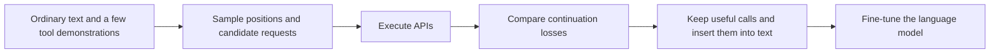

# Toolformer: How Tool Calls Become a Learnable Behavior

Once a model can access a calculator and a retrieval system, the challenge extends beyond having interfaces. Can it recognize an information gap at the right point, formulate a useful request, and use the result for its current task? Toolformer brings these decisions into language-model training: it generates candidate calls, executes them, and filters the resulting training material using continuation loss. The method makes tool use visible as a sequence of inspectable data, objectives, and execution steps. [Main paper §§1–2, PDF pp. 1–4](https://proceedings.neurips.cc/paper_files/paper/2023/file/d842425e4bf79ba039352da0f658a906-Paper-Conference.pdf)

This guide follows the NeurIPS 2023 paper and its supplement through the training procedure, the key filtering formula, the main experiments, and their limits. Toolformer is a method for learning tool use, not a complete long-horizon agent; its historical results are not a ranking of today's models. Independent teaching examples illustrate the method rather than report paper experiments.

## Tools provide capabilities; the model must decide how to use them

A language model ordinarily generates the next token from the context so far. A calculator evaluates an expression, while a retriever returns material for a query. Connecting these systems creates a channel for execution, but it does not automatically teach the model when to pause, which tool to choose, how to express the arguments, or whether the response helps.

Toolformer represents calls and responses as text, embedding tool interactions in a training sequence. Think of a request and result inserted into a passage, followed by the original continuation. At inference time, a runtime detects the delimiter requesting a result, pauses generation, executes the API, places the actual result in the context, and lets the model continue. The returned value comes from external execution rather than the model imitating a plausible answer. [Main paper §2, PDF pp. 2–4](https://proceedings.neurips.cc/paper_files/paper/2023/file/d842425e4bf79ba039352da0f658a906-Paper-Conference.pdf#page=2)

The paper uses five kinds of tool: a question-answering system, Wikipedia search, a four-function calculator, a translation system that translates into English, and a calendar that returns the date. The question-answering tool returns a short answer directly; search provides text from which the model must extract an answer. Although both find information, their response formats and reliability change the work left for the model. [Main paper §3 and Table 1, PDF p. 4](https://proceedings.neurips.cc/paper_files/paper/2023/file/d842425e4bf79ba039352da0f658a906-Paper-Conference.pdf#page=4)

## Constructing training material with calls from ordinary text

Having people label large numbers of call positions, tool types, and arguments would be costly. Instead, the authors provide a few human-written demonstrations for each tool and use an existing model to propose calls for ordinary text. These candidates are only the beginning: they must also be executed and filtered. [Main paper §2 and Figures 2–3, PDF pp. 2–3](https://proceedings.neurips.cc/paper_files/paper/2023/file/d842425e4bf79ba039352da0f658a906-Paper-Conference.pdf#page=3)

Candidate generation involves two choices. First, the method estimates which positions have a high probability of starting an API call and keeps a limited number above a threshold. It then samples several requests at each position. The text therefore need not be manually sorted into calculation questions and knowledge questions in advance. The process still depends on human-defined tools, demonstrations, thresholds, and corpus-selection rules. “Self-supervised” describes the source of the large-scale filtering signal, rather than an absence of human design.

Consider a teaching example invented for this guide: “Each box contains 24 pens; 7 boxes contain …” The model might propose calculating `24*7`, or it might propose a query unrelated to the continuation. Execution tells us whether a request produces a response; a separate criterion is needed to decide whether that response belongs in the training data. This example is not a paper sample: it illustrates why generation, execution, and filtering are distinct.

This teaching diagram summarizes the process; it is not a figure from the paper. The arrows show the order of data preparation: results first help filter candidates, and retained calls and results then become fine-tuning material, rather than directly executing a user's task at this stage.

## The filtering objective: does the result reduce uncertainty about the continuation?

Let the original text be $x_1,\ldots,x_n$, with a candidate call at position $i$. The paper measures the difficulty of predicting subsequent tokens using a weighted negative log-likelihood:

$$
L_i(z)=-\sum_{j=i}^{n}w_{j-i}\log p_M(x_j\mid z,x_{1:j-1}).
$$

Here $z$ is auxiliary text placed at the front of the context, and $w$ controls the importance of tokens at different distances from the call. A lower loss means the model can more easily predict the original continuation under those conditions. The paper uses weights that decay with distance, focusing the filter on information needed near the call. [Main paper §§2 and 4.1, PDF pp. 3, 5](https://proceedings.neurips.cc/paper_files/paper/2023/file/d842425e4bf79ba039352da0f658a906-Paper-Conference.pdf#page=3)

Let $e(c_i,r_i)$ denote the text of a call and its actual result, and let $\epsilon$ be the empty sequence. The positive and baseline losses are:

$$
L_i^+=L_i(e(c_i,r_i)),\qquad
L_i^-=\min\{L_i(\epsilon),L_i(e(c_i,\epsilon))\}.
$$

A call is kept only if $L_i^- - L_i^+\geq\tau_f$, where $\tau_f$ is the filtering threshold. The minimum matters: the returned result must improve on the better of two baselines, no call and a call without a result. Otherwise, a request whose wording reveals the answer or provides a helpful hint might be mistaken for a contribution from the external tool.

For filtering, call information is scored as a prefix; for training, the retained call is inserted at its corresponding position. These are different operations. The original model has seen little text with inserted calls, so placing one in the middle could disrupt the original distribution and interfere with the loss comparison. This is why the paper scores using a prefix. [Main paper §2 and footnote 2, PDF p. 3](https://proceedings.neurips.cc/paper_files/paper/2023/file/d842425e4bf79ba039352da0f658a906-Paper-Conference.pdf#page=3)

The objective also sets a boundary: reducing continuation loss is a computable proxy, not proof that the call's contents are true or that a user's long-term goal has been achieved. The supplement gives examples of irrelevant responses that nevertheless reduce loss. The filter can identify useful material at scale, while leaving correctness to be assessed separately. [Supplement §E, PDF p. 5](https://proceedings.neurips.cc/paper_files/paper/2023/file/d842425e4bf79ba039352da0f658a906-Supplemental-Conference.pdf#page=5)

## Fine-tuning, inference, and zero-shot evaluation play different roles

After filtering, the authors combine the calls and results with the original text and fine-tune the model using the ordinary language-modeling objective. The model thus learns where calls appear, how requests are formatted, and how to continue after receiving a result. The main experiments use a CCNet subset and GPT-J, which the paper denotes as 6.7B. That figure identifies the base model, excluding external systems it can call, such as the Atlas question-answering model; it is therefore insufficient to calculate the cost of the whole system. [Main paper §§2 and 4.1, PDF pp. 4–5](https://proceedings.neurips.cc/paper_files/paper/2023/file/d842425e4bf79ba039352da0f658a906-Paper-Conference.pdf#page=5)

Data preparation also uses tool-specific rules. Calculator material favors text containing numbers and arithmetic relationships; calendar dates are approximated from dates in document URLs; translation material starts with passages containing non-English fragments. These rules affect where each tool gets training opportunities. The supplement also distinguishes Atlas-large for constructing the question-answering training data from Atlas-xxl at inference, showing why external components belong in the comparison conditions. [Supplement §A.1, PDF p. 1](https://proceedings.neurips.cc/paper_files/paper/2023/file/d842425e4bf79ba039352da0f658a906-Supplemental-Conference.pdf#page=1)

“Zero-shot” here means that downstream tests provide task instructions but no examples of that task; the model has already been fine-tuned on tool-call data. Evaluation also introduces two interventions: a call can be triggered when its start marker is among the ten highest-probability tokens, and each input is limited to one API call. The first encourages calls and the second limits loops. Both conditions matter when interpreting the scores. [Main paper §4.2, PDF pp. 5–6](https://proceedings.neurips.cc/paper_files/paper/2023/file/d842425e4bf79ba039352da0f658a906-Paper-Conference.pdf#page=6)

## Controls separate training material from actual tool calls

Comparing Toolformer only with the original GPT-J would leave the effects of extra training and tool execution entangled. The paper therefore includes GPT-J + CC, fine-tuned on the same ordinary corpus, and Toolformer trained on call data with its API disabled at test time. The former controls for corpus training; the latter helps distinguish training on calls from receiving external results during testing.

The table excerpts two mathematics datasets from Table 3. Values are percentages correct under the paper's scoring rule. All use its zero-shot prompting setup; the GPT-J variants share a base model, and Toolformer with calls enabled follows the single-call and triggering rules above. Scoring takes the first number generated, or the first number after an equals sign if an equation appears; it does not grade each step of a complete reasoning process. [Main paper §§4.1–4.2 and Table 3, PDF pp. 5–6](https://proceedings.neurips.cc/paper_files/paper/2023/file/d842425e4bf79ba039352da0f658a906-Paper-Conference.pdf#page=6)

| Model condition | ASDiv | SVAMP |
| --- | ---: | ---: |
| GPT-J | 7.5 | 5.2 |
| GPT-J + CC | 9.6 | 5.0 |
| Toolformer, API disabled | 14.8 | 6.3 |
| Toolformer, API enabled | 40.4 | 29.4 |

The comparison supports an additional benefit from actual tool calls under these test conditions. It does not establish mastery of all mathematical reasoning: even with an accurate calculator, the model can choose the wrong operation or supply wrong arguments. The improvement with the API disabled also cannot all be attributed to a particular internal ability, since the experiment did not measure that mechanism directly.

For question answering, the authors disable the direct question-answering tool, use retrieval to help answer, and score whether the correct answer occurs in the first twenty generated words. Toolformer improves on the same-base results, but remains below the paper's GPT-3 175B comparison on these question-answering datasets; on MLQA it also falls short of original GPT-J in some languages. The contribution is a clear learnable mechanism with controlled evidence, rather than a claim that connecting tools improves everything. [Main paper §4.2 and Tables 4–5, PDF pp. 6–7](https://proceedings.neurips.cc/paper_files/paper/2023/file/d842425e4bf79ba039352da0f658a906-Paper-Conference.pdf#page=7)

## Tool value depends on the base model, feedback, and task boundaries

A tool is not a fixed increment in performance. If a base model can already answer a question, noisy retrieval can distract it. In further experiments with LLaMA v1 7B, the supplement finds that a stronger direct question-answering tool still helps with knowledge completion, whereas the weaker Wikipedia retrieval tool does not produce the same benefit on question answering. The models used to generate and score candidates also change which calls are retained. The comparison is the important lesson: measure tool value against a specific base model and task, rather than judging it solely by whether a call succeeds. [Supplement §§G.2–G.4 and Tables 7–8, PDF pp. 7–9](https://proceedings.neurips.cc/paper_files/paper/2023/file/d842425e4bf79ba039352da0f658a906-Supplemental-Conference.pdf#page=7)

The claim that language ability is preserved has conditions too. With the API disabled, the main paper measures perplexity on WikiText and a CCNet subset excluded from training; Toolformer matches the CCNet-only fine-tuned control. This does not establish preservation of every ability or evaluate the probabilities of every possible tool path when calls are enabled. [Main paper §4.3 and footnote 5, PDF p. 8](https://proceedings.neurips.cc/paper_files/paper/2023/file/d842425e4bf79ba039352da0f658a906-Paper-Conference.pdf#page=8)

The paper explicitly states that its method cannot form reliable chains of calls or support interactive retrieval with repeated query rewriting and inspection of multiple results. Candidate calls are generated independently, so training data lack demonstrations where one tool's result enters a later call. In addition, input wording affects call decisions, producing useful material can be inefficient, and the filtering objective omits the computational costs of different tools. These limits make the method better suited to learning useful local calls than to providing a complete agent's sustained planning and learning from feedback. [Main paper §6, PDF p. 9](https://proceedings.neurips.cc/paper_files/paper/2023/file/d842425e4bf79ba039352da0f658a906-Paper-Conference.pdf#page=9)

## Returning to the paper and continuing the inquiry

To master the method, start with the filtering equations and footnote 2 on page 3 of the main paper, and explain why the comparison uses both an empty prefix and a request alone. Then read Table 3 and its evaluation description on page 6, translating each score back into its model, tool, triggering policy, and scoring rule. For the value of tools with stronger models, turn to supplement §G, especially Table 8: the presence of a tool and its benefit to a given model are separate things to measure. [Method and filtering, PDF p. 3](https://proceedings.neurips.cc/paper_files/paper/2023/file/d842425e4bf79ba039352da0f658a906-Paper-Conference.pdf#page=3) [Evaluation conditions and Table 3, PDF p. 6](https://proceedings.neurips.cc/paper_files/paper/2023/file/d842425e4bf79ba039352da0f658a906-Paper-Conference.pdf#page=6) [Supplement Table 8, PDF p. 9](https://proceedings.neurips.cc/paper_files/paper/2023/file/d842425e4bf79ba039352da0f658a906-Supplemental-Conference.pdf#page=9)

One question to pursue is how an evaluation should record both benefit and cost if a tool lowers continuation loss while adding latency or providing wrong information. This is an editorial question prompted by the objective and limitations, not a solution validated by the paper or a claimed research gap. The [HELM evaluation guide](/read/helm/1) helps distinguish scenarios, metrics, and adaptation conditions; the [Agent survey](/read/agent-survey/1) places tool learning within a larger system. This guide has not reproduced the experiments or explained every prompt, scaling experiment, or supplemental failure case. Its pen-box example and process diagram are independent teaching aids.
