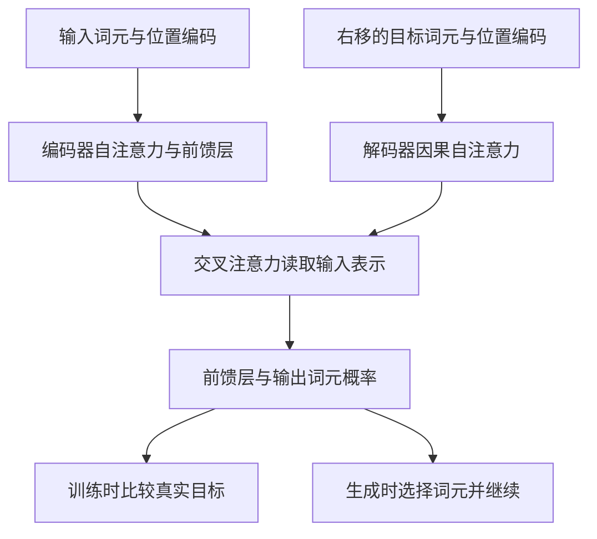

# Transformer：注意力怎样把序列变成可计算的上下文

阅读大语言模型和 Agent 论文时，经常会遇到“上下文”“注意力”和“自回归”这些词。Transformer 的价值，是把它们还原为具体的信息通路：一个位置能看到哪些位置，怎样取出相关信息，又怎样预测后续输出。它研究的是序列转换架构，主要证据来自机器翻译，并没有直接提出今天的对话助手或 Agent 系统。[原论文 §1–3，PDF 第1–3页](https://proceedings.neurips.cc/paper/2017/file/3f5ee243547dee91fbd053c1c4a845aa-Paper.pdf)

本文固定采用 NIPS 2017 正式会议 PDF，沿着“预测什么—信息如何流动—怎样训练—实验支持什么”展开。讲解保留理解后续语言模型所需的公式和条件，不逐项复述全部实验，也不把历史翻译成绩解释成通用智能证明。

## 从翻译任务理解预测对象

设输入句子的词元序列为 $x$，目标译文为 $y_1,\ldots,y_m$。模型需要估计的不是一个不分先后的整句标签，而是一连串条件概率。用教学记号写成：

$$
p_\theta(y\mid x)=\prod_{t=1}^{m}p_\theta(y_t\mid y_{<t},x).
$$

这里的 $\theta$ 是训练得到的参数，$y_{<t}$ 是当前位置之前的译文。编码器先把输入转换成一组上下文表示；解码器结合这些表示及已经知道的输出前缀，给下一个词元分配概率。这就是论文采用的编码器—解码器和自回归生成关系。[§3，PDF 第2–3页](https://proceedings.neurips.cc/paper/2017/file/3f5ee243547dee91fbd053c1c4a845aa-Paper.pdf#page=2)

训练时，正确译文已经存在，可以把它向右移一位作为解码器输入。例如，要预测“我 喜欢 阅读”，输入端提供“起始符 我 喜欢”，监督目标对应“我 喜欢 阅读”。每个位置只接收更早的目标词元。这种使用真实前缀的训练方式通常称为 teacher forcing。推理时没有完整正确译文，只能把已经生成的词元接回输入，逐步继续。

因此，“训练可并行”与“生成要逐步进行”并不矛盾。训练阶段已知整段前缀材料，可以同时计算多个位置，但必须遮住不该看到的答案；生成阶段的下一个输入尚未产生，依然存在时间顺序。论文移除了循环网络逐位置传递隐状态的结构，并没有消除自回归输出的依赖。

## 注意力计算：查询怎样从上下文取信息

理解注意力，先把“匹配”和“取值”分开。查询 $Q$ 表示当前位置用于匹配的信息，键 $K$ 提供被匹配的表示，值 $V$ 提供最终要汇集的内容。它们是训练得到的投影，不是人工填好的关键词索引，也不要求每一维都有可命名的语义。

论文的缩放点积注意力为：

$$
\operatorname{Attention}(Q,K,V)=\operatorname{softmax}\!\left(\frac{QK^\top}{\sqrt{d_k}}\right)V.
$$

若有 $n$ 个查询和 $s$ 个可读取位置，$QK^\top$ 就产生 $n\times s$ 个匹配分数。softmax 对每个查询对应的一行归一化，再对各位置的值向量加权求和。输出仍是一组向量，只是每个向量已经汇入了其他位置的信息。注意力权重体现这一层的数值混合关系；单凭高权重，不能推出人类意义上的理解、解释或事实依据。[§3.2.1、图2与式1，PDF 第4页](https://proceedings.neurips.cc/paper/2017/file/3f5ee243547dee91fbd053c1c4a845aa-Paper.pdf#page=4)

分母 $\sqrt{d_k}$ 不是装饰。向量维度增大时，点积分数可能变得很大，使 softmax 过度集中并进入梯度很小的区域。论文用分量独立、均值为零且方差为一的简化假设说明：点积方差随 $d_k$ 增长，缩放可以缓解这个问题。这个推导说明设计动机，并不表示实际训练中的所有分量始终符合这些假设。

一个教学例子是翻译包含代词的句子：当前位置可能需要结合前面的名词以及其他语法信息。注意力让相关位置之间能够直接建立计算联系。但“能建立联系”只是架构提供的通路；哪些联系有用，仍须由数据和训练目标塑造。

## 多头、前馈层和残差共同组成一个模块

单次注意力把若干来源混合成一个表示。多头注意力则先用不同投影形成多组查询、键和值，让各组分别计算，再拼接并投影回来：

$$
\operatorname{head}_i=\operatorname{Attention}(QW_i^Q,KW_i^K,VW_i^V),\qquad
\operatorname{MultiHead}=\operatorname{Concat}(\operatorname{head}_1,\ldots,\operatorname{head}_h)W^O.
$$

不同头可以在不同表示子空间中处理关系；这不是提前规定“一头管主语、一头管时态”。基础模型使用 $h=8$、$d_{\text{model}}=512$，每头键和值的维度为 64。各头缩小维度后，总计算量可与单个全维注意力相近，而不是简单做八遍同样大的运算。[§3.2.2–3.2.3，PDF 第4–5页](https://proceedings.neurips.cc/paper/2017/file/3f5ee243547dee91fbd053c1c4a845aa-Paper.pdf#page=5)

注意力负责位置之间的信息交换，逐位置前馈网络进一步变换每个位置的特征。论文使用两次线性变换，中间接 ReLU；同一层对不同位置使用同一套前馈参数，不同层则有不同参数。因此，标题强调注意力，并不表示模型里只有加权求和。

基础架构的编码器和解码器分别堆叠六层，六层结构相同并不表示共享所有参数。每个子层外围都有残差连接和层归一化，原文写作 $\operatorname{LayerNorm}(x+\operatorname{Sublayer}(x))$：先把子层输出加回原表示，再做归一化。后续模型可能改变这个顺序，读新论文时应核对，不能把所有 Transformer 视为完全相同的实现。[§3.1、§3.3，图1，PDF 第3–5页](https://proceedings.neurips.cc/paper/2017/file/3f5ee243547dee91fbd053c1c4a845aa-Paper.pdf#page=3)

## 三种注意力通路与位置编码

同一个注意力公式在架构中承担三种工作。编码器自注意力的查询、键和值都来自编码器上一层，可以读取整段输入。解码器自注意力从目标序列自身取信息，但有因果遮罩。编码器—解码器注意力则用解码器表示作查询，用编码器输出作键和值，使当前生成位置能够读取原句。这最后一种常被称为交叉注意力。

这是独立编写的教学示意，不是原图复刻；图中省略了重复层和残差等细节。核心关系是：输入侧信息可以整体读取，输出侧必须遵守时间顺序，两侧通过交叉注意力相连。

遮罩在 softmax 之前把非法连接的分数设为负无穷，使其权重成为零。配合右移输入，预测某个目标词元时就看不到该词元及后续答案。只移动输入却允许任意读取后方位置，仍可能泄露答案；只谈遮罩却忽略输入和监督的对齐，也容易把“当前能看到什么”理解错。[§3.1、§3.2.3，PDF 第3、5页](https://proceedings.neurips.cc/paper/2017/file/3f5ee243547dee91fbd053c1c4a845aa-Paper.pdf#page=5)

移除循环结构之后，还需要提供顺序信息。论文把位置编码与词元嵌入相加，使用不同频率的正弦和余弦：

$$
PE_{(pos,2i)}=\sin\left(\frac{pos}{10000^{2i/d_{\text{model}}}}\right),\qquad
PE_{(pos,2i+1)}=\cos\left(\frac{pos}{10000^{2i/d_{\text{model}}}}\right).
$$

这里 $pos$ 是位置，$i$ 索引维度。多种频率为不同距离提供不同的数值模式，模型再学习如何使用这些信息。作者认为这种设计可能有利于处理训练时未见的更长序列，但论文没有证明无限长度泛化；它还比较了可学习的位置嵌入，两者在对应实验中表现接近。[§3.5，PDF 第6页](https://proceedings.neurips.cc/paper/2017/file/3f5ee243547dee91fbd053c1c4a845aa-Paper.pdf#page=6)

## 并行性的收益，需要连同计算条件一起读

循环层沿序列逐步计算，远距离信息要经过较长的路径。全局自注意力让任意两个位置可以直接相连，因此每层的最短信息通路更短，也更适合并行计算。这解释了架构为什么有希望提高训练效率，不等于任何输入规模下都更省计算。

原文表1用序列长度 $n$、表示维度 $d$ 比较：全局自注意力每层复杂度约为 $O(n^2d)$，循环层约为 $O(nd^2)$。当序列很长时，两两匹配的二次项会成为负担；论文也因此讨论局部限制注意力的可能性。并行步骤较少、总运算量较低、实际硬件耗时较短是三个相关但不同的问题。[§4、表1，PDF 第6–7页](https://proceedings.neurips.cc/paper/2017/file/3f5ee243547dee91fbd053c1c4a845aa-Paper.pdf#page=6)

训练也不只是选一个注意力公式。作者使用子词切分、Adam、学习率预热与衰减、dropout 和标签平滑。英德实验约用 450 万句对，英法约用 3600 万句对。基础模型训练 10 万步，大模型训练 30 万步；这些数据和优化选择都属于结果的条件，不能把全部增益孤立归因于某一条公式。[§5，PDF 第7–8页](https://proceedings.neurips.cc/paper/2017/file/3f5ee243547dee91fbd053c1c4a845aa-Paper.pdf#page=7)

## 翻译结果与消融分别支持什么

下面只摘录论文表2中两个 Transformer 配置的事实。评测是 WMT 2014 英德、英法翻译的 newstest2014，指标为 BLEU，分数更高表示在该评价规则下与参考译文更接近；它不是对全部语言能力的评分。

| 配置 | 英德 BLEU | 英法 BLEU |
| --- | ---: | ---: |
| Transformer base | 27.3 | 38.1 |
| Transformer big | 28.4 | 41.0 |

基础模型与大模型在表3英德配置中分别约为 6500 万和 2.13 亿参数；大模型宽度和前馈维度也更大。论文报告基础模型平均最后五个检查点，大模型平均最后二十个检查点，并使用 beam size 4、长度惩罚 0.6 的解码。英法大模型的 dropout 为 0.1，而表3中通用 big 配置为 0.3。这些条件值得保留，避免把一个成绩当成任何 Transformer 的默认表现。[§6.1、表2–3，PDF 第8–9页](https://proceedings.neurips.cc/paper/2017/file/3f5ee243547dee91fbd053c1c4a845aa-Paper.pdf#page=8)

表3回答的是另一个问题：改变组件会怎样。它使用英德 newstest2013 开发集，不做检查点平均，所以不能直接拿其中分数和上表相减。相近计算预算下，基础八头配置为 25.8 BLEU，单头为 24.9；头数继续增加也不是单调更好。把正弦位置编码换成学习式位置嵌入得到 25.7，与基础配置接近。前者支持在这套设置中多头有帮助，后者提示“提供位置”与“必须使用某一位置函数”应当区分。[§6.2、表3，PDF 第9页](https://proceedings.neurips.cc/paper/2017/file/3f5ee243547dee91fbd053c1c4a845aa-Paper.pdf#page=9)

## 从架构基础走向语言模型与 Agent

这篇论文最值得带走的是一组可检查的问题：查询、键和值来自哪里；哪个位置被遮住；位置怎样进入表示；参数在哪一步更新；测试是否允许看到答案。它们比把“注意力”理解成抽象的智能开关更有用。

原文的完整编码器—解码器服务于序列转换。后续自回归语言模型可以采用不同的 Transformer 结构与训练目标，不能直接套用“六层编码器加六层解码器”的配置。进一步构造 Agent，还需要任务目标、环境交互、工具执行、状态管理和评价机制。注意力提供上下文内的信息处理，不能单独证明这些系统能力。

这是一条编辑性阅读顺序：掌握本篇后，再看 GPT-3 如何把自回归预训练与上下文示范结合；接着读 InstructGPT，区分“续写能力”与“按人的意图行动”的训练问题；最后回到 Agent 综述，将模型放进更大的系统。这个顺序帮助组织理解，不意味着前一篇论文已经验证后一篇的全部结论。

## 回到原文时，优先检查哪些地方

- 若不清楚三种注意力的区别，先对照图1与 §3.2.3，为每个模块标出查询、键和值的来源，尤其检查解码器右移与遮罩。[图1与 §3.2.3，PDF 第3–5页](https://proceedings.neurips.cc/paper/2017/file/3f5ee243547dee91fbd053c1c4a845aa-Paper.pdf#page=3)
- 若公式看懂了却不理解多头的必要性，连读图2、§3.2.2 和表3：先看投影、拼接与输出投影，再核对单头比较的维度和开发集条件。[图2与 §3.2.2，PDF 第4–5页](https://proceedings.neurips.cc/paper/2017/file/3f5ee243547dee91fbd053c1c4a845aa-Paper.pdf#page=4)
- 若关心效率，读表1和 §5–6，把理论复杂度、训练配置、解码设置和测试指标分开记录，不只摘取“训练更快”的结论。[表1与 §4–6，PDF 第6–9页](https://proceedings.neurips.cc/paper/2017/file/3f5ee243547dee91fbd053c1c4a845aa-Paper.pdf#page=6)

本篇覆盖方法主线、主要翻译结果及少量消融；没有复现实验、逐项审查全部超参数或展开所有引用工作。教学图和解释性例子均为本篇原创，原始图表的具体结构、数值和上下文仍应以固定会议 PDF 为准。阅读本篇或打开原文都不会自动记为完成阅读。
