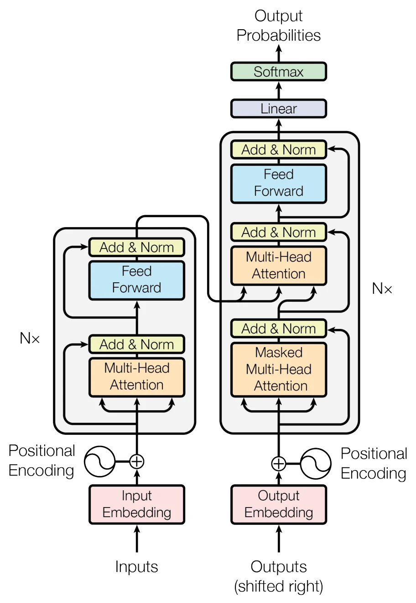
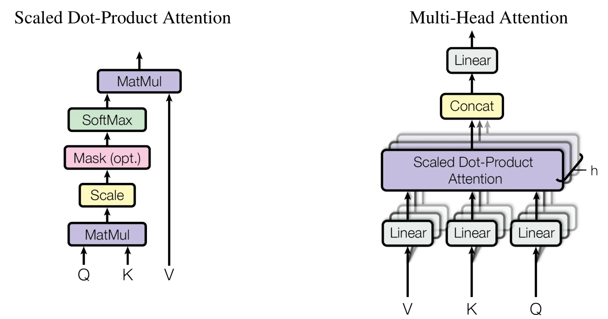

# Transformer：只用注意力完成序列转换

2017 年，八位作者（多数来自 Google Brain 和 Google Research）发表了一篇标题很大胆的论文：《Attention Is All You Need》。它要解决的是机器翻译这类“把一个序列变成另一个序列”的任务。当时的强基线包括采用注意力的循环和卷积模型。作者要试的是，把负责跨位置传递信息的循环和卷积都拿掉，能否在翻译质量和训练成本上取得更好的结果。这篇论文提出的 Transformer，后来成为 GPT 系列等大语言模型共同的基础架构。[原论文摘要与 §1，PDF 第1–2页](https://proceedings.neurips.cc/paper/2017/file/3f5ee243547dee91fbd053c1c4a845aa-Paper.pdf)

今天读它，价值不在于翻译成绩，而在于它把“上下文”“注意力”“自回归生成”这些词变成了可以一步步计算的东西：一个位置怎样去别的位置取信息，模型怎样知道词的先后顺序，训练时为什么能并行、生成时却仍要一个词一个词地写。后面读任何大模型或 Agent 论文，这些问题都会反复出现。

读图时可以带着一个具体问题：预测译文中的一个词，模型从译文前文和原句中分别取了什么，又怎样把两边的信息送到词表？图 1 给出这条路线，图 2 展开沿途反复出现的多头注意力。导读中的翻译成绩、参数配置按 NIPS 2017 会议 PDF 核对；两头手算一节的数值专为演示选取。

## 2017 年的问题：循环网络为什么慢

要理解作者为什么想去掉循环结构，先要知道循环网络怎样处理一句话。RNN 把句子当成一条时间线：读第 1 个词，得到隐状态 $h_1$；再用 $h_1$ 和第 2 个词算出 $h_2$；依此类推。LSTM 和 GRU 是 RNN 的两种改良版本，用“门”来控制哪些信息保留、哪些遗忘，缓解了长句子中信息逐渐消失的问题。它们是当时语言建模和机器翻译中的重要基线。[§1，PDF 第1–2页](https://proceedings.neurips.cc/paper/2017/file/3f5ee243547dee91fbd053c1c4a845aa-Paper.pdf#page=2)

问题出在“依次”两个字上。作者指出，$h_t$ 必须等 $h_{t-1}$ 算完才能开始，这种固有的顺序性让一条训练样本内部无法并行。句子越长，这个限制越要命：显存有限，一次能并排塞进去的样本数也有限。已有的工作用分解技巧和条件计算提高了效率，但作者认为“顺序计算”这个根本约束并没有被解决。

注意力机制当时已经存在，而且很成功。在此前的翻译模型里，它让解码器在生成每个词时回头“看”原句的不同位置，不必把整句话压缩进一个固定长度的向量。它的好处是两个位置无论相隔多远，都能直接建立联系。但作者注意到，除了极少数例子，注意力都是作为循环网络的附件来用的。

另一条路线是卷积。ConvS2S 和 ByteNet 用 CNN 代替循环，所有位置可以同时计算。可是卷积每次只看一个小窗口，两个远距离的位置要经过很多层才能“接上”：ConvS2S 需要的步数随距离线性增长，ByteNet 按对数增长。距离越远，信号要走的路越长，长距离依赖就越难学。[§2，PDF 第2页](https://proceedings.neurips.cc/paper/2017/file/3f5ee243547dee91fbd053c1c4a845aa-Paper.pdf#page=2)

于是作者把目标说得很清楚：既要像卷积一样所有位置并行计算，又要像注意力一样任意两个位置一步相连。他们的答案是完全依靠自注意力（self-attention），也就是让一个序列内部的各个位置互相注意。代价也被作者自己点出来了：注意力本质上是对各位置做加权平均，平均会把细节抹平，降低“有效分辨率”。后文的多头注意力正是为了弥补这一点。

## 预测对象：编码器、解码器与自回归

在看具体结构之前，先明确模型要算什么。机器翻译属于序列转换（sequence transduction）：输入一个序列 $x=(x_1,\ldots,x_n)$，输出另一个序列 $y=(y_1,\ldots,y_m)$，两者长度可以不同。当时主流的做法是编码器—解码器结构，Transformer 沿用了它。[§3，PDF 第2–3页](https://proceedings.neurips.cc/paper/2017/file/3f5ee243547dee91fbd053c1c4a845aa-Paper.pdf#page=2)

编码器先把输入的每个词元变成一个连续向量，得到 $z=(z_1,\ldots,z_n)$。这里的“词元”（token）不一定是一个完整的词，后文会看到，论文用的是子词切分。解码器根据 $z$，一次生成一个输出词元。每生成一步，它都把自己已经生成的部分当作额外输入，再去预测下一个。这种“用自己前面的输出预测后面”的方式叫自回归（auto-regressive）。用概率写出来就是：

$$
p_\theta(y\mid x)=\prod_{t=1}^{m}p_\theta(y_t\mid y_{<t},x)
$$

这个式子是导读为了说明而写的记号，不是论文中带编号的公式。$\theta$ 是模型参数，$y_{<t}$ 是第 $t$ 个位置之前已经确定的输出。整句译文的概率，被拆成一连串“已知原句和前文，下一个词是什么”的条件概率相乘。

训练时有一个便利：正确译文已经摆在那里。可以把正确译文整体向右移一位喂给解码器，让每个位置同时去预测“自己的下一个词”。比如要学会输出“我 喜欢 阅读”，解码器输入是“〈起始〉 我 喜欢”，三个位置分别对应目标“我”“喜欢”“阅读”。这种用真实前文代替模型自己生成结果的训练方式，通常称为 teacher forcing。论文图 1 右下角的 “Outputs (shifted right)” 指的就是这个右移。

推理时情况不同。没有正确答案可以参照，模型只能把刚生成的词接回输入，再算下一个，一步一步来。所以 Transformer 的“可以并行”指的是训练：整段目标序列已知，所有位置能同时计算。生成阶段的先后依赖依然存在。读后面的论文时，这个区分会反复用到：一个模型训练快，不代表它生成快。

不过训练时同时计算所有位置，会带来一个风险：某个位置可能偷看到后面的正确答案。论文用“遮罩”来堵住这个漏洞，后面讲解码器时会具体说明。

## 先看全貌：图 1 怎样读

这张图是整篇论文最常被引用的图，值得花几分钟把它读熟。建议从下往上看，并且左右分开看。[§3.1 与图 1，PDF 第3页](https://proceedings.neurips.cc/paper/2017/file/3f5ee243547dee91fbd053c1c4a845aa-Paper.pdf#page=3)

**左边是编码器。** 输入词元先经过 Input Embedding，被转换成长度为 $d_{\text{model}}=512$ 的向量；然后加上 Positional Encoding（位置编码，图中的波形符号和 ⊕）。接下来进入灰色大框，框外的 “N×” 表示这个框重复堆叠 N 次，论文中 $N=6$。每一层里有两个子层：先是 Multi-Head Attention（多头注意力），再是 Feed Forward（前馈网络）。每个子层后面都跟着一个 Add & Norm，旁边那条绕过子层的箭头就是残差连接。

**右边是解码器。** 结构和编码器相似，但每层有三个子层。最下面的是 Masked Multi-Head Attention，“Masked”就是遮罩，保证每个位置只能看到自己和前面的位置。中间的 Multi-Head Attention 很特别：注意看它的三个输入箭头，有两个来自左边编码器的输出，一个来自解码器下方。这一层让解码器在生成时去“查阅”原句。最上面同样是前馈网络。

**顶部是输出。** 解码器最后的向量经过 Linear（线性变换）和 Softmax，变成词表上每个词元的概率，即 Output Probabilities，模型据此选出下一个词元。

**每个子层都包在 Add & Norm 里。** 用论文的写法，子层的输出是 $\operatorname{LayerNorm}(x+\operatorname{Sublayer}(x))$：先把子层的结果加回它的输入（残差连接），再做层归一化（LayerNorm）。残差连接让信号和梯度可以“抄近路”穿过很多层，是训练深层网络的常用办法。为了能直接相加，模型里所有子层和嵌入层的输出维度都统一为 512。

六层编码器结构相同，但每层有自己的参数，并不共享。还有一个后来经常被改动的细节：原论文把归一化放在相加之后。后续不少模型改成在子层之前做归一化，读新论文时不要默认它们和原版完全一样。

图里每个方框后面都对应一段具体计算。下面按“注意力 → 多头 → 前馈与残差 → 三种用法与位置”的顺序逐个打开。

## 缩放点积注意力：查询怎样从上下文取信息

论文先给出注意力的一般定义：把一个查询（query）和一组“键—值”对（key-value pairs）映射成一个输出。输出是各个值的加权和，每个值的权重由查询和对应键的匹配程度决定。[§3.2，PDF 第3页](https://proceedings.neurips.cc/paper/2017/file/3f5ee243547dee91fbd053c1c4a845aa-Paper.pdf#page=3)

可以用查资料来类比。查询是“我现在想找什么”，键是每份资料的标签，值是资料的内容。查询和每个标签比一比，越匹配的资料权重越高，最后把所有资料按权重混合起来带走。和查字典不同的是，这里不是只取一份最匹配的，而是按比例全都取一点。另外，Q、K、V 都是模型从数据里学出来的向量，不是人工填写的关键词，也不保证每一维都有可解释的含义。

图 2 左边是论文的具体做法，作者称之为缩放点积注意力（Scaled Dot-Product Attention）。从下往上读：Q 和 K 做矩阵乘法（MatMul）得到匹配分数，除以一个缩放因子（Scale），可选地加遮罩（Mask），经过 softmax 变成权重，最后和 V 相乘。写成公式就是论文的式 (1)：

$$
\operatorname{Attention}(Q,K,V)=\operatorname{softmax}\!\left(\frac{QK^\top}{\sqrt{d_k}}\right)V
$$

图 1 里橙色框有三条输入线。先跟着一个头走图 2 左半边：有 $n$ 行查询 $Q$（每行 $d_k$ 个数）、$s$ 行键 $K$（每行也是 $d_k$ 个数）和 $s$ 行值 $V$（每行 $d_v$ 个数）。底部 MatMul 将 $Q$ 乘以转置后的 $K$，得到 $n\times s$ 的分数矩阵。第 $i$ 行第 $j$ 列是查询 $i$ 和键 $j$ 的点积，两者特征越相合，分数越高。[§3.2.1、图 2 与式 1，PDF 第4页](https://proceedings.neurips.cc/paper/2017/file/3f5ee243547dee91fbd053c1c4a845aa-Paper.pdf#page=4)

从 Scale 向上，先除以 $\sqrt{d_k}$，再在需要遮罩的通路上把禁止读取的格子改为 $-\infty$。SoftMax **沿每一行的键位置**归一化：每个查询自己分配总和为 1 的权重。顶端 MatMul 才接上一直从右边绕过来的 $V$，用权重混合值向量，形成 $n\times d_v$ 的输出。若有三个译文位置在查询五个原文位置，权重就有三行五列，最后带走三个向量。图 1 顶端也有 Softmax，但那一步沿词表分配概率，这一步沿可读位置分配权重。

为什么要除以 $\sqrt{d_k}$？这是论文里少数给出推理的设计。作者先比较了两种常见注意力：一种是加性注意力，用一个小的前馈网络计算匹配分；另一种是点积注意力，直接做内积。两者理论复杂度相近，但点积可以用高度优化的矩阵乘法实现，实际快得多，也省内存。问题是，已有实验显示，向量维度 $d_k$ 较大时，不缩放的点积注意力不如加性注意力。

作者的猜测是：维度大了，点积的数值会变得很大，把 softmax 推到梯度极小的区域，训练就学不动了。论文脚注给了一个直觉：如果 $q$ 和 $k$ 的每个分量都是均值为 0、方差为 1 的独立随机变量，那么点积 $q\cdot k=\sum_{i=1}^{d_k}q_ik_i$ 的方差就是 $d_k$。除以 $\sqrt{d_k}$，正好把方差拉回 1。这个推导是为了说明动机，实际训练中的向量未必满足这些假设，但缩放这一步后来几乎被所有实现沿用。

读到这里可以停下来想一想：注意力权重高，是否说明模型“理解”了这两个位置的关系？论文没有这样说。权重描述的是这一层里数值怎样混合，单凭它不能推出人类意义上的理解或因果解释。作者在 §4 提到，有些注意力头的分布看起来和句法结构有关，但那是观察，不是证明。

## 多头注意力：沿图 2 读完一个模块

回到图 1 左下方的橙色框。一个源词要读另一个词的位置，也要取回那个位置携带的内容。单头对**每个查询位置**算一行权重，这一行的所有值向量共用同一组混合比例。例如，两个位置各有一条线索，一条有助于判定动作，另一条有助于确定动作的对象。如果权重各为一半，两条线索都会进来，但所有值的分量都按同一比例折中。一个加权和往往对应多种原始组合，下一层只拿到这个和。作者所说的平均会降低“有效分辨率”，可以这样理解。

图 2 右半边把这一次读取改为并行的多次读取。假设有 $n$ 个查询、$s$ 个可查位置，模块入口的三个矩阵分别为 $Q\in\mathbb R^{n\times512}$、$K,V\in\mathbb R^{s\times512}$。这里的 $Q,K,V$ 指进入多头模块的表示，图 2 左半边公式用的是它们**投影到一个头之后**的矩阵。基础模型有 $h=8$ 个头，每头键宽 $d_k=64$、值宽 $d_v=64$。[§3.2.2，PDF 第4–5页](https://proceedings.neurips.cc/paper/2017/file/3f5ee243547dee91fbd053c1c4a845aa-Paper.pdf#page=5)

| 顺着右图向上 | 对一个头 $i$ 做的事 | 基础模型的形状 |
| --- | --- | --- |
| 底部三个 Linear | 图中从左到右是 $V,K,Q$。分别右乘该头自己的 $W_i^V,W_i^K,W_i^Q$，让同一位置在三个任务中有不同的表示。 | 三个权重矩阵都是 $512\times64$。$Q_i$ 是 $n\times64$，$K_i,V_i$ 各是 $s\times64$。 |
| 成叠的 Scaled Dot-Product Attention | 每块都执行左图的整个过程。$Q_iK_i^\top$ 比较位置，除以 $\sqrt{64}=8$，按通路加遮罩，对每行做 softmax，再乘以 $V_i$。 | 一头得到 $n\times s$ 的权重和 $n\times64$ 的输出。八头各有自己的权重分布。 |
| Concat | 对同一个查询位置，把八个头的输出按特征维首尾相接。位置的顺序和数目都保留。 | 八个 $n\times64$ 拼成一个 $n\times512$。 |
| 顶部 Linear | 右乘可学习的 $W^O$，把来自各头的特征重新组合，供后续层使用。 | $W^O$ 一般为 $(h d_v)\times d_{\rm model}$，此处为 $512\times512$。输出仍为 $n\times512$。 |

一般写法是 $W_i^Q,W_i^K\in\mathbb R^{d_{\rm model}\times d_k}$、$W_i^V\in\mathbb R^{d_{\rm model}\times d_v}$。每个头都能从**全部** 512 个输入分量里学习怎样取出 64 个特征。因此不能把底部 Linear 简化成把原向量的前 64 个数交给第一头、后 64 个数交给第二头。把表中的四行合起来，就是论文的多头公式。

$$
\operatorname{head}_i=\operatorname{Attention}(QW_i^Q,KW_i^K,VW_i^V),\qquad
\operatorname{MultiHead}(Q,K,V)=\operatorname{Concat}(\operatorname{head}_1,\ldots,\operatorname{head}_h)W^O
$$

沿图 1 中橙色框向上走，输出要和绕过它的残差支路相加。即使查的是另一种长度的序列，回来时仍是**每个查询位置一个** 512 维向量。图 1 最顶端的 Linear 则把解码器表示变成词表上的分数，两处 Linear 的用途不同。

## 教学算例：一个查询怎样从两处各取一条线索

取图 1 右侧中间的交叉注意力。假设译文的当前位置向原句的两个位置查询，想把两处的特征分别带回来。下面把宽度降到 $d_{\rm model}=2$，设两头各有 $d_k=d_v=1$，只算一个查询。所有输入和参数都是为手算而指定的教学数值。原论文的训练模型和翻译结果用的是上一节的真实配置。

**先沿右图底部的三条线投影。** 设解码器提供的查询为 $Q=[1,1]$，编码器提供的 $K,V$ 都是二阶单位矩阵，即两个位置的输入行分别为 $[1,0]$ 和 $[0,1]$。下表的三个 $W$ 都是两行一列，右乘就是取内积。表末列中的两个数按**源位置**排列。

| 头 | $W_i^Q$ | $W_i^K$ | $W_i^V$ | 投影后的查询、键、值 |
| --- | --- | --- | --- | --- |
| 头 1 | $(1,0)^\top$ | $(\ln 3,0)^\top$ | $(4,0)^\top$ | 查询为 1，键为 $(\ln 3,0)^\top$，值为 $(4,0)^\top$ |
| 头 2 | $(0,1)^\top$ | $(0,\ln 3)^\top$ | $(0,8)^\top$ | 查询为 1，键为 $(0,\ln 3)^\top$，值为 $(0,8)^\top$ |

**再算两个紫色方框。** 头 1 得分 $[1\cdot\ln 3,1\cdot0]=[\ln 3,0]$。这里 $\sqrt{d_k}=1$，两个源位置都允许读取。取指数得到 $[3,1]$，逐项除以总和 4，权重为 $[3/4,1/4]$。乘以值后，头 1 取回 $(3/4)\times4+(1/4)\times0=3$。头 2 得分为 $[0,\ln 3]$，权重恰好相反，为 $[1/4,3/4]$，于是取回 $(1/4)\times0+(3/4)\times8=6$。

**最后拼接、投影。** Concat 把两个标量变成行向量 $[3,6]$。若令 $W^O$ 的两行分别为 $[1,1]$ 和 $[1,-1]$，最终输出便是 $[3+6,3-6]=[9,-3]$。图 1 中这一行接着与查询侧的残差相加，再做归一化。分数的 softmax 出现在各头内部，最后带回来的特征值可以为负。

可以用同一组值做个对照。假设让一个头直接混合两个值向量 $[4,0]$ 和 $[0,8]$，给第一个位置权重 $a$，结果就是 $[4a,8(1-a)]$。要同时得到刚才拼接前两头分别取回的 3 和 6，第一维要求 $a=3/4$，第二维却要求 $a=1/4$。在这个例子里，两头可以各自选择一次混合比例。这只比较给定取值下的混合步骤；换一套可学习的参数，单头也能算出许多其他表示。作者没有给头规定“主语”“宾语”这样的固定职责。

**为什么八头没有把主要乘法量放大八倍？** 回到真实的 512 维模型。一次查询与一个键比较，单头要在宽度 512 上做点积，八头是在八个宽度 64 上各做一次。对 $n$ 行查询、$s$ 个键，打分的乘加数按 $ns\,h d_k$ 增长，按权重取值按 $ns\,h d_v$ 增长。只要 $h d_k=h d_v=512$，两步的主要矩阵乘法量与宽度 512 的单头相近。输入投影也同理，八个 $512\times64$ 的投影拼起来与一个 $512\times512$ 投影的参数量相同。每头仍各算一张 $n\times s$ 的权重表，各做一次 softmax，所以这个比较不能直接换算成相同的显存或运行时间。[§3.2.2，PDF 第4–5页](https://proceedings.neurips.cc/paper/2017/file/3f5ee243547dee91fbd053c1c4a845aa-Paper.pdf#page=5)

## 回到图 1：前馈层与残差怎样接住多头的输出

图 1 左侧的线经过第一个 Add & Norm，就从橙色框走进了蓝色的 Feed Forward；在右侧，到蓝色框之前还会多经过一层交叉注意力。多头决定去哪些位置取信息，接下来的逐位置前馈网络（Position-wise Feed-Forward Network）则单独加工每个位置拿到的向量。

$$
\operatorname{FFN}(x)=\max(0,\,xW_1+b_1)W_2+b_2
$$

它是两个线性变换，中间夹一个 ReLU 激活函数，即 $\max(0,\cdot)$。“逐位置”是说它对序列中每个位置分别、独立地做同样的变换，位置之间在这里不交流。同一层内各位置共用参数，不同层的参数不同。维度上，输入输出是 512，中间层扩展到 $d_{ff}=2048$。作者也提到，可以把它看成两个核大小为 1 的卷积。[§3.3，PDF 第5页](https://proceedings.neurips.cc/paper/2017/file/3f5ee243547dee91fbd053c1c4a845aa-Paper.pdf#page=5)

这样可以看清论文标题中注意力负责的那部分工作。位置之间的信息沿注意力通路流动，前馈层负责变换每个位置的特征。蓝色框的输出又回到 512 维，刚好和绕行的 512 维残差相加，结果再经过 LayerNorm。

最后还有一处小设计：输入嵌入、输出嵌入和最终 softmax 之前的线性层共用同一个权重矩阵，嵌入层里还会把权重乘以 $\sqrt{d_{\text{model}}}$。[§3.4，PDF 第5页](https://proceedings.neurips.cc/paper/2017/file/3f5ee243547dee91fbd053c1c4a845aa-Paper.pdf#page=5)

## 三种注意力通路、遮罩与位置编码

从图 1 左侧的橙色框出发，移到右下，再移到右侧中间。三个框都包含图 2 的投影、并行注意力、拼接和输出投影，各自学习自己的参数。区别在于哪段表示提供查询、哪段表示供它读取，以及哪些位置可见。设源句有 $s$ 个位置，右移后的目标序列有 $t$ 个位置。[§3.2.3，PDF 第5页](https://proceedings.neurips.cc/paper/2017/file/3f5ee243547dee91fbd053c1c4a845aa-Paper.pdf#page=5)

| 图 1 的位置 | 每个头向哪里查 | 每头权重表 |
| --- | --- | --- |
| 编码器左下，自注意力 | 源句的同一组表示分别投影为 Q、K、V。一个源词可以在整句中找相关位置，再由各头带回特征。 | $s\times s$，可以读取前后文。 |
| 解码器右下，带遮罩的自注意力 | 右移后的目标侧表示提供 Q、K、V。各头可以用不同权重读取已有译文，但必须守住同一条时间边界。 | $t\times t$，主对角线及其左边可见。 |
| 解码器右侧中间，交叉注意力 | 下方经过 Add & Norm 的目标侧表示提供 Q，左侧编码器最终输出提供 K、V。同一译文位置可用不同头读取原句的不同部分。 | $t\times s$，可读取整句原文，输出仍有 $t$ 行。 |

为什么第二个框允许读对角线？继续用译文“我 喜欢 阅读”。图 1 右下输入右移后，三行依次是“〈起始〉、我、喜欢”。第 2 行要预测“喜欢”。它可以看第 1 行和第 2 行，包括自己输入的“我”。第 3 行里已经放着答案“喜欢”，所以第 2 行第 3 列的匹配分必须在 softmax 前改成 $-\infty$，该列的权重才会恰好为零。第 1 行只能读第一列，第 3 行才可以读三列。整张表可以同时算，哪些格子合法在计算前就已确定。[§3.1，PDF 第3页](https://proceedings.neurips.cc/paper/2017/file/3f5ee243547dee91fbd053c1c4a845aa-Paper.pdf#page=3)

只右移而不遮罩，答案能从后面的行传回来；若直接把待预测词放在本行，遮住后面的列也挡不住它从本行输入和残差进入。交叉注意力没有这项因果限制，整句原文在翻译开始前就已经给定。判断信息泄漏时，先确认这条箭头来自原句还是来自译文。

再沿图 1 两边的最底端找到与嵌入相加的波形符号。没有位置编码时，如果把编码器输入的词元重排，同一词元的查询、键、值会一起移动，它从其他词元取回的内容也随之移动。输出行跟着重排，这个计算本身分辨不出“谁在谁前面”。编码器要区分顺序，需要把位置作为额外信息交给它。

论文的做法是给每个位置生成一个和词向量同样长的位置编码，直接加到嵌入上。具体用的是不同频率的正弦和余弦函数：

$$
PE_{(pos,2i)}=\sin\!\left(\frac{pos}{10000^{2i/d_{\text{model}}}}\right),\qquad
PE_{(pos,2i+1)}=\cos\!\left(\frac{pos}{10000^{2i/d_{\text{model}}}}\right)
$$

$pos$ 是位置，$i$ 是维度编号。每一维对应一条正弦波，各维的波长从 $2\pi$ 到 $10000\cdot 2\pi$ 成等比变化。可以把它想成一组转速不同的指针：低维转得快，能区分相邻位置；高维转得慢，能区分远处的位置。[§3.5，PDF 第5–6页](https://proceedings.neurips.cc/paper/2017/file/3f5ee243547dee91fbd053c1c4a845aa-Paper.pdf#page=6)

为什么选这个函数？作者给了两个理由，都写成了假设。第一，对任意固定的偏移 $k$，$PE_{pos+k}$ 可以表示成 $PE_{pos}$ 的线性函数，作者猜测这会让模型容易学会按相对位置来注意。第二，它可能让模型推广到比训练时更长的序列。论文同时试了另一种做法：位置编码不用公式，直接作为参数学出来。结果两者几乎一样（见后文表 3 的 (E) 行），作者最终选择正弦版本，理由正是第二点。论文没有验证长度外推是否真的成立。

## 为什么用自注意力：复杂度、并行与路径长度

论文第 4 节专门回答“凭什么用自注意力”。作者没有只说“效果好”，而是提出了三个衡量一层网络的标准，再和循环层、卷积层逐项比较：[§4、表 1，PDF 第6–7页](https://proceedings.neurips.cc/paper/2017/file/3f5ee243547dee91fbd053c1c4a845aa-Paper.pdf#page=6)

1. 每层的总计算量；
2. 能并行的程度，用“最少需要多少步顺序操作”衡量；
3. 长距离依赖的路径长度：任意两个位置之间，信号最多要经过多少步。作者用较短的路径解释为什么长距离依赖可能更容易学习。

表 1 把结果放在一起，$n$ 是序列长度，$d$ 是表示维度，$k$ 是卷积核大小，$r$ 是受限注意力的邻域大小：

| 层类型 | 每层复杂度 | 顺序操作数 | 最大路径长度 |
| --- | --- | --- | --- |
| 自注意力 | $O(n^2\cdot d)$ | $O(1)$ | $O(1)$ |
| 循环层 | $O(n\cdot d^2)$ | $O(n)$ | $O(n)$ |
| 卷积层 | $O(k\cdot n\cdot d^2)$ | $O(1)$ | $O(\log_k n)$ |
| 受限自注意力 | $O(r\cdot n\cdot d)$ | $O(1)$ | $O(n/r)$ |

例如在图 1 左侧，一个源词在同一层就能直接读取另一个源词，计算量的代价是要为每对位置打分。表 1 的自注意力项按位置间交互计为 $O(n^2 d)$，循环层为 $O(n d^2)$。当时的子词翻译句子通常有 $n<d$，按这两项比较，自注意力较省。要估算整层，还要计入图 2 的输入输出投影和图 1 的前馈网络；表 1 的单个复杂度项不能直接当作端到端的训练成本。卷积路径一栏给出扩张卷积的对数情形，普通连续卷积核要连接远处时可能需要线性增长的层数。

这个结论有明确的适用条件。序列一长，$n^2$ 就会成为负担，这正是后来“长上下文”研究要解决的问题。作者自己也意识到了，提出可以把注意力限制在一个大小为 $r$ 的邻域内，代价是路径长度变成 $O(n/r)$，并说会在未来工作中研究。

作者还顺带提到一个好处：自注意力可能让模型更可解释。他们观察了注意力分布，发现不同的头似乎学会了不同的任务，不少还和句子的句法、语义结构有关。作者说具体例子放在附录中，但固定采用的会议 PDF 并不包含这份附录。这些属于观察，作者没有把它们当成严格的结论。

需要区分三件事：顺序步骤少、总运算量少、在实际硬件上跑得快。表 1 给出前两者的理论比较，训练配置与实测时间见下一节。

## 训练配方：数据、硬件与正则化

图 1 顶端的概率分布怎样学得？论文第 5 节给出译文监督、子词切分、优化器和正则化的具体设置。架构相同，训练和解码条件不同，成绩也不能直接归给某一个方框。[§5，PDF 第7页](https://proceedings.neurips.cc/paper/2017/file/3f5ee243547dee91fbd053c1c4a845aa-Paper.pdf#page=7)

**数据与切分。** 英德翻译用 WMT 2014 英德数据集，约 450 万句对，用 BPE 切分成子词，源语言和目标语言共用约 37000 个词元的词表。英法翻译用更大的 WMT 2014 英法数据集，3600 万句，用 word-piece 切成 32000 个词元。句对按长度相近的原则分批，每批大约包含 25000 个源词元和 25000 个目标词元。

**硬件与时长。** 一台机器，8 块 NVIDIA P100 GPU。基础模型每步约 0.4 秒，训练 10 万步，约 12 小时；大模型每步约 1.0 秒，训练 30 万步，约 3.5 天。

**优化器与学习率。** 使用 Adam 优化器，$\beta_1=0.9,\ \beta_2=0.98,\ \epsilon=10^{-9}$。学习率按论文式 (3) 变化：

$$
lrate=d_{\text{model}}^{-0.5}\cdot\min\!\left(step^{-0.5},\ step\cdot warmup^{-1.5}\right)
$$

前 $warmup=4000$ 步，学习率线性增大；之后按步数的平方根倒数逐渐减小。这种先“热身”再衰减的做法后来被广泛采用。

**正则化。** 作者用了几种防止过拟合的手段。一是 dropout，作用在每个子层输出加回残差之前，以及嵌入与位置编码相加之后，基础模型的丢弃率 $P_{drop}=0.1$。二是标签平滑（label smoothing），取值 $\epsilon_{ls}=0.1$：训练时不要求模型对正确答案给出 100% 的概率，而是留一点给其他词。作者坦言，这会让困惑度（perplexity）变差，因为模型变得不那么确定，但准确率和 BLEU 分数会提高。[§5.4，PDF 第7–8页](https://proceedings.neurips.cc/paper/2017/file/3f5ee243547dee91fbd053c1c4a845aa-Paper.pdf#page=7)

这一节值得多看一眼，因为它说明结果并不只来自一个注意力公式。子词切分、学习率热身、dropout、标签平滑、检查点平均都在起作用，把全部提升归给某一个组件是不准确的。

## 实验结果与消融：证据说明了什么

作者在 WMT 2014 的两个翻译任务上测试，测试集是 newstest2014，指标是 BLEU。BLEU 衡量机器译文和人工参考译文在词组层面的重合程度，分数越高越接近参考译文。表 2 把 Transformer 和当时的主要模型放在一起，同时列出了估算的训练计算量（FLOPs）：[§6.1、表 2，PDF 第8页](https://proceedings.neurips.cc/paper/2017/file/3f5ee243547dee91fbd053c1c4a845aa-Paper.pdf#page=8)

| 模型 | 英德 BLEU | 英法 BLEU | 训练计算量（英德 / 英法） |
| --- | ---: | ---: | --- |
| GNMT + RL | 24.6 | 39.92 | 2.3·10¹⁹ / 1.4·10²⁰ |
| ConvS2S | 25.16 | 40.46 | 9.6·10¹⁸ / 1.5·10²⁰ |
| MoE | 26.03 | 40.56 | 2.0·10¹⁹ / 1.2·10²⁰ |
| GNMT + RL 集成 | 26.30 | 41.16 | 1.8·10²⁰ / 1.1·10²¹ |
| ConvS2S 集成 | 26.36 | 41.29 | 7.7·10¹⁹ / 1.2·10²¹ |
| Transformer（base） | 27.3 | 38.1 | 3.3·10¹⁸ |
| Transformer（big） | 28.4 | 41.0 | 2.3·10¹⁹ |

这里只摘了表 2 中的部分行，“集成”指把多个模型的预测合并，通常比单个模型强。可以读出几件事。英德任务上，大模型 28.4 BLEU，比之前最好的结果（包括集成模型）高出 2 分以上；连基础模型都超过了之前所有已发表的模型，而训练计算量只有对手的一小部分。英法任务上，大模型 41.0 BLEU，超过所有已发表的单模型，训练成本不到之前最佳模型的四分之一；不过它没有超过表中的集成模型。

这些成绩有具体的设置。基础模型取最后 5 个检查点的平均，大模型取最后 20 个；解码用束搜索（beam search），束宽 4，长度惩罚 0.6；英法大模型的 dropout 用 0.1，而不是 0.3。训练计算量是作者用训练时间 × GPU 数 × 每块 GPU 的估计算力粗略换算的，不是精确测量。

**把表 3 当作对图 2 的两次追问。** 表 2 比较整套模型翻译得怎样。表 3 则从同一个基础模型出发，在英德开发集 newstest2013 上改变组件，没有使用检查点平均。下表摘出 (A)、(B) 两组并补出原表留白处沿用的基准值。基础配置 $d_{\rm model}=512$、六层、训练 10 万步。PPL 是按 BPE 子词计算的困惑度，越低越好；BLEU 越高越好。[§6.2、表 3，PDF 第8–9页](https://proceedings.neurips.cc/paper/2017/file/3f5ee243547dee91fbd053c1c4a845aa-Paper.pdf#page=9)

| 配置 | 头数 $h$ | 每头键宽 $d_k$ | 每头值宽 $d_v$ | 开发集 PPL | 开发集 BLEU |
| --- | ---: | ---: | ---: | ---: | ---: |
| 基准 | 8 | 64 | 64 | 4.92 | 25.8 |
| (A) | 1 | 512 | 512 | 5.29 | 24.9 |
| (A) | 4 | 128 | 128 | 5.00 | 25.5 |
| (A) | 16 | 32 | 32 | 4.91 | 25.8 |
| (A) | 32 | 16 | 16 | 5.01 | 25.4 |
| (B) | 8 | 16 | 64 | 5.16 | 25.1 |
| (B) | 8 | 32 | 64 | 5.01 | 25.4 |

**(A) 给定相近的计算预算，怎样分给多个头？** 作者同步改变 $h,d_k,d_v$，使 $h d_k=h d_v=512$。回到图 2，这同时改变了并行读取的次数和每次读取的宽度。与单头相比，8 头高 0.9 BLEU；增加到 16 头，BLEU 与 8 头持平；继续到 32 头，BLEU 又下降。这支持在该任务和宽度下给多个头分配预算的做法。它没有分离头数和每头宽度各自的作用，也没有测试某个头是否专门识别某种语言现象。

**(B) 保留八头，只压缩打分用的表示会怎样？** $h=8$ 和 $d_v=64$ 不变，图 2 中每个头的查询和键从 64 维缩到 32 或 16 维。读取内容的宽度相同，衡量匹配的空间变窄。开发集 BLEU 从 25.8 降到 25.4、25.1，PPL 也上升。同时总参数从约 6500 万降到 6000 万、5800 万，所以不能把差异完全归因于点积本身。作者据此提出更复杂的匹配函数值得试验，这两行没有比较任何替代函数。

表 3 的其余三组可用同样的方法读。(C) 增大前馈宽度到 4096 时是 26.2 BLEU，增加层数到八层时是 25.5，不能把不同扩容方式看成同一种改动。(D) 关掉 dropout 得到 24.6，低于基础配置的 25.8。(E) 把图 1 底部的正弦编码换成学习式位置嵌入得到 25.7，两种给位置的办法在此接近。表中没有去掉全部位置信息的对照，也没有测超出训练长度后的效果。

## 这篇论文之后：从翻译架构到语言模型

作者在结论中说，他们会把 Transformer 用到文本以外的输入输出，比如图像、音频和视频，研究局部的受限注意力来处理大规模输入，并让生成过程不那么依赖顺序。代码在 tensor2tensor 中开源。[§7，PDF 第9页](https://proceedings.neurips.cc/paper/2017/file/3f5ee243547dee91fbd053c1c4a845aa-Paper.pdf#page=9)

后来的发展远远超出了机器翻译，但这些都不在本文中，读的时候要和论文本身的结论分开。最直接的影响是：编码器和解码器可以拆开单独使用。以 GPT 系列为代表的语言模型，采用只由自回归解码器堆叠而成的结构，再在海量文本上预训练。本库的 [GPT-3 导读](/read/gpt3/1#u02) 说明，它沿用了 GPT-2 式的自回归 Transformer，并在归一化位置、稀疏注意力等方面做了调整，不是把原始的编码器—解码器直接放大。

读后续论文时，可以带着这篇论文里学到的几个问题去对照：

- Q、K、V 分别来自哪里？是自注意力还是交叉注意力？
- 哪些位置被遮住了？训练时有没有可能偷看答案？
- 位置信息怎样进入模型？用的是正弦、学习式，还是别的方法？
- 序列长度和计算量是什么关系？$n^2$ 什么时候成为瓶颈？
- 报告的结果在什么数据、什么指标、什么解码设置下成立？

从这里出发，建议的阅读顺序是：先读 [GPT-3](/read/gpt3/1#u01)，看自回归预训练怎样带来上下文学习；再读 [InstructGPT](/read/instructgpt/2#u01)，理解“会续写”和“按人的意图做事”之间还差什么；最后读 [Agent 综述](/read/agent-survey/2)，把模型放进能感知、规划和行动的系统里。这是编辑建议的顺序，并不意味着前一篇证明了后一篇的结论。

## 回到原文：哪些地方值得亲自读

会议 PDF 的正文到第 9 页结束。如果时间有限，建议优先读下面几处：

- **图 1 和 §3.1–3.2.3（PDF 第3–5页）。** 对照图 1，给每个注意力模块标出 Q、K、V 的来源，尤其注意解码器的右移和遮罩。[图 1 与 §3.2.3，PDF 第3–5页](https://proceedings.neurips.cc/paper/2017/file/3f5ee243547dee91fbd053c1c4a845aa-Paper.pdf#page=3)
- **图 2 和 §3.2.2（PDF 第4–5页）。** 自己画一行查询，把头内的权重矩阵、Concat 的输入和残差的宽度标出来。再回到图 1，换成交叉注意力试一次。[§3.2.2，PDF 第4–5页](https://proceedings.neurips.cc/paper/2017/file/3f5ee243547dee91fbd053c1c4a845aa-Paper.pdf#page=5)
- **§3.2.1 的脚注 4（PDF 第4页）。** 只有两行，是理解缩放因子的关键。[§3.2.1 与脚注 4，PDF 第4页](https://proceedings.neurips.cc/paper/2017/file/3f5ee243547dee91fbd053c1c4a845aa-Paper.pdf#page=4)
- **§4 和表 1（PDF 第6–7页）。** 看作者怎样用三个标准论证设计选择，这种“先定标准再比较”的写法值得学习。[§4 与表 1，PDF 第6–7页](https://proceedings.neurips.cc/paper/2017/file/3f5ee243547dee91fbd053c1c4a845aa-Paper.pdf#page=6)
- **表 3（PDF 第9页）。** 自己读一遍每一行改了什么、分数怎么变，再和 §6.2 作者的解释对照。[表 3 与 §6.2，PDF 第9页](https://proceedings.neurips.cc/paper/2017/file/3f5ee243547dee91fbd053c1c4a845aa-Paper.pdf#page=9)

本导读依据 NIPS 2017 会议 PDF 正文 §1–7，覆盖方法主线、训练配置、主要翻译结果和消融。图 1、图 2 为原论文图，取自同一 PDF；表格只摘录了部分行。没有复现实验，没有逐项讲解全部超参数和引用文献，也没有覆盖 arXiv 版附录中的注意力可视化。会议摘要网页上的数值和 PDF 略有出入，本文统一以 PDF 为准。“这篇论文之后”一节中的后续发展属于编辑背景，不是本论文的结论。阅读本导读或打开原文，都不会自动记为已读。
