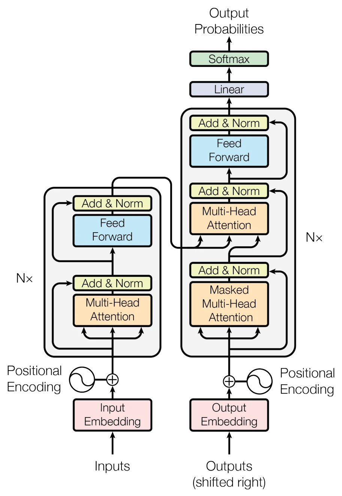
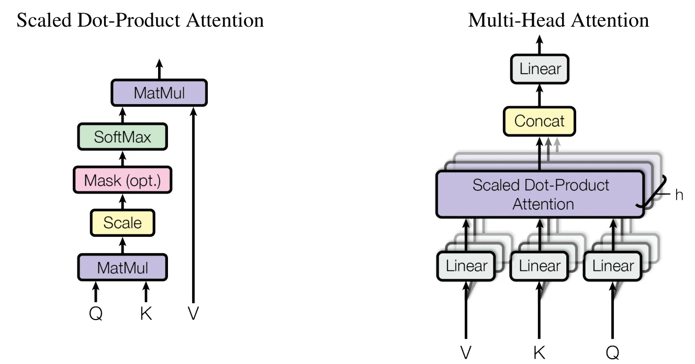

# Transformer：只用注意力完成序列转换

同一个英文词 bank，为什么有时译成“银行”，有时译成“河岸”？先沿图 1 看模型在译出“河岸”前做了什么。

## 先看图 1：译到 bank 的这一刻

假设要把 *They reached the river bank* 译成“他们来到了河岸”。解码器已经生成“他们来到了”，现在要预测下一个词元。为了看清箭头，这个例子按整词讲，暂把“河岸”当作一步，实际模型可能再切成子词。这个英中句子是教学例，论文实际测试的是英德和英法翻译。[§3.1 与图 1，PDF 第3页](https://proceedings.neurips.cc/paper/2017/file/3f5ee243547dee91fbd053c1c4a845aa-Paper.pdf#page=3)

**先看左侧，bank 怎样带上 river 的线索。** 从 Inputs 向上，词元先变成向量，再加上位置信息。查词表时，同一个 bank 总是取出同一行词向量。经过橙色的自注意力框，bank 的位置可以从 river 等位置读取特征。若把 river 换成 savings，bank 自己的词元和位置都没变，它能读到的内容却变了。经过蓝色的前馈层以及后续各层，同一个 bank 就可能得到不同的表示。左侧栈顶保留着每个源位置的表示，供右侧查询。

**再看右侧中间的橙色框。** 右下角送进已知的译文，底部带遮罩的注意力把“他们来到了”的信息汇到当前位置。这个位置向中间橙色框送上一条线，提供查询。从左侧栈顶横过来的两条线，提供与查询比较的键，以及比较之后实际取回的值。于是模型既能利用“译文已经说到哪里”，又能从原句读取 bank 及其周围的线索。这一步叫交叉注意力。

**最后沿线走到顶部。** 取回的内容加回当前位置的表示，再经过归一化和前馈变换。框外的 N× 表示重复整个编码层或解码层。原论文两侧各堆叠六层，每层各有自己的参数。最上面的 Linear 和 Softmax 才给目标词表里的候选词元分配概率。“河岸”可以获得比“银行”更高的概率，尽管它从未作为中文词出现在源句中。决定去哪里读、读回什么、最后用哪个词来表达，发生在图上不同的位置。

暂时遮住输出端，只看右侧中间那三条线。如果你能指出哪一条代表译文当前的需要，哪两条来自可供读取的原句，就可以打开图 2，看看橙色框内部怎样把这次查询算出来。

## 图 2 左侧：查询与键比较，为什么还需要值

在刚才的翻译时刻，解码器拿到一份表示当前译文前文的向量。一个注意力头把它变换成**查询**（query，Q）。编码器给出的每个源位置则各做两种变换，一种产生供查询比较的**键**（key，K），另一种产生取回时使用的**值**（value，V）。以 bank 这个位置为例，它的键决定“查到这里的程度”，值决定“查到后带走什么”。三种变换的参数通过翻译训练学得；没有人预先给 river 贴上“河岸义”的标签。[§3.2，PDF 第3页](https://proceedings.neurips.cc/paper/2017/file/3f5ee243547dee91fbd053c1c4a845aa-Paper.pdf#page=3)

**跟一行分数走。** 从图 2 左下的 MatMul 开始，把当前查询依次与各源位置的键做点积。Scale 把分数除以键宽的平方根；SoftMax 把这一行分数变成总和为 1 的权重。原句在翻译前都已给定，所以此处不需要遮住后面的源词。图中粉色 Mask 是给需要限制可见位置的通路预留的，我们稍后会在解码器的自注意力里用到它。

**注意最右边 V 的那条长箭头。** 假如某次计算给 river 较大的权重，顶端 MatMul 带回的是 river 这个位置的**值向量乘以该权重**，再加上其他位置的相应份额。它带回的可以是有助于区分词义的特征，也可能包含其他信息。模型不会因此直接把 river 复制到译文里。就算两个位置的匹配分恰好相同，只要值不同，它们带回的内容仍然不同。

论文把所有查询的计算合写为式 (1)。有 $n$ 个查询和 $s$ 个源位置时，$QK^\top$ 有 $n$ 行 $s$ 列。每行独立归一化后乘上 $V$，最终每个查询得到一个宽度为 $d_v$ 的向量。回到图 1 的输出端可以看到另一处 softmax，那里沿词表分配生成概率，此处沿源位置分配读取权重。[§3.2.1、图 2 与式 1，PDF 第4页](https://proceedings.neurips.cc/paper/2017/file/3f5ee243547dee91fbd053c1c4a845aa-Paper.pdf#page=4)

$$
\operatorname{Attention}(Q,K,V)=\operatorname{softmax}\!\left(\frac{QK^\top}{\sqrt{d_k}}\right)V
$$

分母调的是分数的尺度。作者在脚注里考虑一个简单情形：若查询和键的各分量独立、均值为零且方差为一，宽度 $d_k$ 个乘积相加，点积的方差就为 $d_k$。除以 $\sqrt{d_k}$ 后，方差回到一，这样较宽的向量就不容易仅因维度增多而把 softmax 推入梯度很小的区域。这是缩放的动机，真实表示不必满足脚注里的独立假设。[§3.2.1 与脚注 4，PDF 第4页](https://proceedings.neurips.cc/paper/2017/file/3f5ee243547dee91fbd053c1c4a845aa-Paper.pdf#page=4)

现在想想，一行权重同时用于值向量的所有分量。如果译文这个位置既要读取 bank 的词义线索，又想保留 river 这个修饰语，有没有办法对同一排源位置做两次不同的选择？

## 图 2 右侧：多头怎样分开读取，再合回同一位置

仍看译到 bank 的这个位置。假如两个源位置的权重各占一半，两个值向量的每一维都会按一半对一半取平均。下一层看到的是混合后的一个向量，从中不一定能分辨每处原来带着什么。作者说的平均会降低“有效分辨率”，指的就是这种限制。多头给同一个查询位置多组可以独立学习的混合比例。

图 2 右半边把这一次读取改为并行的多次读取。假设有 $n$ 个查询、$s$ 个可查位置，模块入口的三个矩阵分别为 $Q\in\mathbb R^{n\times512}$、$K,V\in\mathbb R^{s\times512}$。这里的 $Q,K,V$ 指进入多头模块的表示，图 2 左半边公式用的是它们**投影到一个头之后**的矩阵。基础模型有 $h=8$ 个头，每头键宽 $d_k=64$、值宽 $d_v=64$。[§3.2.2，PDF 第4–5页](https://proceedings.neurips.cc/paper/2017/file/3f5ee243547dee91fbd053c1c4a845aa-Paper.pdf#page=5)

| 顺着右图向上 | 对一个头 $i$ 做的事 | 基础模型的形状 |
| --- | --- | --- |
| 底部三个 Linear | 图中从左到右是 $V,K,Q$。分别右乘该头自己的 $W_i^V,W_i^K,W_i^Q$，让同一位置在三个任务中有不同的表示。 | 三个权重矩阵都是 $512\times64$。$Q_i$ 是 $n\times64$，$K_i,V_i$ 各是 $s\times64$。 |
| 成叠的 Scaled Dot-Product Attention | 每块都执行左图的整个过程。$Q_iK_i^\top$ 比较位置，除以 $\sqrt{64}=8$，按通路加遮罩，对每行做 softmax，再乘以 $V_i$。 | 一头得到 $n\times s$ 的权重和 $n\times64$ 的输出。八头各有自己的权重分布。 |
| Concat | 对同一个查询位置，把八个头的输出按特征维首尾相接。位置的顺序和数目都保留。 | 八个 $n\times64$ 拼成一个 $n\times512$。 |
| 顶部 Linear | 右乘可学习的 $W^O$，把来自各头的特征重新组合，供后续层使用。 | $W^O$ 一般为 $(h d_v)\times d_{\rm model}$，此处为 $512\times512$。输出仍为 $n\times512$。 |

一般写法是 $W_i^Q,W_i^K\in\mathbb R^{d_{\rm model}\times d_k}$、$W_i^V\in\mathbb R^{d_{\rm model}\times d_v}$。每个头都能从**全部** 512 个输入分量里学习怎样取出 64 个特征。因此不能把底部 Linear 简化成把原向量的前 64 个数交给第一头、后 64 个数交给第二头。把表中的四行合起来，就是论文的多头公式。

$$
\operatorname{head}_i=\operatorname{Attention}(QW_i^Q,KW_i^K,VW_i^V),\qquad
\operatorname{MultiHead}(Q,K,V)=\operatorname{Concat}(\operatorname{head}_1,\ldots,\operatorname{head}_h)W^O
$$

沿图 1 中橙色框向上走，输出要和绕过它的残差支路相加。即使查的是另一种长度的序列，回来时仍是**每个查询位置一个** 512 维向量。图 1 最顶端的 Linear 则把解码器表示变成词表上的分数，两处 Linear 的用途不同。

## 教学算例：一个查询怎样从两处各取一条线索

现在只保留原句中的 river、bank 两个源位置，顺序也照原句排。解码器仍在根据“他们来到了”预测下一词元。我们把模型宽度缩成 2，令两头各取一个标量，看看同一个译文位置怎样从这两个源位置取回不同的组合。下面的输入和参数都为便于手算而指定，数值没有词义标签，也不是作者训练出来的权重。

**先沿右图底部的三条线投影。** 设解码器提供的查询为 $Q=[1,1]$，编码器提供的 $K,V$ 都是二阶单位矩阵，即两个位置的输入行分别为 $[1,0]$ 和 $[0,1]$。下表的三个 $W$ 都是两行一列，右乘就是取内积。表末列中的两个数按**源位置**排列。

| 头 | $W_i^Q$ | $W_i^K$ | $W_i^V$ | 投影后的查询、键、值 |
| --- | --- | --- | --- | --- |
| 头 1 | $(1,0)^\top$ | $(\ln 3,0)^\top$ | $(4,0)^\top$ | 查询为 1，键为 $(\ln 3,0)^\top$，值为 $(4,0)^\top$ |
| 头 2 | $(0,1)^\top$ | $(0,\ln 3)^\top$ | $(0,8)^\top$ | 查询为 1，键为 $(0,\ln 3)^\top$，值为 $(0,8)^\top$ |

**再算两个紫色方框。** 头 1 得分 $[1\cdot\ln 3,1\cdot0]=[\ln 3,0]$。这里 $\sqrt{d_k}=1$，两个源位置都允许读取。取指数得到 $[3,1]$，逐项除以总和 4，权重为 $[3/4,1/4]$。乘以值后，头 1 取回 $(3/4)\times4+(1/4)\times0=3$。头 2 得分为 $[0,\ln 3]$，权重恰好相反，为 $[1/4,3/4]$，于是取回 $(1/4)\times0+(3/4)\times8=6$。

**最后拼接、投影。** Concat 把两个标量变成行向量 $[3,6]$。若令 $W^O$ 的两行分别为 $[1,1]$ 和 $[1,-1]$，最终输出便是 $[3+6,3-6]=[9,-3]$。图 1 中这一行接着与查询侧的残差相加，再做归一化。分数的 softmax 出现在各头内部，最后带回来的特征值可以为负。

把这次读取换成单头会怎样？假设让一个头直接混合两个值向量 $[4,0]$ 和 $[0,8]$，给第一个位置权重 $a$，结果就是 $[4a,8(1-a)]$。要同时得到刚才拼接前两头分别取回的 3 和 6，第一维要求 $a=3/4$，第二维却要求 $a=1/4$。在这个例子里，两头可以各自选择一次混合比例。这只比较给定取值下的混合步骤；换一套可学习的参数，单头也能算出许多其他表示。作者没有给头规定“主语”“宾语”这样的固定职责。

**为什么八头没有把主要乘法量放大八倍？** 回到真实的 512 维模型。一次查询与一个键比较，单头要在宽度 512 上做点积，八头是在八个宽度 64 上各做一次。对 $n$ 行查询、$s$ 个键，打分的乘加数按 $ns\,h d_k$ 增长，按权重取值按 $ns\,h d_v$ 增长。只要 $h d_k=h d_v=512$，两步的主要矩阵乘法量与宽度 512 的单头相近。输入投影也同理，八个 $512\times64$ 的投影拼起来与一个 $512\times512$ 投影的参数量相同。每头仍各算一张 $n\times s$ 的权重表，各做一次 softmax，所以这个比较不能直接换算成相同的显存或运行时间。[§3.2.2，PDF 第4–5页](https://proceedings.neurips.cc/paper/2017/file/3f5ee243547dee91fbd053c1c4a845aa-Paper.pdf#page=5)

## 原句已知时，为什么译文还要逐步生成

回到图 1 顶端。预测“河岸”时，模型的条件是整句英语和已经生成的“他们来到了”。选定下一词元之后，它要把这个词元接到已生成的译文里，才能预测再下一个。一次生成依赖此前的输出，这就是自回归。源句和译文可以有不同的长度。[§3，PDF 第2–3页](https://proceedings.neurips.cc/paper/2017/file/3f5ee243547dee91fbd053c1c4a845aa-Paper.pdf#page=2)

训练时人给的参考译文已经存在。把教学译文粗略分成“他们／来到了／河岸”，训练输入排成“〈起始〉／他们／来到了”，对应的预测目标是“他们／来到了／河岸”。这样第三行用已知的“他们”“来到了”预测“河岸”。用参考译文提供前文的做法常称为 teacher forcing。实际使用子词时，每一步对应一个词元，道理相同。

在训练中，输入的三行同时摆在那里，因此模型有机会并行计算三次预测。要让并行计算和真正生成时使用相同范围的前文，还得防住一条捷径：第二行预测“来到了”时，答案就放在训练输入的第三行里。

## 三种注意力通路、遮罩与位置编码

从图 1 左侧的橙色框出发，移到右下，再移到右侧中间。三个框都包含图 2 的投影、并行注意力、拼接和输出投影，各自学习自己的参数。区别在于哪段表示提供查询、哪段表示供它读取，以及哪些位置可见。设源句有 $s$ 个位置，右移后的目标序列有 $t$ 个位置。[§3.2.3，PDF 第5页](https://proceedings.neurips.cc/paper/2017/file/3f5ee243547dee91fbd053c1c4a845aa-Paper.pdf#page=5)

| 图 1 的位置 | 每个头向哪里查 | 每头权重表 |
| --- | --- | --- |
| 编码器左下，自注意力 | 源句的同一组表示分别投影为 Q、K、V。一个源词可以在整句中找相关位置，再由各头带回特征。 | $s\times s$，可以读取前后文。 |
| 解码器右下，带遮罩的自注意力 | 右移后的目标侧表示提供 Q、K、V。各头可以用不同权重读取已有译文，但必须守住同一条时间边界。 | $t\times t$，主对角线及其左边可见。 |
| 解码器右侧中间，交叉注意力 | 下方经过 Add & Norm 的目标侧表示提供 Q，左侧编码器最终输出提供 K、V。同一译文位置可用不同头读取原句的不同部分。 | $t\times s$，可读取整句原文，输出仍有 $t$ 行。 |

沿图 1 右下角回到这个例子。第二行的查询可以看第一列的“〈起始〉”和第二列的“他们”，预测目标“来到了”藏在第三列。因此在第二行第三列填 $-\infty$，再算 softmax，这一列的权重便为零。第三行要预测“河岸”，它已经可以读输入中的“来到了”，所以主对角线是允许的。整张表能够同时计算，哪些格子允许参与在计算前已经确定。[§3.1，PDF 第3页](https://proceedings.neurips.cc/paper/2017/file/3f5ee243547dee91fbd053c1c4a845aa-Paper.pdf#page=3)

只右移而不遮罩，答案能从后面的行传回来；若直接把待预测词放在本行，遮住后面的列也挡不住它从本行输入和残差进入。交叉注意力没有这项因果限制，整句原文在翻译开始前就已经给定。判断信息泄漏时，先确认这条箭头来自原句还是来自译文。

再沿图 1 两边的最底端找到与嵌入相加的波形符号。没有位置编码时，如果把编码器输入的词元重排，同一词元的查询、键、值会一起移动，它从其他词元取回的内容也随之移动。输出行跟着重排，这个计算本身分辨不出“谁在谁前面”。编码器要区分顺序，需要把位置作为额外信息交给它。

论文的做法是给每个位置生成一个和词向量同样长的位置编码，直接加到嵌入上。具体用的是不同频率的正弦和余弦函数：

$$
PE_{(pos,2i)}=\sin\!\left(\frac{pos}{10000^{2i/d_{\text{model}}}}\right),\qquad
PE_{(pos,2i+1)}=\cos\!\left(\frac{pos}{10000^{2i/d_{\text{model}}}}\right)
$$

$pos$ 是位置，$i$ 是维度编号。每一维对应一条正弦波，各维的波长从 $2\pi$ 到 $10000\cdot 2\pi$ 成等比变化。可以把它想成一组转速不同的指针：低维转得快，能区分相邻位置；高维转得慢，能区分远处的位置。[§3.5，PDF 第5–6页](https://proceedings.neurips.cc/paper/2017/file/3f5ee243547dee91fbd053c1c4a845aa-Paper.pdf#page=6)

为什么选这个函数？作者给了两个理由，都写成了假设。第一，对任意固定的偏移 $k$，$PE_{pos+k}$ 可以表示成 $PE_{pos}$ 的线性函数，作者猜测这会让模型容易学会按相对位置来注意。第二，它可能让模型推广到比训练时更长的序列。论文同时试了另一种做法：位置编码不用公式，直接作为参数学出来。结果两者几乎一样（见后文表 3 的 (E) 行），作者最终选择正弦版本，理由正是第二点。论文没有验证长度外推是否真的成立。

## 回到图 1：前馈层与残差怎样接住多头的输出

拿刚才算出的两头输出回到图 1。交叉注意力的值来自原句，但绕过橙色框的残差来自译文这一侧：它保留的正是发出查询时的那个位置。Add & Norm 先把读取结果加回原表示，再做层归一化。这样新的表示可以同时带着“译到哪里了”和“从原句读到了什么”。原论文采用相加后归一化的顺序。经过这个黄色框，才轮到蓝色前馈网络单独加工每个位置的向量。

$$
\operatorname{FFN}(x)=\max(0,\,xW_1+b_1)W_2+b_2
$$

它是两个线性变换，中间夹一个 ReLU 激活函数，即 $\max(0,\cdot)$。“逐位置”是说它对序列中每个位置分别、独立地做同样的变换，位置之间在这里不交流。同一层内各位置共用参数，不同层的参数不同。维度上，输入输出是 512，中间层扩展到 $d_{ff}=2048$。作者也提到，可以把它看成两个核大小为 1 的卷积。[§3.3，PDF 第5页](https://proceedings.neurips.cc/paper/2017/file/3f5ee243547dee91fbd053c1c4a845aa-Paper.pdf#page=5)

这样可以看清论文标题中注意力负责的那部分工作。位置之间的信息沿注意力通路流动，前馈层负责变换每个位置的特征。蓝色框的输出又回到 512 维，刚好和绕行的 512 维残差相加，结果再经过 LayerNorm。

最后还有一处小设计：输入嵌入、输出嵌入和最终 softmax 之前的线性层共用同一个权重矩阵，嵌入层里还会把权重乘以 $\sqrt{d_{\text{model}}}$。[§3.4，PDF 第5页](https://proceedings.neurips.cc/paper/2017/file/3f5ee243547dee91fbd053c1c4a845aa-Paper.pdf#page=5)

## 为什么作者要移除循环

图 1 里的每个源位置可以在一层里直接读取远处的词。对比 2017 年常用的循环网络（RNN），这个变化打破了一条计算依赖：循环层通常要先得到上一个位置的隐藏状态 $h_{t-1}$，才能算当前位置的 $h_t$，所以难以把同一句里的所有位置并行编码。LSTM、GRU 用门控改善记忆，仍要依次传递状态。此前的翻译模型已经用过注意力，Transformer 的新意在于把它用作序列内部传递信息的主要机制。[原论文摘要与 §1，PDF 第1–2页](https://proceedings.neurips.cc/paper/2017/file/3f5ee243547dee91fbd053c1c4a845aa-Paper.pdf) [§1，PDF 第1–2页](https://proceedings.neurips.cc/paper/2017/file/3f5ee243547dee91fbd053c1c4a845aa-Paper.pdf#page=2)

卷积模型给出了另一种办法。局部窗口可以并行计算，可是距离很远的两个词通常要经过多层才能互相影响。自注意力用直接连接缩短了这条路径，同时必须为许多位置对打分。究竟省不省，要把“能并行”和“总共做多少运算”分开看。[§2，PDF 第2页](https://proceedings.neurips.cc/paper/2017/file/3f5ee243547dee91fbd053c1c4a845aa-Paper.pdf#page=2)

## 为什么用自注意力：复杂度、并行与路径长度

论文第 4 节专门回答“凭什么用自注意力”。作者没有只说“效果好”，而是提出了三个衡量一层网络的标准，再和循环层、卷积层逐项比较：[§4、表 1，PDF 第6–7页](https://proceedings.neurips.cc/paper/2017/file/3f5ee243547dee91fbd053c1c4a845aa-Paper.pdf#page=6)

1. 每层的总计算量；
2. 能并行的程度，用“最少需要多少步顺序操作”衡量；
3. 长距离依赖的路径长度：任意两个位置之间，信号最多要经过多少步。作者用较短的路径解释为什么长距离依赖可能更容易学习。

表 1 把结果放在一起，$n$ 是序列长度，$d$ 是表示维度，$k$ 是卷积核大小，$r$ 是受限注意力的邻域大小：

| 层类型 | 每层复杂度 | 顺序操作数 | 最大路径长度 |
| --- | --- | --- | --- |
| 自注意力 | $O(n^2\cdot d)$ | $O(1)$ | $O(1)$ |
| 循环层 | $O(n\cdot d^2)$ | $O(n)$ | $O(n)$ |
| 卷积层 | $O(k\cdot n\cdot d^2)$ | $O(1)$ | $O(\log_k n)$ |
| 受限自注意力 | $O(r\cdot n\cdot d)$ | $O(1)$ | $O(n/r)$ |

例如在图 1 左侧，一个源词在同一层就能直接读取另一个源词，计算量的代价是要为每对位置打分。表 1 的自注意力项按位置间交互计为 $O(n^2 d)$，循环层为 $O(n d^2)$。当时的子词翻译句子通常有 $n<d$，按这两项比较，自注意力较省。要估算整层，还要计入图 2 的输入输出投影和图 1 的前馈网络；表 1 的单个复杂度项不能直接当作端到端的训练成本。卷积路径一栏给出扩张卷积的对数情形，普通连续卷积核要连接远处时可能需要线性增长的层数。

这个结论有明确的适用条件。序列一长，$n^2$ 就会成为负担，这正是后来“长上下文”研究要解决的问题。作者自己也意识到了，提出可以把注意力限制在一个大小为 $r$ 的邻域内，代价是路径长度变成 $O(n/r)$，并说会在未来工作中研究。

作者还顺带提到一个好处：自注意力可能让模型更可解释。他们观察了注意力分布，发现不同的头似乎学会了不同的任务，不少还和句子的句法、语义结构有关。作者说具体例子放在附录中，但固定采用的会议 PDF 并不包含这份附录。这些属于观察，作者没有把它们当成严格的结论。

需要区分三件事：顺序步骤少、总运算量少、在实际硬件上跑得快。表 1 给出前两者的理论比较，训练配置与实测时间见下一节。

## 翻译成绩取决于哪些训练条件

作者用 WMT 2014 的英德和英法平行语料训练，前者约 450 万句对，后者约 3600 万句对。图 1 底部输入的是切分后的子词。生成译文意味着反复预测子词，评估时才把译文与参考译文比较。训练使用 8 块 P100 GPU，基础模型用了约 12 小时，大模型约 3.5 天。这些是特定硬件和配置下的时长。[§5，PDF 第7页](https://proceedings.neurips.cc/paper/2017/file/3f5ee243547dee91fbd053c1c4a845aa-Paper.pdf#page=7)

训练中采用 Adam 和先热身后衰减的学习率。作者还在子层输出加回残差前使用 dropout，并用标签平滑降低对正确答案的置信度要求。表 2 的主要成绩对应整套训练与解码配置，想隔开某个组件的作用，需要看作者另做的开发集对照。[§5.4，PDF 第7–8页](https://proceedings.neurips.cc/paper/2017/file/3f5ee243547dee91fbd053c1c4a845aa-Paper.pdf#page=7)

## 实验结果与消融：证据说明了什么

作者在 WMT 2014 的两个翻译任务上测试，测试集是 newstest2014，指标是 BLEU。BLEU 衡量机器译文和人工参考译文在词组层面的重合程度，分数越高越接近参考译文。表 2 把 Transformer 和当时的主要模型放在一起，同时列出了估算的训练计算量（FLOPs）：[§6.1、表 2，PDF 第8页](https://proceedings.neurips.cc/paper/2017/file/3f5ee243547dee91fbd053c1c4a845aa-Paper.pdf#page=8)

英德任务上，大模型取得 28.4 BLEU，超过表中最好的此前集成结果 26.36。英法任务上，大模型取得 41.0，高于此前的单模型，低于表中两个集成模型。作者根据训练时长、GPU 数和估计算力折算训练成本，报告新模型在这两个任务上用较少的训练计算取得了有竞争力的结果。

这些成绩有具体的设置。基础模型取最后 5 个检查点的平均，大模型取最后 20 个；解码用束搜索（beam search），束宽 4，长度惩罚 0.6；英法大模型的 dropout 用 0.1，而不是 0.3。因此，表中的比较既涉及架构，也受训练和解码选择影响。

**把表 3 当作对图 2 的两次追问。** 表 2 比较整套模型翻译得怎样。表 3 则从同一个基础模型出发，在英德开发集 newstest2013 上改变组件，没有使用检查点平均。下表摘出 (A)、(B) 两组并补出原表留白处沿用的基准值。基础配置 $d_{\rm model}=512$、六层、训练 10 万步。PPL 是按 BPE 子词计算的困惑度，越低越好；BLEU 越高越好。[§6.2、表 3，PDF 第8–9页](https://proceedings.neurips.cc/paper/2017/file/3f5ee243547dee91fbd053c1c4a845aa-Paper.pdf#page=9)

| 配置 | 头数 $h$ | 每头键宽 $d_k$ | 每头值宽 $d_v$ | 开发集 PPL | 开发集 BLEU |
| --- | ---: | ---: | ---: | ---: | ---: |
| 基准 | 8 | 64 | 64 | 4.92 | 25.8 |
| (A) | 1 | 512 | 512 | 5.29 | 24.9 |
| (A) | 4 | 128 | 128 | 5.00 | 25.5 |
| (A) | 16 | 32 | 32 | 4.91 | 25.8 |
| (A) | 32 | 16 | 16 | 5.01 | 25.4 |
| (B) | 8 | 16 | 64 | 5.16 | 25.1 |
| (B) | 8 | 32 | 64 | 5.01 | 25.4 |

**(A) 给定相近的计算预算，怎样分给多个头？** 作者同步改变 $h,d_k,d_v$，使 $h d_k=h d_v=512$。回到图 2，这同时改变了并行读取的次数和每次读取的宽度。与单头相比，8 头高 0.9 BLEU；增加到 16 头，BLEU 与 8 头持平；继续到 32 头，BLEU 又下降。这支持在该任务和宽度下给多个头分配预算的做法。它没有分离头数和每头宽度各自的作用，也没有测试某个头是否专门识别某种语言现象。

**(B) 保留八头，只压缩打分用的表示会怎样？** $h=8$ 和 $d_v=64$ 不变，图 2 中每个头的查询和键从 64 维缩到 32 或 16 维。读取内容的宽度相同，衡量匹配的空间变窄。开发集 BLEU 从 25.8 降到 25.4、25.1，PPL 也上升。同时总参数从约 6500 万降到 6000 万、5800 万，所以不能把差异完全归因于点积本身。作者据此提出更复杂的匹配函数值得试验，这两行没有比较任何替代函数。

表 3 的其余三组可用同样的方法读。(C) 增大前馈宽度到 4096 时是 26.2 BLEU，增加层数到八层时是 25.5，不能把不同扩容方式看成同一种改动。(D) 关掉 dropout 得到 24.6，低于基础配置的 25.8。(E) 把图 1 底部的正弦编码换成学习式位置嵌入得到 25.7，两种给位置的办法在此接近。表中没有去掉全部位置信息的对照，也没有测超出训练长度后的效果。

## 这篇论文之后：从翻译架构到语言模型

作者在结论中说，他们会把 Transformer 用到文本以外的输入输出，比如图像、音频和视频，研究局部的受限注意力来处理大规模输入，并让生成过程不那么依赖顺序。代码在 tensor2tensor 中开源。[§7，PDF 第9页](https://proceedings.neurips.cc/paper/2017/file/3f5ee243547dee91fbd053c1c4a845aa-Paper.pdf#page=9)

后来的发展远远超出了机器翻译，但这些都不在本文中，读的时候要和论文本身的结论分开。最直接的影响是：编码器和解码器可以拆开单独使用。以 GPT 系列为代表的语言模型，采用只由自回归解码器堆叠而成的结构，再在海量文本上预训练。本库的 [GPT-3 导读](/read/gpt3/1#u02) 说明，它沿用了 GPT-2 式的自回归 Transformer，并在归一化位置、稀疏注意力等方面做了调整，不是把原始的编码器—解码器直接放大。

若新模型图中找不到来自另一座编码器的两根箭头，就不要照搬这里的交叉注意力解释。可以先查输入材料在序列的哪里，以及当前生成位置能通过哪些层读到它。

从这里出发，建议的阅读顺序是：先读 [GPT-3](/read/gpt3/1#u01)，看自回归预训练怎样带来上下文学习；再读 [InstructGPT](/read/instructgpt/2#u01)，理解“会续写”和“按人的意图做事”之间还差什么；最后读 [Agent 综述](/read/agent-survey/2)，把模型放进能感知、规划和行动的系统里。这是编辑建议的顺序，并不意味着前一篇证明了后一篇的结论。

## 回到原文：哪些地方值得亲自读

会议 PDF 的正文到第 9 页结束。如果时间有限，建议优先读下面几处：

- **图 1 和 §3.1–3.2.3（PDF 第3–5页）。** 对照图 1，指着三条输入线，说明译到 bank 时查询从哪里来、两份源端表示分别做什么。[图 1 与 §3.2.3，PDF 第3–5页](https://proceedings.neurips.cc/paper/2017/file/3f5ee243547dee91fbd053c1c4a845aa-Paper.pdf#page=3)
- **图 2 和 §3.2.2（PDF 第4–5页）。** 自己画一行查询，把头内的权重矩阵、Concat 的输入和残差的宽度标出来。再回到图 1，换成交叉注意力试一次。[§3.2.2，PDF 第4–5页](https://proceedings.neurips.cc/paper/2017/file/3f5ee243547dee91fbd053c1c4a845aa-Paper.pdf#page=5)
- **§3.2.1 的脚注 4（PDF 第4页）。** 只有两行，是理解缩放因子的关键。[§3.2.1 与脚注 4，PDF 第4页](https://proceedings.neurips.cc/paper/2017/file/3f5ee243547dee91fbd053c1c4a845aa-Paper.pdf#page=4)
- **§4 和表 1（PDF 第6–7页）。** 看作者怎样用三个标准论证设计选择，这种“先定标准再比较”的写法值得学习。[§4 与表 1，PDF 第6–7页](https://proceedings.neurips.cc/paper/2017/file/3f5ee243547dee91fbd053c1c4a845aa-Paper.pdf#page=6)
- **表 3（PDF 第9页）。** 自己读一遍每一行改了什么、分数怎么变，再和 §6.2 作者的解释对照。[表 3 与 §6.2，PDF 第9页](https://proceedings.neurips.cc/paper/2017/file/3f5ee243547dee91fbd053c1c4a845aa-Paper.pdf#page=9)

本导读依据 NIPS 2017 会议 PDF 正文 §1–7，覆盖方法主线、训练配置、主要翻译结果和消融。图 1、图 2 为原论文图，取自同一 PDF；表格只摘录了部分行。没有复现实验，没有逐项讲解全部超参数和引用文献，也没有覆盖 arXiv 版附录中的注意力可视化。会议摘要网页上的数值和 PDF 略有出入，本文统一以 PDF 为准。“这篇论文之后”一节中的后续发展属于编辑背景，不是本论文的结论。阅读本导读或打开原文，都不会自动记为已读。
