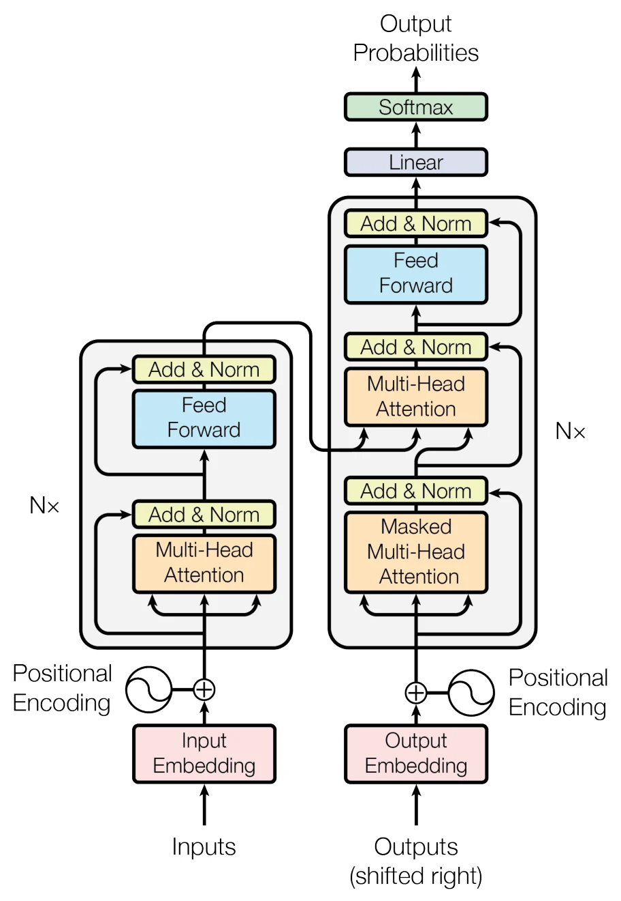
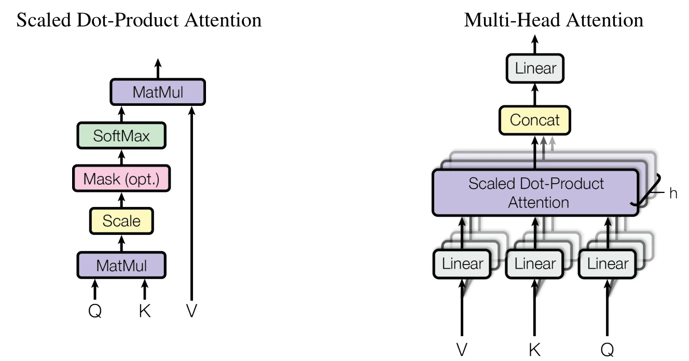

# Transformer: Sequence Transduction Using Attention Alone

In 2017, eight authors, most working at Google Brain or Google Research, published *Attention Is All You Need*. They studied tasks such as machine translation, which turn one sequence into another. At the time, the strongest models used recurrent neural networks (RNNs) as their backbone, supplemented by attention. The authors proposed a bold alternative: remove recurrence altogether and use attention to pass information between words. They called the architecture the Transformer. It achieved state-of-the-art or near-state-of-the-art results on two translation tasks at much lower training cost. [Abstract and §1, PDF pp. 1–2](https://proceedings.neurips.cc/paper/2017/file/3f5ee243547dee91fbd053c1c4a845aa-Paper.pdf)

Today, the architecture matters more than the translation scores. Later large language models, including the GPT series, build on it. Understanding the Transformer gives concrete meaning to terms such as *context*, *attention*, and *autoregressive generation*: we can follow the computations that let one position retrieve information from others, tell the model about word order, and explain why training can be parallelized even though generation proceeds one token at a time.

The heart of the paper is the overall architecture in Figure 1 and the multi-head attention that appears throughout it; this guide devotes most of its space to both. We start with the problem the authors faced and what the model predicts, then examine Figure 1. Three sections unpack attention and multi-head attention, followed by the three attention pathways, positional encoding, the complexity argument, training, and experiments. Numbers come from the fixed NIPS 2017 conference PDF. Terms and abbreviations are marked with a dotted underline on first use; select one to see its expansion and origin.

## The problem in 2017: Why recurrent networks are slow

To see why the authors wanted to remove recurrence, consider how a recurrent network reads a sentence. An RNN treats the sentence as a timeline: it reads the first word and produces a hidden state $h_1$, then uses $h_1$ and the second word to calculate $h_2$, and so on. At each step, the current hidden state compresses what came before. LSTM and GRU networks improve on the RNN with gates that control what to retain and forget, mitigating the loss of earlier information in long sentences. In 2017 they were established state-of-the-art approaches to language modeling and machine translation. [§1, PDF pp. 1–2](https://proceedings.neurips.cc/paper/2017/file/3f5ee243547dee91fbd053c1c4a845aa-Paper.pdf#page=2)

The difficulty, the authors argued, lies in doing this *sequentially*. Computing $h_t$ must wait for $h_{t-1}$, so positions within one training example cannot be computed in parallel. The constraint becomes more severe for longer sentences, while limited GPU memory also restricts how many examples can be batched. Earlier work had improved efficiency with factorization tricks and conditional computation, but the fundamental sequential constraint remained.

Attention was already successful. In translation, it allowed a decoder generating each word to look back at different positions in the source sentence rather than relying on a single fixed-length vector for the whole sentence. Positions could be connected directly, regardless of how far apart they were. Yet, with very few exceptions, attention was attached to a recurrent network rather than replacing its backbone.

Convolution offered another route. ConvS2S and ByteNet replaced recurrence with CNNs, allowing all positions to be computed in parallel. But a convolution sees only a small window at a time, so distant words must pass through multiple layers to influence one another. The number of operations needed to connect positions grows linearly with their distance in ConvS2S and logarithmically in ByteNet. The authors argued that longer paths make long-range dependencies harder to learn. [§2, PDF p. 2](https://proceedings.neurips.cc/paper/2017/file/3f5ee243547dee91fbd053c1c4a845aa-Paper.pdf#page=2)

The goal was therefore clear: compute positions in parallel, as in convolution, while connecting any two positions in one step, as in attention. The answer was to rely on self-attention: positions within the same sequence attend to one another. The authors also identified a cost. Attention takes a weighted average, which can blur details and reduce *effective resolution*. Multi-head attention was designed to counteract that effect.

## What is predicted: Encoders, decoders, and autoregression

Before examining the architecture, clarify what the model computes. Machine translation is sequence transduction: an input sequence $x=(x_1,\ldots,x_n)$ is transformed into an output sequence $y=(y_1,\ldots,y_m)$, possibly of a different length. The dominant approach at the time used an encoder–decoder structure, which the Transformer retained. [§3, PDF pp. 2–3](https://proceedings.neurips.cc/paper/2017/file/3f5ee243547dee91fbd053c1c4a845aa-Paper.pdf#page=2)

The encoder maps the input tokens to continuous vectors $z=(z_1,\ldots,z_n)$. A token need not be a whole word: the paper uses subword segmentation. Given $z$, the decoder generates one output token at a time, using the output generated so far as additional input to predict the next token. Predicting subsequent output from the model's own previous output is called *autoregression*. In probability notation:

$$
p_\theta(y\mid x)=\prod_{t=1}^{m}p_\theta(y_t\mid y_{<t},x)
$$

This notation is introduced by the guide for explanation; it is not a numbered equation in the paper. Here $\theta$ denotes the model parameters, and $y_{<t}$ denotes the output already determined before position $t$. The probability of the whole translation is factored into a product of conditional probabilities: given the source and the preceding output, what comes next?

We will use a teaching example throughout: translating *They reached the river bank* as *They arrived at the riverbank*. The guide invented this English–Chinese translation example; the target shown here is an English word-by-word gloss of an imagined Chinese output, not an English translation. The Chinese words themselves are not displayed. The actual paper tested English–German and English–French translation. For clarity, we treat the items in the gloss as whole words and *riverbank* as one step; the real model further splits words into subwords.

Training has an advantage: the reference translation is already available. Shift the reference translation one position to the right to form the decoder input, and every position can simultaneously predict its own next word. For example, the input is “〈start〉 They arrived at the” and the corresponding targets are “They arrived at the riverbank”: the first position sees the start symbol and predicts “They”; the last sees “〈start〉 They arrived at the” and predicts “riverbank”. Using the reference translation to supply the preceding context is commonly called *teacher forcing*. “Outputs (shifted right)” at the bottom right of Figure 1 refers to this shift.

Inference is different. There is no reference answer to consult, so the model feeds each newly generated word back into its input before calculating the next. Thus the Transformer's parallelism applies to training, when the target sequence is known and all positions can be computed together. Generation remains sequential. This distinction recurs in later papers: fast training does not necessarily mean fast generation.

Computing all training positions together creates a risk. A later input position contains a word that an earlier position is supposed to predict. If the earlier position can read the later one, it can simply copy the answer. The paper uses a *mask* to close this loophole; we will see how in the decoder.

## The big picture: How to read Figure 1

This is the most important and most frequently reproduced figure in the paper; it is worth learning to read fluently. Work from bottom to top, treating the two sides separately. First identify the boxes, then follow the flow of the translation example. [§3.1 and Figure 1, PDF p. 3](https://proceedings.neurips.cc/paper/2017/file/3f5ee243547dee91fbd053c1c4a845aa-Paper.pdf#page=3)

**The encoder is on the left and reads the source.** Each input token passes through Input Embedding to become a vector of length $d_{\text{model}}=512$. Positional Encoding is added to it—the wave symbol and ⊕ in the figure—so that the vector carries information about its position. The result enters the large gray box. “N×” means that the whole box is stacked N times; in the paper, $N=6$. Each layer has two sublayers: orange Multi-Head Attention followed by the blue Feed Forward network.

**The decoder is on the right and writes the translation.** It resembles the encoder, but each layer has three sublayers. At the bottom, Masked Multi-Head Attention ensures that each position can see only itself and earlier positions. The middle Multi-Head Attention is different: notice its three incoming arrows, two from the top of the encoder and one from the decoder below. This layer lets the decoder consult the source while writing the translation; it is called cross-attention. At the top is another feed-forward network.

**The output is at the top.** The decoder's final vectors pass through Linear and Softmax layers to produce probabilities over the target vocabulary: the Output Probabilities from which the next token is selected.

**Each sublayer is wrapped in Add & Norm.** In the paper's notation, the output is $\operatorname{LayerNorm}(x+\operatorname{Sublayer}(x))$. First add the sublayer's result back to its input: the arrow bypassing the sublayer is a *residual connection*. Then apply layer normalization, or LayerNorm. Residual connections give signals and gradients a shortcut through many layers, a standard aid to training deep networks. For the addition to work directly, all sublayers and embedding layers produce 512-dimensional outputs.

Now follow the translation example. Suppose the decoder has already written “They arrived at the” and is about to predict the next word.

Start on the left. The English word *bank* can mean a financial institution or the edge of a river. Looking it up in the embedding table always returns the same row, which does not itself know which sense is intended. Through encoder self-attention, the *bank* position can read information from positions such as *river*; in *the savings bank*, it would instead encounter *savings*. After six layers, the same word can have different representations in different sentences. The top of the encoder retains a final representation for each source position for the decoder to consult.

On the right, “〈start〉 They arrived at the” enters from the bottom. Masked self-attention lets the current position gather information about how far the translation has progressed. It then enters the middle cross-attention sublayer and uses that information to query the encoder's output: which source positions are most relevant to the next word? If it reads mainly the representations of *bank* and *river*, the retrieved information can favor the riverbank sense.

Finally, at the top, the retrieved information is added back to the current position, processed by the feed-forward layer and further layers, and scored over the vocabulary by Linear and Softmax. In the imagined Chinese output, the word glossed here as *riverbank* can receive a higher probability than the word glossed as a financial bank, even though neither word appears in the English source. Deciding where to look in the source, what to retrieve, and which word to produce happens in different parts of the figure.

One detail often changed later is the placement of normalization: the original paper normalizes after the addition. Many subsequent models normalize before the sublayer, so do not assume a newer architecture follows the original exactly.

Figure 1 contains three orange multi-head attention boxes, the core components of the architecture. The next three sections open them up: first one attention computation, then the motivation for multiple heads, and finally a complete walk through the right side of Figure 2.

## Scaled dot-product attention: How a query retrieves information

The paper defines attention generally as a mapping from a query and a set of key–value pairs to an output. The output is a weighted sum of the values; each weight depends on the compatibility of the query with the corresponding key. [§3.2, PDF p. 3](https://proceedings.neurips.cc/paper/2017/file/3f5ee243547dee91fbd053c1c4a845aa-Paper.pdf#page=3)

Think of looking up documents. The query says what you are looking for; each key is a label to compare with the query; each value is the document content you actually take away. Compare the query with every label, give a higher weight to a better match, and mix the contents in those proportions. Unlike a dictionary lookup, attention does not take only the single best match: it takes a weighted contribution from each.

Return to the translation example. In cross-attention, a linear transformation of the decoder's current representation produces the query Q. Each source position from the encoder undergoes two other transformations to produce a key K and a value V. For *bank*, the key helps determine how well the position matches the query; the value determines what is retrieved if it matches. All three transformations are learned during translation training. Nobody tells the model in advance that *river* is related to the riverbank sense.

Why separate keys from values? The basis on which something is selected and the information it provides once selected are different things. Two keys might match a query equally well while their values carry different content. The representation used for comparison and the one used to supply information can each be learned for their own role.

The left side of Figure 2 shows the paper's algorithm, called scaled dot-product attention. Read from bottom to top:

1. **MatMul:** Take the dot product of query Q with each key K to obtain compatibility scores. A larger dot product indicates a larger alignment, influenced by both direction and magnitude.
2. **Scale:** Divide each score by $\sqrt{d_k}$, where $d_k$ is the dimension of a key vector.
3. **Mask (optional):** Set scores for forbidden positions to negative infinity. Cross-attention does not need a causal mask because the complete source is available before translation; decoder self-attention does.
4. **SoftMax:** Turn each row of scores into nonnegative weights that sum to 1.
5. **MatMul:** Take the weighted sum of the value vectors. Notice the long arrow for V: it bypasses the earlier steps and joins the computation only at the top.

Together, these give equation (1) in the paper: [§3.2.1, Figure 2 and equation 1, PDF p. 4](https://proceedings.neurips.cc/paper/2017/file/3f5ee243547dee91fbd053c1c4a845aa-Paper.pdf#page=4)

$$
\operatorname{Attention}(Q,K,V)=\operatorname{softmax}\!\left(\frac{QK^\top}{\sqrt{d_k}}\right)V
$$

In practice, queries are packed into a matrix and computed together. Suppose there are $n$ queries and $s$ positions to be read. $QK^\top$ is an $n\times s$ score matrix: row $i$ contains the scores of query $i$ against every position. Softmax normalizes each row separately, and the result is multiplied by $V$. Each query obtains a new vector mixing information from the available positions. The output still has $n$ rows, one per query position, but each vector has now “looked at” other positions.

Distinguish the two softmax operations. The softmax in Figure 2 distributes attention weights across source positions: where to read, and how much. The softmax at the top of Figure 1 distributes probability across the vocabulary: what to write next. The function is the same; its role is not.

**Why divide by $\sqrt{d_k}$?** This is one of the paper's explicitly motivated design choices. The authors compare two common attention functions. Additive attention uses a small feed-forward network to compute compatibility; dot-product attention uses an inner product. Their theoretical complexity is similar, but dot products can use highly optimized matrix multiplication and are much faster and more space-efficient in practice. Earlier experiments had found, however, that for large $d_k$, unscaled dot-product attention performed worse than additive attention.

The authors' explanation is that high-dimensional dot products can grow large in magnitude, pushing softmax into regions with extremely small gradients. Softmax may then give almost all its weight to one position, leaving the others with gradients close to zero and making training difficult. A footnote supplies the intuition: if the components of $q$ and $k$ are independent random variables with mean 0 and variance 1, the variance of $q\cdot k=\sum_{i=1}^{d_k}q_ik_i$ is $d_k$. Dividing by $\sqrt{d_k}$ brings the variance back to 1. This motivates the design; actual trained vectors need not satisfy the assumptions. Scaling has nevertheless been adopted in almost all subsequent implementations. [§3.2.1 and footnote 4, PDF p. 4](https://proceedings.neurips.cc/paper/2017/file/3f5ee243547dee91fbd053c1c4a845aa-Paper.pdf#page=4)

One common misunderstanding deserves a final warning: a high attention weight does not establish that the model “understands” the relationship between two positions. A weight describes numerical mixing in that layer; it does not by itself establish human-like understanding or a causal explanation.

## Multi-head attention, part 1: Why one set of weights is not enough

The attention above gives each query one set of weights, applied across every dimension of the value vectors. If the *bank* position assigns half its weight to *river* and half to *bank*, every dimension of the retrieved vector is the same half-and-half average of the two values.

But producing *riverbank* may require two kinds of information at once: the river context from *river* and information about *bank* itself as a noun denoting a place. Ideally, the model would attend more to *river* when reading contextual information and more to *bank* when reading information about the word itself. A single attention operation has only one set of weights and must compromise, returning one mixture. The next layer may no longer be able to distinguish where its components came from. This illustrates the limitation behind the authors' remark that averaging reduces effective resolution.

The idea of multi-head attention is straightforward: give the same query multiple sets of weights. Use $h$ learned linear projections to produce $h$ smaller versions of the queries, keys, and values, and perform scaled dot-product attention separately on each. A query position can then primarily read *river* in head 1 and *bank* in head 2. Concatenate the head outputs and apply another linear transformation to combine them into one vector. [§3.2.2, PDF pp. 4–5](https://proceedings.neurips.cc/paper/2017/file/3f5ee243547dee91fbd053c1c4a845aa-Paper.pdf#page=5)

The paper says that multi-head attention lets the model jointly attend to information from different *representation subspaces* at different positions; with a single head, averaging inhibits this. A representation subspace can be understood here as a smaller space formed by a head's projection, which retains and recombines features of the input for matching and retrieval. Different heads see different aspects of the same positions.

Two misunderstandings are worth avoiding.

First, any division of labor among heads is learned. The paper does not prescribe that one head handles syntax and another semantics. In §4 the authors report that different heads appear to learn different tasks, some related to syntactic and semantic structure. This is an observation; the examples are in an appendix not included in the fixed conference PDF.

Second, every head projects from the full 512-dimensional input and can learn to select and combine features from all of it into its own 64 dimensions. Multi-head attention does not simply cut the input into eight fixed pieces and give each head 64 numbers.

The paper's most direct evidence for multiple heads is the group (A) ablation in Table 3: at similar computational cost, eight heads score 0.9 BLEU higher than one. We will examine that experiment with the results. First, follow every step of multi-head attention on the right side of Figure 2.

## Multi-head attention, part 2: Working through Figure 2

The right side of Figure 2 depicts four steps from bottom to top. Let the query matrix $Q$ entering the module have $n$ rows, and the key and value matrices $K,V$ have $s$ rows each, with 512 dimensions per row. The base model has $h=8$ heads, each with key dimension $d_k=64$ and value dimension $d_v=64$. The table tracks the operations and shapes:

| Figure 2, bottom to top | Operation for head $i$ | Shape in the base model |
| --- | --- | --- |
| Three Linear layers at the bottom | Right-multiply $Q,K,V$ by the head's own projection matrices $W_i^Q,W_i^K,W_i^V$ to obtain its queries, keys, and values | Each projection is $512\times64$; $Q_i$ is $n\times64$, and $K_i,V_i$ are each $s\times64$ |
| Stacked Scaled Dot-Product Attention | Each head carries out the full calculation on the left: score, divide by $\sqrt{64}=8$, mask if needed, apply softmax, and multiply by $V_i$ | Each head has its own $n\times s$ weight table and $n\times64$ output |
| Concat | Concatenate the eight head outputs for each query position | Eight $n\times64$ matrices become one $n\times512$ matrix |
| Linear at the top | Right-multiply by output projection $W^O$ to recombine the heads' features | $W^O$ is $512\times512$; the output remains $n\times512$ |

The four steps give the paper's definition of multi-head attention:

$$
\operatorname{head}_i=\operatorname{Attention}(QW_i^Q,KW_i^K,VW_i^V),\qquad
\operatorname{MultiHead}(Q,K,V)=\operatorname{Concat}(\operatorname{head}_1,\ldots,\operatorname{head}_h)W^O
$$

The output projection $W^O$ matters. Concatenation merely places eight results side by side: dimensions 1–64 come from head 1, dimensions 65–128 from head 2, and so on; they have not yet been mixed. $W^O$ lets each output dimension combine results from all heads, bringing together, for example, context read from *river* and word information read from *bank* before passing the result to later layers.

**A small example to calculate by hand.** We will shrink the model until the arithmetic fits on paper. All the numbers are chosen by this guide for demonstration; they are not parameters learned in the paper.

Keep only two source positions: position 1 is *river* and position 2 is *bank*. Set the model width to 2, with two heads and one-dimensional keys and values per head. Let the current decoder query be $Q=[1,1]$. The source representations are $[1,0]$ and $[0,1]$; use these same two rows for keys and values, so $K=V=\begin{bmatrix}1&0\\0&1\end{bmatrix}$.

First, project. Each projection matrix below has two rows and one column, so multiplication takes an inner product:

| Head | $W_i^Q$ | $W_i^K$ | $W_i^V$ | Projection result |
| --- | --- | --- | --- | --- |
| Head 1 | $(1,0)^\top$ | $(\ln 3,0)^\top$ | $(4,0)^\top$ | Query 1; keys $\ln 3$ and 0; values 4 and 0 |
| Head 2 | $(0,1)^\top$ | $(0,\ln 3)^\top$ | $(0,8)^\top$ | Query 1; keys 0 and $\ln 3$; values 0 and 8 |

Second, calculate attention separately for each head. Here $d_k=1$, so the scaling factor is 1.

- Head 1's scores are $[1\times\ln 3,\ 1\times 0]=[\ln 3,0]$. Exponentiating gives $[3,1]$; dividing by the sum, 4, gives weights $[3/4,1/4]$. Head 1 mainly attends to *river*. Its retrieved value is $\tfrac34\times4+\tfrac14\times0=3$.
- Head 2's scores are $[0,\ln 3]$, giving the reverse weights, $[1/4,3/4]$. It mainly attends to *bank*. Its retrieved value is $\tfrac14\times0+\tfrac34\times8=6$.

Third, concatenate and project. Concatenation gives $[3,6]$. Let $W^O=\begin{bmatrix}1&1\\1&-1\end{bmatrix}$; the output is $[3+6,\ 3-6]=[9,-3]$. This vector is then added to the residual and normalized before entering the next sublayer. Softmax appears inside each head; the final output features can be negative.

Now consider why a single head cannot do the same thing *in this particular setup*. Suppose it directly mixes the two value vectors $[4,0]$ from *river* and $[0,8]$ from *bank*, assigning weights $a$ and $1-a$. The result is $[4a,\ 8(1-a)]$. To obtain the 3 and 6 retrieved separately by the two heads, the first dimension requires $a=3/4$, while the second requires $a=1/4$. One set of weights cannot satisfy both. Two heads can choose two mixing proportions. This illustrates the constraint of the single set of weights, not an absolute limit on what a single head can represent with different learned parameters.

**Why does using eight heads not multiply the computation by eight?** Return to the real 512-dimensional model. A full-width single head scores with 512-dimensional queries and keys; eight heads each score in a 64-dimensional subspace. For $n$ queries and $s$ keys, scoring requires multiply-adds proportional to $n\times s\times h\times d_k$, and the weighted sums are proportional to $n\times s\times h\times d_v$. As long as $h\,d_k=h\,d_v=512$, the main cost of these two steps is comparable to one 512-dimensional head. The same holds for projections: eight $512\times64$ matrices have as many parameters as one $512\times512$ matrix. The paper therefore says that smaller head dimensions keep total computational cost similar to full-dimensional single-head attention. Eight heads still create eight $n\times s$ weight tables and perform eight softmax operations, so actual memory use and runtime need not be identical. [§3.2.2, PDF pp. 4–5](https://proceedings.neurips.cc/paper/2017/file/3f5ee243547dee91fbd053c1c4a845aa-Paper.pdf#page=5)

Back in Figure 1, multi-head attention returns one 512-dimensional vector per query position, ready to be added to the bypassing residual. All three orange boxes are multi-head modules with separate parameters. They differ in where their queries, keys, and values come from; the next section follows those pathways.

## Three attention pathways, masking, and positional encoding

Figure 1 uses multi-head attention in three places. The calculation is the same; the difference is the origin of Q, K, and V and which positions are visible. Let the source have $s$ positions and the shifted target sequence have $t$ positions. [§3.2.3, PDF p. 5](https://proceedings.neurips.cc/paper/2017/file/3f5ee243547dee91fbd053c1c4a845aa-Paper.pdf#page=5)

| Location in Figure 1 | Q comes from | K and V come from | Weight table per head |
| --- | --- | --- | --- |
| Encoder self-attention (lower left) | Previous encoder layer | Previous encoder layer | $s\times s$; each source token can read the entire source context |
| Masked decoder self-attention (lower right) | Previous decoder layer | Previous decoder layer | $t\times t$; each position can read only itself and earlier positions |
| Encoder–decoder attention (middle right) | Output of the decoder sublayer below | Final encoder output | $t\times s$; each target position can read the entire source |

The third is the cross-attention discussed above. Its role matches attention in recurrent translation models of the time, but with multiple heads: the same target position can use different heads to read different parts of the source.

**How masking works.** Return to training. The decoder input “〈start〉 They arrived at the” predicts “They arrived at the riverbank” at successive positions. In the decoder self-attention score table, the second row, which predicts “arrived”, may read the first column, “〈start〉”, and the second, “They”. The third column contains the answer “arrived” and must be blocked. Before softmax, its score is set to $-\infty$; afterward its weight is 0. Apply this to every row and only the main diagonal and the area below it remain available. The entire table can still be computed at once: the permitted cells are determined in advance. [§3.1, PDF p. 3](https://proceedings.neurips.cc/paper/2017/file/3f5ee243547dee91fbd053c1c4a845aa-Paper.pdf#page=3)

The shift and the mask work together. Shifting makes the supervised target at each input position the next word; masking prevents the position from seeing that word. Shift without masking and attention can peek ahead; mask without shifting and input and target no longer have the intended next-token alignment. Together, in the paper's formulation, they ensure that the prediction at position $i$ depends only on known outputs before $i$. Cross-attention needs no such causal restriction because the whole source is already available.

**Why positional encoding is needed.** Once recurrence is removed, another problem appears: attention itself does not care about order. Shuffle the encoder's input tokens and their queries, keys, and values move with them; the information each token retrieves from the others stays the same, and the outputs are merely rearranged. Attention alone cannot distinguish “the river bank” from “the bank river”. Recurrent networks read in order and convolutions encode local order; the Transformer has neither, so position must be supplied explicitly.

The paper generates a positional encoding as long as each word embedding and adds it directly to the embedding. It uses sine and cosine functions at different frequencies:

$$
PE_{(pos,2i)}=\sin\!\left(\frac{pos}{10000^{2i/d_{\text{model}}}}\right),\qquad
PE_{(pos,2i+1)}=\cos\!\left(\frac{pos}{10000^{2i/d_{\text{model}}}}\right)
$$

$pos$ is the position and $i$ indexes dimensions. The dimensions follow sinusoids whose wavelengths form a geometric progression from $2\pi$ to $10000\cdot2\pi$. Imagine a collection of hands rotating at different speeds: lower dimensions turn quickly and can distinguish nearby positions; higher dimensions turn slowly and help distinguish positions far apart. Each position has its own combination of readings. [§3.5, PDF pp. 5–6](https://proceedings.neurips.cc/paper/2017/file/3f5ee243547dee91fbd053c1c4a845aa-Paper.pdf#page=6)

The authors give two hypothesized reasons for choosing this function. First, for any fixed offset $k$, $PE_{pos+k}$ can be represented as a linear function of $PE_{pos}$; they hypothesized this would make it easy to learn attention by relative position. Second, it might allow extrapolation to sequences longer than those seen during training. They also tried learned positional embeddings instead of the formula and obtained nearly identical results (Table 3, row (E)). They chose the sinusoidal version because of the second possibility, but did not experimentally verify length extrapolation.

## Feed-forward layers and residuals: Processing attention's output

Back in Figure 1, multi-head attention's output first passes through the yellow Add & Norm block. For cross-attention, information read from the source is added to the existing representation at the current target position, then layer-normalized. The resulting representation carries both where the translation has reached and what was read from the source.

Next comes the blue position-wise feed-forward network, the other sublayer in each layer:

$$
\operatorname{FFN}(x)=\max(0,\,xW_1+b_1)W_2+b_2
$$

It consists of two linear transformations with a ReLU activation, $\max(0,\cdot)$, between them. *Position-wise* means the same transformation is applied separately and independently at each sequence position; positions do not exchange information here. Positions within a layer share parameters, while different layers use different parameters. Input and output are 512-dimensional, and the inner layer expands to $d_{ff}=2048$. The authors note that this can also be described as two convolutions with kernel size 1. [§3.3, PDF p. 5](https://proceedings.neurips.cc/paper/2017/file/3f5ee243547dee91fbd053c1c4a845aa-Paper.pdf#page=5)

The division of labor is now clear: attention moves information between positions; the feed-forward network processes each position's own features. “Attention Is All You Need” means recurrence and convolution are no longer needed to pass information between positions, not that attention is the model's only component. The feed-forward layers have substantial numbers of parameters, and residual connections and layer normalization also matter.

One last detail: the input embeddings, output embeddings, and linear transformation before the final softmax share one weight matrix. In the embedding layers, the weights are multiplied by $\sqrt{d_{\text{model}}}$. [§3.4, PDF p. 5](https://proceedings.neurips.cc/paper/2017/file/3f5ee243547dee91fbd053c1c4a845aa-Paper.pdf#page=5)

## Why self-attention: Complexity, parallelism, and path length

Section 4 asks why self-attention is a good choice. Rather than simply point to performance, the authors establish three criteria for a layer and compare it with recurrent and convolutional layers. [§4 and Table 1, PDF pp. 6–7](https://proceedings.neurips.cc/paper/2017/file/3f5ee243547dee91fbd053c1c4a845aa-Paper.pdf#page=6)

1. Total computational complexity per layer.
2. Degree of parallelism, measured by the minimum number of sequential operations.
3. Path length for long-range dependencies: the maximum number of steps a signal must traverse between positions. The authors argue that shorter paths make long-range dependencies easier to learn.

Table 1 brings the results together. $n$ is sequence length, $d$ representation dimension, $k$ convolution kernel size, and $r$ the neighborhood size for restricted attention:

| Layer type | Complexity per layer | Sequential operations | Maximum path length |
| --- | --- | --- | --- |
| Self-attention | $O(n^2\cdot d)$ | $O(1)$ | $O(1)$ |
| Recurrent | $O(n\cdot d^2)$ | $O(n)$ | $O(n)$ |
| Convolutional | $O(k\cdot n\cdot d^2)$ | $O(1)$ | $O(\log_k n)$ |
| Restricted self-attention | $O(r\cdot n\cdot d)$ | $O(1)$ | $O(n/r)$ |

The last two columns show self-attention's clearest advantages: any two positions can be connected in one step, with no need to compute positions sequentially. This corresponds to encoder self-attention in Figure 1, where each source token can directly read any other source token in the same layer.

The first column needs more care. Self-attention scores every pair of positions, costing $n^2 d$; recurrence costs $n d^2$. Which is cheaper depends on the relative sizes of $n$ and $d$. The authors note that subword segmentation in machine translation usually made sentence length $n$ smaller than representation dimension $d$, making self-attention cheaper under that comparison. Table 1 compares core layer operations; estimating the whole layer also requires the projections in Figure 2 and the feed-forward network in Figure 1. The convolutional $\log_k n$ path length is for dilated convolutions. With ordinary contiguous convolutions, the number of layers needed to connect distant positions grows linearly with distance.

The conclusion has a clear condition: as sequences grow long, $n^2$ becomes a burden, motivating later work on long contexts. The authors recognized this and proposed restricting attention to a neighborhood of size $r$, at the cost of increasing maximum path length to $O(n/r)$; they left investigation to future work.

They also suggest that self-attention might improve interpretability because attention distributions can be inspected directly. Keep three things separate: fewer sequential steps, less total computation, and faster execution on actual hardware. Table 1 addresses the first two; the third requires the training configuration and measured times in the next section.

## Training recipe: Data, hardware, and regularization

Beyond the architecture, §5 specifies the training procedure. These conditions are part of the results and matter for reproduction or comparison. [§5, PDF p. 7](https://proceedings.neurips.cc/paper/2017/file/3f5ee243547dee91fbd053c1c4a845aa-Paper.pdf#page=7)

**Data and segmentation.** English–German used the WMT 2014 dataset, about 4.5 million sentence pairs, segmented with byte-pair encoding (BPE) and a shared source–target vocabulary of about 37,000 tokens. English–French used the larger WMT 2014 dataset of 36 million sentences and a 32,000-token word-piece vocabulary. Sentence pairs were batched by approximate length, with about 25,000 source tokens and 25,000 target tokens per batch.

**Hardware and duration.** Training used one machine with eight NVIDIA P100 GPUs. The base model took about 0.4 seconds per step for 100,000 steps, or about 12 hours. The big model took about 1.0 second per step for 300,000 steps, or about 3.5 days.

**Optimizer and learning rate.** The authors used Adam with $\beta_1=0.9,\ \beta_2=0.98,\ \epsilon=10^{-9}$. The learning rate followed equation (3):

$$
lrate=d_{\text{model}}^{-0.5}\cdot\min\!\left(step^{-0.5},\ step\cdot warmup^{-1.5}\right)
$$

For the first $warmup=4000$ steps, the learning rate increases linearly; afterward it decreases in proportion to the inverse square root of the step number. This warmup-then-decay schedule was widely adopted later.

**Regularization.** Dropout is applied to each sublayer's output before it is added to the residual, and to the sum of embeddings and positional encodings. The base model uses $P_{drop}=0.1$. Label smoothing uses $\epsilon_{ls}=0.1$: rather than require 100% probability on the correct answer, training leaves some probability for other tokens. The authors report that this hurts perplexity, because the model becomes less certain, but improves accuracy and BLEU. [§5.4, PDF pp. 7–8](https://proceedings.neurips.cc/paper/2017/file/3f5ee243547dee91fbd053c1c4a845aa-Paper.pdf#page=7)

The results do not come from the attention equation alone. Subword segmentation, learning-rate warmup, dropout, label smoothing, and checkpoint averaging all play a part. To ask how much individual components contribute, turn to the ablations.

## Results and ablations: What does the evidence show?

The authors tested on two WMT 2014 translation tasks, using newstest2014 and BLEU. BLEU measures phrase-level overlap between machine translations and human reference translations; higher scores indicate greater overlap. Table 2 compares the Transformer with leading models of the time and reports estimated training computation in FLOPs. [§6.1 and Table 2, PDF p. 8](https://proceedings.neurips.cc/paper/2017/file/3f5ee243547dee91fbd053c1c4a845aa-Paper.pdf#page=8)

| Model | English–German BLEU | English–French BLEU | EN–DE training cost (FLOPs) | EN–FR training cost (FLOPs) |
| --- | ---: | ---: | ---: | ---: |
| GNMT + RL | 24.6 | 39.92 | 2.3·10¹⁹ | 1.4·10²⁰ |
| ConvS2S | 25.16 | 40.46 | 9.6·10¹⁸ | 1.5·10²⁰ |
| MoE | 26.03 | 40.56 | 2.0·10¹⁹ | 1.2·10²⁰ |
| GNMT + RL ensemble | 26.30 | 41.16 | 1.8·10²⁰ | 1.1·10²¹ |
| ConvS2S ensemble | 26.36 | 41.29 | 7.7·10¹⁹ | 1.2·10²¹ |
| Transformer (base) | 27.3 | 38.1 | 3.3·10¹⁸ | — (not reported) |
| Transformer (big) | 28.4 | 41.0 | 2.3·10¹⁹ | — (not reported) |

Only selected rows are reproduced. An *ensemble* combines predictions from multiple models and is usually stronger than a single model. On English–German, the big model scored 28.4 BLEU, more than 2 points above the previous best, including ensembles. Even the base model surpassed all previously published models at a fraction of competitors' training cost. On English–French, the big model scored 41.0 BLEU, exceeding all previously published single models at less than a quarter of the previous best model's training cost, but not exceeding the two ensembles in the table.

The scores depend on specific settings: the base model averaged its last five checkpoints and the big model its last 20; decoding used beam search with beam size 4 and length penalty 0.6; the English–French big model used dropout 0.1 rather than 0.3. Training computation was estimated from training time, GPU count, and estimated per-GPU capacity, not measured exactly. The paper does not report EN–FR FLOPs for the Transformer rows; the table therefore leaves those cells blank rather than inferring them.

**Ablations answer a different question: which design choices matter?** Starting from the base model, the authors varied configurations one at a time on the English–German development set, newstest2013, and reported Table 3. They did not average checkpoints here, and the dataset differs, so these scores cannot be directly compared with Table 2. The excerpt below shows groups (A) and (B), directly relevant to multi-head attention, and fills in baseline values left blank in the original table. PPL is per-subword perplexity, lower being better; higher BLEU is better. [§6.2 and Table 3, PDF pp. 8–9](https://proceedings.neurips.cc/paper/2017/file/3f5ee243547dee91fbd053c1c4a845aa-Paper.pdf#page=9)

| Configuration | Heads $h$ | $d_k$ per head | $d_v$ per head | Dev PPL | Dev BLEU | Parameters |
| --- | ---: | ---: | ---: | ---: | ---: | ---: |
| Baseline | 8 | 64 | 64 | 4.92 | 25.8 | 65 million |
| (A) | 1 | 512 | 512 | 5.29 | 24.9 | |
| (A) | 4 | 128 | 128 | 5.00 | 25.5 | |
| (A) | 16 | 32 | 32 | 4.91 | 25.8 | |
| (A) | 32 | 16 | 16 | 5.01 | 25.4 | |
| (B) | 8 | 16 | 64 | 5.16 | 25.1 | 58 million |
| (B) | 8 | 32 | 64 | 5.01 | 25.4 | 60 million |

**Group (A): How many heads for the same budget?** The authors vary $h$, $d_k$, and $d_v$ together, keeping $h\,d_k=h\,d_v=512$ and thus computational cost similar. One head scores 24.9 BLEU, 0.9 below eight; four score 25.5; 16 match eight at 25.8; and 32 fall to 25.4. Multiple heads help here, but more is not always better. With too many heads, each has only 16 dimensions, possibly too narrow a space for matching and retrieval. The experiment changes head count and per-head width together, so it does not isolate their effects or establish that any head specializes in a particular linguistic phenomenon.

**Group (B): Reduce only the dimension used for scoring.** Keeping eight heads and $d_v=64$, the authors reduce $d_k$ from 64 to 32 and 16. The width of retrieved content stays fixed, but the space in which queries and keys measure compatibility narrows. BLEU falls from 25.8 to 25.4 and 25.1, and perplexity rises. The authors suggest that determining compatibility is not easy and that a more sophisticated function than the dot product might help. These variants also reduce parameter count, however, and the paper does not actually test alternative compatibility functions.

The remaining three groups can be read in the same way. Group (C) shows that larger models perform better: for example, increasing the feed-forward dimension to 4096 gives 26.2 BLEU, though different scaling choices have different effects. In group (D), removing dropout lowers BLEU to 24.6, supporting its importance for avoiding overfitting. In group (E), replacing sinusoidal positional encoding with learned positional embeddings gives 25.7 versus 25.8: positional information is necessary, but the particular choice had little effect in this experiment.

## After the paper: From translation architecture to language models

In their conclusion, the authors propose applying the Transformer to non-text inputs and outputs such as images, audio, and video; investigating local restricted attention for large inputs; and making generation less sequential. Their code was released in tensor2tensor. [§7, PDF p. 9](https://proceedings.neurips.cc/paper/2017/file/3f5ee243547dee91fbd053c1c4a845aa-Paper.pdf#page=9)

Later developments went far beyond machine translation. They are not conclusions of this paper and should be kept separate from it. One direct development is that encoders and decoders can be used separately. Language models represented by the GPT series stack autoregressive decoder layers and pretrain on large quantities of text. Without an encoder, such models do not have the middle cross-attention pathway in Figure 1: input material and generated text occupy one sequence and interact through masked self-attention. This library's [GPT-3 guide](/read/gpt3/1#u02) explains that GPT-3 uses a GPT-2-style autoregressive Transformer with changes including normalization placement and sparse attention; it is not simply a scaled-up version of the original encoder–decoder.

When reading later papers, carry forward questions from this one:

- Where do Q, K, and V come from? Is the operation self-attention or cross-attention?
- How many heads are used, and how wide is each head?
- Which positions are masked? Can the model peek at an answer during training?
- How does positional information enter the model: sinusoidal, learned, or another way?
- How does computation scale with sequence length? When does $n^2$ become a bottleneck?
- Under what data, metrics, and decoding settings do the reported results hold?

From here, an editorial reading sequence is [GPT-3](/read/gpt3/1#u01), for autoregressive pretraining and in-context learning; then [InstructGPT](/read/instructgpt/2#u01), for the gap between continuing text and following human intent; and finally the [Agent survey](/read/agent-survey/2), for models inside systems that perceive, plan, and act. This is a suggested order, not a claim that one paper proves the conclusions of the next.

## Back to the paper: What to read for yourself

The main text is only nine pages, and is well worth reading in full after this guide. If time is limited, prioritize:

- **Figure 1 and §§3.1–3.2.3 (PDF pp. 3–5).** Annotate the Q, K, and V sources for each orange box, paying particular attention to the decoder's shift and mask. [Figure 1 and §3.2.3, PDF pp. 3–5](https://proceedings.neurips.cc/paper/2017/file/3f5ee243547dee91fbd053c1c4a845aa-Paper.pdf#page=3)
- **Figure 2 and §3.2.2 (PDF pp. 4–5).** Use this guide's shape table to label the matrix dimensions at each step on the right side of Figure 2. [Figure 2 and §3.2.2, PDF pp. 4–5](https://proceedings.neurips.cc/paper/2017/file/3f5ee243547dee91fbd053c1c4a845aa-Paper.pdf#page=5)
- **Footnote 4 in §3.2.1 (PDF p. 4).** Just two lines, but key to understanding the scaling factor. [§3.2.1 and footnote 4, PDF p. 4](https://proceedings.neurips.cc/paper/2017/file/3f5ee243547dee91fbd053c1c4a845aa-Paper.pdf#page=4)
- **§4 and Table 1 (PDF pp. 6–7).** Notice how the authors establish criteria before making a comparison, a useful pattern of argument in its own right. [§4 and Table 1, PDF pp. 6–7](https://proceedings.neurips.cc/paper/2017/file/3f5ee243547dee91fbd053c1c4a845aa-Paper.pdf#page=6)
- **Table 3 (PDF p. 9).** Work through what changes in each row and how the scores move, then compare your reading with the authors' interpretation in §6.2. [Table 3 and §6.2, PDF p. 9](https://proceedings.neurips.cc/paper/2017/file/3f5ee243547dee91fbd053c1c4a845aa-Paper.pdf#page=9)

This guide is based on §§1–7 of the NIPS 2017 conference PDF and covers the main method, training configuration, principal translation results, and ablations. Figures 1 and 2 are from that PDF; Tables 2 and 3 are excerpts. The English–Chinese translation sentence and the two-head calculation are invented teaching examples, not experiments from the paper. No experiments were reproduced; not every hyperparameter or cited work is explained, and the attention visualizations in the arXiv appendix are not covered. Numbers on the conference abstract page differ slightly from the PDF; this guide consistently uses the PDF. Later developments in “After the paper” are editorial background, not conclusions of the paper. Reading this guide or opening the original does not automatically mark either as read.
