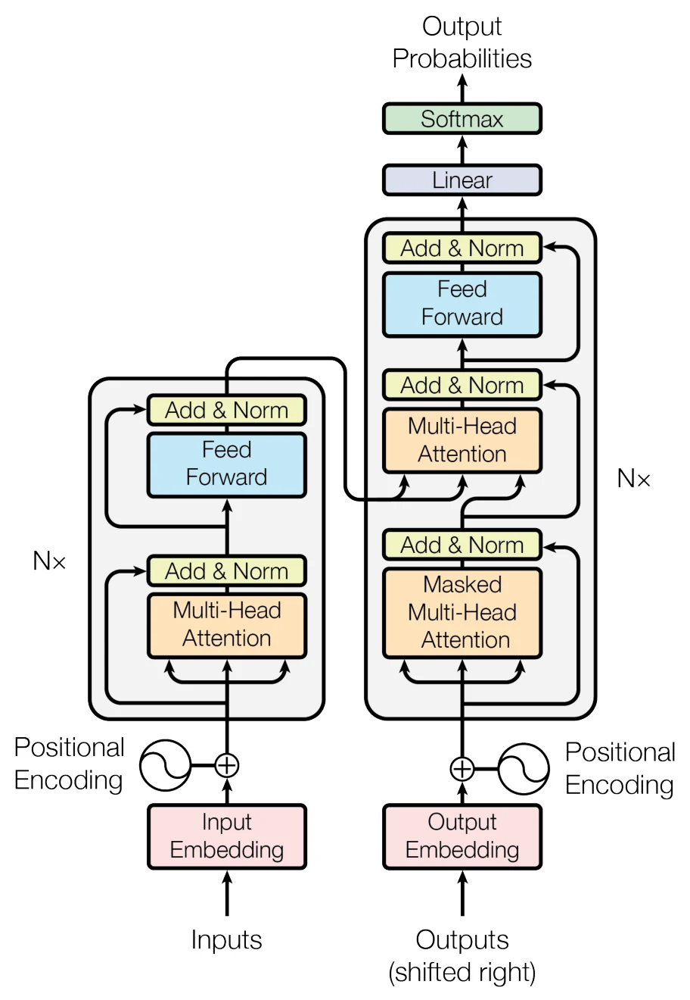
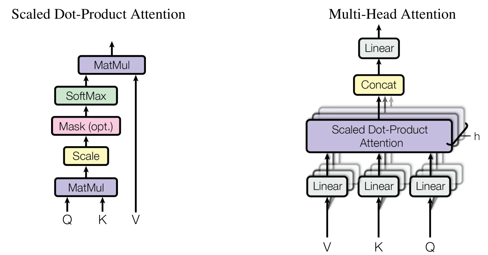

# Transformer：只用注意力完成序列转换

2017 年，八位作者（多数来自 Google Brain 和 Google Research）发表了《Attention Is All You Need》。他们研究的是机器翻译这类“把一个序列变成另一个序列”的任务。当时效果最好的模型都以循环神经网络（RNN）为骨架，再配上注意力。作者提出了一个大胆的想法：把循环结构整个拿掉，只用注意力在词与词之间传递信息。他们把这个新架构叫作 Transformer。它在两项翻译任务上取得了当时最好或接近最好的成绩，训练成本却低得多。[原论文摘要与 §1，PDF 第1–2页](https://proceedings.neurips.cc/paper/2017/file/3f5ee243547dee91fbd053c1c4a845aa-Paper.pdf)

今天读这篇论文，重点不在翻译分数，而在架构本身。后来的 GPT 系列等大语言模型都建立在它之上。读懂它，“上下文”“注意力”“自回归生成”这些词就不再抽象：一个位置怎样从其他位置取信息，模型怎样知道词的先后顺序，为什么训练可以并行、生成却要一个词一个词地写，都有具体的计算可以对照。

全文的核心是图 1 的整体架构和其中反复出现的多头注意力，导读的大部分篇幅也给了它们。阅读顺序是：先了解作者面对的问题，再明确模型要预测什么；接着对照图 1 看全貌，然后用三节细讲注意力和多头注意力；最后看三种注意力通路、位置编码、复杂度论证、训练与实验。数字都来自固定的 NIPS 2017 会议 PDF。正文中第一次出现的缩写和术语带有虚线，点开可以看全称和来历。

## 2017 年的问题：循环网络为什么慢

要理解作者为什么想去掉循环结构，先看循环网络怎样读一句话。RNN 把句子当作一条时间线：读入第 1 个词，得到隐状态 $h_1$；再用 $h_1$ 和第 2 个词算出 $h_2$；依此类推，每一步都把前文“压”进当前的隐状态。LSTM 和 GRU 是 RNN 的改良版，用“门”控制哪些信息保留、哪些遗忘，缓解了长句中前面的信息逐渐消失的问题。2017 年时，它们是语言建模和机器翻译里公认的最佳方案。[§1，PDF 第1–2页](https://proceedings.neurips.cc/paper/2017/file/3f5ee243547dee91fbd053c1c4a845aa-Paper.pdf#page=2)

作者指出的问题在“依次”两个字上。$h_t$ 要等 $h_{t-1}$ 算完才能开始，所以同一条训练样本内部无法并行计算。句子越长，这个限制越明显；而显存有限，一次能并排塞进去的样本也有限。已有工作用分解技巧和条件计算提高了效率，但作者认为，“必须按顺序算”这一根本约束仍然存在。

注意力机制在当时已经很成功。它最早用于翻译：解码器生成每个词时，可以回头去“看”原句的不同位置，而不必把整句话压缩进一个固定长度的向量。它的好处是，两个位置无论相隔多远，都能直接建立联系。不过作者注意到，除了极少数例子，注意力都是作为循环网络的附件来用的，骨架仍是循环。

另一条路线是卷积。ConvS2S 和 ByteNet 用 CNN 代替循环，所有位置可以同时计算。但卷积每次只看一个小窗口，相距很远的两个词要经过很多层才能互相影响：在 ConvS2S 中，所需的操作数随距离线性增长，在 ByteNet 中按对数增长。作者认为，信号要走的路越长，长距离依赖就越难学。[§2，PDF 第2页](https://proceedings.neurips.cc/paper/2017/file/3f5ee243547dee91fbd053c1c4a845aa-Paper.pdf#page=2)

于是作者的目标很明确：既要像卷积那样让所有位置并行计算，又要像注意力那样让任意两个位置一步相连。他们的答案是完全依靠自注意力，也就是让同一个序列内部的各个位置互相注意。作者也预先指出了代价：注意力本质上是按权重做平均，平均会把细节抹平，降低“有效分辨率”。后文的多头注意力正是为弥补这一点设计的。

## 预测对象：编码器、解码器与自回归

在看具体结构之前，先明确模型要算什么。机器翻译属于序列转换：输入一个序列 $x=(x_1,\ldots,x_n)$，输出另一个序列 $y=(y_1,\ldots,y_m)$，两者长度可以不同。当时主流的做法是编码器—解码器结构，Transformer 沿用了这个框架。[§3，PDF 第2–3页](https://proceedings.neurips.cc/paper/2017/file/3f5ee243547dee91fbd053c1c4a845aa-Paper.pdf#page=2)

编码器先把输入的每个词元变成一个连续向量，得到 $z=(z_1,\ldots,z_n)$。这里的“词元”不一定是完整的词，论文用的是子词切分。解码器根据 $z$ 一次生成一个输出词元，每生成一步，就把已经生成的部分当作额外输入，再预测下一个。这种“用自己前面的输出预测后面”的方式叫自回归。用概率写出来是：

$$
p_\theta(y\mid x)=\prod_{t=1}^{m}p_\theta(y_t\mid y_{<t},x)
$$

这个式子是导读为了说明而写的记号，不是论文中带编号的公式。$\theta$ 是模型参数，$y_{<t}$ 是第 $t$ 个位置之前已经确定的输出。整句译文的概率，被拆成一连串“已知原句和前文，下一个词是什么”的条件概率相乘。

后文会一直用一个教学例子：把英文 *They reached the river bank* 译成“他们来到了河岸”。这个英中句子是导读自编的，论文实际测试的是英德和英法翻译。为了讲清楚，这里按整词处理，把“河岸”当作一步；实际模型会把词再切成子词。

训练时有一个便利：参考译文已经摆在那里。可以把参考译文整体向右移一位，作为解码器的输入，让每个位置同时去预测“自己的下一个词”。输入排成“〈起始〉 他们 来到了”，对应的目标是“他们 来到了 河岸”：第一个位置看到起始符，要预测“他们”；第三个位置看到“〈起始〉 他们 来到了”，要预测“河岸”。这种用参考译文提供前文的训练方式，通常称为 teacher forcing。论文图 1 右下角的 “Outputs (shifted right)” 指的就是这个右移。

推理时情况不同。没有参考答案可以参照，模型只能把刚生成的词接回输入，再算下一个，一步一步来。所以 Transformer 的“可以并行”指的是训练：目标序列已知，所有位置能同时计算。生成阶段的先后依赖依然存在。读后面的论文时，这个区分会反复用到：训练快，不代表生成快。

训练时同时计算所有位置，也带来一个风险：输入里第三个位置放着“来到了”，而它正是第二个位置要预测的答案。如果第二个位置能读到第三个位置，它就能直接抄答案。论文用“遮罩”堵住这个漏洞，后面讲解码器时会具体说明。

## 先看全貌：图 1 怎样读

这张图是整篇论文最重要、也最常被引用的图，值得花时间读熟。建议从下往上看，左右分开看。我们先认识每个方框，再用翻译例子把数据流走一遍。[§3.1 与图 1，PDF 第3页](https://proceedings.neurips.cc/paper/2017/file/3f5ee243547dee91fbd053c1c4a845aa-Paper.pdf#page=3)

**左边是编码器，负责读原句。** 输入词元先经过 Input Embedding，各自变成一个长度为 $d_{\text{model}}=512$ 的向量；然后加上 Positional Encoding（位置编码，图中的波形符号和 ⊕），让向量带上“我在第几个位置”的信息。接着进入灰色大框。框外的 “N×” 表示整个框重复堆叠 N 次，论文中 $N=6$。每一层有两个子层：先是橙色的 Multi-Head Attention（多头注意力），再是蓝色的 Feed Forward（前馈网络）。

**右边是解码器，负责写译文。** 结构和编码器相似，但每层有三个子层。最下面的 Masked Multi-Head Attention 带遮罩，保证每个位置只能看到自己和前面的位置。中间的 Multi-Head Attention 很特别：注意它下方的三个输入箭头，两个来自左边编码器的顶部，一个来自解码器下方。这一层让解码器在写译文时去“查阅”原句，叫作交叉注意力。最上面同样是前馈网络。

**顶部是输出。** 解码器最后的向量经过 Linear（线性变换）和 Softmax，变成目标词表上每个词元的概率，即 Output Probabilities，模型据此选出下一个词元。

**每个子层都包在 Add & Norm 里。** 用论文的写法，子层的输出是 $\operatorname{LayerNorm}(x+\operatorname{Sublayer}(x))$：先把子层的结果加回它的输入，这就是图中绕过子层的那条箭头，叫残差连接；再做层归一化（LayerNorm）。残差连接让信号和梯度可以“抄近路”穿过很多层，是训练深层网络的常用办法。为了能直接相加，模型里所有子层和嵌入层的输出都统一为 512 维。

现在用翻译例子走一遍。假设解码器已经写出“他们来到了”，正要预测下一个词。

先看左侧。英文 bank 有“银行”和“河岸”两个意思。查嵌入表时，bank 总是取出同一行向量，本身并不知道该是哪个意思。经过编码器的自注意力，bank 这个位置可以读取 river 等位置的信息；如果句子是 *the savings bank*，它读到的就是 savings。经过六层之后，同一个 bank 在不同句子里会得到不同的表示。编码器顶部保留着每个源位置的最终表示，等待解码器来查。

再看右侧。“〈起始〉 他们 来到了”从右下角进入，经过带遮罩的自注意力，当前位置汇总了“译文已经写到哪里”的信息。然后它进入中间的交叉注意力，带着这份信息去编码器的输出里查找：原句中哪些位置和“现在要写的下一个词”最相关？假如它主要读到了 bank 和 river 的表示，取回的信息就会偏向“河岸”的意思。

最后到顶部。取回的信息加回当前位置，经过前馈层和更多层的同样处理，最上面的 Linear 和 Softmax 给词表里每个候选词打分。“河岸”可以得到比“银行”更高的概率，尽管它从未作为中文词出现在原句里。可以看到，“去原句哪里查”“查回什么”和“最终用哪个词表达”，发生在图上不同的位置。

还有一个后来经常被改动的细节：原论文把归一化放在相加之后。后续不少模型改成在子层之前做归一化，读新论文时不要默认它们和原版完全一样。

图 1 中出现了三次橙色的多头注意力，它是整个架构的核心部件。接下来三节逐层打开它：先看单个注意力怎样计算，再看为什么要用多个头，最后沿图 2 右侧完整算一遍。

## 缩放点积注意力：一次查询怎样取回信息

论文先给出注意力的一般定义：把一个查询（query）和一组“键—值”对（key-value pairs）映射为一个输出。输出是各个值的加权和，每个值的权重由查询和对应键的匹配程度决定。[§3.2，PDF 第3页](https://proceedings.neurips.cc/paper/2017/file/3f5ee243547dee91fbd053c1c4a845aa-Paper.pdf#page=3)

可以用查资料来类比。查询是“我现在想找什么”；键是每份资料贴的标签，用来和查询比较；值是资料的内容，比较之后真正被带走的东西。查询和每个标签比一比，越匹配的资料权重越高，最后把所有资料的内容按权重混合起来带走。和查字典不同的是，这里不只取最匹配的一份，而是按比例每份都取一点。

把类比放回翻译例子。交叉注意力中，解码器当前位置的表示经过一次线性变换，得到查询 Q。编码器给出的每个源位置，各自经过另外两次变换，分别得到键 K 和值 V。以 bank 这个位置为例，它的键决定“查询和它有多匹配”，它的值决定“匹配之后带走什么”。这三种变换的参数都是在翻译训练中学出来的，没有人预先告诉模型 river 和“河岸”有关。

为什么键和值要分开？因为“凭什么被选中”和“被选中后提供什么”是两回事。两个位置的键可以和查询同样匹配，但值不同，带回的内容也就不同。同一个源词，用来被比较的表示和用来提供内容的表示，可以各自学得适合自己的任务。

图 2 左边是论文的具体算法，作者称为缩放点积注意力。从下往上读：

1. **MatMul：** 查询 Q 和每个键 K 做点积，得到匹配分数。点积越大，说明两个向量越“同方向”，匹配越好。
2. **Scale：** 每个分数除以 $\sqrt{d_k}$，$d_k$ 是键向量的维度。
3. **Mask（可选）：** 把不允许看到的位置的分数设为负无穷。交叉注意力不需要它，因为整句原文在翻译前都已给定；解码器的自注意力需要它。
4. **SoftMax：** 把一行分数变成一组非负、加起来等于 1 的权重。
5. **MatMul：** 用这组权重对各位置的值向量加权求和。注意图中 V 那条长长的箭头，它一直绕到最上面才参与计算。

合起来就是论文的式 (1)：[§3.2.1、图 2 与式 1，PDF 第4页](https://proceedings.neurips.cc/paper/2017/file/3f5ee243547dee91fbd053c1c4a845aa-Paper.pdf#page=4)

$$
\operatorname{Attention}(Q,K,V)=\operatorname{softmax}\!\left(\frac{QK^\top}{\sqrt{d_k}}\right)V
$$

实际计算时，所有查询被排成一个矩阵一起算。假设有 $n$ 个查询、$s$ 个可以被查的位置。$QK^\top$ 得到一个 $n\times s$ 的分数矩阵，第 $i$ 行是第 $i$ 个查询对每个位置的匹配分。softmax 对每一行分别归一化，再乘以 $V$。每个查询就得到一个混合了各位置信息的新向量。输出仍是 $n$ 行，每个查询位置一个向量，只是这个向量已经“看过”了其他位置。

顺带区分两个 softmax。图 2 里的 softmax 沿源位置分配读取权重，决定“从哪里读多少”；图 1 顶部的 softmax 沿词表分配概率，决定“下一个词写什么”。两者用的是同一个函数，作用完全不同。

**为什么要除以 $\sqrt{d_k}$？** 这是论文里少数给出推理的设计。作者先比较了两种常见注意力：加性注意力用一个小的前馈网络计算匹配分；点积注意力直接做内积。两者理论复杂度相近，但点积可以用高度优化的矩阵乘法实现，实际快得多，也更省内存。问题在于，已有实验发现，维度 $d_k$ 较大时，不加缩放的点积注意力不如加性注意力。

作者的解释是：维度大了，点积的数值会变得很大，把 softmax 推到梯度极小的区域。那时 softmax 几乎把全部权重给某一个位置，其余位置的梯度接近零，训练就很难进行。论文脚注给了一个直觉：如果 $q$ 和 $k$ 的每个分量都是均值为 0、方差为 1 的独立随机变量，那么点积 $q\cdot k=\sum_{i=1}^{d_k}q_ik_i$ 的方差就是 $d_k$。除以 $\sqrt{d_k}$，正好把方差拉回 1。这个推导说明的是设计动机，实际训练中的向量未必满足这些假设，但缩放这一步后来几乎被所有实现沿用。[§3.2.1 与脚注 4，PDF 第4页](https://proceedings.neurips.cc/paper/2017/file/3f5ee243547dee91fbd053c1c4a845aa-Paper.pdf#page=4)

最后补一句常见误解：注意力权重高，并不说明模型“理解”了这两个位置的关系。权重描述的是这一层里数值怎样混合，单凭它推不出人类意义上的理解或因果解释。

## 多头注意力（上）：为什么一组权重不够

上一节的注意力有一个特点：每个查询只算出一组权重，这组权重同时作用在值向量的所有维度上。如果 bank 位置给 river 和 bank 各分一半权重，取回的向量每一维都是两个值向量的“一半对一半”平均。

问题来了。要写出“河岸”，当前位置可能同时需要两种信息：从 river 那里读到“这是关于河流的语境”，从 bank 本身读到“这是一个表示地点的名词”。理想的做法是：读语境信息时多看 river，读词本身的信息时多看 bank。但单个注意力只有一组权重，只能在两者之间折中，取回的是一份混合物。下一层拿到这份混合物，未必还能分清哪些成分来自哪里。作者在背景部分说的“平均会降低有效分辨率”，指的就是这个限制。

多头注意力的思路很直接：既然一组权重不够，就给同一个查询多组权重。具体做法是用 $h$ 组不同的线性投影，把查询、键、值分别投影成 $h$ 份较小的版本，每一份各自做一次缩放点积注意力。这样同一个查询位置在 $h$ 个“头”里各算出一组权重，可以在第 1 个头里主要读 river，在第 2 个头里主要读 bank。最后把各头的结果拼接起来，再经过一次线性变换，合成一个向量。[§3.2.2，PDF 第4–5页](https://proceedings.neurips.cc/paper/2017/file/3f5ee243547dee91fbd053c1c4a845aa-Paper.pdf#page=5)

论文的原话是：多头注意力让模型能够在不同位置上，同时关注来自不同表示子空间的信息；只用一个头时，平均会抑制这一点。“表示子空间”可以理解为：每个头的投影只保留并重新组合输入中的一部分特征，形成一个较小的空间，在那里衡量匹配、取回内容。不同的头看到的是同一组位置的不同侧面。

这里要防止两种误读。

第一，各头的分工是训练出来的，论文没有预先规定“第一头管语法，第二头管语义”。作者在 §4 说，他们观察到不同的头似乎学会了不同的任务，有些和句法、语义结构有关，但这只是观察，具体例子放在附录中，而固定采用的会议 PDF 并不包含这份附录。

第二，每个头的投影都从完整的 512 维输入出发，可以学会从所有特征中挑选、组合出自己需要的 64 维。不能把多头理解成“把 512 维切成 8 段，每个头只看其中 64 个数”。

多头为什么有用，论文最直接的证据是表 3 的 (A) 组消融：在计算量相近的条件下，8 个头比 1 个头高 0.9 BLEU。这组实验在后面讲结果时会细读。下一节先沿图 2 右侧，把多头的每一步算清楚。

## 多头注意力（下）：沿图 2 右侧算一遍

图 2 右半边从下往上画了多头注意力的四个步骤。先说明记号：进入多头模块的查询矩阵 $Q$ 有 $n$ 行，键和值矩阵 $K,V$ 各有 $s$ 行，每行都是 512 维。基础模型有 $h=8$ 个头，每头的键维度 $d_k=64$、值维度 $d_v=64$。下表把每一步做什么、形状怎样变化列在一起：

| 图 2 右侧，从下往上 | 对第 $i$ 个头做的事 | 基础模型中的形状 |
| --- | --- | --- |
| 底部三个 Linear | $Q,K,V$ 分别右乘该头自己的投影矩阵 $W_i^Q,W_i^K,W_i^V$，得到这个头专用的查询、键、值 | 每个投影矩阵是 $512\times64$；$Q_i$ 为 $n\times64$，$K_i,V_i$ 各为 $s\times64$ |
| 层叠的 Scaled Dot-Product Attention | 每一层都完整执行图 2 左侧的计算：打分、除以 $\sqrt{64}=8$、按需遮罩、softmax、乘以 $V_i$ | 每个头得到自己的 $n\times s$ 权重表和 $n\times64$ 输出 |
| Concat | 对每个查询位置，把 8 个头的输出首尾相接 | 8 个 $n\times64$ 拼成一个 $n\times512$ |
| 顶部 Linear | 右乘输出投影矩阵 $W^O$，把来自各头的特征重新组合 | $W^O$ 为 $512\times512$，输出仍是 $n\times512$ |

把四步写成公式，就是论文的多头注意力定义：

$$
\operatorname{head}_i=\operatorname{Attention}(QW_i^Q,KW_i^K,VW_i^V),\qquad
\operatorname{MultiHead}(Q,K,V)=\operatorname{Concat}(\operatorname{head}_1,\ldots,\operatorname{head}_h)W^O
$$

顶部的 $W^O$ 不是可有可无的。拼接只是把 8 份结果并排放着，第 1 到 64 维来自头 1，第 65 到 128 维来自头 2，彼此还没有混合。$W^O$ 让每个输出维度都可以综合所有头的结果，把“从 river 读到的语境”和“从 bank 读到的词义”真正结合起来，再交给后面的层。

**一个可以手算的小例子。** 下面把模型缩小到能用纸笔算完。所有数值都是导读为了演示而指定的，不是论文训练出的参数。

只保留原句中的两个源位置，第 1 个是 river，第 2 个是 bank。模型宽度缩成 2，有 2 个头，每个头的键和值都只有 1 维。设解码器当前位置的查询为 $Q=[1,1]$。两个源位置的表示分别是 $[1,0]$ 和 $[0,1]$，键和值都用这两行，即 $K=V=\begin{bmatrix}1&0\\0&1\end{bmatrix}$。

第一步，投影。两个头的投影矩阵如下，每个都是两行一列，相乘就是取内积：

| 头 | $W_i^Q$ | $W_i^K$ | $W_i^V$ | 投影结果 |
| --- | --- | --- | --- | --- |
| 头 1 | $(1,0)^\top$ | $(\ln 3,0)^\top$ | $(4,0)^\top$ | 查询 1；两个位置的键为 $\ln 3$ 和 0；值为 4 和 0 |
| 头 2 | $(0,1)^\top$ | $(0,\ln 3)^\top$ | $(0,8)^\top$ | 查询 1；两个位置的键为 0 和 $\ln 3$；值为 0 和 8 |

第二步，每个头各算一次注意力。这里 $d_k=1$，缩放因子是 1。

- 头 1 的分数是 $[1\times\ln 3,\ 1\times 0]=[\ln 3,0]$。取指数得 $[3,1]$，除以总和 4，权重为 $[3/4,1/4]$。头 1 主要看 river。取回的值是 $\tfrac34\times4+\tfrac14\times0=3$。
- 头 2 的分数是 $[0,\ln 3]$，权重恰好相反，为 $[1/4,3/4]$，主要看 bank。取回的值是 $\tfrac14\times0+\tfrac34\times8=6$。

第三步，拼接和输出投影。拼接得到 $[3,6]$。设 $W^O=\begin{bmatrix}1&1\\1&-1\end{bmatrix}$，输出为 $[3+6,\ 3-6]=[9,-3]$。这个向量接下来与残差相加、做归一化，进入下一个子层。注意 softmax 只出现在每个头的内部，最终输出的特征可以是负数。

现在看单头为什么做不到同样的事。假设只有一个头，直接混合两个值向量 $[4,0]$（来自 river）和 $[0,8]$（来自 bank），给 river 的权重为 $a$，给 bank 的权重为 $1-a$，结果是 $[4a,\ 8(1-a)]$。要同时得到刚才两个头分别取回的 3 和 6，第一维要求 $a=3/4$，第二维却要求 $a=1/4$，一组权重无法同时满足。两个头可以各选一次混合比例，这正是多头的意义。当然，这个例子只说明“一组权重”这一步的限制；换一套可学习的参数，单头也能算出其他有用的表示。

**为什么 8 个头的计算量没有变成 8 倍？** 回到真实的 512 维模型。单头注意力用 512 维的查询和键打分；8 头则在 8 个 64 维的子空间里各打一次分。对 $n$ 个查询和 $s$ 个键，打分的乘加次数与 $n\times s\times h\times d_k$ 成正比，加权求和与 $n\times s\times h\times d_v$ 成正比。只要 $h\,d_k=h\,d_v=512$，这两步的主要计算量就和一个 512 维的单头相当。投影也一样：8 个 $512\times64$ 的矩阵拼起来，参数量和一个 $512\times512$ 的矩阵相同。论文据此说，由于每个头的维度变小了，总计算量与全维度的单头注意力相近。区别在于，8 个头要各算一张 $n\times s$ 的权重表、各做一次 softmax，所以实际的显存和运行时间不一定完全相同。[§3.2.2，PDF 第4–5页](https://proceedings.neurips.cc/paper/2017/file/3f5ee243547dee91fbd053c1c4a845aa-Paper.pdf#page=5)

最后回到图 1。多头注意力的输出仍是每个查询位置一个 512 维向量，正好可以和绕过它的残差相加。图 1 中三处橙色框都是这样一个多头模块，各自有独立的参数，区别只在于查询、键、值从哪里来，下一节就来看这三条通路。

## 三种注意力通路、遮罩与位置编码

同一个多头注意力，在图 1 里被用在三个地方。三者的计算完全相同，区别只在于 Q、K、V 从哪里来、能看到哪些位置。设源句有 $s$ 个位置，右移后的目标序列有 $t$ 个位置：[§3.2.3，PDF 第5页](https://proceedings.neurips.cc/paper/2017/file/3f5ee243547dee91fbd053c1c4a845aa-Paper.pdf#page=5)

| 图 1 中的位置 | Q 来自 | K、V 来自 | 每个头的权重表 |
| --- | --- | --- | --- |
| 编码器的自注意力（左下） | 编码器上一层 | 编码器上一层 | $s\times s$，每个源词可以读整句的前后文 |
| 解码器的带遮罩自注意力（右下） | 解码器上一层 | 解码器上一层 | $t\times t$，只能读自己和之前的位置 |
| 编码器—解码器注意力（右侧中间） | 解码器下方子层的输出 | 编码器最终输出 | $t\times s$，每个译文位置可以读整句原文 |

第三种就是前面说的交叉注意力。它和当时循环网络翻译模型里的注意力用法一致，只是换成了多头：同一个译文位置可以用不同的头读原句的不同部分。

**遮罩怎样工作。** 回到训练时的例子。解码器输入是“〈起始〉 他们 来到了”，三个位置分别要预测“他们”“来到了”“河岸”。在解码器自注意力的 $3\times3$ 分数表中，第 2 行（预测“来到了”）可以看第 1 列的“〈起始〉”和第 2 列的“他们”，但第 3 列放的正是答案“来到了”，必须挡住。做法是在 softmax 之前把这一格的分数设为 $-\infty$，softmax 之后它的权重就变成 0。对每一行都这样处理，就得到一张只保留主对角线及其左下部分的表。整张表仍然可以一次算完，只是哪些格子能参与，在计算前就已确定。[§3.1，PDF 第3页](https://proceedings.neurips.cc/paper/2017/file/3f5ee243547dee91fbd053c1c4a845aa-Paper.pdf#page=3)

遮罩和右移必须配合使用。右移让每个位置的监督目标是“下一个词”；遮罩保证这个位置读不到那个词。只右移不遮罩，模型会通过注意力偷看后面的答案；只遮罩不右移，输入和目标就对不上。论文的说法是，两者合在一起，才保证位置 $i$ 的预测只依赖 $i$ 之前的已知输出。交叉注意力不需要这种限制，因为整句原文在翻译开始前就已经给定。

**为什么需要位置编码。** 去掉循环之后，还有一个问题：注意力本身不关心顺序。把编码器输入的词元打乱，每个词元的查询、键、值会跟着一起移动，它从其他词元取回的内容也不会变，输出只是跟着重新排列。换句话说，单靠注意力，模型分不清 “the river bank” 和 “the bank river”。循环网络天然按顺序读，卷积也带有局部顺序，Transformer 两者都没有，所以必须把位置信息显式地加进去。

论文的做法是给每个位置生成一个和词向量同样长的位置编码，直接加到嵌入上，用的是不同频率的正弦和余弦函数：

$$
PE_{(pos,2i)}=\sin\!\left(\frac{pos}{10000^{2i/d_{\text{model}}}}\right),\qquad
PE_{(pos,2i+1)}=\cos\!\left(\frac{pos}{10000^{2i/d_{\text{model}}}}\right)
$$

$pos$ 是位置，$i$ 是维度编号。每一维对应一条正弦波，各维的波长从 $2\pi$ 到 $10000\cdot2\pi$ 成等比变化。可以把它想成一组转速不同的指针：低维转得快，能区分相邻的位置；高维转得慢，能区分相隔很远的位置。每个位置对应一组独一无二的指针读数。[§3.5，PDF 第5–6页](https://proceedings.neurips.cc/paper/2017/file/3f5ee243547dee91fbd053c1c4a845aa-Paper.pdf#page=6)

作者为选择这个函数给了两个理由，都写成了假设。第一，对任意固定的偏移 $k$，$PE_{pos+k}$ 都可以表示成 $PE_{pos}$ 的线性函数，作者猜测这能让模型容易学会按相对位置来注意。第二，它可能让模型推广到比训练时更长的序列。论文还试了另一种做法：位置编码不用公式，而是作为参数直接学出来。结果两者几乎一样（表 3 的 (E) 行）。作者最终选择正弦版本，理由正是第二点，但论文没有实验验证长度外推是否成立。

## 前馈层与残差：接住注意力的输出

多头注意力的输出回到图 1 后，先经过黄色的 Add & Norm。以交叉注意力为例，从原句读回的信息加到当前译文位置原有的表示上，再做层归一化。这样，新的表示同时带着“译文写到了哪里”和“从原句读到了什么”。

接着是每层的第二个子层，蓝色的逐位置前馈网络：

$$
\operatorname{FFN}(x)=\max(0,\,xW_1+b_1)W_2+b_2
$$

它是两次线性变换，中间夹一个 ReLU 激活函数，也就是 $\max(0,\cdot)$。“逐位置”是说它对序列中每个位置分别、独立地做同样的变换，位置之间在这里不交流。同一层内各位置共用参数，不同层的参数不同。维度上，输入和输出是 512，中间层扩展到 $d_{ff}=2048$。作者也提到，可以把它看成两个核大小为 1 的卷积。[§3.3，PDF 第5页](https://proceedings.neurips.cc/paper/2017/file/3f5ee243547dee91fbd053c1c4a845aa-Paper.pdf#page=5)

这样就能看清分工：注意力负责在位置之间搬运信息，前馈网络负责加工每个位置自己的特征。论文标题说“只需要注意力”，指的是不再需要循环和卷积来在位置之间传递信息，而不是说模型里只有注意力。前馈层的参数量其实相当可观，残差连接和层归一化也不可缺少。

最后还有一处小设计：输入嵌入、输出嵌入和最终 softmax 之前的线性层共用同一个权重矩阵，嵌入层里还会把权重乘以 $\sqrt{d_{\text{model}}}$。[§3.4，PDF 第5页](https://proceedings.neurips.cc/paper/2017/file/3f5ee243547dee91fbd053c1c4a845aa-Paper.pdf#page=5)

## 为什么用自注意力：复杂度、并行与路径长度

论文第 4 节专门回答“凭什么用自注意力”。作者没有只说效果好，而是先定下三个衡量一层网络的标准，再与循环层、卷积层逐项比较：[§4、表 1，PDF 第6–7页](https://proceedings.neurips.cc/paper/2017/file/3f5ee243547dee91fbd053c1c4a845aa-Paper.pdf#page=6)

1. 每层的总计算量；
2. 能并行的程度，用最少需要多少步顺序操作来衡量；
3. 长距离依赖的路径长度：任意两个位置之间，信号最多要经过多少步。作者认为路径越短，长距离依赖越容易学。

表 1 把结果放在一起。$n$ 是序列长度，$d$ 是表示维度，$k$ 是卷积核大小，$r$ 是受限注意力的邻域大小：

| 层类型 | 每层复杂度 | 顺序操作数 | 最大路径长度 |
| --- | --- | --- | --- |
| 自注意力 | $O(n^2\cdot d)$ | $O(1)$ | $O(1)$ |
| 循环层 | $O(n\cdot d^2)$ | $O(n)$ | $O(n)$ |
| 卷积层 | $O(k\cdot n\cdot d^2)$ | $O(1)$ | $O(\log_k n)$ |
| 受限自注意力 | $O(r\cdot n\cdot d)$ | $O(1)$ | $O(n/r)$ |

后两列是自注意力最突出的优势：任意两个位置一步就能连上，也不需要按顺序计算。这正对应图 1 中编码器的自注意力，每个源词在同一层里就能直接读到任何其他源词。

第一列需要多想一下。自注意力要为每一对位置打分，计算量是 $n^2 d$；循环层的计算量是 $n d^2$。谁更省，取决于 $n$ 和 $d$ 谁大。作者指出，当时机器翻译用子词切分，句子长度 $n$ 通常小于表示维度 $d$，所以自注意力反而更省。表 1 比较的只是层内的核心运算，要估算整层，还要算上图 2 的投影和图 1 的前馈网络。卷积一栏的 $\log_k n$ 指的是空洞卷积，普通的连续卷积要连接远处位置，需要的层数随距离线性增长。

这个结论有明确的适用条件：序列一长，$n^2$ 就会成为负担，这正是后来长上下文研究要解决的问题。作者自己也意识到了，提出可以把注意力限制在一个大小为 $r$ 的邻域内，代价是最大路径长度变为 $O(n/r)$，并说会在未来工作中研究。

作者还顺带提到，自注意力可能让模型更容易解释，因为可以直接查看注意力分布。还要区分三件事：顺序步骤少、总运算量少、在实际硬件上跑得快。表 1 讨论的是前两件，第三件要看下一节的训练配置和实测时间。

## 训练配方：数据、硬件与正则化

架构之外，论文第 5 节交代了训练细节。这些条件是结果的一部分，复现或比较时都不能省略。[§5，PDF 第7页](https://proceedings.neurips.cc/paper/2017/file/3f5ee243547dee91fbd053c1c4a845aa-Paper.pdf#page=7)

**数据与切分。** 英德翻译用 WMT 2014 英德数据集，约 450 万句对，用 BPE 切分成子词，源语言和目标语言共用约 37000 个词元的词表。英法翻译用更大的 WMT 2014 英法数据集，3600 万句，切成 32000 个 word-piece 词元。句对按长度相近的原则分批，每批约含 25000 个源词元和 25000 个目标词元。

**硬件与时长。** 一台机器，8 块 NVIDIA P100 GPU。基础模型每步约 0.4 秒，训练 10 万步，约 12 小时；大模型每步约 1.0 秒，训练 30 万步，约 3.5 天。

**优化器与学习率。** 使用 Adam 优化器，$\beta_1=0.9,\ \beta_2=0.98,\ \epsilon=10^{-9}$。学习率按论文式 (3) 变化：

$$
lrate=d_{\text{model}}^{-0.5}\cdot\min\!\left(step^{-0.5},\ step\cdot warmup^{-1.5}\right)
$$

前 $warmup=4000$ 步学习率线性增大，之后按步数平方根的倒数逐渐减小。这种先“热身”再衰减的做法后来被广泛采用。

**正则化。** 一是 dropout，作用在每个子层的输出加回残差之前，以及嵌入与位置编码相加之后，基础模型的丢弃率 $P_{drop}=0.1$。二是标签平滑，取值 $\epsilon_{ls}=0.1$：训练时不要求模型给正确答案 100% 的概率，而是留一点给其他词。作者坦言，这会让困惑度变差，因为模型变得不那么确定，但能提高准确率和 BLEU 分数。[§5.4，PDF 第7–8页](https://proceedings.neurips.cc/paper/2017/file/3f5ee243547dee91fbd053c1c4a845aa-Paper.pdf#page=7)

这一节提醒我们，成绩不只来自注意力公式。子词切分、学习率热身、dropout、标签平滑和检查点平均都在起作用。想知道某个组件单独贡献了多少，要看下一节的消融实验。

## 实验结果与消融：证据说明了什么

作者在 WMT 2014 的两个翻译任务上测试，测试集是 newstest2014，指标是 BLEU。BLEU 衡量机器译文和人工参考译文在词组层面的重合程度，分数越高越接近参考译文。表 2 把 Transformer 和当时的主要模型放在一起，并列出估算的训练计算量（FLOPs）：[§6.1、表 2，PDF 第8页](https://proceedings.neurips.cc/paper/2017/file/3f5ee243547dee91fbd053c1c4a845aa-Paper.pdf#page=8)

| 模型 | 英德 BLEU | 英法 BLEU | 训练计算量（英德 / 英法） |
| --- | ---: | ---: | --- |
| GNMT + RL | 24.6 | 39.92 | 2.3·10¹⁹ / 1.4·10²⁰ |
| ConvS2S | 25.16 | 40.46 | 9.6·10¹⁸ / 1.5·10²⁰ |
| MoE | 26.03 | 40.56 | 2.0·10¹⁹ / 1.2·10²⁰ |
| GNMT + RL 集成 | 26.30 | 41.16 | 1.8·10²⁰ / 1.1·10²¹ |
| ConvS2S 集成 | 26.36 | 41.29 | 7.7·10¹⁹ / 1.2·10²¹ |
| Transformer（base） | 27.3 | 38.1 | 3.3·10¹⁸ |
| Transformer（big） | 28.4 | 41.0 | 2.3·10¹⁹ |

表中只摘了部分行。“集成”指把多个模型的预测合并，通常比单个模型强。英德任务上，大模型取得 28.4 BLEU，比此前最好的结果（包括集成模型）高出 2 分以上；连基础模型都超过了此前所有已发表的模型，训练计算量只有对手的一小部分。英法任务上，大模型取得 41.0 BLEU，超过所有已发表的单模型，训练成本不到此前最佳模型的四分之一，但没有超过表中的两个集成模型。

这些成绩有具体的设置：基础模型取最后 5 个检查点的平均，大模型取最后 20 个；解码用束搜索，束宽 4，长度惩罚 0.6；英法大模型的 dropout 用 0.1，而不是 0.3。训练计算量是作者用训练时间、GPU 数和每块 GPU 的估计算力折算的，不是精确测量。

**消融实验回答另一个问题：哪些设计真的重要。** 作者在英德开发集 newstest2013 上，从基础模型出发逐项改变配置，结果列在表 3。这里没有做检查点平均，用的也是另一个数据集，所以分数不能和表 2 直接比较。下表摘出与多头注意力直接相关的 (A)、(B) 两组，并补上原表中留白的基准值。PPL 是按子词计算的困惑度，越低越好；BLEU 越高越好。[§6.2、表 3，PDF 第8–9页](https://proceedings.neurips.cc/paper/2017/file/3f5ee243547dee91fbd053c1c4a845aa-Paper.pdf#page=9)

| 配置 | 头数 $h$ | 每头 $d_k$ | 每头 $d_v$ | 开发集 PPL | 开发集 BLEU | 参数量 |
| --- | ---: | ---: | ---: | ---: | ---: | ---: |
| 基准 | 8 | 64 | 64 | 4.92 | 25.8 | 6500 万 |
| (A) | 1 | 512 | 512 | 5.29 | 24.9 | |
| (A) | 4 | 128 | 128 | 5.00 | 25.5 | |
| (A) | 16 | 32 | 32 | 4.91 | 25.8 | |
| (A) | 32 | 16 | 16 | 5.01 | 25.4 | |
| (B) | 8 | 16 | 64 | 5.16 | 25.1 | 5800 万 |
| (B) | 8 | 32 | 64 | 5.01 | 25.4 | 6000 万 |

**(A) 组：同样的预算，分给多少个头？** 作者同步改变 $h$、$d_k$、$d_v$，保持 $h\,d_k=h\,d_v=512$，也就是上一节说的“总计算量相近”。只用 1 个头时 BLEU 是 24.9，比 8 个头低 0.9；4 个头是 25.5；16 个头和 8 个头一样，都是 25.8；增加到 32 个头，又降到 25.4。可见多头确实有帮助，但不是越多越好：头太多时，每个头只剩 16 维，用来比较和取值的空间可能太窄。这组实验同时改变了头数和每头的宽度，没有把两者的作用分开，也没有检验某个头是否专门负责某种语言现象。

**(B) 组：只缩小打分用的维度。** 保持 8 个头和 $d_v=64$ 不变，只把每头的 $d_k$ 从 64 缩小到 32 和 16。取回内容的宽度没变，但查询和键用来衡量匹配的空间变窄了。BLEU 从 25.8 降到 25.4 和 25.1，困惑度也上升。作者由此推测，判断“匹配程度”并不简单，比点积更精巧的匹配函数也许有好处。需要注意，这两行的参数量也减少了，而且论文没有实际测试其他匹配函数。

表 3 的其余三组可以用同样的方法读。(C) 组显示更大的模型更好，例如前馈维度增大到 4096 时 BLEU 为 26.2，但不同的扩容方式效果不同。(D) 组去掉 dropout 后降到 24.6，说明正则化对避免过拟合很重要。(E) 组把正弦位置编码换成学出来的位置嵌入，得到 25.7，和 25.8 几乎一样：给模型提供位置信息是必须的，但具体用哪个函数，在这个实验里影响不大。

## 这篇论文之后：从翻译架构到语言模型

作者在结论中说，他们会把 Transformer 用到文本以外的输入输出，比如图像、音频和视频；会研究局部的受限注意力来处理大规模输入；并希望让生成过程不那么依赖顺序。代码在 tensor2tensor 中开源。[§7，PDF 第9页](https://proceedings.neurips.cc/paper/2017/file/3f5ee243547dee91fbd053c1c4a845aa-Paper.pdf#page=9)

后来的发展远远超出了机器翻译。这些不属于本文的结论，读的时候要和论文本身分开。最直接的影响是，编码器和解码器可以拆开单独使用。以 GPT 系列为代表的语言模型，只用自回归解码器堆叠而成，再在海量文本上预训练。由于没有编码器，这类模型里也就没有图 1 中间那条交叉注意力：输入材料和生成的文字放在同一个序列里，靠带遮罩的自注意力互相读取。本库的 [GPT-3 导读](/read/gpt3/1#u02) 说明，GPT-3 沿用了 GPT-2 式的自回归 Transformer，并在归一化位置、稀疏注意力等方面做了调整，不是把原始的编码器—解码器直接放大。

读后续论文时，可以带着这篇论文里学到的几个问题去对照：

- Q、K、V 分别来自哪里？是自注意力还是交叉注意力？
- 用了几个头，每个头多宽？
- 哪些位置被遮住了？训练时有没有可能偷看答案？
- 位置信息怎样进入模型？用的是正弦、学习式，还是别的方法？
- 序列长度和计算量是什么关系？$n^2$ 什么时候成为瓶颈？
- 报告的结果在什么数据、什么指标、什么解码设置下成立？

从这里出发，建议先读 [GPT-3](/read/gpt3/1#u01)，看自回归预训练怎样带来上下文学习；再读 [InstructGPT](/read/instructgpt/2#u01)，理解“会续写”和“按人的意图做事”之间还差什么；最后读 [Agent 综述](/read/agent-survey/2)，把模型放进能感知、规划和行动的系统里。这是编辑建议的顺序，并不意味着前一篇证明了后一篇的结论。

## 回到原文：哪些地方值得亲自读

这篇论文的正文只有 9 页，读完导读后很值得完整读一遍原文。如果时间有限，建议优先读下面几处：

- **图 1 和 §3.1–3.2.3（PDF 第3–5页）。** 对照图 1，给三个橙色框分别标出 Q、K、V 的来源，尤其注意解码器的右移和遮罩。[图 1 与 §3.2.3，PDF 第3–5页](https://proceedings.neurips.cc/paper/2017/file/3f5ee243547dee91fbd053c1c4a845aa-Paper.pdf#page=3)
- **图 2 和 §3.2.2（PDF 第4–5页）。** 照着本导读的形状表，自己在图 2 右侧标出每一步的矩阵大小。[图 2 与 §3.2.2，PDF 第4–5页](https://proceedings.neurips.cc/paper/2017/file/3f5ee243547dee91fbd053c1c4a845aa-Paper.pdf#page=5)
- **§3.2.1 的脚注 4（PDF 第4页）。** 只有两行，是理解缩放因子的关键。[§3.2.1 与脚注 4，PDF 第4页](https://proceedings.neurips.cc/paper/2017/file/3f5ee243547dee91fbd053c1c4a845aa-Paper.pdf#page=4)
- **§4 和表 1（PDF 第6–7页）。** 看作者怎样先定标准、再逐项比较，这种论证方式值得学习。[§4 与表 1，PDF 第6–7页](https://proceedings.neurips.cc/paper/2017/file/3f5ee243547dee91fbd053c1c4a845aa-Paper.pdf#page=6)
- **表 3（PDF 第9页）。** 自己读一遍每一行改了什么、分数怎么变，再和 §6.2 中作者的解释对照。[表 3 与 §6.2，PDF 第9页](https://proceedings.neurips.cc/paper/2017/file/3f5ee243547dee91fbd053c1c4a845aa-Paper.pdf#page=9)

本导读依据 NIPS 2017 会议 PDF 正文 §1–7，覆盖方法主线、训练配置、主要翻译结果和消融。图 1、图 2 为原论文图，取自同一 PDF；表 2、表 3 只摘录了部分行。英中翻译句子和多头手算例子都是导读自编的教学例子，不是论文实验。没有复现实验，没有逐项讲解全部超参数和引用文献，也没有覆盖 arXiv 版附录中的注意力可视化。会议摘要网页上的数值与 PDF 略有出入，本文统一以 PDF 为准。“这篇论文之后”一节中的后续发展属于编辑背景，不是本论文的结论。阅读本导读或打开原文，都不会自动记为已读。
