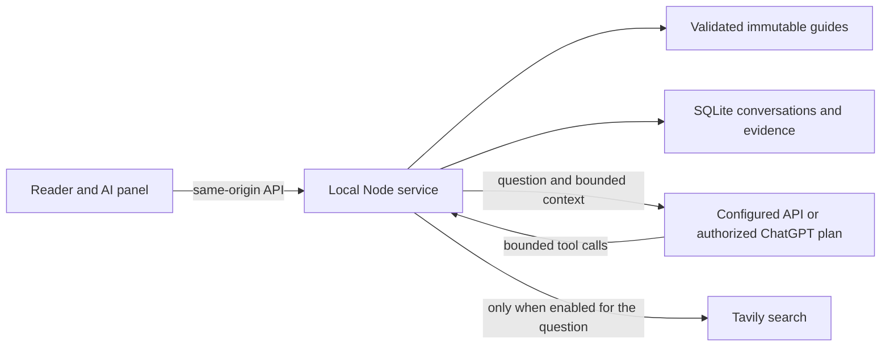

# AI reading extension

This extends the accepted specification 1.1 reader. Approved guide bodies and browser personal-record schemas remain unchanged. The feature is implemented locally, and the refined panel/settings interface passed reader acceptance on 2026-10-25. Actual provider quality and long-running reliability remain separate from interface acceptance.

## Research and decisions

Official repositories were inspected through the GitHub connector; the design borrows patterns, not source code or dependencies:

| Reference | Applied decision |
|---|---|
| [Kotaemon](https://github.com/Cinnamon/kotaemon/blob/main/README.md) and its [QA pipeline](https://github.com/Cinnamon/kotaemon/blob/main/libs/ktem/ktem/reasoning/simple.py) | Separate retrieval, evidence, answer and source review. Preserve a source snapshot for every answer. |
| [Khoj](https://github.com/khoj-ai/khoj/blob/master/README.md) | Keep library lookup and internet search as distinct, explicitly bounded tools. |
| [assistant-ui](https://github.com/assistant-ui/assistant-ui/blob/main/README.md) and [external runtime](https://www.assistant-ui.com/docs/runtimes/custom/external-store) | Separate UI, conversation persistence and streaming lifecycle; provide stop, recovery and explicit error states. |
| [Function calling documentation](https://developers.openai.com/api/docs/guides/function-calling) | Match tool results to call IDs, validate tool arguments in application code, bound calls and reject unoffered tools. |
| [Tavily Search API](https://docs.tavily.com/documentation/api-reference/endpoint/search) | Use bounded search excerpts; search is not full webpage or full-paper reading. |

The current fourteen-article library does not require a vector database. The current reviewed guide is supplied directly within a character budget. A rebuildable section index provides keyword retrieval across current revisions, followed by exact section reads when needed. This avoids requiring a second embedding provider merely to use the reader. It does not promise semantic retrieval or exhaustive literature search.

The existing IndexedDB layer already has strict revision conflicts, transactions, readback and a complete 5 MiB backup contract. Long AI transcripts and source snapshots would consume that capacity and require incompatible backup changes. A separate backend SQLite store therefore owns AI conversations. Its physical schema remains version 1, with transactions, foreign keys, request idempotency, terminal turn states and a complete 16 MiB backup budget. AI JSON backups now use version 2 to preserve provider/fallback metadata; imports accept versions 1 and 2. No existing personal records are migrated.

## Data flow



- Content identity is `guideId + revision + bodySha256 + unitId`. A stale frontend/backend mismatch is rejected. The backend validates content at startup; restart it after content updates.
- A turn contains its question, answer, status, model identifier, context scope, metadata/coverage snapshot, selected passage, included history IDs, tool results and source snapshots. The source text is reviewed guide Markdown or retrieved search text, not an inferred original-paper quotation.
- Up to 40,000 characters of guide text are supplied. Larger guides use the opening and current section and disclose that scope. History includes at most six completed turns and 12,000 characters. Questions are limited to 6,000 characters and selected passages to 12,000; unsupported rendered selections can instead be written into the question.
- Tools are `search_library`, `read_section` and optional `web_search`. Maximum six calls, four tool rounds, then a final answer without tools. Section reads are limited to 16,000 characters. Search returns up to four excerpts of 4,000 characters each. Combined message budget is 130,000 characters; this is a conservative character budget, not provider token counting.
- The UI shows actual activity statuses and streamed answer text. Hidden provider reasoning is not displayed or saved. ChatGPT's opaque reasoning items are retained only in memory for stateless tool continuation. Verified `[L…]` and `[W…]` references open the corresponding source snapshot. Unknown references do not become links. Generated HTML and images are not loaded.
- Cancellation reaches the model/search fetch. Partial text is checkpointed during streaming, with a final complete/interrupted/error state. Startup recovers interrupted runs; a duplicate service must acquire its port before it can open or recover the database.
- One active turn per conversation and two across the service. Each active turn reserves up to 2 MiB; writes/imports keep the whole collection exportable within 16 MiB. Near capacity, export first and deliberately delete old conversations before continuing.

## Backend configuration

Requires Node 22.13+ on the 22.x line, or Node 24+. Node's built-in SQLite may emit its experimental-feature warning on Node 22; [the Node documentation](https://nodejs.org/download/release/v22.23.0/docs/api/sqlite.html) records that it no longer requires a flag from 22.13. The backend uses the locked `jose` dependency to verify official login signatures. No hosted account service or cloud provisioning is needed.

Open the reader's **AI 设置 → API**, enter **Base URL**, **Model ID** and **API Key**, then **保存配置**. Saving applies to subsequent questions without restarting. If ChatGPT is currently selected, **使用此 API** explicitly switches the provider after saving. The page never receives a saved key: its empty password field preserves an existing key; changing the address requires re-entering the corresponding key. A confirmed save clears the entered key. Settings and question submission are locked against each other; a detected configuration conflict retains the draft and requires reloading before saving again. Saving configuration does not verify provider connectivity.

The settings are persisted in **`server/config.local.json`**, which can also be edited directly. For a fresh checkout, copy `server/config.example.json` to that filename if desired; the settings page can create it. The local file is ignored by Git. Never put credentials in `VITE_*`, frontend code, content packages or public assets. `settings.mjs` serializes page reads/writes and uses a temporary file, replacement and readback; revision/fingerprint checks detect intervening edits. Avoid editing this file manually while saving from a page; there is no shared lock with external editors.

```json
{
  "baseURL": "https://api.openai.com/v1",
  "apiKey": "",
  "modelId": "",
  "chatgptModelId": "",
  "chatgptReasoningEffort": "",
  "chatgptFallbackToApi": true,
  "toolsEnabled": true,
  "maxOutputTokens": 3000,
  "timeoutMs": 120000,
  "search": { "apiKey": "" }
}
```

`baseURL` is the API prefix; the backend appends `/chat/completions`. Set the actual provider URL, credential and model locally. HTTPS is required except for loopback HTTP. The model must support streaming Chat Completions and, with `toolsEnabled: true`, function tools. OpenAI-compatible endpoints vary; this does not guarantee that every ModelID supports this protocol. A Responses-only model is not supported by this adapter. Set `toolsEnabled: false` deliberately for plain streaming Q&A; that also disables library tools and web search. Unsupported tool calls are never silently dropped.

`search.apiKey` is an optional Tavily credential for searching public webpages. Get a key from the [Tavily dashboard](https://app.tavily.com/) and place that key in this field. It is separate from the model API key. [Tavily's quickstart](https://docs.tavily.com/) describes key creation and its current free allowance. Without it, guide Q&A and library tools remain available; web search is disabled. No search URL needs to be filled in: this adapter uses Tavily's fixed endpoint. Restart the combined service after changing configuration. Timeout accepts 1–180 seconds; output accepts 128–8192 tokens.

From the project directory:
```text
npm run build
npm start
```

`npm start` starts the website and AI together and opens the library. Ctrl+C stops both. `npm run dev` runs both in development mode; `npm run preview` runs both from the existing build. Those two commands open a browser only when passed `-- --open`. Use `npm start -- --no-open` for a terminal-only start. For manual or isolated operation, `npm run dev:web` / `npm run preview:web` run only the frontend, and `npm run ai` runs only the backend.

Keep the reader at `http://127.0.0.1:4173`. Vite proxies `/api/ai` to `127.0.0.1:4176`; both bind to loopback. Do not start duplicate services. The launcher stops its own companion service on a startup failure; it never kills a process occupying either port. Missing credentials produce an explicit unconfigured state, and an absent backend leaves reading and question drafting available.

### System network proxy

The backend automatically adopts Windows system proxy decisions. Keep the existing proxy application running and start PaperDesk normally; no proxy address, fixed port or additional project configuration is needed. Windows selects the proxy for each complete target URL, then the proxy application applies its own routing rules. Loopback requests remain direct. This covers authorization discovery, signing keys, token exchange/renewal, model lists, model responses and optional search. The same transport is used by `start`, `dev`, `preview`, `ai` and direct backend startup.

`server/network.mjs` uses Windows PowerShell's .NET Framework `GetSystemWebProxy().GetProxy(target)` and a pinned `undici` dispatcher for that request. [Microsoft's implementation](https://github.com/microsoft/referencesource/blob/main/System/net/System/Net/webproxy.cs) evaluates automatic configuration and manual bypasses; the complete URL matters for PAC rules. Each request resolves anew. Proxy connections are reused within a bounded pool. Only the target URL is given to the hidden helper; credentials, headers and request bodies are not. Proxy details stay in memory and are excluded from frontend settings, logs and backups. No operating-system settings or Clash files are edited.

Explicitly inherited `HTTP_PROXY`/`HTTPS_PROXY` settings take precedence over Windows discovery, with `NO_PROXY` handled by the environment dispatcher. Loopback always bypasses proxies. On other platforms, absent explicit environment proxies, the operating-system network route is used directly; TUN routing can operate underneath it. The backend does not depend on a parent Node flag or change global fetch behavior. [Node's built-in proxy mechanism](https://nodejs.org/learn/http/enterprise-network-configuration) requires explicit environment opt-in and does not itself import Windows system proxy decisions, which caused the earlier browser/backend difference.

System-proxy resolution is bounded and cancellable. A resolution failure or unsupported proxy scheme is reported instead of silently trying a different route. The transport does not automatically replay a failed request or token exchange. HTTP and HTTPS proxies are supported; proxy account credentials are not read from other programs. The Windows API used here returns the first PAC proxy candidate; multi-candidate proxy failover is not implemented. TLS and JWT verification remain enabled. The pinned `undici@7.30.1` dependency preserves the project's existing supported Node range; no extra `NODE_USE_ENV_PROXY` setting is needed.

### ChatGPT subscription use

Ordinary API keys use separate API billing; subscription usage is not converted into API credit balance. OpenAI now also documents an official [Sign in with ChatGPT route for local personal and open-source tools](https://developers.openai.com/cookbook/articles/sign-in-with-chatgpt). Eligible accounts can authorize tools to use included plan usage. This is an OAuth integration, not a value to paste into `apiKey`.

PaperDesk implements this as an optional second provider. Start the combined service, open a deep reader, and use **AI 设置 → ChatGPT 订阅 → 连接 ChatGPT 订阅**. Complete the OpenAI authorization page and return to the reader. Successful authorization selects ChatGPT; subsequent restarts retain the selection and normally renew the login without another browser flow. No API key is required for this route. Existing API settings remain available through **API → 使用此 API**. Switching settings tabs changes only the form being edited. The quota fallback described below is the only automatic provider switch; disconnected or revoked authorization still requires deliberate action.

After login, the **模型** selector loads the authorized account's visible model catalog, using official display names and server order. Choose **自动推荐** to use its first visible entry, or choose a model and **保存模型**. Saving validates against a fresh catalog; subsequent questions and checks can reuse a validated catalog for five minutes. Unavailable choices are not silently substituted. This saves `chatgptModelId`, independently of the API's `modelId`. The plan route uses official streaming Responses with `store: false`; `maxOutputTokens` applies only to the Chat Completions route, since this plan protocol does not support that field. Both routes retain local context, response-size, timeout and tool budgets.

The model catalog includes large instruction templates and capability metadata. Its separate JSON budget is 8 MiB, with at most 2,048 source entries and 256 visible choices. Only model identifiers, display names and bounded supported/default reasoning values reach the picker; templates and capability descriptions are discarded. Filtering follows `visibility: "list"` and server order, as in the official [DevKit model implementation](https://github.com/openai/sign-in-with-chatgpt-devkit/blob/main/packages/local/src/models.ts). An observed valid catalog was larger than the former 512 KiB limit, causing the misleading transport-budget error after successful login. Catalog growth does not increase answer-stream, error-body or conversation-storage budgets.

### Connection reliability and thinking

**AI 设置 → ChatGPT 订阅 → 思考强度（Thinking）** saves `chatgptReasoningEffort` alongside the model. An empty string means **模型默认** and omits the API override. Explicit choices are sent as `reasoning: { effort }` in every Responses tool round. Higher effort can take longer; it does not change the API fallback's settings or billing. Changing the draft model resets the draft effort to its default. A saved choice that is no longer supported is rejected before inference and can be corrected in settings.

Choices come only from the catalog's optional `supported_reasoning_levels[].effort`; the optional `default_reasoning_level` supplies the default label. These fields follow [Codex's model metadata structure](https://github.com/openai/codex/blob/main/codex-rs/protocol/src/openai_models.rs). The recognized public Responses values are `none`, `minimal`, `low`, `medium`, `high`, `xhigh` and `max`, with a model-specific subset. SIWC does not guarantee these optional capability fields; when absent, the picker offers only the model default. Do not infer support from a model name or borrow another application's authorization. See the official [reasoning guide](https://developers.openai.com/api/docs/guides/reasoning).

The backend holds projected catalogs in memory for up to five minutes, shares concurrent reads and cancels an upstream read when its last caller leaves. Login start/completion/cancellation, disconnect, shutdown and permission failures invalidate the cache. Old connection results cannot populate a new cache. **刷新模型** bypasses the cache; a failed refresh discards the old entry. The model-list GET can retry a network interruption or eligible HTTP 502/503/504 once after 250 ms, within its original 15-second deadline. Authorization rejection, quota exhaustion, ordinary 429, malformed data and size limits do not retry. Responses POSTs and rotating token exchanges are never automatically replayed by this change.

Opening settings now starts a single model-list read after local settings load. Closing settings during authorization retains local status tracking in the reader; returning to the page refreshes local status. Pending tracking has bounded retries and never starts inference, model discovery or a new authorization flow.

The stream parser handles LF, CRLF and CR boundaries across arbitrary chunks, including split UTF-8 text, following the behavior of [openai-node's line decoder](https://github.com/openai/openai-node/blob/main/src/internal/decoders/line.ts). A generic **正在思考** status appears only after an actual reasoning event; hidden reasoning is never shown or persisted. Requests explicitly include `reasoning.encrypted_content` for older-server compatibility; current documentation already makes it the default with `store: false`. Complete output items remain in memory for tool continuation. The [official SIWC DevKit Responses implementation](https://github.com/openai/sign-in-with-chatgpt-devkit/blob/main/packages/local/src/responses.ts) also informs the streaming Accept header, terminal-event requirement and avoidance of automatic inference retries.

### Streaming text reconciliation

Responses text is accumulated by `output_index`, `content_index` and item identity, not by concatenating every arriving delta into one string. A validated `output_text.done`, `refusal.done`, completed assistant item or final response can correct provisional text. The final output order is authoritative; final item identities are checked independently of wire indices, and already-completed commentary may be omitted. This follows the official [streaming event contract](https://developers.openai.com/api/reference/resources/responses/streaming-events), [openai-node text accumulator](https://github.com/openai/openai-node/blob/main/src/internal/responses/response-accumulator.ts) and [ResponseStream identity checks](https://github.com/openai/openai-node/blob/main/src/lib/responses/ResponseStream.ts).

The earlier **ChatGPT 流式回答与完成记录不一致** error came from a local prefix-only comparison. Multiple interleaved parts or finalized wording could fail that comparison even after the provider generated an answer. It was not a quota-exhaustion signal. Requests on this path use the selected ChatGPT subscription authorization; generated work may count toward subscription usage even when local finalization fails. The application cannot establish the exact usage charged to an individual failed answer.

Corrections now checkpoint the replacement before sending a `replace` event to the reader. This changes only the answer text and preserves the turn, sources and preceding tool rounds. It neither repeats inference nor invokes the quota fallback. Empty final answers, failed/incomplete responses, mismatched identities, size violations and interrupted streams still preserve the recoverable partial answer and remain unfinished. Hidden reasoning is still excluded from stored/displayed text. Old interrupted records remain as received; the repair applies to subsequent requests without rewriting them.

### Viewing subscription usage

**AI 设置 → ChatGPT 订阅** shows **使用状态** instead of empty balance fields. The state reports the most recent confirmed request outcome, with its time and model. It is not a percentage, remaining-token estimate or guarantee about the next request. The secondary [ChatGPT Settings → Usage](https://chatgpt.com/settings/usage) link remains available.

The reviewed SIWC [account/session documentation](https://developers.openai.com/siwc/token-sharing-open-source/profiles-and-sessions#tracking-usage) directs applications to the official Usage page. The official [DevKit client contract](https://github.com/openai/sign-in-with-chatgpt-devkit/blob/main/packages/local/src/types.ts) has no numeric-usage method; its [usage indicator](https://github.com/openai/sign-in-with-chatgpt-devkit/blob/main/packages/react/src/usage-indicator.tsx) accepts a supplied limit label, rather than fetching a balance. The documentation also states that the shared five-hour limit applies to Plus, not Pro. The UI therefore makes no account-plan inference or claim that both windows apply.

Codex's [usage request](https://github.com/openai/codex/blob/main/codex-rs/backend-client/src/client/rate_limit_resets.rs) and rate-limit headers belong to its own authorization flow. They are not a published numeric-usage contract for this independent SIWC login. Do not borrow another application's credentials, probe private endpoints with this token, or treat token counts and ordinary API rate limits as plan balances. Actual remaining percentages require a supported usage source for the selected SIWC connection; this part of the requested feature remains unavailable.

#### Availability from actual requests

- **未确认** is the initial state. Login and successful model discovery do not establish inference availability.
- **当前不可用（额度已达上限）** follows the exact structured `subscription_sharing_usage_limit_exceeded` response from a model lookup or answer request. This observation is retained even if the configured API subsequently answers successfully, or fallback is disabled/unconfigured.
- **可用** follows a complete successful ChatGPT answer or explicit availability check. A later ordinary question can recover the state, because each question still tries the selected ChatGPT provider. Catalog success and API fallback success cannot clear a quota observation.
- Ordinary network errors, temporary usage-check failures, other rate limits, cancellation and timeouts do not imply quota exhaustion. If a later attempt cannot confirm recovery, the UI retains the last confirmed observation and explains the failed attempt separately.

**尝试连接 / 重新尝试** sends one fixed short prompt to the saved ChatGPT model, with no tools, guide context, question history or personal records. It selects the lowest recognized effort advertised by that model, or omits the override if capabilities are absent; it does not test a complete answer at the reader's saved effort. The explicit check may consume a small amount of subscription usage. It does not switch the selected provider, invoke the API fallback or create a conversation. Completion must pass the same structured Responses terminal checks used for normal answers, within a 60-second total timeout and separate 256 KiB stream / 256-character visible-answer limits. The larger transport allowance accommodates bounded opaque reasoning; it does not increase the visible answer limit. The selected model must be saved before checking. Failures retain the sanitized specific diagnostic instead of replacing every cause with a generic connection notice.

Availability is held only in backend memory. Service restart, renewed authorization, disconnect or a changed saved ChatGPT model returns it to unknown. Connection/configuration generations and request ordering prevent an older in-flight request from restoring stale state. Opening settings and refreshing status never start a check; there is no timer-based probe. Closing the panel or switching forms cancels its explicit check, while a required credential rotation can still finish securely. The local check endpoint is a token-protected POST and shares the active-answer/connection mutation lock. The ordinary `/status` endpoint only reads the in-memory observation.

### API fallback after a subscription limit

The reader-requested **额度用尽时使用备用 API** option is enabled by default (`chatgptFallbackToApi: true`) and can be saved independently of the model selector. Configure the API address, key and model under **API → 保存配置**, then keep **ChatGPT 订阅** as the selected provider. Saving API credentials alone does not change an existing ChatGPT provider selection. Without a complete API configuration, no fallback request can run. The alternate API uses its own billing and allowance.

- Only the official structured `subscription_sharing_usage_limit_exceeded` error triggers fallback. It can mean the plan allowance or this application's usage limit; it does not establish a reset time. Ordinary rate/concurrency limits, unavailable usage checks, network failures, model errors, rejected authorization, cancellation and timeouts do not trigger it. Classification follows the official [DevKit error contract](https://github.com/openai/sign-in-with-chatgpt-devkit/blob/main/packages/local/src/errors.ts).
- A question fixes its configuration when submitted. Either catalog resolution or an in-progress ChatGPT answer may switch to that configured API once, within the same cancellation signal and total time/tool budget. The next question still starts with ChatGPT. No permanent provider selection is changed.
- On an interrupted ChatGPT answer, the existing fragment and original model are saved as **订阅未完成的回答**. The API receives the original question, bounded history and gathered source snapshots, and starts a fresh answer. Source identifiers stay stable, and only remaining tool budget is available. Opaque provider reasoning is not sent to the other provider.
- The UI replaces the in-progress answer after the fallback checkpoint is saved. It labels the actual API/model for the turn and keeps the former fragment separately expandable. Later history includes only completed final answers. API failure or cancellation preserves the final state without another fallback or automatic retry.

This is the official SIWC plan route already integrated into PaperDesk, not a conversion of subscription credits to ordinary API keys. No shared local proxy or other application's login store is needed.

The implementation follows the official [registration and sign-in](https://developers.openai.com/siwc/token-sharing-open-source/sign-in), [profiles and sessions](https://developers.openai.com/siwc/token-sharing-open-source/profiles-and-sessions), and [models and inference](https://developers.openai.com/siwc/token-sharing-open-source/models-and-inference) documentation. It independently implements dynamic local registration, a random loopback callback, PKCE, one-time state, nonce and verified JWT issuer/audience/signature/expiry checks. It uses no browser cookies, private ChatGPT endpoints or credentials from other programs. Refresh runs once for concurrent callers; replacement credentials are durably quarantined before verification so a temporary signing-key outage does not discard a rotated refresh token. Known terminal authorization errors require a new login; temporary failures preserve the connection.

Windows authorization data is encrypted with DPAPI for the current OS user under ignored `private/ai/chatgpt/`, with a restricted directory ACL. On other platforms the current fallback uses owner-only files and directory permissions; OS keychain integration is not implemented. Backend records contain only protocol-required registration/subject identifiers and credentials. No email/profile is displayed, logged or added to conversation backups. `private/ai/provider.json` contains only the chosen provider. These files are never web assets or part of content/AI exports. An encrypted Windows credential copy is not portable to a different OS account or machine; reconnect there instead. Keep one backend process per data directory.

Disconnecting removes locally saved credentials and attempts to revoke the refresh token. If remote revocation cannot be confirmed, the UI says so and points to ChatGPT settings. Existing conversation records remain. [ChatGPT app limits](https://help.openai.com/en/articles/20001542-using-your-chatgpt-plan-in-other-apps-and-sites) determine the available allowance and controls; eligibility, model availability, expiration and revocation still apply. This is not a promise of permanent login or unlimited usage.

The frontend receives readiness, model names/catalog, API address, configuration revision, whether keys exist, search availability, safe connection status, a short-lived official authorization URL and an ephemeral local request token. Saved API keys and access/refresh tokens stay in the backend. Vite denies backend/private files, including direct filesystem requests. The API checks Host, Origin and token, has no permissive CORS, and does not return provider error bodies or credentials. These controls support a local single-user service; they are not authentication for an internet deployment.

If connecting immediately fails, the message distinguishes the stage and HTTP status from invalid JSON, schema, timeout and network failures. The initial diagnosis on 2026-10-24 found **HTTP 403 with HTML** from both official discovery and signing-key endpoints; standard JSON headers did not resolve it. A controlled anonymous comparison then produced **403/HTML using default Node networking and 200/valid JSON using the proxy returned by Windows**, for both endpoints. No proxy address was supplied to that comparison. The backend had not adopted Windows proxy routing. The upstream reason for rejecting the other route is unknown. The earlier generic “invalid or incomplete data” message hid the HTTP rejection. The reader subsequently reported successful login. The corrected model reader also completed a live read-only catalog request through the existing system proxy. Live renewal and subscription inference remain separate checks.

## Storage, privacy and recovery

AI records live in ignored `private/ai/paperdesk.sqlite` and its SQLite journal files. All browsers connected to this backend share those conversations. Browser notes, explorations, reading positions and explicit marks remain in their original IndexedDB origin and are not automatically sent to the model.

Sending a question transmits the stated guide context, selected passage, question and bounded history from that conversation to the selected API or authorized ChatGPT model. With quota fallback enabled and an API configured, the same submitted question, history, context and gathered sources can also be sent to that API after an explicit subscription usage-limit response. Web search starts unchecked; when enabled for a turn, the model may send a search query to Tavily and receive excerpts. Search queries may be derived from the question, so do not enable search for text that should not leave the model conversation. The model has no arbitrary URL downloader, shell, SQL tool, note-writing tool or automatic content-publication path.

Use the AI panel's **历史对话** button to choose a conversation or explicitly delete the current one. Its **备份与恢复** entry opens a separate dialog to download **all AI conversations**, preview and restore an AI backup. Imports are validated and transactional. Any conversation, turn or request ID conflict rejects the whole import, preserving existing records. Restore into an empty service or remove only the explicitly selected conflicting conversations after preserving a backup. AI imports never trigger new model calls.

New AI exports use `schemaVersion: 2`. Version 1 backups remain importable without inventing provider metadata for old turns; version 2 includes the actual provider and any retained fallback fragment. Strict validation rejects malformed fields instead of discarding them. The SQLite layout and browser-record backup version remain unchanged. Older PaperDesk builds cannot import version 2 AI exports.

`/backup` continues to cover browser records only. Clearing browser data does not delete AI conversations; deleting AI conversations does not clear browser notes. Downloaded files may contain private questions and should be protected like personal notes. For a filesystem copy, stop the AI service first and preserve the complete `private/ai/` directory; do not copy or delete individual active SQLite journal files.

## Verification state

The extension has been statically reviewed across frontend, storage, tool orchestration and local-service boundaries. The production build includes content validation and TypeScript checking. The accepted baseline's historical test and screenshot counts do not apply to this feature. Current run results and remaining checks are in `PROJECT-STATE.md`.

The configured API previously passed a bounded live stream/library-tool smoke check using in-memory conversation storage. OAuth, refresh, provider routing, settings persistence, model selection, tool streaming and concurrent state were checked with synthetic data. The reader reported successful official login, and the repaired model reader returned the live catalog with only picker fields exposed. This diagnostic did not refresh credentials, call inference or write conversations. Quota fallback is verified with synthetic errors, including mid-stream switching and backup recovery; actual subscription exhaustion and live subscription inference remain unverified. Isolated Chromium tests and examined desktop/narrow screenshots cover the redesigned panel, API settings, model selection, safe links, pending states, nested dialogs, cancellation, explicit provider selection, complete synthetic answers and source focus. These are simulated browser checks, not physical-device testing. No claim of factual-answer correctness follows from compilation or a successful model response; broader answer-quality and long-running failure acceptance remain separate checks. Exact commands, failures and remaining limits are recorded in `PROJECT-STATE.md`.
